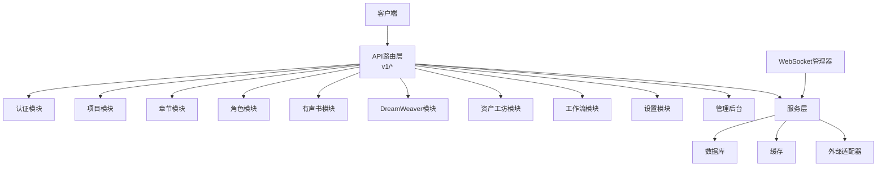
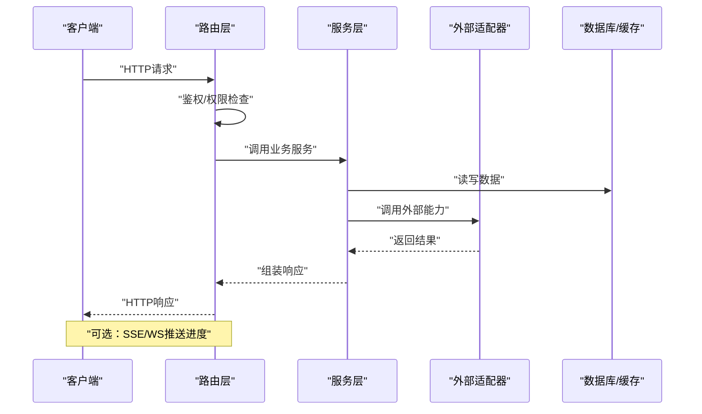
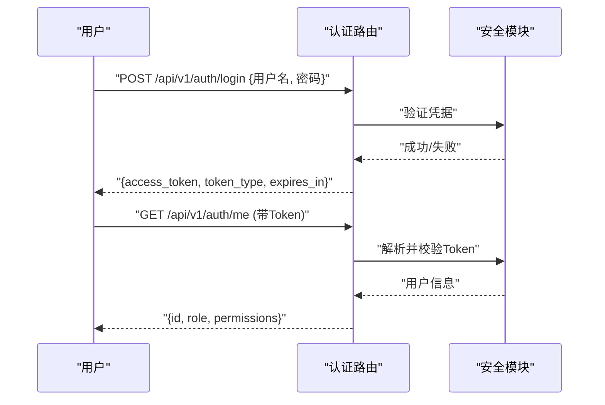
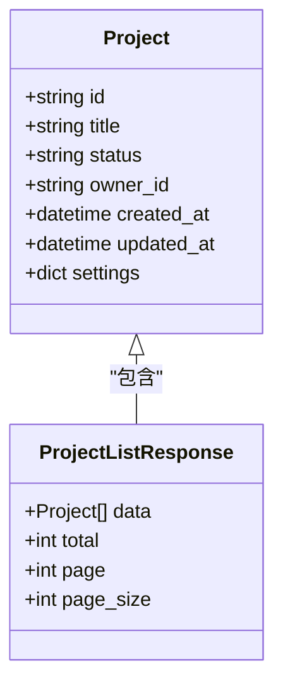
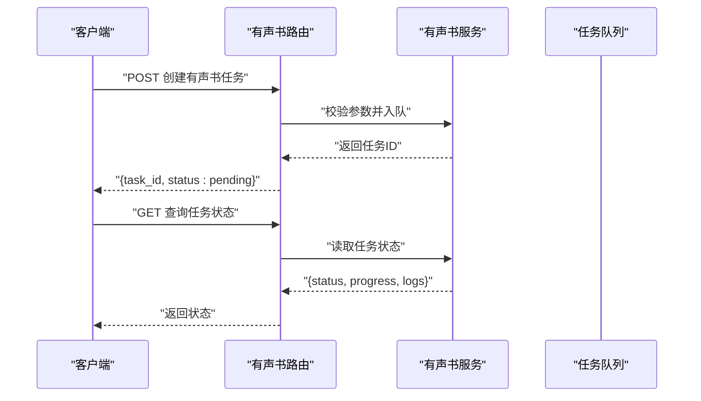
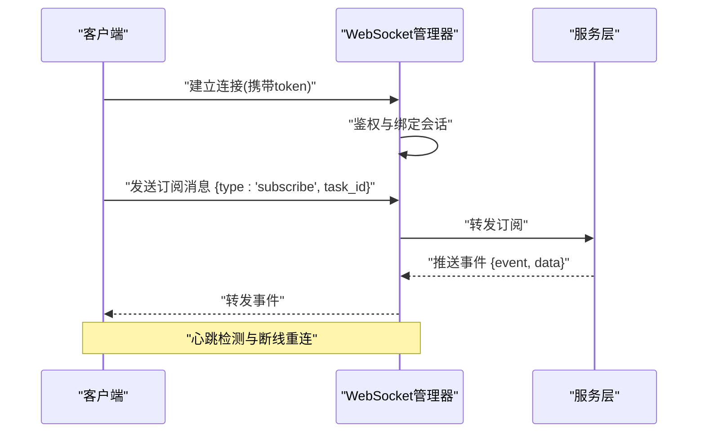
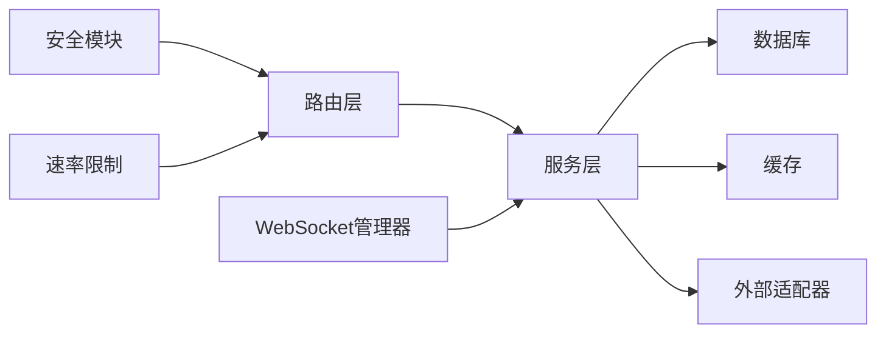

# API参考

<cite>
**本文引用的文件**   
- [backend/app/main.py](file://backend/app/main.py)
- [backend/app/api/v1/auth.py](file://backend/app/api/v1/auth.py)
- [backend/app/api/v1/projects.py](file://backend/app/api/v1/projects.py)
- [backend/app/api/v1/chapters.py](file://backend/app/api/v1/chapters.py)
- [backend/app/api/v1/characters.py](file://backend/app/api/v1/characters.py)
- [backend/app/api/v1/audiobook.py](file://backend/app/api/v1/audiobook.py)
- [backend/app/api/v1/dreamweaver.py](file://backend/app/api/v1/dreamweaver.py)
- [backend/app/api/v1/asset_studio.py](file://backend/app/api/v1/asset_studio.py)
- [backend/app/api/v1/workflow/__init__.py](file://backend/app/api/v1/workflow/__init__.py)
- [backend/app/api/v1/settings.py](file://backend/app/api/v1/settings.py)
- [backend/app/api/v1/admin/__init__.py](file://backend/app/api/v1/admin/__init__.py)
- [backend/app/core/config.py](file://backend/app/core/config.py)
- [backend/app/core/security.py](file://backend/app/core/security.py)
- [backend/app/core/permissions.py](file://backend/app/core/permissions.py)
- [backend/app/schemas/project.py](file://backend/app/schemas/project.py)
- [backend/app/schemas/user.py](file://backend/app/schemas/user.py)
- [backend/app/schemas/audiobook.py](file://backend/app/schemas/audiobook.py)
- [backend/app/services/streaming_service.py](file://backend/app/services/streaming_service.py)
- [backend/app/websocket/manager.py](file://backend/app/websocket/manager.py)
- [backend/app/services/rate_limit_handler.py](file://backend/app/services/rate_limit_handler.py)
- [adapters/rate_limiter.py](file://adapters/rate_limiter.py)
- [backend/app/utils/api_errors.py](file://backend/app/utils/api_errors.py)
</cite>

## 目录
1. [简介](#简介)
2. [项目结构](#项目结构)
3. [核心组件](#核心组件)
4. [架构总览](#架构总览)
5. [详细组件分析](#详细组件分析)
6. [依赖关系分析](#依赖关系分析)
7. [性能考虑](#性能考虑)
8. [故障排查指南](#故障排查指南)
9. [结论](#结论)
10. [附录](#附录)

## 简介
本API参考文档面向小说创作代理系统的后端服务，覆盖RESTful接口、WebSocket实时交互、认证与授权、数据模型、分页排序过滤、版本管理与兼容性策略、客户端集成建议、速率限制与安全注意事项等。读者可据此快速完成前后端对接、SDK开发与问题定位。

## 项目结构
后端采用模块化分层设计：
- API路由层：按业务域划分（认证、项目、章节、角色、有声书、DreamWeaver、资产工坊、工作流、设置、管理后台）
- 服务层：编排业务逻辑、调用外部适配器、任务调度与流式输出
- 数据模型与Schema：Pydantic定义请求/响应结构与校验规则
- 安全与权限：JWT鉴权、RBAC权限控制、速率限制
- WebSocket：连接管理与事件分发
- 配置与环境：统一配置加载、环境变量注入

**图表来源** 
- [backend/app/main.py](file://backend/app/main.py)
- [backend/app/api/v1/__init__.py](file://backend/app/api/v1/__init__.py)

**章节来源**
- [backend/app/main.py](file://backend/app/main.py)

## 核心组件
- 认证与授权：基于JWT的无状态鉴权，支持RBAC权限控制；敏感操作需管理员或特定角色。
- 资源管理：项目、章节、角色、资产、有声书等实体的CRUD与状态流转。
- 生成与编排：工作流编排、DreamWeaver视频/图像生成、TTS音频合成、多模态处理。
- 流式输出：SSE/WS推送进度与中间结果，提升长时任务体验。
- 速率限制：全局与用户级限流，保护后端稳定性。
- 错误处理：统一错误码与消息格式，便于前端一致化处理。

**章节来源**
- [backend/app/core/security.py](file://backend/app/core/security.py)
- [backend/app/core/permissions.py](file://backend/app/core/permissions.py)
- [backend/app/services/rate_limit_handler.py](file://backend/app/services/rate_limit_handler.py)
- [adapters/rate_limiter.py](file://adapters/rate_limiter.py)
- [backend/app/utils/api_errors.py](file://backend/app/utils/api_errors.py)

## 架构总览
系统以FastAPI为核心，提供REST与WebSocket双通道。请求经路由层进入对应业务控制器，调用服务层进行领域逻辑编排，必要时通过适配器调用第三方能力（LLM、TTS、图像/视频生成）。数据库与缓存作为持久化与加速层。WebSocket用于实时事件推送与交互式任务。

**图表来源** 
- [backend/app/main.py](file://backend/app/main.py)
- [backend/app/services/streaming_service.py](file://backend/app/services/streaming_service.py)
- [backend/app/websocket/manager.py](file://backend/app/websocket/manager.py)

## 详细组件分析

### 认证与授权（Auth）
- 端点概览
  - POST /api/v1/auth/login：登录获取令牌
  - POST /api/v1/auth/logout：登出
  - GET /api/v1/auth/me：当前用户信息
- 认证方式
  - 使用Authorization头携带Bearer Token
  - 支持刷新令牌机制（若启用）
- 权限控制
  - 普通用户：访问自身资源
  - 管理员：访问管理后台与系统配置

**图表来源** 
- [backend/app/api/v1/auth.py](file://backend/app/api/v1/auth.py)
- [backend/app/core/security.py](file://backend/app/core/security.py)

**章节来源**
- [backend/app/api/v1/auth.py](file://backend/app/api/v1/auth.py)
- [backend/app/core/security.py](file://backend/app/core/security.py)
- [backend/app/core/permissions.py](file://backend/app/core/permissions.py)

### 项目（Projects）
- 端点概览
  - GET /api/v1/projects：列表（分页、排序、过滤）
  - POST /api/v1/projects：创建项目
  - GET /api/v1/projects/{id}：详情
  - PUT /api/v1/projects/{id}：更新
  - DELETE /api/v1/projects/{id}：删除
- 查询参数
  - page、page_size：分页
  - sort_by、order：排序字段与方向
  - filters：JSON字符串，如{"status":"active","owner_id":"..."}
- 典型响应
  - 成功：{data: Project[], total, page, page_size}
  - 错误：{code, message, details}

**图表来源** 
- [backend/app/schemas/project.py](file://backend/app/schemas/project.py)
- [backend/app/api/v1/projects.py](file://backend/app/api/v1/projects.py)

**章节来源**
- [backend/app/api/v1/projects.py](file://backend/app/api/v1/projects.py)
- [backend/app/schemas/project.py](file://backend/app/schemas/project.py)

### 章节（Chapters）
- 端点概览
  - GET /api/v1/projects/{project_id}/chapters：列表
  - POST /api/v1/projects/{project_id}/chapters：创建
  - GET /api/v1/projects/{project_id}/chapters/{chapter_id}：详情
  - PUT /api/v1/projects/{project_id}/chapters/{chapter_id}：更新
  - DELETE /api/v1/projects/{project_id}/chapters/{chapter_id}：删除
- 校验规则
  - 标题非空、长度限制
  - 内容文本大小限制
  - 顺序号唯一性约束

**章节来源**
- [backend/app/api/v1/chapters.py](file://backend/app/api/v1/chapters.py)

### 角色（Characters）
- 端点概览
  - GET /api/v1/projects/{project_id}/characters：列表
  - POST /api/v1/projects/{project_id}/characters：创建
  - GET /api/v1/projects/{project_id}/characters/{character_id}：详情
  - PUT /api/v1/projects/{project_id}/characters/{character_id}：更新
  - DELETE /api/v1/projects/{project_id}/characters/{character_id}：删除
- 字段说明
  - name、description、voice_id、style_tags等
  - 关联项目ID校验

**章节来源**
- [backend/app/api/v1/characters.py](file://backend/app/api/v1/characters.py)

### 有声书（Audiobook）
- 端点概览
  - GET /api/v1/projects/{project_id}/audiobooks：列表
  - POST /api/v1/projects/{project_id}/audiobooks：创建任务
  - GET /api/v1/projects/{project_id}/audiobooks/{task_id}：任务状态
  - POST /api/v1/projects/{project_id}/audiobooks/{task_id}/regenerate：重新生成
  - GET /api/v1/projects/{project_id}/audiobooks/{task_id}/download：下载产物
- 任务状态
  - pending、processing、completed、failed
- 流式进度
  - SSE或WS推送阶段进度与日志

**图表来源** 
- [backend/app/api/v1/audiobook.py](file://backend/app/api/v1/audiobook.py)
- [backend/app/schemas/audiobook.py](file://backend/app/schemas/audiobook.py)

**章节来源**
- [backend/app/api/v1/audiobook.py](file://backend/app/api/v1/audiobook.py)
- [backend/app/schemas/audiobook.py](file://backend/app/schemas/audiobook.py)

### DreamWeaver（多媒体生成）
- 端点概览
  - POST /api/v1/dreamweaver/generate：提交生成任务（图像/视频/TTS）
  - GET /api/v1/dreamweaver/tasks/{task_id}：查询任务状态
  - GET /api/v1/dreamweaver/tasks/{task_id}/result：获取结果
  - POST /api/v1/dreamweaver/tasks/{task_id}/cancel：取消任务
- 参数说明
  - model、prompt、style、resolution、duration等
- 错误处理
  - 模型不可用、配额不足、输入不合法

**章节来源**
- [backend/app/api/v1/dreamweaver.py](file://backend/app/api/v1/dreamweaver.py)

### 资产工坊（Asset Studio）
- 端点概览
  - GET /api/v1/asset-studio/assets：列表（支持标签、类型过滤）
  - POST /api/v1/asset-studio/assets：上传/创建资产
  - GET /api/v1/asset-studio/assets/{asset_id}：详情
  - PUT /api/v1/asset-studio/assets/{asset_id}：更新元数据
  - DELETE /api/v1/asset-studio/assets/{asset_id}：删除
- 文件上传
  - multipart/form-data，支持图片、音频、视频
  - 文件大小与类型限制

**章节来源**
- [backend/app/api/v1/asset_studio.py](file://backend/app/api/v1/asset_studio.py)

### 工作流（Workflow）
- 端点概览
  - POST /api/v1/workflows/run：启动工作流
  - GET /api/v1/workflows/{run_id}：查询运行状态
  - GET /api/v1/workflows/{run_id}/stages：阶段详情
  - POST /api/v1/workflows/{run_id}/pause/resume：暂停/恢复
- 阶段状态
  - queued、running、succeeded、failed、cancelled

**章节来源**
- [backend/app/api/v1/workflow/__init__.py](file://backend/app/api/v1/workflow/__init__.py)

### 设置（Settings）
- 端点概览
  - GET /api/v1/settings：获取系统设置
  - PUT /api/v1/settings：更新设置（管理员）
- 配置项
  - 功能开关、默认模型、存储路径、审计策略等

**章节来源**
- [backend/app/api/v1/settings.py](file://backend/app/api/v1/settings.py)

### 管理后台（Admin）
- 端点概览
  - GET /api/v1/admin/users：用户列表
  - PUT /api/v1/admin/users/{user_id}/role：修改角色
  - GET /api/v1/admin/logs：审计日志
  - POST /api/v1/admin/restart：重启服务（受限）
- 权限要求
  - 仅管理员可访问

**章节来源**
- [backend/app/api/v1/admin/__init__.py](file://backend/app/api/v1/admin/__init__.py)

### WebSocket API
- 连接地址
  - ws(s)://host/ws?token=...
- 消息格式
  - 上行：{type, payload}
  - 下行：{event, data, timestamp}
- 事件类型
  - task_progress：任务进度
  - task_result：任务结果
  - error：错误通知
  - heartbeat：心跳保活
- 交互模式
  - 客户端连接后订阅任务ID，服务端推送相关事件
  - 断线重连与幂等处理

**图表来源** 
- [backend/app/websocket/manager.py](file://backend/app/websocket/manager.py)
- [backend/app/services/streaming_service.py](file://backend/app/services/streaming_service.py)

**章节来源**
- [backend/app/websocket/manager.py](file://backend/app/websocket/manager.py)
- [backend/app/services/streaming_service.py](file://backend/app/services/streaming_service.py)

## 依赖关系分析
- 路由层依赖服务层，服务层依赖数据访问与外部适配器
- 安全模块贯穿所有受保护端点
- 速率限制在网关或服务层生效
- WebSocket管理器与服务层协作推送事件

**图表来源** 
- [backend/app/main.py](file://backend/app/main.py)
- [backend/app/core/security.py](file://backend/app/core/security.py)
- [backend/app/services/rate_limit_handler.py](file://backend/app/services/rate_limit_handler.py)
- [adapters/rate_limiter.py](file://adapters/rate_limiter.py)
- [backend/app/websocket/manager.py](file://backend/app/websocket/manager.py)

**章节来源**
- [backend/app/main.py](file://backend/app/main.py)
- [backend/app/core/config.py](file://backend/app/core/config.py)

## 性能考虑
- 分页与索引：合理使用page/page_size，为高频查询字段建立索引
- 缓存热点：用户信息、模型目录、资产元数据可缓存
- 异步任务：长时任务入队，避免阻塞请求线程
- 流式输出：SSE/WS减少轮询开销
- 速率限制：保护后端免受突发流量冲击
- 连接池：数据库与外部API连接复用

[本节为通用指导，无需具体文件引用]

## 故障排查指南
- 常见错误码
  - 400：请求参数校验失败
  - 401：未认证或Token过期
  - 403：权限不足
  - 404：资源不存在
  - 429：触发速率限制
  - 500：服务器内部错误
- 排查步骤
  - 检查Authorization头与Token有效性
  - 查看请求体是否符合Schema定义
  - 关注服务日志中的错误堆栈
  - 确认外部适配器可用性
- 重试机制
  - 对幂等请求实施指数退避重试
  - 对网络抖动导致的临时失败进行重试

**章节来源**
- [backend/app/utils/api_errors.py](file://backend/app/utils/api_errors.py)
- [backend/app/services/rate_limit_handler.py](file://backend/app/services/rate_limit_handler.py)
- [adapters/rate_limiter.py](file://adapters/rate_limiter.py)

## 结论
本API参考文档系统化梳理了小说创作代理系统的REST与WebSocket接口、数据模型、认证授权、速率限制与错误处理等关键方面。开发者可据此高效集成前端或SDK，并在生产环境中保障稳定性与性能。

[本节为总结性内容，无需具体文件引用]

## 附录

### 数据模型与校验
- 项目（Project）
  - 字段：id、title、status、owner_id、created_at、updated_at、settings
  - 校验：title非空且长度限制，status枚举值限定
- 用户（User）
  - 字段：id、username、email、role、permissions
  - 校验：邮箱格式、角色白名单
- 有声书任务（AudiobookTask）
  - 字段：task_id、project_id、status、progress、logs、result_url
  - 校验：project_id存在性、status枚举

**章节来源**
- [backend/app/schemas/project.py](file://backend/app/schemas/project.py)
- [backend/app/schemas/user.py](file://backend/app/schemas/user.py)
- [backend/app/schemas/audiobook.py](file://backend/app/schemas/audiobook.py)

### 分页、排序与过滤
- 分页：page（起始页）、page_size（每页条数）
- 排序：sort_by（字段名）、order（asc/desc）
- 过滤：filters（JSON字符串），示例{"status":"active","owner_id":"uid"}

**章节来源**
- [backend/app/api/v1/projects.py](file://backend/app/api/v1/projects.py)

### API版本管理与兼容性
- 版本前缀：/api/v1
- 向后兼容：新增字段保持可选，废弃字段保留过渡期
- 弃用策略：通过响应头X-Deprecation-Date与文档公告提前告知

**章节来源**
- [backend/app/main.py](file://backend/app/main.py)

### 客户端集成指南
- SDK使用
  - 初始化时传入Base URL与Token
  - 封装请求重试与超时配置
- 错误处理
  - 统一解析错误响应，展示友好提示
  - 区分网络错误与业务错误
- 重试机制
  - 对幂等接口实施指数退避
  - 对非幂等接口谨慎重试

[本节为通用指导，无需具体文件引用]

### 速率限制与安全
- 速率限制
  - 全局与用户级限制，超限返回429
  - 可通过配置调整阈值与窗口
- 安全建议
  - 强制HTTPS
  - 最小权限原则
  - 敏感信息脱敏与审计

**章节来源**
- [backend/app/services/rate_limit_handler.py](file://backend/app/services/rate_limit_handler.py)
- [adapters/rate_limiter.py](file://adapters/rate_limiter.py)
- [backend/app/core/security.py](file://backend/app/core/security.py)