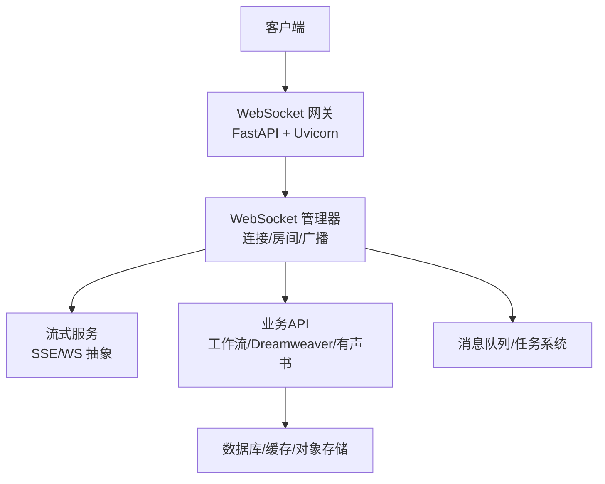
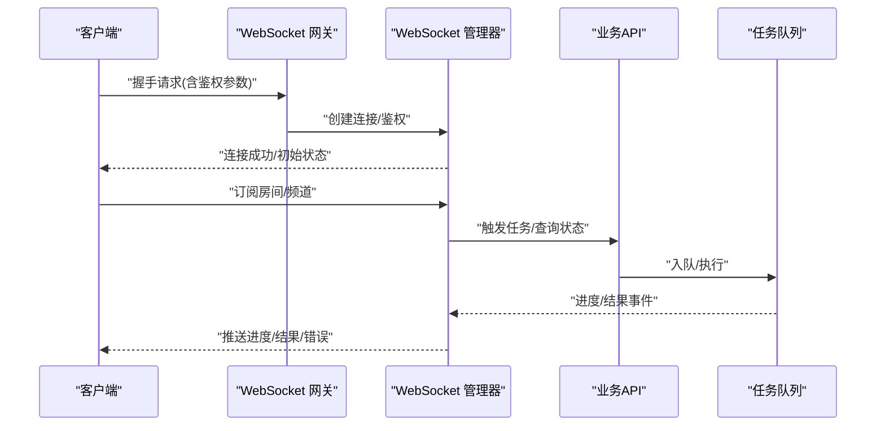
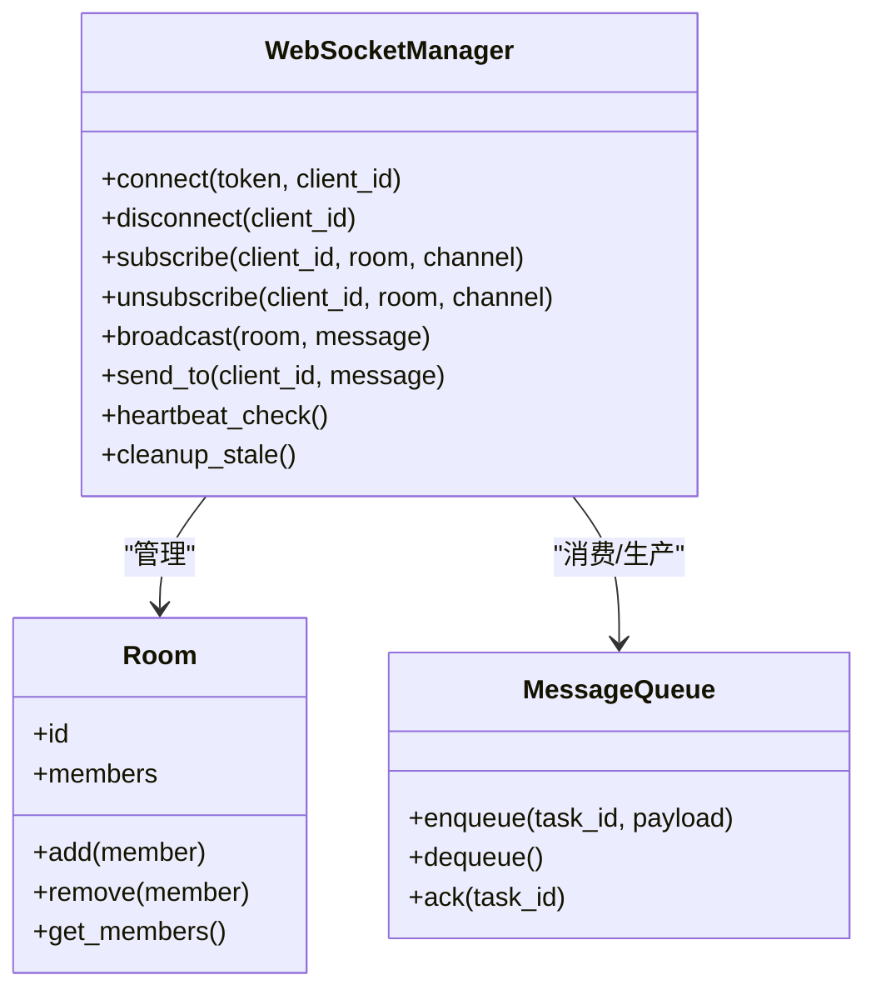
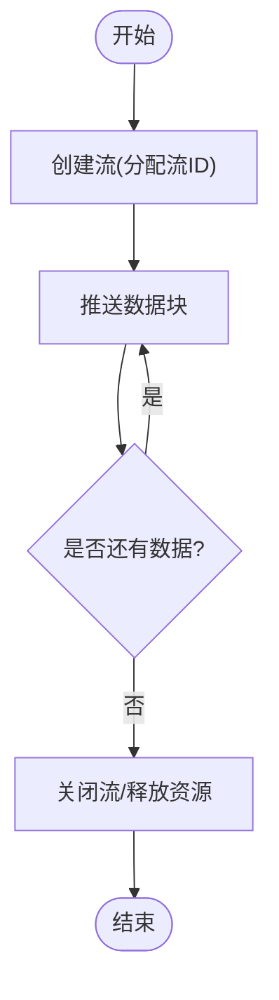
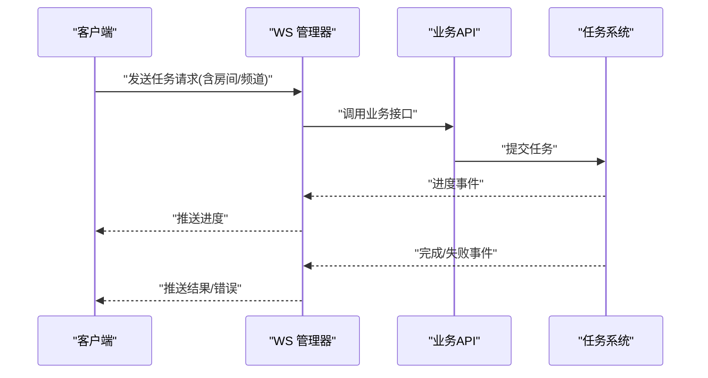
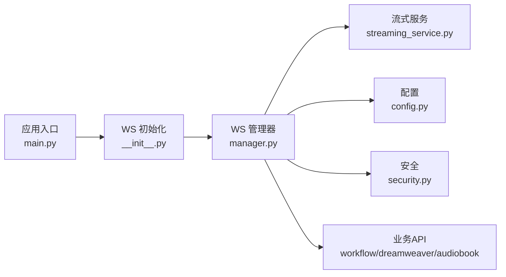

# WebSocket API

<cite>
**本文引用的文件**   
- [backend/app/main.py](file://backend/app/main.py)
- [backend/app/websocket/__init__.py](file://backend/app/websocket/__init__.py)
- [backend/app/websocket/manager.py](file://backend/app/websocket/manager.py)
- [backend/app/services/streaming_service.py](file://backend/app/services/streaming_service.py)
- [backend/app/api/v1/workflow/routes.py](file://backend/app/api/v1/workflow/routes.py)
- [backend/app/api/v1/dreamweaver.py](file://backend/app/api/v1/dreamweaver.py)
- [backend/app/api/v1/audiobook.py](file://backend/app/api/v1/audiobook.py)
- [backend/app/core/config.py](file://backend/app/core/config.py)
- [backend/app/core/security.py](file://backend/app/core/security.py)
- [backend/app/schemas/common.py](file://backend/app/schemas/common.py)
- [scripts/verify_seed_tts_websocket.py](file://scripts/verify_seed_tts_websocket.py)
- [scripts/verify_seed_tts_websocket_v2.py](file://scripts/verify_seed_tts_websocket_v2.py)
- [scripts/verify_seed_tts_websocket_v3.py](file://scripts/verify_seed_tts_websocket_v3.py)
- [tests/test_seed_tts_websocket_verification_results.json](file://tests/test_seed_tts_websocket_verification_results.json)
- [tests/test_seed_tts_websocket_verification_results_v2.json](file://tests/test_seed_tts_websocket_verification_results_v2.json)
- [docs/SEED_TTS_WEBSOCKET_IMPLEMENTATION.md](file://docs/SEED_TTS_WEBSOCKET_IMPLEMENTATION.md)
</cite>

## 目录
1. [简介](#简介)
2. [项目结构](#项目结构)
3. [核心组件](#核心组件)
4. [架构总览](#架构总览)
5. [详细组件分析](#详细组件分析)
6. [依赖关系分析](#依赖关系分析)
7. [性能考虑](#性能考虑)
8. [故障排查指南](#故障排查指南)
9. [结论](#结论)
10. [附录](#附录)

## 简介
本文件为小说创作代理系统的WebSocket API文档，聚焦实时通信能力：连接建立、消息格式、事件类型与状态同步机制。覆盖任务进度推送、错误通知、聊天功能与协作编辑的实时交互模式；并给出连接管理、重连机制、消息队列与广播通知的技术实现要点。同时提供客户端集成示例（事件监听、错误处理、性能优化），以及安全性、带宽限制与并发连接管理的说明。

## 项目结构
后端基于FastAPI构建，WebSocket路由与服务位于backend/app目录下，核心包括：
- 应用入口与中间件注册
- WebSocket管理器（连接生命周期、房间/频道、广播）
- 流式服务（长轮询/SSE/WS统一抽象）
- 业务API（工作流、Dreamweaver、有声书等）对WS事件的触发点
- 配置与安全（鉴权、限流、TLS）

图表来源
- [backend/app/main.py](file://backend/app/main.py)
- [backend/app/websocket/manager.py](file://backend/app/websocket/manager.py)
- [backend/app/services/streaming_service.py](file://backend/app/services/streaming_service.py)
- [backend/app/api/v1/workflow/routes.py](file://backend/app/api/v1/workflow/routes.py)

章节来源
- [backend/app/main.py](file://backend/app/main.py)
- [backend/app/websocket/__init__.py](file://backend/app/websocket/__init__.py)
- [backend/app/websocket/manager.py](file://backend/app/websocket/manager.py)
- [backend/app/services/streaming_service.py](file://backend/app/services/streaming_service.py)

## 核心组件
- WebSocket管理器
  - 负责连接接入、认证校验、房间/频道管理、消息路由与广播、心跳保活、断线清理。
  - 支持按用户、项目、任务维度的订阅与发布。
- 流式服务
  - 封装SSE/WS的统一接口，便于将后台任务进度、生成片段、错误信息以增量方式推送。
- 业务API
  - 工作流、Dreamweaver、有声书等模块在关键阶段触发WS事件（如开始、进度、完成、失败）。
- 配置与安全
  - 通过配置项控制WS端口、TLS、鉴权策略、速率限制、最大连接数等。

章节来源
- [backend/app/websocket/manager.py](file://backend/app/websocket/manager.py)
- [backend/app/services/streaming_service.py](file://backend/app/services/streaming_service.py)
- [backend/app/core/config.py](file://backend/app/core/config.py)
- [backend/app/core/security.py](file://backend/app/core/security.py)

## 架构总览
整体采用“网关+管理器+业务”的分层架构。客户端通过WebSocket连接到网关，网关将连接交由管理器维护；管理器根据消息中的房间/频道进行分发，或向业务API发起异步任务，并将结果回推至客户端。

图表来源
- [backend/app/main.py](file://backend/app/main.py)
- [backend/app/websocket/manager.py](file://backend/app/websocket/manager.py)
- [backend/app/services/streaming_service.py](file://backend/app/services/streaming_service.py)

## 详细组件分析

### WebSocket管理器
职责
- 连接生命周期：建立、认证、心跳、关闭、清理。
- 房间/频道：加入、离开、订阅、退订。
- 消息路由：点对点、组播、广播。
- 事件驱动：对接任务队列与流式服务，转发进度、错误、完成等事件。

关键流程
- 连接建立：解析鉴权令牌/会话，绑定用户/租户上下文。
- 订阅管理：维护订阅表，去重与权限校验。
- 广播策略：按房间粒度批量发送，支持节流与重试。
- 断线恢复：记录未消费消息，重连后补发（可选）。

图表来源
- [backend/app/websocket/manager.py](file://backend/app/websocket/manager.py)

章节来源
- [backend/app/websocket/manager.py](file://backend/app/websocket/manager.py)

### 流式服务（SSE/WS统一抽象）
职责
- 统一输出增量数据（文本片段、音频分片、进度百分比）。
- 与任务系统解耦，支持多种传输协议。
- 提供背压与缓冲控制，避免内存暴涨。

典型用法
- 任务启动时返回流ID，客户端持续拉取增量。
- 错误时推送错误事件并关闭流。

图表来源
- [backend/app/services/streaming_service.py](file://backend/app/services/streaming_service.py)

章节来源
- [backend/app/services/streaming_service.py](file://backend/app/services/streaming_service.py)

### 业务API与WS事件触发点
- 工作流API：章节生成、大纲扩展、角色设定等阶段推送进度与结果。
- Dreamweaver API：视频/图像生成任务的进度、预览图、失败原因。
- 有声书API：TTS合成、分段朗读、字幕生成的实时反馈。

图表来源
- [backend/app/api/v1/workflow/routes.py](file://backend/app/api/v1/workflow/routes.py)
- [backend/app/api/v1/dreamweaver.py](file://backend/app/api/v1/dreamweaver.py)
- [backend/app/api/v1/audiobook.py](file://backend/app/api/v1/audiobook.py)

章节来源
- [backend/app/api/v1/workflow/routes.py](file://backend/app/api/v1/workflow/routes.py)
- [backend/app/api/v1/dreamweaver.py](file://backend/app/api/v1/dreamweaver.py)
- [backend/app/api/v1/audiobook.py](file://backend/app/api/v1/audiobook.py)

### 消息格式与事件类型
通用消息结构
- type：事件类型（如 progress、result、error、chat、collab_edit）
- id：消息唯一标识
- ts：时间戳
- data：业务负载（随type变化）
- meta：元数据（房间、频道、用户、权限标记）

常用事件
- 进度类：progress（百分比、阶段、耗时）
- 结果类：result（生成内容、链接、摘要）
- 错误类：error（错误码、消息、建议）
- 聊天类：chat（消息、用户、时间戳）
- 协作编辑类：collab_edit（操作、位置、差异）

章节来源
- [backend/app/schemas/common.py](file://backend/app/schemas/common.py)

### 连接管理与重连机制
- 连接建立：携带鉴权参数（Token/Session），服务端校验通过后建立会话。
- 心跳保活：定期Ping/Pong，超时断开并清理。
- 重连策略：指数退避、抖动、最大重试次数、幂等恢复。
- 断线补偿：未消费消息列表、按序回放（可选）。

章节来源
- [backend/app/websocket/manager.py](file://backend/app/websocket/manager.py)
- [backend/app/core/config.py](file://backend/app/core/config.py)

### 消息队列与广播通知
- 入队：业务API将任务与上下文入队，返回任务ID。
- 消费：管理器订阅队列，按房间/频道聚合推送。
- 广播：同房间多客户端去重与顺序保证（可选）。
- 可靠性：ACK/NACK、重试、死信队列（可选）。

章节来源
- [backend/app/websocket/manager.py](file://backend/app/websocket/manager.py)
- [backend/app/services/streaming_service.py](file://backend/app/services/streaming_service.py)

### 客户端集成示例（概念性）
- 事件监听：订阅房间/频道，处理progress/result/error/chat/collab_edit。
- 错误处理：捕获网络异常、鉴权失败、业务错误，触发重连。
- 性能优化：合并小消息、节流推送、按需订阅、离线缓存。

章节来源
- [scripts/verify_seed_tts_websocket.py](file://scripts/verify_seed_tts_websocket.py)
- [scripts/verify_seed_tts_websocket_v2.py](file://scripts/verify_seed_tts_websocket_v2.py)
- [scripts/verify_seed_tts_websocket_v3.py](file://scripts/verify_seed_tts_websocket_v3.py)

## 依赖关系分析
- FastAPI网关：承载HTTP与WebSocket路由。
- WebSocket管理器：连接与房间管理、消息路由。
- 流式服务：统一增量输出。
- 业务API：触发任务与事件。
- 配置与安全：鉴权、限流、TLS。

图表来源
- [backend/app/main.py](file://backend/app/main.py)
- [backend/app/websocket/__init__.py](file://backend/app/websocket/__init__.py)
- [backend/app/websocket/manager.py](file://backend/app/websocket/manager.py)
- [backend/app/services/streaming_service.py](file://backend/app/services/streaming_service.py)
- [backend/app/core/config.py](file://backend/app/core/config.py)
- [backend/app/core/security.py](file://backend/app/core/security.py)
- [backend/app/api/v1/workflow/routes.py](file://backend/app/api/v1/workflow/routes.py)
- [backend/app/api/v1/dreamweaver.py](file://backend/app/api/v1/dreamweaver.py)
- [backend/app/api/v1/audiobook.py](file://backend/app/api/v1/audiobook.py)

章节来源
- [backend/app/main.py](file://backend/app/main.py)
- [backend/app/websocket/__init__.py](file://backend/app/websocket/__init__.py)
- [backend/app/websocket/manager.py](file://backend/app/websocket/manager.py)
- [backend/app/services/streaming_service.py](file://backend/app/services/streaming_service.py)
- [backend/app/core/config.py](file://backend/app/core/config.py)
- [backend/app/core/security.py](file://backend/app/core/security.py)
- [backend/app/api/v1/workflow/routes.py](file://backend/app/api/v1/workflow/routes.py)
- [backend/app/api/v1/dreamweaver.py](file://backend/app/api/v1/dreamweaver.py)
- [backend/app/api/v1/audiobook.py](file://backend/app/api/v1/audiobook.py)

## 性能考虑
- 连接规模：单进程连接上限、进程池与水平扩展策略。
- 内存占用：消息缓冲大小、去重与压缩、流控。
- CPU开销：序列化/反序列化、加密解密、心跳检测频率。
- I/O瓶颈：网络吞吐、磁盘/对象存储读写、数据库查询。
- 推荐实践：
  - 使用连接池与异步I/O。
  - 合理设置心跳间隔与超时。
  - 对大消息分片与限速。
  - 启用压缩与二进制传输（如适用）。

[本节为通用指导，不直接分析具体文件]

## 故障排查指南
常见问题
- 连接失败：鉴权失败、端口不通、TLS证书问题。
- 消息丢失：未订阅房间、重连未补偿、队列积压。
- 延迟过高：CPU饱和、GC停顿、I/O阻塞。
- 错误频发：业务逻辑异常、下游服务不可用。

排查步骤
- 检查日志：连接建立、鉴权、订阅、发送、错误堆栈。
- 验证配置：WS端口、TLS、限流、最大连接数。
- 监控指标：连接数、消息吞吐、延迟分布、错误率。
- 复现实例：使用脚本工具模拟客户端行为。

章节来源
- [backend/app/core/security.py](file://backend/app/core/security.py)
- [backend/app/core/config.py](file://backend/app/core/config.py)
- [scripts/verify_seed_tts_websocket.py](file://scripts/verify_seed_tts_websocket.py)
- [scripts/verify_seed_tts_websocket_v2.py](file://scripts/verify_seed_tts_websocket_v2.py)
- [scripts/verify_seed_tts_websocket_v3.py](file://scripts/verify_seed_tts_websocket_v3.py)
- [tests/test_seed_tts_websocket_verification_results.json](file://tests/test_seed_tts_websocket_verification_results.json)
- [tests/test_seed_tts_websocket_verification_results_v2.json](file://tests/test_seed_tts_websocket_verification_results_v2.json)

## 结论
本WebSocket API以“网关+管理器+业务”分层设计，提供高内聚的连接与消息管理能力，并通过流式服务统一增量输出。结合任务队列与房间广播，可实现任务进度推送、错误通知、聊天与协作编辑等实时场景。建议在部署中关注鉴权、限流、TLS与连接规模，配合监控与自动化测试保障稳定性与性能。

[本节为总结，不直接分析具体文件]

## 附录
- 参考实现与验证
  - 脚本与测试用例展示了WS连接的建立、事件接收与错误处理流程。
- 相关文档
  - 种子TTS WebSocket实现说明提供了事件模型与兼容性细节。

章节来源
- [docs/SEED_TTS_WEBSOCKET_IMPLEMENTATION.md](file://docs/SEED_TTS_WEBSOCKET_IMPLEMENTATION.md)
- [scripts/verify_seed_tts_websocket.py](file://scripts/verify_seed_tts_websocket.py)
- [scripts/verify_seed_tts_websocket_v2.py](file://scripts/verify_seed_tts_websocket_v2.py)
- [scripts/verify_seed_tts_websocket_v3.py](file://scripts/verify_seed_tts_websocket_v3.py)
- [tests/test_seed_tts_websocket_verification_results.json](file://tests/test_seed_tts_websocket_verification_results.json)
- [tests/test_seed_tts_websocket_verification_results_v2.json](file://tests/test_seed_tts_websocket_verification_results_v2.json)