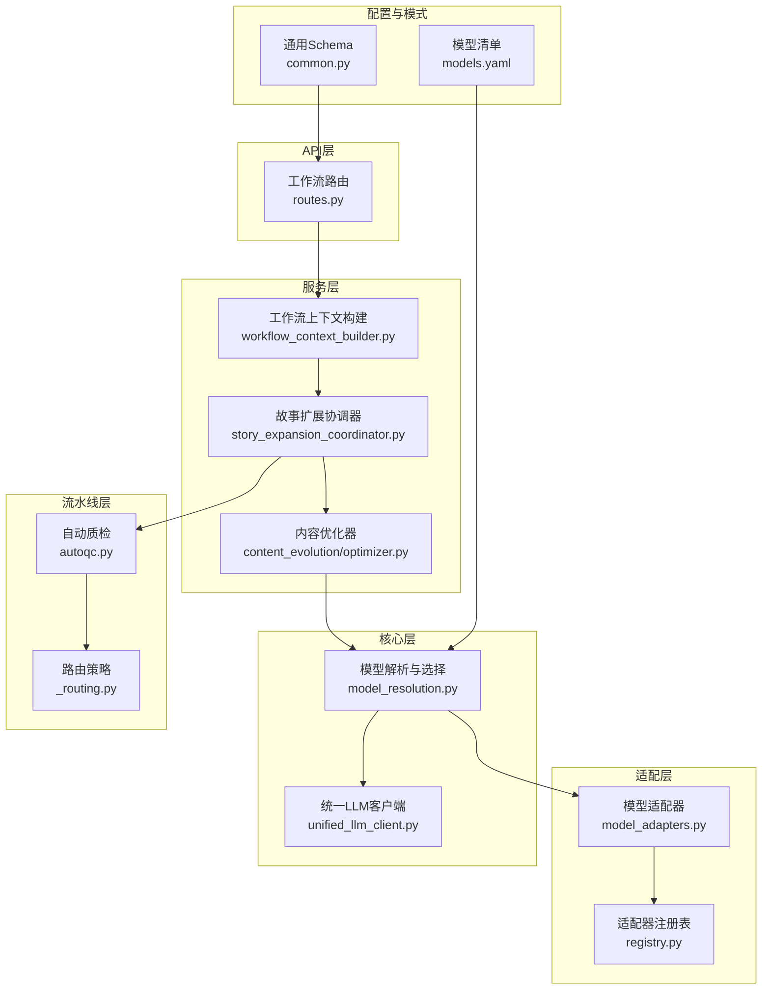
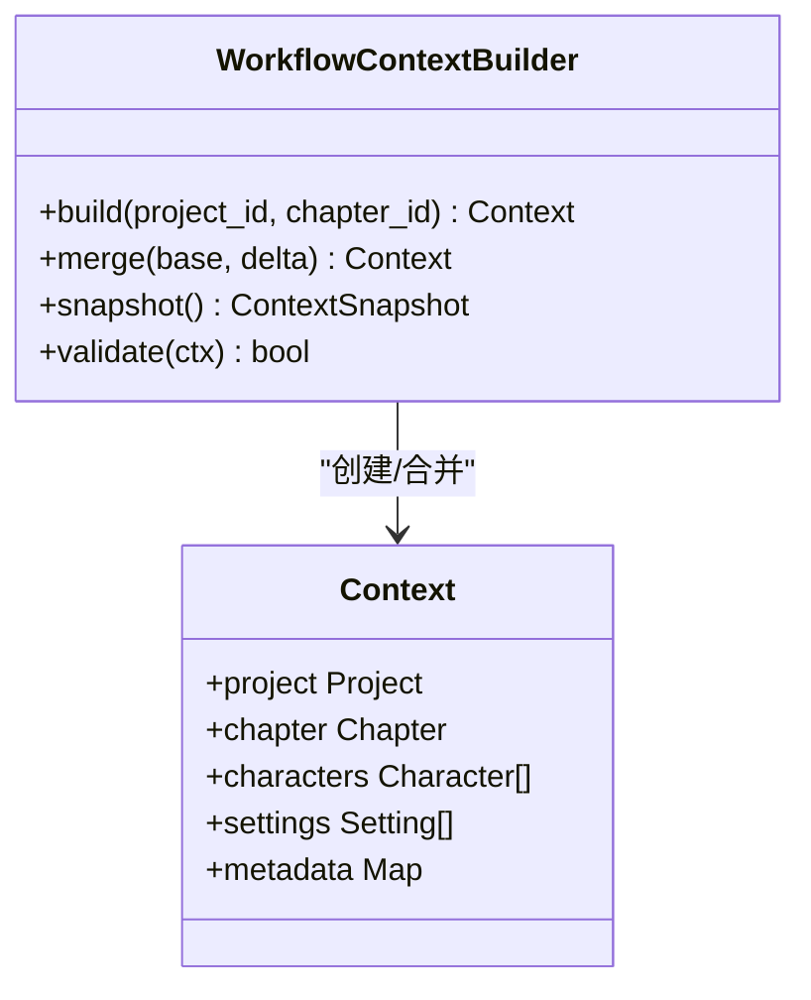
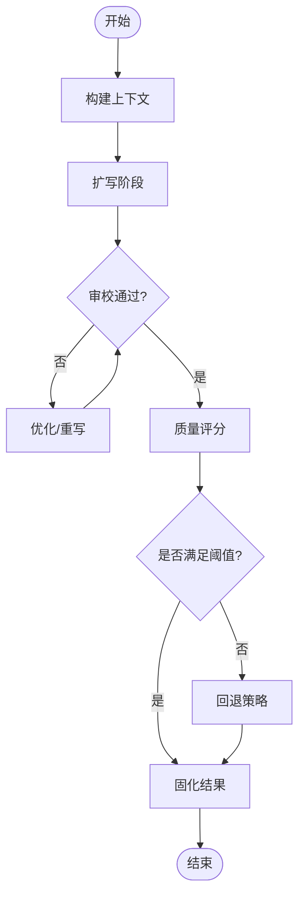
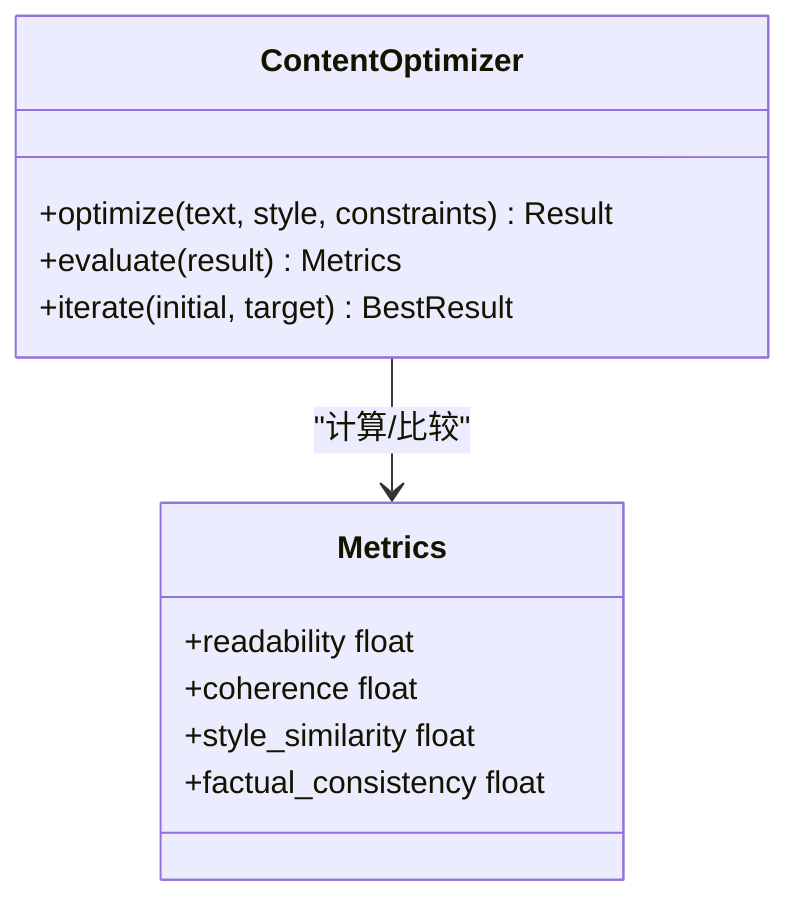
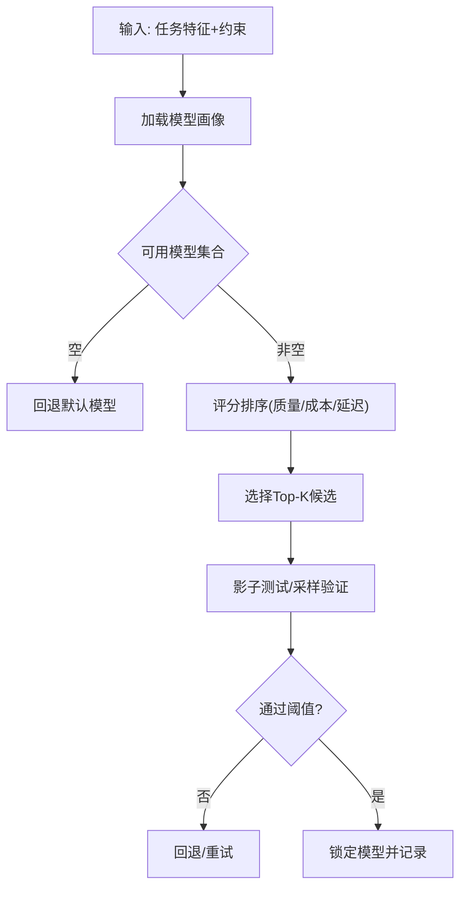
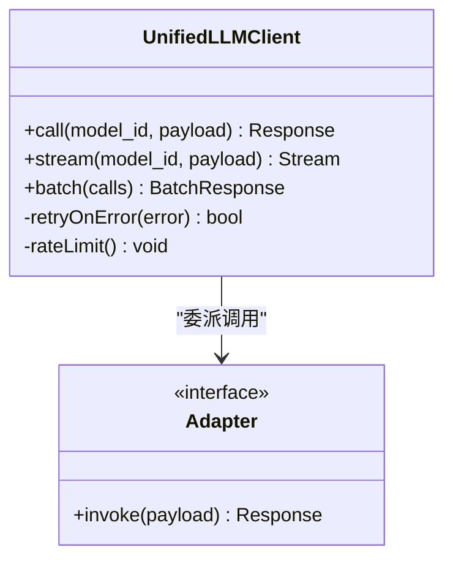
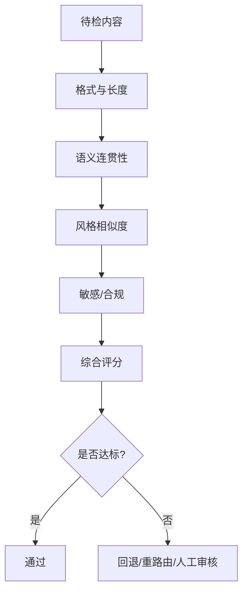
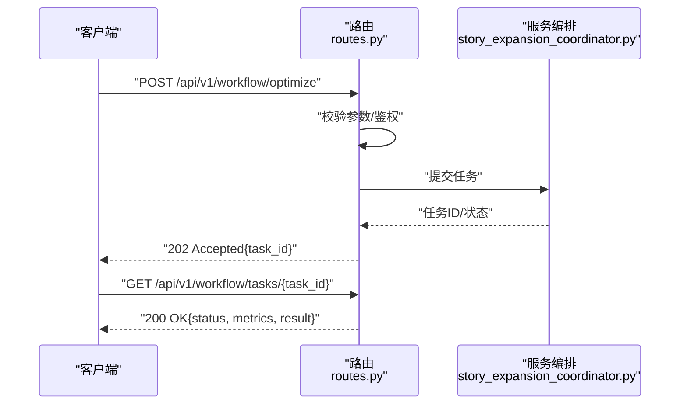
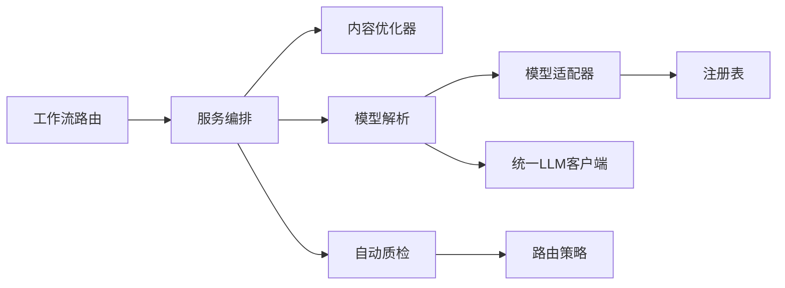

# 优化扩展API

<cite>
**本文引用的文件**   
- [backend/app/api/v1/workflow/routes.py](file://backend/app/api/v1/workflow/routes.py)
- [backend/app/services/workflow_context_builder.py](file://backend/app/services/workflow_context_builder.py)
- [backend/app/services/story_expansion_coordinator.py](file://backend/app/services/story_expansion_coordinator.py)
- [backend/app/services/content_evolution/optimizer.py](file://backend/app/services/content_evolution/optimizer.py)
- [adapters/model_adapters.py](file://adapters/model_adapters.py)
- [adapters/registry.py](file://adapters/registry.py)
- [core/model_resolution.py](file://core/model_resolution.py)
- [core/unified_llm_client.py](file://core/unified_llm_client.py)
- [pipeline/autoqc.py](file://pipeline/autoqc.py)
- [pipeline/_routing.py](file://pipeline/_routing.py)
- [schemas/common.py](file://schemas/common.py)
- [config/models.yaml](file://config/models.yaml)
</cite>

## 目录
1. [简介](#简介)
2. [项目结构](#项目结构)
3. [核心组件](#核心组件)
4. [架构总览](#架构总览)
5. [详细组件分析](#详细组件分析)
6. [依赖关系分析](#依赖关系分析)
7. [性能考量](#性能考量)
8. [故障排查指南](#故障排查指南)
9. [结论](#结论)
10. [附录](#附录)

## 简介
本文件面向“工作流优化与扩展功能”的API文档，聚焦内容优化、模型选择与智能扩展三大能力。文档覆盖：
- AI驱动的文本优化、风格迁移与质量提升的自动化流程
- 多模型路由、性能评估与成本优化的决策接口
- 自定义优化器开发、插件注册与扩展点集成规范
- 机器学习模型的集成方式、推理优化与结果验证机制

目标读者包括后端开发者、算法工程师与平台集成方，既提供高层架构说明，也给出代码级实现路径与调用序列图，便于快速落地与二次扩展。

## 项目结构
围绕工作流优化与扩展的关键模块分布如下：
- API层：工作流相关路由与请求校验
- 服务层：上下文构建、故事扩展编排、内容演进优化
- 适配层：统一模型适配器与注册表
- 核心层：模型解析、统一LLM客户端
- 流水线层：自动质检、路由策略
- 配置与模式：模型清单、通用Schema定义



图表来源
- [backend/app/api/v1/workflow/routes.py](file://backend/app/api/v1/workflow/routes.py)
- [backend/app/services/workflow_context_builder.py](file://backend/app/services/workflow_context_builder.py)
- [backend/app/services/story_expansion_coordinator.py](file://backend/app/services/story_expansion_coordinator.py)
- [backend/app/services/content_evolution/optimizer.py](file://backend/app/services/content_evolution/optimizer.py)
- [adapters/model_adapters.py](file://adapters/model_adapters.py)
- [adapters/registry.py](file://adapters/registry.py)
- [core/model_resolution.py](file://core/model_resolution.py)
- [core/unified_llm_client.py](file://core/unified_llm_client.py)
- [pipeline/autoqc.py](file://pipeline/autoqc.py)
- [pipeline/_routing.py](file://pipeline/_routing.py)
- [config/models.yaml](file://config/models.yaml)
- [schemas/common.py](file://schemas/common.py)

章节来源
- [backend/app/api/v1/workflow/routes.py](file://backend/app/api/v1/workflow/routes.py)
- [backend/app/services/workflow_context_builder.py](file://backend/app/services/workflow_context_builder.py)
- [backend/app/services/story_expansion_coordinator.py](file://backend/app/services/story_expansion_coordinator.py)
- [backend/app/services/content_evolution/optimizer.py](file://backend/app/services/content_evolution/optimizer.py)
- [adapters/model_adapters.py](file://adapters/model_adapters.py)
- [adapters/registry.py](file://adapters/registry.py)
- [core/model_resolution.py](file://core/model_resolution.py)
- [core/unified_llm_client.py](file://core/unified_llm_client.py)
- [pipeline/autoqc.py](file://pipeline/autoqc.py)
- [pipeline/_routing.py](file://pipeline/_routing.py)
- [config/models.yaml](file://config/models.yaml)
- [schemas/common.py](file://schemas/common.py)

## 核心组件
- 工作流上下文构建器：聚合项目、章节、角色、设定等上下文信息，为后续优化与扩展提供标准化输入。
- 故事扩展协调器：编排“扩写—审校—再优化”的多阶段流程，支持并行与重试。
- 内容优化器：基于提示工程与模型评测，执行文本润色、风格迁移与质量提升。
- 模型解析与选择：根据任务类型、预算、延迟与质量目标动态选择最优模型。
- 统一LLM客户端：屏蔽不同提供商差异，统一调用、限流与重试。
- 自动质检与路由：对生成内容进行多维度评分与规则检查，结合路由策略决定回退或重路由。

章节来源
- [backend/app/services/workflow_context_builder.py](file://backend/app/services/workflow_context_builder.py)
- [backend/app/services/story_expansion_coordinator.py](file://backend/app/services/story_expansion_coordinator.py)
- [backend/app/services/content_evolution/optimizer.py](file://backend/app/services/content_evolution/optimizer.py)
- [core/model_resolution.py](file://core/model_resolution.py)
- [core/unified_llm_client.py](file://core/unified_llm_client.py)
- [pipeline/autoqc.py](file://pipeline/autoqc.py)
- [pipeline/_routing.py](file://pipeline/_routing.py)

## 架构总览
下图展示从API到模型调用的端到端流程，以及质检与路由的闭环反馈。

```mermaid
sequenceDiagram
participant Client as "客户端"
participant API as "工作流路由<br/>routes.py"
participant Ctx as "上下文构建<br/>workflow_context_builder.py"
participant Coord as "扩展协调器<br/>story_expansion_coordinator.py"
participant Opt as "内容优化器<br/>content_evolution/optimizer.py"
participant Res as "模型解析<br/>model_resolution.py"
participant LLM as "统一LLM客户端<br/>unified_llm_client.py"
participant QC as "自动质检<br/>autoqc.py"
participant RT as "路由策略<br/>_routing.py"
Client->>API : "POST /api/v1/workflow/optimize"
API->>Ctx : "构建上下文(项目/章节/角色)"
Ctx-->>API : "标准化上下文对象"
API->>Coord : "启动扩展流程"
Coord->>Opt : "触发内容优化/风格迁移"
Opt->>Res : "选择模型(质量/成本/延迟)"
Res->>LLM : "统一调用(含重试/限流)"
LLM-->>Res : "返回候选结果"
Res-->>Opt : "候选集"
Opt->>QC : "质量评估与规则检查"
QC-->>RT : "评分与通过判定"
RT-->>Coord : "路由决策(继续/回退/重路由)"
Coord-->>API : "最终结果与指标"
API-->>Client : "响应(含追踪ID/成本/耗时)"
```

图表来源
- [backend/app/api/v1/workflow/routes.py](file://backend/app/api/v1/workflow/routes.py)
- [backend/app/services/workflow_context_builder.py](file://backend/app/services/workflow_context_builder.py)
- [backend/app/services/story_expansion_coordinator.py](file://backend/app/services/story_expansion_coordinator.py)
- [backend/app/services/content_evolution/optimizer.py](file://backend/app/services/content_evolution/optimizer.py)
- [core/model_resolution.py](file://core/model_resolution.py)
- [core/unified_llm_client.py](file://core/unified_llm_client.py)
- [pipeline/autoqc.py](file://pipeline/autoqc.py)
- [pipeline/_routing.py](file://pipeline/_routing.py)

## 详细组件分析

### 工作流上下文构建器（Workflow Context Builder）
职责
- 聚合项目元数据、章节大纲、角色设定、场景信息等，形成统一的上下文对象
- 提供增量更新与快照能力，支撑长对话与批处理
- 输出标准化JSON结构，供下游优化与扩展使用

关键能力
- 上下文合并策略：按优先级覆盖冲突字段
- 版本化与回溯：保留历史快照，支持A/B对比
- 安全过滤：敏感信息与越权访问拦截



图表来源
- [backend/app/services/workflow_context_builder.py](file://backend/app/services/workflow_context_builder.py)

章节来源
- [backend/app/services/workflow_context_builder.py](file://backend/app/services/workflow_context_builder.py)

### 故事扩展协调器（Story Expansion Coordinator）
职责
- 编排扩写、审校、再优化的多阶段流程
- 管理并发、重试、超时与熔断
- 记录每步指标（耗时、成本、评分），支持可观测性

关键能力
- 阶段编排：顺序/并行/条件分支
- 失败恢复：断点续跑与局部重算
- 指标采集：步骤级埋点与汇总



图表来源
- [backend/app/services/story_expansion_coordinator.py](file://backend/app/services/story_expansion_coordinator.py)
- [pipeline/autoqc.py](file://pipeline/autoqc.py)

章节来源
- [backend/app/services/story_expansion_coordinator.py](file://backend/app/services/story_expansion_coordinator.py)
- [pipeline/autoqc.py](file://pipeline/autoqc.py)

### 内容优化器（Content Evolution Optimizer）
职责
- 执行文本润色、风格迁移、连贯性与一致性增强
- 基于评测指标驱动迭代优化
- 支持多策略组合与权重调节

关键能力
- 提示模板管理：按体裁/风格/受众切换
- 评测指标：可读性、连贯性、风格相似度、事实一致性
- 自适应学习：根据反馈调整策略权重



图表来源
- [backend/app/services/content_evolution/optimizer.py](file://backend/app/services/content_evolution/optimizer.py)

章节来源
- [backend/app/services/content_evolution/optimizer.py](file://backend/app/services/content_evolution/optimizer.py)

### 模型解析与选择（Model Resolution）
职责
- 根据任务类型、质量目标、成本预算与延迟SLA选择最优模型
- 维护模型画像（吞吐、时延、价格、可用性）
- 支持灰度发布与影子流量

关键能力
- 多目标优化：质量/成本/延迟的加权决策
- 动态降级：健康检查与自动切流
- 缓存命中：相似任务复用结果



图表来源
- [core/model_resolution.py](file://core/model_resolution.py)
- [config/models.yaml](file://config/models.yaml)

章节来源
- [core/model_resolution.py](file://core/model_resolution.py)
- [config/models.yaml](file://config/models.yaml)

### 统一LLM客户端（Unified LLM Client）
职责
- 封装各提供商SDK差异，统一调用接口
- 实现重试、限流、超时、熔断与错误分类
- 支持流式输出与批量请求

关键能力
- 连接池与并发控制
- 幂等与去重
- 审计与追踪（trace_id/span_id）



图表来源
- [core/unified_llm_client.py](file://core/unified_llm_client.py)
- [adapters/model_adapters.py](file://adapters/model_adapters.py)

章节来源
- [core/unified_llm_client.py](file://core/unified_llm_client.py)
- [adapters/model_adapters.py](file://adapters/model_adapters.py)

### 自动质检与路由（AutoQC & Routing）
职责
- 多维度质量评分与规则检查
- 根据评分与策略决定继续、回退或重路由
- 输出可解释的诊断报告

关键能力
- 语义一致性检查
- 风格匹配度评估
- 敏感内容与合规检测



图表来源
- [pipeline/autoqc.py](file://pipeline/autoqc.py)
- [pipeline/_routing.py](file://pipeline/_routing.py)

章节来源
- [pipeline/autoqc.py](file://pipeline/autoqc.py)
- [pipeline/_routing.py](file://pipeline/_routing.py)

### API路由与工作流入口（Workflow Routes）
职责
- 暴露RESTful接口用于触发优化与扩展流程
- 参数校验、权限控制与审计日志
- 返回结构化响应与追踪信息

关键能力
- 请求体Schema校验
- 异步任务与进度查询
- 分页与过滤



图表来源
- [backend/app/api/v1/workflow/routes.py](file://backend/app/api/v1/workflow/routes.py)
- [backend/app/services/story_expansion_coordinator.py](file://backend/app/services/story_expansion_coordinator.py)
- [schemas/common.py](file://schemas/common.py)

章节来源
- [backend/app/api/v1/workflow/routes.py](file://backend/app/api/v1/workflow/routes.py)
- [schemas/common.py](file://schemas/common.py)

## 依赖关系分析
- 低耦合高内聚：API层仅负责入参校验与调度，业务逻辑下沉至服务层
- 适配器解耦：模型选择与调用通过统一接口抽象，新增模型只需实现适配器并注册
- 可观测性贯穿：每个环节输出指标与追踪ID，便于定位瓶颈与问题



图表来源
- [backend/app/api/v1/workflow/routes.py](file://backend/app/api/v1/workflow/routes.py)
- [backend/app/services/story_expansion_coordinator.py](file://backend/app/services/story_expansion_coordinator.py)
- [backend/app/services/content_evolution/optimizer.py](file://backend/app/services/content_evolution/optimizer.py)
- [core/model_resolution.py](file://core/model_resolution.py)
- [adapters/model_adapters.py](file://adapters/model_adapters.py)
- [adapters/registry.py](file://adapters/registry.py)
- [core/unified_llm_client.py](file://core/unified_llm_client.py)
- [pipeline/autoqc.py](file://pipeline/autoqc.py)
- [pipeline/_routing.py](file://pipeline/_routing.py)

章节来源
- [backend/app/api/v1/workflow/routes.py](file://backend/app/api/v1/workflow/routes.py)
- [backend/app/services/story_expansion_coordinator.py](file://backend/app/services/story_expansion_coordinator.py)
- [backend/app/services/content_evolution/optimizer.py](file://backend/app/services/content_evolution/optimizer.py)
- [core/model_resolution.py](file://core/model_resolution.py)
- [adapters/model_adapters.py](file://adapters/model_adapters.py)
- [adapters/registry.py](file://adapters/registry.py)
- [core/unified_llm_client.py](file://core/unified_llm_client.py)
- [pipeline/autoqc.py](file://pipeline/autoqc.py)
- [pipeline/_routing.py](file://pipeline/_routing.py)

## 性能考量
- 并发与批处理：统一客户端支持批量调用与流式输出，降低网络开销
- 缓存与去重：相似任务结果缓存，减少重复推理
- 弹性伸缩：按QPS与延迟目标自动扩缩容
- 资源隔离：不同租户/项目独立配额与限流
- 监控告警：关键指标（成功率、P95/P99延迟、成本）实时告警

[本节为通用指导，不直接分析具体文件]

## 故障排查指南
常见问题与定位方法
- 模型不可用：检查健康状态与配额，查看回退策略是否生效
- 超时与重试：确认超时阈值与重试次数，避免雪崩
- 质量不达标：查看质检报告与评分维度，调整策略权重
- 成本超支：核对模型单价与调用量，启用更优模型或缓存
- 权限与鉴权：检查用户角色与资源访问策略

章节来源
- [pipeline/autoqc.py](file://pipeline/autoqc.py)
- [pipeline/_routing.py](file://pipeline/_routing.py)
- [core/unified_llm_client.py](file://core/unified_llm_client.py)

## 结论
本方案以“上下文构建—编排优化—模型选择—质检路由”为主线，构建了可扩展、可观测、可治理的工作流优化体系。通过统一LLM客户端与适配器注册机制，系统能够灵活接入新模型与新优化策略；通过自动质检与路由策略，保障输出质量与稳定性。建议在生产环境持续完善指标体系与灰度策略，逐步提升自动化水平与性价比。

[本节为总结性内容，不直接分析具体文件]

## 附录
- 自定义优化器开发规范
  - 实现统一接口：定义输入/输出结构与评测函数
  - 注册扩展点：在注册表中声明名称、版本与依赖
  - 单元测试与基准：覆盖边界条件与性能基线
- 插件注册与扩展点集成
  - 插件描述：名称、版本、能力标签、资源需求
  - 生命周期：初始化、运行、销毁钩子
  - 配置注入：环境变量与配置文件映射
- 模型集成与推理优化
  - 适配器实现：统一请求/响应转换
  - 推理加速：批处理、量化、缓存
  - 结果验证：抽样回归测试与在线A/B

[本节为概念性补充，不直接分析具体文件]