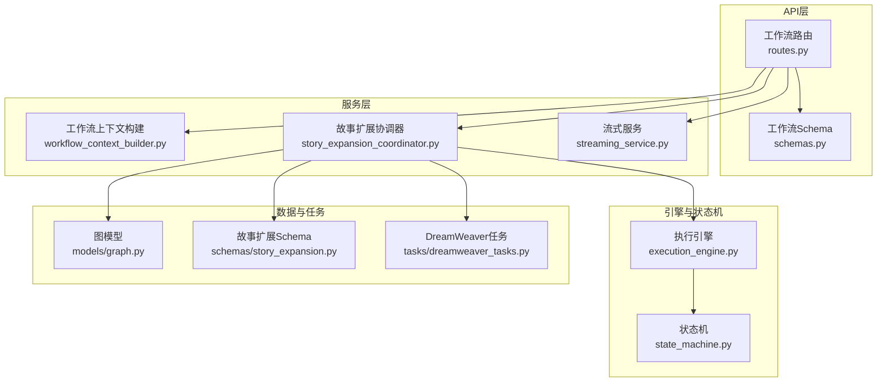
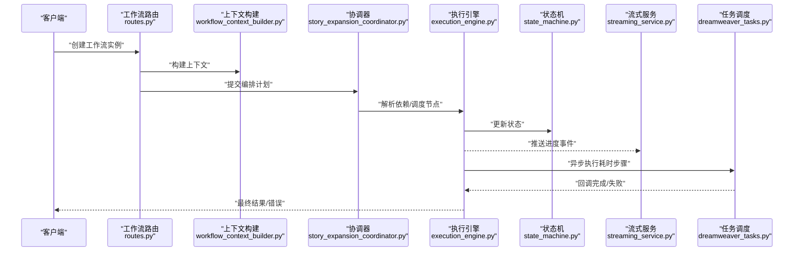
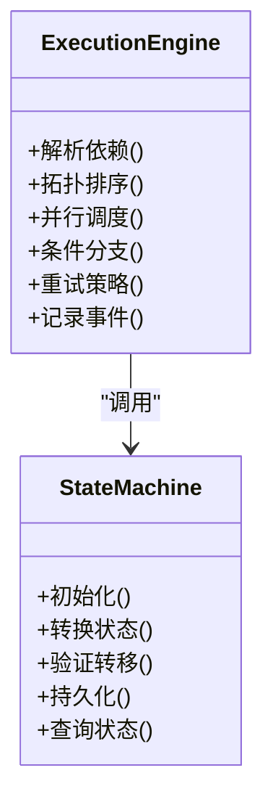
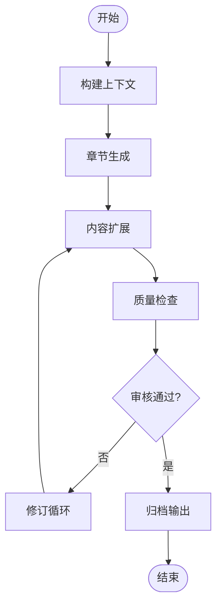
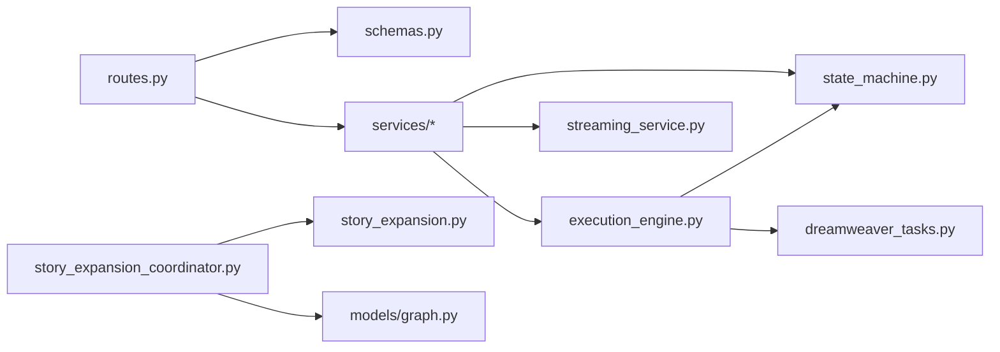

# 工作流API

<cite>
**本文引用的文件**   
- [backend/app/api/v1/workflow/__init__.py](file://backend/app/api/v1/workflow/__init__.py)
- [backend/app/api/v1/workflow/routes.py](file://backend/app/api/v1/workflow/routes.py)
- [backend/app/api/v1/workflow/schemas.py](file://backend/app/api/v1/workflow/schemas.py)
- [backend/app/services/workflow_context_builder.py](file://backend/app/services/workflow_context_builder.py)
- [core/execution_engine.py](file://core/execution_engine.py)
- [pipeline/state_machine.py](file://pipeline/state_machine.py)
- [backend/app/models/graph.py](file://backend/app/models/graph.py)
- [backend/app/schemas/story_expansion.py](file://backend/app/schemas/story_expansion.py)
- [backend/app/services/story_expansion_coordinator.py](file://backend/app/services/story_expansion_coordinator.py)
- [backend/app/tasks/dreamweaver_tasks.py](file://backend/app/tasks/dreamweaver_tasks.py)
- [backend/app/services/streaming_service.py](file://backend/app/services/streaming_service.py)
- [backend/app/core/config.py](file://backend/app/core/config.py)
</cite>

## 目录
1. [简介](#简介)
2. [项目结构](#项目结构)
3. [核心组件](#核心组件)
4. [架构总览](#架构总览)
5. [详细组件分析](#详细组件分析)
6. [依赖关系分析](#依赖关系分析)
7. [性能考量](#性能考量)
8. [故障排查指南](#故障排查指南)
9. [结论](#结论)
10. [附录](#附录)

## 简介
本文件面向“小说创作代理系统”的工作流API，覆盖工作流的创建、执行、监控与管理接口；阐述节点编排、条件分支、并行执行与错误重试等引擎能力；并提供章节生成、内容扩展、质量检查与审核流程的自动化接口说明。同时给出自定义工作流开发、插件集成与扩展点的实现指南，解释状态管理、数据传递与依赖解析的技术细节，帮助开发者快速构建稳定高效的内容生产流水线。

## 项目结构
工作流相关代码主要分布在以下位置：
- API路由层：backend/app/api/v1/workflow/*
- 服务层：backend/app/services/*（含工作流上下文构建、协调器、流式服务等）
- 引擎与状态机：core/execution_engine.py、pipeline/state_machine.py
- 数据模型与Schema：backend/app/models/graph.py、backend/app/schemas/story_expansion.py
- 任务调度：backend/app/tasks/dreamweaver_tasks.py
- 配置：backend/app/core/config.py

图表来源
- [backend/app/api/v1/workflow/routes.py](file://backend/app/api/v1/workflow/routes.py)
- [backend/app/api/v1/workflow/schemas.py](file://backend/app/api/v1/workflow/schemas.py)
- [backend/app/services/workflow_context_builder.py](file://backend/app/services/workflow_context_builder.py)
- [backend/app/services/story_expansion_coordinator.py](file://backend/app/services/story_expansion_coordinator.py)
- [backend/app/services/streaming_service.py](file://backend/app/services/streaming_service.py)
- [core/execution_engine.py](file://core/execution_engine.py)
- [pipeline/state_machine.py](file://pipeline/state_machine.py)
- [backend/app/models/graph.py](file://backend/app/models/graph.py)
- [backend/app/schemas/story_expansion.py](file://backend/app/schemas/story_expansion.py)
- [backend/app/tasks/dreamweaver_tasks.py](file://backend/app/tasks/dreamweaver_tasks.py)

章节来源
- [backend/app/api/v1/workflow/routes.py](file://backend/app/api/v1/workflow/routes.py)
- [backend/app/api/v1/workflow/schemas.py](file://backend/app/api/v1/workflow/schemas.py)
- [backend/app/services/workflow_context_builder.py](file://backend/app/services/workflow_context_builder.py)
- [backend/app/services/story_expansion_coordinator.py](file://backend/app/services/story_expansion_coordinator.py)
- [core/execution_engine.py](file://core/execution_engine.py)
- [pipeline/state_machine.py](file://pipeline/state_machine.py)
- [backend/app/models/graph.py](file://backend/app/models/graph.py)
- [backend/app/schemas/story_expansion.py](file://backend/app/schemas/story_expansion.py)
- [backend/app/tasks/dreamweaver_tasks.py](file://backend/app/tasks/dreamweaver_tasks.py)

## 核心组件
- 工作流路由与Schema：定义REST端点、请求/响应结构与校验规则，暴露工作流生命周期操作。
- 工作流上下文构建：聚合项目、章节、角色、设定等上下文信息，为执行引擎提供输入。
- 执行引擎：负责节点调度、依赖解析、条件分支、并行执行与错误重试策略。
- 状态机：维护工作流实例的状态转换，支持持久化与查询。
- 故事扩展协调器：编排章节生成、内容扩展、质量检查与审核流程。
- 流式服务：通过SSE或WebSocket推送执行进度与中间结果。
- 任务调度：将耗时任务异步化，保障主线程响应性。

章节来源
- [backend/app/api/v1/workflow/routes.py](file://backend/app/api/v1/workflow/routes.py)
- [backend/app/api/v1/workflow/schemas.py](file://backend/app/api/v1/workflow/schemas.py)
- [backend/app/services/workflow_context_builder.py](file://backend/app/services/workflow_context_builder.py)
- [core/execution_engine.py](file://core/execution_engine.py)
- [pipeline/state_machine.py](file://pipeline/state_machine.py)
- [backend/app/services/story_expansion_coordinator.py](file://backend/app/services/story_expansion_coordinator.py)
- [backend/app/services/streaming_service.py](file://backend/app/services/streaming_service.py)
- [backend/app/tasks/dreamweaver_tasks.py](file://backend/app/tasks/dreamweaver_tasks.py)

## 架构总览
工作流API采用分层架构：API层接收请求并返回结构化响应；服务层编排业务逻辑；引擎层驱动执行；状态机保证一致性；任务层处理异步作业；流式服务提供实时反馈。

图表来源
- [backend/app/api/v1/workflow/routes.py](file://backend/app/api/v1/workflow/routes.py)
- [backend/app/services/workflow_context_builder.py](file://backend/app/services/workflow_context_builder.py)
- [backend/app/services/story_expansion_coordinator.py](file://backend/app/services/story_expansion_coordinator.py)
- [core/execution_engine.py](file://core/execution_engine.py)
- [pipeline/state_machine.py](file://pipeline/state_machine.py)
- [backend/app/services/streaming_service.py](file://backend/app/services/streaming_service.py)
- [backend/app/tasks/dreamweaver_tasks.py](file://backend/app/tasks/dreamweaver_tasks.py)

## 详细组件分析

### 工作流API路由与Schema
- 路由职责：定义工作流CRUD、启动/暂停/恢复、取消、查询状态与日志、批量操作等端点。
- Schema职责：定义工作流定义、节点类型、参数、依赖、重试策略、输出契约等数据结构。
- 典型端点类别：
  - 工作流定义：创建、更新、删除、版本化、导入导出
  - 实例管理：创建实例、启动、暂停、恢复、终止、重启
  - 执行控制：触发节点、跳过节点、重跑节点、回滚
  - 监控查询：状态、进度、事件、日志、指标
  - 批量操作：批量启动、批量终止、批量迁移

章节来源
- [backend/app/api/v1/workflow/routes.py](file://backend/app/api/v1/workflow/routes.py)
- [backend/app/api/v1/workflow/schemas.py](file://backend/app/api/v1/workflow/schemas.py)

### 工作流上下文构建
- 目标：聚合项目元数据、章节大纲、角色档案、设定集、历史产出等，形成稳定的执行上下文。
- 关键点：
  - 上下文快照：确保执行期间上下文不可变，避免并发污染
  - 依赖注入：按需加载外部资源（如知识库、向量索引）
  - 安全边界：敏感字段脱敏与权限校验

章节来源
- [backend/app/services/workflow_context_builder.py](file://backend/app/services/workflow_context_builder.py)

### 执行引擎与状态机
- 执行引擎：
  - 依赖解析：基于DAG进行拓扑排序，识别可并行执行的节点集合
  - 条件分支：根据上下文变量与节点输出动态选择路径
  - 并行执行：按最大并发度调度节点，限制资源占用
  - 错误重试：支持指数退避、固定间隔、上限次数与幂等键
- 状态机：
  - 状态定义：待运行、运行中、暂停、成功、失败、已取消
  - 转换规则：严格的状态转移表，防止非法跳转
  - 持久化：每次转换写入数据库，支持断点续跑

图表来源
- [core/execution_engine.py](file://core/execution_engine.py)
- [pipeline/state_machine.py](file://pipeline/state_machine.py)

章节来源
- [core/execution_engine.py](file://core/execution_engine.py)
- [pipeline/state_machine.py](file://pipeline/state_machine.py)

### 故事扩展协调器（章节生成、内容扩展、质量检查、审核）
- 职责：编排章节生成、内容扩展、质量检查与审核流程，确保各阶段数据一致性与可追溯性。
- 关键流程：
  - 章节生成：基于上下文与模板生成初稿
  - 内容扩展：扩写场景、对话、描写，保持风格一致
  - 质量检查：语义连贯、角色一致性、设定冲突检测
  - 审核流程：人工或自动审核，支持多轮修订
- 数据契约：使用统一Schema描述输入输出，便于跨阶段传递与校验

图表来源
- [backend/app/services/story_expansion_coordinator.py](file://backend/app/services/story_expansion_coordinator.py)
- [backend/app/schemas/story_expansion.py](file://backend/app/schemas/story_expansion.py)

章节来源
- [backend/app/services/story_expansion_coordinator.py](file://backend/app/services/story_expansion_coordinator.py)
- [backend/app/schemas/story_expansion.py](file://backend/app/schemas/story_expansion.py)

### 流式服务与任务调度
- 流式服务：通过SSE或WebSocket推送执行进度、节点状态、中间产物与错误信息，提升用户体验与可观测性。
- 任务调度：将耗时任务（如大模型调用、媒体处理）放入队列，支持重试、超时与优先级。

章节来源
- [backend/app/services/streaming_service.py](file://backend/app/services/streaming_service.py)
- [backend/app/tasks/dreamweaver_tasks.py](file://backend/app/tasks/dreamweaver_tasks.py)

### 数据模型与Schema
- 图模型：存储工作流定义、节点关系、版本信息与执行快照。
- 故事扩展Schema：定义章节、场景、角色、设定、质量指标等数据结构。

章节来源
- [backend/app/models/graph.py](file://backend/app/models/graph.py)
- [backend/app/schemas/story_expansion.py](file://backend/app/schemas/story_expansion.py)

## 依赖关系分析
- 低耦合高内聚：API层仅依赖Schema与服务层接口；服务层通过执行引擎与状态机抽象；任务层独立于主流程。
- 关键依赖链：
  - routes -> schemas / services
  - services -> execution_engine / state_machine / streaming_service
  - execution_engine -> state_machine / tasks
  - story_expansion_coordinator -> schemas / models / tasks

图表来源
- [backend/app/api/v1/workflow/routes.py](file://backend/app/api/v1/workflow/routes.py)
- [backend/app/api/v1/workflow/schemas.py](file://backend/app/api/v1/workflow/schemas.py)
- [backend/app/services/workflow_context_builder.py](file://backend/app/services/workflow_context_builder.py)
- [backend/app/services/story_expansion_coordinator.py](file://backend/app/services/story_expansion_coordinator.py)
- [backend/app/services/streaming_service.py](file://backend/app/services/streaming_service.py)
- [core/execution_engine.py](file://core/execution_engine.py)
- [pipeline/state_machine.py](file://pipeline/state_machine.py)
- [backend/app/models/graph.py](file://backend/app/models/graph.py)
- [backend/app/schemas/story_expansion.py](file://backend/app/schemas/story_expansion.py)
- [backend/app/tasks/dreamweaver_tasks.py](file://backend/app/tasks/dreamweaver_tasks.py)

章节来源
- [backend/app/api/v1/workflow/routes.py](file://backend/app/api/v1/workflow/routes.py)
- [backend/app/api/v1/workflow/schemas.py](file://backend/app/api/v1/workflow/schemas.py)
- [backend/app/services/workflow_context_builder.py](file://backend/app/services/workflow_context_builder.py)
- [backend/app/services/story_expansion_coordinator.py](file://backend/app/services/story_expansion_coordinator.py)
- [backend/app/services/streaming_service.py](file://backend/app/services/streaming_service.py)
- [core/execution_engine.py](file://core/execution_engine.py)
- [pipeline/state_machine.py](file://pipeline/state_machine.py)
- [backend/app/models/graph.py](file://backend/app/models/graph.py)
- [backend/app/schemas/story_expansion.py](file://backend/app/schemas/story_expansion.py)
- [backend/app/tasks/dreamweaver_tasks.py](file://backend/app/tasks/dreamweaver_tasks.py)

## 性能考量
- 并行度控制：根据CPU/GPU与I/O特性调整最大并发，避免资源争用。
- 缓存策略：对重复计算的结果（如提示词优化、嵌入向量）进行缓存。
- 流式输出：减少首字节延迟，提升交互体验。
- 任务队列：削峰填谷，保障稳定性与可扩展性。
- 幂等设计：重试时避免重复副作用，使用唯一幂等键。

[本节为通用指导，不直接分析具体文件]

## 故障排查指南
- 常见问题定位：
  - 状态异常：检查状态机转移表与持久化记录
  - 依赖解析失败：核对节点依赖声明与上下文字段
  - 重试风暴：检查重试策略与退避算法
  - 流式中断：确认网络与心跳机制
- 诊断手段：
  - 查看执行事件与日志
  - 抓取工作流快照与上下文
  - 检查任务队列堆积与失败原因
  - 使用健康检查与指标面板

章节来源
- [pipeline/state_machine.py](file://pipeline/state_machine.py)
- [core/execution_engine.py](file://core/execution_engine.py)
- [backend/app/services/streaming_service.py](file://backend/app/services/streaming_service.py)
- [backend/app/tasks/dreamweaver_tasks.py](file://backend/app/tasks/dreamweaver_tasks.py)

## 结论
本工作流API以清晰的层次划分与严格的依赖管理，提供了从创建到执行、监控与管理的完整能力。通过执行引擎与状态机的协同，实现了节点编排、条件分支、并行执行与错误重试；借助流式服务与任务调度，提升了实时性与稳定性。开发者可基于现有扩展点快速定制工作流与插件，满足多样化内容生产需求。

[本节为总结性内容，不直接分析具体文件]

## 附录

### 自定义工作流开发与插件集成
- 扩展点：
  - 节点类型注册：定义新节点的行为与输入输出契约
  - 条件表达式：支持基于上下文的动态分支
  - 重试策略：可插拔的重试与补偿逻辑
  - 钩子函数：在节点前后插入自定义逻辑
- 最佳实践：
  - 明确输入输出Schema，避免隐式依赖
  - 使用幂等键与事务边界，确保一致性
  - 提供单元测试与集成测试用例

[本节为概念性指导，不直接分析具体文件]

### 状态管理与数据传递
- 状态管理：
  - 使用状态机约束合法转移，避免非法状态
  - 持久化每次状态变更，支持断点续跑
- 数据传递：
  - 上下文快照隔离，避免并发污染
  - 节点间通过显式Schema传递数据，增强可维护性

[本节为概念性指导，不直接分析具体文件]

### 依赖解析与执行顺序
- 依赖解析：
  - 基于DAG拓扑排序，识别并行执行集合
  - 动态依赖：根据运行时上下文调整依赖关系
- 执行顺序：
  - 严格遵循依赖顺序，确保前置节点成功后再执行后续节点

[本节为概念性指导，不直接分析具体文件]

### 配置与环境
- 关键配置项：
  - 并发度、超时、重试策略、队列大小、流式协议等
- 环境隔离：
  - 不同环境使用独立配置与资源，避免相互干扰

章节来源
- [backend/app/core/config.py](file://backend/app/core/config.py)