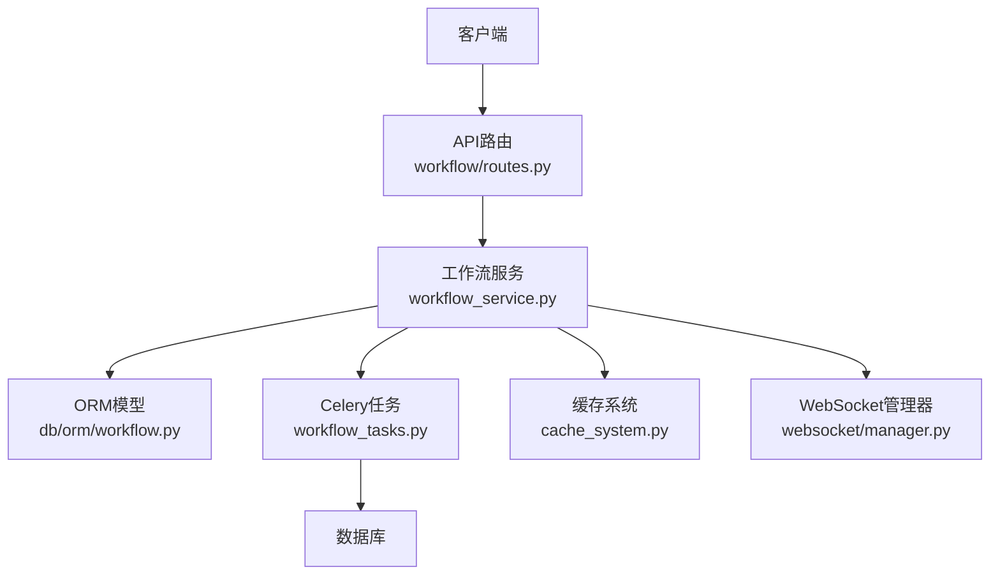
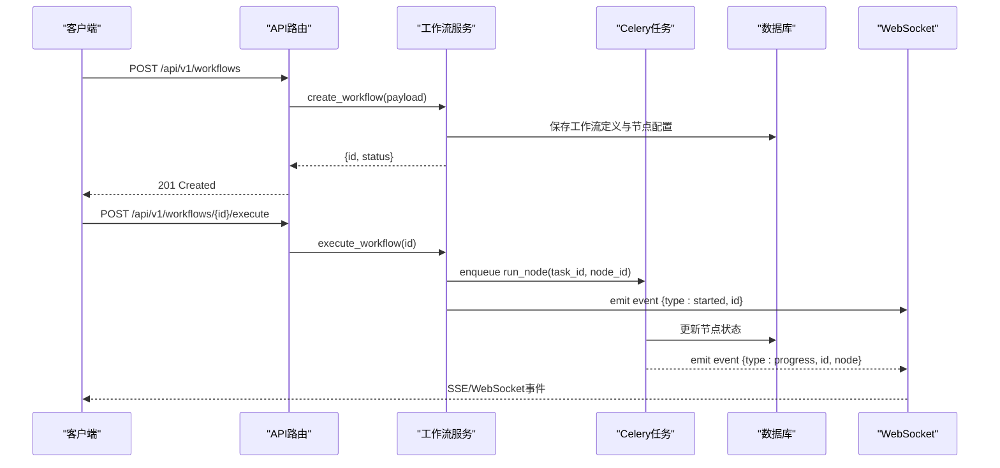
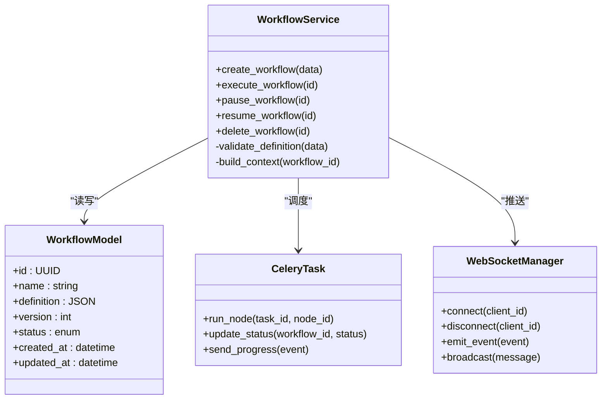

# 工作流核心API

<cite>
**本文引用的文件**
- [backend/app/api/v1/workflow/routes.py](file://backend/app/api/v1/workflow/routes.py)
- [backend/app/api/v1/workflow/schemas.py](file://backend/app/api/v1/workflow/schemas.py)
- [backend/app/services/workflow_service.py](file://backend/app/services/workflow_service.py)
- [backend/app/models/workflow.py](file://backend/app/models/workflow.py)
- [backend/app/db/orm/workflow.py](file://backend/app/db/orm/workflow.py)
- [backend/app/core/config.py](file://backend/app/core/config.py)
- [backend/app/utils/api_errors.py](file://backend/app/utils/api_errors.py)
- [backend/app/celery_app.py](file://backend/app/celery_app.py)
- [backend/app/tasks/workflow_tasks.py](file://backend/app/tasks/workflow_tasks.py)
- [backend/app/websocket/manager.py](file://backend/app/websocket/manager.py)
- [backend/app/services/workflow_context_builder.py](file://backend/app/services/workflow_context_builder.py)
- [backend/app/services/batch_processor.py](file://backend/app/services/batch_processor.py)
- [backend/app/services/cache_system.py](file://backend/app/services/cache_system.py)
</cite>

## 目录
1. [简介](#简介)
2. [项目结构](#项目结构)
3. [核心组件](#核心组件)
4. [架构总览](#架构总览)
5. [详细组件分析](#详细组件分析)
6. [依赖关系分析](#依赖关系分析)
7. [性能考虑](#性能考虑)
8. [故障排查指南](#故障排查指南)
9. [结论](#结论)
10. [附录](#附录)

## 简介
本文件为工作流核心系统的API文档，覆盖工作流的创建、执行、暂停、恢复与删除等基础操作接口；详细说明工作流定义格式、节点配置参数与执行状态管理；提供工作流模板管理、版本控制与批量操作的RESTful API规范；包含请求响应示例、错误码说明与最佳实践指南；并解释工作流引擎的核心概念：节点类型、依赖关系与数据传递机制。

## 项目结构
工作流相关代码主要分布在后端API层、服务层、模型与ORM映射、任务调度与WebSocket推送等模块中：
- API路由与Schema定义位于 backend/app/api/v1/workflow 目录
- 业务服务逻辑位于 backend/app/services 下的 workflow_* 模块
- 数据模型与ORM映射位于 backend/app/models 与 backend/app/db/orm
- 异步任务由 Celery 驱动，位于 backend/app/tasks
- WebSocket实时状态推送位于 backend/app/websocket
- 上下文构建与缓存系统位于 backend/app/services



图表来源
- [backend/app/api/v1/workflow/routes.py](file://backend/app/api/v1/workflow/routes.py)
- [backend/app/services/workflow_service.py](file://backend/app/services/workflow_service.py)
- [backend/app/db/orm/workflow.py](file://backend/app/db/orm/workflow.py)
- [backend/app/tasks/workflow_tasks.py](file://backend/app/tasks/workflow_tasks.py)
- [backend/app/websocket/manager.py](file://backend/app/websocket/manager.py)
- [backend/app/services/cache_system.py](file://backend/app/services/cache_system.py)

章节来源
- [backend/app/api/v1/workflow/routes.py](file://backend/app/api/v1/workflow/routes.py)
- [backend/app/services/workflow_service.py](file://backend/app/services/workflow_service.py)
- [backend/app/db/orm/workflow.py](file://backend/app/db/orm/workflow.py)

## 核心组件
- API路由层：暴露RESTful接口，负责请求校验、权限检查与响应封装
- 工作流服务层：编排工作流生命周期（创建、执行、暂停、恢复、删除）、模板管理与版本控制、批量操作
- 数据模型与ORM：持久化工作流定义、节点配置、执行记录与状态
- 任务调度：通过Celery执行耗时任务（如节点运行、批处理）
- WebSocket：向客户端推送工作流执行进度与状态变更
- 上下文构建器：组装工作流执行上下文（输入、依赖、变量）
- 缓存系统：缓存工作流模板、节点元数据与中间结果

章节来源
- [backend/app/api/v1/workflow/routes.py](file://backend/app/api/v1/workflow/routes.py)
- [backend/app/api/v1/workflow/schemas.py](file://backend/app/api/v1/workflow/schemas.py)
- [backend/app/services/workflow_service.py](file://backend/app/services/workflow_service.py)
- [backend/app/models/workflow.py](file://backend/app/models/workflow.py)
- [backend/app/db/orm/workflow.py](file://backend/app/db/orm/workflow.py)
- [backend/app/tasks/workflow_tasks.py](file://backend/app/tasks/workflow_tasks.py)
- [backend/app/websocket/manager.py](file://backend/app/websocket/manager.py)
- [backend/app/services/workflow_context_builder.py](file://backend/app/services/workflow_context_builder.py)
- [backend/app/services/cache_system.py](file://backend/app/services/cache_system.py)

## 架构总览
工作流核心API采用分层架构：
- 表现层：FastAPI路由，接收HTTP请求，返回JSON响应
- 服务层：工作流服务编排业务逻辑，调用ORM、任务队列与缓存
- 数据层：ORM映射到数据库表，存储工作流定义、节点配置与执行状态
- 异步层：Celery任务处理耗时操作，避免阻塞HTTP请求
- 实时层：WebSocket推送执行进度与状态事件



图表来源
- [backend/app/api/v1/workflow/routes.py](file://backend/app/api/v1/workflow/routes.py)
- [backend/app/services/workflow_service.py](file://backend/app/services/workflow_service.py)
- [backend/app/tasks/workflow_tasks.py](file://backend/app/tasks/workflow_tasks.py)
- [backend/app/websocket/manager.py](file://backend/app/websocket/manager.py)
- [backend/app/db/orm/workflow.py](file://backend/app/db/orm/workflow.py)

## 详细组件分析

### 工作流定义与节点配置
工作流定义包含以下关键元素：
- 基本信息：名称、描述、版本、标签
- 节点列表：每个节点包含类型、配置参数、依赖关系、输入输出映射
- 全局配置：超时、重试策略、并发限制
- 版本控制：支持多版本并存，可切换默认版本

节点类型包括：
- 数据处理节点：转换、过滤、聚合
- 外部服务节点：调用第三方API
- 条件分支节点：基于规则选择路径
- 并行执行节点：同时运行多个子任务

数据传递机制：
- 节点间通过上下文变量传递数据
- 支持JSON对象、数组、字符串等类型
- 提供内置函数进行数据转换

章节来源
- [backend/app/api/v1/workflow/schemas.py](file://backend/app/api/v1/workflow/schemas.py)
- [backend/app/models/workflow.py](file://backend/app/models/workflow.py)
- [backend/app/db/orm/workflow.py](file://backend/app/db/orm/workflow.py)

### 工作流生命周期API

#### 创建工作流
- 端点：POST /api/v1/workflows
- 请求体：包含工作流定义JSON
- 响应：工作流ID与初始状态
- 错误码：400（验证失败）、409（重复名称）

#### 执行工作流
- 端点：POST /api/v1/workflows/{id}/execute
- 查询参数：run_id（可选，用于追踪）
- 响应：立即返回执行ID
- 异步：实际执行在后台进行

#### 暂停工作流
- 端点：POST /api/v1/workflows/{id}/pause
- 功能：暂停正在执行的节点
- 限制：仅当前用户的工作流可暂停

#### 恢复工作流
- 端点：POST /api/v1/workflows/{id}/resume
- 功能：从暂停状态继续执行
- 状态检查：确保工作流处于暂停状态

#### 删除工作流
- 端点：DELETE /api/v1/workflows/{id}
- 级联：删除所有关联的执行记录
- 软删除：标记deleted_at字段

章节来源
- [backend/app/api/v1/workflow/routes.py](file://backend/app/api/v1/workflow/routes.py)
- [backend/app/services/workflow_service.py](file://backend/app/services/workflow_service.py)

### 工作流模板管理API

#### 模板CRUD
- 创建模板：POST /api/v1/templates
- 获取模板：GET /api/v1/templates/{id}
- 更新模板：PUT /api/v1/templates/{id}
- 删除模板：DELETE /api/v1/templates/{id}

#### 模板版本控制
- 版本发布：POST /api/v1/templates/{id}/publish
- 版本回滚：POST /api/v1/templates/{id}/rollback
- 版本对比：GET /api/v1/templates/{id}/versions

#### 模板使用统计
- 使用次数：GET /api/v1/templates/{id}/usage
- 最近执行：GET /api/v1/templates/{id}/recent-runs

章节来源
- [backend/app/api/v1/workflow/routes.py](file://backend/app/api/v1/workflow/routes.py)
- [backend/app/services/workflow_service.py](file://backend/app/services/workflow_service.py)

### 批量操作API

#### 批量执行
- 端点：POST /api/v1/workflows/batch-execute
- 请求体：工作流ID数组与参数映射
- 响应：批量任务ID列表
- 进度查询：GET /api/v1/batch-jobs/{job_id}/status

#### 批量导入导出
- 导入：POST /api/v1/workflows/import
- 导出：GET /api/v1/workflows/export?ids=...
- 格式：支持JSON与YAML

#### 批量状态管理
- 批量暂停：POST /api/v1/workflows/batch-pause
- 批量恢复：POST /api/v1/workflows/batch-resume
- 批量删除：DELETE /api/v1/workflows/batch-delete

章节来源
- [backend/app/api/v1/workflow/routes.py](file://backend/app/api/v1/workflow/routes.py)
- [backend/app/services/batch_processor.py](file://backend/app/services/batch_processor.py)

### 执行状态管理

#### 状态枚举
- pending：待执行
- running：执行中
- paused：已暂停
- success：成功
- failed：失败
- cancelled：已取消

#### 状态查询
- 单个工作流：GET /api/v1/workflows/{id}/status
- 批量状态：GET /api/v1/workflows/status?ids=...
- 历史状态：GET /api/v1/workflows/{id}/history

#### 实时状态推送
- WebSocket连接：ws://host/ws/workflows/{id}
- 事件类型：started, progress, completed, failed, paused, resumed
- 重连机制：支持断线重连与状态同步

章节来源
- [backend/app/services/workflow_service.py](file://backend/app/services/workflow_service.py)
- [backend/app/websocket/manager.py](file://backend/app/websocket/manager.py)

### 工作流引擎核心概念

#### 节点类型详解
- 基础节点：简单数据处理
- 复合节点：包含子工作流
- 条件节点：基于表达式分支
- 循环节点：迭代处理集合
- 并行节点：并发执行任务

#### 依赖关系管理
- 声明式依赖：通过depends_on字段指定
- 动态依赖：运行时计算依赖关系
- 循环检测：防止循环依赖
- 拓扑排序：确定执行顺序

#### 数据传递机制
- 上下文变量：跨节点共享数据
- 输入输出映射：节点间数据传输
- 数据类型转换：自动类型适配
- 错误传播：异常向上抛出

章节来源
- [backend/app/services/workflow_context_builder.py](file://backend/app/services/workflow_context_builder.py)
- [backend/app/models/workflow.py](file://backend/app/models/workflow.py)

## 依赖关系分析



图表来源
- [backend/app/services/workflow_service.py](file://backend/app/services/workflow_service.py)
- [backend/app/models/workflow.py](file://backend/app/models/workflow.py)
- [backend/app/tasks/workflow_tasks.py](file://backend/app/tasks/workflow_tasks.py)
- [backend/app/websocket/manager.py](file://backend/app/websocket/manager.py)

章节来源
- [backend/app/services/workflow_service.py](file://backend/app/services/workflow_service.py)
- [backend/app/models/workflow.py](file://backend/app/models/workflow.py)
- [backend/app/tasks/workflow_tasks.py](file://backend/app/tasks/workflow_tasks.py)
- [backend/app/websocket/manager.py](file://backend/app/websocket/manager.py)

## 性能考虑
- 异步执行：所有耗时操作通过Celery异步处理
- 连接池：数据库连接复用，减少开销
- 缓存策略：热点数据缓存，提升读取性能
- 限流保护：防止恶意请求耗尽资源
- 批量操作：支持批量处理，减少网络往返
- 内存管理：大对象及时释放，避免内存泄漏

## 故障排查指南

### 常见错误码
- 400：请求参数验证失败
- 401：未授权访问
- 403：权限不足
- 404：资源不存在
- 409：资源冲突
- 429：请求频率限制
- 500：服务器内部错误
- 503：服务暂时不可用

### 调试技巧
- 启用详细日志：设置DEBUG=true
- 查看任务状态：检查Celery worker日志
- 监控执行状态：使用WebSocket实时跟踪
- 数据库查询：直接检查状态表
- 缓存诊断：查看缓存命中率

### 常见问题解决
- 工作流无法启动：检查依赖服务可用性
- 节点执行超时：调整超时配置
- 内存不足：优化数据处理逻辑
- 并发冲突：增加锁机制
- 数据不一致：检查事务完整性

章节来源
- [backend/app/utils/api_errors.py](file://backend/app/utils/api_errors.py)
- [backend/app/celery_app.py](file://backend/app/celery_app.py)

## 结论
工作流核心API提供了完整的工作流管理能力，涵盖定义、执行、状态监控、模板管理等核心功能。通过分层架构设计，系统具备良好的可扩展性和维护性。建议在生产环境中合理配置缓存、限流和监控，确保系统稳定运行。

## 附录

### API端点总览
| 方法 | 路径 | 描述 | 认证 |
|------|------|------|------|
| POST | /api/v1/workflows | 创建工作流 | 需要 |
| GET | /api/v1/workflows/{id} | 获取工作流详情 | 需要 |
| PUT | /api/v1/workflows/{id} | 更新工作流 | 需要 |
| DELETE | /api/v1/workflows/{id} | 删除工作流 | 需要 |
| POST | /api/v1/workflows/{id}/execute | 执行工作流 | 需要 |
| POST | /api/v1/workflows/{id}/pause | 暂停工作流 | 需要 |
| POST | /api/v1/workflows/{id}/resume | 恢复工作流 | 需要 |
| GET | /api/v1/workflows/{id}/status | 查询执行状态 | 需要 |
| POST | /api/v1/templates | 创建模板 | 管理员 |
| GET | /api/v1/templates | 获取模板列表 | 需要 |
| POST | /api/v1/workflows/batch-execute | 批量执行 | 需要 |

### 请求响应示例

#### 创建工作流请求
```json
{
  "name": "文本处理流程",
  "description": "对文本进行清洗和分析",
  "version": 1,
  "nodes": [
    {
      "id": "node_1",
      "type": "text_cleaner",
      "config": {"remove_html": true},
      "depends_on": []
    },
    {
      "id": "node_2", 
      "type": "analyzer",
      "config": {"analyze_sentiment": true},
      "depends_on": ["node_1"]
    }
  ],
  "global_config": {
    "timeout": 300,
    "retry_count": 3
  }
}
```

#### 创建工作流响应
```json
{
  "id": "wf_123456",
  "name": "文本处理流程",
  "version": 1,
  "status": "pending",
  "created_at": "2024-01-01T00:00:00Z"
}
```

### 最佳实践
- 节点设计：保持单一职责，避免过长的节点逻辑
- 错误处理：实现完善的错误捕获和重试机制
- 数据验证：在服务层和API层都进行输入验证
- 监控告警：设置关键指标监控和告警规则
- 版本管理：合理使用版本控制，避免破坏性变更
- 性能优化：合理使用缓存和异步处理