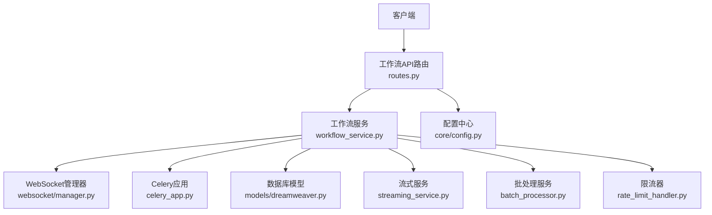
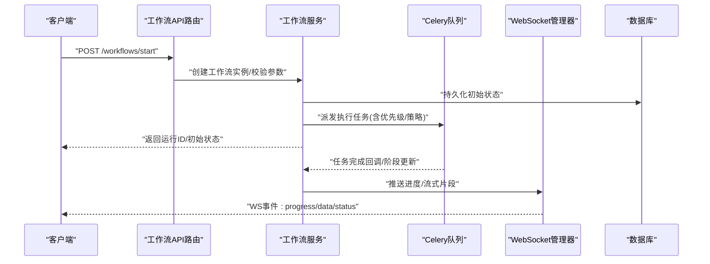
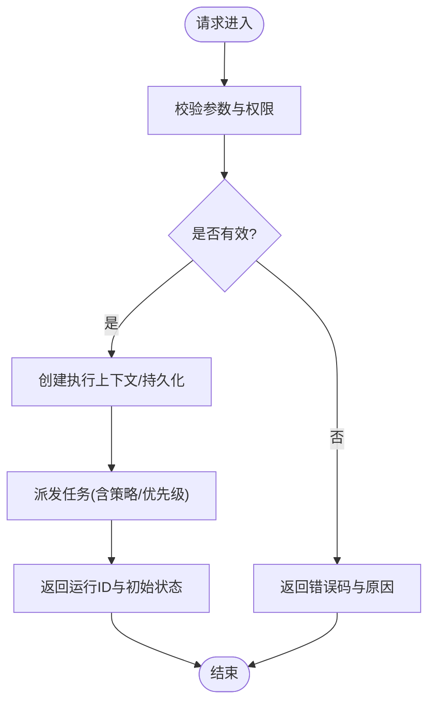
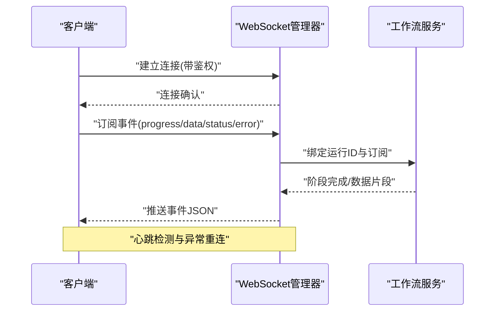
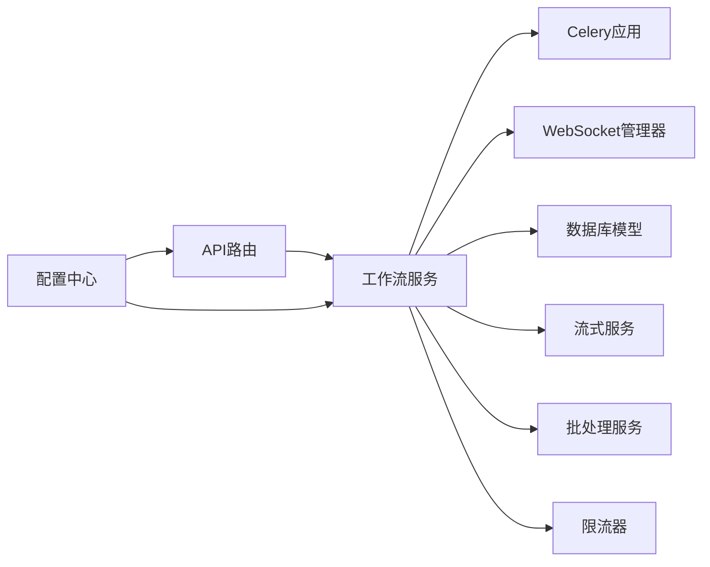

# 执行控制API

<cite>
**本文引用的文件**   
- [backend/app/api/v1/workflow/routes.py](file://backend/app/api/v1/workflow/routes.py)
- [backend/app/services/workflow_service.py](file://backend/app/services/workflow_service.py)
- [backend/app/websocket/manager.py](file://backend/app/websocket/manager.py)
- [backend/app/core/config.py](file://backend/app/core/config.py)
- [backend/app/celery_app.py](file://backend/app/celery_app.py)
- [backend/app/services/streaming_service.py](file://backend/app/services/streaming_service.py)
- [backend/app/services/batch_processor.py](file://backend/app/services/batch_processor.py)
- [backend/app/services/rate_limit_handler.py](file://backend/app/services/rate_limit_handler.py)
- [backend/app/models/dreamweaver.py](file://backend/app/models/dreamweaver.py)
- [backend/app/schemas/common.py](file://backend/app/schemas/common.py)
</cite>

## 目录
1. [简介](#简介)
2. [项目结构](#项目结构)
3. [核心组件](#核心组件)
4. [架构总览](#架构总览)
5. [详细组件分析](#详细组件分析)
6. [依赖关系分析](#依赖关系分析)
7. [性能考量](#性能考量)
8. [故障排查指南](#故障排查指南)
9. [结论](#结论)
10. [附录](#附录)

## 简介
本文件面向工作流执行控制系统，聚焦“执行控制”能力：启动、停止、重试与取消；并覆盖流式执行、实时反馈与进度推送的WebSocket通信协议。同时给出执行环境配置、资源需求与性能调优参数，以及执行策略选择、负载均衡与故障转移的配置接口说明，并对调度算法、优先级管理与资源分配进行技术解读。文档以代码仓库中的后端实现为依据，确保可追溯与可落地。

## 项目结构
工作流执行控制相关代码主要位于后端模块：
- API路由层：定义REST端点，负责请求校验、鉴权与编排调用服务层。
- 服务层：封装工作流生命周期管理、任务调度、状态持久化与事件广播。
- WebSocket管理器：维护连接、通道与消息路由，支持流式输出与进度推送。
- 配置中心：集中加载环境变量与运行时参数，提供默认值与校验。
- Celery应用：异步任务队列与分布式执行引擎。
- 模型与Schema：统一的数据结构与校验契约。

图表来源
- [backend/app/api/v1/workflow/routes.py](file://backend/app/api/v1/workflow/routes.py)
- [backend/app/services/workflow_service.py](file://backend/app/services/workflow_service.py)
- [backend/app/websocket/manager.py](file://backend/app/websocket/manager.py)
- [backend/app/celery_app.py](file://backend/app/celery_app.py)
- [backend/app/models/dreamweaver.py](file://backend/app/models/dreamweaver.py)
- [backend/app/services/streaming_service.py](file://backend/app/services/streaming_service.py)
- [backend/app/services/batch_processor.py](file://backend/app/services/batch_processor.py)
- [backend/app/services/rate_limit_handler.py](file://backend/app/services/rate_limit_handler.py)
- [backend/app/core/config.py](file://backend/app/core/config.py)

章节来源
- [backend/app/api/v1/workflow/routes.py](file://backend/app/api/v1/workflow/routes.py)
- [backend/app/services/workflow_service.py](file://backend/app/services/workflow_service.py)
- [backend/app/websocket/manager.py](file://backend/app/websocket/manager.py)
- [backend/app/core/config.py](file://backend/app/core/config.py)

## 核心组件
- 工作流API路由：暴露启动、停止、重试、取消等执行控制接口，统一入参出参与错误码。
- 工作流服务：协调任务创建、状态机推进、结果持久化、事件广播与重试策略。
- WebSocket管理器：建立长连接、订阅频道、推送进度与流式数据片段。
- 配置中心：读取并校验执行环境、并发度、超时、重试次数、限流阈值等。
- Celery应用：承载异步任务，支持分布式扩展与失败重试。
- 流式服务：将中间结果分片推送至WebSocket或SSE通道。
- 批处理服务：批量提交任务、合并结果、提升吞吐。
- 限流器：保护下游资源，避免过载。

章节来源
- [backend/app/api/v1/workflow/routes.py](file://backend/app/api/v1/workflow/routes.py)
- [backend/app/services/workflow_service.py](file://backend/app/services/workflow_service.py)
- [backend/app/websocket/manager.py](file://backend/app/websocket/manager.py)
- [backend/app/core/config.py](file://backend/app/core/config.py)
- [backend/app/celery_app.py](file://backend/app/celery_app.py)
- [backend/app/services/streaming_service.py](file://backend/app/services/streaming_service.py)
- [backend/app/services/batch_processor.py](file://backend/app/services/batch_processor.py)
- [backend/app/services/rate_limit_handler.py](file://backend/app/services/rate_limit_handler.py)

## 架构总览
下图展示从HTTP请求到异步执行、状态更新与WebSocket推送的整体流程。

图表来源
- [backend/app/api/v1/workflow/routes.py](file://backend/app/api/v1/workflow/routes.py)
- [backend/app/services/workflow_service.py](file://backend/app/services/workflow_service.py)
- [backend/app/celery_app.py](file://backend/app/celery_app.py)
- [backend/app/websocket/manager.py](file://backend/app/websocket/manager.py)
- [backend/app/models/dreamweaver.py](file://backend/app/models/dreamweaver.py)

## 详细组件分析

### 执行控制API（启动/停止/重试/取消）
- 启动工作流
  - 方法：POST
  - 路径：/api/v1/workflows/start
  - 功能：校验输入、创建执行上下文、写入初始状态、派发任务、返回运行标识。
  - 关键参数：工作流类型、输入数据、执行策略、优先级、资源配额、超时、重试策略。
  - 响应：运行ID、当前状态、预计耗时、WebSocket订阅地址。
- 停止工作流
  - 方法：POST
  - 路径：/api/v1/workflows/{run_id}/stop
  - 功能：标记为停止中，通知执行器尽快退出，保存中间状态以便恢复。
- 重试工作流
  - 方法：POST
  - 路径：/api/v1/workflows/{run_id}/retry
  - 功能：基于上次失败原因重建上下文，按策略重新派发任务。
- 取消工作流
  - 方法：POST
  - 路径：/api/v1/workflows/{run_id}/cancel
  - 功能：立即终止正在运行的任务，清理临时资源，记录取消原因。

图表来源
- [backend/app/api/v1/workflow/routes.py](file://backend/app/api/v1/workflow/routes.py)
- [backend/app/services/workflow_service.py](file://backend/app/services/workflow_service.py)
- [backend/app/models/dreamweaver.py](file://backend/app/models/dreamweaver.py)

章节来源
- [backend/app/api/v1/workflow/routes.py](file://backend/app/api/v1/workflow/routes.py)
- [backend/app/services/workflow_service.py](file://backend/app/services/workflow_service.py)
- [backend/app/models/dreamweaver.py](file://backend/app/models/dreamweaver.py)

### WebSocket流式通信协议
- 连接建立
  - 地址：ws://{host}/api/v1/workflows/{run_id}/events
  - 握手：可选携带token或会话ID用于鉴权与绑定运行实例。
- 订阅频道
  - 客户端发送订阅消息，指定关注的事件类型：progress、data、status、error。
- 服务端推送
  - 进度：百分比、阶段名、已用时长、剩余估计。
  - 数据：分片结果（如文本块、媒体片段），支持断点续传标识。
  - 状态：运行中、暂停、成功、失败、取消。
  - 错误：错误码、错误信息、建议操作。
- 心跳与重连
  - 心跳间隔与超时由配置决定；客户端需实现指数退避重连。

图表来源
- [backend/app/websocket/manager.py](file://backend/app/websocket/manager.py)
- [backend/app/services/streaming_service.py](file://backend/app/services/streaming_service.py)
- [backend/app/services/workflow_service.py](file://backend/app/services/workflow_service.py)

章节来源
- [backend/app/websocket/manager.py](file://backend/app/websocket/manager.py)
- [backend/app/services/streaming_service.py](file://backend/app/services/streaming_service.py)

### 执行环境配置与资源需求
- 并发与线程池
  - 工作流并发度、Celery worker数量、I/O线程池大小。
- 超时与重试
  - 单步超时、整体超时、最大重试次数、退避策略。
- 资源配额
  - CPU/内存上限、GPU显存限制、磁盘空间阈值。
- 限流与熔断
  - 全局QPS、下游服务速率限制、熔断阈值与恢复时间。
- 日志与追踪
  - 日志级别、采样率、链路追踪开关。

章节来源
- [backend/app/core/config.py](file://backend/app/core/config.py)
- [backend/app/celery_app.py](file://backend/app/celery_app.py)
- [backend/app/services/rate_limit_handler.py](file://backend/app/services/rate_limit_handler.py)

### 执行策略、负载均衡与故障转移
- 执行策略
  - 顺序执行、并行执行、条件分支、回滚策略。
- 负载均衡
  - 基于权重或负载感知的任务分发，支持多worker节点。
- 故障转移
  - 自动重试、降级策略、备用执行器切换、幂等性保障。

章节来源
- [backend/app/services/workflow_service.py](file://backend/app/services/workflow_service.py)
- [backend/app/celery_app.py](file://backend/app/celery_app.py)

### 调度算法、优先级管理与资源分配
- 调度算法
  - 优先级队列、加权公平调度、抢占式调度（高优任务插队）。
- 优先级管理
  - 任务优先级字段、动态调整、过期淘汰。
- 资源分配
  - 资源标签匹配、亲和/反亲和规则、弹性扩缩容。

章节来源
- [backend/app/celery_app.py](file://backend/app/celery_app.py)
- [backend/app/services/batch_processor.py](file://backend/app/services/batch_processor.py)

## 依赖关系分析
- API路由依赖服务层，服务层依赖Celery队列、数据库模型、WebSocket管理器与流式服务。
- 限流器在入口与服务层双重防护，避免雪崩。
- 配置中心贯穿各组件，提供一致的环境变量与默认值。

图表来源
- [backend/app/api/v1/workflow/routes.py](file://backend/app/api/v1/workflow/routes.py)
- [backend/app/services/workflow_service.py](file://backend/app/services/workflow_service.py)
- [backend/app/celery_app.py](file://backend/app/celery_app.py)
- [backend/app/websocket/manager.py](file://backend/app/websocket/manager.py)
- [backend/app/models/dreamweaver.py](file://backend/app/models/dreamweaver.py)
- [backend/app/services/streaming_service.py](file://backend/app/services/streaming_service.py)
- [backend/app/services/batch_processor.py](file://backend/app/services/batch_processor.py)
- [backend/app/services/rate_limit_handler.py](file://backend/app/services/rate_limit_handler.py)
- [backend/app/core/config.py](file://backend/app/core/config.py)

章节来源
- [backend/app/api/v1/workflow/routes.py](file://backend/app/api/v1/workflow/routes.py)
- [backend/app/services/workflow_service.py](file://backend/app/services/workflow_service.py)
- [backend/app/celery_app.py](file://backend/app/celery_app.py)
- [backend/app/websocket/manager.py](file://backend/app/websocket/manager.py)
- [backend/app/models/dreamweaver.py](file://backend/app/models/dreamweaver.py)
- [backend/app/services/streaming_service.py](file://backend/app/services/streaming_service.py)
- [backend/app/services/batch_processor.py](file://backend/app/services/batch_processor.py)
- [backend/app/services/rate_limit_handler.py](file://backend/app/services/rate_limit_handler.py)
- [backend/app/core/config.py](file://backend/app/core/config.py)

## 性能考量
- 并发与吞吐
  - 合理设置Celery worker数与工作进程数，避免CPU争用与上下文切换开销。
- I/O优化
  - 启用连接池、缓存热点数据、减少阻塞调用。
- 批处理
  - 使用批处理服务聚合小任务，降低队列压力与网络往返。
- 流式传输
  - 分片大小与推送频率平衡，避免拥塞与抖动。
- 监控与告警
  - 跟踪队列长度、延迟分布、错误率与资源利用率。

[本节为通用指导，不直接分析具体文件]

## 故障排查指南
- 常见问题
  - 启动失败：检查参数校验、权限、资源配额与依赖服务可用性。
  - 执行卡住：查看任务队列堆积、worker健康、锁与死锁。
  - 流式中断：检查WebSocket心跳、网络稳定性与服务器负载。
  - 重试风暴：确认退避策略与熔断阈值。
- 定位手段
  - 查看运行状态与阶段内容、错误日志与追踪ID。
  - 通过WebSocket事件回放定位问题阶段。
  - 使用批处理与限流器指标评估瓶颈。

章节来源
- [backend/app/services/workflow_service.py](file://backend/app/services/workflow_service.py)
- [backend/app/websocket/manager.py](file://backend/app/websocket/manager.py)
- [backend/app/services/rate_limit_handler.py](file://backend/app/services/rate_limit_handler.py)

## 结论
本执行控制API围绕工作流的启动、停止、重试与取消构建，结合WebSocket实现流式执行与实时反馈。通过配置中心统一管理环境与资源参数，配合Celery与批处理服务实现高吞吐与可扩展的执行能力。合理的调度算法、优先级管理与资源分配策略，保障了系统在复杂场景下的稳定性与效率。

[本节为总结性内容，不直接分析具体文件]

## 附录
- 数据模型与Schema
  - 工作流运行实体、阶段状态、事件结构、错误码定义。
- 示例请求与响应
  - 启动、停止、重试、取消的典型载荷与返回结构。
- 最佳实践
  - 幂等设计、优雅停机、灰度发布与回滚策略。

[本节为补充信息，不直接分析具体文件]