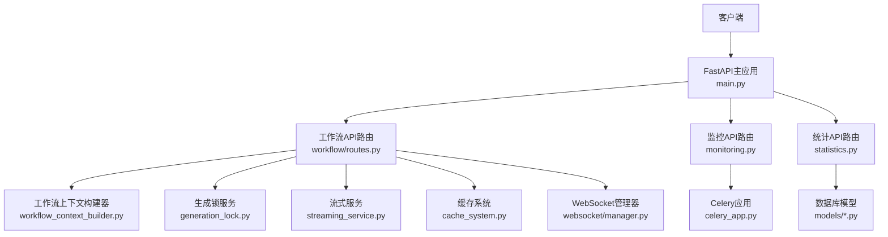
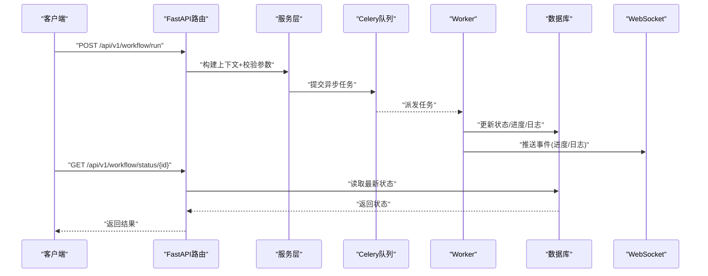
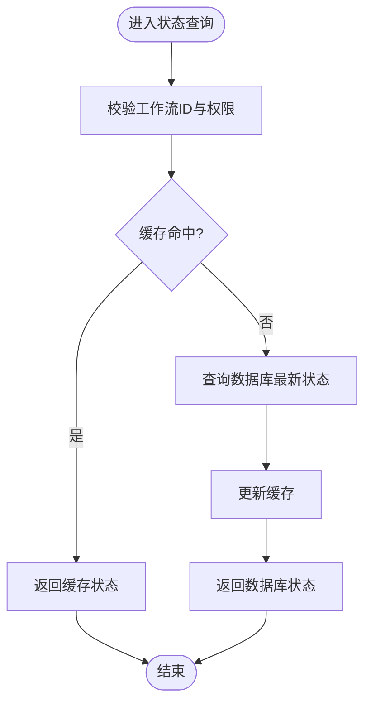
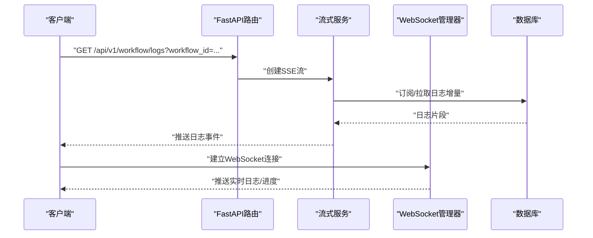
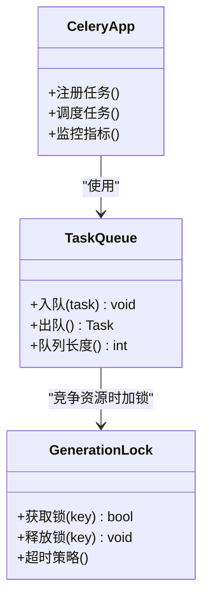
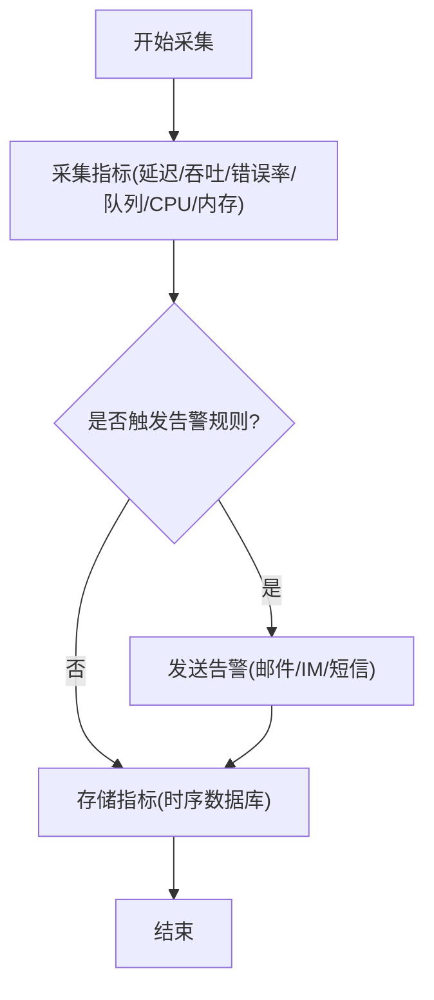
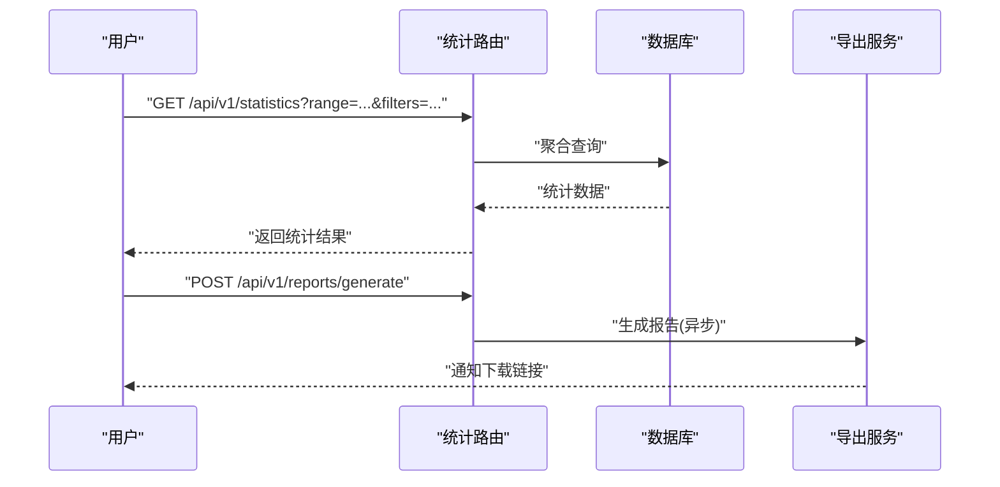
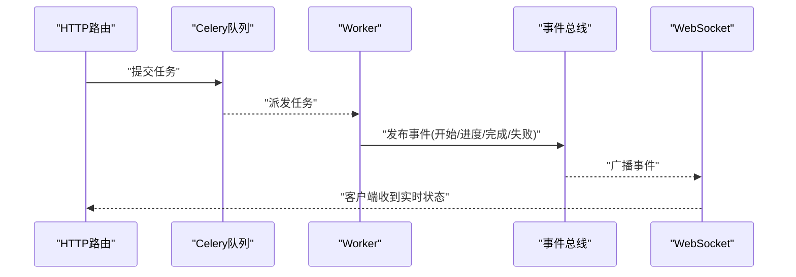
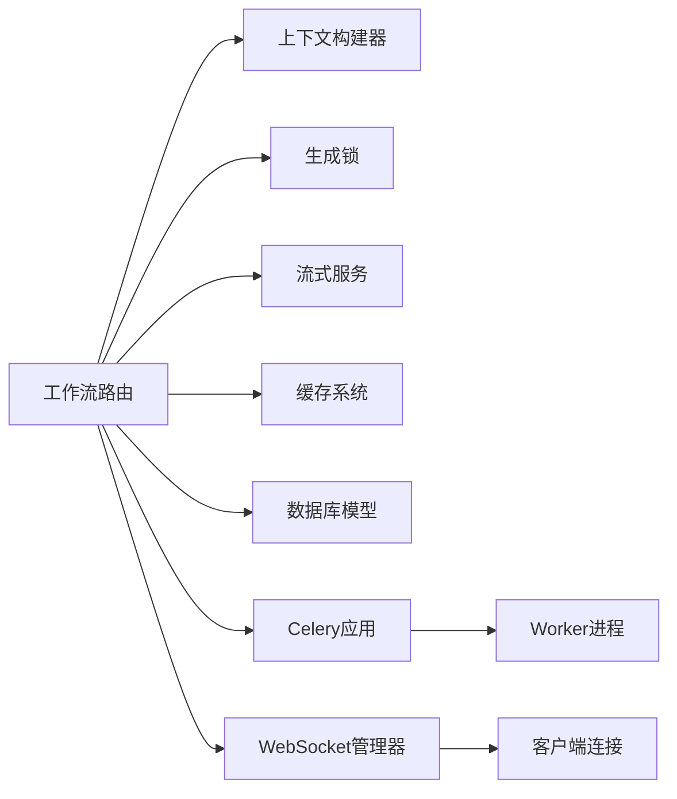

# 状态监控API

<cite>
**本文引用的文件**   
- [backend/app/api/v1/workflow/__init__.py](file://backend/app/api/v1/workflow/__init__.py)
- [backend/app/api/v1/workflow/routes.py](file://backend/app/api/v1/workflow/routes.py)
- [backend/app/api/v1/workflow/schemas.py](file://backend/app/api/v1/workflow/schemas.py)
- [backend/app/api/v1/monitoring.py](file://backend/app/api/v1/monitoring.py)
- [backend/app/api/v1/statistics.py](file://backend/app/api/v1/statistics.py)
- [backend/app/services/workflow_context_builder.py](file://backend/app/services/workflow_context_builder.py)
- [backend/app/services/generation_lock.py](file://backend/app/services/generation_lock.py)
- [backend/app/celery_app.py](file://backend/app/celery_app.py)
- [backend/app/websocket/manager.py](file://backend/app/websocket/manager.py)
- [backend/app/main.py](file://backend/app/main.py)
- [backend/app/core/config.py](file://backend/app/core/config.py)
- [backend/app/db/base.py](file://backend/app/db/base.py)
- [backend/app/models/dreamweaver.py](file://backend/app/models/dreamweaver.py)
- [backend/app/models/audiobook_task.py](file://backend/app/models/audiobook_task.py)
- [backend/app/services/streaming_service.py](file://backend/app/services/streaming_service.py)
- [backend/app/services/cache_system.py](file://backend/app/services/cache_system.py)
- [backend/app/utils/api_errors.py](file://backend/app/utils/api_errors.py)
</cite>

## 目录
1. [简介](#简介)
2. [项目结构](#项目结构)
3. [核心组件](#核心组件)
4. [架构总览](#架构总览)
5. [详细组件分析](#详细组件分析)
6. [依赖关系分析](#依赖关系分析)
7. [性能考量](#性能考量)
8. [故障排查指南](#故障排查指南)
9. [结论](#结论)
10. [附录](#附录)

## 简介
本文件面向工作流状态监控与管理API，覆盖以下能力：
- 工作流执行状态的实时查询、进度跟踪与日志获取
- 任务队列管理、并发控制与资源锁定机制
- 性能监控指标、错误诊断信息与告警通知接口
- 工作流历史查询、统计分析与报告生成数据接口
- 异步任务处理、WebSocket实时更新与事件驱动架构的技术实现

该文档以代码仓库中的后端API与服务实现为依据，提供从系统架构到具体接口的完整说明，并辅以可视化图表帮助理解。

## 项目结构
围绕工作流监控与管理的关键目录与文件：
- API路由层：backend/app/api/v1/workflow/* 与工作流相关的路由与Schema定义
- 监控与统计：backend/app/api/v1/monitoring.py、statistics.py
- 服务层：工作流上下文构建、生成锁、流式输出、缓存等
- 异步任务：Celery应用配置与任务注册
- WebSocket：连接管理与消息分发
- 数据库模型：工作流与任务相关的持久化模型
- 应用入口与配置：FastAPI主应用、配置加载

**图示来源** 
- [backend/app/main.py](file://backend/app/main.py)
- [backend/app/api/v1/workflow/routes.py](file://backend/app/api/v1/workflow/routes.py)
- [backend/app/api/v1/monitoring.py](file://backend/app/api/v1/monitoring.py)
- [backend/app/api/v1/statistics.py](file://backend/app/api/v1/statistics.py)
- [backend/app/services/workflow_context_builder.py](file://backend/app/services/workflow_context_builder.py)
- [backend/app/services/generation_lock.py](file://backend/app/services/generation_lock.py)
- [backend/app/services/streaming_service.py](file://backend/app/services/streaming_service.py)
- [backend/app/services/cache_system.py](file://backend/app/services/cache_system.py)
- [backend/app/celery_app.py](file://backend/app/celery_app.py)
- [backend/app/websocket/manager.py](file://backend/app/websocket/manager.py)
- [backend/app/models/dreamweaver.py](file://backend/app/models/dreamweaver.py)
- [backend/app/models/audiobook_task.py](file://backend/app/models/audiobook_task.py)

**章节来源**
- [backend/app/main.py](file://backend/app/main.py)
- [backend/app/api/v1/workflow/routes.py](file://backend/app/api/v1/workflow/routes.py)
- [backend/app/api/v1/monitoring.py](file://backend/app/api/v1/monitoring.py)
- [backend/app/api/v1/statistics.py](file://backend/app/api/v1/statistics.py)

## 核心组件
- 工作流API路由：负责接收请求、参数校验、调用服务层、返回响应
- 工作流上下文构建器：组装工作流运行所需上下文（项目、阶段、输入输出）
- 生成锁服务：确保同一资源的并发写入安全，避免竞态条件
- 流式服务：支持SSE或流式响应，用于进度与日志推送
- 缓存系统：热点数据缓存，降低数据库压力
- Celery应用：异步任务调度与执行
- WebSocket管理器：维护连接、广播事件、实时更新
- 数据库模型：工作流与任务的状态、进度、日志持久化

**章节来源**
- [backend/app/api/v1/workflow/routes.py](file://backend/app/api/v1/workflow/routes.py)
- [backend/app/services/workflow_context_builder.py](file://backend/app/services/workflow_context_builder.py)
- [backend/app/services/generation_lock.py](file://backend/app/services/generation_lock.py)
- [backend/app/services/streaming_service.py](file://backend/app/services/streaming_service.py)
- [backend/app/services/cache_system.py](file://backend/app/services/cache_system.py)
- [backend/app/celery_app.py](file://backend/app/celery_app.py)
- [backend/app/websocket/manager.py](file://backend/app/websocket/manager.py)
- [backend/app/models/dreamweaver.py](file://backend/app/models/dreamweaver.py)
- [backend/app/models/audiobook_task.py](file://backend/app/models/audiobook_task.py)

## 架构总览
整体采用分层架构：
- 表现层：FastAPI路由，统一鉴权、限流、参数校验
- 服务层：业务逻辑封装（上下文构建、锁、流式、缓存）
- 数据层：数据库模型与迁移、缓存存储
- 异步层：Celery任务队列与Worker
- 实时层：WebSocket与SSE事件推送

**图示来源** 
- [backend/app/api/v1/workflow/routes.py](file://backend/app/api/v1/workflow/routes.py)
- [backend/app/services/workflow_context_builder.py](file://backend/app/services/workflow_context_builder.py)
- [backend/app/celery_app.py](file://backend/app/celery_app.py)
- [backend/app/websocket/manager.py](file://backend/app/websocket/manager.py)
- [backend/app/models/dreamweaver.py](file://backend/app/models/dreamweaver.py)
- [backend/app/models/audiobook_task.py](file://backend/app/models/audiobook_task.py)

## 详细组件分析

### 工作流状态查询与进度跟踪
- 接口职责：根据工作流ID查询当前状态、阶段、进度百分比、关键里程碑与最近日志
- 数据源：数据库模型（工作流与任务表），必要时结合缓存
- 实时性：通过WebSocket或SSE推送增量更新；REST接口提供快照

**图示来源** 
- [backend/app/api/v1/workflow/routes.py](file://backend/app/api/v1/workflow/routes.py)
- [backend/app/services/cache_system.py](file://backend/app/services/cache_system.py)
- [backend/app/models/dreamweaver.py](file://backend/app/models/dreamweaver.py)
- [backend/app/models/audiobook_task.py](file://backend/app/models/audiobook_task.py)

**章节来源**
- [backend/app/api/v1/workflow/routes.py](file://backend/app/api/v1/workflow/routes.py)
- [backend/app/services/cache_system.py](file://backend/app/services/cache_system.py)
- [backend/app/models/dreamweaver.py](file://backend/app/models/dreamweaver.py)
- [backend/app/models/audiobook_task.py](file://backend/app/models/audiobook_task.py)

### 日志获取与流式推送
- 接口职责：按工作流ID获取历史日志；支持SSE/WS实时推送新日志
- 技术实现：流式服务封装SSE；WebSocket管理器维护连接与事件广播
- 错误处理：断线重连、分页拉取、日志滚动清理

**图示来源** 
- [backend/app/api/v1/workflow/routes.py](file://backend/app/api/v1/workflow/routes.py)
- [backend/app/services/streaming_service.py](file://backend/app/services/streaming_service.py)
- [backend/app/websocket/manager.py](file://backend/app/websocket/manager.py)
- [backend/app/models/dreamweaver.py](file://backend/app/models/dreamweaver.py)

**章节来源**
- [backend/app/api/v1/workflow/routes.py](file://backend/app/api/v1/workflow/routes.py)
- [backend/app/services/streaming_service.py](file://backend/app/services/streaming_service.py)
- [backend/app/websocket/manager.py](file://backend/app/websocket/manager.py)
- [backend/app/models/dreamweaver.py](file://backend/app/models/dreamweaver.py)

### 任务队列管理与并发控制
- 接口职责：提交任务、查看队列长度、限制并发度、重试策略
- 技术实现：Celery任务队列与限流；生成锁服务保证资源级互斥
- 监控：队列深度、消费速率、失败率、平均耗时

**图示来源** 
- [backend/app/celery_app.py](file://backend/app/celery_app.py)
- [backend/app/services/generation_lock.py](file://backend/app/services/generation_lock.py)

**章节来源**
- [backend/app/celery_app.py](file://backend/app/celery_app.py)
- [backend/app/services/generation_lock.py](file://backend/app/services/generation_lock.py)

### 性能监控指标与告警通知
- 指标采集：请求延迟、吞吐、错误率、队列深度、CPU/内存、外部依赖耗时
- 告警规则：阈值触发（如错误率>5%、队列深度>阈值）、分级通知
- 接口：暴露Prometheus格式或JSON端点，供监控系统抓取

**图示来源** 
- [backend/app/api/v1/monitoring.py](file://backend/app/api/v1/monitoring.py)

**章节来源**
- [backend/app/api/v1/monitoring.py](file://backend/app/api/v1/monitoring.py)

### 工作流历史查询、统计分析与报告生成
- 历史查询：按时间范围、状态、类型筛选工作流记录
- 统计分析：成功率、平均时长、阶段分布、资源利用率
- 报告生成：导出CSV/JSON，支持定时任务生成与下载

**图示来源** 
- [backend/app/api/v1/statistics.py](file://backend/app/api/v1/statistics.py)
- [backend/app/models/dreamweaver.py](file://backend/app/models/dreamweaver.py)
- [backend/app/models/audiobook_task.py](file://backend/app/models/audiobook_task.py)

**章节来源**
- [backend/app/api/v1/statistics.py](file://backend/app/api/v1/statistics.py)
- [backend/app/models/dreamweaver.py](file://backend/app/models/dreamweaver.py)
- [backend/app/models/audiobook_task.py](file://backend/app/models/audiobook_task.py)

### 异步任务处理与事件驱动架构
- 异步处理：Celery Worker执行耗时任务，解耦HTTP请求路径
- 事件驱动：任务生命周期事件（开始、进行中、完成、失败）通过WebSocket/SSE推送
- 幂等与重试：任务去重、指数退避重试、死信队列

**图示来源** 
- [backend/app/celery_app.py](file://backend/app/celery_app.py)
- [backend/app/websocket/manager.py](file://backend/app/websocket/manager.py)

**章节来源**
- [backend/app/celery_app.py](file://backend/app/celery_app.py)
- [backend/app/websocket/manager.py](file://backend/app/websocket/manager.py)

## 依赖关系分析
- 路由层依赖服务层（上下文构建、锁、流式、缓存）
- 服务层依赖数据层（数据库模型、缓存）
- 异步层（Celery）与实时层（WebSocket）通过事件通信
- 配置与启动由主应用统一管理

**图示来源** 
- [backend/app/api/v1/workflow/routes.py](file://backend/app/api/v1/workflow/routes.py)
- [backend/app/services/workflow_context_builder.py](file://backend/app/services/workflow_context_builder.py)
- [backend/app/services/generation_lock.py](file://backend/app/services/generation_lock.py)
- [backend/app/services/streaming_service.py](file://backend/app/services/streaming_service.py)
- [backend/app/services/cache_system.py](file://backend/app/services/cache_system.py)
- [backend/app/celery_app.py](file://backend/app/celery_app.py)
- [backend/app/websocket/manager.py](file://backend/app/websocket/manager.py)
- [backend/app/models/dreamweaver.py](file://backend/app/models/dreamweaver.py)
- [backend/app/models/audiobook_task.py](file://backend/app/models/audiobook_task.py)

**章节来源**
- [backend/app/api/v1/workflow/routes.py](file://backend/app/api/v1/workflow/routes.py)
- [backend/app/celery_app.py](file://backend/app/celery_app.py)
- [backend/app/websocket/manager.py](file://backend/app/websocket/manager.py)

## 性能考量
- 缓存策略：热点状态与日志摘要缓存，减少数据库压力
- 流式输出：SSE/WS增量推送，避免全量拉取
- 队列优化：合理设置并发度、重试策略、死信队列
- 资源锁：细粒度锁键设计，避免全局锁瓶颈
- 监控指标：采集关键指标并设置告警阈值

[本节为通用指导，不直接分析具体文件]

## 故障排查指南
- 常见问题：任务堆积、锁竞争、WebSocket断连、日志丢失
- 诊断步骤：检查队列深度、Worker健康、锁持有者、事件总线连通性
- 错误分类：参数错误、权限不足、资源冲突、外部依赖失败
- 恢复策略：重试、降级、回滚、扩容

**章节来源**
- [backend/app/utils/api_errors.py](file://backend/app/utils/api_errors.py)

## 结论
本状态监控API体系通过分层架构、异步任务、实时推送与完善的监控告警，实现了工作流执行状态的可观测性与可控性。建议在生产环境强化缓存与队列容量规划，完善错误分类与自愈策略，持续提升稳定性与性能。

[本节为总结，不直接分析具体文件]

## 附录
- 配置项参考：应用配置与环境变量
- 数据库迁移：Alembic脚本与版本管理
- 部署建议：容器化、反向代理、SSL证书

**章节来源**
- [backend/app/core/config.py](file://backend/app/core/config.py)
- [backend/app/db/base.py](file://backend/app/db/base.py)