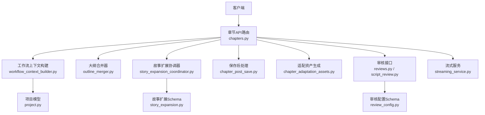
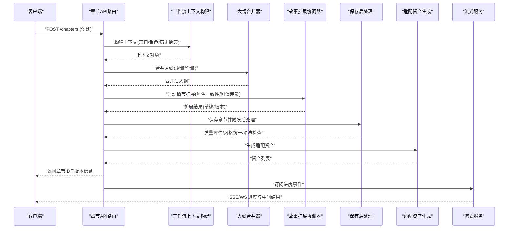
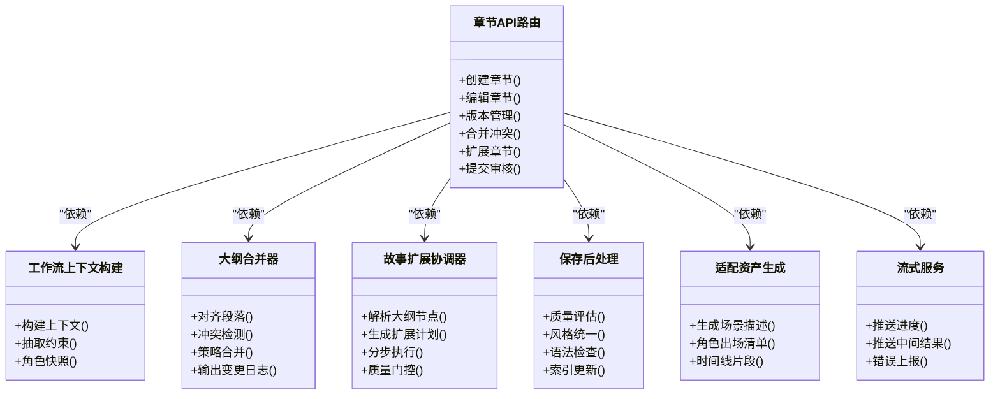

# 章节处理API

<cite>
**本文引用的文件**   
- [backend/app/api/v1/chapters.py](file://backend/app/api/v1/chapters.py)
- [backend/app/services/workflow_context_builder.py](file://backend/app/services/workflow_context_builder.py)
- [backend/app/services/outline_merger.py](file://backend/app/services/outline_merger.py)
- [backend/app/services/story_expansion_coordinator.py](file://backend/app/services/story_expansion_coordinator.py)
- [backend/app/services/chapter_post_save.py](file://backend/app/services/chapter_post_save.py)
- [backend/app/services/chapter_adaptation_assets.py](file://backend/app/services/chapter_adaptation_assets.py)
- [backend/app/models/project.py](file://backend/app/models/project.py)
- [backend/app/schemas/review_config.py](file://backend/app/schemas/review_config.py)
- [backend/app/schemas/story_expansion.py](file://backend/app/schemas/story_expansion.py)
- [backend/app/api/v1/reviews.py](file://backend/app/api/v1/reviews.py)
- [backend/app/api/v1/script_review.py](file://backend/app/api/v1/script_review.py)
- [backend/app/services/streaming_service.py](file://backend/app/services/streaming_service.py)
</cite>

## 目录
1. [简介](#简介)
2. [项目结构](#项目结构)
3. [核心组件](#核心组件)
4. [架构总览](#架构总览)
5. [详细组件分析](#详细组件分析)
6. [依赖关系分析](#依赖关系分析)
7. [性能考量](#性能考量)
8. [故障排查指南](#故障排查指南)
9. [结论](#结论)
10. [附录](#附录)

## 简介
本文件为“章节处理工作流”的专用API文档，覆盖章节的创建、编辑、扩展与审核相关接口；说明章节内容结构、大纲生成、情节发展与角色一致性检查的工作流；包含版本管理、冲突解决与内容合并的自动化流程；提供质量评估、风格统一与语法检查的集成接口；并解释章节与项目其他组件的数据交互与状态同步机制。读者可据此快速对接章节处理的全链路能力，包括异步任务、流式进度与多阶段审核。

## 项目结构
围绕章节处理的代码主要分布在后端API路由、服务层、数据模型与Schema定义中：
- API路由层：暴露HTTP接口，负责参数校验、权限控制与响应封装
- 服务层：编排章节上下文构建、大纲合并、故事扩展协调、保存后处理、适配资产等
- 数据模型与Schema：定义章节、项目、审核配置、故事扩展等数据结构
- 流式服务：支持SSE或WebSocket推送进度与中间结果

图表来源
- [backend/app/api/v1/chapters.py](file://backend/app/api/v1/chapters.py)
- [backend/app/services/workflow_context_builder.py](file://backend/app/services/workflow_context_builder.py)
- [backend/app/services/outline_merger.py](file://backend/app/services/outline_merger.py)
- [backend/app/services/story_expansion_coordinator.py](file://backend/app/services/story_expansion_coordinator.py)
- [backend/app/services/chapter_post_save.py](file://backend/app/services/chapter_post_save.py)
- [backend/app/services/chapter_adaptation_assets.py](file://backend/app/services/chapter_adaptation_assets.py)
- [backend/app/models/project.py](file://backend/app/models/project.py)
- [backend/app/schemas/review_config.py](file://backend/app/schemas/review_config.py)
- [backend/app/schemas/story_expansion.py](file://backend/app/schemas/story_expansion.py)
- [backend/app/api/v1/reviews.py](file://backend/app/api/v1/reviews.py)
- [backend/app/api/v1/script_review.py](file://backend/app/api/v1/script_review.py)
- [backend/app/services/streaming_service.py](file://backend/app/services/streaming_service.py)

章节来源
- [backend/app/api/v1/chapters.py](file://backend/app/api/v1/chapters.py)
- [backend/app/services/workflow_context_builder.py](file://backend/app/services/workflow_context_builder.py)
- [backend/app/services/outline_merger.py](file://backend/app/services/outline_merger.py)
- [backend/app/services/story_expansion_coordinator.py](file://backend/app/services/story_expansion_coordinator.py)
- [backend/app/services/chapter_post_save.py](file://backend/app/services/chapter_post_save.py)
- [backend/app/services/chapter_adaptation_assets.py](file://backend/app/services/chapter_adaptation_assets.py)
- [backend/app/models/project.py](file://backend/app/models/project.py)
- [backend/app/schemas/review_config.py](file://backend/app/schemas/review_config.py)
- [backend/app/schemas/story_expansion.py](file://backend/app/schemas/story_expansion.py)
- [backend/app/api/v1/reviews.py](file://backend/app/api/v1/reviews.py)
- [backend/app/api/v1/script_review.py](file://backend/app/api/v1/script_review.py)
- [backend/app/services/streaming_service.py](file://backend/app/services/streaming_service.py)

## 核心组件
- 章节API路由：提供章节CRUD、批量操作、版本管理与合并、扩展与审核入口
- 工作流上下文构建：聚合项目设定、角色档案、前序章节摘要与约束，形成章节生成的上下文
- 大纲合并器：将用户输入的大纲片段与既有大纲进行结构化合并，处理冲突与重复
- 故事扩展协调器：基于上下文与大纲驱动情节发展，保证角色一致性与剧情连贯性
- 保存后处理：触发质量评估、风格统一、语法检查、索引更新与缓存刷新
- 适配资产生成：为章节生成配套素材（如场景描述、角色出场清单、时间线片段）
- 审核接口：提交审核、查看审核结果、回滚与修订闭环
- 流式服务：推送长耗时任务的进度与中间产物

章节来源
- [backend/app/api/v1/chapters.py](file://backend/app/api/v1/chapters.py)
- [backend/app/services/workflow_context_builder.py](file://backend/app/services/workflow_context_builder.py)
- [backend/app/services/outline_merger.py](file://backend/app/services/outline_merger.py)
- [backend/app/services/story_expansion_coordinator.py](file://backend/app/services/story_expansion_coordinator.py)
- [backend/app/services/chapter_post_save.py](file://backend/app/services/chapter_post_save.py)
- [backend/app/services/chapter_adaptation_assets.py](file://backend/app/services/chapter_adaptation_assets.py)
- [backend/app/api/v1/reviews.py](file://backend/app/api/v1/reviews.py)
- [backend/app/api/v1/script_review.py](file://backend/app/api/v1/script_review.py)
- [backend/app/services/streaming_service.py](file://backend/app/services/streaming_service.py)

## 架构总览
章节处理采用“路由-服务-模型/Schema-外部服务”的分层架构，关键调用链如下：

图表来源
- [backend/app/api/v1/chapters.py](file://backend/app/api/v1/chapters.py)
- [backend/app/services/workflow_context_builder.py](file://backend/app/services/workflow_context_builder.py)
- [backend/app/services/outline_merger.py](file://backend/app/services/outline_merger.py)
- [backend/app/services/story_expansion_coordinator.py](file://backend/app/services/story_expansion_coordinator.py)
- [backend/app/services/chapter_post_save.py](file://backend/app/services/chapter_post_save.py)
- [backend/app/services/chapter_adaptation_assets.py](file://backend/app/services/chapter_adaptation_assets.py)
- [backend/app/services/streaming_service.py](file://backend/app/services/streaming_service.py)

## 详细组件分析

### 章节API路由（创建/编辑/版本/合并/扩展/审核）
- 职责
  - 接收章节创建、编辑请求，校验入参并委派至服务层
  - 管理章节版本：创建新版本、切换基线、合并差异
  - 触发扩展流程：根据大纲与上下文生成情节扩展
  - 发起审核流程：提交审核、查询结果、执行修订
- 典型流程
  - 创建章节：构建上下文→合并大纲→扩展→保存→后处理→生成资产→返回版本
  - 编辑章节：拉取最新版本→增量合并→重新扩展→保存为新版本
  - 合并冲突：读取双端差异→策略合并→生成合并报告→可选人工确认
  - 审核闭环：提交→多规则评估→给出建议→修订→再审核

章节来源
- [backend/app/api/v1/chapters.py](file://backend/app/api/v1/chapters.py)

### 工作流上下文构建
- 职责
  - 聚合项目设定、角色档案、世界观与历史摘要
  - 抽取约束条件（风格、视角、时间线、禁忌词等）
  - 输出标准化上下文对象供后续步骤使用
- 关键点
  - 上下文缓存与失效策略
  - 大文本摘要压缩与关键信息保留
  - 角色一致性快照（当前出场、关系、立场）

章节来源
- [backend/app/services/workflow_context_builder.py](file://backend/app/services/workflow_context_builder.py)
- [backend/app/models/project.py](file://backend/app/models/project.py)

### 大纲合并器
- 职责
  - 将用户输入的大纲片段与现有大纲进行结构化对齐
  - 处理重复段落、冲突分支、顺序调整
  - 输出合并后的稳定大纲与变更日志
- 算法要点
  - 段落级相似度匹配与锚点定位
  - 冲突检测与自动/半自动合并策略
  - 版本化存储与回溯能力

章节来源
- [backend/app/services/outline_merger.py](file://backend/app/services/outline_merger.py)

### 故事扩展协调器
- 职责
  - 基于上下文与大纲驱动情节扩展
  - 维护角色一致性、时间线连贯、伏笔回收
  - 产出可扩展的章节草稿与元数据（场景、对白、动作）
- 工作流
  - 解析大纲节点→生成扩展计划→分步执行→质量门控→汇总输出

章节来源
- [backend/app/services/story_expansion_coordinator.py](file://backend/app/services/story_expansion_coordinator.py)
- [backend/app/schemas/story_expansion.py](file://backend/app/schemas/story_expansion.py)

### 保存后处理与质量评估
- 职责
  - 触发质量评估（语义连贯、风格统一、语法检查）
  - 更新索引与缓存，生成预览与统计
  - 记录审计日志与指标
- 集成点
  - 与审核接口联动，自动标记待审/通过/需修订
  - 与流式服务协作，推送处理进度

章节来源
- [backend/app/services/chapter_post_save.py](file://backend/app/services/chapter_post_save.py)
- [backend/app/api/v1/reviews.py](file://backend/app/api/v1/reviews.py)
- [backend/app/api/v1/script_review.py](file://backend/app/api/v1/script_review.py)
- [backend/app/schemas/review_config.py](file://backend/app/schemas/review_config.py)

### 适配资产生成
- 职责
  - 为章节生成配套素材：场景描述、角色出场清单、时间线片段、关键道具
  - 与前端展示与下游生产管线对接
- 关键点
  - 资产版本与章节版本绑定
  - 增量更新与去重

章节来源
- [backend/app/services/chapter_adaptation_assets.py](file://backend/app/services/chapter_adaptation_assets.py)

### 流式服务（进度与中间结果）
- 职责
  - 提供SSE或WebSocket通道，推送长耗时任务的进度、中间产物与错误
- 使用方式
  - 客户端建立连接→订阅章节任务ID→接收事件→渲染进度

章节来源
- [backend/app/services/streaming_service.py](file://backend/app/services/streaming_service.py)

## 依赖关系分析
章节处理各组件之间的依赖关系如下：

图表来源
- [backend/app/api/v1/chapters.py](file://backend/app/api/v1/chapters.py)
- [backend/app/services/workflow_context_builder.py](file://backend/app/services/workflow_context_builder.py)
- [backend/app/services/outline_merger.py](file://backend/app/services/outline_merger.py)
- [backend/app/services/story_expansion_coordinator.py](file://backend/app/services/story_expansion_coordinator.py)
- [backend/app/services/chapter_post_save.py](file://backend/app/services/chapter_post_save.py)
- [backend/app/services/chapter_adaptation_assets.py](file://backend/app/services/chapter_adaptation_assets.py)
- [backend/app/services/streaming_service.py](file://backend/app/services/streaming_service.py)

章节来源
- [backend/app/api/v1/chapters.py](file://backend/app/api/v1/chapters.py)
- [backend/app/services/workflow_context_builder.py](file://backend/app/services/workflow_context_builder.py)
- [backend/app/services/outline_merger.py](file://backend/app/services/outline_merger.py)
- [backend/app/services/story_expansion_coordinator.py](file://backend/app/services/story_expansion_coordinator.py)
- [backend/app/services/chapter_post_save.py](file://backend/app/services/chapter_post_save.py)
- [backend/app/services/chapter_adaptation_assets.py](file://backend/app/services/chapter_adaptation_assets.py)
- [backend/app/services/streaming_service.py](file://backend/app/services/streaming_service.py)

## 性能考量
- 上下文构建与摘要压缩：对长文本进行分层摘要，减少LLM调用成本与延迟
- 大纲合并：段落级相似度计算与锚点定位，避免全量比对
- 扩展协调：分步执行与并行子任务，结合队列与限流
- 保存后处理：异步化质量评估与索引更新，避免阻塞主流程
- 流式推送：使用SSE/WebSocket降低轮询开销，提升用户体验
- 缓存策略：上下文、资产与中间结果缓存，设置合理失效键

[本节为通用指导，不直接分析具体文件]

## 故障排查指南
- 常见问题
  - 上下文构建失败：检查项目设定完整性、角色档案缺失、历史摘要过期
  - 大纲合并冲突：查看变更日志，确认冲突策略是否合理
  - 扩展失败：核对约束条件、角色一致性快照、时间线冲突
  - 审核未通过：查看审核配置与评分项，定位具体问题
  - 流式中断：检查连接状态、事件队列与重试策略
- 诊断手段
  - 启用详细日志与追踪ID
  - 导出上下文与合并日志
  - 回放扩展计划与中间产物
  - 审核报告与问题明细

章节来源
- [backend/app/api/v1/reviews.py](file://backend/app/api/v1/reviews.py)
- [backend/app/api/v1/script_review.py](file://backend/app/api/v1/script_review.py)
- [backend/app/services/streaming_service.py](file://backend/app/services/streaming_service.py)

## 结论
章节处理工作流以清晰的层次化架构与模块化服务为核心，提供从创建、编辑、扩展到审核的完整闭环。通过上下文构建、大纲合并、情节扩展、质量评估与适配资产生成，确保内容质量与一致性。流式服务与异步处理提升了系统吞吐与用户体验。建议在大规模使用时强化缓存、限流与监控，保障稳定性与性能。

[本节为总结性内容，不直接分析具体文件]

## 附录
- 术语
  - 上下文：项目设定、角色档案、历史摘要与约束的综合体
  - 大纲：章节的结构化骨架，含场景、目标与关键事件
  - 扩展：基于大纲与上下文的情节细化与内容生成
  - 审核：多规则质量评估与修订闭环
- 最佳实践
  - 小步快跑：频繁保存新版本，便于回溯与合并
  - 明确约束：在上下文中清晰表达风格、视角与禁忌
  - 渐进审核：先自动评估，再人工复核，最后定稿
  - 监控告警：关注扩展耗时、审核通过率与错误率

[本节为补充信息，不直接分析具体文件]