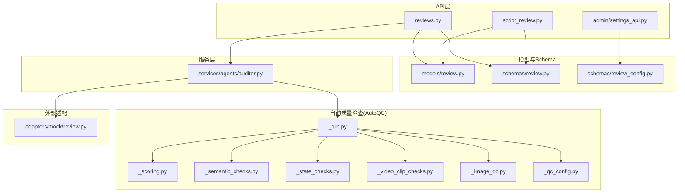
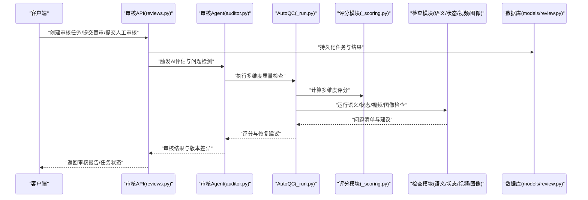
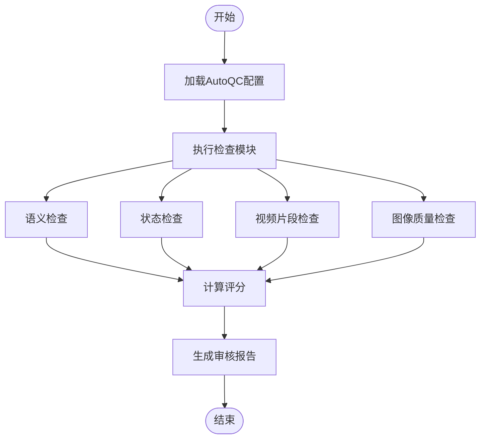
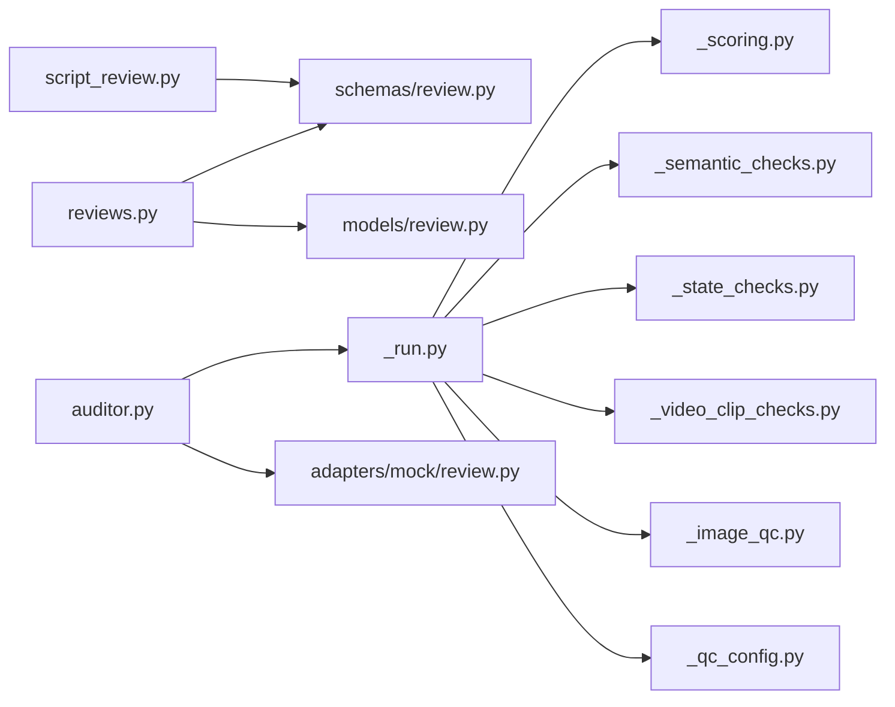

# 审核与质量管控API

<cite>
**本文引用的文件**   
- [backend/app/api/v1/reviews.py](file://backend/app/api/v1/reviews.py)
- [backend/app/api/v1/script_review.py](file://backend/app/api/v1/script_review.py)
- [backend/app/schemas/review.py](file://backend/app/schemas/review.py)
- [backend/app/schemas/review_config.py](file://backend/app/schemas/review_config.py)
- [backend/app/models/review.py](file://backend/app/models/review.py)
- [backend/app/services/agents/auditor.py](file://backend/app/services/agents/auditor.py)
- [pipeline/autoqc_pkg/_run.py](file://pipeline/autoqc_pkg/_run.py)
- [pipeline/autoqc_pkg/_scoring.py](file://pipeline/autoqc_pkg/_scoring.py)
- [pipeline/autoqc_pkg/_semantic_checks.py](file://pipeline/autoqc_pkg/_semantic_checks.py)
- [pipeline/autoqc_pkg/_state_checks.py](file://pipeline/autoqc_pkg/_state_checks.py)
- [pipeline/autoqc_pkg/_video_clip_checks.py](file://pipeline/autoqc_pkg/_video_clip_checks.py)
- [pipeline/autoqc_pkg/_image_qc.py](file://pipeline/autoqc_pkg/_image_qc.py)
- [pipeline/autoqc_pkg/_qc_config.py](file://pipeline/autoqc_pkg/_qc_config.py)
- [adapters/mock/review.py](file://adapters/mock/review.py)
- [backend/app/api/v1/admin/settings_api.py](file://backend/app/api/v1/admin/settings_api.py)
- [backend/app/core/config.py](file://backend/app/core/config.py)
</cite>

## 目录
1. [简介](#简介)
2. [项目结构](#项目结构)
3. [核心组件](#核心组件)
4. [架构总览](#架构总览)
5. [详细组件分析](#详细组件分析)
6. [依赖关系分析](#依赖关系分析)
7. [性能考量](#性能考量)
8. [故障排查指南](#故障排查指南)
9. [结论](#结论)
10. [附录](#附录)

## 简介
本文件为“审核与质量管控系统”的API文档，覆盖以下能力：
- 盲审机制：匿名评审、专家权重、评分聚合与结果隔离。
- AI质量评估：多维度评分、问题检测、修复建议生成。
- 人工审核流程：任务分配、审核意见、版本对比、审批闭环。
- 自动修复：基于规则与AI建议的自动化修复流水线。
- 审核工作流：任务管理、状态流转、批量处理。
- 质量报告：多维指标汇总、趋势分析与导出。
- 配置管理：审核标准、专家权重、持续改进策略。

## 项目结构
审核与质量管控相关代码主要分布在后端API层、数据模型与Schema、服务层（Agent）、以及自动化质量检查（AutoQC）管道中。

图表来源
- [backend/app/api/v1/reviews.py](file://backend/app/api/v1/reviews.py)
- [backend/app/api/v1/script_review.py](file://backend/app/api/v1/script_review.py)
- [backend/app/schemas/review.py](file://backend/app/schemas/review.py)
- [backend/app/schemas/review_config.py](file://backend/app/schemas/review_config.py)
- [backend/app/models/review.py](file://backend/app/models/review.py)
- [backend/app/services/agents/auditor.py](file://backend/app/services/agents/auditor.py)
- [pipeline/autoqc_pkg/_run.py](file://pipeline/autoqc_pkg/_run.py)
- [pipeline/autoqc_pkg/_scoring.py](file://pipeline/autoqc_pkg/_scoring.py)
- [pipeline/autoqc_pkg/_semantic_checks.py](file://pipeline/autoqc_pkg/_semantic_checks.py)
- [pipeline/autoqc_pkg/_state_checks.py](file://pipeline/autoqc_pkg/_state_checks.py)
- [pipeline/autoqc_pkg/_video_clip_checks.py](file://pipeline/autoqc_pkg/_video_clip_checks.py)
- [pipeline/autoqc_pkg/_image_qc.py](file://pipeline/autoqc_pkg/_image_qc.py)
- [pipeline/autoqc_pkg/_qc_config.py](file://pipeline/autoqc_pkg/_qc_config.py)
- [adapters/mock/review.py](file://adapters/mock/review.py)

章节来源
- [backend/app/api/v1/reviews.py](file://backend/app/api/v1/reviews.py)
- [backend/app/api/v1/script_review.py](file://backend/app/api/v1/script_review.py)
- [backend/app/schemas/review.py](file://backend/app/schemas/review.py)
- [backend/app/schemas/review_config.py](file://backend/app/schemas/review_config.py)
- [backend/app/models/review.py](file://backend/app/models/review.py)
- [backend/app/services/agents/auditor.py](file://backend/app/services/agents/auditor.py)
- [pipeline/autoqc_pkg/_run.py](file://pipeline/autoqc_pkg/_run.py)

## 核心组件
- 审核API路由：提供审核任务CRUD、盲审执行、人工审核提交、版本对比、批量操作等接口。
- 脚本审核API：面向文本/脚本内容的专项审核入口，支持语义校验与修复建议。
- 审核Schema与模型：定义审核任务、评分维度、问题项、修复建议、版本差异等数据结构。
- 审核Agent：编排AI评估、问题检测、修复建议生成与结果回写。
- AutoQC管道：实现多维度评分、语义一致性、状态连续性、音视频片段检查、图像质量检查及配置管理。
- Mock适配器：用于测试与联调的模拟审核响应。

章节来源
- [backend/app/api/v1/reviews.py](file://backend/app/api/v1/reviews.py)
- [backend/app/api/v1/script_review.py](file://backend/app/api/v1/script_review.py)
- [backend/app/schemas/review.py](file://backend/app/schemas/review.py)
- [backend/app/schemas/review_config.py](file://backend/app/schemas/review_config.py)
- [backend/app/models/review.py](file://backend/app/models/review.py)
- [backend/app/services/agents/auditor.py](file://backend/app/services/agents/auditor.py)
- [pipeline/autoqc_pkg/_run.py](file://pipeline/autoqc_pkg/_run.py)
- [pipeline/autoqc_pkg/_scoring.py](file://pipeline/autoqc_pkg/_scoring.py)
- [pipeline/autoqc_pkg/_semantic_checks.py](file://pipeline/autoqc_pkg/_semantic_checks.py)
- [pipeline/autoqc_pkg/_state_checks.py](file://pipeline/autoqc_pkg/_state_checks.py)
- [pipeline/autoqc_pkg/_video_clip_checks.py](file://pipeline/autoqc_pkg/_video_clip_checks.py)
- [pipeline/autoqc_pkg/_image_qc.py](file://pipeline/autoqc_pkg/_image_qc.py)
- [pipeline/autoqc_pkg/_qc_config.py](file://pipeline/autoqc_pkg/_qc_config.py)
- [adapters/mock/review.py](file://adapters/mock/review.py)

## 架构总览
审核与质量管控系统采用“API层 + 服务层 + 质量检查管道”的分层架构。API负责请求路由与参数校验；服务层协调审核Agent与AutoQC管道；质量检查管道按维度执行评分与问题检测，并输出修复建议。

图表来源
- [backend/app/api/v1/reviews.py](file://backend/app/api/v1/reviews.py)
- [backend/app/services/agents/auditor.py](file://backend/app/services/agents/auditor.py)
- [pipeline/autoqc_pkg/_run.py](file://pipeline/autoqc_pkg/_run.py)
- [pipeline/autoqc_pkg/_scoring.py](file://pipeline/autoqc_pkg/_scoring.py)
- [pipeline/autoqc_pkg/_semantic_checks.py](file://pipeline/autoqc_pkg/_semantic_checks.py)
- [pipeline/autoqc_pkg/_state_checks.py](file://pipeline/autoqc_pkg/_state_checks.py)
- [pipeline/autoqc_pkg/_video_clip_checks.py](file://pipeline/autoqc_pkg/_video_clip_checks.py)
- [pipeline/autoqc_pkg/_image_qc.py](file://pipeline/autoqc_pkg/_image_qc.py)
- [backend/app/models/review.py](file://backend/app/models/review.py)

## 详细组件分析

### 审核API（reviews.py）
- 功能要点
  - 审核任务管理：创建、查询、更新、删除、批量操作。
  - 盲审机制：匿名评审、专家权重配置、评分聚合、结果隔离。
  - 人工审核：提交审核意见、批准/驳回、版本对比。
  - 质量报告：生成多维评分与问题清单，支持导出。
- 关键输入/输出
  - 输入：任务ID、评审人信息、评分维度、审核意见、版本标识。
  - 输出：任务状态、评分详情、问题列表、修复建议、报告链接。
- 错误处理
  - 参数校验失败、权限不足、任务不存在、并发冲突等。

章节来源
- [backend/app/api/v1/reviews.py](file://backend/app/api/v1/reviews.py)
- [backend/app/schemas/review.py](file://backend/app/schemas/review.py)
- [backend/app/models/review.py](file://backend/app/models/review.py)

### 脚本审核API（script_review.py）
- 功能要点
  - 文本/脚本内容审核：语义一致性、逻辑连贯性、风格合规性。
  - 修复建议：自动生成修改建议与替换片段。
  - 版本对比：展示前后版本差异与影响范围。
- 关键输入/输出
  - 输入：脚本内容、上下文、审核标准、目标维度。
  - 输出：问题定位、修复建议、版本差异摘要。

章节来源
- [backend/app/api/v1/script_review.py](file://backend/app/api/v1/script_review.py)
- [backend/app/schemas/review.py](file://backend/app/schemas/review.py)

### 审核Schema与模型（review.py, review_config.py, models/review.py）
- Schema设计
  - 审核任务：任务ID、类型、状态、创建时间、更新时间。
  - 评分维度：内容质量、技术质量、合规性、用户体验等。
  - 问题项：问题类型、严重级别、位置、描述、修复建议。
  - 版本差异：字段级变更、影响范围、风险提示。
- 模型映射
  - 数据库表结构与字段约束、索引与关联关系。
- 配置项
  - 审核标准、阈值、权重、黑名单/白名单规则。

章节来源
- [backend/app/schemas/review.py](file://backend/app/schemas/review.py)
- [backend/app/schemas/review_config.py](file://backend/app/schemas/review_config.py)
- [backend/app/models/review.py](file://backend/app/models/review.py)

### 审核Agent（auditor.py）
- 职责
  - 编排AI评估流程：调用AutoQC管道、聚合评分、生成修复建议。
  - 管理审核生命周期：任务调度、状态流转、结果回写。
  - 集成Mock适配器：在测试与联调阶段提供稳定响应。
- 关键方法
  - 启动审核、执行检查、合并结果、输出报告。

章节来源
- [backend/app/services/agents/auditor.py](file://backend/app/services/agents/auditor.py)
- [adapters/mock/review.py](file://adapters/mock/review.py)

### AutoQC管道（_run.py, _scoring.py, _semantic_checks.py, _state_checks.py, _video_clip_checks.py, _image_qc.py, _qc_config.py）
- 运行入口（_run.py）
  - 接收审核任务与上下文，按配置执行各检查模块，汇总结果。
- 评分模块（_scoring.py）
  - 多维度评分算法：加权平均、阈值判定、置信度计算。
- 语义检查（_semantic_checks.py）
  - 语义一致性、逻辑连贯性、术语规范、风格匹配。
- 状态检查（_state_checks.py）
  - 状态连续性、时序一致性、条件分支正确性。
- 视频片段检查（_video_clip_checks.py）
  - 帧率、分辨率、码率、转场效果、音画同步。
- 图像质量检查（_image_qc.py）
  - 清晰度、噪声、色彩一致性、构图合理性。
- 配置管理（_qc_config.py）
  - 检查开关、阈值、权重、规则库加载。

图表来源
- [pipeline/autoqc_pkg/_run.py](file://pipeline/autoqc_pkg/_run.py)
- [pipeline/autoqc_pkg/_scoring.py](file://pipeline/autoqc_pkg/_scoring.py)
- [pipeline/autoqc_pkg/_semantic_checks.py](file://pipeline/autoqc_pkg/_semantic_checks.py)
- [pipeline/autoqc_pkg/_state_checks.py](file://pipeline/autoqc_pkg/_state_checks.py)
- [pipeline/autoqc_pkg/_video_clip_checks.py](file://pipeline/autoqc_pkg/_video_clip_checks.py)
- [pipeline/autoqc_pkg/_image_qc.py](file://pipeline/autoqc_pkg/_image_qc.py)
- [pipeline/autoqc_pkg/_qc_config.py](file://pipeline/autoqc_pkg/_qc_config.py)

章节来源
- [pipeline/autoqc_pkg/_run.py](file://pipeline/autoqc_pkg/_run.py)
- [pipeline/autoqc_pkg/_scoring.py](file://pipeline/autoqc_pkg/_scoring.py)
- [pipeline/autoqc_pkg/_semantic_checks.py](file://pipeline/autoqc_pkg/_semantic_checks.py)
- [pipeline/autoqc_pkg/_state_checks.py](file://pipeline/autoqc_pkg/_state_checks.py)
- [pipeline/autoqc_pkg/_video_clip_checks.py](file://pipeline/autoqc_pkg/_video_clip_checks.py)
- [pipeline/autoqc_pkg/_image_qc.py](file://pipeline/autoqc_pkg/_image_qc.py)
- [pipeline/autoqc_pkg/_qc_config.py](file://pipeline/autoqc_pkg/_qc_config.py)

## 依赖关系分析
- API层依赖Schema与模型进行参数校验与数据持久化。
- 审核Agent依赖AutoQC管道与各检查模块，实现质量评估与问题检测。
- AutoQC管道通过配置模块动态启用检查项与调整阈值。
- Mock适配器为测试与联调提供稳定的审核响应。

图表来源
- [backend/app/api/v1/reviews.py](file://backend/app/api/v1/reviews.py)
- [backend/app/api/v1/script_review.py](file://backend/app/api/v1/script_review.py)
- [backend/app/schemas/review.py](file://backend/app/schemas/review.py)
- [backend/app/models/review.py](file://backend/app/models/review.py)
- [backend/app/services/agents/auditor.py](file://backend/app/services/agents/auditor.py)
- [pipeline/autoqc_pkg/_run.py](file://pipeline/autoqc_pkg/_run.py)
- [pipeline/autoqc_pkg/_scoring.py](file://pipeline/autoqc_pkg/_scoring.py)
- [pipeline/autoqc_pkg/_semantic_checks.py](file://pipeline/autoqc_pkg/_semantic_checks.py)
- [pipeline/autoqc_pkg/_state_checks.py](file://pipeline/autoqc_pkg/_state_checks.py)
- [pipeline/autoqc_pkg/_video_clip_checks.py](file://pipeline/autoqc_pkg/_video_clip_checks.py)
- [pipeline/autoqc_pkg/_image_qc.py](file://pipeline/autoqc_pkg/_image_qc.py)
- [pipeline/autoqc_pkg/_qc_config.py](file://pipeline/autoqc_pkg/_qc_config.py)
- [adapters/mock/review.py](file://adapters/mock/review.py)

章节来源
- [backend/app/api/v1/reviews.py](file://backend/app/api/v1/reviews.py)
- [backend/app/services/agents/auditor.py](file://backend/app/services/agents/auditor.py)
- [pipeline/autoqc_pkg/_run.py](file://pipeline/autoqc_pkg/_run.py)

## 性能考量
- 并行检查：AutoQC管道可并行执行各检查模块，缩短整体耗时。
- 增量评估：仅对变更部分重新计算评分与问题检测。
- 缓存策略：对重复内容与历史结果进行缓存，减少重复计算。
- 资源限制：对大体积媒体文件进行分片处理与异步任务队列。
- 监控与告警：记录关键指标与异常，便于性能优化与问题定位。

[本节为通用指导，不直接分析具体文件]

## 故障排查指南
- 常见问题
  - 审核任务失败：检查任务状态、依赖资源、权限配置。
  - 评分异常：核对阈值与权重配置，确认检查模块是否启用。
  - 修复建议无效：验证规则库与AI模型可用性。
  - 版本对比不一致：确认版本标识与差异计算逻辑。
- 调试步骤
  - 查看日志与错误堆栈，定位失败环节。
  - 使用Mock适配器验证接口稳定性。
  - 逐步禁用检查模块，缩小问题范围。
  - 检查数据库记录与Schema一致性。

章节来源
- [adapters/mock/review.py](file://adapters/mock/review.py)
- [backend/app/core/config.py](file://backend/app/core/config.py)

## 结论
本系统通过分层架构与模块化设计，实现了完整的审核与质量管控能力。API层提供灵活的接口，服务层协调AI与规则引擎，AutoQC管道确保多维度质量评估。结合盲审机制、人工审核流程与自动修复功能，形成闭环的质量保障体系。

[本节为总结性内容，不直接分析具体文件]

## 附录
- 审核标准配置：定义维度权重、阈值、规则库与黑名单。
- 专家权重：支持多专家评分与加权聚合，确保公平性与准确性。
- 持续改进机制：基于反馈与历史数据优化评分模型与规则。
- 批量处理示例：支持批量创建任务、批量提交审核、批量导出报告。
- 版本对比示例：展示字段级差异与影响范围，辅助决策。

[本节为补充说明，不直接分析具体文件]