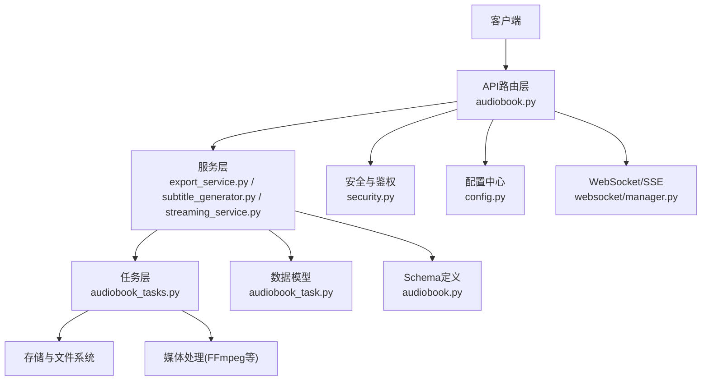
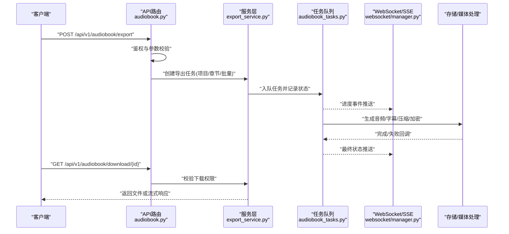
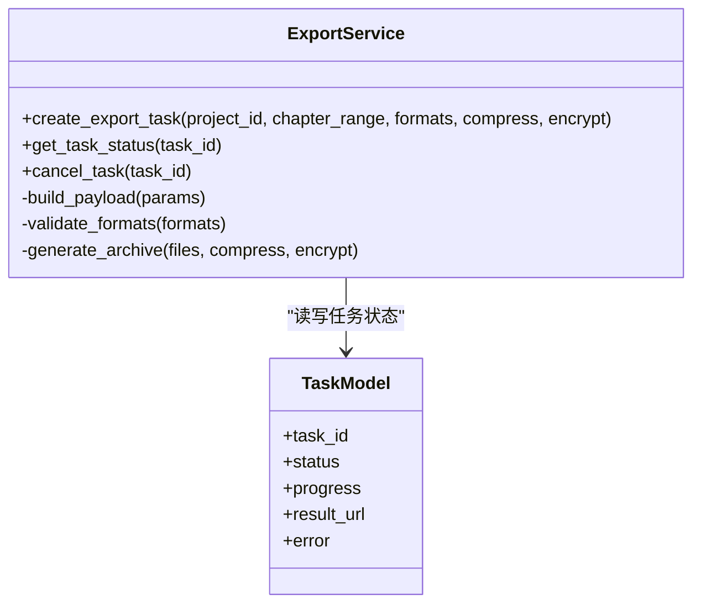
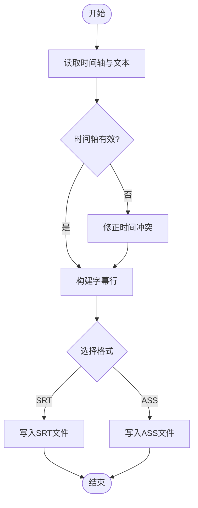
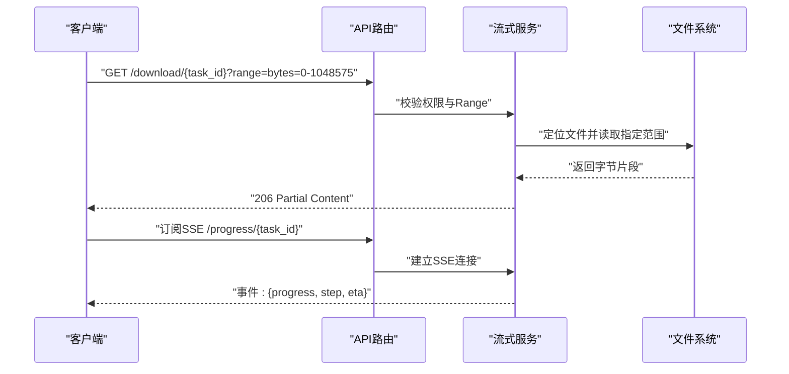
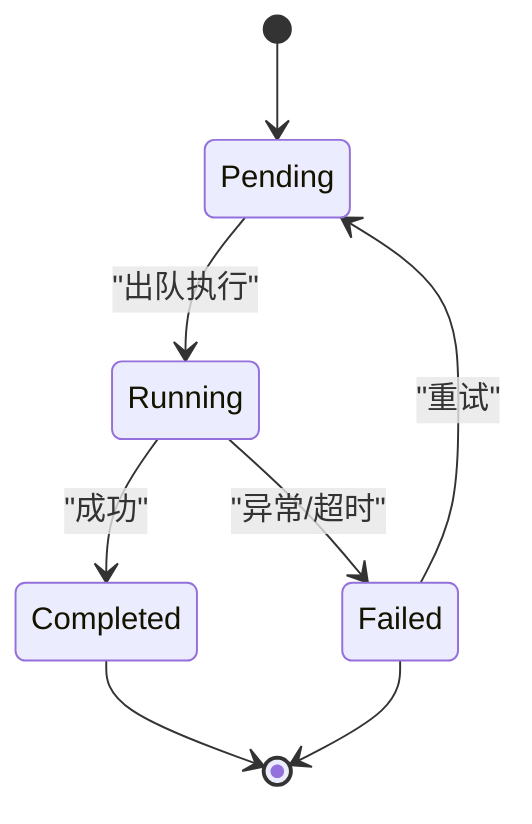
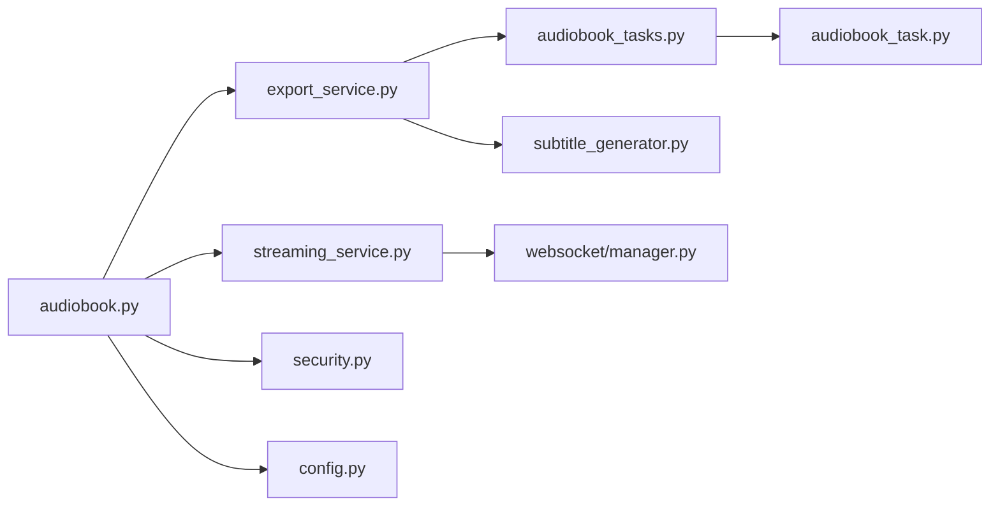

# 导出与下载API

<cite>
**本文档引用的文件**   
- [backend/app/api/v1/audiobook.py](file://backend/app/api/v1/audiobook.py)
- [backend/app/services/audiobook/export_service.py](file://backend/app/services/audiobook/export_service.py)
- [backend/app/services/audiobook/subtitle_generator.py](file://backend/app/services/audiobook/subtitle_generator.py)
- [backend/app/services/audiobook/streaming_service.py](file://backend/app/services/audiobook/streaming_service.py)
- [backend/app/tasks/audiobook_tasks.py](file://backend/app/tasks/audiobook_tasks.py)
- [backend/app/models/audiobook_task.py](file://backend/app/models/audiobook_task.py)
- [backend/app/schemas/audiobook.py](file://backend/app/schemas/audiobook.py)
- [backend/app/core/security.py](file://backend/app/core/security.py)
- [backend/app/core/config.py](file://backend/app/core/config.py)
- [backend/app/websocket/manager.py](file://backend/app/websocket/manager.py)
- [backend/tests/test_audiobook_exports.py](file://backend/tests/test_audiobook_exports.py)
- [backend/tests/test_audiobook_stream_routes.py](file://backend/tests/test_audiobook_stream_routes.py)
- [backend/tests/test_audiobook_sse_progress.py](file://backend/tests/test_audiobook_sse_progress.py)
</cite>

## 目录
1. [简介](#简介)
2. [项目结构](#项目结构)
3. [核心组件](#核心组件)
4. [架构总览](#架构总览)
5. [详细组件分析](#详细组件分析)
6. [依赖关系分析](#依赖关系分析)
7. [性能考量](#性能考量)
8. [故障排查指南](#故障排查指南)
9. [结论](#结论)
10. [附录：接口清单与示例](#附录接口清单与示例)

## 简介
本章节面向“导出与下载”能力，覆盖项目打包、音频文件下载、字幕生成与格式转换的API。文档涵盖多输出格式（MP3、WAV、SRT、ASS等）、分章节导出、批量下载、流式传输、任务管理、进度跟踪、断点续传、文件压缩、加密保护与访问控制机制。读者可据此快速集成并稳定使用导出与下载功能。

## 项目结构
导出与下载相关代码主要分布在后端API层、服务层、任务调度层、数据模型与Schema定义、以及测试用例中。整体采用分层设计：
- API路由层：暴露HTTP接口，负责鉴权、参数校验、请求分发
- 服务层：封装导出、字幕生成、流式传输等业务逻辑
- 任务层：基于异步任务队列处理耗时操作（打包、转码、压缩）
- 模型与Schema：统一数据结构与数据库映射
- WebSocket/SSE：用于实时进度推送与流式响应

**图表来源** 
- [backend/app/api/v1/audiobook.py](file://backend/app/api/v1/audiobook.py)
- [backend/app/services/audiobook/export_service.py](file://backend/app/services/audiobook/export_service.py)
- [backend/app/services/audiobook/subtitle_generator.py](file://backend/app/services/audiobook/subtitle_generator.py)
- [backend/app/services/audiobook/streaming_service.py](file://backend/app/services/audiobook/streaming_service.py)
- [backend/app/tasks/audiobook_tasks.py](file://backend/app/tasks/audiobook_tasks.py)
- [backend/app/models/audiobook_task.py](file://backend/app/models/audiobook_task.py)
- [backend/app/schemas/audiobook.py](file://backend/app/schemas/audiobook.py)
- [backend/app/core/security.py](file://backend/app/core/security.py)
- [backend/app/core/config.py](file://backend/app/core/config.py)
- [backend/app/websocket/manager.py](file://backend/app/websocket/manager.py)

**章节来源**
- [backend/app/api/v1/audiobook.py](file://backend/app/api/v1/audiobook.py)
- [backend/app/services/audiobook/export_service.py](file://backend/app/services/audiobook/export_service.py)
- [backend/app/services/audiobook/subtitle_generator.py](file://backend/app/services/audiobook/subtitle_generator.py)
- [backend/app/services/audiobook/streaming_service.py](file://backend/app/services/audiobook/streaming_service.py)
- [backend/app/tasks/audiobook_tasks.py](file://backend/app/tasks/audiobook_tasks.py)
- [backend/app/models/audiobook_task.py](file://backend/app/models/audiobook_task.py)
- [backend/app/schemas/audiobook.py](file://backend/app/schemas/audiobook.py)
- [backend/app/core/security.py](file://backend/app/core/security.py)
- [backend/app/core/config.py](file://backend/app/core/config.py)
- [backend/app/websocket/manager.py](file://backend/app/websocket/manager.py)

## 核心组件
- 导出服务：负责按项目或章节打包音频与字幕，支持多种格式与压缩选项
- 字幕生成器：从时间轴或TTS元数据生成SRT、ASS等字幕文件
- 流式服务：提供音频流式下载与SSE进度推送，支持Range断点续传
- 任务调度：将耗时导出任务入队，异步执行并持久化状态
- 安全与配置：鉴权、权限控制、加密开关、存储路径与并发限制

**章节来源**
- [backend/app/services/audiobook/export_service.py](file://backend/app/services/audiobook/export_service.py)
- [backend/app/services/audiobook/subtitle_generator.py](file://backend/app/services/audiobook/subtitle_generator.py)
- [backend/app/services/audiobook/streaming_service.py](file://backend/app/services/audiobook/streaming_service.py)
- [backend/app/tasks/audiobook_tasks.py](file://backend/app/tasks/audiobook_tasks.py)
- [backend/app/core/security.py](file://backend/app/core/security.py)
- [backend/app/core/config.py](file://backend/app/core/config.py)

## 架构总览
导出与下载的整体流程如下：
- 客户端发起导出/下载请求，API路由进行鉴权与参数校验
- 服务层根据请求构建导出任务（单章/全量/批量），调用任务队列异步执行
- 任务执行过程中更新任务状态与进度，通过SSE/WebSocket推送给客户端
- 音频与字幕生成完成后，支持直接下载或流式传输；可选压缩与加密
- 失败时返回错误码与诊断信息，支持重试与断点续传

**图表来源** 
- [backend/app/api/v1/audiobook.py](file://backend/app/api/v1/audiobook.py)
- [backend/app/services/audiobook/export_service.py](file://backend/app/services/audiobook/export_service.py)
- [backend/app/tasks/audiobook_tasks.py](file://backend/app/tasks/audiobook_tasks.py)
- [backend/app/websocket/manager.py](file://backend/app/websocket/manager.py)

## 详细组件分析

### 导出服务（ExportService）
职责：
- 接收导出请求（项目ID、章节范围、输出格式、是否压缩、是否加密）
- 组装任务参数，调用任务队列执行
- 维护任务生命周期（创建、运行、完成、失败）
- 聚合音频与字幕产物，生成压缩包（可选）

关键行为：
- 分章节导出：按章节粒度生成音频与字幕，支持合并为整包
- 批量导出：跨多个项目或章节并行处理，限制并发度
- 格式转换：支持MP3、WAV音频；SRT、ASS字幕
- 压缩与加密：ZIP打包，AES加密（可选）

**图表来源** 
- [backend/app/services/audiobook/export_service.py](file://backend/app/services/audiobook/export_service.py)
- [backend/app/models/audiobook_task.py](file://backend/app/models/audiobook_task.py)

**章节来源**
- [backend/app/services/audiobook/export_service.py](file://backend/app/services/audiobook/export_service.py)
- [backend/app/models/audiobook_task.py](file://backend/app/models/audiobook_task.py)

### 字幕生成器（SubtitleGenerator）
职责：
- 从TTS时间戳或音频切分结果生成标准字幕
- 支持SRT（简单时间轴）与ASS（高级样式）两种格式
- 兼容不同语言编码与换行规范

关键行为：
- 输入：文本片段、起止时间、说话人标签（可选）
- 输出：SRT/ASS文件路径与元数据
- 错误处理：时间重叠修正、非法字符过滤

**图表来源** 
- [backend/app/services/audiobook/subtitle_generator.py](file://backend/app/services/audiobook/subtitle_generator.py)

**章节来源**
- [backend/app/services/audiobook/subtitle_generator.py](file://backend/app/services/audiobook/subtitle_generator.py)

### 流式服务（StreamingService）
职责：
- 提供音频文件的流式下载，支持Range头实现断点续传
- 通过SSE推送导出任务进度
- 大文件分块传输，降低内存占用

关键行为：
- 校验下载权限与文件存在性
- 计算字节范围，返回206 Partial Content
- SSE事件包含进度百分比、当前步骤、剩余时间估算

**图表来源** 
- [backend/app/services/audiobook/streaming_service.py](file://backend/app/services/audiobook/streaming_service.py)
- [backend/app/websocket/manager.py](file://backend/app/websocket/manager.py)

**章节来源**
- [backend/app/services/audiobook/streaming_service.py](file://backend/app/services/audiobook/streaming_service.py)
- [backend/app/websocket/manager.py](file://backend/app/websocket/manager.py)

### 任务调度（AudiobookTasks）
职责：
- 将导出任务入队，设置优先级与重试策略
- 监控任务执行状态，更新数据库记录
- 失败时触发告警与回滚

关键行为：
- 支持并发控制与资源隔离
- 任务超时与自动重试
- 结果持久化与清理临时文件

**图表来源** 
- [backend/app/tasks/audiobook_tasks.py](file://backend/app/tasks/audiobook_tasks.py)
- [backend/app/models/audiobook_task.py](file://backend/app/models/audiobook_task.py)

**章节来源**
- [backend/app/tasks/audiobook_tasks.py](file://backend/app/tasks/audiobook_tasks.py)
- [backend/app/models/audiobook_task.py](file://backend/app/models/audiobook_task.py)

### 安全与访问控制（Security & Config）
职责：
- 鉴权：JWT或会话令牌校验
- 授权：基于角色或资源的访问控制（RBAC）
- 配置：加密开关、存储路径、并发限制、超时策略

关键行为：
- 导出任务仅对拥有项目权限的用户开放
- 下载链接带短期有效签名，防止越权访问
- 敏感配置通过环境变量注入，避免硬编码

**章节来源**
- [backend/app/core/security.py](file://backend/app/core/security.py)
- [backend/app/core/config.py](file://backend/app/core/config.py)

## 依赖关系分析
导出与下载模块之间的依赖关系如下：
- API路由依赖服务层进行业务编排
- 服务层依赖任务调度与数据模型
- 任务层依赖存储与媒体处理工具
- 安全与配置贯穿各层，保障一致性与可控性

**图表来源** 
- [backend/app/api/v1/audiobook.py](file://backend/app/api/v1/audiobook.py)
- [backend/app/services/audiobook/export_service.py](file://backend/app/services/audiobook/export_service.py)
- [backend/app/services/audiobook/streaming_service.py](file://backend/app/services/audiobook/streaming_service.py)
- [backend/app/tasks/audiobook_tasks.py](file://backend/app/tasks/audiobook_tasks.py)
- [backend/app/services/audiobook/subtitle_generator.py](file://backend/app/services/audiobook/subtitle_generator.py)
- [backend/app/models/audiobook_task.py](file://backend/app/models/audiobook_task.py)
- [backend/app/websocket/manager.py](file://backend/app/websocket/manager.py)
- [backend/app/core/security.py](file://backend/app/core/security.py)
- [backend/app/core/config.py](file://backend/app/core/config.py)

**章节来源**
- [backend/app/api/v1/audiobook.py](file://backend/app/api/v1/audiobook.py)
- [backend/app/services/audiobook/export_service.py](file://backend/app/services/audiobook/export_service.py)
- [backend/app/services/audiobook/streaming_service.py](file://backend/app/services/audiobook/streaming_service.py)
- [backend/app/tasks/audiobook_tasks.py](file://backend/app/tasks/audiobook_tasks.py)
- [backend/app/services/audiobook/subtitle_generator.py](file://backend/app/services/audiobook/subtitle_generator.py)
- [backend/app/models/audiobook_task.py](file://backend/app/models/audiobook_task.py)
- [backend/app/websocket/manager.py](file://backend/app/websocket/manager.py)
- [backend/app/core/security.py](file://backend/app/core/security.py)
- [backend/app/core/config.py](file://backend/app/core/config.py)

## 性能考量
- 流式传输：优先使用分块传输与Range请求，减少内存峰值
- 并发控制：限制同时执行的导出任务数，避免资源争用
- 缓存策略：对重复导出的中间结果进行缓存，提升二次导出速度
- I/O优化：使用异步I/O与缓冲池，提高磁盘与网络吞吐
- 压缩与加密：按需启用，避免不必要的CPU开销

[本节为通用指导，不直接分析具体文件]

## 故障排查指南
常见问题与定位方法：
- 导出失败：检查任务状态与错误日志，确认输入文件完整性
- 下载中断：验证Range头与服务器支持，检查网络稳定性
- 进度不更新：确认SSE连接状态与任务队列消费情况
- 权限错误：核对用户角色与资源访问策略
- 格式不支持：确认输出格式列表与编码器可用性

**章节来源**
- [backend/tests/test_audiobook_exports.py](file://backend/tests/test_audiobook_exports.py)
- [backend/tests/test_audiobook_stream_routes.py](file://backend/tests/test_audiobook_stream_routes.py)
- [backend/tests/test_audiobook_sse_progress.py](file://backend/tests/test_audiobook_sse_progress.py)

## 结论
导出与下载功能通过清晰的分层架构与完善的任务管理，提供了稳定高效的音频与字幕处理能力。支持多格式输出、流式传输、断点续传、压缩加密与访问控制，满足多样化业务场景。建议在生产环境结合监控与限流策略，确保高可用与可扩展性。

[本节为总结性内容，不直接分析具体文件]

## 附录：接口清单与示例
以下为导出与下载相关接口的概览（以路径与用途为主，不包含具体请求体与响应体）：

- 导出任务
  - POST /api/v1/audiobook/export
    - 用途：创建导出任务（项目/章节/批量）
    - 参数：project_id、chapter_range、formats、compress、encrypt
    - 响应：task_id、status、progress
    - 参考：[backend/app/api/v1/audiobook.py](file://backend/app/api/v1/audiobook.py)、[backend/app/schemas/audiobook.py](file://backend/app/schemas/audiobook.py)

- 任务状态查询
  - GET /api/v1/audiobook/task/{task_id}
    - 用途：获取任务状态与进度
    - 响应：status、progress、result_url、error
    - 参考：[backend/app/models/audiobook_task.py](file://backend/app/models/audiobook_task.py)

- 取消任务
  - DELETE /api/v1/audiobook/task/{task_id}
    - 用途：取消正在执行的导出任务
    - 响应：success、message
    - 参考：[backend/app/tasks/audiobook_tasks.py](file://backend/app/tasks/audiobook_tasks.py)

- 下载文件
  - GET /api/v1/audiobook/download/{task_id}
    - 用途：下载导出结果（支持Range断点续传）
    - 响应：文件流或压缩包
    - 参考：[backend/app/services/audiobook/streaming_service.py](file://backend/app/services/audiobook/streaming_service.py)

- 进度推送（SSE）
  - GET /api/v1/audiobook/progress/{task_id}
    - 用途：订阅任务进度事件
    - 事件：{progress, step, eta}
    - 参考：[backend/app/websocket/manager.py](file://backend/app/websocket/manager.py)

- 字幕生成
  - POST /api/v1/audiobook/subtitles
    - 用途：根据时间轴生成SRT/ASS字幕
    - 参数：text_segments、timestamps、format
    - 响应：file_path、format、encoding
    - 参考：[backend/app/services/audiobook/subtitle_generator.py](file://backend/app/services/audiobook/subtitle_generator.py)

- 批量导出
  - POST /api/v1/audiobook/batch-export
    - 用途：跨项目或章节批量创建导出任务
    - 参数：targets、formats、options
    - 响应：task_ids、status
    - 参考：[backend/app/services/audiobook/export_service.py](file://backend/app/services/audiobook/export_service.py)

**章节来源**
- [backend/app/api/v1/audiobook.py](file://backend/app/api/v1/audiobook.py)
- [backend/app/services/audiobook/export_service.py](file://backend/app/services/audiobook/export_service.py)
- [backend/app/services/audiobook/subtitle_generator.py](file://backend/app/services/audiobook/subtitle_generator.py)
- [backend/app/services/audiobook/streaming_service.py](file://backend/app/services/audiobook/streaming_service.py)
- [backend/app/tasks/audiobook_tasks.py](file://backend/app/tasks/audiobook_tasks.py)
- [backend/app/models/audiobook_task.py](file://backend/app/models/audiobook_task.py)
- [backend/app/schemas/audiobook.py](file://backend/app/schemas/audiobook.py)
- [backend/app/websocket/manager.py](file://backend/app/websocket/manager.py)