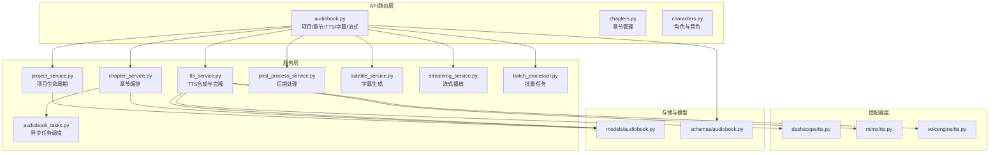
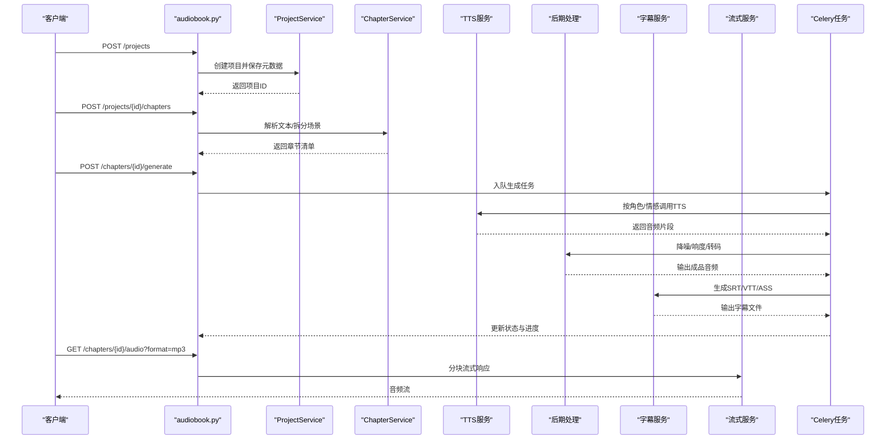
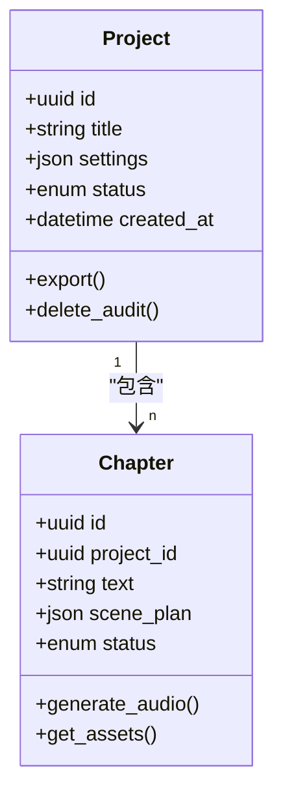
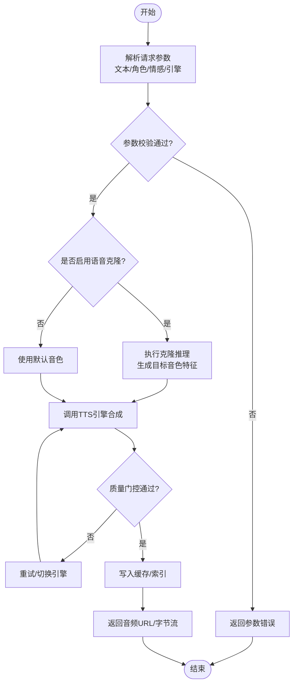
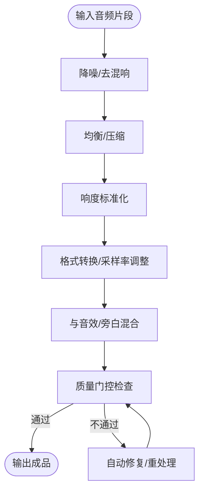
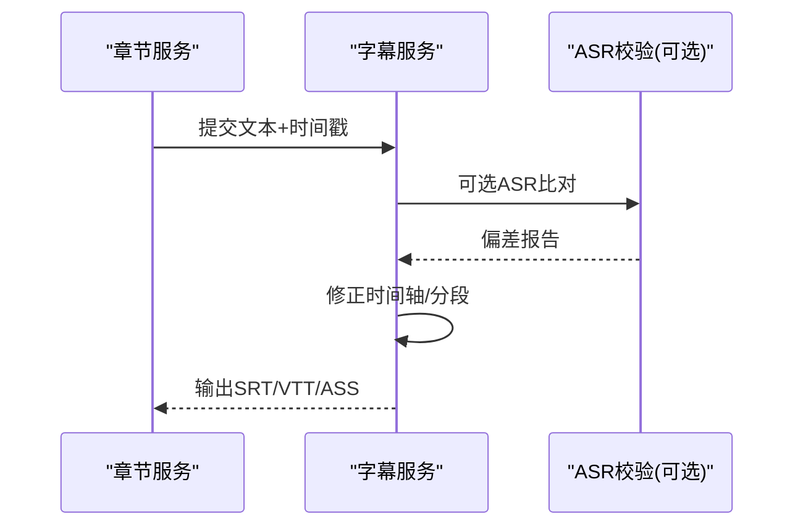
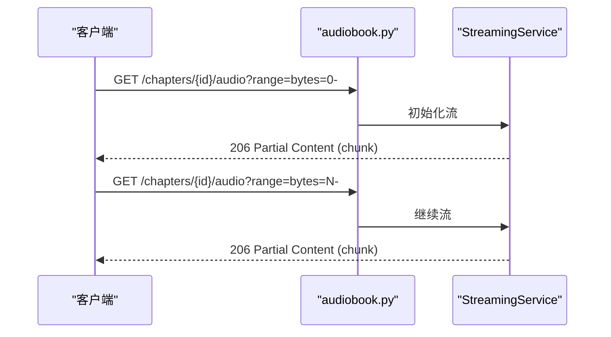
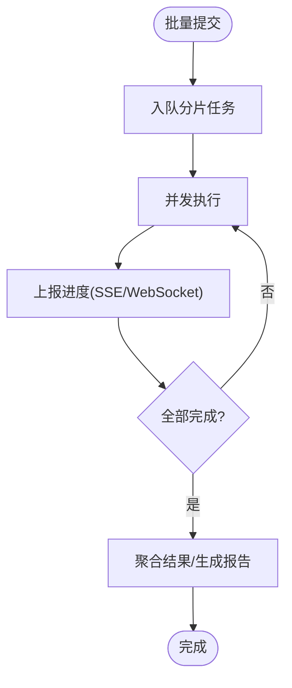
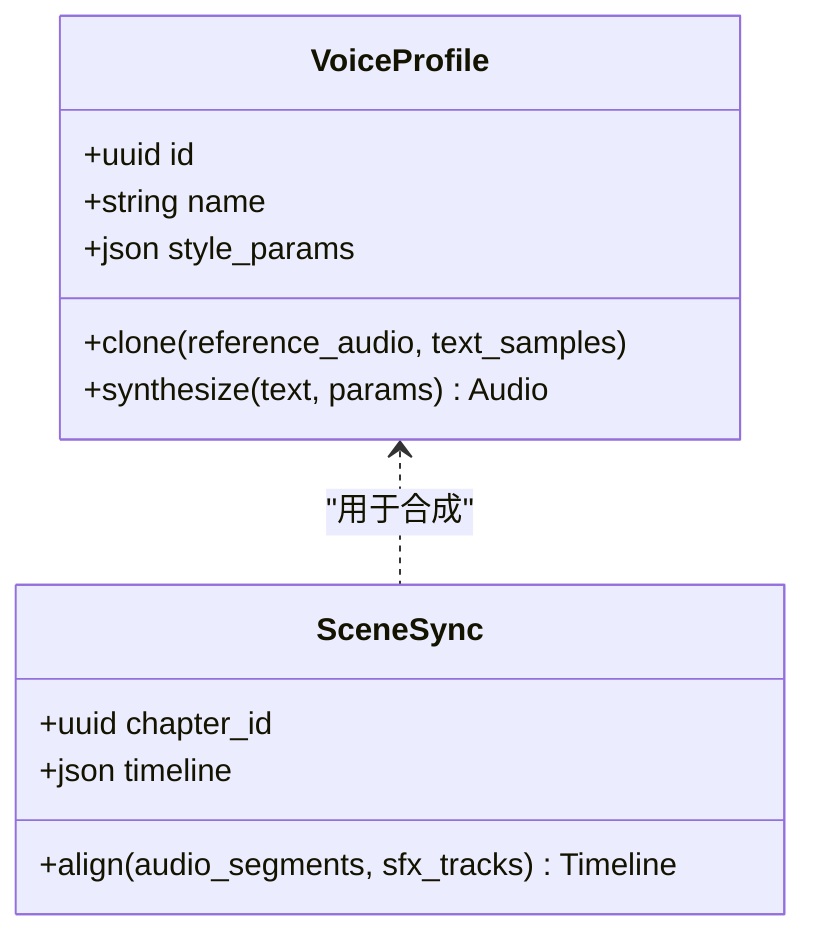
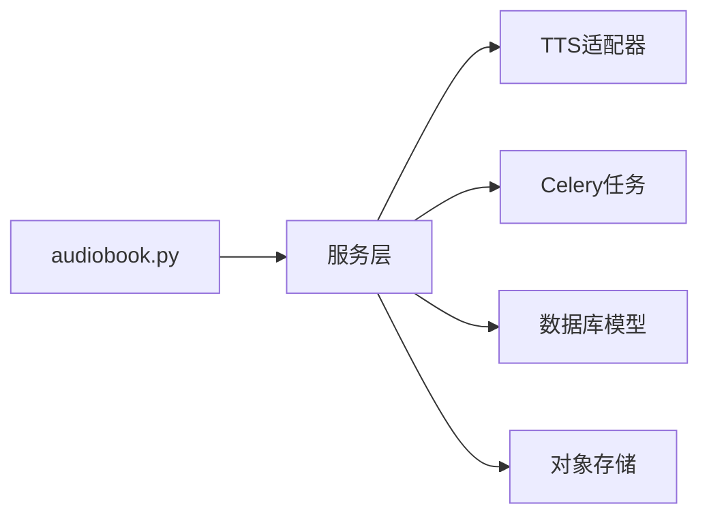

# 有声书API

<cite>
**本文引用的文件**   
- [backend/app/api/v1/audiobook.py](file://backend/app/api/v1/audiobook.py)
- [backend/app/api/v1/chapters.py](file://backend/app/api/v1/chapters.py)
- [backend/app/api/v1/characters.py](file://backend/app/api/v1/characters.py)
- [backend/app/schemas/audiobook.py](file://backend/app/schemas/audiobook.py)
- [backend/app/models/audiobook.py](file://backend/app/models/audiobook.py)
- [backend/app/services/audiobook/project_service.py](file://backend/app/services/audiobook/project_service.py)
- [backend/app/services/audiobook/chapter_service.py](file://backend/app/services/audiobook/chapter_service.py)
- [backend/app/services/audiobook/tts_service.py](file://backend/app/services/audiobook/tts_service.py)
- [backend/app/services/audiobook/post_process_service.py](file://backend/app/services/audiobook/post_process_service.py)
- [backend/app/services/audiobook/subtitle_service.py](file://backend/app/services/audiobook/subtitle_service.py)
- [backend/app/services/audiobook/streaming_service.py](file://backend/app/services/audiobook/streaming_service.py)
- [backend/app/services/batch_processor.py](file://backend/app/services/batch_processor.py)
- [backend/app/services/tasks/audiobook_tasks.py](file://backend/app/services/tasks/audiobook_tasks.py)
- [adapters/dashscope/tts.py](file://adapters/dashscope/tts.py)
- [adapters/mimo/tts.py](file://adapters/mimo/tts.py)
- [adapters/volcengine/tts.py](file://adapters/volcengine/tts.py)
- [agents/sound_effect_manager.py](file://agents/sound_effect_manager.py)
- [agents/audio_sync_manager.py](file://agents/audio_sync_manager.py)
- [backend/app/services/streaming_service.py](file://backend/app/services/streaming_service.py)
</cite>

## 目录
1. [简介](#简介)
2. [项目结构](#项目结构)
3. [核心组件](#核心组件)
4. [架构总览](#架构总览)
5. [详细组件分析](#详细组件分析)
6. [依赖关系分析](#依赖关系分析)
7. [性能考量](#性能考量)
8. [故障排查指南](#故障排查指南)
9. [结论](#结论)
10. [附录](#附录)

## 简介
本文件为小说创作代理系统的“有声书API”技术文档，聚焦以下能力：
- 有声书项目创建与管理
- 章节音频生成（TTS引擎集成、语音克隆、情感控制）
- 后期处理（混音、响度标准化、转码）
- 音效管理与字幕生成
- 音频质量控制与流媒体播放
- 批量处理、进度跟踪与错误恢复机制

该API面向开发者与集成方，提供REST接口定义、数据模型说明、调用流程与最佳实践。

## 项目结构
后端采用分层架构：路由层（API）、服务层（业务编排）、适配器层（第三方TTS/视频/图像等）、任务队列（Celery）、数据库模型与Schema校验。

图表来源
- [backend/app/api/v1/audiobook.py](file://backend/app/api/v1/audiobook.py)
- [backend/app/services/audiobook/project_service.py](file://backend/app/services/audiobook/project_service.py)
- [backend/app/services/audiobook/chapter_service.py](file://backend/app/services/audiobook/chapter_service.py)
- [backend/app/services/audiobook/tts_service.py](file://backend/app/services/audiobook/tts_service.py)
- [backend/app/services/audiobook/post_process_service.py](file://backend/app/services/audiobook/post_process_service.py)
- [backend/app/services/audiobook/subtitle_service.py](file://backend/app/services/audiobook/subtitle_service.py)
- [backend/app/services/audiobook/streaming_service.py](file://backend/app/services/audiobook/streaming_service.py)
- [backend/app/services/batch_processor.py](file://backend/app/services/batch_processor.py)
- [backend/app/services/tasks/audiobook_tasks.py](file://backend/app/services/tasks/audiobook_tasks.py)
- [adapters/dashscope/tts.py](file://adapters/dashscope/tts.py)
- [adapters/mimo/tts.py](file://adapters/mimo/tts.py)
- [adapters/volcengine/tts.py](file://adapters/volcengine/tts.py)
- [backend/app/models/audiobook.py](file://backend/app/models/audiobook.py)
- [backend/app/schemas/audiobook.py](file://backend/app/schemas/audiobook.py)

章节来源
- [backend/app/api/v1/audiobook.py](file://backend/app/api/v1/audiobook.py)
- [backend/app/api/v1/chapters.py](file://backend/app/api/v1/chapters.py)
- [backend/app/api/v1/characters.py](file://backend/app/api/v1/characters.py)

## 核心组件
- 项目服务（Project Service）：负责有声书项目的创建、配置、导出与删除审计。
- 章节服务（Chapter Service）：章节拆分、场景规划、素材准备与生成编排。
- TTS服务（TTS Service）：多引擎接入（DashScope、Mimo、VolcEngine），支持语音克隆、情感参数、预览与缓存。
- 后期处理服务（Post Process Service）：降噪、响度标准化、格式转换、拼接与质量门控。
- 字幕服务（Subtitle Service）：SRT/VTT/ASS等多格式字幕生成与时间轴对齐。
- 流式服务（Streaming Service）：分块传输、断点续传、HLS/DASH片段化播放。
- 批量处理器（Batch Processor）：并发控制、重试与进度上报。
- 任务队列（Audiobook Tasks）：Celery任务编排、失败诊断与恢复。

章节来源
- [backend/app/services/audiobook/project_service.py](file://backend/app/services/audiobook/project_service.py)
- [backend/app/services/audiobook/chapter_service.py](file://backend/app/services/audiobook/chapter_service.py)
- [backend/app/services/audiobook/tts_service.py](file://backend/app/services/audiobook/tts_service.py)
- [backend/app/services/audiobook/post_process_service.py](file://backend/app/services/audiobook/post_process_service.py)
- [backend/app/services/audiobook/subtitle_service.py](file://backend/app/services/audiobook/subtitle_service.py)
- [backend/app/services/audiobook/streaming_service.py](file://backend/app/services/audiobook/streaming_service.py)
- [backend/app/services/batch_processor.py](file://backend/app/services/batch_processor.py)
- [backend/app/services/tasks/audiobook_tasks.py](file://backend/app/services/tasks/audiobook_tasks.py)

## 架构总览
系统以FastAPI作为HTTP入口，服务层进行业务编排，通过适配器对接多个TTS供应商；音频与字幕产物持久化到对象存储或本地磁盘；Celery承担耗时任务；WebSocket/SSE用于实时进度推送。

图表来源
- [backend/app/api/v1/audiobook.py](file://backend/app/api/v1/audiobook.py)
- [backend/app/services/audiobook/project_service.py](file://backend/app/services/audiobook/project_service.py)
- [backend/app/services/audiobook/chapter_service.py](file://backend/app/services/audiobook/chapter_service.py)
- [backend/app/services/audiobook/tts_service.py](file://backend/app/services/audiobook/tts_service.py)
- [backend/app/services/audiobook/post_process_service.py](file://backend/app/services/audiobook/post_process_service.py)
- [backend/app/services/audiobook/subtitle_service.py](file://backend/app/services/audiobook/subtitle_service.py)
- [backend/app/services/audiobook/streaming_service.py](file://backend/app/services/audiobook/streaming_service.py)
- [backend/app/services/tasks/audiobook_tasks.py](file://backend/app/services/tasks/audiobook_tasks.py)

## 详细组件分析

### 项目与章节管理API
- 项目CRUD：创建、查询、更新、导出、删除（含审计）。
- 章节管理：上传脚本、自动拆分、场景规划、模板填充。
- 关键请求体与响应遵循统一Schema校验。

图表来源
- [backend/app/models/audiobook.py](file://backend/app/models/audiobook.py)
- [backend/app/schemas/audiobook.py](file://backend/app/schemas/audiobook.py)

章节来源
- [backend/app/api/v1/audiobook.py](file://backend/app/api/v1/audiobook.py)
- [backend/app/api/v1/chapters.py](file://backend/app/api/v1/chapters.py)
- [backend/app/schemas/audiobook.py](file://backend/app/schemas/audiobook.py)

### TTS引擎集成与语音克隆
- 支持的引擎：DashScope、Mimo、VolcEngine。
- 功能要点：
  - 多模型选择与回退策略
  - 语音克隆（上传参考音频/文本对）
  - 情感控制（语速、语调、停顿、强调）
  - 预览与缓存（避免重复合成）
  - 角色分配（按角色绑定音色与风格）

图表来源
- [backend/app/services/audiobook/tts_service.py](file://backend/app/services/audiobook/tts_service.py)
- [adapters/dashscope/tts.py](file://adapters/dashscope/tts.py)
- [adapters/mimo/tts.py](file://adapters/mimo/tts.py)
- [adapters/volcengine/tts.py](file://adapters/volcengine/tts.py)

章节来源
- [backend/app/services/audiobook/tts_service.py](file://backend/app/services/audiobook/tts_service.py)
- [adapters/dashscope/tts.py](file://adapters/dashscope/tts.py)
- [adapters/mimo/tts.py](file://adapters/mimo/tts.py)
- [adapters/volcengine/tts.py](file://adapters/volcengine/tts.py)

### 后期处理与音效管理
- 后期处理：降噪、均衡、压缩、响度标准化（EBU R128/LUFS）、格式转换（MP3/WAV/FLAC）、拼接与淡入淡出。
- 音效管理：基于标签检索、音量融合、动态避让（ducking）、环境声叠加。
- 质量门控：峰值限制、静音检测、ASR一致性校验。

图表来源
- [backend/app/services/audiobook/post_process_service.py](file://backend/app/services/audiobook/post_process_service.py)
- [agents/sound_effect_manager.py](file://agents/sound_effect_manager.py)

章节来源
- [backend/app/services/audiobook/post_process_service.py](file://backend/app/services/audiobook/post_process_service.py)
- [agents/sound_effect_manager.py](file://agents/sound_effect_manager.py)

### 字幕生成与同步
- 支持格式：SRT、VTT、ASS。
- 时间轴对齐：依据TTS输出时间戳或ASR结果修正。
- 角色标注：按角色分段标记，便于多语言/多角色字幕。

图表来源
- [backend/app/services/audiobook/subtitle_service.py](file://backend/app/services/audiobook/subtitle_service.py)
- [agents/audio_sync_manager.py](file://agents/audio_sync_manager.py)

章节来源
- [backend/app/services/audiobook/subtitle_service.py](file://backend/app/services/audiobook/subtitle_service.py)
- [agents/audio_sync_manager.py](file://agents/audio_sync_manager.py)

### 流媒体播放与下载
- 流式播放：Range头支持、分块传输、HLS/DASH片段化。
- 下载：直链下载、签名URL、限速与防盗链。
- 断点续传：服务端记录已发送偏移量。

图表来源
- [backend/app/api/v1/audiobook.py](file://backend/app/api/v1/audiobook.py)
- [backend/app/services/audiobook/streaming_service.py](file://backend/app/services/audiobook/streaming_service.py)
- [backend/app/services/streaming_service.py](file://backend/app/services/streaming_service.py)

章节来源
- [backend/app/api/v1/audiobook.py](file://backend/app/api/v1/audiobook.py)
- [backend/app/services/audiobook/streaming_service.py](file://backend/app/services/audiobook/streaming_service.py)
- [backend/app/services/streaming_service.py](file://backend/app/services/streaming_service.py)

### 批量处理、进度跟踪与错误恢复
- 批量处理：并发控制、任务分片、优先级队列。
- 进度跟踪：SSE/WebSocket事件推送，阶段化进度（排队、合成、后期、质检、完成）。
- 错误恢复：幂等任务、断点续跑、失败重试与降级策略。

图表来源
- [backend/app/services/batch_processor.py](file://backend/app/services/batch_processor.py)
- [backend/app/services/tasks/audiobook_tasks.py](file://backend/app/services/tasks/audiobook_tasks.py)

章节来源
- [backend/app/services/batch_processor.py](file://backend/app/services/batch_processor.py)
- [backend/app/services/tasks/audiobook_tasks.py](file://backend/app/services/tasks/audiobook_tasks.py)

### 高级功能示例：角色分配、情感控制与音频同步
- 角色分配：为不同角色绑定音色、说话风格与情感曲线。
- 情感控制：通过参数调节语速、停顿、重音与情绪强度。
- 音频同步：对白与环境音的时序对齐，确保画面/字幕一致。

图表来源
- [backend/app/services/audiobook/tts_service.py](file://backend/app/services/audiobook/tts_service.py)
- [agents/audio_sync_manager.py](file://agents/audio_sync_manager.py)

章节来源
- [backend/app/services/audiobook/tts_service.py](file://backend/app/services/audiobook/tts_service.py)
- [agents/audio_sync_manager.py](file://agents/audio_sync_manager.py)

## 依赖关系分析
- API路由依赖服务层，服务层依赖适配器与任务队列。
- TTS适配器可插拔，支持运行时选择与回退。
- 数据存储包括关系型数据库（项目/章节/任务元数据）与对象存储（音频/字幕文件）。

图表来源
- [backend/app/api/v1/audiobook.py](file://backend/app/api/v1/audiobook.py)
- [backend/app/services/audiobook/project_service.py](file://backend/app/services/audiobook/project_service.py)
- [backend/app/services/audiobook/chapter_service.py](file://backend/app/services/audiobook/chapter_service.py)
- [backend/app/services/audiobook/tts_service.py](file://backend/app/services/audiobook/tts_service.py)
- [backend/app/services/tasks/audiobook_tasks.py](file://backend/app/services/tasks/audiobook_tasks.py)
- [backend/app/models/audiobook.py](file://backend/app/models/audiobook.py)

章节来源
- [backend/app/api/v1/audiobook.py](file://backend/app/api/v1/audiobook.py)
- [backend/app/services/audiobook/project_service.py](file://backend/app/services/audiobook/project_service.py)
- [backend/app/services/audiobook/chapter_service.py](file://backend/app/services/audiobook/chapter_service.py)
- [backend/app/services/audiobook/tts_service.py](file://backend/app/services/audiobook/tts_service.py)
- [backend/app/services/tasks/audiobook_tasks.py](file://backend/app/services/tasks/audiobook_tasks.py)
- [backend/app/models/audiobook.py](file://backend/app/models/audiobook.py)

## 性能考量
- 并发与限流：批量任务设置最大并发，避免资源争用。
- 缓存与预热：TTS预览与常用音色特征缓存，减少冷启动延迟。
- 流式传输：大文件分块传输，降低内存占用与首帧延迟。
- 质量门控：在后期处理前进行快速自检，减少无效计算。
- 存储优化：按需转码与分辨率/比特率预设，平衡音质与体积。

[本节为通用指导，无需引用具体文件]

## 故障排查指南
- 常见问题定位：
  - TTS失败：检查引擎可用性、密钥与配额、输入文本长度与敏感词过滤。
  - 后期处理异常：确认音频格式、采样率与响度阈值配置。
  - 字幕错位：核对时间戳来源与ASR偏差阈值。
  - 流式播放卡顿：检查Range头与网络带宽，确认分块大小。
- 日志与追踪：
  - 任务级Trace ID贯穿全流程，便于跨服务定位。
  - SSE/WebSocket事件包含阶段与错误码，辅助前端展示。
- 恢复策略：
  - 幂等任务设计，支持断点续跑。
  - 失败重试与降级（切换TTS引擎或回退默认音色）。

章节来源
- [backend/app/services/tasks/audiobook_tasks.py](file://backend/app/services/tasks/audiobook_tasks.py)
- [backend/app/services/batch_processor.py](file://backend/app/services/batch_processor.py)
- [backend/app/services/audiobook/tts_service.py](file://backend/app/services/audiobook/tts_service.py)
- [backend/app/services/audiobook/post_process_service.py](file://backend/app/services/audiobook/post_process_service.py)
- [backend/app/services/audiobook/subtitle_service.py](file://backend/app/services/audiobook/subtitle_service.py)
- [backend/app/services/audiobook/streaming_service.py](file://backend/app/services/audiobook/streaming_service.py)

## 结论
本API围绕有声书生产的全链路能力构建，覆盖从项目创建、章节生成、TTS合成、后期处理、字幕生成到流式播放的完整闭环。通过适配器解耦、任务队列与质量门控，系统在可扩展性、稳定性与用户体验方面具备良好基础。建议在生产环境中结合监控与告警完善可观测性，并根据业务需求扩展更多TTS引擎与音效库。

[本节为总结性内容，无需引用具体文件]

## 附录
- 术语表：
  - TTS：文本转语音
  - LUFS：响度单位
  - HLS/DASH：流媒体协议
  - ASR：自动语音识别
- 最佳实践：
  - 合理设置并发与超时，避免雪崩效应
  - 使用签名URL保护音频资源
  - 定期清理临时文件与缓存
  - 对敏感文本进行安全过滤

[本节为补充信息，无需引用具体文件]