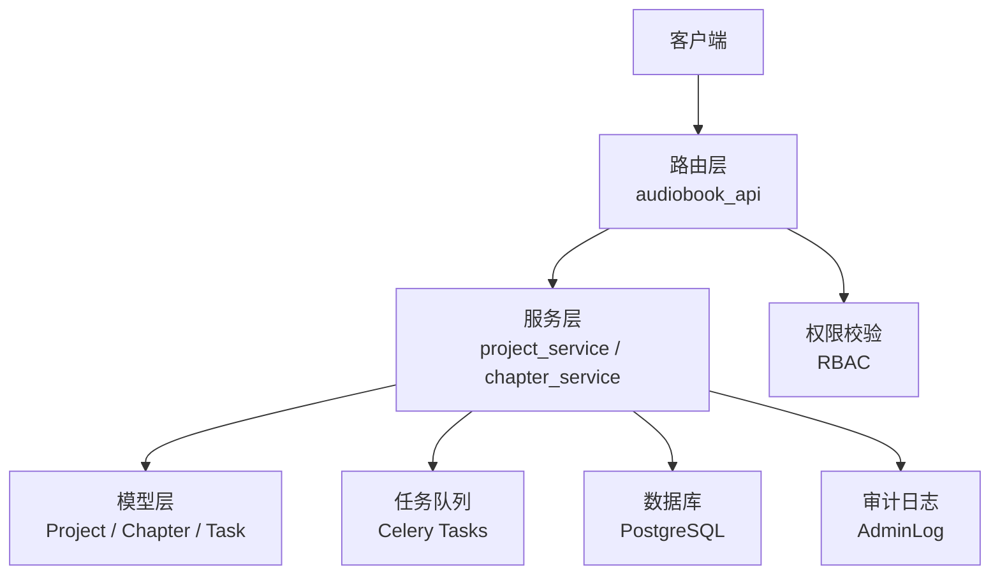
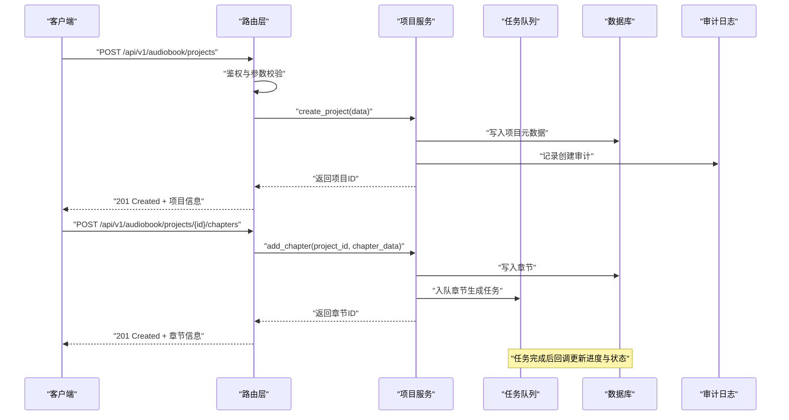
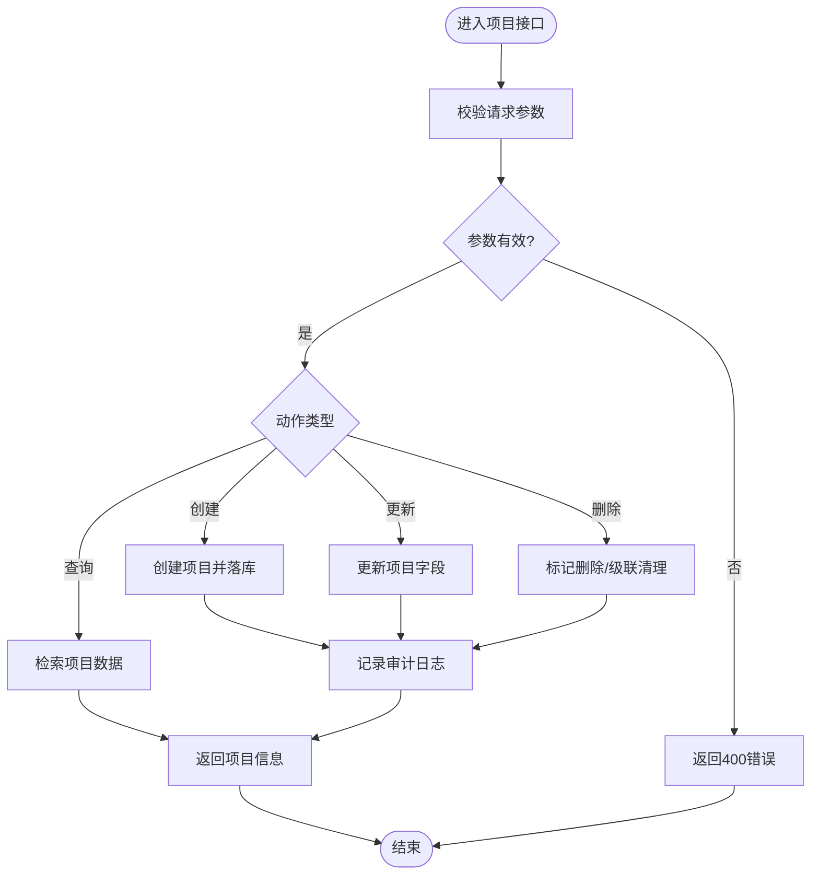
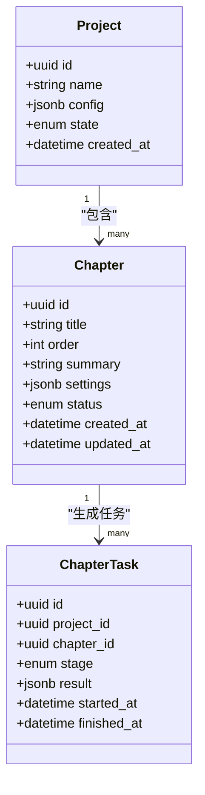
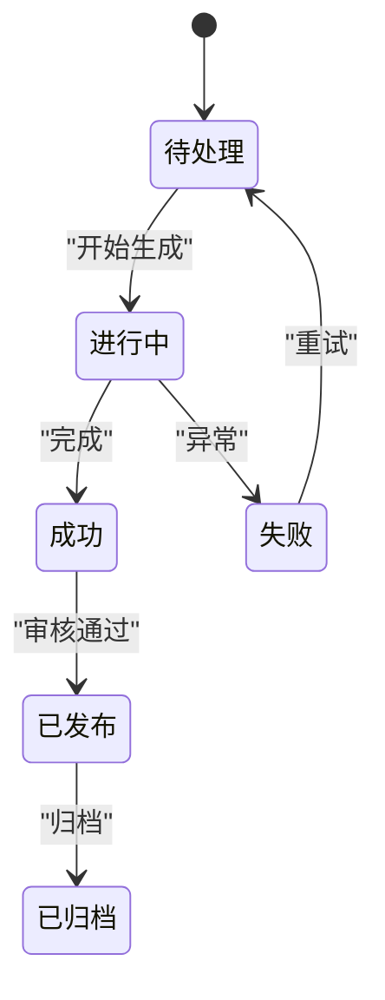
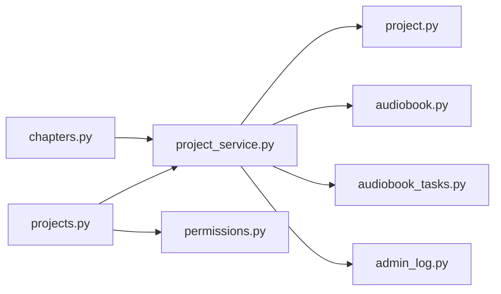

# 有声书项目管理API

<cite>
**本文引用的文件**   
- [backend/app/api/v1/audiobook_api/projects.py](file://backend/app/api/v1/audiobook_api/projects.py)
- [backend/app/schemas/project.py](file://backend/app/schemas/project.py)
- [backend/app/models/project.py](file://backend/app/models/project.py)
- [backend/app/services/audiobook/project_service.py](file://backend/app/services/audiobook/project_service.py)
- [backend/app/api/v1/audiobook_api/chapters.py](file://backend/app/api/v1/audiobook_api/chapters.py)
- [backend/app/schemas/audiobook.py](file://backend/app/schemas/audiobook.py)
- [backend/app/models/audiobook.py](file://backend/app/models/audiobook.py)
- [backend/app/tasks/audiobook_tasks.py](file://backend/app/tasks/audiobook_tasks.py)
- [backend/app/core/permissions.py](file://backend/app/core/permissions.py)
- [backend/app/models/admin_log.py](file://backend/app/models/admin_log.py)
- [backend/app/api/v1/audiobook_api/__init__.py](file://backend/app/api/v1/audiobook_api/__init__.py)
</cite>

## 目录
1. [简介](#简介)
2. [项目结构](#项目结构)
3. [核心组件](#核心组件)
4. [架构总览](#架构总览)
5. [详细组件分析](#详细组件分析)
6. [依赖关系分析](#依赖关系分析)
7. [性能考虑](#性能考虑)
8. [故障排查指南](#故障排查指南)
9. [结论](#结论)
10. [附录：接口清单与示例](#附录接口清单与示例)

## 简介
本文件为“有声书项目管理”功能的API文档，覆盖项目创建、更新、删除与查询；章节管理（增删改查、批量操作）；进度跟踪与生成状态；项目状态管理、版本控制与协作权限；以及审计日志机制。文档面向开发者与集成方，提供清晰的请求/响应结构说明、错误码约定与最佳实践建议。

## 项目结构
后端采用分层架构：路由层（FastAPI）、服务层（业务编排）、模型层（ORM）、任务层（异步队列）、权限与审计模块。有声书相关API集中在 audiobook_api 子模块下，通过 schemas 定义输入输出结构，models 定义数据库实体，services 封装复杂流程，tasks 处理耗时任务（如TTS生成、章节渲染）。

**图示来源** 
- [backend/app/api/v1/audiobook_api/projects.py](file://backend/app/api/v1/audiobook_api/projects.py)
- [backend/app/services/audiobook/project_service.py](file://backend/app/services/audiobook/project_service.py)
- [backend/app/models/project.py](file://backend/app/models/project.py)
- [backend/app/tasks/audiobook_tasks.py](file://backend/app/tasks/audiobook_tasks.py)
- [backend/app/core/permissions.py](file://backend/app/core/permissions.py)
- [backend/app/models/admin_log.py](file://backend/app/models/admin_log.py)

**章节来源**
- [backend/app/api/v1/audiobook_api/__init__.py](file://backend/app/api/v1/audiobook_api/__init__.py)

## 核心组件
- 路由层：暴露RESTful接口，负责参数校验、鉴权、调用服务层并返回统一响应。
- 服务层：实现项目CRUD、章节管理、进度追踪、版本控制与协作逻辑，协调任务队列。
- 模型层：定义 Project、Chapter、Task 等实体及关联关系。
- 任务层：异步执行TTS生成、音频合成、质量检查等耗时操作。
- 权限与审计：基于角色的访问控制（RBAC），记录关键操作的审计日志。

**章节来源**
- [backend/app/api/v1/audiobook_api/projects.py](file://backend/app/api/v1/audiobook_api/projects.py)
- [backend/app/services/audiobook/project_service.py](file://backend/app/services/audiobook/project_service.py)
- [backend/app/models/project.py](file://backend/app/models/project.py)
- [backend/app/models/audiobook.py](file://backend/app/models/audiobook.py)
- [backend/app/tasks/audiobook_tasks.py](file://backend/app/tasks/audiobook_tasks.py)
- [backend/app/core/permissions.py](file://backend/app/core/permissions.py)
- [backend/app/models/admin_log.py](file://backend/app/models/admin_log.py)

## 架构总览
下图展示从HTTP请求到数据持久化与异步任务的完整链路，包括权限校验、服务编排、任务调度与结果回写。

**图示来源** 
- [backend/app/api/v1/audiobook_api/projects.py](file://backend/app/api/v1/audiobook_api/projects.py)
- [backend/app/api/v1/audiobook_api/chapters.py](file://backend/app/api/v1/audiobook_api/chapters.py)
- [backend/app/services/audiobook/project_service.py](file://backend/app/services/audiobook/project_service.py)
- [backend/app/tasks/audiobook_tasks.py](file://backend/app/tasks/audiobook_tasks.py)
- [backend/app/models/project.py](file://backend/app/models/project.py)
- [backend/app/models/audiobook.py](file://backend/app/models/audiobook.py)

## 详细组件分析

### 项目CRUD接口
- 创建项目：接收项目元数据（名称、描述、配置、初始设置等），校验后持久化并记录审计。
- 更新项目：支持增量更新字段（如标题、描述、配置项、协作成员、版本标签等）。
- 删除项目：软删除或硬删除（依据策略），级联清理章节与任务。
- 查询项目：按ID获取详情，支持列表过滤（状态、创建时间、作者等）。

**图示来源** 
- [backend/app/api/v1/audiobook_api/projects.py](file://backend/app/api/v1/audiobook_api/projects.py)
- [backend/app/services/audiobook/project_service.py](file://backend/app/services/audiobook/project_service.py)
- [backend/app/models/project.py](file://backend/app/models/project.py)
- [backend/app/models/admin_log.py](file://backend/app/models/admin_log.py)

**章节来源**
- [backend/app/api/v1/audiobook_api/projects.py](file://backend/app/api/v1/audiobook_api/projects.py)
- [backend/app/schemas/project.py](file://backend/app/schemas/project.py)
- [backend/app/models/project.py](file://backend/app/models/project.py)

### 章节管理接口
- 新增章节：绑定项目，写入章节元数据（序号、标题、内容摘要、角色范围、时长预估等）。
- 更新章节：修改内容、调整顺序、重新计算时长或触发重生成。
- 删除章节：软删除，保留历史版本以便回溯。
- 批量操作：批量导入/导出、批量重命名、批量设置生成策略。
- 进度跟踪：实时查询章节生成阶段（脚本准备、TTS、混音、质检、发布）。

**图示来源** 
- [backend/app/models/audiobook.py](file://backend/app/models/audiobook.py)
- [backend/app/schemas/audiobook.py](file://backend/app/schemas/audiobook.py)

**章节来源**
- [backend/app/api/v1/audiobook_api/chapters.py](file://backend/app/api/v1/audiobook_api/chapters.py)
- [backend/app/schemas/audiobook.py](file://backend/app/schemas/audiobook.py)
- [backend/app/models/audiobook.py](file://backend/app/models/audiobook.py)

### 进度跟踪与生成状态
- 状态机：章节生命周期包含待处理、进行中、成功、失败、重试等状态。
- 阶段粒度：脚本生成、TTS合成、音效叠加、降噪、质检、归档。
- 进度事件：通过SSE或轮询接口获取阶段性结果与错误诊断信息。
- 重试机制：失败自动重试，支持人工干预与参数调优。

**图示来源** 
- [backend/app/tasks/audiobook_tasks.py](file://backend/app/tasks/audiobook_tasks.py)
- [backend/app/models/audiobook.py](file://backend/app/models/audiobook.py)

**章节来源**
- [backend/app/tasks/audiobook_tasks.py](file://backend/app/tasks/audiobook_tasks.py)
- [backend/app/models/audiobook.py](file://backend/app/models/audiobook.py)

### 版本控制与协作
- 版本标签：为项目与章节打标签，支持分支合并与差异对比。
- 协作权限：基于角色的访问控制（RBAC），区分编辑者、审阅者、观察者。
- 变更追踪：记录字段级变更历史，支持回滚与快照恢复。
- 冲突解决：并发编辑时检测冲突并提供合并策略。

**章节来源**
- [backend/app/core/permissions.py](file://backend/app/core/permissions.py)
- [backend/app/models/project.py](file://backend/app/models/project.py)
- [backend/app/models/audiobook.py](file://backend/app/models/audiobook.py)

### 权限控制与审计日志
- 权限模型：用户-角色-资源三元组，细粒度到接口级别。
- 审计范围：项目CRUD、章节操作、配置变更、协作成员变更。
- 日志格式：操作人、时间、IP、资源ID、变更前后值、结果状态。
- 合规性：满足数据留存与可追溯要求，支持导出与告警。

**章节来源**
- [backend/app/core/permissions.py](file://backend/app/core/permissions.py)
- [backend/app/models/admin_log.py](file://backend/app/models/admin_log.py)

## 依赖关系分析
- 路由层依赖服务层进行业务编排，服务层依赖模型层进行数据持久化。
- 任务层由服务层触发，完成后通过回调更新数据库状态。
- 权限模块在路由层拦截请求，审计模块在服务层记录关键操作。

**图示来源** 
- [backend/app/api/v1/audiobook_api/projects.py](file://backend/app/api/v1/audiobook_api/projects.py)
- [backend/app/api/v1/audiobook_api/chapters.py](file://backend/app/api/v1/audiobook_api/chapters.py)
- [backend/app/services/audiobook/project_service.py](file://backend/app/services/audiobook/project_service.py)
- [backend/app/models/project.py](file://backend/app/models/project.py)
- [backend/app/models/audiobook.py](file://backend/app/models/audiobook.py)
- [backend/app/tasks/audiobook_tasks.py](file://backend/app/tasks/audiobook_tasks.py)
- [backend/app/core/permissions.py](file://backend/app/core/permissions.py)
- [backend/app/models/admin_log.py](file://backend/app/models/admin_log.py)

**章节来源**
- [backend/app/api/v1/audiobook_api/projects.py](file://backend/app/api/v1/audiobook_api/projects.py)
- [backend/app/api/v1/audiobook_api/chapters.py](file://backend/app/api/v1/audiobook_api/chapters.py)
- [backend/app/services/audiobook/project_service.py](file://backend/app/services/audiobook/project_service.py)

## 性能考虑
- 分页与过滤：列表接口默认分页，支持按状态、时间、作者等过滤。
- 异步任务：TTS生成、音频处理等耗时操作放入队列，避免阻塞请求。
- 缓存策略：对热点项目元数据与章节列表使用缓存，降低DB压力。
- 连接池：数据库连接池与Redis缓存池合理配置，提升并发能力。
- 限流与熔断：对高频接口实施限流，保护下游服务稳定性。

[本节为通用指导，不直接分析具体文件]

## 故障排查指南
- 常见错误码：
  - 400：参数校验失败，检查必填字段与格式。
  - 401：未授权，确认Token与权限。
  - 403：无权限，检查角色与资源绑定。
  - 404：资源不存在，确认ID与归属。
  - 429：限流触发，稍后重试。
  - 500：服务端异常，查看日志与任务状态。
- 调试步骤：
  - 查看接口日志与审计日志定位操作链。
  - 检查任务队列中失败任务的重试次数与错误信息。
  - 验证数据库记录一致性（项目-章节-任务状态）。
  - 使用SSE或轮询接口获取实时进度与诊断信息。

**章节来源**
- [backend/app/models/admin_log.py](file://backend/app/models/admin_log.py)
- [backend/app/tasks/audiobook_tasks.py](file://backend/app/tasks/audiobook_tasks.py)

## 结论
有声书项目管理API以清晰的分层架构与完善的权限审计机制，支撑项目与章节的全生命周期管理。通过异步任务与状态机设计，确保高并发下的稳定与可观测性。建议在生产环境启用缓存、限流与监控，结合审计日志进行合规与问题定位。

[本节为总结，不直接分析具体文件]

## 附录：接口清单与示例
以下为常用接口的请求/响应结构说明（字段含义见各Schema定义）：

- 创建项目
  - 方法：POST
  - 路径：/api/v1/audiobook/projects
  - 请求体：项目名称、描述、配置项、初始协作成员
  - 响应：项目ID、创建时间、状态

- 更新项目
  - 方法：PATCH
  - 路径：/api/v1/audiobook/projects/{id}
  - 请求体：需更新的字段集合
  - 响应：更新后的项目信息

- 删除项目
  - 方法：DELETE
  - 路径：/api/v1/audiobook/projects/{id}
  - 响应：删除结果与审计记录ID

- 查询项目
  - 方法：GET
  - 路径：/api/v1/audiobook/projects/{id}
  - 响应：项目详情（含配置、协作成员、版本标签）

- 新增章节
  - 方法：POST
  - 路径：/api/v1/audiobook/projects/{id}/chapters
  - 请求体：章节标题、内容、顺序、生成策略
  - 响应：章节ID、状态、任务ID

- 更新章节
  - 方法：PATCH
  - 路径：/api/v1/audiobook/chapters/{chapter_id}
  - 请求体：需更新的字段集合
  - 响应：更新后的章节信息

- 删除章节
  - 方法：DELETE
  - 路径：/api/v1/audiobook/chapters/{chapter_id}
  - 响应：删除结果与审计记录ID

- 批量操作
  - 方法：POST
  - 路径：/api/v1/audiobook/chapters/batch
  - 请求体：操作类型（导入/导出/重命名/设置策略）、目标章节ID列表、参数
  - 响应：任务ID、预计完成时间

- 进度跟踪
  - 方法：GET
  - 路径：/api/v1/audiobook/chapters/{chapter_id}/progress
  - 响应：当前阶段、状态、错误信息（如有）

- 版本控制
  - 方法：POST
  - 路径：/api/v1/audiobook/projects/{id}/versions
  - 请求体：版本标签、备注
  - 响应：版本ID、创建时间

- 协作权限
  - 方法：POST
  - 路径：/api/v1/audiobook/projects/{id}/members
  - 请求体：用户ID、角色、资源范围
  - 响应：成员绑定结果

**章节来源**
- [backend/app/api/v1/audiobook_api/projects.py](file://backend/app/api/v1/audiobook_api/projects.py)
- [backend/app/api/v1/audiobook_api/chapters.py](file://backend/app/api/v1/audiobook_api/chapters.py)
- [backend/app/schemas/project.py](file://backend/app/schemas/project.py)
- [backend/app/schemas/audiobook.py](file://backend/app/schemas/audiobook.py)