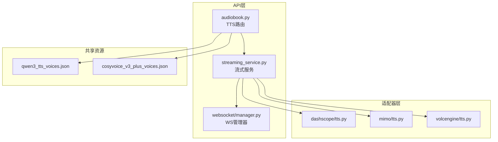
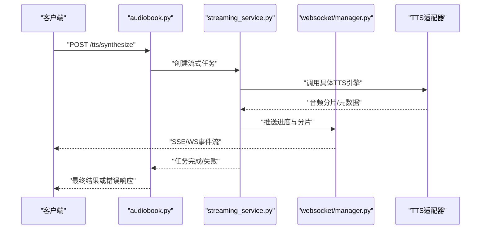
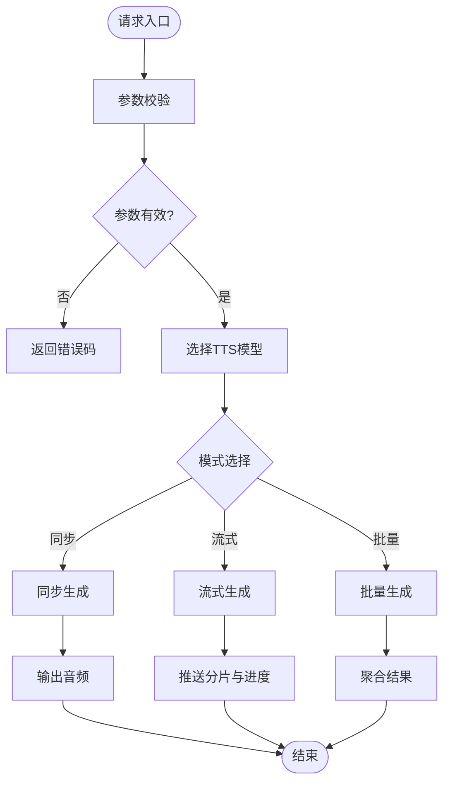
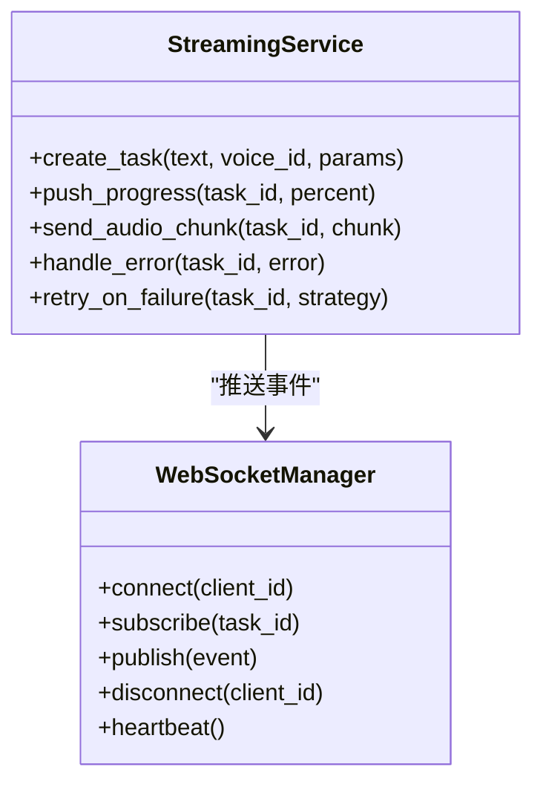
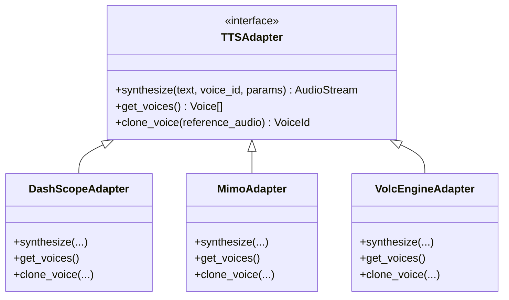
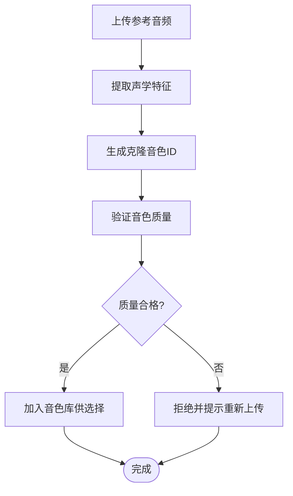
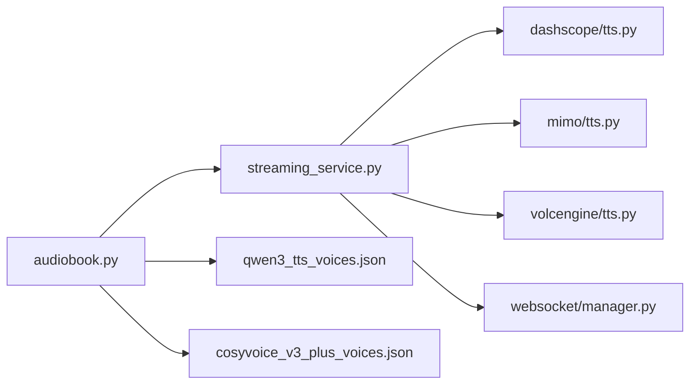

# TTS语音生成API

<cite>
**本文档引用的文件**   
- [adapters/dashscope/tts.py](file://adapters/dashscope/tts.py)
- [adapters/mimo/tts.py](file://adapters/mimo/tts.py)
- [adapters/volcengine/tts.py](file://adapters/volcengine/tts.py)
- [backend/app/api/v1/audiobook.py](file://backend/app/api/v1/audiobook.py)
- [backend/app/services/streaming_service.py](file://backend/app/services/streaming_service.py)
- [backend/app/websocket/manager.py](file://backend/app/websocket/manager.py)
- [shared/qwen3_tts_voices.json](file://shared/qwen3_tts_voices.json)
- [shared/cosyvoice_v3_plus_voices.json](file://shared/cosyvoice_v3_plus_voices.json)
- [scripts/verify_seed_tts_websocket.py](file://scripts/verify_seed_tts_websocket.py)
- [backend/test_seed_tts_ws.py](file://backend/test_seed_tts_ws.py)
</cite>

## 目录
1. [简介](#简介)
2. [项目结构](#项目结构)
3. [核心组件](#核心组件)
4. [架构总览](#架构总览)
5. [详细组件分析](#详细组件分析)
6. [依赖关系分析](#依赖关系分析)
7. [性能考量](#性能考量)
8. [故障排查指南](#故障排查指南)
9. [结论](#结论)
10. [附录](#附录)

## 简介
本文件面向TTS（文本转语音）生成功能的API文档，覆盖以下能力：
- 语音合成接口：同步与流式输出、批量处理
- 角色分配与音色选择：多模型音色库、克隆音色
- 情感控制与语速调节：参数化调优
- 多模型支持：DashScope、Mimo、VolcEngine等适配层
- 实时生成：WebSocket流式输出与进度监控
- 错误重试与质量保障：重试策略、校验与回退

## 项目结构
TTS相关代码主要分布在以下位置：
- 适配器层：各厂商TTS实现（DashScope、Mimo、VolcEngine）
- API层：音频书与TTS路由（同步/流式/批量）
- 服务层：流式服务、WebSocket管理器
- 共享资源：各模型音色清单（JSON）
- 脚本与测试：WebSocket验证、种子数据验证

图表来源 
- [backend/app/api/v1/audiobook.py](file://backend/app/api/v1/audiobook.py)
- [backend/app/services/streaming_service.py](file://backend/app/services/streaming_service.py)
- [backend/app/websocket/manager.py](file://backend/app/websocket/manager.py)
- [adapters/dashscope/tts.py](file://adapters/dashscope/tts.py)
- [adapters/mimo/tts.py](file://adapters/mimo/tts.py)
- [adapters/volcengine/tts.py](file://adapters/volcengine/tts.py)
- [shared/qwen3_tts_voices.json](file://shared/qwen3_tts_voices.json)
- [shared/cosyvoice_v3_plus_voices.json](file://shared/cosyvoice_v3_plus_voices.json)

章节来源
- [backend/app/api/v1/audiobook.py](file://backend/app/api/v1/audiobook.py)
- [backend/app/services/streaming_service.py](file://backend/app/services/streaming_service.py)
- [backend/app/websocket/manager.py](file://backend/app/websocket/manager.py)
- [adapters/dashscope/tts.py](file://adapters/dashscope/tts.py)
- [adapters/mimo/tts.py](file://adapters/mimo/tts.py)
- [adapters/volcengine/tts.py](file://adapters/volcengine/tts.py)
- [shared/qwen3_tts_voices.json](file://shared/qwen3_tts_voices.json)
- [shared/cosyvoice_v3_plus_voices.json](file://shared/cosyvoice_v3_plus_voices.json)

## 核心组件
- TTS路由（audiobook.py）：提供REST接口，负责请求校验、参数归一化、调度流式服务或批量任务。
- 流式服务（streaming_service.py）：封装流式生成逻辑，统一调用不同TTS适配器，推送进度与音频分片。
- WebSocket管理器（websocket/manager.py）：管理连接生命周期、消息路由、断线重连与超时控制。
- 适配器（dashscope/mimo/volcengine tts.py）：对接具体厂商TTS能力，包括音色列表、克隆、参数映射。
- 音色清单（qwen3_tts_voices.json、cosyvoice_v3_plus_voices.json）：维护可用音色ID、名称、属性与默认配置。

章节来源
- [backend/app/api/v1/audiobook.py](file://backend/app/api/v1/audiobook.py)
- [backend/app/services/streaming_service.py](file://backend/app/services/streaming_service.py)
- [backend/app/websocket/manager.py](file://backend/app/websocket/manager.py)
- [adapters/dashscope/tts.py](file://adapters/dashscope/tts.py)
- [adapters/mimo/tts.py](file://adapters/mimo/tts.py)
- [adapters/volcengine/tts.py](file://adapters/volcengine/tts.py)
- [shared/qwen3_tts_voices.json](file://shared/qwen3_tts_voices.json)
- [shared/cosyvoice_v3_plus_voices.json](file://shared/cosyvoice_v3_plus_voices.json)

## 架构总览
TTS整体流程：客户端通过REST或WebSocket发起请求，路由层进行参数校验与模型选择，流式服务协调适配器完成合成，WebSocket推送进度与音频分片，最终返回完整音频或流式播放。

图表来源 
- [backend/app/api/v1/audiobook.py](file://backend/app/api/v1/audiobook.py)
- [backend/app/services/streaming_service.py](file://backend/app/services/streaming_service.py)
- [backend/app/websocket/manager.py](file://backend/app/websocket/manager.py)
- [adapters/dashscope/tts.py](file://adapters/dashscope/tts.py)
- [adapters/mimo/tts.py](file://adapters/mimo/tts.py)
- [adapters/volcengine/tts.py](file://adapters/volcengine/tts.py)

## 详细组件分析

### 组件A：TTS路由与接口定义
- 功能要点
  - 同步合成：提交文本、音色、参数，返回音频文件或URL
  - 流式合成：建立SSE/WS通道，逐步推送音频分片与进度
  - 批量处理：提交多个片段，异步生成并汇总结果
  - 音色选择：从共享音色清单中获取可用音色及默认参数
- 关键参数
  - 文本内容、目标音色、语速、音量、情感强度、采样率、格式
  - 模型ID、是否启用克隆、参考音频路径（克隆用）
- 错误处理
  - 参数校验失败、模型不可用、网络异常、超时重试

图表来源 
- [backend/app/api/v1/audiobook.py](file://backend/app/api/v1/audiobook.py)
- [backend/app/services/streaming_service.py](file://backend/app/services/streaming_service.py)

章节来源
- [backend/app/api/v1/audiobook.py](file://backend/app/api/v1/audiobook.py)
- [backend/app/services/streaming_service.py](file://backend/app/services/streaming_service.py)

### 组件B：流式服务与WebSocket
- 功能要点
  - 统一管理流式任务状态（新建、进行中、完成、失败）
  - 与WebSocket管理器协作，推送进度事件与音频分片
  - 支持断线重连、心跳检测、超时清理
- 关键事件
  - progress：进度百分比、已处理时长
  - audio_chunk：音频二进制分片
  - error：错误信息与重试建议
- 重试机制
  - 指数退避、最大重试次数、可配置阈值

图表来源 
- [backend/app/services/streaming_service.py](file://backend/app/services/streaming_service.py)
- [backend/app/websocket/manager.py](file://backend/app/websocket/manager.py)

章节来源
- [backend/app/services/streaming_service.py](file://backend/app/services/streaming_service.py)
- [backend/app/websocket/manager.py](file://backend/app/websocket/manager.py)

### 组件C：多模型适配器（DashScope、Mimo、VolcEngine）
- 功能要点
  - 统一接口抽象：synthesize(text, voice_id, params) -> audio_stream
  - 音色映射：将通用音色ID转换为厂商特定ID
  - 参数归一化：语速、音量、情感强度等参数标准化
  - 克隆支持：上传参考音频，生成克隆音色
- 差异点
  - DashScope：支持高保真音色与情感控制
  - Mimo：轻量级合成，适合低延迟场景
  - VolcEngine：企业级稳定性，批量优化

图表来源 
- [adapters/dashscope/tts.py](file://adapters/dashscope/tts.py)
- [adapters/mimo/tts.py](file://adapters/mimo/tts.py)
- [adapters/volcengine/tts.py](file://adapters/volcengine/tts.py)

章节来源
- [adapters/dashscope/tts.py](file://adapters/dashscope/tts.py)
- [adapters/mimo/tts.py](file://adapters/mimo/tts.py)
- [adapters/volcengine/tts.py](file://adapters/volcengine/tts.py)

### 组件D：音色管理与克隆
- 音色清单
  - qwen3_tts_voices.json：Qwen3 TTS音色库，包含音色ID、名称、性别、风格
  - cosyvoice_v3_plus_voices.json：CosyVoice v3+音色库，支持情感与语速调节
- 克隆流程
  - 上传参考音频 -> 提取特征 -> 生成克隆音色ID -> 用于后续合成
- 质量控制
  - 音色相似度评分、清晰度检测、噪声过滤

图表来源 
- [shared/qwen3_tts_voices.json](file://shared/qwen3_tts_voices.json)
- [shared/cosyvoice_v3_plus_voices.json](file://shared/cosyvoice_v3_plus_voices.json)

章节来源
- [shared/qwen3_tts_voices.json](file://shared/qwen3_tts_voices.json)
- [shared/cosyvoice_v3_plus_voices.json](file://shared/cosyvoice_v3_plus_voices.json)

## 依赖关系分析
- 模块耦合
  - audiobook.py依赖streaming_service.py进行任务调度
  - streaming_service.py依赖具体TTS适配器实现
  - websocket/manager.py为流式服务提供通信基础设施
- 外部依赖
  - 各厂商TTS SDK（DashScope、Mimo、VolcEngine）
  - 音频处理库（FFmpeg、Pydub）
  - 数据库（音色库、任务状态持久化）

图表来源 
- [backend/app/api/v1/audiobook.py](file://backend/app/api/v1/audiobook.py)
- [backend/app/services/streaming_service.py](file://backend/app/services/streaming_service.py)
- [backend/app/websocket/manager.py](file://backend/app/websocket/manager.py)
- [adapters/dashscope/tts.py](file://adapters/dashscope/tts.py)
- [adapters/mimo/tts.py](file://adapters/mimo/tts.py)
- [adapters/volcengine/tts.py](file://adapters/volcengine/tts.py)
- [shared/qwen3_tts_voices.json](file://shared/qwen3_tts_voices.json)
- [shared/cosyvoice_v3_plus_voices.json](file://shared/cosyvoice_v3_plus_voices.json)

章节来源
- [backend/app/api/v1/audiobook.py](file://backend/app/api/v1/audiobook.py)
- [backend/app/services/streaming_service.py](file://backend/app/services/streaming_service.py)
- [backend/app/websocket/manager.py](file://backend/app/websocket/manager.py)
- [adapters/dashscope/tts.py](file://adapters/dashscope/tts.py)
- [adapters/mimo/tts.py](file://adapters/mimo/tts.py)
- [adapters/volcengine/tts.py](file://adapters/volcengine/tts.py)
- [shared/qwen3_tts_voices.json](file://shared/qwen3_tts_voices.json)
- [shared/cosyvoice_v3_plus_voices.json](file://shared/cosyvoice_v3_plus_voices.json)

## 性能考量
- 流式传输：减少首包延迟，提升用户体验
- 批量处理：合并小片段，降低API调用开销
- 缓存策略：热门音色与短文本结果缓存
- 并发控制：限制同时进行的合成任务数
- 资源优化：音频格式自适应（MP3/AAC/WAV）

## 故障排查指南
- 常见问题
  - 音色无效：检查音色ID是否在清单中
  - 网络超时：调整重试策略与超时时间
  - 音频质量差：调整语速、音量、情感参数
  - WebSocket断开：检查心跳与重连机制
- 调试工具
  - verify_seed_tts_websocket.py：验证WebSocket流式输出
  - test_seed_tts_ws.py：单元测试流式服务

章节来源
- [scripts/verify_seed_tts_websocket.py](file://scripts/verify_seed_tts_websocket.py)
- [backend/test_seed_tts_ws.py](file://backend/test_seed_tts_ws.py)

## 结论
本TTS系统通过统一的适配器层与流式服务，实现了多模型、多音色的语音合成能力。WebSocket流式输出提供了实时交互体验，批量处理提升了效率。通过完善的错误重试与质量控制机制，确保了系统的稳定性与可用性。

## 附录
- 配置示例
  - 环境变量：API密钥、模型ID、超时设置
  - 配置文件：音色清单、路由规则
- 最佳实践
  - 选择合适的音色与模型
  - 合理设置语速与情感参数
  - 使用流式输出提升用户体验
  - 实施批量处理优化成本