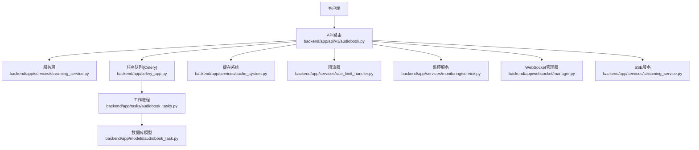
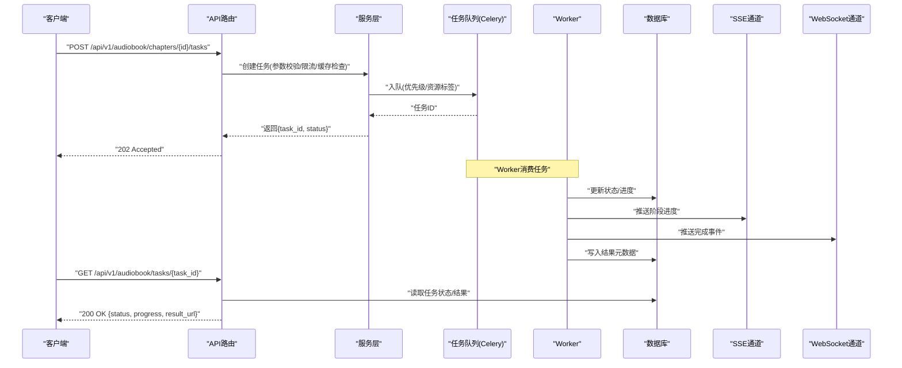
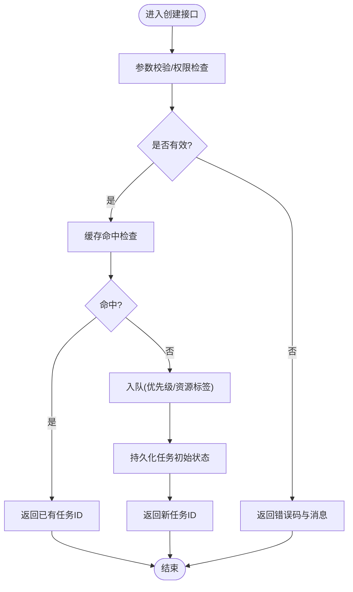
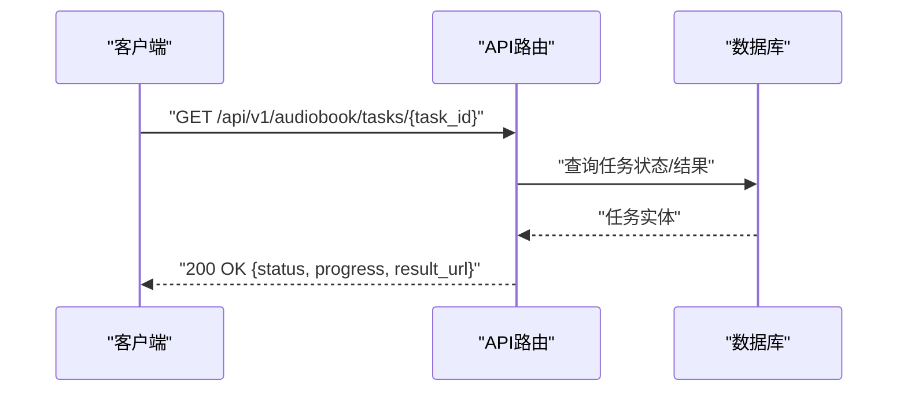
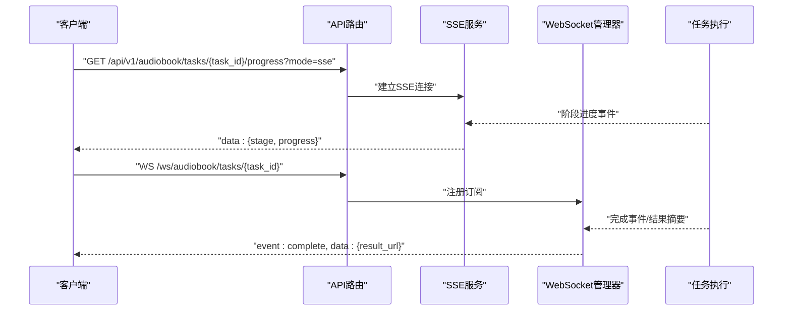
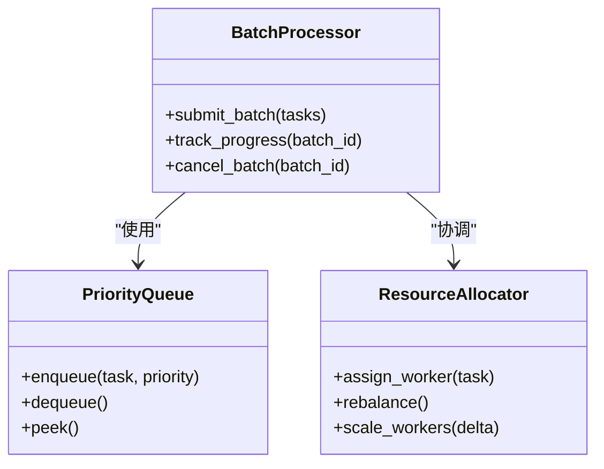
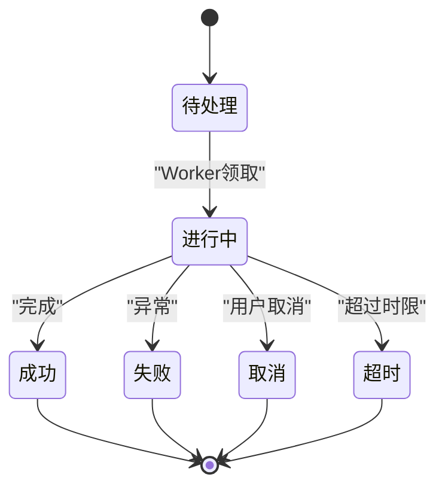
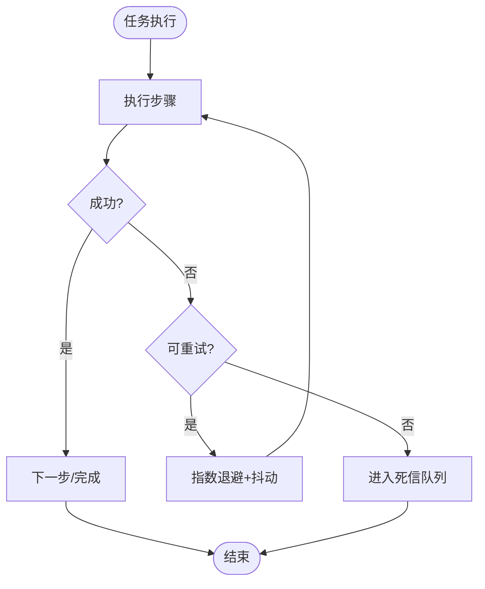
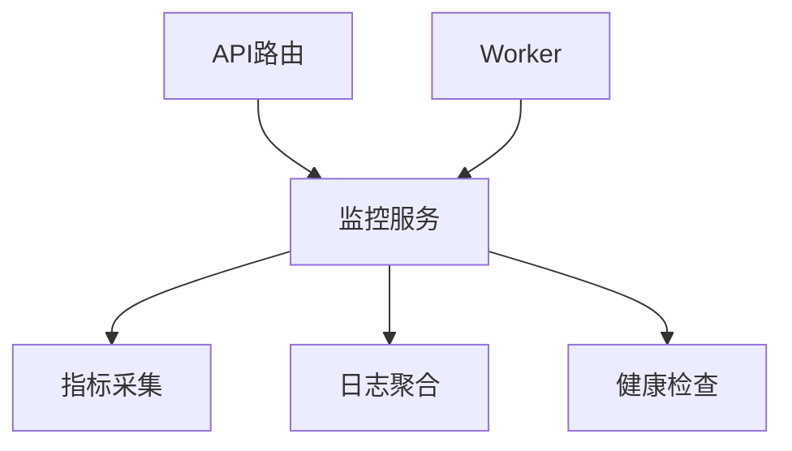
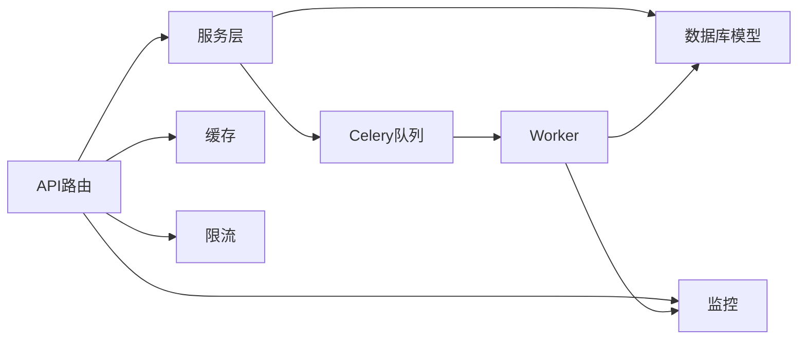

# 任务管理API

<cite>
**本文引用的文件**   
- [backend/app/main.py](file://backend/app/main.py)
- [backend/app/api/v1/audiobook.py](file://backend/app/api/v1/audiobook.py)
- [backend/app/services/streaming_service.py](file://backend/app/services/streaming_service.py)
- [backend/app/websocket/manager.py](file://backend/app/websocket/manager.py)
- [backend/app/tasks/audiobook_tasks.py](file://backend/app/tasks/audiobook_tasks.py)
- [backend/app/celery_app.py](file://backend/app/celery_app.py)
- [backend/app/models/audiobook_task.py](file://backend/app/models/audiobook_task.py)
- [backend/app/schemas/audiobook.py](file://backend/app/schemas/audiobook.py)
- [backend/app/core/config.py](file://backend/app/core/config.py)
- [backend/app/services/batch_processor.py](file://backend/app/services/batch_processor.py)
- [backend/app/services/rate_limit_handler.py](file://backend/app/services/rate_limit_handler.py)
- [backend/app/services/cache_system.py](file://backend/app/services/cache_system.py)
- [backend/app/utils/api_errors.py](file://backend/app/utils/api_errors.py)
- [backend/app/services/monitoring/service.py](file://backend/app/services/monitoring/service.py)
- [backend/app/api/v1/monitoring.py](file://backend/app/api/v1/monitoring.py)
</cite>

## 目录
1. [简介](#简介)
2. [项目结构](#项目结构)
3. [核心组件](#核心组件)
4. [架构总览](#架构总览)
5. [详细组件分析](#详细组件分析)
6. [依赖关系分析](#依赖关系分析)
7. [性能考量](#性能考量)
8. [故障排查指南](#故障排查指南)
9. [结论](#结论)
10. [附录](#附录)

## 简介
本章节面向“章节音频生成”的任务管理API，覆盖任务创建、状态查询、进度监控与结果获取的完整生命周期。文档同时说明批量任务处理、优先级调度、资源分配与负载均衡的实现方式，并提供错误处理、重试机制与超时控制的实践示例。此外，还涵盖WebSocket实时通知、SSE流式更新与轮询查询三种进度推送模式，以及任务监控、日志查看与故障诊断工具的使用方法。

## 项目结构
后端采用分层架构：API层暴露REST接口；服务层编排业务逻辑；任务层基于Celery执行异步任务；数据模型与Schema定义持久化结构与校验；中间件负责限流、缓存与监控；WebSocket/SSE提供实时通信能力。

**图表来源** 
- [backend/app/api/v1/audiobook.py](file://backend/app/api/v1/audiobook.py)
- [backend/app/services/streaming_service.py](file://backend/app/services/streaming_service.py)
- [backend/app/celery_app.py](file://backend/app/celery_app.py)
- [backend/app/tasks/audiobook_tasks.py](file://backend/app/tasks/audiobook_tasks.py)
- [backend/app/models/audiobook_task.py](file://backend/app/models/audiobook_task.py)
- [backend/app/services/cache_system.py](file://backend/app/services/cache_system.py)
- [backend/app/services/rate_limit_handler.py](file://backend/app/services/rate_limit_handler.py)
- [backend/app/services/monitoring/service.py](file://backend/app/services/monitoring/service.py)
- [backend/app/websocket/manager.py](file://backend/app/websocket/manager.py)

**章节来源**
- [backend/app/main.py](file://backend/app/main.py)
- [backend/app/api/v1/audiobook.py](file://backend/app/api/v1/audiobook.py)
- [backend/app/services/streaming_service.py](file://backend/app/services/streaming_service.py)
- [backend/app/websocket/manager.py](file://backend/app/websocket/manager.py)
- [backend/app/tasks/audiobook_tasks.py](file://backend/app/tasks/audiobook_tasks.py)
- [backend/app/celery_app.py](file://backend/app/celery_app.py)
- [backend/app/models/audiobook_task.py](file://backend/app/models/audiobook_task.py)
- [backend/app/schemas/audiobook.py](file://backend/app/schemas/audiobook.py)
- [backend/app/core/config.py](file://backend/app/core/config.py)

## 核心组件
- API路由层：统一入口，负责请求校验、鉴权、限流、缓存命中、调用服务或任务队列，并返回标准响应。
- 服务层：封装领域逻辑，协调任务调度、流式输出（SSE）、WebSocket事件广播、监控指标上报。
- 任务层：Celery任务定义与执行，包含重试、超时控制、幂等性保障与结果持久化。
- 数据模型与Schema：任务实体、状态机、字段约束与序列化/反序列化。
- 基础设施：缓存、限流、监控、配置中心。

**章节来源**
- [backend/app/api/v1/audiobook.py](file://backend/app/api/v1/audiobook.py)
- [backend/app/services/streaming_service.py](file://backend/app/services/streaming_service.py)
- [backend/app/tasks/audiobook_tasks.py](file://backend/app/tasks/audiobook_tasks.py)
- [backend/app/models/audiobook_task.py](file://backend/app/models/audiobook_task.py)
- [backend/app/schemas/audiobook.py](file://backend/app/schemas/audiobook.py)
- [backend/app/services/cache_system.py](file://backend/app/services/cache_system.py)
- [backend/app/services/rate_limit_handler.py](file://backend/app/services/rate_limit_handler.py)
- [backend/app/core/config.py](file://backend/app/core/config.py)

## 架构总览
整体流程围绕“任务生命周期”展开：创建→入队→调度→执行→结果落库→推送通知（SSE/WebSocket）→客户端拉取结果。关键路径包括：
- 同步创建任务：快速返回任务ID，后续通过轮询或长连接获取进度。
- 异步执行：Celery Worker消费任务，按优先级与资源配额调度。
- 实时通知：SSE推送阶段性进度，WebSocket推送完成事件与结果摘要。
- 监控与可观测性：指标采集、日志聚合、错误追踪。

**图表来源** 
- [backend/app/api/v1/audiobook.py](file://backend/app/api/v1/audiobook.py)
- [backend/app/services/streaming_service.py](file://backend/app/services/streaming_service.py)
- [backend/app/celery_app.py](file://backend/app/celery_app.py)
- [backend/app/tasks/audiobook_tasks.py](file://backend/app/tasks/audiobook_tasks.py)
- [backend/app/models/audiobook_task.py](file://backend/app/models/audiobook_task.py)

## 详细组件分析

### 任务创建与提交
- 接口职责：接收章节ID与生成参数，进行权限与参数校验，触发任务创建并返回任务ID。
- 关键行为：
  - 参数校验与默认值填充（Schema）。
  - 限流与配额检查（Rate Limit）。
  - 缓存短路（若相同参数已存在且未过期，直接返回已有任务ID）。
  - 入队（Celery），携带优先级与资源标签。
  - 记录审计与追踪上下文。
- 错误处理：非法参数、配额不足、队列不可用等异常标准化返回。

**图表来源** 
- [backend/app/api/v1/audiobook.py](file://backend/app/api/v1/audiobook.py)
- [backend/app/services/cache_system.py](file://backend/app/services/cache_system.py)
- [backend/app/services/rate_limit_handler.py](file://backend/app/services/rate_limit_handler.py)
- [backend/app/celery_app.py](file://backend/app/celery_app.py)

**章节来源**
- [backend/app/api/v1/audiobook.py](file://backend/app/api/v1/audiobook.py)
- [backend/app/schemas/audiobook.py](file://backend/app/schemas/audiobook.py)
- [backend/app/services/cache_system.py](file://backend/app/services/cache_system.py)
- [backend/app/services/rate_limit_handler.py](file://backend/app/services/rate_limit_handler.py)
- [backend/app/celery_app.py](file://backend/app/celery_app.py)

### 状态查询与结果获取
- 接口职责：根据任务ID查询当前状态、进度与结果URL。
- 关键行为：
  - 从数据库读取任务实体与最新状态。
  - 若结果为大对象，返回预签名URL或分片下载信息。
  - 支持条件过滤（如仅返回成功/失败）。
- 错误处理：任务不存在、权限不足、数据损坏等。

**图表来源** 
- [backend/app/api/v1/audiobook.py](file://backend/app/api/v1/audiobook.py)
- [backend/app/models/audiobook_task.py](file://backend/app/models/audiobook_task.py)

**章节来源**
- [backend/app/api/v1/audiobook.py](file://backend/app/api/v1/audiobook.py)
- [backend/app/models/audiobook_task.py](file://backend/app/models/audiobook_task.py)

### 进度监控：SSE与WebSocket
- SSE流式更新：服务端持续推送任务阶段进度（如“解析脚本”“TTS合成”“混音”），适合浏览器与轻量客户端。
- WebSocket实时通知：双向通道，适合需要即时交互的场景（如取消任务、订阅特定频道）。
- 轮询查询：作为兜底方案，适用于不支持长连接的客户端。

**图表来源** 
- [backend/app/services/streaming_service.py](file://backend/app/services/streaming_service.py)
- [backend/app/websocket/manager.py](file://backend/app/websocket/manager.py)
- [backend/app/tasks/audiobook_tasks.py](file://backend/app/tasks/audiobook_tasks.py)

**章节来源**
- [backend/app/services/streaming_service.py](file://backend/app/services/streaming_service.py)
- [backend/app/websocket/manager.py](file://backend/app/websocket/manager.py)

### 批量任务处理与优先级调度
- 批量处理：支持一次性提交多个章节音频生成任务，内部拆分为独立子任务，统一跟踪批次ID。
- 优先级调度：任务入队时携带优先级权重，结合资源标签（如GPU/CPU）选择合适Worker。
- 资源分配与负载均衡：
  - Worker池按资源类型划分队列。
  - 动态扩缩容策略依据队列长度与CPU/GPU利用率。
  - 任务亲和性与反亲和性避免热点节点过载。

**图表来源** 
- [backend/app/services/batch_processor.py](file://backend/app/services/batch_processor.py)
- [backend/app/celery_app.py](file://backend/app/celery_app.py)

**章节来源**
- [backend/app/services/batch_processor.py](file://backend/app/services/batch_processor.py)
- [backend/app/celery_app.py](file://backend/app/celery_app.py)

### 任务生命周期与状态机
- 状态定义：待处理、进行中、成功、失败、取消、超时。
- 转换规则：
  - 创建后进入“待处理”。
  - Worker领取后转为“进行中”，周期性更新进度。
  - 成功/失败/取消/超时时终止。
- 持久化：每次状态变更写库，保证可追溯与断点续跑。

**图表来源** 
- [backend/app/models/audiobook_task.py](file://backend/app/models/audiobook_task.py)

**章节来源**
- [backend/app/models/audiobook_task.py](file://backend/app/models/audiobook_task.py)

### 错误处理、重试机制与超时控制
- 错误分类：网络错误、上游服务限流、数据校验失败、资源不足、超时。
- 重试策略：指数退避+抖动，最大重试次数与死信队列。
- 超时控制：任务级超时、步骤级超时、I/O超时与熔断降级。
- 标准化错误响应：统一错误码、消息与追踪ID。

**图表来源** 
- [backend/app/tasks/audiobook_tasks.py](file://backend/app/tasks/audiobook_tasks.py)
- [backend/app/utils/api_errors.py](file://backend/app/utils/api_errors.py)

**章节来源**
- [backend/app/tasks/audiobook_tasks.py](file://backend/app/tasks/audiobook_tasks.py)
- [backend/app/utils/api_errors.py](file://backend/app/utils/api_errors.py)

### 监控、日志与诊断
- 监控指标：任务吞吐、成功率、平均耗时、队列长度、Worker利用率。
- 日志规范：结构化日志，包含任务ID、阶段、耗时、错误堆栈。
- 诊断工具：
  - 任务详情查询接口。
  - 批处理状态接口。
  - 健康检查与依赖探测。
  - 日志检索与导出。

**图表来源** 
- [backend/app/services/monitoring/service.py](file://backend/app/services/monitoring/service.py)
- [backend/app/api/v1/monitoring.py](file://backend/app/api/v1/monitoring.py)

**章节来源**
- [backend/app/services/monitoring/service.py](file://backend/app/services/monitoring/service.py)
- [backend/app/api/v1/monitoring.py](file://backend/app/api/v1/monitoring.py)

## 依赖关系分析
- API路由依赖服务层、缓存、限流、监控与WebSocket/SSE。
- 服务层依赖任务队列、数据库模型与外部TTS/媒体服务。
- 任务层依赖数据库、缓存与监控上报。
- 监控与日志贯穿全链路，便于问题定位。

**图表来源** 
- [backend/app/api/v1/audiobook.py](file://backend/app/api/v1/audiobook.py)
- [backend/app/services/streaming_service.py](file://backend/app/services/streaming_service.py)
- [backend/app/celery_app.py](file://backend/app/celery_app.py)
- [backend/app/tasks/audiobook_tasks.py](file://backend/app/tasks/audiobook_tasks.py)
- [backend/app/models/audiobook_task.py](file://backend/app/models/audiobook_task.py)
- [backend/app/services/cache_system.py](file://backend/app/services/cache_system.py)
- [backend/app/services/rate_limit_handler.py](file://backend/app/services/rate_limit_handler.py)
- [backend/app/services/monitoring/service.py](file://backend/app/services/monitoring/service.py)

**章节来源**
- [backend/app/api/v1/audiobook.py](file://backend/app/api/v1/audiobook.py)
- [backend/app/services/streaming_service.py](file://backend/app/services/streaming_service.py)
- [backend/app/celery_app.py](file://backend/app/celery_app.py)
- [backend/app/tasks/audiobook_tasks.py](file://backend/app/tasks/audiobook_tasks.py)
- [backend/app/models/audiobook_task.py](file://backend/app/models/audiobook_task.py)
- [backend/app/services/cache_system.py](file://backend/app/services/cache_system.py)
- [backend/app/services/rate_limit_handler.py](file://backend/app/services/rate_limit_handler.py)
- [backend/app/services/monitoring/service.py](file://backend/app/services/monitoring/service.py)

## 性能考量
- 缓存策略：对重复任务与常用配置进行缓存，减少重复计算与上游调用。
- 限流保护：令牌桶/漏桶算法，防止突发流量打垮下游服务。
- 队列优化：合理设置并发度、队列分区与Worker数量，避免饥饿与拥塞。
- I/O优化：结果文件分片下载、预签名URL缩短响应时间。
- 监控告警：关键指标阈值告警，提前发现瓶颈。

[本节为通用指导，不直接分析具体文件]

## 故障排查指南
- 常见问题：
  - 任务长时间“进行中”：检查Worker是否存活、队列是否堆积、资源是否耗尽。
  - 频繁失败：查看错误码与堆栈，确认上游服务可用性、参数合法性与配额限制。
  - 进度不更新：确认SSE/WebSocket连接是否正常，检查事件推送链路。
- 诊断步骤：
  - 使用任务详情接口核对状态与结果URL。
  - 查看监控面板与日志聚合，定位异常时间点。
  - 复现最小用例，逐步缩小范围。
- 恢复建议：
  - 重启Worker或扩容队列。
  - 清理死信队列中的失败任务，必要时人工干预。
  - 调整超时与重试策略，避免雪崩。

**章节来源**
- [backend/app/utils/api_errors.py](file://backend/app/utils/api_errors.py)
- [backend/app/services/monitoring/service.py](file://backend/app/services/monitoring/service.py)
- [backend/app/api/v1/monitoring.py](file://backend/app/api/v1/monitoring.py)

## 结论
本章音频生成任务管理API以清晰的分层架构与完善的任务生命周期管理为核心，结合SSE/WebSocket实时通知、批量处理与优先级调度，提供了高可用、可扩展的解决方案。通过统一的错误处理、重试与超时控制，以及全面的监控与诊断工具，能够有效支撑大规模音频生成场景的稳定运行。

[本节为总结性内容，不直接分析具体文件]

## 附录
- 配置项参考：队列并发、Worker数量、超时阈值、重试策略、缓存TTL、限流阈值等。
- 最佳实践：
  - 客户端侧实现重连与退避，确保SSE/WebSocket稳定性。
  - 任务参数尽量幂等，避免重复提交导致副作用。
  - 监控指标接入告警平台，形成闭环运维。

[本节为补充信息，不直接分析具体文件]