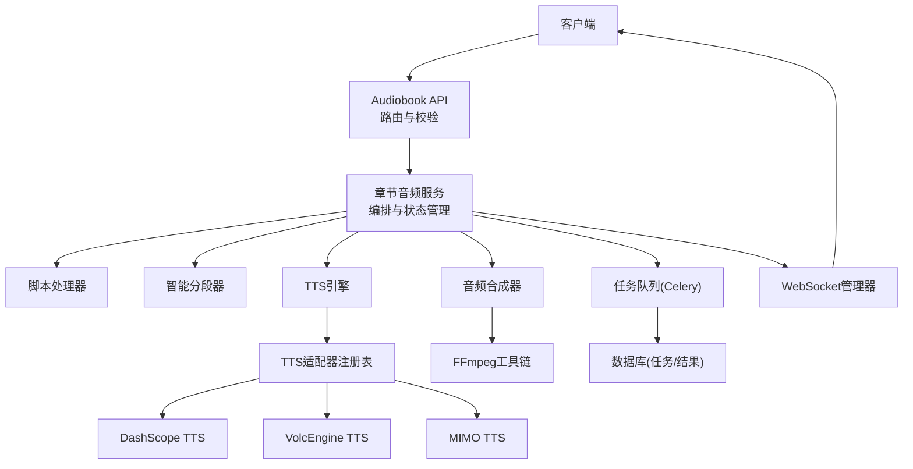
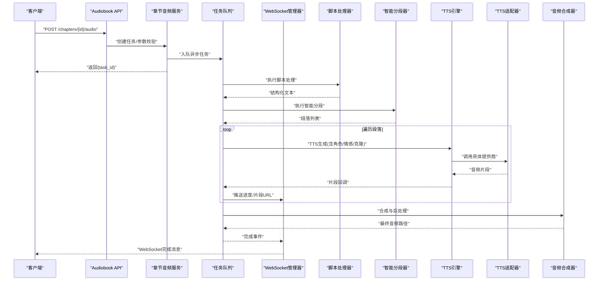
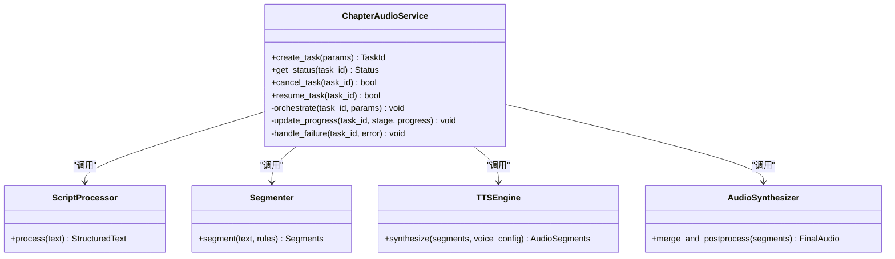
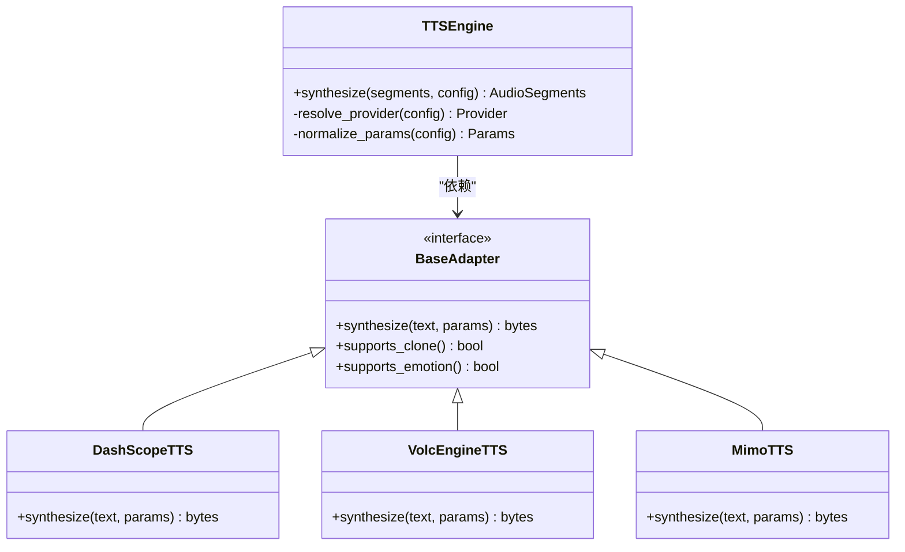
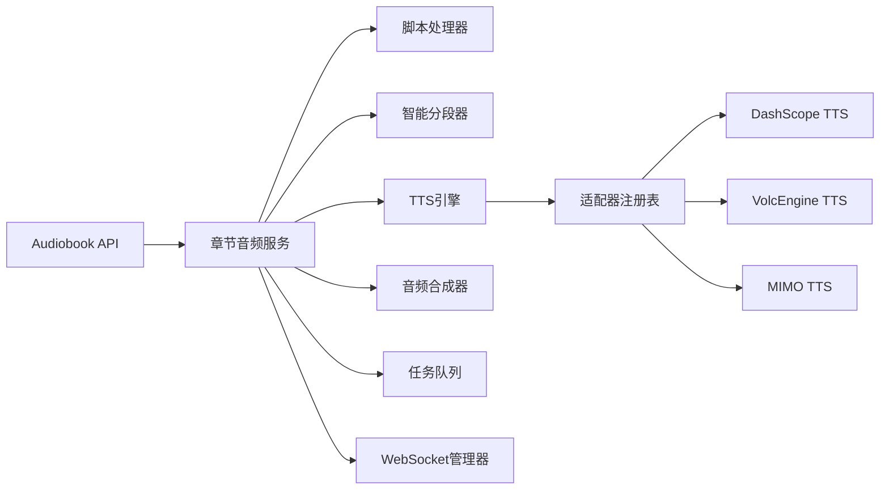

# 章节音频生成API

<cite>
**本文引用的文件**   
- [backend/app/api/v1/audiobook.py](file://backend/app/api/v1/audiobook.py)
- [backend/app/services/audiobook/chapter_audio_service.py](file://backend/app/services/audiobook/chapter_audio_service.py)
- [backend/app/services/audiobook/chapter_script_processor.py](file://backend/app/services/audiobook/chapter_script_processor.py)
- [backend/app/services/audiobook/chapter_segmenter.py](file://backend/app/services/audiobook/chapter_segmenter.py)
- [backend/app/services/audiobook/tts_engine.py](file://backend/app/services/audiobook/tts_engine.py)
- [backend/app/services/audiobook/audio_synthesizer.py](file://backend/app/services/audiobook/audio_synthesizer.py)
- [backend/app/services/audiobook/batch_generator.py](file://backend/app/services/audiobook/batch_generator.py)
- [backend/app/services/audiobook/streaming_service.py](file://backend/app/services/audiobook/streaming_service.py)
- [backend/app/websocket/manager.py](file://backend/app/websocket/manager.py)
- [backend/app/tasks/audiobook_tasks.py](file://backend/app/tasks/audiobook_tasks.py)
- [adapters/dashscope/tts.py](file://adapters/dashscope/tts.py)
- [adapters/volcengine/tts.py](file://adapters/volcengine/tts.py)
- [adapters/mimo/tts.py](file://adapters/mimo/tts.py)
- [adapters/_shared.py](file://adapters/_shared.py)
- [adapters/base.py](file://adapters/base.py)
- [adapters/model_adapters.py](file://adapters/model_adapters.py)
- [adapters/registry.py](file://adapters/registry.py)
- [backend/app/models/audiobook_task.py](file://backend/app/models/audiobook_task.py)
- [backend/app/schemas/audiobook.py](file://backend/app/schemas/audiobook.py)
- [backend/app/core/config.py](file://backend/app/core/config.py)
- [scripts/verify_seed_tts_websocket.py](file://scripts/verify_seed_tts_websocket.py)
- [SEED_TTS_WEBSOCKET_IMPLEMENTATION.md](file://SEED_TTS_WEBSOCKET_IMPLEMENTATION.md)
</cite>

## 目录
1. [简介](#简介)
2. [项目结构](#项目结构)
3. [核心组件](#核心组件)
4. [架构总览](#架构总览)
5. [详细组件分析](#详细组件分析)
6. [依赖关系分析](#依赖关系分析)
7. [性能考量](#性能考量)
8. [故障排查指南](#故障排查指南)
9. [结论](#结论)
10. [附录](#附录)

## 简介
本文件为“章节音频生成”功能的全面API文档，覆盖脚本处理、智能分段、TTS生成与音频合成接口；说明角色分配、情感控制、语音克隆调用方法；提供批量生成、进度监控与错误重试机制；包含完整的音频文件处理、格式转换与质量检查示例；解释异步任务处理、WebSocket实时进度与流式输出支持。

## 项目结构
章节音频生成功能围绕后端API层、服务层、适配器层与任务队列展开：
- API层：暴露REST接口，接收章节文本与参数，返回任务ID或流式结果。
- 服务层：编排脚本处理、智能分段、角色分配、情感控制、TTS与音频合成。
- 适配器层：对接多种TTS提供商（如DashScope、火山引擎、MIMO等），统一抽象接口。
- 任务队列：Celery异步执行长耗时任务，支持断点续跑与重试。
- WebSocket：推送实时进度与事件，支持SSE/WS双通道。

图表来源
- [backend/app/api/v1/audiobook.py](file://backend/app/api/v1/audiobook.py)
- [backend/app/services/audiobook/chapter_audio_service.py](file://backend/app/services/audiobook/chapter_audio_service.py)
- [adapters/registry.py](file://adapters/registry.py)
- [adapters/dashscope/tts.py](file://adapters/dashscope/tts.py)
- [adapters/volcengine/tts.py](file://adapters/volcengine/tts.py)
- [adapters/mimo/tts.py](file://adapters/mimo/tts.py)
- [backend/app/websocket/manager.py](file://backend/app/websocket/manager.py)
- [backend/app/tasks/audiobook_tasks.py](file://backend/app/tasks/audiobook_tasks.py)

章节来源
- [backend/app/api/v1/audiobook.py](file://backend/app/api/v1/audiobook.py)
- [backend/app/services/audiobook/chapter_audio_service.py](file://backend/app/services/audiobook/chapter_audio_service.py)
- [adapters/registry.py](file://adapters/registry.py)

## 核心组件
- 章节音频服务：协调脚本处理、分段、角色分配、情感控制、TTS与合成，维护任务状态与进度。
- 脚本处理器：对原始章节文本进行清洗、结构化、对话标注与提示词增强。
- 智能分段器：按语义边界、标点、角色切换与时长约束切分段落，保证TTS输入长度与连贯性。
- TTS引擎：统一封装多提供商TTS能力，支持音色克隆、情感控制、语速/音调调节。
- 音频合成器：合并片段、混音、降噪、响度标准化、格式转换与质量检查。
- 批量生成器：并发调度多个章节/段落的生成任务，支持限流与失败重试。
- 流式服务：基于SSE/WS的增量音频流输出与进度上报。
- WebSocket管理器：连接生命周期、房间广播、心跳与重连策略。
- 任务队列：Celery任务定义、幂等性与重试策略、结果持久化。

章节来源
- [backend/app/services/audiobook/chapter_audio_service.py](file://backend/app/services/audiobook/chapter_audio_service.py)
- [backend/app/services/audiobook/chapter_script_processor.py](file://backend/app/services/audiobook/chapter_script_processor.py)
- [backend/app/services/audiobook/chapter_segmenter.py](file://backend/app/services/audiobook/chapter_segmenter.py)
- [backend/app/services/audiobook/tts_engine.py](file://backend/app/services/audiobook/tts_engine.py)
- [backend/app/services/audiobook/audio_synthesizer.py](file://backend/app/services/audiobook/audio_synthesizer.py)
- [backend/app/services/audiobook/batch_generator.py](file://backend/app/services/audiobook/batch_generator.py)
- [backend/app/services/audiobook/streaming_service.py](file://backend/app/services/audiobook/streaming_service.py)
- [backend/app/websocket/manager.py](file://backend/app/websocket/manager.py)
- [backend/app/tasks/audiobook_tasks.py](file://backend/app/tasks/audiobook_tasks.py)

## 架构总览
章节音频生成的端到端流程如下：
- 客户端通过API提交章节文本与生成参数（模型、音色、情感、是否克隆、是否流式）。
- 服务层将请求入队或直接同步处理，创建任务记录并返回任务ID。
- 脚本处理器对文本预处理，分段器按规则切分，角色分配与情感注入到每段。
- TTS引擎根据配置选择提供商，调用对应适配器生成音频片段。
- 音频合成器将片段拼接、后处理并输出最终音频文件。
- WebSocket/SSE推送实时进度与中间结果，任务完成后更新数据库状态。

图表来源
- [backend/app/api/v1/audiobook.py](file://backend/app/api/v1/audiobook.py)
- [backend/app/services/audiobook/chapter_audio_service.py](file://backend/app/services/audiobook/chapter_audio_service.py)
- [backend/app/tasks/audiobook_tasks.py](file://backend/app/tasks/audiobook_tasks.py)
- [backend/app/websocket/manager.py](file://backend/app/websocket/manager.py)
- [adapters/dashscope/tts.py](file://adapters/dashscope/tts.py)
- [adapters/volcengine/tts.py](file://adapters/volcengine/tts.py)
- [adapters/mimo/tts.py](file://adapters/mimo/tts.py)

## 详细组件分析

### 章节音频服务（编排与状态）
- 职责：接收API请求，创建任务，编排脚本处理、分段、TTS与合成，维护任务状态机，触发WebSocket事件。
- 关键能力：
  - 任务创建与幂等：基于任务ID去重，避免重复生成。
  - 进度追踪：阶段枚举（脚本处理、分段、TTS、合成、完成/失败），实时更新。
  - 错误恢复：可配置的重试次数与退避策略，失败回滚已写入的中间结果。
  - 资源隔离：每个任务独立上下文，防止共享状态污染。

图表来源
- [backend/app/services/audiobook/chapter_audio_service.py](file://backend/app/services/audiobook/chapter_audio_service.py)
- [backend/app/services/audiobook/chapter_script_processor.py](file://backend/app/services/audiobook/chapter_script_processor.py)
- [backend/app/services/audiobook/chapter_segmenter.py](file://backend/app/services/audiobook/chapter_segmenter.py)
- [backend/app/services/audiobook/tts_engine.py](file://backend/app/services/audiobook/tts_engine.py)
- [backend/app/services/audiobook/audio_synthesizer.py](file://backend/app/services/audiobook/audio_synthesizer.py)

章节来源
- [backend/app/services/audiobook/chapter_audio_service.py](file://backend/app/services/audiobook/chapter_audio_service.py)

### 脚本处理器（文本预处理与结构化）
- 职责：清洗噪声、提取对话、标注说话人、插入停顿标记、生成TTS提示词。
- 关键点：
  - 文本规范化：去除多余空白、统一标点、转义特殊字符。
  - 对话识别：基于规则与轻量模型识别角色与台词。
  - 提示词增强：结合角色设定与情感标签生成TTS输入。

章节来源
- [backend/app/services/audiobook/chapter_script_processor.py](file://backend/app/services/audiobook/chapter_script_processor.py)

### 智能分段器（语义切分与时长约束）
- 职责：按语义边界、标点、角色切换、最大时长限制切分段落，确保TTS输入稳定。
- 关键点：
  - 语义切分：使用句法与语义特征确定段落边界。
  - 时长预估：基于文本长度与目标语速估算时长，动态调整切分。
  - 连续性保障：跨段落保留上下文信息，避免语义断裂。

章节来源
- [backend/app/services/audiobook/chapter_segmenter.py](file://backend/app/services/audiobook/chapter_segmenter.py)

### TTS引擎（多提供商统一接口）
- 职责：统一封装各TTS提供商接口，支持音色克隆、情感控制、语速/音调调节。
- 关键点：
  - 提供商适配：通过注册表选择具体实现（DashScope、VolcEngine、MIMO等）。
  - 参数归一化：将上层参数映射为各提供商所需格式。
  - 错误处理：网络异常、配额不足、模型不可用等场景的统一处理与降级。

图表来源
- [backend/app/services/audiobook/tts_engine.py](file://backend/app/services/audiobook/tts_engine.py)
- [adapters/base.py](file://adapters/base.py)
- [adapters/dashscope/tts.py](file://adapters/dashscope/tts.py)
- [adapters/volcengine/tts.py](file://adapters/volcengine/tts.py)
- [adapters/mimo/tts.py](file://adapters/mimo/tts.py)
- [adapters/registry.py](file://adapters/registry.py)

章节来源
- [backend/app/services/audiobook/tts_engine.py](file://backend/app/services/audiobook/tts_engine.py)
- [adapters/dashscope/tts.py](file://adapters/dashscope/tts.py)
- [adapters/volcengine/tts.py](file://adapters/volcengine/tts.py)
- [adapters/mimo/tts.py](file://adapters/mimo/tts.py)
- [adapters/registry.py](file://adapters/registry.py)

### 音频合成器（拼接、后处理与质量检查）
- 职责：合并TTS片段、混音、降噪、响度标准化、格式转换与质量检查。
- 关键点：
  - 片段合并：无缝拼接，保持采样率一致。
  - 后处理：降噪、均衡、压缩、响度对齐。
  - 质量检查：峰值、RMS、静音检测、失真评估。

章节来源
- [backend/app/services/audiobook/audio_synthesizer.py](file://backend/app/services/audiobook/audio_synthesizer.py)

### 批量生成器（并发与重试）
- 职责：并发调度多个章节/段落的生成任务，支持限流、失败重试与结果聚合。
- 关键点：
  - 并发控制：基于令牌桶或信号量限制并发数。
  - 重试策略：指数退避、最大重试次数、失败隔离。
  - 结果聚合：汇总成功与失败项，提供差异报告。

章节来源
- [backend/app/services/audiobook/batch_generator.py](file://backend/app/services/audiobook/batch_generator.py)

### 流式服务（SSE/WS增量输出）
- 职责：基于SSE或WebSocket推送增量音频片段与进度事件。
- 关键点：
  - 增量输出：每生成一个片段即推送，降低首包延迟。
  - 事件类型：进度、片段URL、完成、错误。
  - 连接管理：心跳、自动重连、断线恢复。

章节来源
- [backend/app/services/audiobook/streaming_service.py](file://backend/app/services/audiobook/streaming_service.py)
- [backend/app/websocket/manager.py](file://backend/app/websocket/manager.py)

### 任务队列（Celery异步处理）
- 职责：定义长耗时任务，支持幂等、重试、结果持久化。
- 关键点：
  - 任务定义：章节生成、分段、TTS、合成等子任务。
  - 重试策略：可配置重试次数与退避时间。
  - 结果存储：任务状态、进度、输出路径持久化。

章节来源
- [backend/app/tasks/audiobook_tasks.py](file://backend/app/tasks/audiobook_tasks.py)
- [backend/app/models/audiobook_task.py](file://backend/app/models/audiobook_task.py)

## 依赖关系分析
- API层依赖服务层，服务层依赖脚本处理、分段、TTS与合成模块。
- TTS引擎通过注册表动态选择适配器，解耦具体提供商实现。
- 任务队列与WebSocket作为基础设施，贯穿整个流程。
- 配置文件集中管理模型、音色、情感与提供商参数。

图表来源
- [backend/app/api/v1/audiobook.py](file://backend/app/api/v1/audiobook.py)
- [backend/app/services/audiobook/chapter_audio_service.py](file://backend/app/services/audiobook/chapter_audio_service.py)
- [adapters/registry.py](file://adapters/registry.py)
- [adapters/dashscope/tts.py](file://adapters/dashscope/tts.py)
- [adapters/volcengine/tts.py](file://adapters/volcengine/tts.py)
- [adapters/mimo/tts.py](file://adapters/mimo/tts.py)
- [backend/app/tasks/audiobook_tasks.py](file://backend/app/tasks/audiobook_tasks.py)
- [backend/app/websocket/manager.py](file://backend/app/websocket/manager.py)

章节来源
- [backend/app/api/v1/audiobook.py](file://backend/app/api/v1/audiobook.py)
- [backend/app/services/audiobook/chapter_audio_service.py](file://backend/app/services/audiobook/chapter_audio_service.py)
- [adapters/registry.py](file://adapters/registry.py)

## 性能考量
- 并发与限流：批量生成时合理设置并发上限，避免下游提供商限流。
- 缓存策略：对相同文本与参数的TTS结果进行缓存，减少重复计算。
- 流式输出：优先使用SSE/WS增量输出，降低首包延迟与内存占用。
- 资源隔离：每个任务独立上下文，避免共享状态导致的竞争条件。
- 错误重试：指数退避与最大重试次数，平衡成功率与延迟。

## 故障排查指南
- 常见问题：
  - TTS提供商不可用：检查适配器配置与网络连通性，查看错误码与日志。
  - 音色克隆失败：确认参考音频质量与格式，检查克隆样本索引。
  - 分段异常：检查文本结构与分段规则，必要时调整阈值。
  - 合成失败：检查音频片段完整性与采样率一致性。
- 调试工具：
  - WebSocket验证脚本：用于测试实时进度与流式输出。
  - 日志级别：提升日志级别以获取更详细的执行轨迹。
  - 任务查询：通过任务ID查询状态与进度，定位失败阶段。

章节来源
- [scripts/verify_seed_tts_websocket.py](file://scripts/verify_seed_tts_websocket.py)
- [SEED_TTS_WEBSOCKET_IMPLEMENTATION.md](file://SEED_TTS_WEBSOCKET_IMPLEMENTATION.md)
- [backend/app/tasks/audiobook_tasks.py](file://backend/app/tasks/audiobook_tasks.py)

## 结论
章节音频生成功能通过模块化设计与适配器模式，实现了高内聚、低耦合的架构。服务层编排脚本处理、智能分段、TTS与音频合成，任务队列与WebSocket提供异步与实时能力。通过批量生成、进度监控与错误重试机制，系统具备高可用与可扩展性。未来可进一步优化缓存策略、负载均衡与质量评估模型。

## 附录
- API接口定义：
  - POST /chapters/{id}/audio：提交章节音频生成任务，返回任务ID。
  - GET /tasks/{task_id}：查询任务状态与进度。
  - GET /tasks/{task_id}/stream：SSE流式输出音频片段与进度。
  - POST /batch/generate：批量生成任务，支持并发与重试配置。
- 参数说明：
  - model：TTS模型标识。
  - voice：音色ID或克隆参数。
  - emotion：情感标签（如高兴、悲伤、平静）。
  - speed：语速调节系数。
  - pitch：音调调节系数。
  - format：输出音频格式（如mp3、wav）。
  - quality：质量检查阈值。
- 错误码：
  - 400：参数无效。
  - 404：任务不存在。
  - 500：服务器内部错误。
  - 503：服务提供商不可用。

章节来源
- [backend/app/api/v1/audiobook.py](file://backend/app/api/v1/audiobook.py)
- [backend/app/schemas/audiobook.py](file://backend/app/schemas/audiobook.py)
- [backend/app/core/config.py](file://backend/app/core/config.py)