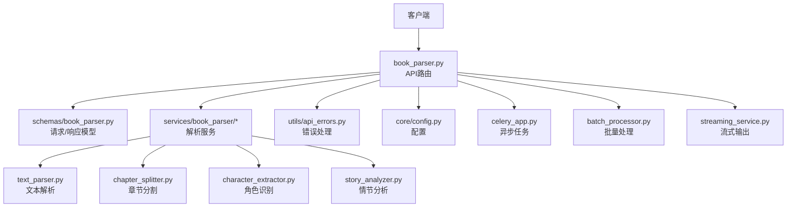
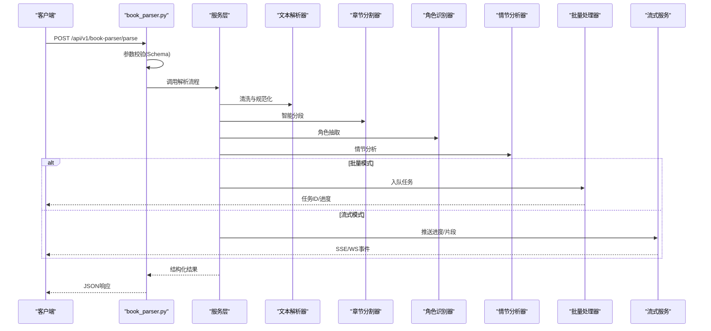
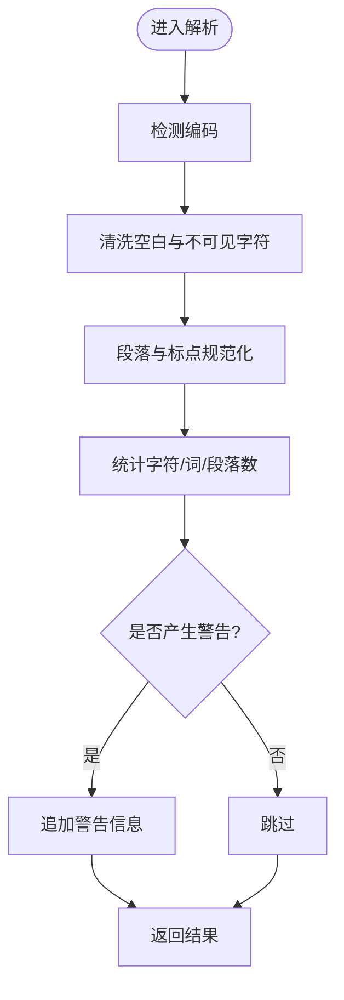
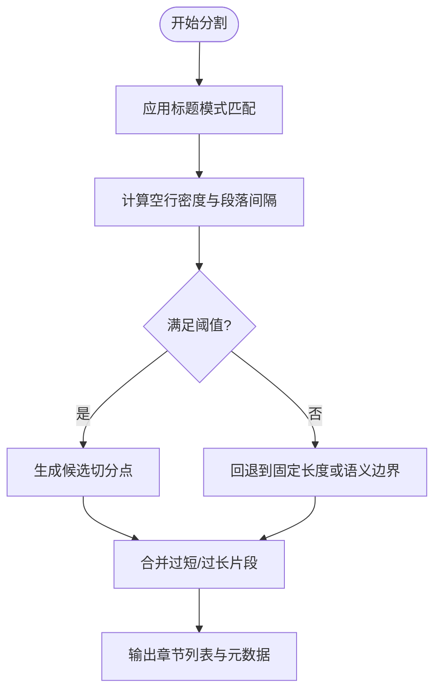
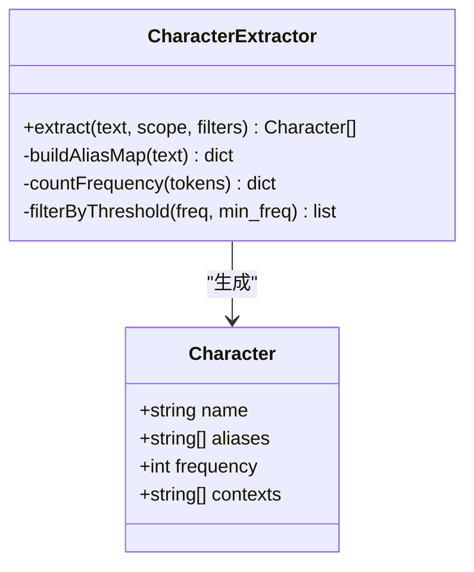
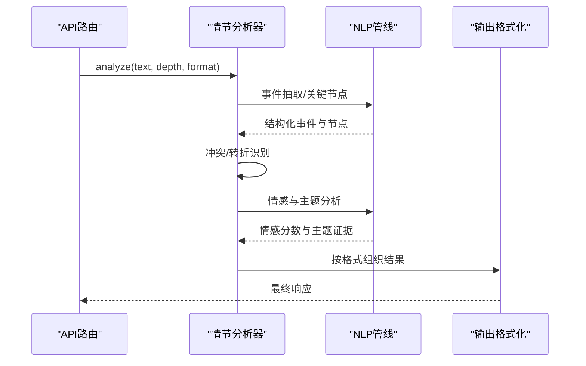
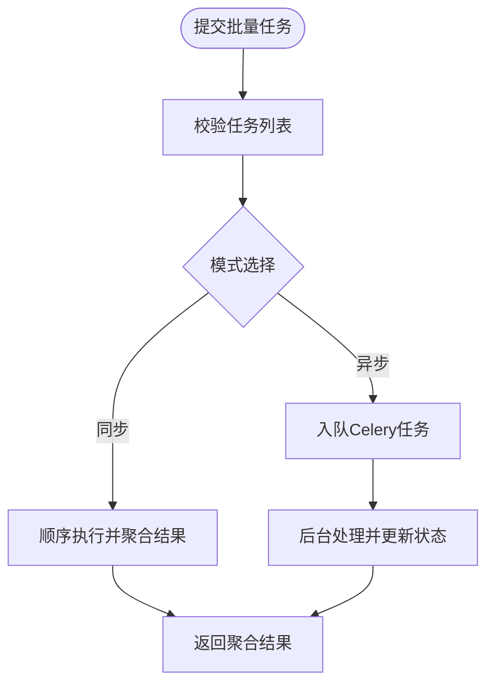
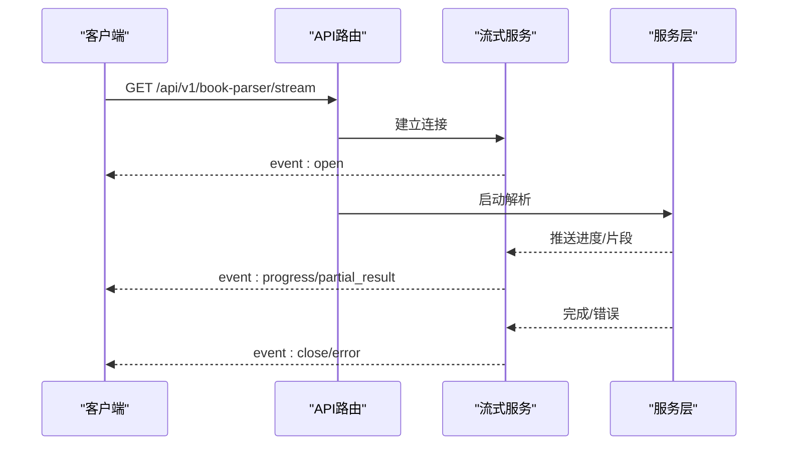
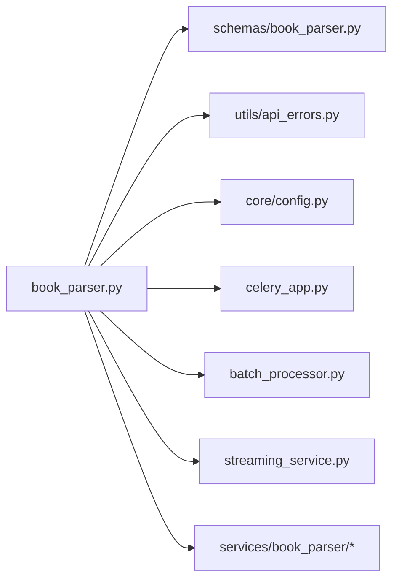

# 脚本处理API

<cite>
**本文引用的文件**   
- [backend/app/api/v1/book_parser.py](file://backend/app/api/v1/book_parser.py)
- [backend/app/services/book_parser/__init__.py](file://backend/app/services/book_parser/__init__.py)
- [backend/app/services/book_parser/text_parser.py](file://backend/app/services/book_parser/text_parser.py)
- [backend/app/services/book_parser/chapter_splitter.py](file://backend/app/services/book_parser/chapter_splitter.py)
- [backend/app/services/book_parser/character_extractor.py](file://backend/app/services/book_parser/character_extractor.py)
- [backend/app/services/book_parser/story_analyzer.py](file://backend/app/services/book_parser/story_analyzer.py)
- [backend/app/schemas/book_parser.py](file://backend/app/schemas/book_parser.py)
- [backend/app/utils/api_errors.py](file://backend/app/utils/api_errors.py)
- [backend/app/core/config.py](file://backend/app/core/config.py)
- [backend/app/celery_app.py](file://backend/app/celery_app.py)
- [backend/app/services/batch_processor.py](file://backend/app/services/batch_processor.py)
- [backend/app/services/streaming_service.py](file://backend/app/services/streaming_service.py)
</cite>

## 目录
1. [简介](#简介)
2. [项目结构](#项目结构)
3. [核心组件](#核心组件)
4. [架构总览](#架构总览)
5. [详细组件分析](#详细组件分析)
6. [依赖关系分析](#依赖关系分析)
7. [性能考量](#性能考量)
8. [故障排查指南](#故障排查指南)
9. [结论](#结论)
10. [附录](#附录)

## 简介
本文件为“小说脚本处理”功能的API文档，覆盖文本解析、章节分割、角色识别与情节分析等能力。文档面向开发者与集成方，提供接口定义、请求/响应格式、错误码说明、异步处理机制、批量处理、格式验证与内容清洗示例，以及智能分段算法、对话提取、场景标注与情感分析的实现要点与优化建议。

## 项目结构
脚本处理功能位于后端模块中，主要包含：
- API路由层：对外暴露REST接口，负责参数校验、鉴权与结果序列化
- 服务层：实现文本解析、章节分割、角色提取、情节分析等业务逻辑
- 数据模型与Schema：统一输入输出结构
- 工具与配置：错误处理、配置加载、异步任务与流式服务

图表来源
- [backend/app/api/v1/book_parser.py](file://backend/app/api/v1/book_parser.py)
- [backend/app/schemas/book_parser.py](file://backend/app/schemas/book_parser.py)
- [backend/app/services/book_parser/text_parser.py](file://backend/app/services/book_parser/text_parser.py)
- [backend/app/services/book_parser/chapter_splitter.py](file://backend/app/services/book_parser/chapter_splitter.py)
- [backend/app/services/book_parser/character_extractor.py](file://backend/app/services/book_parser/character_extractor.py)
- [backend/app/services/book_parser/story_analyzer.py](file://backend/app/services/book_parser/story_analyzer.py)
- [backend/app/utils/api_errors.py](file://backend/app/utils/api_errors.py)
- [backend/app/core/config.py](file://backend/app/core/config.py)
- [backend/app/celery_app.py](file://backend/app/celery_app.py)
- [backend/app/services/batch_processor.py](file://backend/app/services/batch_processor.py)
- [backend/app/services/streaming_service.py](file://backend/app/services/streaming_service.py)

章节来源
- [backend/app/api/v1/book_parser.py](file://backend/app/api/v1/book_parser.py)
- [backend/app/schemas/book_parser.py](file://backend/app/schemas/book_parser.py)

## 核心组件
- 文本解析器：负责原始文本清洗、编码检测、段落规范化、标点修复、空白字符清理与基础统计
- 章节分割器：基于规则与启发式策略的智能分段（标题模式、空行密度、语义边界），支持自定义阈值与回退策略
- 角色识别器：通过命名实体识别与上下文共现统计，抽取角色名、别名、称谓及出现频次
- 情节分析器：事件抽取、关键节点定位、冲突/转折识别、主题/情感倾向评估
- 批量处理器：队列化执行多文本任务，支持进度上报与失败重试
- 流式服务：SSE/WS推送解析进度与中间结果，提升长文本体验

章节来源
- [backend/app/services/book_parser/text_parser.py](file://backend/app/services/book_parser/text_parser.py)
- [backend/app/services/book_parser/chapter_splitter.py](file://backend/app/services/book_parser/chapter_splitter.py)
- [backend/app/services/book_parser/character_extractor.py](file://backend/app/services/book_parser/character_extractor.py)
- [backend/app/services/book_parser/story_analyzer.py](file://backend/app/services/book_parser/story_analyzer.py)
- [backend/app/services/batch_processor.py](file://backend/app/services/batch_processor.py)
- [backend/app/services/streaming_service.py](file://backend/app/services/streaming_service.py)

## 架构总览
整体采用分层架构：API路由层接收请求并调用服务层；服务层组合多个专用解析器完成业务逻辑；错误处理与配置在通用模块中集中管理；异步与流式能力由Celery与流式服务提供。

图表来源
- [backend/app/api/v1/book_parser.py](file://backend/app/api/v1/book_parser.py)
- [backend/app/services/book_parser/text_parser.py](file://backend/app/services/book_parser/text_parser.py)
- [backend/app/services/book_parser/chapter_splitter.py](file://backend/app/services/book_parser/chapter_splitter.py)
- [backend/app/services/book_parser/character_extractor.py](file://backend/app/services/book_parser/character_extractor.py)
- [backend/app/services/book_parser/story_analyzer.py](file://backend/app/services/book_parser/story_analyzer.py)
- [backend/app/services/batch_processor.py](file://backend/app/services/batch_processor.py)
- [backend/app/services/streaming_service.py](file://backend/app/services/streaming_service.py)

## 详细组件分析

### 文本解析接口
- 功能：文本清洗、编码检测、段落规范化、标点修复、空白清理、长度统计
- 输入字段：
  - text: 原始文本
  - options: { normalize_whitespace, fix_punctuation, detect_encoding }
- 输出字段：
  - cleaned_text: 清洗后文本
  - stats: { char_count, word_count, paragraph_count }
  - warnings: 清洗过程中的警告列表

图表来源
- [backend/app/services/book_parser/text_parser.py](file://backend/app/services/book_parser/text_parser.py)

章节来源
- [backend/app/services/book_parser/text_parser.py](file://backend/app/services/book_parser/text_parser.py)

### 章节分割接口
- 功能：智能分段，支持标题模式匹配、空行密度、语义边界判断与回退策略
- 输入字段：
  - text: 已清洗文本
  - strategy: { rule_based, semantic, hybrid }
  - thresholds: { min_length, max_length, gap_ratio }
  - custom_patterns: 自定义正则表达式列表
- 输出字段：
  - chapters: [{ id, title, content, start_offset, end_offset }]
  - metadata: { strategy_used, thresholds_applied, fallback_triggered }

图表来源
- [backend/app/services/book_parser/chapter_splitter.py](file://backend/app/services/book_parser/chapter_splitter.py)

章节来源
- [backend/app/services/book_parser/chapter_splitter.py](file://backend/app/services/book_parser/chapter_splitter.py)

### 角色识别接口
- 功能：从文本中抽取角色名、别名、称谓，统计出现频次与上下文
- 输入字段：
  - text: 已清洗文本
  - scope: { chapter, whole_book }
  - filters: { min_freq, exclude_titles }
- 输出字段：
  - characters: [{ name, aliases, frequency, contexts }]
  - summary: { total_mentions, unique_names }

图表来源
- [backend/app/services/book_parser/character_extractor.py](file://backend/app/services/book_parser/character_extractor.py)

章节来源
- [backend/app/services/book_parser/character_extractor.py](file://backend/app/services/book_parser/character_extractor.py)

### 情节分析接口
- 功能：事件抽取、关键节点定位、冲突/转折识别、主题/情感倾向评估
- 输入字段：
  - text: 已清洗文本
  - analysis_depth: { shallow, medium, deep }
  - output_format: { structured, narrative }
- 输出字段：
  - events: [{ type, subject, object, timestamp_hint }]
  - key_nodes: [{ label, description, confidence }]
  - sentiment: { overall, per_chapter }
  - themes: [{ theme, evidence }]

图表来源
- [backend/app/services/book_parser/story_analyzer.py](file://backend/app/services/book_parser/story_analyzer.py)

章节来源
- [backend/app/services/book_parser/story_analyzer.py](file://backend/app/services/book_parser/story_analyzer.py)

### 批量处理接口
- 功能：提交多个文本任务，支持进度查询与失败重试
- 输入字段：
  - tasks: [{ id, text, options }]
  - mode: { sync, async }
  - retry_policy: { max_retries, backoff }
- 输出字段：
  - task_id: 任务批次ID
  - status: pending/processing/completed/failed
  - progress: { completed, total, errors }

图表来源
- [backend/app/services/batch_processor.py](file://backend/app/services/batch_processor.py)
- [backend/app/celery_app.py](file://backend/app/celery_app.py)

章节来源
- [backend/app/services/batch_processor.py](file://backend/app/services/batch_processor.py)
- [backend/app/celery_app.py](file://backend/app/celery_app.py)

### 流式处理接口
- 功能：SSE/WS推送解析进度与中间结果，适用于长文本实时反馈
- 输入字段：同各接口
- 输出事件：
  - event_type: progress/partial_result/error
  - payload: 具体数据

图表来源
- [backend/app/services/streaming_service.py](file://backend/app/services/streaming_service.py)

章节来源
- [backend/app/services/streaming_service.py](file://backend/app/services/streaming_service.py)

## 依赖关系分析
- API路由依赖Schema进行参数校验，依赖服务层实现业务逻辑
- 服务层内部模块高内聚、低耦合，通过明确接口交互
- 错误处理集中在utils模块，便于统一捕获与返回
- 配置项集中于core.config，支持环境变量注入
- 异步与流式分别由Celery与流式服务支撑

图表来源
- [backend/app/api/v1/book_parser.py](file://backend/app/api/v1/book_parser.py)
- [backend/app/schemas/book_parser.py](file://backend/app/schemas/book_parser.py)
- [backend/app/utils/api_errors.py](file://backend/app/utils/api_errors.py)
- [backend/app/core/config.py](file://backend/app/core/config.py)
- [backend/app/celery_app.py](file://backend/app/celery_app.py)
- [backend/app/services/batch_processor.py](file://backend/app/services/batch_processor.py)
- [backend/app/services/streaming_service.py](file://backend/app/services/streaming_service.py)

章节来源
- [backend/app/api/v1/book_parser.py](file://backend/app/api/v1/book_parser.py)
- [backend/app/schemas/book_parser.py](file://backend/app/schemas/book_parser.py)

## 性能考量
- 文本解析：优先本地规则与轻量NLP，避免大模型调用；对超长文本启用分块处理
- 章节分割：合理设置阈值与回退策略，减少不必要的递归与回溯
- 角色识别：缓存高频词汇与别名映射，降低重复计算
- 情节分析：按需选择分析深度，浅层用于快速预览，深层用于精修
- 批量处理：使用队列与并发控制，避免资源争用；失败任务指数退避重试
- 流式处理：增量推送，减少内存峰值；服务端缓冲与背压控制

[本节为通用指导，不直接分析具体文件]

## 故障排查指南
- 常见错误码：
  - 400 参数校验失败：检查Schema字段类型与必填项
  - 422 格式验证错误：确认JSON结构与字段约束
  - 500 内部错误：查看日志与异常堆栈
  - 503 服务不可用：检查Celery队列与流式服务状态
- 调试建议：
  - 开启详细日志，记录输入摘要与中间状态
  - 使用最小可复现样本定位问题
  - 检查配置项与环境变量是否正确加载

章节来源
- [backend/app/utils/api_errors.py](file://backend/app/utils/api_errors.py)
- [backend/app/core/config.py](file://backend/app/core/config.py)

## 结论
本API文档系统化梳理了小说脚本处理的文本解析、章节分割、角色识别与情节分析能力，提供了清晰的接口定义、数据模型与流程图示。结合批量与流式处理机制，可满足大规模文本分析与实时反馈需求。建议在生产环境启用监控与告警，持续优化解析质量与性能。

[本节为总结性内容，不直接分析具体文件]

## 附录
- 请求/响应格式示例路径：
  - 文本解析：参考 schemas/book_parser.py 中的 ParseRequest/ParseResponse
  - 章节分割：参考 schemas/book_parser.py 中的 SplitRequest/SplitResponse
  - 角色识别：参考 schemas/book_parser.py 中的 CharacterExtractRequest/CharacterExtractResponse
  - 情节分析：参考 schemas/book_parser.py 中的 StoryAnalyzeRequest/StoryAnalyzeResponse
  - 批量处理：参考 schemas/book_parser.py 中的 BatchRequest/BatchResponse
  - 流式处理：参考 streaming_service.py 的事件定义

章节来源
- [backend/app/schemas/book_parser.py](file://backend/app/schemas/book_parser.py)
- [backend/app/services/streaming_service.py](file://backend/app/services/streaming_service.py)