# 音频合成API

<cite>
**本文引用的文件**   
- [backend/app/api/v1/audiobook.py](file://backend/app/api/v1/audiobook.py)
- [backend/app/services/audiobook/audio_mixer.py](file://backend/app/services/audiobook/audio_mixer.py)
- [backend/app/services/audiobook/audio_quality_checker.py](file://backend/app/services/audiobook/audio_quality_checker.py)
- [backend/app/services/audiobook/audio_post_processor.py](file://backend/app/services/audiobook/audio_post_processor.py)
- [backend/app/services/audiobook/audio_file_manager.py](file://backend/app/services/audiobook/audio_file_manager.py)
- [backend/app/services/audiobook/background_tasks.py](file://backend/app/services/audiobook/background_tasks.py)
- [backend/app/services/audiobook/task_queue.py](file://backend/app/services/audiobook/task_queue.py)
- [backend/app/services/audiobook/sound_effect_manager.py](file://backend/app/services/audiobook/sound_effect_manager.py)
- [backend/app/services/audiobook/music_manager.py](file://backend/app/services/audiobook/music_manager.py)
- [backend/app/services/audiobook/dynamic_mixing.py](file://backend/app/services/audiobook/dynamic_mixing.py)
- [backend/app/services/audiobook/format_converter.py](file://backend/app/services/audiobook/format_converter.py)
- [backend/app/services/audiobook/asset_library_service.py](file://backend/app/services/audiobook/asset_library_service.py)
- [backend/app/models/audio_library_asset.py](file://backend/app/models/audio_library_asset.py)
- [backend/app/schemas/audiobook.py](file://backend/app/schemas/audiobook.py)
- [backend/app/celery_app.py](file://backend/app/celery_app.py)
- [backend/app/tasks/audiobook_tasks.py](file://backend/app/tasks/audiobook_tasks.py)
- [scripts/ffmpeg/fast_transit.sh](file://scripts/ffmpeg/fast_transit.sh)
- [scripts/ffmpeg/slow_transit.sh](file://scripts/ffmpeg/slow_transit.sh)
- [backend/data/audio_library/sfx_candidates.jsonl](file://backend/data/audio_library/sfx_candidates.jsonl)
</cite>

## 目录
1. [简介](#简介)
2. [项目结构](#项目结构)
3. [核心组件](#核心组件)
4. [架构总览](#架构总览)
5. [详细组件分析](#详细组件分析)
6. [依赖关系分析](#依赖关系分析)
7. [性能考量](#性能考量)
8. [故障排查指南](#故障排查指南)
9. [结论](#结论)
10. [附录](#附录)

## 简介
本文件为“音频合成”功能的API与实现文档，覆盖多轨混音、音效叠加、音量平衡、格式转换、音频文件管理、质量检查、后期处理、背景音乐添加、环境音效集成、动态混音、异步任务队列、进度跟踪与失败恢复机制。同时给出音频格式支持、编码参数与质量标准的说明，并提供端到端调用示例与最佳实践。

## 项目结构
本项目采用分层架构：API层暴露REST接口；服务层封装业务逻辑（混音、音效、格式转换、质量检查、后期处理等）；模型与Schema定义数据契约；Celery任务与队列负责异步执行与重试；FFmpeg脚本用于高性能转码与处理。

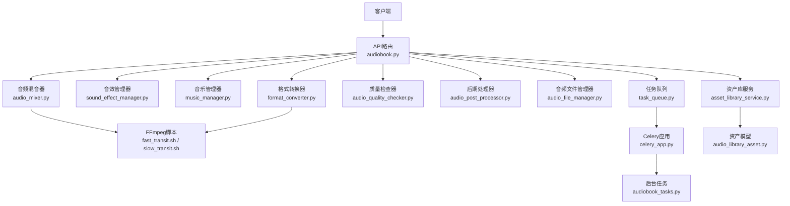

**图表来源** 
- [backend/app/api/v1/audiobook.py](file://backend/app/api/v1/audiobook.py)
- [backend/app/services/audiobook/audio_mixer.py](file://backend/app/services/audiobook/audio_mixer.py)
- [backend/app/services/audiobook/sound_effect_manager.py](file://backend/app/services/audiobook/sound_effect_manager.py)
- [backend/app/services/audiobook/music_manager.py](file://backend/app/services/audiobook/music_manager.py)
- [backend/app/services/audiobook/format_converter.py](file://backend/app/services/audiobook/format_converter.py)
- [backend/app/services/audiobook/audio_quality_checker.py](file://backend/app/services/audiobook/audio_quality_checker.py)
- [backend/app/services/audiobook/audio_post_processor.py](file://backend/app/services/audiobook/audio_post_processor.py)
- [backend/app/services/audiobook/audio_file_manager.py](file://backend/app/services/audiobook/audio_file_manager.py)
- [backend/app/services/audiobook/task_queue.py](file://backend/app/services/audiobook/task_queue.py)
- [backend/app/celery_app.py](file://backend/app/celery_app.py)
- [backend/app/tasks/audiobook_tasks.py](file://backend/app/tasks/audiobook_tasks.py)
- [scripts/ffmpeg/fast_transit.sh](file://scripts/ffmpeg/fast_transit.sh)
- [scripts/ffmpeg/slow_transit.sh](file://scripts/ffmpeg/slow_transit.sh)

**章节来源**
- [backend/app/api/v1/audiobook.py](file://backend/app/api/v1/audiobook.py)
- [backend/app/services/audiobook/audio_mixer.py](file://backend/app/services/audiobook/audio_mixer.py)
- [backend/app/services/audiobook/task_queue.py](file://backend/app/services/audiobook/task_queue.py)
- [backend/app/celery_app.py](file://backend/app/celery_app.py)
- [backend/app/tasks/audiobook_tasks.py](file://backend/app/tasks/audiobook_tasks.py)
- [scripts/ffmpeg/fast_transit.sh](file://scripts/ffmpeg/fast_transit.sh)
- [scripts/ffmpeg/slow_transit.sh](file://scripts/ffmpeg/slow_transit.sh)

## 核心组件
- 音频混音器：多轨混音、轨道增益、交叉淡入淡出、响度均衡、声道布局控制。
- 音效管理器：环境音效检索、叠加、时间对齐、空间化（可选）。
- 音乐管理器：背景音乐加载、循环、淡入淡出、与对白/音效的避让。
- 格式转换器：采样率、位深、编码格式、码率、声道数转换。
- 质量检查器：响度、峰值、失真、静音段、频谱异常检测。
- 后期处理器：降噪、压缩、限幅、EQ、立体声增强。
- 音频文件管理器：上传、校验、缓存、清理、版本化。
- 任务队列与后台任务：异步编排、进度上报、失败重试、断点续跑。
- 资产库服务：素材索引、元数据、评分、策略选择。

**章节来源**
- [backend/app/services/audiobook/audio_mixer.py](file://backend/app/services/audiobook/audio_mixer.py)
- [backend/app/services/audiobook/sound_effect_manager.py](file://backend/app/services/audiobook/sound_effect_manager.py)
- [backend/app/services/audiobook/music_manager.py](file://backend/app/services/audiobook/music_manager.py)
- [backend/app/services/audiobook/format_converter.py](file://backend/app/services/audiobook/format_converter.py)
- [backend/app/services/audiobook/audio_quality_checker.py](file://backend/app/services/audiobook/audio_quality_checker.py)
- [backend/app/services/audiobook/audio_post_processor.py](file://backend/app/services/audiobook/audio_post_processor.py)
- [backend/app/services/audiobook/audio_file_manager.py](file://backend/app/services/audiobook/audio_file_manager.py)
- [backend/app/services/audiobook/task_queue.py](file://backend/app/services/audiobook/task_queue.py)
- [backend/app/celery_app.py](file://backend/app/celery_app.py)
- [backend/app/tasks/audiobook_tasks.py](file://backend/app/tasks/audiobook_tasks.py)
- [backend/app/services/audiobook/asset_library_service.py](file://backend/app/services/audiobook/asset_library_service.py)

## 架构总览
整体流程以API为入口，协调混音、音效、音乐、格式转换、质量检查与后期处理，并通过任务队列异步执行长耗时步骤，提供进度与结果回调。

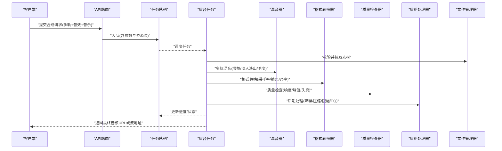

**图表来源** 
- [backend/app/api/v1/audiobook.py](file://backend/app/api/v1/audiobook.py)
- [backend/app/services/audiobook/task_queue.py](file://backend/app/services/audiobook/task_queue.py)
- [backend/app/tasks/audiobook_tasks.py](file://backend/app/tasks/audiobook_tasks.py)
- [backend/app/services/audiobook/audio_mixer.py](file://backend/app/services/audiobook/audio_mixer.py)
- [backend/app/services/audiobook/format_converter.py](file://backend/app/services/audiobook/format_converter.py)
- [backend/app/services/audiobook/audio_quality_checker.py](file://backend/app/services/audiobook/audio_quality_checker.py)
- [backend/app/services/audiobook/audio_post_processor.py](file://backend/app/services/audiobook/audio_post_processor.py)
- [backend/app/services/audiobook/audio_file_manager.py](file://backend/app/services/audiobook/audio_file_manager.py)

## 详细组件分析

### 多轨混音API与服务
- 能力要点
  - 多轨输入：对白、BGM、SFX、旁白、环境音等。
  - 轨道控制：独立增益、Panning、淡入淡出时长、交叉淡化。
  - 响度与平衡：目标响度、LUFS校准、动态范围控制。
  - 输出：立体声/环绕、采样率、位深、编码格式。
- 典型调用路径
  - API接收请求 -> 校验参数 -> 入队任务 -> 后台任务调用混音器 -> 生成中间产物 -> 进入后续处理链。
- 关键数据结构
  - 轨道列表、时间轴标记、混音预设、响度目标、输出规格。
- 错误处理
  - 轨道缺失、时长不一致、采样率不匹配、资源不可用时的回退策略。

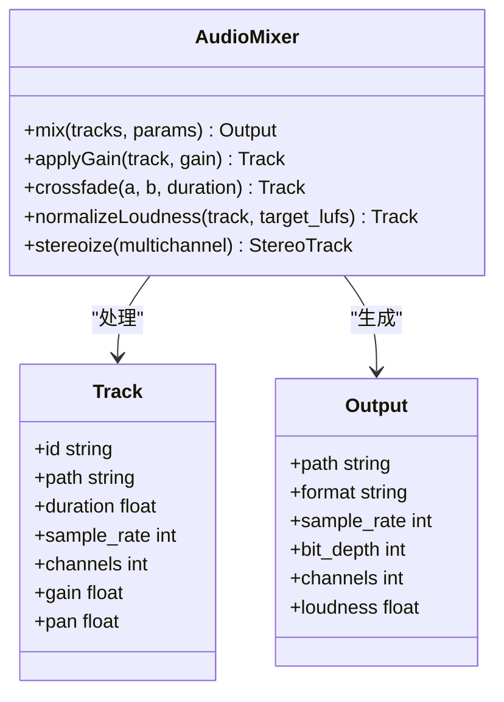

**图表来源** 
- [backend/app/services/audiobook/audio_mixer.py](file://backend/app/services/audiobook/audio_mixer.py)

**章节来源**
- [backend/app/api/v1/audiobook.py](file://backend/app/api/v1/audiobook.py)
- [backend/app/services/audiobook/audio_mixer.py](file://backend/app/services/audiobook/audio_mixer.py)
- [backend/app/services/audiobook/task_queue.py](file://backend/app/services/audiobook/task_queue.py)
- [backend/app/tasks/audiobook_tasks.py](file://backend/app/tasks/audiobook_tasks.py)

### 音效叠加与环境音效集成
- 能力要点
  - 基于标签/语义检索环境音效，按场景自动匹配。
  - 时间对齐：根据对白停顿、场景切换插入音效。
  - 空间化：可选的左右声道偏移、距离衰减。
- 调用流程
  - API接收场景描述与时间戳 -> 音效管理器检索候选 -> 排序与选择 -> 叠加到混音轨道。
- 质量保障
  - 避免频段冲突、动态范围适配、短时静音保护。

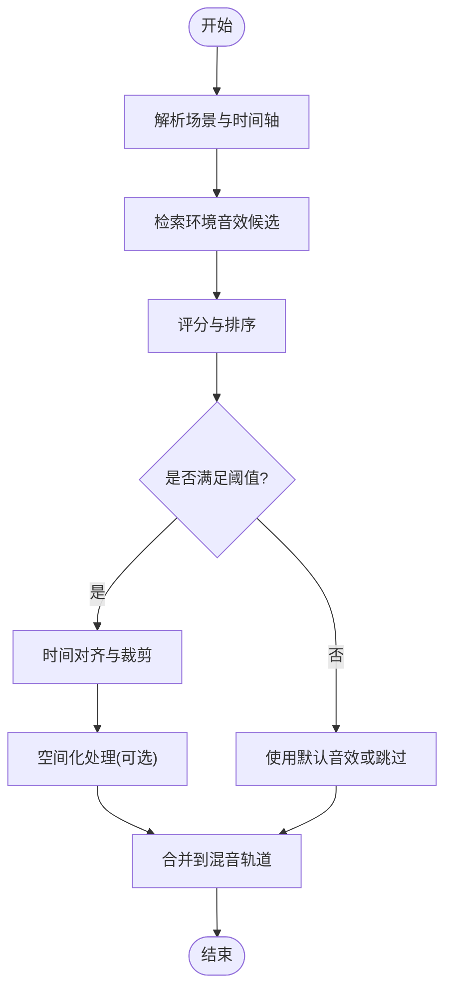

**图表来源** 
- [backend/app/services/audiobook/sound_effect_manager.py](file://backend/app/services/audiobook/sound_effect_manager.py)
- [backend/data/audio_library/sfx_candidates.jsonl](file://backend/data/audio_library/sfx_candidates.jsonl)

**章节来源**
- [backend/app/services/audiobook/sound_effect_manager.py](file://backend/app/services/audiobook/sound_effect_manager.py)
- [backend/data/audio_library/sfx_candidates.jsonl](file://backend/data/audio_library/sfx_candidates.jsonl)

### 背景音乐添加与避让
- 能力要点
  - BGM加载、循环、淡入淡出、与对白/音效的动态避让。
  - 场景化预设：不同情绪/节奏的BGM模板。
- 调用流程
  - API传入BGM ID与强度曲线 -> 音乐管理器预处理 -> 在混音阶段进行避让与融合。
- 注意事项
  - 避免人声频段掩蔽、保持对话清晰度。

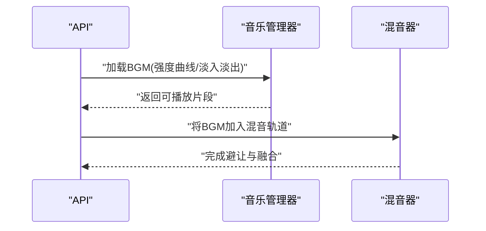

**图表来源** 
- [backend/app/services/audiobook/music_manager.py](file://backend/app/services/audiobook/music_manager.py)
- [backend/app/services/audiobook/audio_mixer.py](file://backend/app/services/audiobook/audio_mixer.py)

**章节来源**
- [backend/app/services/audiobook/music_manager.py](file://backend/app/services/audiobook/music_manager.py)
- [backend/app/services/audiobook/audio_mixer.py](file://backend/app/services/audiobook/audio_mixer.py)

### 动态混音与实时调整
- 能力要点
  - 基于事件触发（如角色说话、动作）动态调整各轨音量与效果。
  - 支持在线参数热更新与平滑过渡。
- 适用场景
  - 交互式音频、游戏音频、直播混音。

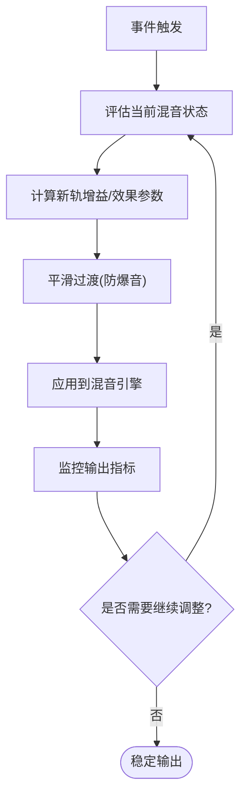

**图表来源** 
- [backend/app/services/audiobook/dynamic_mixing.py](file://backend/app/services/audiobook/dynamic_mixing.py)

**章节来源**
- [backend/app/services/audiobook/dynamic_mixing.py](file://backend/app/services/audiobook/dynamic_mixing.py)

### 格式转换与编码参数
- 支持的格式
  - 输入：WAV、FLAC、MP3、AAC、OGG、M4A等。
  - 输出：WAV、MP3、AAC、FLAC、OPUS等。
- 编码参数
  - 采样率：8k/16k/24k/44.1k/48k等。
  - 位深：16/24/32位。
  - 码率：CBR/VBR，具体数值由质量档位决定。
  - 声道：单声道/立体声/5.1。
- 转换策略
  - 无损优先、按需降采样、避免重复编码。

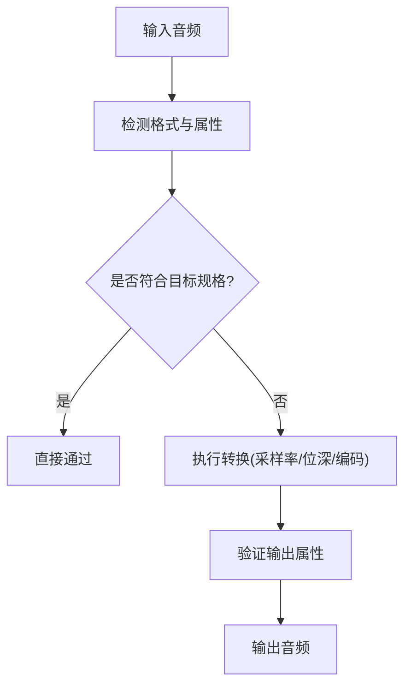

**图表来源** 
- [backend/app/services/audiobook/format_converter.py](file://backend/app/services/audiobook/format_converter.py)
- [scripts/ffmpeg/fast_transit.sh](file://scripts/ffmpeg/fast_transit.sh)
- [scripts/ffmpeg/slow_transit.sh](file://scripts/ffmpeg/slow_transit.sh)

**章节来源**
- [backend/app/services/audiobook/format_converter.py](file://backend/app/services/audiobook/format_converter.py)
- [scripts/ffmpeg/fast_transit.sh](file://scripts/ffmpeg/fast_transit.sh)
- [scripts/ffmpeg/slow_transit.sh](file://scripts/ffmpeg/slow_transit.sh)

### 音频文件管理与质量检查
- 文件管理
  - 上传校验（大小、格式、完整性）、临时存储、持久化、清理策略。
  - 版本化与回滚、引用计数、锁机制。
- 质量检查
  - 响度(LUFS)、峰值、失真、静音段、频谱异常、相位问题。
  - 质量分级与修复建议。

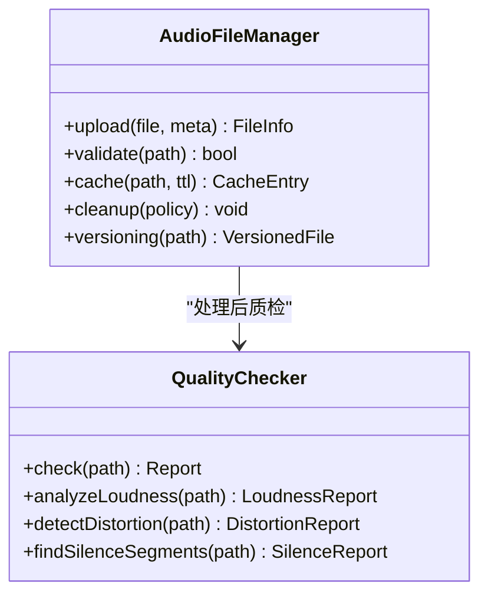

**图表来源** 
- [backend/app/services/audiobook/audio_file_manager.py](file://backend/app/services/audiobook/audio_file_manager.py)
- [backend/app/services/audiobook/audio_quality_checker.py](file://backend/app/services/audiobook/audio_quality_checker.py)

**章节来源**
- [backend/app/services/audiobook/audio_file_manager.py](file://backend/app/services/audiobook/audio_file_manager.py)
- [backend/app/services/audiobook/audio_quality_checker.py](file://backend/app/services/audiobook/audio_quality_checker.py)

### 后期处理流水线
- 能力要点
  - 降噪、压缩、限幅、EQ、立体声增强、去齿音。
  - 可配置处理链与参数模板。
- 调用顺序
  - 降噪 -> 压缩 -> 限幅 -> EQ -> 立体声增强 -> 输出。

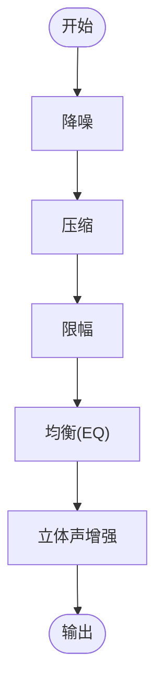

**图表来源** 
- [backend/app/services/audiobook/audio_post_processor.py](file://backend/app/services/audiobook/audio_post_processor.py)

**章节来源**
- [backend/app/services/audiobook/audio_post_processor.py](file://backend/app/services/audiobook/audio_post_processor.py)

### 异步任务队列、进度跟踪与失败恢复
- 任务队列
  - 入队参数包括：轨道列表、音效/BGM选择、格式与质量要求、优先级。
  - 支持分片与并行处理，提升吞吐。
- 进度跟踪
  - 阶段化进度：准备、混音、转换、质检、后期、打包。
  - 实时推送进度与中间产物URL。
- 失败恢复
  - 重试策略（指数退避）、断点续跑、部分结果保留、告警通知。

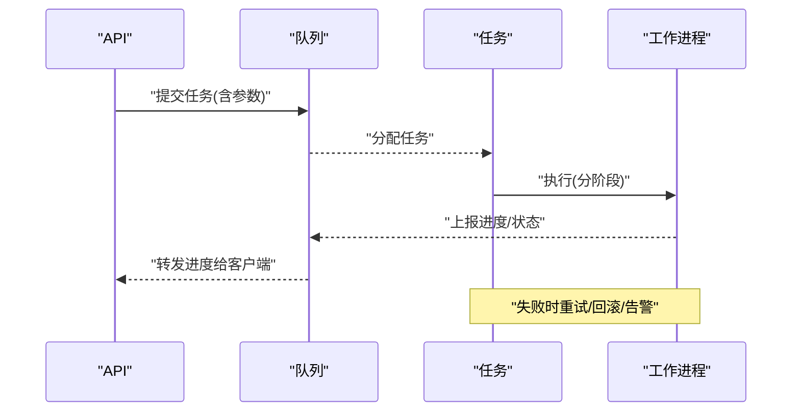

**图表来源** 
- [backend/app/services/audiobook/task_queue.py](file://backend/app/services/audiobook/task_queue.py)
- [backend/app/celery_app.py](file://backend/app/celery_app.py)
- [backend/app/tasks/audiobook_tasks.py](file://backend/app/tasks/audiobook_tasks.py)

**章节来源**
- [backend/app/services/audiobook/task_queue.py](file://backend/app/services/audiobook/task_queue.py)
- [backend/app/celery_app.py](file://backend/app/celery_app.py)
- [backend/app/tasks/audiobook_tasks.py](file://backend/app/tasks/audiobook_tasks.py)

### 资产库与素材选择
- 资产库服务
  - 素材索引、元数据、评分、策略选择（热度/相关性/版权）。
  - 与数据库模型关联，支持查询与过滤。
- 使用方式
  - 通过API传入场景标签与约束，返回推荐素材ID列表。

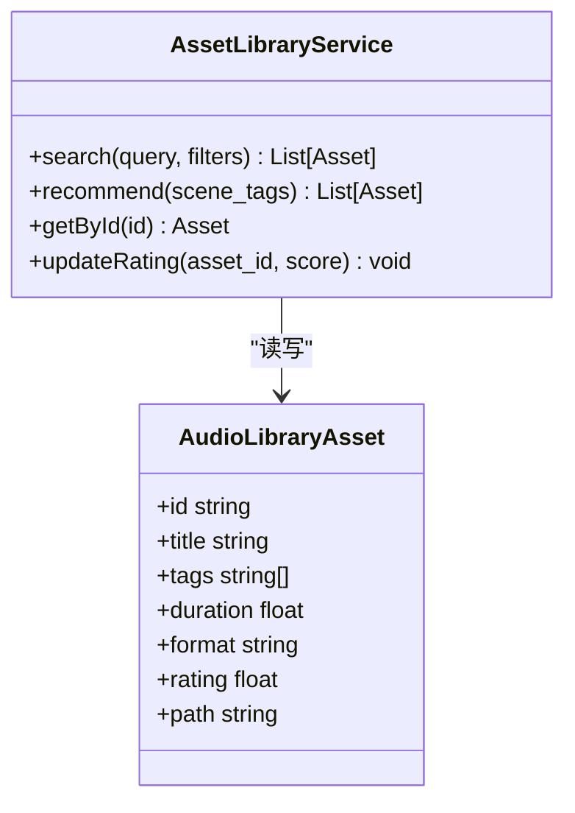

**图表来源** 
- [backend/app/services/audiobook/asset_library_service.py](file://backend/app/services/audiobook/asset_library_service.py)
- [backend/app/models/audio_library_asset.py](file://backend/app/models/audio_library_asset.py)

**章节来源**
- [backend/app/services/audiobook/asset_library_service.py](file://backend/app/services/audiobook/asset_library_service.py)
- [backend/app/models/audio_library_asset.py](file://backend/app/models/audio_library_asset.py)

## 依赖关系分析
- 组件耦合
  - API层依赖服务层，服务层依赖工具与外部脚本（FFmpeg）。
  - 任务队列与Celery解耦生产与消费，提高可扩展性。
- 外部依赖
  - FFmpeg用于转码与处理。
  - 数据库用于资产与任务状态持久化。
- 潜在风险
  - 循环依赖需避免；大文件处理需内存与磁盘I/O优化。

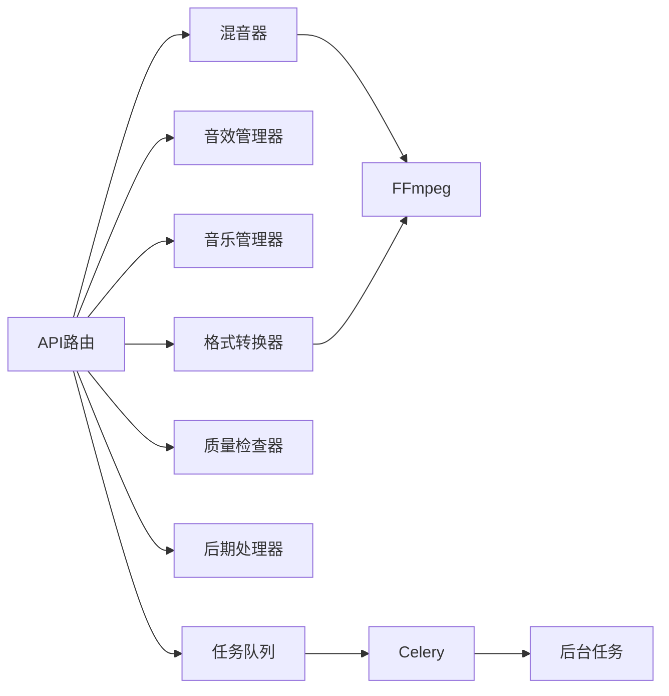

**图表来源** 
- [backend/app/api/v1/audiobook.py](file://backend/app/api/v1/audiobook.py)
- [backend/app/services/audiobook/audio_mixer.py](file://backend/app/services/audiobook/audio_mixer.py)
- [backend/app/services/audiobook/sound_effect_manager.py](file://backend/app/services/audiobook/sound_effect_manager.py)
- [backend/app/services/audiobook/music_manager.py](file://backend/app/services/audiobook/music_manager.py)
- [backend/app/services/audiobook/format_converter.py](file://backend/app/services/audiobook/format_converter.py)
- [backend/app/services/audiobook/audio_quality_checker.py](file://backend/app/services/audiobook/audio_quality_checker.py)
- [backend/app/services/audiobook/audio_post_processor.py](file://backend/app/services/audiobook/audio_post_processor.py)
- [backend/app/services/audiobook/task_queue.py](file://backend/app/services/audiobook/task_queue.py)
- [backend/app/celery_app.py](file://backend/app/celery_app.py)
- [backend/app/tasks/audiobook_tasks.py](file://backend/app/tasks/audiobook_tasks.py)
- [scripts/ffmpeg/fast_transit.sh](file://scripts/ffmpeg/fast_transit.sh)
- [scripts/ffmpeg/slow_transit.sh](file://scripts/ffmpeg/slow_transit.sh)

**章节来源**
- [backend/app/api/v1/audiobook.py](file://backend/app/api/v1/audiobook.py)
- [backend/app/services/audiobook/task_queue.py](file://backend/app/services/audiobook/task_queue.py)
- [backend/app/celery_app.py](file://backend/app/celery_app.py)
- [backend/app/tasks/audiobook_tasks.py](file://backend/app/tasks/audiobook_tasks.py)
- [scripts/ffmpeg/fast_transit.sh](file://scripts/ffmpeg/fast_transit.sh)
- [scripts/ffmpeg/slow_transit.sh](file://scripts/ffmpeg/slow_transit.sh)

## 性能考量
- 并发与并行
  - 多轨处理分片并行，利用多核CPU；大文件流式处理降低内存占用。
- I/O优化
  - 使用SSD与本地缓存；减少重复读取与写入。
- 转码优化
  - 选择合适的FFmpeg参数，避免不必要的重采样；批量任务排队。
- 质量与速度权衡
  - 提供快速模式与高质量模式，满足不同场景需求。

[本节为通用指导，无需特定文件来源]

## 故障排查指南
- 常见问题
  - 素材缺失或损坏：检查文件路径与完整性校验。
  - 格式不支持：确认输入/输出格式与编码器可用性。
  - 任务失败：查看队列日志与重试次数，定位阶段错误。
  - 音质问题：检查响度、峰值、失真报告与后期参数。
- 诊断方法
  - 启用详细日志与追踪ID；导出中间产物进行分析。
  - 使用质量检查报告定位问题段落。

**章节来源**
- [backend/app/services/audiobook/audio_quality_checker.py](file://backend/app/services/audiobook/audio_quality_checker.py)
- [backend/app/services/audiobook/audio_file_manager.py](file://backend/app/services/audiobook/audio_file_manager.py)
- [backend/app/tasks/audiobook_tasks.py](file://backend/app/tasks/audiobook_tasks.py)

## 结论
本音频合成API提供了完整的多轨混音、音效叠加、背景音乐集成、动态混音、格式转换、质量检查与后期处理能力，并通过异步任务队列实现高吞吐与可靠执行。建议在生产环境中结合质量检查与监控指标，持续优化处理链与参数配置。

[本节为总结，无需特定文件来源]

## 附录
- API调用示例（概念性）
  - 提交合成请求：包含轨道列表、音效/BGM选择、输出格式与质量要求。
  - 查询进度：通过任务ID获取阶段进度与中间产物。
  - 下载结果：成功后获取最终音频文件或流地址。
- 音频格式支持与质量标准
  - 输入/输出格式见“格式转换与编码参数”。
  - 质量标准参考质量检查器的各项指标与建议。

[本节为补充信息，无需特定文件来源]