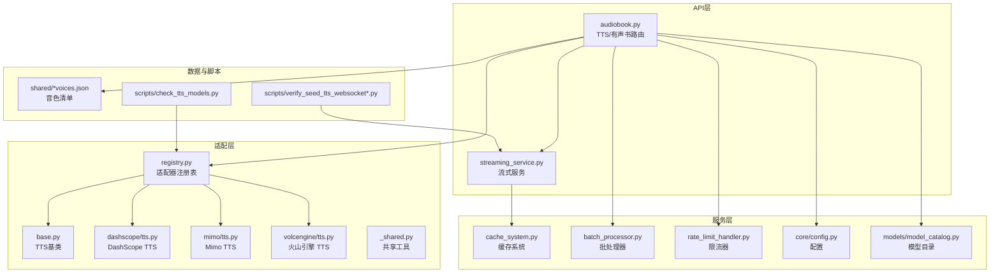
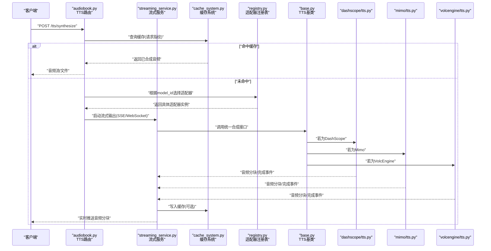
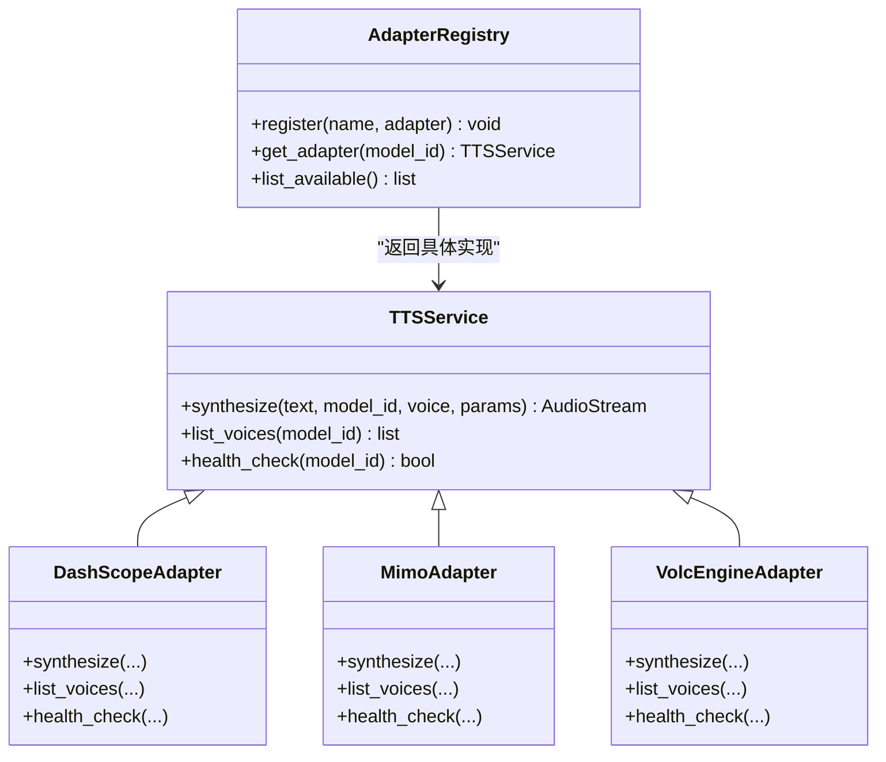
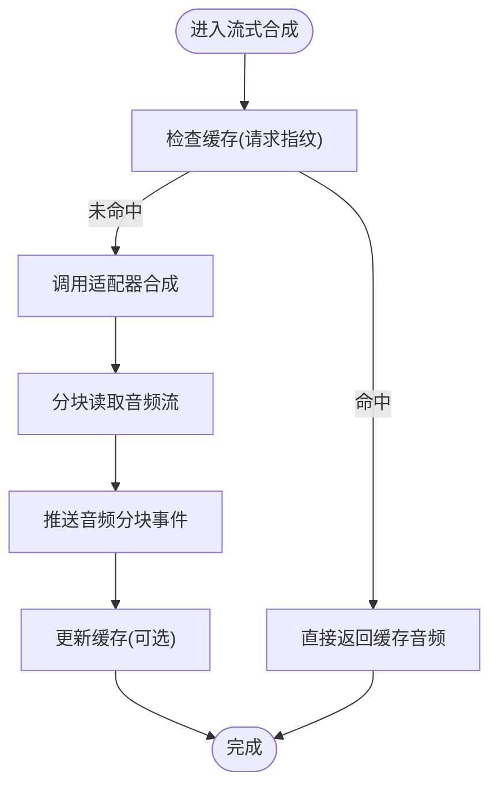
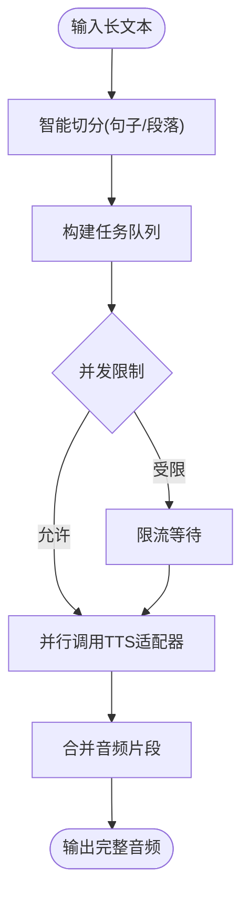
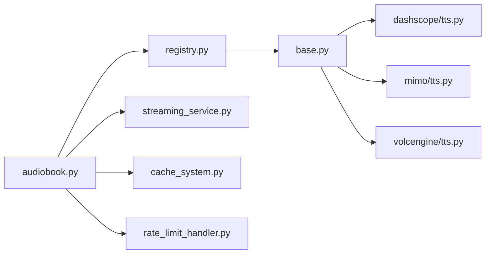

# TTS引擎API

<cite>
**本文引用的文件**   
- [adapters/dashscope/tts.py](file://adapters/dashscope/tts.py)
- [adapters/mimo/tts.py](file://adapters/mimo/tts.py)
- [adapters/volcengine/tts.py](file://adapters/volcengine/tts.py)
- [adapters/base.py](file://adapters/base.py)
- [adapters/registry.py](file://adapters/registry.py)
- [adapters/_shared.py](file://adapters/_shared.py)
- [backend/app/api/v1/audiobook.py](file://backend/app/api/v1/audiobook.py)
- [backend/app/services/streaming_service.py](file://backend/app/services/streaming_service.py)
- [backend/app/services/cache_system.py](file://backend/app/services/cache_system.py)
- [backend/app/services/batch_processor.py](file://backend/app/services/batch_processor.py)
- [backend/app/services/rate_limit_handler.py](file://backend/app/services/rate_limit_handler.py)
- [backend/app/core/config.py](file://backend/app/core/config.py)
- [backend/app/models/model_catalog.py](file://backend/app/models/model_catalog.py)
- [scripts/check_tts_models.py](file://scripts/check_tts_models.py)
- [scripts/verify_seed_tts_websocket.py](file://scripts/verify_seed_tts_websocket.py)
- [scripts/verify_seed_tts_websocket_v2.py](file://scripts/verify_seed_tts_websocket_v2.py)
- [scripts/verify_seed_tts_websocket_v3.py](file://scripts/verify_seed_tts_websocket_v3.py)
- [shared/cosyvoice_v3_plus_voices.json](file://shared/cosyvoice_v3_plus_voices.json)
- [shared/seed_tts_2_0_voices.json](file://shared/seed_tts_2_0_voices.json)
- [shared/stepaudio_2_5_tts_voices.json](file://shared/stepaudio_2_5_tts_voices.json)
- [shared/qwen3_tts_voices.json](file://shared/qwen3_tts_voices.json)
</cite>

## 目录
1. [简介](#简介)
2. [项目结构](#项目结构)
3. [核心组件](#核心组件)
4. [架构总览](#架构总览)
5. [详细组件分析](#详细组件分析)
6. [依赖关系分析](#依赖关系分析)
7. [性能与优化](#性能与优化)
8. [故障排查指南](#故障排查指南)
9. [结论](#结论)
10. [附录：示例与最佳实践](#附录示例与最佳实践)

## 简介
本文件为文本转语音（TTS）引擎的API文档，面向开发者与集成方，覆盖以下主题：
- TTS引擎配置、模型选择与参数调优接口
- 多供应商集成调用方法（CosyVoice、Mimo、StepAudio、SeedTTS等）
- 语音质量设置、情感控制、语速调节与音量控制
- 完整的TTS生成示例：批量处理、流式输出、错误处理
- 性能优化、缓存策略与负载均衡机制

本仓库采用适配器模式将不同TTS供应商统一抽象，通过注册表进行路由与调度，并在后端服务中提供REST API与流式能力。

## 项目结构
TTS相关代码主要分布在以下模块：
- adapters：各TTS供应商适配器实现与公共基础类
- backend/app/api：对外暴露的REST接口（如有声书/TTS相关路由）
- backend/app/services：流式服务、缓存、批处理、限流等通用服务
- backend/app/core：配置与环境加载
- scripts：验证与调试脚本（含WebSocket校验）
- shared：各供应商音色清单JSON

图表来源
- [backend/app/api/v1/audiobook.py](file://backend/app/api/v1/audiobook.py)
- [backend/app/services/streaming_service.py](file://backend/app/services/streaming_service.py)
- [adapters/base.py](file://adapters/base.py)
- [adapters/registry.py](file://adapters/registry.py)
- [adapters/dashscope/tts.py](file://adapters/dashscope/tts.py)
- [adapters/mimo/tts.py](file://adapters/mimo/tts.py)
- [adapters/volcengine/tts.py](file://adapters/volcengine/tts.py)
- [adapters/_shared.py](file://adapters/_shared.py)
- [backend/app/services/cache_system.py](file://backend/app/services/cache_system.py)
- [backend/app/services/batch_processor.py](file://backend/app/services/batch_processor.py)
- [backend/app/services/rate_limit_handler.py](file://backend/app/services/rate_limit_handler.py)
- [backend/app/core/config.py](file://backend/app/core/config.py)
- [backend/app/models/model_catalog.py](file://backend/app/models/model_catalog.py)
- [scripts/check_tts_models.py](file://scripts/check_tts_models.py)
- [scripts/verify_seed_tts_websocket.py](file://scripts/verify_seed_tts_websocket.py)
- [scripts/verify_seed_tts_websocket_v2.py](file://scripts/verify_seed_tts_websocket_v2.py)
- [scripts/verify_seed_tts_websocket_v3.py](file://scripts/verify_seed_tts_websocket_v3.py)
- [shared/cosyvoice_v3_plus_voices.json](file://shared/cosyvoice_v3_plus_voices.json)
- [shared/seed_tts_2_0_voices.json](file://shared/seed_tts_2_0_voices.json)
- [shared/stepaudio_2_5_tts_voices.json](file://shared/stepaudio_2_5_tts_voices.json)
- [shared/qwen3_tts_voices.json](file://shared/qwen3_tts_voices.json)

章节来源
- [backend/app/api/v1/audiobook.py](file://backend/app/api/v1/audiobook.py)
- [adapters/base.py](file://adapters/base.py)
- [adapters/registry.py](file://adapters/registry.py)
- [backend/app/services/streaming_service.py](file://backend/app/services/streaming_service.py)
- [backend/app/services/cache_system.py](file://backend/app/services/cache_system.py)
- [backend/app/services/batch_processor.py](file://backend/app/services/batch_processor.py)
- [backend/app/services/rate_limit_handler.py](file://backend/app/services/rate_limit_handler.py)
- [backend/app/core/config.py](file://backend/app/core/config.py)
- [backend/app/models/model_catalog.py](file://backend/app/models/model_catalog.py)
- [scripts/check_tts_models.py](file://scripts/check_tts_models.py)
- [scripts/verify_seed_tts_websocket.py](file://scripts/verify_seed_tts_websocket.py)
- [scripts/verify_seed_tts_websocket_v2.py](file://scripts/verify_seed_tts_websocket_v2.py)
- [scripts/verify_seed_tts_websocket_v3.py](file://scripts/verify_seed_tts_websocket_v3.py)
- [shared/cosyvoice_v3_plus_voices.json](file://shared/cosyvoice_v3_plus_voices.json)
- [shared/seed_tts_2_0_voices.json](file://shared/seed_tts_2_0_voices.json)
- [shared/stepaudio_2_5_tts_voices.json](file://shared/stepaudio_2_5_tts_voices.json)
- [shared/qwen3_tts_voices.json](file://shared/qwen3_tts_voices.json)

## 核心组件
- TTS基类与适配器契约：定义统一的合成接口、参数映射与结果格式，屏蔽供应商差异。
- 适配器注册表：集中管理可用TTS供应商实例，支持按模型ID或名称动态选择。
- 流式服务：封装SSE/WebSocket流式输出，支持分块音频推送与进度事件。
- 缓存系统：基于请求指纹缓存音频片段，减少重复调用与网络开销。
- 批处理器：对长文本进行智能切分与并发合成，提升吞吐。
- 限流器：保护下游供应商配额与稳定性。
- 配置与模型目录：集中管理供应商密钥、默认参数、模型白名单与音色清单。

章节来源
- [adapters/base.py](file://adapters/base.py)
- [adapters/registry.py](file://adapters/registry.py)
- [backend/app/services/streaming_service.py](file://backend/app/services/streaming_service.py)
- [backend/app/services/cache_system.py](file://backend/app/services/cache_system.py)
- [backend/app/services/batch_processor.py](file://backend/app/services/batch_processor.py)
- [backend/app/services/rate_limit_handler.py](file://backend/app/services/rate_limit_handler.py)
- [backend/app/core/config.py](file://backend/app/core/config.py)
- [backend/app/models/model_catalog.py](file://backend/app/models/model_catalog.py)

## 架构总览
下图展示了从API到适配器的完整调用链，以及流式与缓存的交互。

图表来源
- [backend/app/api/v1/audiobook.py](file://backend/app/api/v1/audiobook.py)
- [backend/app/services/streaming_service.py](file://backend/app/services/streaming_service.py)
- [backend/app/services/cache_system.py](file://backend/app/services/cache_system.py)
- [adapters/registry.py](file://adapters/registry.py)
- [adapters/base.py](file://adapters/base.py)
- [adapters/dashscope/tts.py](file://adapters/dashscope/tts.py)
- [adapters/mimo/tts.py](file://adapters/mimo/tts.py)
- [adapters/volcengine/tts.py](file://adapters/volcengine/tts.py)

## 详细组件分析

### TTS适配器基类与注册表
- 基类定义了统一的合成方法签名、参数标准化与结果解析，确保各供应商行为一致。
- 注册表维护所有已注册的适配器，并提供按模型标识查找实例的能力，便于动态扩展。

图表来源
- [adapters/base.py](file://adapters/base.py)
- [adapters/registry.py](file://adapters/registry.py)
- [adapters/dashscope/tts.py](file://adapters/dashscope/tts.py)
- [adapters/mimo/tts.py](file://adapters/mimo/tts.py)
- [adapters/volcengine/tts.py](file://adapters/volcengine/tts.py)

章节来源
- [adapters/base.py](file://adapters/base.py)
- [adapters/registry.py](file://adapters/registry.py)
- [adapters/dashscope/tts.py](file://adapters/dashscope/tts.py)
- [adapters/mimo/tts.py](file://adapters/mimo/tts.py)
- [adapters/volcengine/tts.py](file://adapters/volcengine/tts.py)

### 流式服务（SSE/WebSocket）
- 负责将TTS合成的音频分块实时推送给客户端，并发送进度与状态事件。
- 与缓存系统协作，在首次合成后写入缓存，后续请求可直接命中。

图表来源
- [backend/app/services/streaming_service.py](file://backend/app/services/streaming_service.py)
- [backend/app/services/cache_system.py](file://backend/app/services/cache_system.py)
- [adapters/base.py](file://adapters/base.py)

章节来源
- [backend/app/services/streaming_service.py](file://backend/app/services/streaming_service.py)
- [backend/app/services/cache_system.py](file://backend/app/services/cache_system.py)

### 批处理器（长文本切分与并发）
- 将长文本按语义或长度切分为多个片段，分别调用TTS适配器并行合成，再合并输出。
- 支持失败重试与降级策略，保证整体任务成功率。

图表来源
- [backend/app/services/batch_processor.py](file://backend/app/services/batch_processor.py)
- [adapters/base.py](file://adapters/base.py)

章节来源
- [backend/app/services/batch_processor.py](file://backend/app/services/batch_processor.py)

### 限流器（保护下游供应商）
- 基于令牌桶或滑动窗口实现，防止突发流量导致供应商限流或熔断。
- 可针对每个模型/租户维度独立限流。

章节来源
- [backend/app/services/rate_limit_handler.py](file://backend/app/services/rate_limit_handler.py)

### 配置与模型目录
- 集中管理各供应商的密钥、默认参数、超时与重试策略。
- 模型目录维护可用模型列表、能力标签与音色清单映射。

章节来源
- [backend/app/core/config.py](file://backend/app/core/config.py)
- [backend/app/models/model_catalog.py](file://backend/app/models/model_catalog.py)

## 依赖关系分析
- API路由依赖注册表获取具体适配器，依赖流式服务与缓存系统进行输出与加速。
- 适配器之间无直接耦合，均通过基类契约与注册表解耦。
- 外部依赖包括各供应商SDK/HTTP接口、缓存存储（内存/Redis）、消息通道（SSE/WebSocket）。

图表来源
- [backend/app/api/v1/audiobook.py](file://backend/app/api/v1/audiobook.py)
- [adapters/registry.py](file://adapters/registry.py)
- [adapters/base.py](file://adapters/base.py)
- [adapters/dashscope/tts.py](file://adapters/dashscope/tts.py)
- [adapters/mimo/tts.py](file://adapters/mimo/tts.py)
- [adapters/volcengine/tts.py](file://adapters/volcengine/tts.py)
- [backend/app/services/streaming_service.py](file://backend/app/services/streaming_service.py)
- [backend/app/services/cache_system.py](file://backend/app/services/cache_system.py)
- [backend/app/services/rate_limit_handler.py](file://backend/app/services/rate_limit_handler.py)

章节来源
- [backend/app/api/v1/audiobook.py](file://backend/app/api/v1/audiobook.py)
- [adapters/registry.py](file://adapters/registry.py)
- [adapters/base.py](file://adapters/base.py)
- [adapters/dashscope/tts.py](file://adapters/dashscope/tts.py)
- [adapters/mimo/tts.py](file://adapters/mimo/tts.py)
- [adapters/volcengine/tts.py](file://adapters/volcengine/tts.py)
- [backend/app/services/streaming_service.py](file://backend/app/services/streaming_service.py)
- [backend/app/services/cache_system.py](file://backend/app/services/cache_system.py)
- [backend/app/services/rate_limit_handler.py](file://backend/app/services/rate_limit_handler.py)

## 性能与优化
- 缓存策略：基于请求指纹（文本+模型+音色+关键参数）缓存音频片段，命中时直接返回，显著降低延迟与成本。
- 流式输出：边合成边推送，首包延迟低，适合实时场景。
- 批处理并发：合理设置并发度与队列长度，结合限流器避免过载。
- 负载均衡：通过注册表与模型目录实现多供应商路由，可按健康状态与负载动态切换。
- 预热与探针：使用脚本对热门音色与模型进行预热，减少冷启动延迟。

[本节为通用指导，不直接分析具体文件]

## 故障排查指南
- 常见问题
  - 模型不可用：检查模型目录与健康状态，确认注册表是否包含该模型。
  - 供应商限流：查看限流器日志，调整并发与重试策略。
  - 流式中断：检查网络与缓存服务可用性，确认事件推送通道正常。
  - 音色不存在：核对音色清单JSON与模型能力标签。
- 诊断脚本
  - 使用检查脚本验证各TTS模型连通性与能力。
  - 使用WebSocket验证脚本测试流式输出与事件完整性。

章节来源
- [scripts/check_tts_models.py](file://scripts/check_tts_models.py)
- [scripts/verify_seed_tts_websocket.py](file://scripts/verify_seed_tts_websocket.py)
- [scripts/verify_seed_tts_websocket_v2.py](file://scripts/verify_seed_tts_websocket_v2.py)
- [scripts/verify_seed_tts_websocket_v3.py](file://scripts/verify_seed_tts_websocket_v3.py)
- [backend/app/models/model_catalog.py](file://backend/app/models/model_catalog.py)
- [backend/app/services/rate_limit_handler.py](file://backend/app/services/rate_limit_handler.py)

## 结论
本TTS引擎通过适配器模式与注册表实现了多供应商的统一接入，配合流式服务、缓存系统与批处理能力，提供了高性能、可扩展且稳定的文本转语音服务。建议在生产环境中启用缓存与限流，并结合模型目录与健康探测实现自动负载均衡与故障转移。

[本节为总结性内容，不直接分析具体文件]

## 附录：示例与最佳实践

### 配置与模型选择
- 在配置文件中设置各供应商的密钥、默认参数与超时。
- 通过模型目录声明可用模型、能力标签与音色清单映射。
- 使用注册表按模型ID选择具体适配器。

章节来源
- [backend/app/core/config.py](file://backend/app/core/config.py)
- [backend/app/models/model_catalog.py](file://backend/app/models/model_catalog.py)
- [adapters/registry.py](file://adapters/registry.py)

### 多供应商调用方法
- CosyVoice：通过对应适配器调用，传入音色ID与情感/语速/音量参数。
- Mimo：通过Mimo适配器调用，注意其音色清单与参数映射。
- StepAudio：通过对应适配器调用，参考音色清单与能力标签。
- SeedTTS：支持HTTP与WebSocket两种模式，可使用验证脚本进行测试。

章节来源
- [adapters/dashscope/tts.py](file://adapters/dashscope/tts.py)
- [adapters/mimo/tts.py](file://adapters/mimo/tts.py)
- [adapters/volcengine/tts.py](file://adapters/volcengine/tts.py)
- [shared/cosyvoice_v3_plus_voices.json](file://shared/cosyvoice_v3_plus_voices.json)
- [shared/seed_tts_2_0_voices.json](file://shared/seed_tts_2_0_voices.json)
- [shared/stepaudio_2_5_tts_voices.json](file://shared/stepaudio_2_5_tts_voices.json)
- [shared/qwen3_tts_voices.json](file://shared/qwen3_tts_voices.json)
- [scripts/verify_seed_tts_websocket.py](file://scripts/verify_seed_tts_websocket.py)
- [scripts/verify_seed_tts_websocket_v2.py](file://scripts/verify_seed_tts_websocket_v2.py)
- [scripts/verify_seed_tts_websocket_v3.py](file://scripts/verify_seed_tts_websocket_v3.py)

### 语音质量、情感、语速与音量
- 语音质量：可通过采样率、码率与后处理参数调节。
- 情感控制：部分供应商支持情感标签或风格参数。
- 语速调节：通过速度系数控制，范围由供应商限定。
- 音量控制：通过增益或响度归一化参数调整。

章节来源
- [adapters/base.py](file://adapters/base.py)
- [adapters/dashscope/tts.py](file://adapters/dashscope/tts.py)
- [adapters/mimo/tts.py](file://adapters/mimo/tts.py)
- [adapters/volcengine/tts.py](file://adapters/volcengine/tts.py)

### 完整示例（批量、流式、错误处理）
- 批量处理：将长文本切分为片段，并发调用TTS适配器，合并输出；失败片段重试或降级。
- 流式输出：使用SSE/WebSocket实时推送音频分块，同时发送进度与状态事件。
- 错误处理：捕获网络异常、供应商限流与参数错误，记录日志并返回友好错误码。

章节来源
- [backend/app/services/batch_processor.py](file://backend/app/services/batch_processor.py)
- [backend/app/services/streaming_service.py](file://backend/app/services/streaming_service.py)
- [backend/app/services/rate_limit_handler.py](file://backend/app/services/rate_limit_handler.py)
- [adapters/base.py](file://adapters/base.py)

### 性能优化与缓存策略
- 启用请求指纹缓存，命中率高的片段优先命中。
- 合理设置并发与队列长度，避免下游过载。
- 使用健康探测与自动切换，提高可用性。

章节来源
- [backend/app/services/cache_system.py](file://backend/app/services/cache_system.py)
- [backend/app/services/batch_processor.py](file://backend/app/services/batch_processor.py)
- [backend/app/models/model_catalog.py](file://backend/app/models/model_catalog.py)

### 负载均衡机制
- 通过注册表与模型目录实现多供应商路由。
- 根据健康状态与负载指标动态选择最优适配器。
- 支持灰度发布与回滚策略。

章节来源
- [adapters/registry.py](file://adapters/registry.py)
- [backend/app/models/model_catalog.py](file://backend/app/models/model_catalog.py)