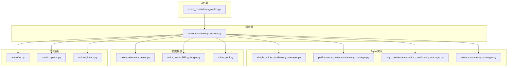
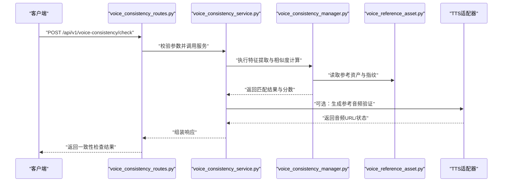
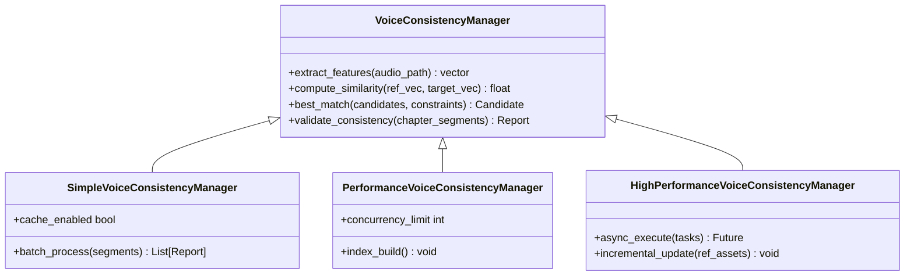
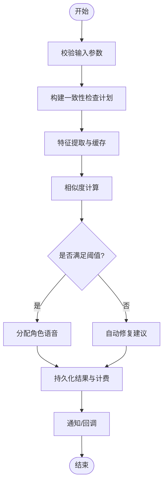
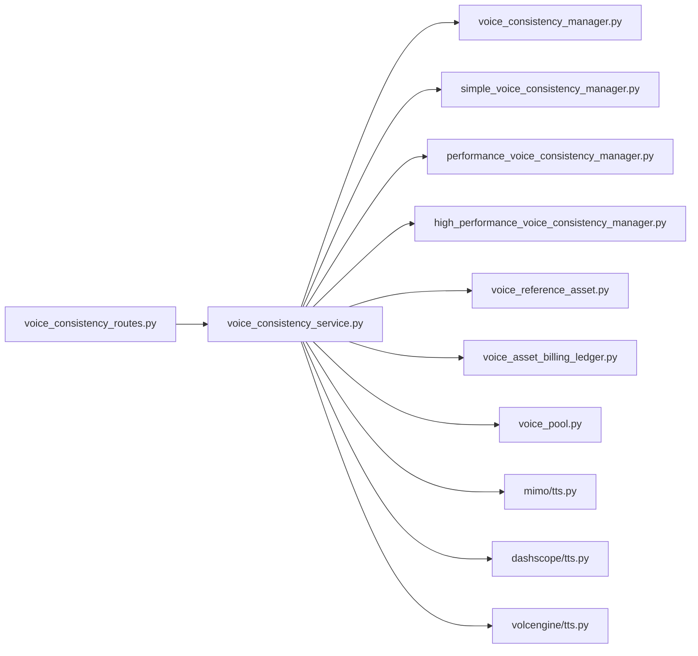

# 语音一致性API

<cite>
**本文引用的文件**   
- [agents/voice_consistency_manager.py](file://agents/voice_consistency_manager.py)
- [agents/simple_voice_consistency_manager.py](file://agents/simple_voice_consistency_manager.py)
- [agents/performance_voice_consistency_manager.py](file://agents/performance_voice_consistency_manager.py)
- [agents/high_performance_voice_consistency_manager.py](file://agents/high_performance_voice_consistency_manager.py)
- [backend/app/api/v1/audiobook_api/voice_consistency_routes.py](file://backend/app/api/v1/audiobook_api/voice_consistency_routes.py)
- [backend/app/services/audiobook/voice_consistency_service.py](file://backend/app/services/audiobook/voice_consistency_service.py)
- [backend/app/schemas/voice_pool.py](file://backend/app/schemas/voice_pool.py)
- [backend/app/models/voice_reference_asset.py](file://backend/app/models/voice_reference_asset.py)
- [backend/app/models/voice_asset_billing_ledger.py](file://backend/app/models/voice_asset_billing_ledger.py)
- [adapters/mimo/tts.py](file://adapters/mimo/tts.py)
- [adapters/dashscope/tts.py](file://adapters/dashscope/tts.py)
- [adapters/volcengine/tts.py](file://adapters/volcengine/tts.py)
- [scripts/debug_single_voice.py](file://scripts/debug_single_voice.py)
- [scripts/verify_seed_tts_websocket.py](file://scripts/verify_seed_tts_websocket.py)
</cite>

## 目录
1. [简介](#简介)
2. [项目结构](#项目结构)
3. [核心组件](#核心组件)
4. [架构总览](#架构总览)
5. [详细组件分析](#详细组件分析)
6. [依赖关系分析](#依赖关系分析)
7. [性能考量](#性能考量)
8. [故障排查指南](#故障排查指南)
9. [结论](#结论)
10. [附录](#附录)

## 简介
本文件为“语音一致性管理”的API与实现文档，覆盖角色语音分配、一致性检查与自动匹配接口；详细说明语音特征提取、相似度计算与最佳匹配算法；包含语音风格控制、情感保持一致与跨章节一致性能力。并提供完整的语音一致性验证示例（批量检查与自动修复）、质量保证机制与人工干预流程说明，帮助读者快速理解并正确使用该子系统。

## 项目结构
语音一致性相关代码主要分布在以下位置：
- agents层：提供多种一致性与匹配策略的实现（基础版、高性能版等）
- backend/app/api：暴露REST API路由
- backend/app/services：业务编排与服务层
- backend/app/schemas与models：数据模型与校验契约
- adapters：TTS适配器（用于生成参考音频或进行在线验证）
- scripts：调试与验证脚本

图表来源
- [backend/app/api/v1/audiobook_api/voice_consistency_routes.py](file://backend/app/api/v1/audiobook_api/voice_consistency_routes.py)
- [backend/app/services/audiobook/voice_consistency_service.py](file://backend/app/services/audiobook/voice_consistency_service.py)
- [agents/voice_consistency_manager.py](file://agents/voice_consistency_manager.py)
- [agents/simple_voice_consistency_manager.py](file://agents/simple_voice_consistency_manager.py)
- [agents/performance_voice_consistency_manager.py](file://agents/performance_voice_consistency_manager.py)
- [agents/high_performance_voice_consistency_manager.py](file://agents/high_performance_voice_consistency_manager.py)
- [backend/app/schemas/voice_pool.py](file://backend/app/schemas/voice_pool.py)
- [backend/app/models/voice_reference_asset.py](file://backend/app/models/voice_reference_asset.py)
- [backend/app/models/voice_asset_billing_ledger.py](file://backend/app/models/voice_asset_billing_ledger.py)
- [adapters/mimo/tts.py](file://adapters/mimo/tts.py)
- [adapters/dashscope/tts.py](file://adapters/dashscope/tts.py)
- [adapters/volcengine/tts.py](file://adapters/volcengine/tts.py)

章节来源
- [backend/app/api/v1/audiobook_api/voice_consistency_routes.py](file://backend/app/api/v1/audiobook_api/voice_consistency_routes.py)
- [backend/app/services/audiobook/voice_consistency_service.py](file://backend/app/services/audiobook/voice_consistency_service.py)
- [agents/voice_consistency_manager.py](file://agents/voice_consistency_manager.py)

## 核心组件
- 路由层（API）：定义角色语音分配、一致性检查、自动匹配的HTTP接口，负责参数校验、权限与限流、结果序列化。
- 服务层（Service）：编排具体任务，协调多个Agent实现、持久化与计费记录、TTS预览与回退策略。
- Agent实现：
  - 基础管理器：通用特征提取、相似度计算、匹配策略。
  - 性能管理器：缓存、批处理、并发优化。
  - 高性能管理器：分布式/异步、索引加速、增量更新。
- 数据模型：
  - 语音参考资产：存储角色参考音频、元数据、指纹。
  - 计费台账：记录每次匹配/生成的资源消耗。
  - 声音池Schema：统一输入输出契约。
- TTS适配器：调用不同厂商TTS以生成参考音频或进行在线验证。

章节来源
- [backend/app/api/v1/audiobook_api/voice_consistency_routes.py](file://backend/app/api/v1/audiobook_api/voice_consistency_routes.py)
- [backend/app/services/audiobook/voice_consistency_service.py](file://backend/app/services/audiobook/voice_consistency_service.py)
- [agents/voice_consistency_manager.py](file://agents/voice_consistency_manager.py)
- [agents/simple_voice_consistency_manager.py](file://agents/simple_voice_consistency_manager.py)
- [agents/performance_voice_consistency_manager.py](file://agents/performance_voice_consistency_manager.py)
- [agents/high_performance_voice_consistency_manager.py](file://agents/high_performance_voice_consistency_manager.py)
- [backend/app/schemas/voice_pool.py](file://backend/app/schemas/voice_pool.py)
- [backend/app/models/voice_reference_asset.py](file://backend/app/models/voice_reference_asset.py)
- [backend/app/models/voice_asset_billing_ledger.py](file://backend/app/models/voice_asset_billing_ledger.py)
- [adapters/mimo/tts.py](file://adapters/mimo/tts.py)
- [adapters/dashscope/tts.py](file://adapters/dashscope/tts.py)
- [adapters/volcengine/tts.py](file://adapters/volcengine/tts.py)

## 架构总览
系统采用分层架构：API路由接收请求，服务层编排任务，Agent实现具体算法，数据模型持久化，TTS适配器用于参考音频生成与在线验证。

图表来源
- [backend/app/api/v1/audiobook_api/voice_consistency_routes.py](file://backend/app/api/v1/audiobook_api/voice_consistency_routes.py)
- [backend/app/services/audiobook/voice_consistency_service.py](file://backend/app/services/audiobook/voice_consistency_service.py)
- [agents/voice_consistency_manager.py](file://agents/voice_consistency_manager.py)
- [backend/app/models/voice_reference_asset.py](file://backend/app/models/voice_reference_asset.py)
- [adapters/mimo/tts.py](file://adapters/mimo/tts.py)
- [adapters/dashscope/tts.py](file://adapters/dashscope/tts.py)
- [adapters/volcengine/tts.py](file://adapters/volcengine/tts.py)

## 详细组件分析

### 组件A：语音一致性管理器（Agent）
- 职责：
  - 语音特征提取：从参考音频或文本生成语音特征向量（如音色、语速、音高分布）。
  - 相似度计算：比较目标音频与参考音频的特征距离，输出相似度分数。
  - 最佳匹配算法：在候选池中按分数排序，结合约束（角色、风格、情感）选择最优匹配。
- 实现变体：
  - 基础版：顺序处理，适合小规模场景。
  - 性能版：引入缓存与批处理，提升吞吐。
  - 高性能版：异步并发、索引加速、增量更新，适合大规模生产环境。

图表来源
- [agents/voice_consistency_manager.py](file://agents/voice_consistency_manager.py)
- [agents/simple_voice_consistency_manager.py](file://agents/simple_voice_consistency_manager.py)
- [agents/performance_voice_consistency_manager.py](file://agents/performance_voice_consistency_manager.py)
- [agents/high_performance_voice_consistency_manager.py](file://agents/high_performance_voice_consistency_manager.py)

章节来源
- [agents/voice_consistency_manager.py](file://agents/voice_consistency_manager.py)
- [agents/simple_voice_consistency_manager.py](file://agents/simple_voice_consistency_manager.py)
- [agents/performance_voice_consistency_manager.py](file://agents/performance_voice_consistency_manager.py)
- [agents/high_performance_voice_consistency_manager.py](file://agents/high_performance_voice_consistency_manager.py)

### 组件B：服务层（Service）
- 职责：
  - 编排一致性检查、自动匹配、批量验证与修复流程。
  - 与数据模型交互，读写参考资产与计费台账。
  - 调用TTS适配器生成参考音频或进行在线验证。
  - 提供风格控制与情感保持一致的策略配置。

图表来源
- [backend/app/services/audiobook/voice_consistency_service.py](file://backend/app/services/audiobook/voice_consistency_service.py)
- [backend/app/models/voice_reference_asset.py](file://backend/app/models/voice_reference_asset.py)
- [backend/app/models/voice_asset_billing_ledger.py](file://backend/app/models/voice_asset_billing_ledger.py)

章节来源
- [backend/app/services/audiobook/voice_consistency_service.py](file://backend/app/services/audiobook/voice_consistency_service.py)

### 组件C：API路由（Routes）
- 接口清单（概念性描述）：
  - 角色语音分配：提交角色与文本片段，返回分配的语音ID与置信度。
  - 一致性检查：提交章节片段集合，返回一致性报告与问题定位。
  - 自动匹配：基于参考资产与约束条件，返回最佳匹配结果。
  - 批量检查：支持多章节/多片段并行检查，返回汇总报告。
  - 自动修复：对不通过项给出修复建议或自动替换。
- 行为特性：
  - 参数校验与错误码标准化。
  - 分页与限流保护。
  - 结果序列化与审计日志。

章节来源
- [backend/app/api/v1/audiobook_api/voice_consistency_routes.py](file://backend/app/api/v1/audiobook_api/voice_consistency_routes.py)

### 组件D：数据模型与Schema
- 语音参考资产：存储角色参考音频路径、元数据、指纹向量、版本信息。
- 计费台账：记录每次匹配/生成的资源消耗、成本与账单关联。
- 声音池Schema：统一输入输出契约，确保API与内部服务的数据一致性。

章节来源
- [backend/app/models/voice_reference_asset.py](file://backend/app/models/voice_reference_asset.py)
- [backend/app/models/voice_asset_billing_ledger.py](file://backend/app/models/voice_asset_billing_ledger.py)
- [backend/app/schemas/voice_pool.py](file://backend/app/schemas/voice_pool.py)

### 组件E：TTS适配器
- 作用：
  - 生成参考音频用于特征提取与在线验证。
  - 支持多厂商TTS（Mimo、DashScope、VolcEngine等），便于扩展与回退。
- 使用场景：
  - 首次创建角色参考音频。
  - 一致性检查失败时的在线重放验证。

章节来源
- [adapters/mimo/tts.py](file://adapters/mimo/tts.py)
- [adapters/dashscope/tts.py](file://adapters/dashscope/tts.py)
- [adapters/volcengine/tts.py](file://adapters/volcengine/tts.py)

## 依赖关系分析
- API路由依赖服务层，服务层依赖Agent实现与数据模型。
- Agent实现可被服务层按需切换（基础/性能/高性能）。
- TTS适配器作为外部依赖，提供音频生成能力。
- 数据模型与Schema保证数据一致性与可演进性。

图表来源
- [backend/app/api/v1/audiobook_api/voice_consistency_routes.py](file://backend/app/api/v1/audiobook_api/voice_consistency_routes.py)
- [backend/app/services/audiobook/voice_consistency_service.py](file://backend/app/services/audiobook/voice_consistency_service.py)
- [agents/voice_consistency_manager.py](file://agents/voice_consistency_manager.py)
- [agents/simple_voice_consistency_manager.py](file://agents/simple_voice_consistency_manager.py)
- [agents/performance_voice_consistency_manager.py](file://agents/performance_voice_consistency_manager.py)
- [agents/high_performance_voice_consistency_manager.py](file://agents/high_performance_voice_consistency_manager.py)
- [backend/app/models/voice_reference_asset.py](file://backend/app/models/voice_reference_asset.py)
- [backend/app/models/voice_asset_billing_ledger.py](file://backend/app/models/voice_asset_billing_ledger.py)
- [backend/app/schemas/voice_pool.py](file://backend/app/schemas/voice_pool.py)
- [adapters/mimo/tts.py](file://adapters/mimo/tts.py)
- [adapters/dashscope/tts.py](file://adapters/dashscope/tts.py)
- [adapters/volcengine/tts.py](file://adapters/volcengine/tts.py)

章节来源
- [backend/app/api/v1/audiobook_api/voice_consistency_routes.py](file://backend/app/api/v1/audiobook_api/voice_consistency_routes.py)
- [backend/app/services/audiobook/voice_consistency_service.py](file://backend/app/services/audiobook/voice_consistency_service.py)

## 性能考量
- 特征提取缓存：避免重复计算，提升批量检查效率。
- 批处理与并发：合理设置并发限制，平衡吞吐与资源占用。
- 索引加速：对参考资产建立向量索引，缩短匹配时间。
- 增量更新：仅对变更的参考资产重新计算指纹。
- 回退策略：当TTS不可用时，降级到本地缓存或离线模式。

[本节为通用指导，不直接分析具体文件]

## 故障排查指南
- 常见问题：
  - 参考音频缺失或损坏：检查引用路径与完整性。
  - 相似度阈值过低：调整阈值或增加参考样本。
  - TTS超时或失败：检查适配器配置与网络连通性。
  - 计费异常：核对台账记录与账单关联。
- 调试工具：
  - 单语音调试脚本：用于定位单个角色的语音问题。
  - WebSocket验证脚本：用于在线验证TTS与一致性检查链路。

章节来源
- [scripts/debug_single_voice.py](file://scripts/debug_single_voice.py)
- [scripts/verify_seed_tts_websocket.py](file://scripts/verify_seed_tts_websocket.py)

## 结论
本系统通过分层架构与多实现Agent，提供了完整的语音一致性管理能力，涵盖角色语音分配、一致性检查、自动匹配与修复。结合TTS适配器与数据模型，实现了可扩展、高性能且可审计的语音一致性解决方案。建议在生产环境中启用性能版或高性能版，并结合缓存与索引优化，以获得最佳效果。

[本节为总结性内容，不直接分析具体文件]

## 附录
- 语音风格控制：通过约束条件指定语调、语速、情感强度等，确保风格一致。
- 情感保持一致：在跨章节场景中，维护情感标签与强度的一致性。
- 跨章节一致性：基于章节上下文与角色关系图，确保全局一致性。
- 质量保证机制：自动化检查+人工审核双轨制，关键节点设置质量门禁。
- 人工干预流程：提供可视化界面与审批工作流，支持手动调整与回滚。

[本节为补充说明，不直接分析具体文件]