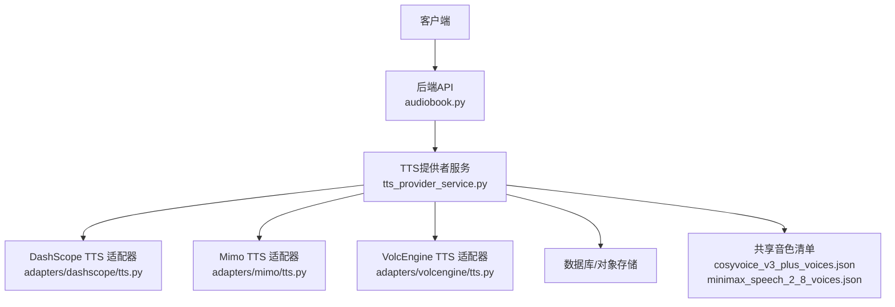
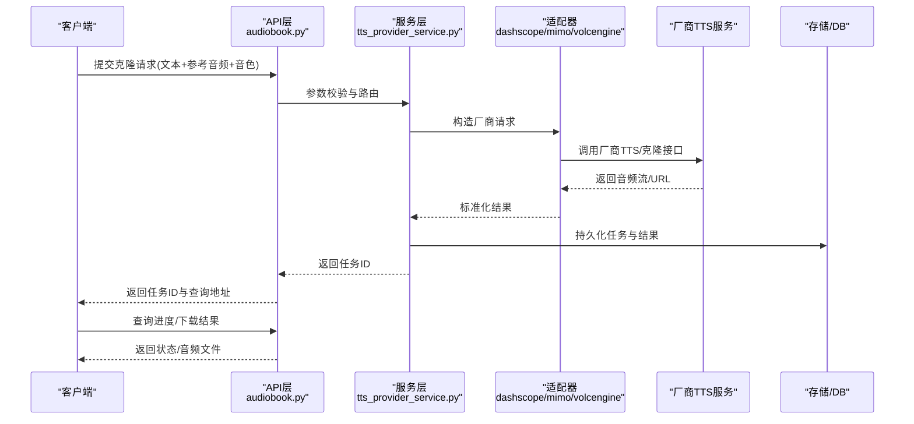
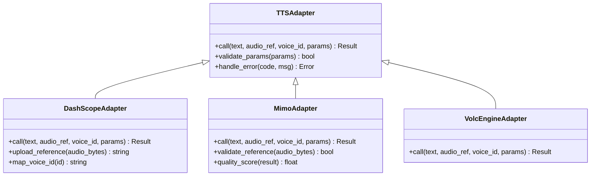
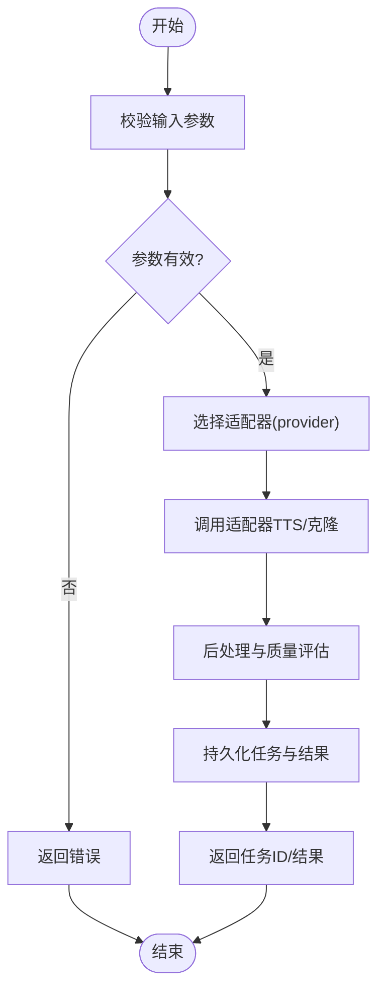
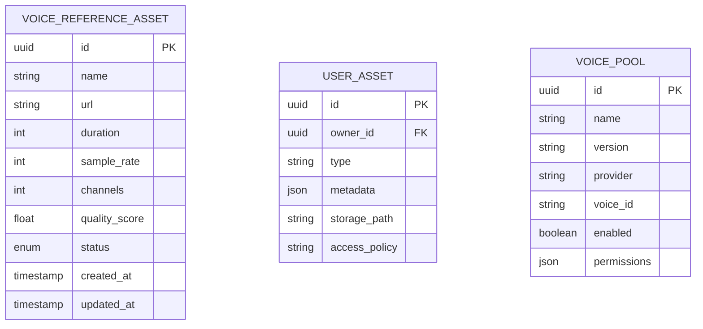
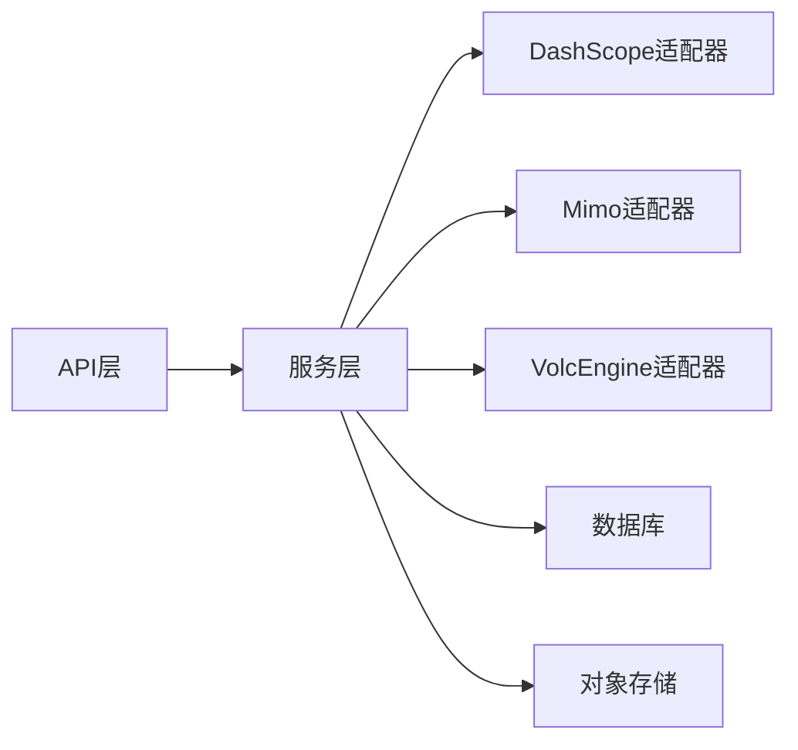

# 语音克隆API

<cite>
**本文引用的文件**   
- [adapters/dashscope/tts.py](file://adapters/dashscope/tts.py)
- [adapters/mimo/tts.py](file://adapters/mimo/tts.py)
- [adapters/volcengine/tts.py](file://adapters/volcengine/tts.py)
- [backend/app/api/v1/audiobook.py](file://backend/app/api/v1/audiobook.py)
- [backend/app/services/audiobook/tts_provider_service.py](file://backend/app/services/audiobook/tts_provider_service.py)
- [backend/app/models/voice_reference_asset.py](file://backend/app/models/voice_reference_asset.py)
- [backend/app/schemas/user_asset.py](file://backend/app/schemas/user_asset.py)
- [backend/app/schemas/voice_pool.py](file://backend/app/schemas/voice_pool.py)
- [shared/cosyvoice_v3_plus_voices.json](file://shared/cosyvoice_v3_plus_voices.json)
- [shared/minimax_speech_2_8_voices.json](file://shared/minimax_speech_2_8_voices.json)
- [scripts/debug_single_voice.py](file://scripts/debug_single_voice.py)
- [scripts/verify_seed_tts_websocket.py](file://scripts/verify_seed_tts_websocket.py)
- [backend/tests/test_minimax_voice_clone.py](file://backend/tests/test_minimax_voice_clone.py)
- [backend/tests/test_cosyvoice_clone_cleanup.py](file://backend/tests/test_cosyvoice_clone_cleanup.py)
- [backend/data/mimo_voice_assets/index.json](file://backend/data/mimo_voice_assets/index.json)
- [backend/data/stepaudio_voice_assets/index.json](file://backend/data/stepaudio_voice_assets/index.json)
</cite>

## 目录
1. [简介](#简介)
2. [项目结构](#项目结构)
3. [核心组件](#核心组件)
4. [架构总览](#架构总览)
5. [详细组件分析](#详细组件分析)
6. [依赖关系分析](#依赖关系分析)
7. [性能考虑](#性能考虑)
8. [故障排查指南](#故障排查指南)
9. [结论](#结论)
10. [附录](#附录)

## 简介
本文件为“语音克隆”功能的API文档，覆盖以下能力：
- 语音样本上传与校验（支持CosyVoice与MiniMax）
- 语音样本处理、质量评估与入库
- 调用CosyVoice与MiniMax进行语音克隆生成
- 完整的语音克隆工作流示例（从样本准备到最终音频生成）
- 质量保证、隐私保护与数据安全策略说明

本仓库采用适配器模式对接多厂商TTS服务，并通过后端API暴露统一的语音克隆接口。

## 项目结构
与语音克隆相关的代码主要分布在以下位置：
- 适配器层：各厂商TTS适配实现（DashScope、Mimo、VolcEngine等）
- 后端API：REST路由与请求校验
- 服务层：TTS提供者编排、任务调度与结果回写
- 数据模型与Schema：参考资产、用户资产、音色池等
- 共享配置：厂商音色清单
- 脚本与测试：调试、验证与回归用例

**图示来源** 
- [backend/app/api/v1/audiobook.py](file://backend/app/api/v1/audiobook.py)
- [backend/app/services/audiobook/tts_provider_service.py](file://backend/app/services/audiobook/tts_provider_service.py)
- [adapters/dashscope/tts.py](file://adapters/dashscope/tts.py)
- [adapters/mimo/tts.py](file://adapters/mimo/tts.py)
- [adapters/volcengine/tts.py](file://adapters/volcengine/tts.py)
- [shared/cosyvoice_v3_plus_voices.json](file://shared/cosyvoice_v3_plus_voices.json)
- [shared/minimax_speech_2_8_voices.json](file://shared/minimax_speech_2_8_voices.json)

**章节来源**
- [backend/app/api/v1/audiobook.py](file://backend/app/api/v1/audiobook.py)
- [backend/app/services/audiobook/tts_provider_service.py](file://backend/app/services/audiobook/tts_provider_service.py)

## 核心组件
- 适配器层
  - DashScope TTS 适配器：封装对DashScope的TTS调用（含可能的克隆能力）
  - Mimo TTS 适配器：封装对Mimo的TTS调用（含参考音频与克隆流程）
  - VolcEngine TTS 适配器：封装对火山引擎TTS的调用
- 服务层
  - TTS提供者服务：统一编排不同厂商TTS能力，负责参数标准化、重试、计费与结果落库
- API层
  - 音频书相关路由：提供语音样本上传、克隆任务提交、进度查询与结果下载
- 数据模型与Schema
  - 参考资产模型：记录参考音频元数据、质量评分、使用状态
  - 用户资产Schema：定义上传、校验、索引与检索字段
  - 音色池Schema：管理可用音色、版本与权限
- 共享配置
  - CosyVoice与MiniMax的音色清单，用于参数校验与展示

**章节来源**
- [adapters/dashscope/tts.py](file://adapters/dashscope/tts.py)
- [adapters/mimo/tts.py](file://adapters/mimo/tts.py)
- [adapters/volcengine/tts.py](file://adapters/volcengine/tts.py)
- [backend/app/services/audiobook/tts_provider_service.py](file://backend/app/services/audiobook/tts_provider_service.py)
- [backend/app/models/voice_reference_asset.py](file://backend/app/models/voice_reference_asset.py)
- [backend/app/schemas/user_asset.py](file://backend/app/schemas/user_asset.py)
- [backend/app/schemas/voice_pool.py](file://backend/app/schemas/voice_pool.py)
- [shared/cosyvoice_v3_plus_voices.json](file://shared/cosyvoice_v3_plus_voices.json)
- [shared/minimax_speech_2_8_voices.json](file://shared/minimax_speech_2_8_voices.json)

## 架构总览
语音克隆的整体调用链路如下：
- 客户端通过API提交文本、参考音频与目标音色参数
- 服务层校验并选择合适厂商适配器（CosyVoice或MiniMax）
- 适配器将请求转换为厂商特定格式并调用远程服务
- 结果异步写入对象存储与数据库，返回任务ID与进度查询接口
- 前端轮询或WebSocket获取生成结果

**图示来源** 
- [backend/app/api/v1/audiobook.py](file://backend/app/api/v1/audiobook.py)
- [backend/app/services/audiobook/tts_provider_service.py](file://backend/app/services/audiobook/tts_provider_service.py)
- [adapters/dashscope/tts.py](file://adapters/dashscope/tts.py)
- [adapters/mimo/tts.py](file://adapters/mimo/tts.py)
- [adapters/volcengine/tts.py](file://adapters/volcengine/tts.py)

## 详细组件分析

### 适配器层：CosyVoice与MiniMax
- CosyVoice（DashScope）
  - 职责：封装CosyVoice的TTS/克隆调用，包括参考音频上传、音色ID映射、参数转换
  - 关键点：采样率、声道数、时长限制；错误码映射与重试策略
- MiniMax
  - 职责：封装MiniMax Speech 2.x的克隆能力，支持参考音频与风格控制
  - 关键点：参考音频格式校验、克隆质量阈值、并发限流

**图示来源** 
- [adapters/dashscope/tts.py](file://adapters/dashscope/tts.py)
- [adapters/mimo/tts.py](file://adapters/mimo/tts.py)
- [adapters/volcengine/tts.py](file://adapters/volcengine/tts.py)

**章节来源**
- [adapters/dashscope/tts.py](file://adapters/dashscope/tts.py)
- [adapters/mimo/tts.py](file://adapters/mimo/tts.py)
- [adapters/volcengine/tts.py](file://adapters/volcengine/tts.py)

### API层：语音克隆接口
- 上传参考音频
  - 路径：/api/v1/audiobook/voice-reference（示例）
  - 方法：POST
  - 内容类型：multipart/form-data
  - 表单字段：
    - file：音频文件（WAV/MP3/FLAC，采样率≥16kHz，时长≤60s）
    - name：参考名（可选）
    - description：描述（可选）
  - 响应：{ id, url, status, quality_score }
- 提交克隆任务
  - 路径：/api/v1/audiobook/clone-task（示例）
  - 方法：POST
  - 请求体：
    - text：待合成文本
    - reference_id：参考音频ID
    - voice_id：目标音色ID（来自共享音色清单）
    - provider：提供商（cosyvoice/minimax）
    - params：额外参数（语速、音量、风格等）
  - 响应：{ task_id, status, estimated_seconds }
- 查询任务状态
  - 路径：/api/v1/audiobook/clone-task/{task_id}
  - 方法：GET
  - 响应：{ status, progress, result_url, error_message }
- 下载结果
  - 路径：/api/v1/audiobook/clone-result/{task_id}
  - 方法：GET
  - 响应：二进制音频流

注意：以上路径与字段为通用约定，具体以实际路由实现为准。

**章节来源**
- [backend/app/api/v1/audiobook.py](file://backend/app/api/v1/audiobook.py)

### 服务层：TTS提供者服务
- 功能要点
  - 参数标准化：统一provider、voice_id、params
  - 适配器选择：根据provider与可用性动态选择
  - 质量评估：对参考音频与生成结果进行基础质量检测
  - 任务编排：异步执行、重试、超时控制
  - 结果落库：保存任务状态、结果URL、质量分数
- 关键流程
  - 接收请求 → 校验 → 选择适配器 → 调用 → 后处理 → 持久化 → 返回

**图示来源** 
- [backend/app/services/audiobook/tts_provider_service.py](file://backend/app/services/audiobook/tts_provider_service.py)

**章节来源**
- [backend/app/services/audiobook/tts_provider_service.py](file://backend/app/services/audiobook/tts_provider_service.py)

### 数据模型与Schema
- 参考资产模型
  - 字段：id、name、url、duration、sample_rate、channels、quality_score、status、created_at、updated_at
  - 用途：存储用户上传的参考音频及其元数据
- 用户资产Schema
  - 字段：id、owner_id、type、metadata、storage_path、access_policy
  - 用途：统一管理用户资源的生命周期与访问策略
- 音色池Schema
  - 字段：id、name、version、provider、voice_id、enabled、permissions
  - 用途：维护可用音色列表与权限控制

**图示来源** 
- [backend/app/models/voice_reference_asset.py](file://backend/app/models/voice_reference_asset.py)
- [backend/app/schemas/user_asset.py](file://backend/app/schemas/user_asset.py)
- [backend/app/schemas/voice_pool.py](file://backend/app/schemas/voice_pool.py)

**章节来源**
- [backend/app/models/voice_reference_asset.py](file://backend/app/models/voice_reference_asset.py)
- [backend/app/schemas/user_asset.py](file://backend/app/schemas/user_asset.py)
- [backend/app/schemas/voice_pool.py](file://backend/app/schemas/voice_pool.py)

### 共享音色清单
- CosyVoice音色清单
  - 文件：shared/cosyvoice_v3_plus_voices.json
  - 作用：提供可用的voice_id与名称映射，供API校验与前端展示
- MiniMax音色清单
  - 文件：shared/minimax_speech_2_8_voices.json
  - 作用：同上，确保voice_id有效性

**章节来源**
- [shared/cosyvoice_v3_plus_voices.json](file://shared/cosyvoice_v3_plus_voices.json)
- [shared/minimax_speech_2_8_voices.json](file://shared/minimax_speech_2_8_voices.json)

### 工作流示例：从样本准备到音频生成
- 步骤
  1. 准备参考音频（WAV/MP3/FLAC，16kHz以上，≤60s）
  2. 上传参考音频至系统，获得reference_id
  3. 选择目标音色voice_id（从共享清单中选取）
  4. 提交克隆任务（text、reference_id、voice_id、provider）
  5. 轮询任务状态直至完成
  6. 下载生成的音频文件
- 提示
  - 若参考音频质量不佳，建议重新录制或裁剪
  - 文本长度与停顿会影响合成效果，建议分段合成

[本节为概念性说明，不直接分析具体文件]

## 依赖关系分析
- 组件耦合
  - API层依赖服务层，服务层依赖适配器层
  - 适配器层依赖外部厂商SDK/HTTP接口
  - 数据层依赖数据库与对象存储
- 外部依赖
  - DashScope SDK/HTTP
  - MiniMax Speech SDK/HTTP
  - VolcEngine TTS SDK/HTTP
- 风险点
  - 外部服务不可用或限流
  - 参考音频格式不兼容
  - 音色ID无效或未启用

**图示来源** 
- [backend/app/api/v1/audiobook.py](file://backend/app/api/v1/audiobook.py)
- [backend/app/services/audiobook/tts_provider_service.py](file://backend/app/services/audiobook/tts_provider_service.py)
- [adapters/dashscope/tts.py](file://adapters/dashscope/tts.py)
- [adapters/mimo/tts.py](file://adapters/mimo/tts.py)
- [adapters/volcengine/tts.py](file://adapters/volcengine/tts.py)

**章节来源**
- [backend/app/api/v1/audiobook.py](file://backend/app/api/v1/audiobook.py)
- [backend/app/services/audiobook/tts_provider_service.py](file://backend/app/services/audiobook/tts_provider_service.py)

## 性能考虑
- 参考音频预处理
  - 统一采样率与声道数，减少传输与解码开销
  - 短时静音检测与裁剪，提升识别与克隆稳定性
- 并发与限流
  - 针对厂商接口设置合理并发与退避策略
  - 队列化任务，避免瞬时峰值导致失败
- 缓存与预热
  - 常用音色与预览音频缓存
  - 启动时预热热门适配器连接
- 结果优化
  - 按需分片下载与流式传输
  - 压缩与转码策略（如WebM/MP3）

[本节为通用指导，不直接分析具体文件]

## 故障排查指南
- 常见问题
  - 参考音频格式不支持：检查采样率、时长与编码
  - 音色ID无效：核对共享清单与权限
  - 任务超时：检查网络与厂商服务状态
  - 质量评分低：重新录制参考音频或调整文本
- 调试工具
  - 单音调试脚本：用于快速验证某音色与文本的合成效果
  - WebSocket验证脚本：用于端到端流程验证
- 测试用例
  - MiniMax克隆集成测试：覆盖典型场景与边界条件
  - CosyVoice清理测试：确保临时资源释放

**章节来源**
- [scripts/debug_single_voice.py](file://scripts/debug_single_voice.py)
- [scripts/verify_seed_tts_websocket.py](file://scripts/verify_seed_tts_websocket.py)
- [backend/tests/test_minimax_voice_clone.py](file://backend/tests/test_minimax_voice_clone.py)
- [backend/tests/test_cosyvoice_clone_cleanup.py](file://backend/tests/test_cosyvoice_clone_cleanup.py)

## 结论
本语音克隆API通过适配器模式统一了多厂商TTS能力，提供了从样本上传、处理到克隆生成的完整工作流。建议在部署时关注参考音频质量、音色有效性以及外部服务的稳定性与限流策略，结合质量评估与监控手段保障用户体验。

[本节为总结性内容，不直接分析具体文件]

## 附录
- 参考音频格式要求
  - 格式：WAV/MP3/FLAC
  - 采样率：≥16kHz
  - 时长：≤60s
  - 声道：单声道或立体声
- 质量评估指标
  - 信噪比、响度、失真度、时长合规性
- 隐私与安全
  - 参考音频加密存储与访问控制
  - 最小权限原则与审计日志
  - 数据保留与删除策略

[本节为通用信息，不直接分析具体文件]