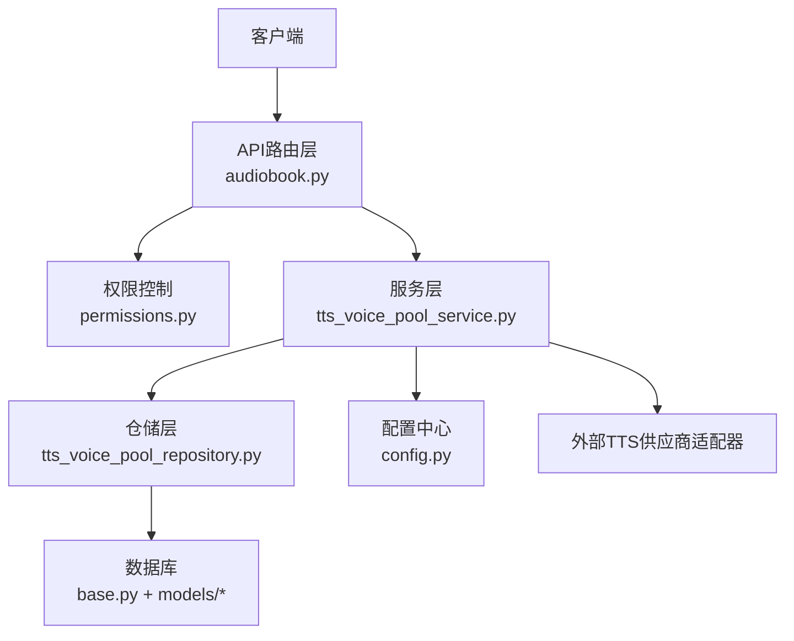
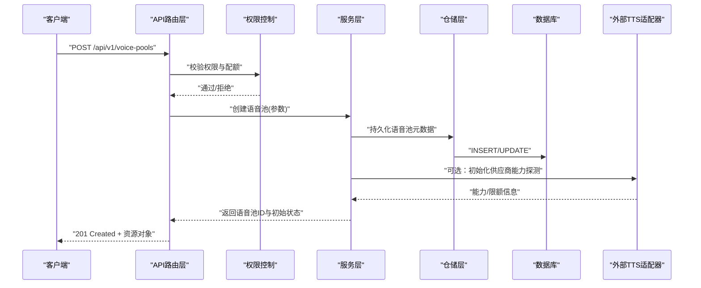
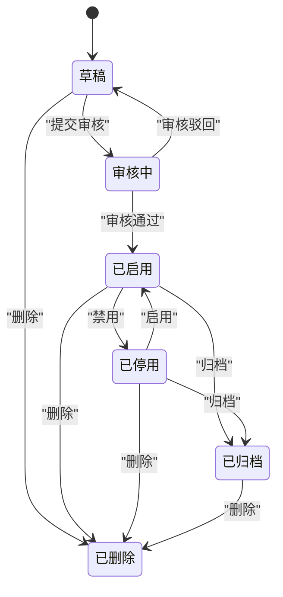
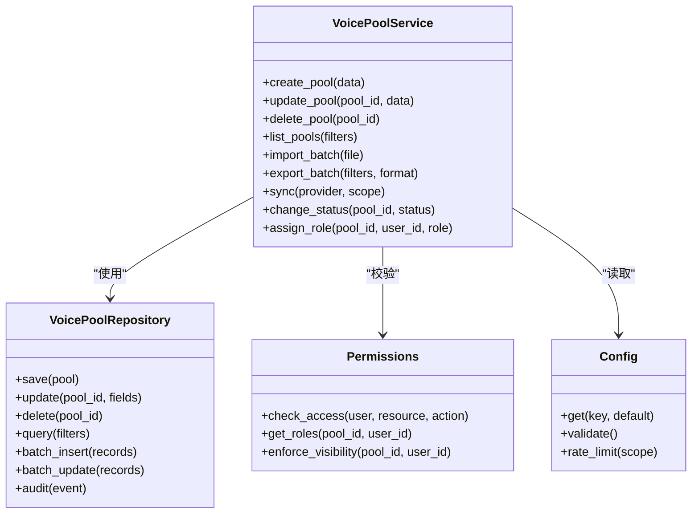

# 语音池管理API

<cite>
**本文引用的文件**
- [backend/app/api/v1/audiobook.py](file://backend/app/api/v1/audiobook.py)
- [backend/app/schemas/voice_pool.py](file://backend/app/schemas/voice_pool.py)
- [backend/app/models/voice_pool_publication.py](file://backend/app/models/voice_pool_publication.py)
- [backend/app/models/voice_reference_asset.py](file://backend/app/models/voice_reference_asset.py)
- [backend/app/models/voice_asset_billing_ledger.py](file://backend/app/models/voice_asset_billing_ledger.py)
- [backend/app/services/audiobook/tts_voice_pool_service.py](file://backend/app/services/audiobook/tts_voice_pool_service.py)
- [backend/app/services/audiobook/tts_voice_pool_repository.py](file://backend/app/services/audiobook/tts_voice_pool_repository.py)
- [backend/app/core/permissions.py](file://backend/app/core/permissions.py)
- [backend/app/core/config.py](file://backend/app/core/config.py)
- [backend/app/db/base.py](file://backend/app/db/base.py)
- [alembic/versions/add_user_voice_isolation_and_public_pool.py](file://alembic/versions/add_user_voice_isolation_and_public_pool.py)
</cite>

## 目录
1. [简介](#简介)
2. [项目结构](#项目结构)
3. [核心组件](#核心组件)
4. [架构总览](#架构总览)
5. [详细组件分析](#详细组件分析)
6. [依赖关系分析](#依赖关系分析)
7. [性能考虑](#性能考虑)
8. [故障排查指南](#故障排查指南)
9. [结论](#结论)
10. [附录](#附录)

## 简介
本文件为“语音池管理系统”的API文档，覆盖语音池的创建、更新、删除与查询接口；详细说明状态管理、角色分配策略与批量操作能力；给出配置参数、权限控制与访问限制说明；提供完整的CRUD示例（含批量导入、导出与同步）；解释语音池与项目的关联关系及数据迁移策略。读者无需深入代码即可理解并正确使用相关接口。

## 项目结构
与语音池相关的代码主要分布在以下位置：
- API路由层：位于后端API模块中，负责HTTP请求解析、鉴权、参数校验与响应封装。
- 领域模型与数据库映射：定义语音池实体、发布物、参考资产、计费流水等表结构。
- 服务层：封装业务逻辑，包括状态机、角色分配、批量处理、同步与审计。
- 权限与安全：统一权限校验、RBAC与访问限制。
- 配置与环境：开关、配额、限流、外部TTS供应商配置。
- 数据库迁移：新增用户隔离与公共语音池等变更。

图表来源
- [backend/app/api/v1/audiobook.py](file://backend/app/api/v1/audiobook.py)
- [backend/app/core/permissions.py](file://backend/app/core/permissions.py)
- [backend/app/services/audiobook/tts_voice_pool_service.py](file://backend/app/services/audiobook/tts_voice_pool_service.py)
- [backend/app/services/audiobook/tts_voice_pool_repository.py](file://backend/app/services/audiobook/tts_voice_pool_repository.py)
- [backend/app/db/base.py](file://backend/app/db/base.py)
- [backend/app/core/config.py](file://backend/app/core/config.py)

章节来源
- [backend/app/api/v1/audiobook.py](file://backend/app/api/v1/audiobook.py)
- [backend/app/schemas/voice_pool.py](file://backend/app/schemas/voice_pool.py)
- [backend/app/models/voice_pool_publication.py](file://backend/app/models/voice_pool_publication.py)
- [backend/app/models/voice_reference_asset.py](file://backend/app/models/voice_reference_asset.py)
- [backend/app/models/voice_asset_billing_ledger.py](file://backend/app/models/voice_asset_billing_ledger.py)
- [backend/app/services/audiobook/tts_voice_pool_service.py](file://backend/app/services/audiobook/tts_voice_pool_service.py)
- [backend/app/services/audiobook/tts_voice_pool_repository.py](file://backend/app/services/audiobook/tts_voice_pool_repository.py)
- [backend/app/core/permissions.py](file://backend/app/core/permissions.py)
- [backend/app/core/config.py](file://backend/app/core/config.py)
- [backend/app/db/base.py](file://backend/app/db/base.py)
- [alembic/versions/add_user_voice_isolation_and_public_pool.py](file://alembic/versions/add_user_voice_isolation_and_public_pool.py)

## 核心组件
- API路由层
  - 提供RESTful接口：创建、更新、删除、查询、批量导入/导出、同步、状态变更、角色分配。
  - 统一鉴权、参数校验、错误码与分页。
- 服务层
  - 实现语音池生命周期管理、状态机流转、角色分配策略、批量任务编排、对外部TTS适配器的调用与重试。
- 仓储层
  - 封装数据库读写、事务、索引优化、并发安全与审计日志写入。
- 模型与Schema
  - 定义语音池、发布物、参考资产、计费流水等数据结构与校验规则。
- 权限与安全
  - RBAC、资源级权限、租户隔离、访问频率限制。
- 配置与环境
  - 功能开关、配额、限流、供应商密钥与端点、缓存与队列配置。

章节来源
- [backend/app/api/v1/audiobook.py](file://backend/app/api/v1/audiobook.py)
- [backend/app/schemas/voice_pool.py](file://backend/app/schemas/voice_pool.py)
- [backend/app/services/audiobook/tts_voice_pool_service.py](file://backend/app/services/audiobook/tts_voice_pool_service.py)
- [backend/app/services/audiobook/tts_voice_pool_repository.py](file://backend/app/services/audiobook/tts_voice_pool_repository.py)
- [backend/app/core/permissions.py](file://backend/app/core/permissions.py)
- [backend/app/core/config.py](file://backend/app/core/config.py)

## 架构总览
系统采用分层架构：API路由层接收请求，经权限校验后交由服务层处理业务逻辑，服务层通过仓储层访问数据库，必要时调用外部TTS适配器。配置中心集中管理运行时参数。

图表来源
- [backend/app/api/v1/audiobook.py](file://backend/app/api/v1/audiobook.py)
- [backend/app/core/permissions.py](file://backend/app/core/permissions.py)
- [backend/app/services/audiobook/tts_voice_pool_service.py](file://backend/app/services/audiobook/tts_voice_pool_service.py)
- [backend/app/services/audiobook/tts_voice_pool_repository.py](file://backend/app/services/audiobook/tts_voice_pool_repository.py)
- [backend/app/db/base.py](file://backend/app/db/base.py)

## 详细组件分析

### 语音池CRUD接口
- 创建语音池
  - 方法：POST
  - 路径：/api/v1/voice-pools
  - 请求体关键字段：名称、描述、所属项目ID、可见范围（私有/团队/公开）、默认音色策略、状态、标签、扩展配置。
  - 行为：校验权限与配额，创建记录，初始化状态为“草稿”，生成唯一标识，写入审计日志。
  - 响应：201 Created，返回语音池对象（含id、name、status、visibility、project_id等）。
- 更新语音池
  - 方法：PATCH
  - 路径：/api/v1/voice-pools/{pool_id}
  - 支持字段：名称、描述、可见范围、默认音色策略、标签、扩展配置、状态（受状态机约束）。
  - 行为：权限校验、字段校验、状态机检查、并发锁、审计记录。
  - 响应：200 OK，返回更新后的语音池对象。
- 删除语音池
  - 方法：DELETE
  - 路径：/api/v1/voice-pools/{pool_id}
  - 行为：软删除或物理删除（取决于配置），清理引用、释放配额、记录审计。
  - 响应：204 No Content或200 OK（返回删除结果摘要）。
- 查询语音池
  - 方法：GET
  - 路径：/api/v1/voice-pools
  - 查询参数：project_id、visibility、status、keyword、page、size、sort_by、order。
  - 行为：权限过滤（仅可见资源）、分页、排序、计数。
  - 响应：200 OK，返回分页列表与总数。

章节来源
- [backend/app/api/v1/audiobook.py](file://backend/app/api/v1/audiobook.py)
- [backend/app/schemas/voice_pool.py](file://backend/app/schemas/voice_pool.py)

### 状态管理与状态机
- 状态枚举：草稿、已启用、已停用、审核中、已归档、已删除。
- 转换规则：
  - 草稿 → 审核中（提交审核）
  - 审核中 → 已启用（审核通过）
  - 审核中 → 草稿（审核驳回）
  - 已启用 → 已停用（管理员或所有者禁用）
  - 已停用 → 已启用（重新启用）
  - 任意可删除状态 → 已删除（软删除）
  - 已启用/已停用 → 已归档（历史归档）
- 触发方式：API调用、后台任务、审批流程回调。
- 一致性：状态变更需原子性事务，失败回滚并记录错误原因。

图表来源
- [backend/app/services/audiobook/tts_voice_pool_service.py](file://backend/app/services/audiobook/tts_voice_pool_service.py)
- [backend/app/schemas/voice_pool.py](file://backend/app/schemas/voice_pool.py)

### 角色分配策略
- 角色类型：所有者、管理员、编辑者、查看者、审核员。
- 分配维度：用户级、项目级、池级；继承与覆盖规则明确。
- 策略要点：
  - 默认继承项目角色，池级显式设置优先。
  - 审核员仅具备审核动作权限。
  - 编辑者可修改非敏感配置，不可变更可见性与所有权。
  - 管理员可启停、归档、删除。
  - 所有者拥有全部权限并可转移所有权。
- 审计：所有角色变更记录审计日志，包含操作人、时间、旧值与新值。

章节来源
- [backend/app/core/permissions.py](file://backend/app/core/permissions.py)
- [backend/app/services/audiobook/tts_voice_pool_service.py](file://backend/app/services/audiobook/tts_voice_pool_service.py)

### 批量操作：导入、导出与同步
- 批量导入
  - 接口：POST /api/v1/voice-pools/import
  - 输入：CSV/JSON文件，包含名称、描述、项目ID、可见范围、默认策略、标签等。
  - 行为：预校验、去重、冲突检测、分批写入、失败回滚或跳过策略、进度上报。
  - 输出：导入结果摘要（成功数、失败数、错误明细）。
- 批量导出
  - 接口：GET /api/v1/voice-pools/export
  - 参数：project_id、visibility、status、fields、format(csv|json)。
  - 行为：权限过滤、字段选择、异步生成下载链接。
  - 输出：202 Accepted + 任务ID，后续查询任务状态获取下载URL。
- 同步
  - 接口：POST /api/v1/voice-pools/sync
  - 参数：provider、scope(project/pool)、dry_run。
  - 行为：拉取外部供应商能力/限额/可用音色，合并本地策略，差异报告，应用变更。
  - 输出：同步任务ID与状态查询接口。

章节来源
- [backend/app/api/v1/audiobook.py](file://backend/app/api/v1/audiobook.py)
- [backend/app/services/audiobook/tts_voice_pool_service.py](file://backend/app/services/audiobook/tts_voice_pool_service.py)

### 配置参数与访问限制
- 配置项
  - 功能开关：enable_voice_pool、enable_public_pool、enable_audit_log。
  - 配额与限流：max_pools_per_project、rate_limit_import、rate_limit_sync。
  - 供应商：endpoint、api_key、timeout、retry、fallback。
  - 存储：local_path、cloud_bucket、encryption。
  - 缓存：cache_ttl、cache_backend。
- 访问限制
  - 基于RBAC的资源级权限控制。
  - 租户隔离：按project_id过滤。
  - 频率限制：按用户/IP/项目维度限流。
  - 审计：关键操作全量记录。

章节来源
- [backend/app/core/config.py](file://backend/app/core/config.py)
- [backend/app/core/permissions.py](file://backend/app/core/permissions.py)

### 与项目的关联关系
- 关系模型：一个项目可拥有多个语音池；每个语音池属于一个项目；可见范围决定跨项目共享策略。
- 数据一致性：项目删除时级联处理（软删除或归档）；语音池变更影响项目统计与配额。
- 查询优化：按project_id建立索引；常用查询条件组合索引。

章节来源
- [backend/app/models/voice_pool_publication.py](file://backend/app/models/voice_pool_publication.py)
- [backend/app/db/base.py](file://backend/app/db/base.py)

### 数据迁移策略
- 迁移目标：新增用户隔离与公共语音池、完善索引与约束、补齐审计字段。
- 策略要点：
  - 增量迁移：按版本顺序执行，幂等设计。
  - 兼容期：新旧字段并存，逐步废弃。
  - 回滚方案：保留反向迁移脚本。
  - 数据校验：迁移前后一致性检查与修复脚本。
- 关键变更：引入public_pool标志、visibility字段、project_id外键、deleted_at软删除标记。

章节来源
- [alembic/versions/add_user_voice_isolation_and_public_pool.py](file://alembic/versions/add_user_voice_isolation_and_public_pool.py)

## 依赖关系分析
- API路由依赖权限模块与服务层。
- 服务层依赖仓储层与配置中心，必要时调用外部TTS适配器。
- 仓储层依赖数据库ORM与连接池。
- 模型与Schema定义数据契约，确保前后端一致。

图表来源
- [backend/app/services/audiobook/tts_voice_pool_service.py](file://backend/app/services/audiobook/tts_voice_pool_service.py)
- [backend/app/services/audiobook/tts_voice_pool_repository.py](file://backend/app/services/audiobook/tts_voice_pool_repository.py)
- [backend/app/core/permissions.py](file://backend/app/core/permissions.py)
- [backend/app/core/config.py](file://backend/app/core/config.py)

章节来源
- [backend/app/services/audiobook/tts_voice_pool_service.py](file://backend/app/services/audiobook/tts_voice_pool_service.py)
- [backend/app/services/audiobook/tts_voice_pool_repository.py](file://backend/app/services/audiobook/tts_voice_pool_repository.py)
- [backend/app/core/permissions.py](file://backend/app/core/permissions.py)
- [backend/app/core/config.py](file://backend/app/core/config.py)

## 性能考虑
- 数据库层面
  - 针对project_id、visibility、status建立复合索引。
  - 批量操作使用事务与分批提交，避免长事务锁表。
  - 分页查询使用游标或keyset分页减少深翻页开销。
- 服务层
  - 外部TTS调用采用超时、重试与熔断策略。
  - 批量导入导出采用异步任务与进度上报。
  - 热点数据缓存（如项目配额、角色映射）降低DB压力。
- 限流与背压
  - 按用户/IP/项目维度限流，防止滥用。
  - 大任务拆分与并行度控制，避免内存峰值过高。

[本节为通用指导，不直接分析具体文件]

## 故障排查指南
- 常见问题
  - 权限不足：检查RBAC配置与资源可见性。
  - 状态非法：确认当前状态是否允许目标转换。
  - 导入失败：检查文件格式、必填字段、重复项与冲突策略。
  - 同步异常：核对供应商配置、网络连通性与速率限制。
  - 配额超限：检查项目配额与全局上限。
- 诊断步骤
  - 查看审计日志与错误码定位问题。
  - 开启调试模式打印SQL与调用链。
  - 检查限流与重试次数。
  - 验证迁移版本与数据一致性。

章节来源
- [backend/app/api/v1/audiobook.py](file://backend/app/api/v1/audiobook.py)
- [backend/app/services/audiobook/tts_voice_pool_service.py](file://backend/app/services/audiobook/tts_voice_pool_service.py)

## 结论
本API文档系统化阐述了语音池管理的CRUD、状态机、角色分配、批量操作、配置与权限、项目关联与数据迁移等关键能力。遵循本文档进行集成与开发，可实现稳定、安全、可扩展的语音池管理能力。建议在生产环境启用完整审计与限流，结合监控告警保障服务质量。

[本节为总结性内容，不直接分析具体文件]

## 附录
- 术语
  - 语音池：一组可用于TTS的音色与策略集合。
  - 发布物：语音池对外发布的版本快照。
  - 参考资产：用于训练或克隆音色的参考音频。
  - 计费流水：TTS使用计费的审计记录。
- 参考文件
  - Schema定义：[backend/app/schemas/voice_pool.py](file://backend/app/schemas/voice_pool.py)
  - 模型定义：[backend/app/models/voice_pool_publication.py](file://backend/app/models/voice_pool_publication.py)、[backend/app/models/voice_reference_asset.py](file://backend/app/models/voice_reference_asset.py)、[backend/app/models/voice_asset_billing_ledger.py](file://backend/app/models/voice_asset_billing_ledger.py)
  - 服务与仓储：[backend/app/services/audiobook/tts_voice_pool_service.py](file://backend/app/services/audiobook/tts_voice_pool_service.py)、[backend/app/services/audiobook/tts_voice_pool_repository.py](file://backend/app/services/audiobook/tts_voice_pool_repository.py)
  - 权限与配置：[backend/app/core/permissions.py](file://backend/app/core/permissions.py)、[backend/app/core/config.py](file://backend/app/core/config.py)
  - 数据库基类：[backend/app/db/base.py](file://backend/app/db/base.py)
  - 迁移脚本：[alembic/versions/add_user_voice_isolation_and_public_pool.py](file://alembic/versions/add_user_voice_isolation_and_public_pool.py)