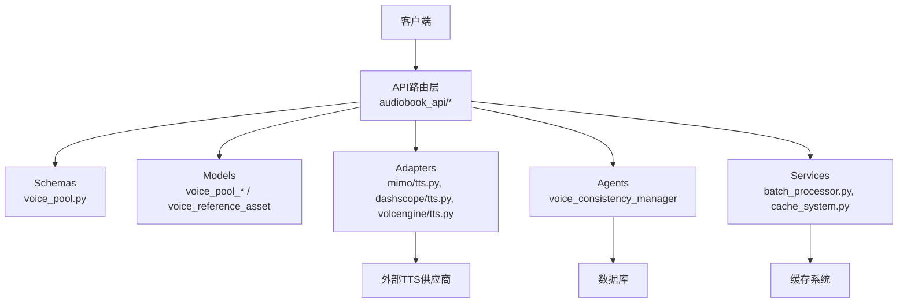
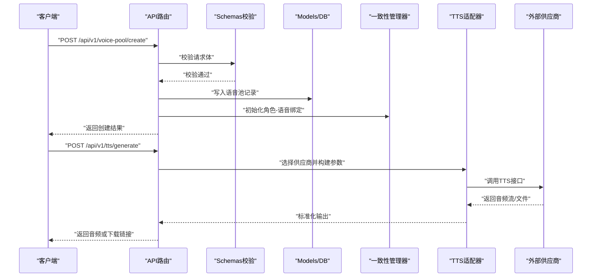
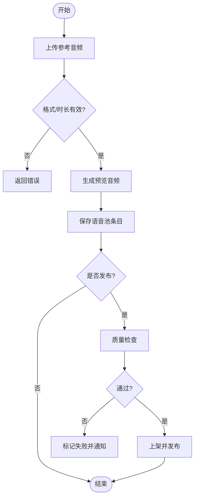
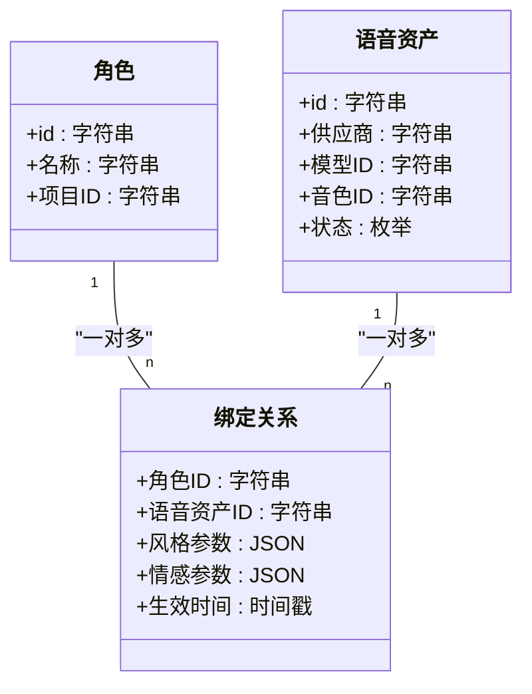
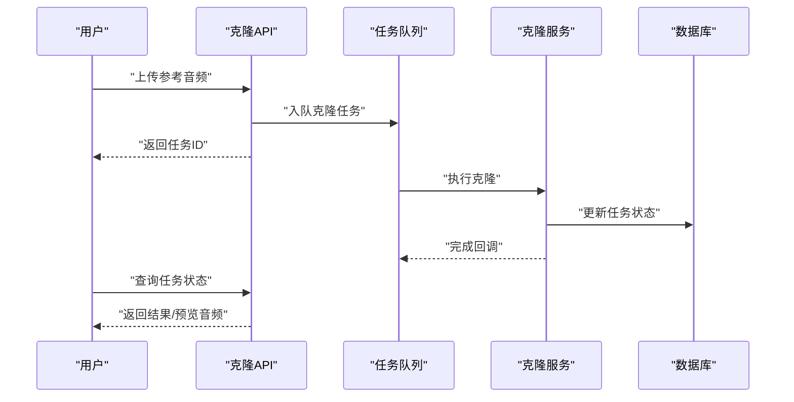
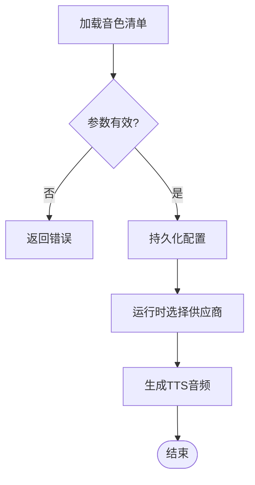
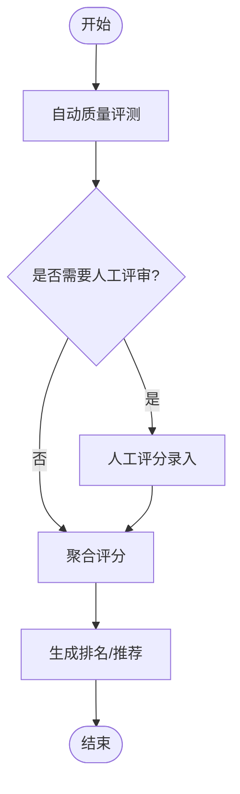
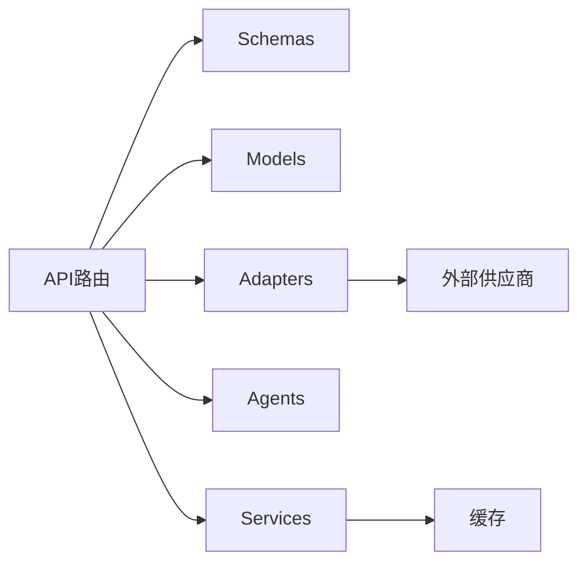

# 语音管理API

<cite>
**本文档引用的文件**   
- [backend/app/api/v1/audiobook_api/voice_pool.py](file://backend/app/api/v1/audiobook_api/voice_pool.py)
- [backend/app/api/v1/audiobook_api/tts_engine_config.py](file://backend/app/api/v1/audiobook_api/tts_engine_config.py)
- [backend/app/api/v1/audiobook_api/voice_clone.py](file://backend/app/api/v1/audiobook_api/voice_clone.py)
- [backend/app/schemas/voice_pool.py](file://backend/app/schemas/voice_pool.py)
- [backend/app/models/voice_pool_publication.py](file://backend/app/models/voice_pool_publication.py)
- [backend/app/models/voice_pool_rating.py](file://backend/app/models/voice_pool_rating.py)
- [backend/app/models/voice_reference_asset.py](file://backend/app/models/voice_reference_asset.py)
- [adapters/mimo/tts.py](file://adapters/mimo/tts.py)
- [adapters/dashscope/tts.py](file://adapters/dashscope/tts.py)
- [adapters/volcengine/tts.py](file://adapters/volcengine/tts.py)
- [agents/high_performance_voice_consistency_manager.py](file://agents/high_performance_voice_consistency_manager.py)
- [agents/performance_voice_consistency_manager.py](file://agents/performance_voice_consistency_manager.py)
- [agents/simple_voice_consistency_manager.py](file://agents/simple_voice_consistency_manager.py)
- [backend/app/services/batch_processor.py](file://backend/app/services/batch_processor.py)
- [backend/app/services/cache_system.py](file://backend/app/services/cache_system.py)
- [shared/cosyvoice_v3_5_plus_voices.json](file://shared/cosyvoice_v3_5_plus_voices.json)
- [shared/mimo_v2_5_tts_voices.json](file://shared/mimo_v2_5_tts_voices.json)
- [shared/stepaudio_2_5_tts_voices.json](file://shared/stepaudio_2_5_tts_voices.json)
- [backend/app/scripts/warmup_tts_voice_previews.py](file://backend/app/scripts/warmup_tts_voice_previews.py)
</cite>

## 目录
1. [简介](#简介)
2. [项目结构](#项目结构)
3. [核心组件](#核心组件)
4. [架构总览](#架构总览)
5. [详细组件分析](#详细组件分析)
6. [依赖关系分析](#依赖关系分析)
7. [性能考量](#性能考量)
8. [故障排查指南](#故障排查指南)
9. [结论](#结论)
10. [附录](#附录)

## 简介
本文件为“语音管理系统”的API文档，覆盖以下能力：
- 语音池管理：创建、发布、评分与审计
- 角色分配：将角色绑定到具体语音资产，保障一致性
- 语音克隆：上传参考音频进行克隆训练与预览
- TTS引擎配置：多供应商（CosyVoice、Mimo、StepAudio等）的统一接入与参数控制
- 语音质量评估：自动评测与人工评分
- 情感控制与风格切换：通过TTS参数或提示词驱动
- 语音资产上传、预览与测试：批量处理与缓存预热
- 一致性保证与性能优化：队列化、缓存、预热与并发策略

## 项目结构
后端采用分层设计：
- API层：按业务域划分路由（如 audiobook_api），提供REST接口
- Schemas：请求/响应数据模型定义
- Models：数据库实体（语音池、评分、引用资产等）
- Adapters：第三方TTS供应商适配（DashScope、Mimo、VolcEngine等）
- Agents：一致性管理与批处理服务
- Services：通用服务（缓存、批处理等）
- Scripts：辅助脚本（预热、清理等）

图表来源 
- [backend/app/api/v1/audiobook_api/voice_pool.py](file://backend/app/api/v1/audiobook_api/voice_pool.py)
- [backend/app/schemas/voice_pool.py](file://backend/app/schemas/voice_pool.py)
- [backend/app/models/voice_pool_publication.py](file://backend/app/models/voice_pool_publication.py)
- [backend/app/models/voice_pool_rating.py](file://backend/app/models/voice_pool_rating.py)
- [backend/app/models/voice_reference_asset.py](file://backend/app/models/voice_reference_asset.py)
- [adapters/mimo/tts.py](file://adapters/mimo/tts.py)
- [adapters/dashscope/tts.py](file://adapters/dashscope/tts.py)
- [adapters/volcengine/tts.py](file://adapters/volcengine/tts.py)
- [agents/high_performance_voice_consistency_manager.py](file://agents/high_performance_voice_consistency_manager.py)
- [backend/app/services/batch_processor.py](file://backend/app/services/batch_processor.py)
- [backend/app/services/cache_system.py](file://backend/app/services/cache_system.py)

章节来源
- [backend/app/api/v1/audiobook_api/voice_pool.py](file://backend/app/api/v1/audiobook_api/voice_pool.py)
- [backend/app/schemas/voice_pool.py](file://backend/app/schemas/voice_pool.py)
- [backend/app/models/voice_pool_publication.py](file://backend/app/models/voice_pool_publication.py)
- [backend/app/models/voice_pool_rating.py](file://backend/app/models/voice_pool_rating.py)
- [backend/app/models/voice_reference_asset.py](file://backend/app/models/voice_reference_asset.py)
- [adapters/mimo/tts.py](file://adapters/mimo/tts.py)
- [adapters/dashscope/tts.py](file://adapters/dashscope/tts.py)
- [adapters/volcengine/tts.py](file://adapters/volcengine/tts.py)
- [agents/high_performance_voice_consistency_manager.py](file://agents/high_performance_voice_consistency_manager.py)
- [backend/app/services/batch_processor.py](file://backend/app/services/batch_processor.py)
- [backend/app/services/cache_system.py](file://backend/app/services/cache_system.py)

## 核心组件
- 语音池管理API：提供语音池的CRUD、发布、评分、检索与过滤
- TTS引擎配置API：统一配置各供应商的模型ID、音色库、速率、音量、情感参数
- 语音克隆API：上传参考音频、触发克隆任务、查询进度与结果
- 角色分配API：将角色映射到具体语音资产，支持批量绑定与回滚
- 质量评估API：自动评测指标（清晰度、失真度、情感匹配度）与人工评分聚合
- 资产上传与预览：支持批量上传、格式校验、转码、生成预览音频
- 一致性管理器：保障同一角色在不同场景下的音色一致性与风格稳定

章节来源
- [backend/app/api/v1/audiobook_api/voice_pool.py](file://backend/app/api/v1/audiobook_api/voice_pool.py)
- [backend/app/api/v1/audiobook_api/tts_engine_config.py](file://backend/app/api/v1/audiobook_api/tts_engine_config.py)
- [backend/app/api/v1/audiobook_api/voice_clone.py](file://backend/app/api/v1/audiobook_api/voice_clone.py)
- [backend/app/schemas/voice_pool.py](file://backend/app/schemas/voice_pool.py)
- [backend/app/models/voice_pool_publication.py](file://backend/app/models/voice_pool_publication.py)
- [backend/app/models/voice_pool_rating.py](file://backend/app/models/voice_pool_rating.py)
- [backend/app/models/voice_reference_asset.py](file://backend/app/models/voice_reference_asset.py)
- [agents/high_performance_voice_consistency_manager.py](file://agents/high_performance_voice_consistency_manager.py)

## 架构总览
整体调用链：
- 客户端发起HTTP请求至API路由
- API层解析并校验请求体（Schemas）
- 业务逻辑调用Models读写数据库
- 需要TTS时，通过Adapters调用外部供应商
- 一致性由Agents保障，批处理与缓存由Services支撑

图表来源 
- [backend/app/api/v1/audiobook_api/voice_pool.py](file://backend/app/api/v1/audiobook_api/voice_pool.py)
- [backend/app/api/v1/audiobook_api/tts_engine_config.py](file://backend/app/api/v1/audiobook_api/tts_engine_config.py)
- [adapters/mimo/tts.py](file://adapters/mimo/tts.py)
- [adapters/dashscope/tts.py](file://adapters/dashscope/tts.py)
- [adapters/volcengine/tts.py](file://adapters/volcengine/tts.py)
- [agents/high_performance_voice_consistency_manager.py](file://agents/high_performance_voice_consistency_manager.py)

## 详细组件分析

### 语音池管理API
- 功能范围
  - 创建/更新/删除语音池条目
  - 发布/下架语音池资源
  - 评分与评论（自动+人工）
  - 检索与过滤（按供应商、音色、风格、质量分）
- 数据模型
  - 语音池条目：包含名称、描述、供应商、模型ID、音色ID、元数据、状态
  - 发布记录：版本、发布时间、操作人
  - 评分记录：分数、维度（清晰度、情感、自然度）、评价人
- 关键流程
  - 上传参考音频 -> 校验格式与时长 -> 生成预览 -> 入库
  - 发布前执行质量检查 -> 通过后上架
  - 评分聚合用于排序与推荐

图表来源 
- [backend/app/api/v1/audiobook_api/voice_pool.py](file://backend/app/api/v1/audiobook_api/voice_pool.py)
- [backend/app/schemas/voice_pool.py](file://backend/app/schemas/voice_pool.py)
- [backend/app/models/voice_pool_publication.py](file://backend/app/models/voice_pool_publication.py)
- [backend/app/models/voice_pool_rating.py](file://backend/app/models/voice_pool_rating.py)

章节来源
- [backend/app/api/v1/audiobook_api/voice_pool.py](file://backend/app/api/v1/audiobook_api/voice_pool.py)
- [backend/app/schemas/voice_pool.py](file://backend/app/schemas/voice_pool.py)
- [backend/app/models/voice_pool_publication.py](file://backend/app/models/voice_pool_publication.py)
- [backend/app/models/voice_pool_rating.py](file://backend/app/models/voice_pool_rating.py)

### 角色分配API
- 功能范围
  - 将角色绑定到具体语音资产（支持多供应商、多音色）
  - 批量绑定与回滚
  - 一致性约束：同一角色在项目中保持音色稳定
- 关键流程
  - 选择角色 -> 指定语音资产 -> 设置风格/情感参数 -> 提交
  - 后台校验冲突与重复 -> 持久化绑定关系
  - 运行时根据上下文选择最佳音色

图表来源 
- [backend/app/models/voice_reference_asset.py](file://backend/app/models/voice_reference_asset.py)
- [backend/app/models/voice_pool_publication.py](file://backend/app/models/voice_pool_publication.py)
- [agents/high_performance_voice_consistency_manager.py](file://agents/high_performance_voice_consistency_manager.py)

章节来源
- [backend/app/models/voice_reference_asset.py](file://backend/app/models/voice_reference_asset.py)
- [backend/app/models/voice_pool_publication.py](file://backend/app/models/voice_pool_publication.py)
- [agents/high_performance_voice_consistency_manager.py](file://agents/high_performance_voice_consistency_manager.py)

### 语音克隆API
- 功能范围
  - 上传参考音频样本（单条或多条）
  - 触发克隆任务（异步）
  - 查询任务状态与结果（预览音频、可用性）
  - 清理临时文件与失败重试
- 关键流程
  - 上传样本 -> 校验与预处理 -> 入队克隆任务 -> 回调更新状态
  - 成功后生成可用音色并加入语音池

图表来源 
- [backend/app/api/v1/audiobook_api/voice_clone.py](file://backend/app/api/v1/audiobook_api/voice_clone.py)
- [backend/app/models/voice_reference_asset.py](file://backend/app/models/voice_reference_asset.py)

章节来源
- [backend/app/api/v1/audiobook_api/voice_clone.py](file://backend/app/api/v1/audiobook_api/voice_clone.py)
- [backend/app/models/voice_reference_asset.py](file://backend/app/models/voice_reference_asset.py)

### TTS引擎配置API
- 功能范围
  - 统一配置各供应商（CosyVoice、Mimo、StepAudio、DashScope、VolcEngine等）
  - 设置模型ID、音色库、速率、音量、情感强度、采样率
  - 动态切换与灰度发布
- 关键流程
  - 读取共享音色清单（JSON）-> 校验有效性 -> 写入配置
  - 运行时根据策略选择供应商与参数

图表来源 
- [backend/app/api/v1/audiobook_api/tts_engine_config.py](file://backend/app/api/v1/audiobook_api/tts_engine_config.py)
- [shared/cosyvoice_v3_5_plus_voices.json](file://shared/cosyvoice_v3_5_plus_voices.json)
- [shared/mimo_v2_5_tts_voices.json](file://shared/mimo_v2_5_tts_voices.json)
- [shared/stepaudio_2_5_tts_voices.json](file://shared/stepaudio_2_5_tts_voices.json)
- [adapters/dashscope/tts.py](file://adapters/dashscope/tts.py)
- [adapters/mimo/tts.py](file://adapters/mimo/tts.py)
- [adapters/volcengine/tts.py](file://adapters/volcengine/tts.py)

章节来源
- [backend/app/api/v1/audiobook_api/tts_engine_config.py](file://backend/app/api/v1/audiobook_api/tts_engine_config.py)
- [shared/cosyvoice_v3_5_plus_voices.json](file://shared/cosyvoice_v3_5_plus_voices.json)
- [shared/mimo_v2_5_tts_voices.json](file://shared/mimo_v2_5_tts_voices.json)
- [shared/stepaudio_2_5_tts_voices.json](file://shared/stepaudio_2_5_tts_voices.json)
- [adapters/dashscope/tts.py](file://adapters/dashscope/tts.py)
- [adapters/mimo/tts.py](file://adapters/mimo/tts.py)
- [adapters/volcengine/tts.py](file://adapters/volcengine/tts.py)

### 语音质量评估API
- 功能范围
  - 自动评测：清晰度、失真度、情感匹配度、自然度
  - 人工评分：多维度打分与评论
  - 评分聚合与排名
- 关键流程
  - 对生成的音频进行自动评测 -> 存储评分 -> 结合人工评分计算综合得分

图表来源 
- [backend/app/models/voice_pool_rating.py](file://backend/app/models/voice_pool_rating.py)

章节来源
- [backend/app/models/voice_pool_rating.py](file://backend/app/models/voice_pool_rating.py)

### 情感控制与风格切换
- 功能范围
  - 通过TTS参数控制情感强度、语速、语调
  - 基于提示词的风格切换（如“欢快”、“沉稳”）
  - 角色级默认风格与项目级覆盖
- 关键流程
  - 读取角色绑定中的风格/情感参数 -> 注入到TTS请求 -> 生成对应风格的音频

章节来源
- [agents/high_performance_voice_consistency_manager.py](file://agents/high_performance_voice_consistency_manager.py)
- [agents/performance_voice_consistency_manager.py](file://agents/performance_voice_consistency_manager.py)
- [agents/simple_voice_consistency_manager.py](file://agents/simple_voice_consistency_manager.py)

### 语音资产上传、预览与测试
- 功能范围
  - 批量上传音频文件（MP3/WAV/FLAC等）
  - 格式校验、转码、去噪、归一化
  - 生成预览音频与缩略图
  - 测试播放与对比
- 关键流程
  - 上传 -> 校验 -> 转码 -> 生成预览 -> 入库 -> 可测试

章节来源
- [backend/app/api/v1/audiobook_api/voice_pool.py](file://backend/app/api/v1/audiobook_api/voice_pool.py)
- [backend/app/scripts/warmup_tts_voice_previews.py](file://backend/app/scripts/warmup_tts_voice_previews.py)

## 依赖关系分析
- API层依赖Schemas进行输入校验
- API层依赖Models进行数据持久化
- API层依赖Adapters调用外部TTS供应商
- API层依赖Agents进行一致性管理
- Services提供缓存与批处理能力

图表来源 
- [backend/app/api/v1/audiobook_api/voice_pool.py](file://backend/app/api/v1/audiobook_api/voice_pool.py)
- [backend/app/schemas/voice_pool.py](file://backend/app/schemas/voice_pool.py)
- [backend/app/models/voice_pool_publication.py](file://backend/app/models/voice_pool_publication.py)
- [adapters/mimo/tts.py](file://adapters/mimo/tts.py)
- [agents/high_performance_voice_consistency_manager.py](file://agents/high_performance_voice_consistency_manager.py)
- [backend/app/services/batch_processor.py](file://backend/app/services/batch_processor.py)
- [backend/app/services/cache_system.py](file://backend/app/services/cache_system.py)

章节来源
- [backend/app/api/v1/audiobook_api/voice_pool.py](file://backend/app/api/v1/audiobook_api/voice_pool.py)
- [backend/app/schemas/voice_pool.py](file://backend/app/schemas/voice_pool.py)
- [backend/app/models/voice_pool_publication.py](file://backend/app/models/voice_pool_publication.py)
- [adapters/mimo/tts.py](file://adapters/mimo/tts.py)
- [agents/high_performance_voice_consistency_manager.py](file://agents/high_performance_voice_consistency_manager.py)
- [backend/app/services/batch_processor.py](file://backend/app/services/batch_processor.py)
- [backend/app/services/cache_system.py](file://backend/app/services/cache_system.py)

## 性能考量
- 缓存预热：预生成常用音色的预览音频，减少首次延迟
- 批处理：批量上传与转换任务使用队列化与并行处理
- 一致性管理：高性能一致性管理器确保角色音色稳定且低开销
- 供应商选择：根据负载与成本动态选择最优供应商
- 缓存系统：热点数据缓存，降低数据库压力

章节来源
- [backend/app/scripts/warmup_tts_voice_previews.py](file://backend/app/scripts/warmup_tts_voice_previews.py)
- [backend/app/services/batch_processor.py](file://backend/app/services/batch_processor.py)
- [agents/high_performance_voice_consistency_manager.py](file://agents/high_performance_voice_consistency_manager.py)
- [agents/performance_voice_consistency_manager.py](file://agents/performance_voice_consistency_manager.py)
- [backend/app/services/cache_system.py](file://backend/app/services/cache_system.py)

## 故障排查指南
- 常见问题
  - 上传失败：检查文件格式、大小限制与权限
  - 克隆任务卡住：查看任务队列状态与日志
  - TTS生成失败：检查供应商配置与网络连通性
  - 一致性异常：检查角色绑定与风格参数
- 排查步骤
  - 查看API日志与错误码
  - 检查数据库记录与状态
  - 验证供应商适配器配置
  - 使用调试脚本定位问题

章节来源
- [backend/app/api/v1/audiobook_api/voice_pool.py](file://backend/app/api/v1/audiobook_api/voice_pool.py)
- [backend/app/api/v1/audiobook_api/voice_clone.py](file://backend/app/api/v1/audiobook_api/voice_clone.py)
- [adapters/mimo/tts.py](file://adapters/mimo/tts.py)
- [adapters/dashscope/tts.py](file://adapters/dashscope/tts.py)
- [adapters/volcengine/tts.py](file://adapters/volcengine/tts.py)

## 结论
本API文档系统化地描述了语音管理系统的核心能力与实现细节，涵盖语音池管理、角色分配、语音克隆、TTS引擎配置、质量评估、情感控制与风格切换、资产上传与预览等。通过多供应商集成、一致性保证与性能优化策略，系统能够高效、稳定地支持大规模语音生产需求。

## 附录
- 示例用法
  - 上传参考音频并触发克隆
  - 配置TTS引擎参数并生成音频
  - 批量绑定角色与语音资产
  - 预览与测试不同风格的语音
- 最佳实践
  - 合理设置供应商权重与降级策略
  - 定期清理临时文件与失败任务
  - 监控质量评分与用户反馈
  - 使用缓存预热提升用户体验