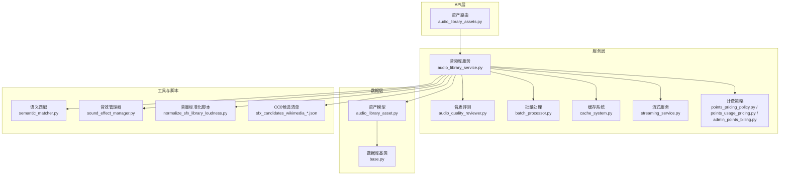
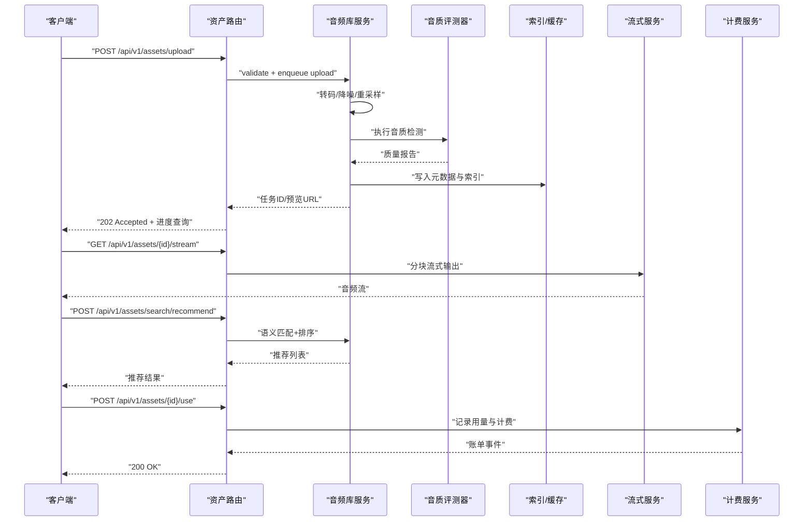
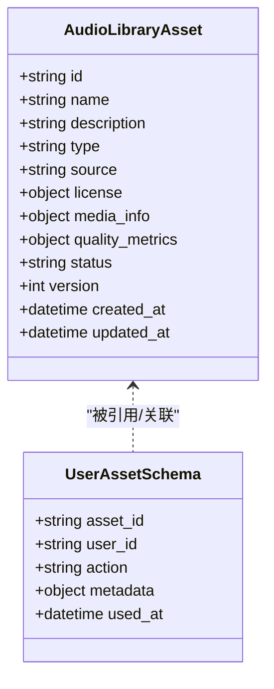
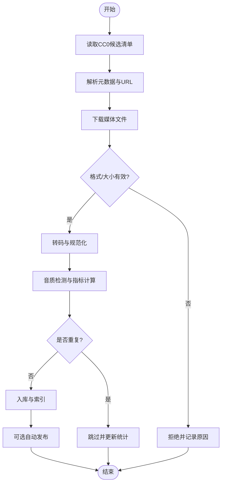
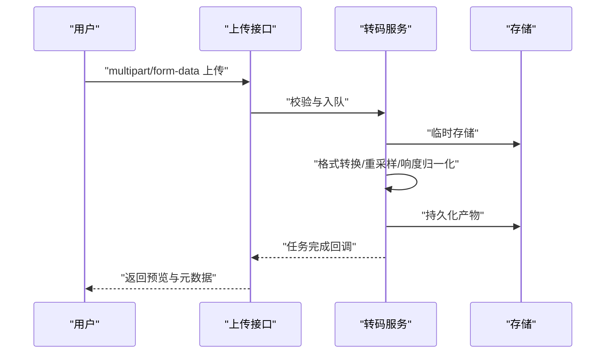
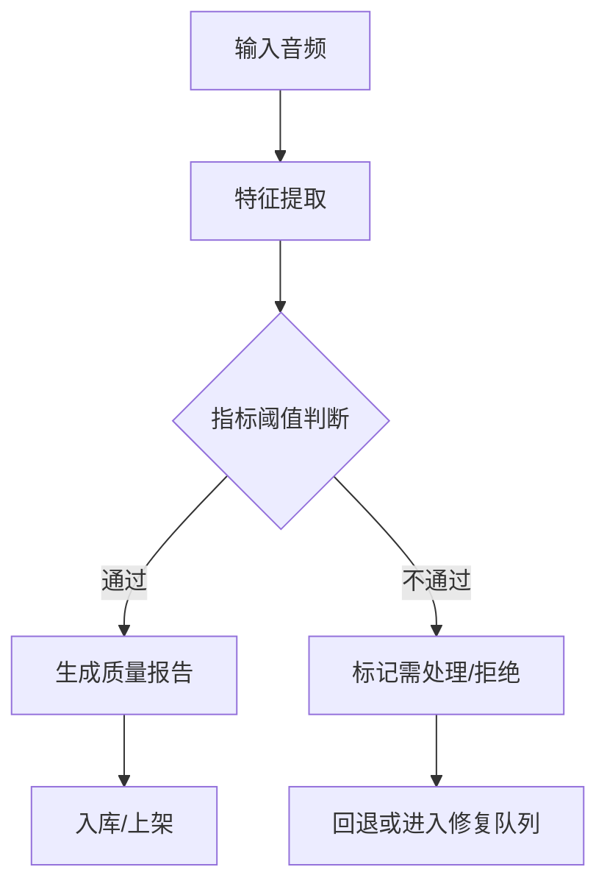
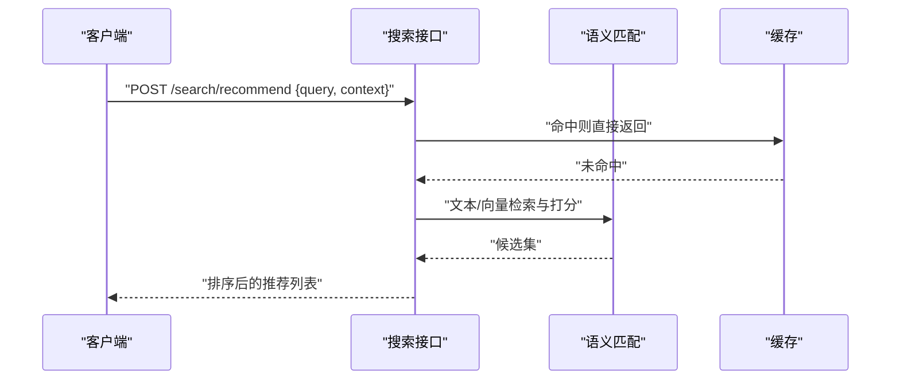
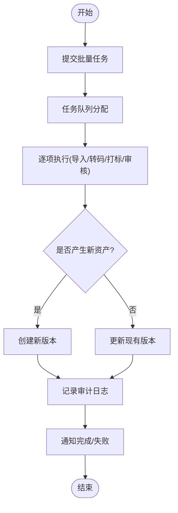
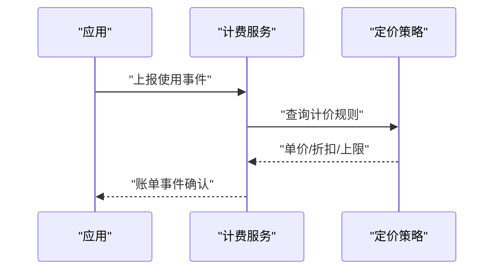
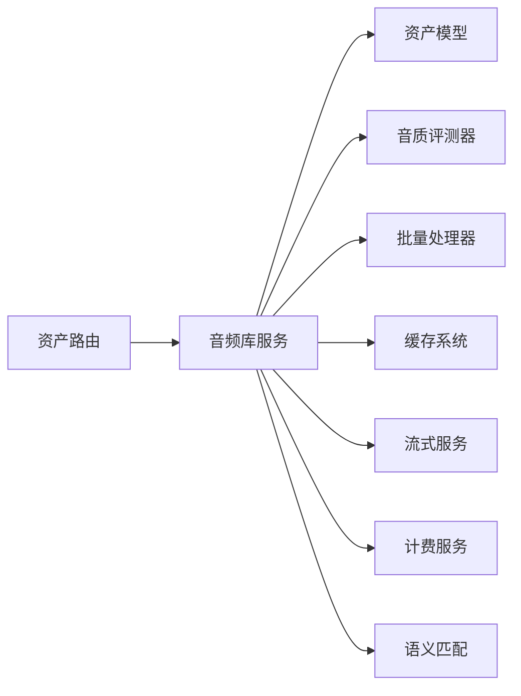

# 音频库管理API

<cite>
**本文引用的文件**   
- [backend/app/api/v1/asset_studio_api/audio_library_assets.py](file://backend/app/api/v1/asset_studio_api/audio_library_assets.py)
- [backend/app/models/audio_library_asset.py](file://backend/app/models/audio_library_asset.py)
- [backend/app/schemas/user_asset.py](file://backend/app/schemas/user_asset.py)
- [backend/app/services/audiobook/audio_library_service.py](file://backend/app/services/audiobook/audio_library_service.py)
- [backend/app/services/audiobook/audio_quality_reviewer.py](file://backend/app/services/audiobook/audio_quality_reviewer.py)
- [backend/app/services/audiobook/batch_processor.py](file://backend/app/services/audiobook/batch_processor.py)
- [backend/app/services/admin_points_billing.py](file://backend/app/services/admin_points_billing.py)
- [backend/app/services/points_pricing_policy.py](file://backend/app/services/points_pricing_policy.py)
- [backend/app/services/points_usage_pricing.py](file://backend/app/services/points_usage_pricing.py)
- [backend/app/services/cache_system.py](file://backend/app/services/cache_system.py)
- [backend/app/services/streaming_service.py](file://backend/app/services/streaming_service.py)
- [backend/app/core/config.py](file://backend/app/core/config.py)
- [backend/app/db/base.py](file://backend/app/db/base.py)
- [backend/data/audio_library/sfx_candidates_wikimedia_cc0_pd_continued2_20260511.json](file://backend/data/audio_library/sfx_candidates_wikimedia_cc0_pd_continued2_20260511.json)
- [backend/scripts/normalize_sfx_library_loudness.py](file://backend/scripts/normalize_sfx_library_loudness.py)
- [agents/sound_effect_manager.py](file://agents/sound_effect_manager.py)
- [core/semantic_matcher.py](file://core/semantic_matcher.py)
</cite>

## 目录
1. [简介](#简介)
2. [项目结构](#项目结构)
3. [核心组件](#核心组件)
4. [架构总览](#架构总览)
5. [详细组件分析](#详细组件分析)
6. [依赖关系分析](#依赖关系分析)
7. [性能考量](#性能考量)
8. [故障排查指南](#故障排查指南)
9. [结论](#结论)
10. [附录](#附录)

## 简介
本文件为“音频库管理系统”的API文档，覆盖音效素材管理、背景音乐库、音效匹配与版权管理。重点说明CC0素材导入、自定义音效上传、智能推荐、音频格式转换、音量标准化、音质检测、素材搜索与分类、批量操作、版本控制、使用统计与成本核算等能力。读者可据此快速对接接口、理解数据流与处理逻辑，并掌握最佳实践与排障方法。

## 项目结构
系统采用分层架构：API层暴露REST接口；服务层封装业务逻辑（导入、转码、质检、推荐、计费）；模型与Schema定义数据契约；脚本与工具提供批处理与质量校准能力；缓存与流式服务支撑高并发访问。

图表来源 
- [backend/app/api/v1/asset_studio_api/audio_library_assets.py](file://backend/app/api/v1/asset_studio_api/audio_library_assets.py)
- [backend/app/services/audiobook/audio_library_service.py](file://backend/app/services/audiobook/audio_library_service.py)
- [backend/app/services/audiobook/audio_quality_reviewer.py](file://backend/app/services/audiobook/audio_quality_reviewer.py)
- [backend/app/services/audiobook/batch_processor.py](file://backend/app/services/audiobook/batch_processor.py)
- [backend/app/services/cache_system.py](file://backend/app/services/cache_system.py)
- [backend/app/services/streaming_service.py](file://backend/app/services/streaming_service.py)
- [backend/app/services/points_pricing_policy.py](file://backend/app/services/points_pricing_policy.py)
- [backend/app/services/points_usage_pricing.py](file://backend/app/services/points_usage_pricing.py)
- [backend/app/services/admin_points_billing.py](file://backend/app/services/admin_points_billing.py)
- [backend/app/models/audio_library_asset.py](file://backend/app/models/audio_library_asset.py)
- [backend/app/db/base.py](file://backend/app/db/base.py)
- [core/semantic_matcher.py](file://core/semantic_matcher.py)
- [agents/sound_effect_manager.py](file://agents/sound_effect_manager.py)
- [backend/scripts/normalize_sfx_library_loudness.py](file://backend/scripts/normalize_sfx_library_loudness.py)
- [backend/data/audio_library/sfx_candidates_wikimedia_cc0_pd_continued2_20260511.json](file://backend/data/audio_library/sfx_candidates_wikimedia_cc0_pd_continued2_20260511.json)

章节来源
- [backend/app/api/v1/asset_studio_api/audio_library_assets.py](file://backend/app/api/v1/asset_studio_api/audio_library_assets.py)
- [backend/app/services/audiobook/audio_library_service.py](file://backend/app/services/audiobook/audio_library_service.py)
- [backend/app/models/audio_library_asset.py](file://backend/app/models/audio_library_asset.py)
- [backend/app/schemas/user_asset.py](file://backend/app/schemas/user_asset.py)

## 核心组件
- 资产路由与控制器：负责接收请求、参数校验、权限检查、调用服务层并返回响应。
- 音频库服务：编排素材导入、转码、质检、索引、检索、推荐、计费与统计。
- 音质评测器：对音频进行响度、失真、静音段、采样率/位深等指标检测。
- 批量处理器：支持批量导入、转码、打标、审核与发布。
- 缓存与流式服务：热点元数据缓存、分块下载与流式播放。
- 计费与点券策略：按使用量计价、配额控制与账单记录。
- 数据模型与Schema：资产实体、用户资产、评分与审计字段。
- 工具与脚本：语义匹配、音效管理、音量标准化、CC0候选清单。

章节来源
- [backend/app/api/v1/asset_studio_api/audio_library_assets.py](file://backend/app/api/v1/asset_studio_api/audio_library_assets.py)
- [backend/app/services/audiobook/audio_library_service.py](file://backend/app/services/audiobook/audio_library_service.py)
- [backend/app/services/audiobook/audio_quality_reviewer.py](file://backend/app/services/audiobook/audio_quality_reviewer.py)
- [backend/app/services/audiobook/batch_processor.py](file://backend/app/services/audiobook/batch_processor.py)
- [backend/app/services/cache_system.py](file://backend/app/services/cache_system.py)
- [backend/app/services/streaming_service.py](file://backend/app/services/streaming_service.py)
- [backend/app/services/points_pricing_policy.py](file://backend/app/services/points_pricing_policy.py)
- [backend/app/services/points_usage_pricing.py](file://backend/app/services/points_usage_pricing.py)
- [backend/app/services/admin_points_billing.py](file://backend/app/services/admin_points_billing.py)
- [backend/app/models/audio_library_asset.py](file://backend/app/models/audio_library_asset.py)
- [backend/app/schemas/user_asset.py](file://backend/app/schemas/user_asset.py)

## 架构总览
下图展示一次“自定义音效上传→转码→质检→入库→检索→推荐→计费”的端到端流程。

图表来源 
- [backend/app/api/v1/asset_studio_api/audio_library_assets.py](file://backend/app/api/v1/asset_studio_api/audio_library_assets.py)
- [backend/app/services/audiobook/audio_library_service.py](file://backend/app/services/audiobook/audio_library_service.py)
- [backend/app/services/audiobook/audio_quality_reviewer.py](file://backend/app/services/audiobook/audio_quality_reviewer.py)
- [backend/app/services/cache_system.py](file://backend/app/services/cache_system.py)
- [backend/app/services/streaming_service.py](file://backend/app/services/streaming_service.py)
- [backend/app/services/points_usage_pricing.py](file://backend/app/services/points_usage_pricing.py)

## 详细组件分析

### 资产模型与Schema
- 资产实体包含：唯一标识、名称、描述、类型（音效/音乐）、来源（用户上传/CC0导入/第三方）、版权信息（许可证、作者、来源链接）、媒体信息（时长、采样率、位深、声道、编码）、质量指标（响度、峰值、失真度、静音比例）、状态（草稿/审核中/已发布/已下架）、版本与审计字段（创建/更新时间、操作人）。
- Schema约束用于输入校验与输出序列化，确保字段完整性与类型安全。

图表来源 
- [backend/app/models/audio_library_asset.py](file://backend/app/models/audio_library_asset.py)
- [backend/app/schemas/user_asset.py](file://backend/app/schemas/user_asset.py)

章节来源
- [backend/app/models/audio_library_asset.py](file://backend/app/models/audio_library_asset.py)
- [backend/app/schemas/user_asset.py](file://backend/app/schemas/user_asset.py)

### CC0素材导入流程
- 读取候选清单（JSON），解析元数据与资源地址。
- 拉取媒体文件，校验格式与大小，生成转码产物。
- 计算质量指标，填充版权信息（CC0/PD），入库并建立索引。
- 支持增量导入与去重策略。

图表来源 
- [backend/data/audio_library/sfx_candidates_wikimedia_cc0_pd_continued2_20260511.json](file://backend/data/audio_library/sfx_candidates_wikimedia_cc0_pd_continued2_20260511.json)
- [backend/app/services/audiobook/audio_library_service.py](file://backend/app/services/audiobook/audio_library_service.py)

章节来源
- [backend/data/audio_library/sfx_candidates_wikimedia_cc0_pd_continued2_20260511.json](file://backend/data/audio_library/sfx_candidates_wikimedia_cc0_pd_continued2_20260511.json)
- [backend/app/services/audiobook/audio_library_service.py](file://backend/app/services/audiobook/audio_library_service.py)

### 自定义音效上传与转码
- 支持多格式上传（WAV/MP3/FLAC/OGG等），服务端统一转码为目标格式与采样率。
- 转码过程包括重采样、声道合并、动态范围压缩与响度归一化。
- 失败重试与断点续传，错误码清晰可追踪。

图表来源 
- [backend/app/api/v1/asset_studio_api/audio_library_assets.py](file://backend/app/api/v1/asset_studio_api/audio_library_assets.py)
- [backend/app/services/audiobook/audio_library_service.py](file://backend/app/services/audiobook/audio_library_service.py)

章节来源
- [backend/app/api/v1/asset_studio_api/audio_library_assets.py](file://backend/app/api/v1/asset_studio_api/audio_library_assets.py)
- [backend/app/services/audiobook/audio_library_service.py](file://backend/app/services/audiobook/audio_library_service.py)

### 音质检测与音量标准化
- 检测项：平均响度、峰值、真峰值、动态范围、静音段占比、失真度、采样率/位深一致性。
- 标准化：目标响度（LUFS）、峰值限制、噪声门限、均衡与压缩参数。
- 输出质量报告，作为入库与审核依据。

图表来源 
- [backend/app/services/audiobook/audio_quality_reviewer.py](file://backend/app/services/audiobook/audio_quality_reviewer.py)
- [backend/scripts/normalize_sfx_library_loudness.py](file://backend/scripts/normalize_sfx_library_loudness.py)

章节来源
- [backend/app/services/audiobook/audio_quality_reviewer.py](file://backend/app/services/audiobook/audio_quality_reviewer.py)
- [backend/scripts/normalize_sfx_library_loudness.py](file://backend/scripts/normalize_sfx_library_loudness.py)

### 素材搜索、分类与智能推荐
- 搜索：关键词、标签、类型、来源、质量等级、时间范围、分页排序。
- 分类：基于标签体系与内容属性（环境音/拟音/打击乐/自然声等）。
- 推荐：结合语义匹配、上下文场景、历史使用与评分，输出Top-N推荐。

图表来源 
- [core/semantic_matcher.py](file://core/semantic_matcher.py)
- [backend/app/services/cache_system.py](file://backend/app/services/cache_system.py)
- [backend/app/api/v1/asset_studio_api/audio_library_assets.py](file://backend/app/api/v1/asset_studio_api/audio_library_assets.py)

章节来源
- [core/semantic_matcher.py](file://core/semantic_matcher.py)
- [backend/app/services/cache_system.py](file://backend/app/services/cache_system.py)
- [backend/app/api/v1/asset_studio_api/audio_library_assets.py](file://backend/app/api/v1/asset_studio_api/audio_library_assets.py)

### 批量操作与版本控制
- 批量：批量导入、批量转码、批量打标、批量审核、批量发布/下架。
- 版本：每次变更生成新版本，保留历史快照，支持回滚与差异对比。
- 审计：记录操作人、时间、变更内容与审批意见。

图表来源 
- [backend/app/services/audiobook/batch_processor.py](file://backend/app/services/audiobook/batch_processor.py)
- [backend/app/models/audio_library_asset.py](file://backend/app/models/audio_library_asset.py)

章节来源
- [backend/app/services/audiobook/batch_processor.py](file://backend/app/services/audiobook/batch_processor.py)
- [backend/app/models/audio_library_asset.py](file://backend/app/models/audio_library_asset.py)

### 版权管理与合规
- 版权字段：许可证类型（CC0/CC-BY/私有等）、作者、来源链接、授权条款。
- 合规校验：来源合法性、许可证兼容性、敏感内容过滤。
- 导出与审计：版权声明导出、使用链路追踪、合规报表。

章节来源
- [backend/app/models/audio_library_asset.py](file://backend/app/models/audio_library_asset.py)
- [backend/app/schemas/user_asset.py](file://backend/app/schemas/user_asset.py)

### 使用统计与成本核算
- 使用统计：按资产维度统计播放次数、下载次数、推荐曝光、转化率。
- 成本核算：按使用量（时长/次数/质量等级）计价，支持套餐与折扣。
- 账单记录：事件驱动，记录用户、资产、用量、单价、总额与时间戳。

图表来源 
- [backend/app/services/points_usage_pricing.py](file://backend/app/services/points_usage_pricing.py)
- [backend/app/services/points_pricing_policy.py](file://backend/app/services/points_pricing_policy.py)
- [backend/app/services/admin_points_billing.py](file://backend/app/services/admin_points_billing.py)

章节来源
- [backend/app/services/points_usage_pricing.py](file://backend/app/services/points_usage_pricing.py)
- [backend/app/services/points_pricing_policy.py](file://backend/app/services/points_pricing_policy.py)
- [backend/app/services/admin_points_billing.py](file://backend/app/services/admin_points_billing.py)

## 依赖关系分析
- API层依赖服务层，服务层依赖模型与Schema、工具与脚本、外部存储与缓存。
- 计费模块独立于业务主流程，通过事件订阅与异步记账降低耦合。
- 语义匹配与缓存提升检索性能，避免重复计算。

图表来源 
- [backend/app/api/v1/asset_studio_api/audio_library_assets.py](file://backend/app/api/v1/asset_studio_api/audio_library_assets.py)
- [backend/app/services/audiobook/audio_library_service.py](file://backend/app/services/audiobook/audio_library_service.py)
- [backend/app/models/audio_library_asset.py](file://backend/app/models/audio_library_asset.py)
- [backend/app/services/audiobook/audio_quality_reviewer.py](file://backend/app/services/audiobook/audio_quality_reviewer.py)
- [backend/app/services/audiobook/batch_processor.py](file://backend/app/services/audiobook/batch_processor.py)
- [backend/app/services/cache_system.py](file://backend/app/services/cache_system.py)
- [backend/app/services/streaming_service.py](file://backend/app/services/streaming_service.py)
- [backend/app/services/points_usage_pricing.py](file://backend/app/services/points_usage_pricing.py)
- [core/semantic_matcher.py](file://core/semantic_matcher.py)

章节来源
- [backend/app/api/v1/asset_studio_api/audio_library_assets.py](file://backend/app/api/v1/asset_studio_api/audio_library_assets.py)
- [backend/app/services/audiobook/audio_library_service.py](file://backend/app/services/audiobook/audio_library_service.py)

## 性能考量
- 转码与质检：采用异步任务与并行处理，限制并发数避免过载。
- 缓存策略：热点元数据与推荐结果缓存，TTL与失效策略合理配置。
- 流式播放：分块传输与Range请求，减少首帧延迟。
- 数据库：读写分离与索引优化，避免全表扫描。
- 配置：根据环境与负载调整超时、重试与熔断参数。

章节来源
- [backend/app/core/config.py](file://backend/app/core/config.py)
- [backend/app/services/cache_system.py](file://backend/app/services/cache_system.py)
- [backend/app/services/streaming_service.py](file://backend/app/services/streaming_service.py)

## 故障排查指南
- 上传失败：检查文件格式、大小限制、网络超时与存储权限。
- 转码异常：查看转码日志、FFmpeg输出、参数配置与磁盘空间。
- 音质不达标：复核阈值配置、输入源质量与标准化参数。
- 检索缓慢：检查缓存命中率、索引重建与查询条件复杂度。
- 计费偏差：核对使用事件上报、计价策略与账单聚合逻辑。

章节来源
- [backend/app/services/audiobook/audio_quality_reviewer.py](file://backend/app/services/audiobook/audio_quality_reviewer.py)
- [backend/app/services/audiobook/batch_processor.py](file://backend/app/services/audiobook/batch_processor.py)
- [backend/app/services/cache_system.py](file://backend/app/services/cache_system.py)
- [backend/app/services/points_usage_pricing.py](file://backend/app/services/points_usage_pricing.py)

## 结论
本API文档系统化梳理了音频库管理的核心能力与实现路径，涵盖从素材导入、转码质检到检索推荐、计费统计的全链路。建议在生产环境中完善监控告警、容量规划与合规审计，持续优化性能与用户体验。

## 附录
- 常用接口示例（概念性）
  - 上传：POST /api/v1/assets/upload（multipart/form-data）
  - 查询：GET /api/v1/assets?keyword=&type=&source=&quality=&page=
  - 推荐：POST /api/v1/assets/search/recommend（{query, context}）
  - 流式：GET /api/v1/assets/{id}/stream（支持Range）
  - 批量：POST /api/v1/assets/batch（{actions:[...]}）
  - 计费：POST /api/v1/assets/{id}/use（{user_id, usage_type}）
- 配置要点
  - 转码预设、响度目标、采样率与位深策略
  - 缓存TTL、最大并发与队列长度
  - 计费规则、折扣策略与限额控制

[本节为概念性补充，不直接分析具体文件]