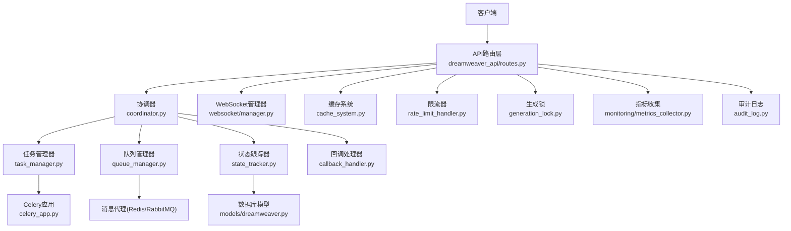
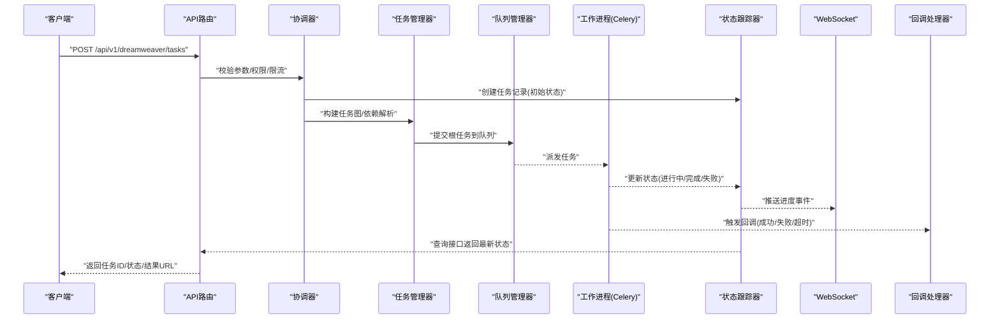
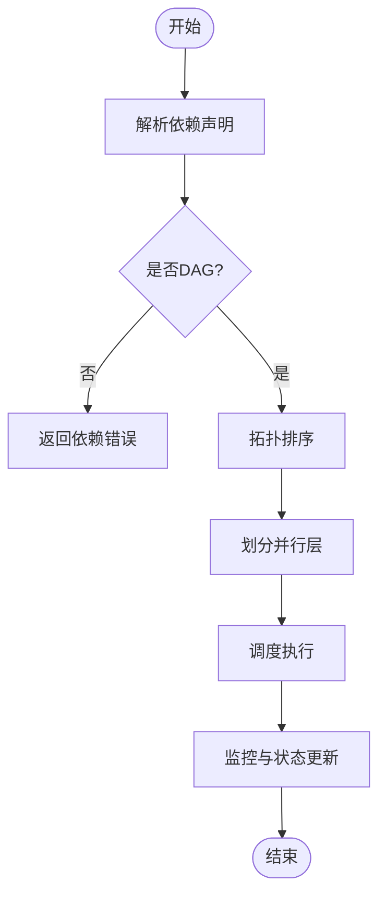
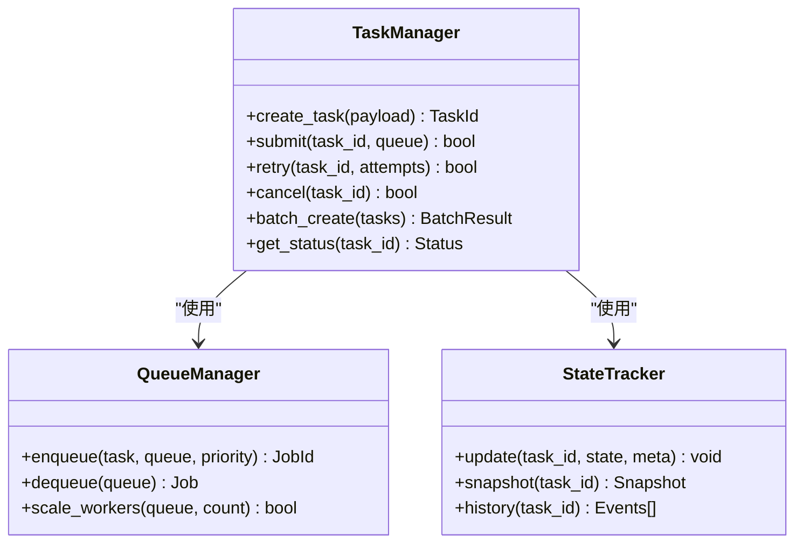
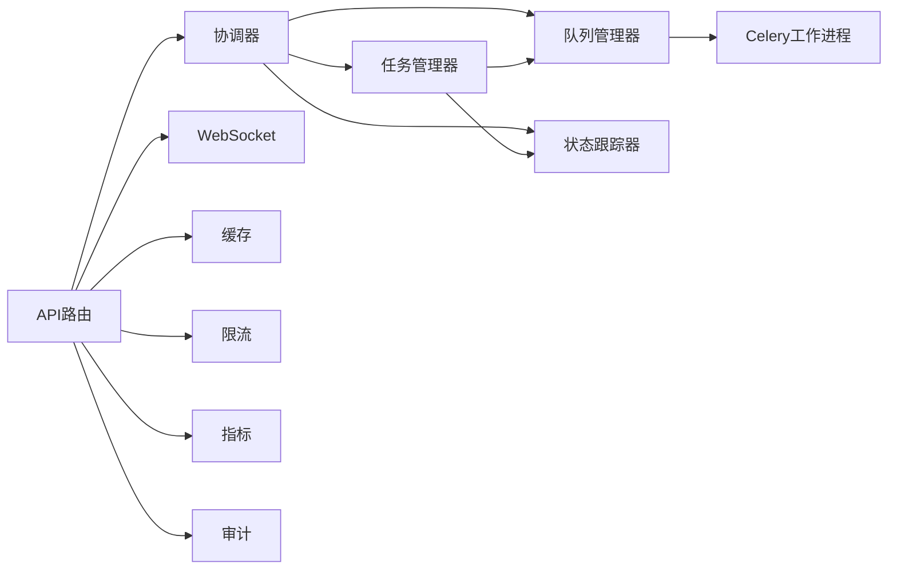

# 任务调度API

<cite>
**本文档引用的文件**   
- [backend/app/main.py](file://backend/app/main.py)
- [backend/app/celery_app.py](file://backend/app/celery_app.py)
- [backend/app/api/v1/dreamweaver_api/__init__.py](file://backend/app/api/v1/dreamweaver_api/__init__.py)
- [backend/app/api/v1/dreamweaver_api/routes.py](file://backend/app/api/v1/dreamweaver_api/routes.py)
- [backend/app/services/dreamweaver/coordinator.py](file://backend/app/services/dreamweaver/coordinator.py)
- [backend/app/services/dreamweaver/task_manager.py](file://backend/app/services/dreamweaver/task_manager.py)
- [backend/app/services/dreamweaver/queue_manager.py](file://backend/app/services/dreamweaver/queue_manager.py)
- [backend/app/services/dreamweaver/state_tracker.py](file://backend/app/services/dreamweaver/state_tracker.py)
- [backend/app/services/dreamweaver/callback_handler.py](file://backend/app/services/dreamweaver/callback_handler.py)
- [backend/app/models/dreamweaver.py](file://backend/app/models/dreamweaver.py)
- [backend/app/schemas/dreamweaver_contract.py](file://backend/app/schemas/dreamweaver_contract.py)
- [backend/app/websocket/manager.py](file://backend/app/websocket/manager.py)
- [backend/app/core/config.py](file://backend/app/core/config.py)
- [backend/app/services/batch_processor.py](file://backend/app/services/batch_processor.py)
- [backend/app/services/streaming_service.py](file://backend/app/services/streaming_service.py)
- [backend/app/services/rate_limit_handler.py](file://backend/app/services/rate_limit_handler.py)
- [backend/app/services/generation_lock.py](file://backend/app/services/generation_lock.py)
- [backend/app/services/cache_system.py](file://backend/app/services/cache_system.py)
- [backend/app/utils/api_errors.py](file://backend/app/utils/api_errors.py)
- [backend/app/services/monitoring/metrics_collector.py](file://backend/app/services/monitoring/metrics_collector.py)
- [backend/app/services/audit_log.py](file://backend/app/services/audit_log.py)
</cite>

## 目录
1. [简介](#简介)
2. [项目结构](#项目结构)
3. [核心组件](#核心组件)
4. [架构总览](#架构总览)
5. [详细组件分析](#详细组件分析)
6. [依赖关系分析](#依赖关系分析)
7. [性能考虑](#性能考虑)
8. [故障排查指南](#故障排查指南)
9. [结论](#结论)
10. [附录](#附录)

## 简介
本文件为“梦境编织者”任务调度系统的API文档，覆盖任务的创建、查询、管理与监控接口；说明任务依赖关系、执行顺序与并行控制机制；提供任务状态跟踪、进度报告与结果获取的接口规范；解释任务队列配置、负载均衡与故障转移策略；并给出批处理、定时任务与回调通知的使用示例。同时包含审计、日志记录与性能分析的API调用方法，帮助开发者快速集成与运维。

## 项目结构
系统采用分层架构：API层暴露REST/WebSocket接口；服务层编排任务生命周期、依赖解析、并发控制与结果聚合；持久化层通过模型与迁移管理任务元数据；消息与队列层基于Celery进行异步执行；监控与审计贯穿全链路。

**图表来源** 
- [backend/app/api/v1/dreamweaver_api/routes.py](file://backend/app/api/v1/dreamweaver_api/routes.py)
- [backend/app/services/dreamweaver/coordinator.py](file://backend/app/services/dreamweaver/coordinator.py)
- [backend/app/services/dreamweaver/task_manager.py](file://backend/app/services/dreamweaver/task_manager.py)
- [backend/app/services/dreamweaver/queue_manager.py](file://backend/app/services/dreamweaver/queue_manager.py)
- [backend/app/services/dreamweaver/state_tracker.py](file://backend/app/services/dreamweaver/state_tracker.py)
- [backend/app/services/dreamweaver/callback_handler.py](file://backend/app/services/dreamweaver/callback_handler.py)
- [backend/app/celery_app.py](file://backend/app/celery_app.py)
- [backend/app/models/dreamweaver.py](file://backend/app/models/dreamweaver.py)
- [backend/app/websocket/manager.py](file://backend/app/websocket/manager.py)
- [backend/app/services/cache_system.py](file://backend/app/services/cache_system.py)
- [backend/app/services/rate_limit_handler.py](file://backend/app/services/rate_limit_handler.py)
- [backend/app/services/generation_lock.py](file://backend/app/services/generation_lock.py)
- [backend/app/services/monitoring/metrics_collector.py](file://backend/app/services/monitoring/metrics_collector.py)
- [backend/app/services/audit_log.py](file://backend/app/services/audit_log.py)

**章节来源**
- [backend/app/main.py](file://backend/app/main.py)
- [backend/app/celery_app.py](file://backend/app/celery_app.py)

## 核心组件
- 任务协调器：负责任务图构建、依赖解析、执行顺序与并行度控制。
- 任务管理器：封装任务创建、提交、重试、取消与批量操作。
- 队列管理器：对接Celery队列，支持多队列、权重与动态扩缩容。
- 状态跟踪器：维护任务生命周期状态机、事件与快照。
- 回调处理器：统一处理成功/失败/超时等回调事件。
- WebSocket管理器：推送实时进度与结果。
- 缓存系统：热点结果与中间态缓存。
- 限流与生成锁：保护下游资源与避免重复生成。
- 指标与审计：采集运行指标与审计事件。

**章节来源**
- [backend/app/services/dreamweaver/coordinator.py](file://backend/app/services/dreamweaver/coordinator.py)
- [backend/app/services/dreamweaver/task_manager.py](file://backend/app/services/dreamweaver/task_manager.py)
- [backend/app/services/dreamweaver/queue_manager.py](file://backend/app/services/dreamweaver/queue_manager.py)
- [backend/app/services/dreamweaver/state_tracker.py](file://backend/app/services/dreamweaver/state_tracker.py)
- [backend/app/services/dreamweaver/callback_handler.py](file://backend/app/services/dreamweaver/callback_handler.py)
- [backend/app/websocket/manager.py](file://backend/app/websocket/manager.py)
- [backend/app/services/cache_system.py](file://backend/app/services/cache_system.py)
- [backend/app/services/rate_limit_handler.py](file://backend/app/services/rate_limit_handler.py)
- [backend/app/services/generation_lock.py](file://backend/app/services/generation_lock.py)
- [backend/app/services/monitoring/metrics_collector.py](file://backend/app/services/monitoring/metrics_collector.py)
- [backend/app/services/audit_log.py](file://backend/app/services/audit_log.py)

## 架构总览
下图展示一次典型任务从创建到完成的端到端流程，包括依赖检查、入队、执行、状态更新、进度推送与结果返回。

**图表来源** 
- [backend/app/api/v1/dreamweaver_api/routes.py](file://backend/app/api/v1/dreamweaver_api/routes.py)
- [backend/app/services/dreamweaver/coordinator.py](file://backend/app/services/dreamweaver/coordinator.py)
- [backend/app/services/dreamweaver/task_manager.py](file://backend/app/services/dreamweaver/task_manager.py)
- [backend/app/services/dreamweaver/queue_manager.py](file://backend/app/services/dreamweaver/queue_manager.py)
- [backend/app/services/dreamweaver/state_tracker.py](file://backend/app/services/dreamweaver/state_tracker.py)
- [backend/app/websocket/manager.py](file://backend/app/websocket/manager.py)
- [backend/app/services/dreamweaver/callback_handler.py](file://backend/app/services/dreamweaver/callback_handler.py)
- [backend/app/celery_app.py](file://backend/app/celery_app.py)

## 详细组件分析

### API路由层（任务CRUD与监控）
- 任务创建：POST /api/v1/dreamweaver/tasks
  - 请求体字段：任务类型、输入参数、依赖列表、优先级、并发限制、回调地址、批处理选项、定时时间等。
  - 响应：任务ID、当前状态、预计完成时间、进度URL。
- 任务查询：GET /api/v1/dreamweaver/tasks/{task_id}
  - 支持过滤：状态、创建时间范围、标签、批次号。
  - 响应：任务详情、依赖图、阶段进度、结果引用。
- 任务管理：PUT/PATCH /api/v1/dreamweaver/tasks/{task_id}
  - 支持暂停、恢复、重试、取消、优先级调整。
- 批量操作：POST /api/v1/dreamweaver/tasks/batch
  - 支持批量创建、批量状态查询、批量取消。
- 进度与结果：GET /api/v1/dreamweaver/tasks/{task_id}/progress, GET /api/v1/dreamweaver/tasks/{task_id}/result
  - 进度支持SSE或轮询；结果支持直链下载或临时URL。
- 监控与审计：GET /api/v1/dreamweaver/monitoring, GET /api/v1/dreamweaver/audit
  - 指标：吞吐、延迟、错误率、队列长度、消费者数。
  - 审计：操作人、动作、时间戳、关联任务ID。

**章节来源**
- [backend/app/api/v1/dreamweaver_api/routes.py](file://backend/app/api/v1/dreamweaver_api/routes.py)
- [backend/app/schemas/dreamweaver_contract.py](file://backend/app/schemas/dreamweaver_contract.py)

### 任务协调器（依赖与执行顺序）
- 依赖解析：将用户声明的依赖转换为有向无环图(DAG)，检测循环依赖。
- 执行顺序：拓扑排序确定阶段边界，同层可并行，跨层串行。
- 并行控制：全局并发上限、按任务类型分池、按租户隔离。
- 失败策略：单节点失败重试、级联失败回滚、部分成功保留。

**图表来源** 
- [backend/app/services/dreamweaver/coordinator.py](file://backend/app/services/dreamweaver/coordinator.py)

**章节来源**
- [backend/app/services/dreamweaver/coordinator.py](file://backend/app/services/dreamweaver/coordinator.py)

### 任务管理器（创建、提交、重试、取消、批处理）
- 创建：校验输入、生成唯一ID、写入初始状态。
- 提交：根据队列策略选择目标队列，设置超时与重试次数。
- 重试：指数退避、最大重试次数、死信队列。
- 取消：幂等取消、清理中间态、释放锁。
- 批处理：合并相同输入、去重、批量结果聚合。

**图表来源** 
- [backend/app/services/dreamweaver/task_manager.py](file://backend/app/services/dreamweaver/task_manager.py)
- [backend/app/services/dreamweaver/queue_manager.py](file://backend/app/services/dreamweaver/queue_manager.py)
- [backend/app/services/dreamweaver/state_tracker.py](file://backend/app/services/dreamweaver/state_tracker.py)

**章节来源**
- [backend/app/services/dreamweaver/task_manager.py](file://backend/app/services/dreamweaver/task_manager.py)
- [backend/app/services/dreamweaver/queue_manager.py](file://backend/app/services/dreamweaver/queue_manager.py)
- [backend/app/services/dreamweaver/state_tracker.py](file://backend/app/services/dreamweaver/state_tracker.py)

### 队列管理器（配置、负载均衡、故障转移）
- 队列配置：多队列名称、权重、最大并发、超时、重试策略。
- 负载均衡：按负载因子分配、粘性会话可选、热键扩散。
- 故障转移：消费者健康检查、自动重启、任务重新派发。
- 监控：队列深度、消费速率、平均耗时、错误率。

**章节来源**
- [backend/app/services/dreamweaver/queue_manager.py](file://backend/app/services/dreamweaver/queue_manager.py)
- [backend/app/core/config.py](file://backend/app/core/config.py)

### 状态跟踪器（状态机、事件、快照）
- 状态机：待处理、排队中、执行中、等待依赖、成功、失败、已取消、超时。
- 事件：每个状态变更产生事件，附带上下文与耗时。
- 快照：关键阶段保存快照，便于回溯与恢复。

**章节来源**
- [backend/app/services/dreamweaver/state_tracker.py](file://backend/app/services/dreamweaver/state_tracker.py)
- [backend/app/models/dreamweaver.py](file://backend/app/models/dreamweaver.py)

### 回调处理器（成功/失败/超时）
- 回调事件：任务完成、失败、超时、重试耗尽。
- 重试与退避：对回调失败进行指数退避与最大重试。
- 幂等性：基于任务ID与事件ID保证幂等。

**章节来源**
- [backend/app/services/dreamweaver/callback_handler.py](file://backend/app/services/dreamweaver/callback_handler.py)

### WebSocket管理器（实时进度与结果）
- 订阅：按任务ID或批次号订阅进度事件。
- 推送：增量推送阶段进度、指标与结果链接。
- 断线重连：支持断线后拉取未消费事件。

**章节来源**
- [backend/app/websocket/manager.py](file://backend/app/websocket/manager.py)

### 批处理服务（批量创建与聚合）
- 批量创建：合并相同输入、去重、批量提交。
- 结果聚合：按批次聚合结果，支持部分成功。
- 进度：批次维度与任务维度双粒度进度。

**章节来源**
- [backend/app/services/batch_processor.py](file://backend/app/services/batch_processor.py)

### 流式服务（SSE进度与结果）
- SSE接口：/api/v1/dreamweaver/tasks/{task_id}/stream
- 事件：start、progress、partial_result、complete、error
- 客户端：自动重连与事件去重。

**章节来源**
- [backend/app/services/streaming_service.py](file://backend/app/services/streaming_service.py)

### 限流与生成锁（保护下游与一致性）
- 限流：按租户/模型/接口维度限流，令牌桶或滑动窗口。
- 生成锁：同一输入在同一时刻仅允许一个生成任务，避免重复计算。

**章节来源**
- [backend/app/services/rate_limit_handler.py](file://backend/app/services/rate_limit_handler.py)
- [backend/app/services/generation_lock.py](file://backend/app/services/generation_lock.py)

### 缓存系统（热点结果与中间态）
- 缓存策略：TTL、LRU、按任务ID与输入哈希键。
- 失效：任务完成后失效或按需失效。
- 命中：命中直接返回结果，降低延迟。

**章节来源**
- [backend/app/services/cache_system.py](file://backend/app/services/cache_system.py)

### 指标与审计（监控与合规）
- 指标：任务数、成功率、P95/P99延迟、队列长度、消费者数。
- 审计：操作记录、访问日志、错误追踪。
- 导出：Prometheus/JSON导出，供外部监控系统抓取。

**章节来源**
- [backend/app/services/monitoring/metrics_collector.py](file://backend/app/services/monitoring/metrics_collector.py)
- [backend/app/services/audit_log.py](file://backend/app/services/audit_log.py)

## 依赖关系分析
- API路由依赖协调器、任务管理器、队列管理器、状态跟踪器、WebSocket、限流、缓存、指标与审计。
- 协调器依赖任务管理器、状态跟踪器与队列管理器。
- 任务管理器依赖队列管理器与状态跟踪器。
- 工作进程由Celery驱动，读取队列并更新状态。

**图表来源** 
- [backend/app/api/v1/dreamweaver_api/routes.py](file://backend/app/api/v1/dreamweaver_api/routes.py)
- [backend/app/services/dreamweaver/coordinator.py](file://backend/app/services/dreamweaver/coordinator.py)
- [backend/app/services/dreamweaver/task_manager.py](file://backend/app/services/dreamweaver/task_manager.py)
- [backend/app/services/dreamweaver/queue_manager.py](file://backend/app/services/dreamweaver/queue_manager.py)
- [backend/app/services/dreamweaver/state_tracker.py](file://backend/app/services/dreamweaver/state_tracker.py)
- [backend/app/websocket/manager.py](file://backend/app/websocket/manager.py)
- [backend/app/services/cache_system.py](file://backend/app/services/cache_system.py)
- [backend/app/services/rate_limit_handler.py](file://backend/app/services/rate_limit_handler.py)
- [backend/app/services/monitoring/metrics_collector.py](file://backend/app/services/monitoring/metrics_collector.py)
- [backend/app/services/audit_log.py](file://backend/app/services/audit_log.py)
- [backend/app/celery_app.py](file://backend/app/celery_app.py)

**章节来源**
- [backend/app/api/v1/dreamweaver_api/routes.py](file://backend/app/api/v1/dreamweaver_api/routes.py)
- [backend/app/services/dreamweaver/coordinator.py](file://backend/app/services/dreamweaver/coordinator.py)

## 性能考虑
- 队列与消费者：合理设置队列数量与消费者并发，避免热点队列拥塞。
- 依赖与并行：最大化同层并行，减少跨层等待；必要时拆分大任务。
- 缓存与锁：启用热点结果缓存与生成锁，降低重复计算与竞争。
- 限流与背压：按租户与模型限流，防止雪崩；消费者过载时主动降速。
- 监控与告警：关注队列深度、消费速率、错误率与延迟分位，及时扩容。

[本节为通用指导，不直接分析具体文件]

## 故障排查指南
- 常见问题
  - 任务卡住：检查队列深度与消费者健康；查看任务状态与事件历史。
  - 依赖错误：验证依赖图是否为DAG；检查上游任务状态。
  - 回调失败：确认回调地址可达；检查重试与退避策略。
  - 结果缺失：检查缓存失效与结果存储路径；确认任务最终状态。
- 诊断步骤
  - 使用监控接口查看指标与队列状态。
  - 使用审计接口定位最近操作与错误。
  - 通过WebSocket订阅实时事件，观察进度变化。
  - 检查限流与生成锁是否误拦截。

**章节来源**
- [backend/app/utils/api_errors.py](file://backend/app/utils/api_errors.py)
- [backend/app/services/monitoring/metrics_collector.py](file://backend/app/services/monitoring/metrics_collector.py)
- [backend/app/services/audit_log.py](file://backend/app/services/audit_log.py)
- [backend/app/websocket/manager.py](file://backend/app/websocket/manager.py)
- [backend/app/services/rate_limit_handler.py](file://backend/app/services/rate_limit_handler.py)
- [backend/app/services/generation_lock.py](file://backend/app/services/generation_lock.py)

## 结论
本API文档围绕“梦境编织者”任务调度系统，提供了从接口定义到内部实现的全面说明。通过协调器、任务管理器、队列管理器与状态跟踪器的协作，系统实现了可靠的依赖解析、执行顺序与并行控制；结合WebSocket、SSE、缓存、限流与锁机制，保障了高可用与高性能；指标与审计能力则支撑了可观测性与合规性。建议在生产环境充分评估队列与消费者规模，完善监控与告警，确保稳定运行。

[本节为总结性内容，不直接分析具体文件]

## 附录

### 任务状态枚举与含义
- 待处理：任务已创建但未入队。
- 排队中：任务已在队列等待消费。
- 执行中：任务正在被工作进程处理。
- 等待依赖：任务依赖尚未满足。
- 成功：任务执行成功。
- 失败：任务执行失败。
- 已取消：任务被取消。
- 超时：任务执行超时。

**章节来源**
- [backend/app/services/dreamweaver/state_tracker.py](file://backend/app/services/dreamweaver/state_tracker.py)
- [backend/app/models/dreamweaver.py](file://backend/app/models/dreamweaver.py)

### 常用API调用示例（描述性）
- 创建任务：POST /api/v1/dreamweaver/tasks，传入任务类型、输入参数、依赖列表、优先级与回调地址。
- 查询任务：GET /api/v1/dreamweaver/tasks/{task_id}，返回状态、进度与结果引用。
- 批量创建：POST /api/v1/dreamweaver/tasks/batch，传入任务数组，返回批次ID与任务映射。
- 进度订阅：GET /api/v1/dreamweaver/tasks/{task_id}/progress 或 /api/v1/dreamweaver/tasks/{task_id}/stream。
- 结果获取：GET /api/v1/dreamweaver/tasks/{task_id}/result，返回结果文件或URL。
- 监控与审计：GET /api/v1/dreamweaver/monitoring 与 GET /api/v1/dreamweaver/audit。

**章节来源**
- [backend/app/api/v1/dreamweaver_api/routes.py](file://backend/app/api/v1/dreamweaver_api/routes.py)
- [backend/app/schemas/dreamweaver_contract.py](file://backend/app/schemas/dreamweaver_contract.py)