# 梦境编织者API

<cite>
**本文引用的文件**   
- [backend/app/api/v1/dreamweaver.py](file://backend/app/api/v1/dreamweaver.py)
- [backend/app/schemas/dreamweaver_contract.py](file://backend/app/schemas/dreamweaver_contract.py)
- [backend/app/services/dreamweaver/__init__.py](file://backend/app/services/dreamweaver/__init__.py)
- [backend/app/services/dreamweaver/runner.py](file://backend/app/services/dreamweaver/runner.py)
- [backend/app/services/dreamweaver/task_manager.py](file://backend/app/services/dreamweaver/task_manager.py)
- [backend/app/services/dreamweaver/pipeline.py](file://backend/app/services/dreamweaver/pipeline.py)
- [backend/app/services/dreamweaver/video_generation_service.py](file://backend/app/services/dreamweaver/video_generation_service.py)
- [backend/app/services/dreamweaver/storyboard_processor.py](file://backend/app/services/dreamweaver/storyboard_processor.py)
- [backend/app/services/dreamweaver/character_consistency_manager.py](file://backend/app/services/dreamweaver/character_consistency_manager.py)
- [backend/app/services/dreamweaver/scene_manager.py](file://backend/app/services/dreamweaver/scene_manager.py)
- [backend/app/services/dreamweaver/composition_engine.py](file://backend/app/services/dreamweaver/composition_engine.py)
- [backend/app/tasks/dreamweaver_tasks.py](file://backend/app/tasks/dreamweaver_tasks.py)
- [backend/app/websocket/manager.py](file://backend/app/websocket/manager.py)
- [backend/app/models/dreamweaver.py](file://backend/app/models/dreamweaver.py)
- [adapters/wan26_video_adapter.py](file://adapters/wan26_video_adapter.py)
- [adapters/vidu_platform/video.py](file://adapters/vidu_platform/video.py)
- [adapters/volcengine/video.py](file://adapters/volcengine/video.py)
- [adapters/dashscope/video_t2v.py](file://adapters/dashscope/video_t2v.py)
- [adapters/dashscope/video_kling.py](file://adapters/dashscope/video_kling.py)
- [agents/dreamweaver_agent_pkg/_run.py](file://agents/dreamweaver_agent_pkg/_run.py)
- [agents/dreamweaver_agent_pkg/_t2v_gen.py](file://agents/dreamweaver_agent_pkg/_t2v_gen.py)
- [agents/dreamweaver_agent_pkg/_i2v_gen.py](file://agents/dreamweaver_agent_pkg/_i2v_gen.py)
- [agents/dreamweaver_agent_pkg/_video_prompts.py](file://agents/dreamweaver_agent_pkg/_video_prompts.py)
- [pipeline/state_machine.py](file://pipeline/state_machine.py)
- [core/model_runtime.py](file://core/model_runtime.py)
- [core/unified_media_runtime.py](file://core/unified_media_runtime.py)
</cite>

## 目录
1. [简介](#简介)
2. [项目结构](#项目结构)
3. [核心组件](#核心组件)
4. [架构总览](#架构总览)
5. [详细组件分析](#详细组件分析)
6. [依赖关系分析](#依赖关系分析)
7. [性能与成本优化](#性能与成本优化)
8. [故障排查指南](#故障排查指南)
9. [结论](#结论)
10. [附录：API参考与示例](#附录api参考与示例)

## 简介
本文件为“梦境编织者”视频生成代理系统的API文档，聚焦于视频项目的创建、运行管理、任务调度与结果获取。内容涵盖分镜脚本处理、角色一致性控制、场景管理与视频合成的高级能力，并提供实时进度跟踪（WebSocket事件）、错误处理机制、批量生成、参数优化与质量评估的接口使用示例。同时给出资源管理、成本控制与性能优化的最佳实践建议。

## 项目结构
系统采用分层与模块化设计：
- API层：REST接口定义、请求校验与响应封装
- 服务层：编排视频生成流水线、任务管理、状态机驱动
- 适配器层：对接多种视频模型供应商（如DashScope、Vidu、火山引擎等）
- 任务层：异步任务队列执行长耗时流程
- WebSocket层：实时事件推送（进度、完成、错误）
- 数据模型层：项目、任务、事件与资产持久化

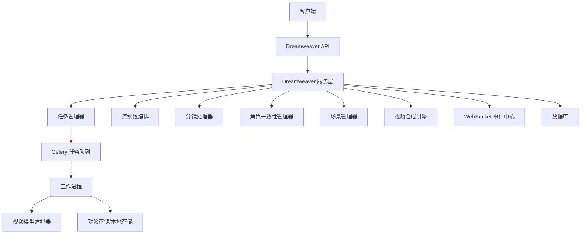

图表来源
- [backend/app/api/v1/dreamweaver.py:1-200](file://backend/app/api/v1/dreamweaver.py#L1-L200)
- [backend/app/services/dreamweaver/runner.py:1-200](file://backend/app/services/dreamweaver/runner.py#L1-L200)
- [backend/app/tasks/dreamweaver_tasks.py:1-200](file://backend/app/tasks/dreamweaver_tasks.py#L1-L200)
- [backend/app/websocket/manager.py:1-200](file://backend/app/websocket/manager.py#L1-L200)

章节来源
- [backend/app/api/v1/dreamweaver.py:1-200](file://backend/app/api/v1/dreamweaver.py#L1-L200)
- [backend/app/services/dreamweaver/__init__.py:1-100](file://backend/app/services/dreamweaver/__init__.py#L1-L100)

## 核心组件
- Dreamweaver API：提供项目CRUD、任务提交、查询、取消、批量操作与结果下载
- 服务层Runner：解析请求、构建上下文、协调各子服务并驱动状态机
- 任务管理器：任务入队、重试、超时、幂等与并发控制
- 流水线编排：按阶段推进（分镜→角色一致性→场景→生成→合成→质检）
- 分镜处理器：将故事文本转换为结构化分镜，包含镜头时长、转场、提示词
- 角色一致性管理器：维护角色特征库、参考图与跨镜头一致性策略
- 场景管理器：场景元数据、资产索引、复用与缓存
- 视频合成引擎：多片段拼接、转场、字幕、音频对齐与导出
- 适配器层：统一抽象不同视频模型的输入输出格式与限流策略
- WebSocket事件中心：进度、阶段完成、错误与结果通知
- 数据模型：项目、任务、事件、资产与审计记录

章节来源
- [backend/app/services/dreamweaver/runner.py:1-200](file://backend/app/services/dreamweaver/runner.py#L1-L200)
- [backend/app/services/dreamweaver/task_manager.py:1-200](file://backend/app/services/dreamweaver/task_manager.py#L1-L200)
- [backend/app/services/dreamweaver/pipeline.py:1-200](file://backend/app/services/dreamweaver/pipeline.py#L1-L200)
- [backend/app/services/dreamweaver/storyboard_processor.py:1-200](file://backend/app/services/dreamweaver/storyboard_processor.py#L1-L200)
- [backend/app/services/dreamweaver/character_consistency_manager.py:1-200](file://backend/app/services/dreamweaver/character_consistency_manager.py#L1-L200)
- [backend/app/services/dreamweaver/scene_manager.py:1-200](file://backend/app/services/dreamweaver/scene_manager.py#L1-L200)
- [backend/app/services/dreamweaver/composition_engine.py:1-200](file://backend/app/services/dreamweaver/composition_engine.py#L1-L200)

## 架构总览
Dreamweaver通过REST API接收请求，服务层进行参数校验与上下文构建，随后进入任务队列由工作进程执行。流水线按阶段推进，每个阶段可触发WebSocket事件。最终结果写入存储并通过API返回或下载。

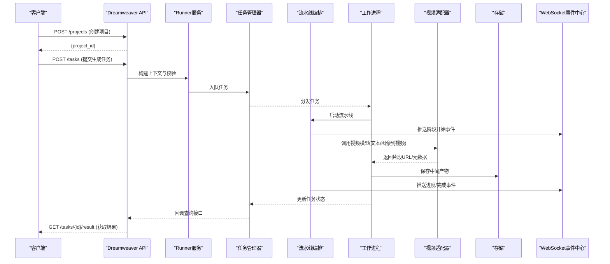

图表来源
- [backend/app/api/v1/dreamweaver.py:1-200](file://backend/app/api/v1/dreamweaver.py#L1-L200)
- [backend/app/services/dreamweaver/runner.py:1-200](file://backend/app/services/dreamweaver/runner.py#L1-L200)
- [backend/app/tasks/dreamweaver_tasks.py:1-200](file://backend/app/tasks/dreamweaver_tasks.py#L1-L200)
- [backend/app/websocket/manager.py:1-200](file://backend/app/websocket/manager.py#L1-L200)

## 详细组件分析

### Dreamweaver API（REST）
- 项目接口：创建、更新、删除、列表、详情
- 任务接口：提交、查询、取消、重试、批量提交
- 结果接口：片段/成片下载、预览、元数据
- 事件订阅：WebSocket连接建立与鉴权

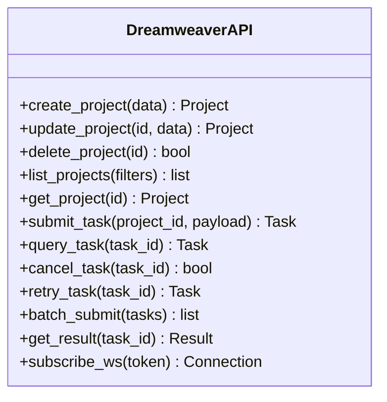

图表来源
- [backend/app/api/v1/dreamweaver.py:1-200](file://backend/app/api/v1/dreamweaver.py#L1-L200)
- [backend/app/schemas/dreamweaver_contract.py:1-200](file://backend/app/schemas/dreamweaver_contract.py#L1-L200)

章节来源
- [backend/app/api/v1/dreamweaver.py:1-200](file://backend/app/api/v1/dreamweaver.py#L1-L200)
- [backend/app/schemas/dreamweaver_contract.py:1-200](file://backend/app/schemas/dreamweaver_contract.py#L1-L200)

### Runner服务（编排器）
- 职责：解析请求、构建上下文、校验参数、协调子服务、驱动状态机、处理异常与回滚
- 关键方法：初始化上下文、阶段路由、失败重试、结果聚合

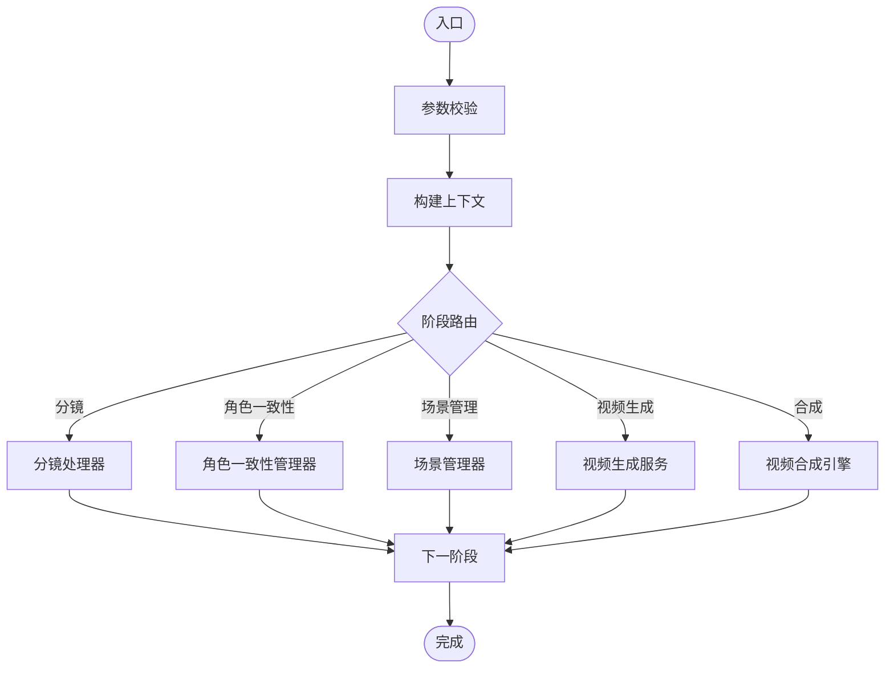

图表来源
- [backend/app/services/dreamweaver/runner.py:1-200](file://backend/app/services/dreamweaver/runner.py#L1-L200)
- [pipeline/state_machine.py:1-200](file://pipeline/state_machine.py#L1-L200)

章节来源
- [backend/app/services/dreamweaver/runner.py:1-200](file://backend/app/services/dreamweaver/runner.py#L1-L200)
- [pipeline/state_machine.py:1-200](file://pipeline/state_machine.py#L1-L200)

### 任务管理器（TaskManager）
- 职责：任务入队、去重、幂等、并发限制、超时与重试、状态同步
- 关键特性：支持批量提交、优先级队列、失败告警

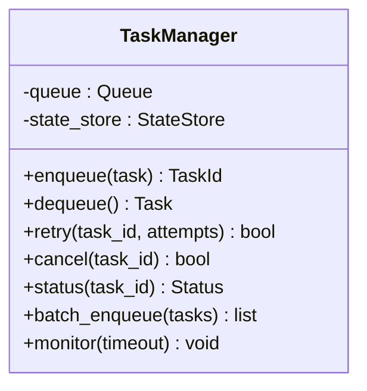

图表来源
- [backend/app/services/dreamweaver/task_manager.py:1-200](file://backend/app/services/dreamweaver/task_manager.py#L1-L200)
- [backend/app/tasks/dreamweaver_tasks.py:1-200](file://backend/app/tasks/dreamweaver_tasks.py#L1-L200)

章节来源
- [backend/app/services/dreamweaver/task_manager.py:1-200](file://backend/app/services/dreamweaver/task_manager.py#L1-L200)
- [backend/app/tasks/dreamweaver_tasks.py:1-200](file://backend/app/tasks/dreamweaver_tasks.py#L1-L200)

### 流水线编排（Pipeline）
- 职责：阶段顺序控制、依赖检查、并行度控制、断点续跑
- 关键阶段：分镜→角色一致性→场景→生成→合成→质检

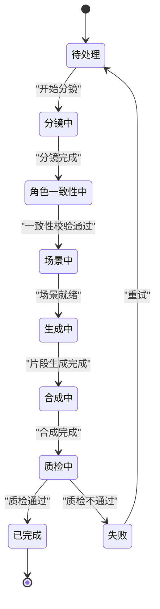

图表来源
- [backend/app/services/dreamweaver/pipeline.py:1-200](file://backend/app/services/dreamweaver/pipeline.py#L1-L200)
- [pipeline/state_machine.py:1-200](file://pipeline/state_machine.py#L1-L200)

章节来源
- [backend/app/services/dreamweaver/pipeline.py:1-200](file://backend/app/services/dreamweaver/pipeline.py#L1-L200)
- [pipeline/state_machine.py:1-200](file://pipeline/state_machine.py#L1-L200)

### 分镜处理器（StoryboardProcessor）
- 职责：从故事文本提取镜头信息、生成提示词、估算时长与转场
- 输出：结构化分镜条目（镜头描述、时长、转场、提示词、参考素材）

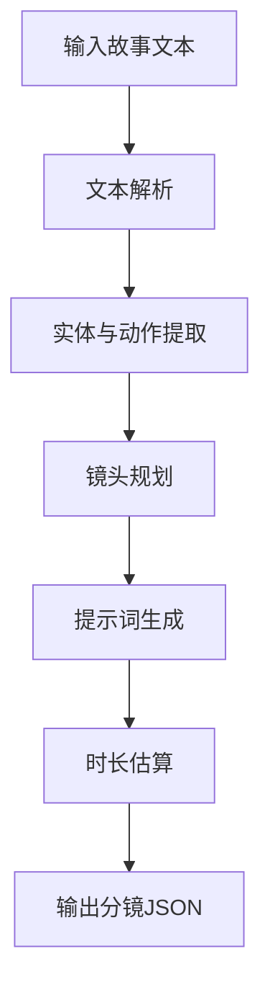

图表来源
- [backend/app/services/dreamweaver/storyboard_processor.py:1-200](file://backend/app/services/dreamweaver/storyboard_processor.py#L1-L200)
- [agents/dreamweaver_agent_pkg/_video_prompts.py:1-200](file://agents/dreamweaver_agent_pkg/_video_prompts.py#L1-L200)

章节来源
- [backend/app/services/dreamweaver/storyboard_processor.py:1-200](file://backend/app/services/dreamweaver/storyboard_processor.py#L1-L200)
- [agents/dreamweaver_agent_pkg/_video_prompts.py:1-200](file://agents/dreamweaver_agent_pkg/_video_prompts.py#L1-L200)

### 角色一致性管理器（CharacterConsistencyManager）
- 职责：维护角色特征库、参考图管理、跨镜头一致性策略（风格、服装、面部特征）
- 关键能力：特征向量检索、相似度阈值控制、动态参考图选择

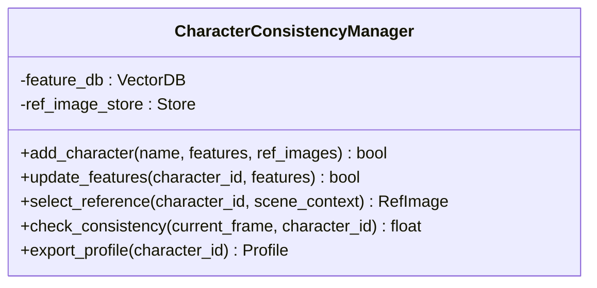

图表来源
- [backend/app/services/dreamweaver/character_consistency_manager.py:1-200](file://backend/app/services/dreamweaver/character_consistency_manager.py#L1-L200)

章节来源
- [backend/app/services/dreamweaver/character_consistency_manager.py:1-200](file://backend/app/services/dreamweaver/character_consistency_manager.py#L1-L200)

### 场景管理器（SceneManager）
- 职责：场景元数据管理、资产索引、复用与缓存、生命周期控制
- 关键能力：场景模板、资产版本化、冲突检测

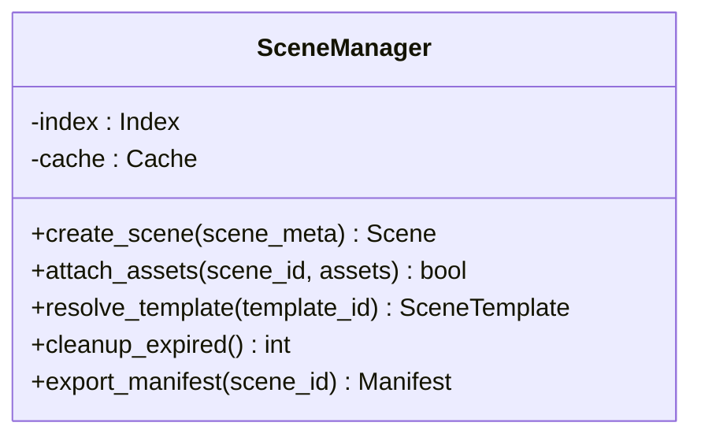

图表来源
- [backend/app/services/dreamweaver/scene_manager.py:1-200](file://backend/app/services/dreamweaver/scene_manager.py#L1-L200)

章节来源
- [backend/app/services/dreamweaver/scene_manager.py:1-200](file://backend/app/services/dreamweaver/scene_manager.py#L1-L200)

### 视频生成服务（VideoGenerationService）
- 职责：根据分镜与角色/场景上下文调用视频模型，处理输入适配与输出归一化
- 关键能力：文本到视频、图像到视频、参数调优、失败重试

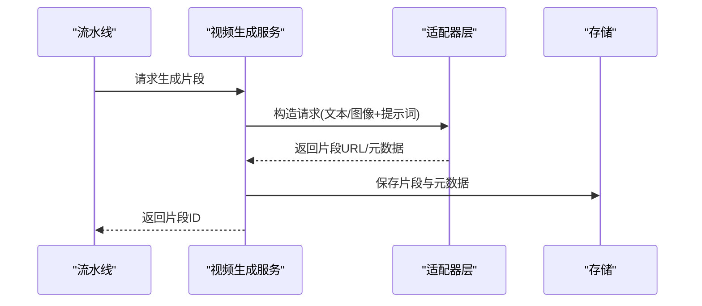

图表来源
- [backend/app/services/dreamweaver/video_generation_service.py:1-200](file://backend/app/services/dreamweaver/video_generation_service.py#L1-L200)
- [adapters/wan26_video_adapter.py:1-200](file://adapters/wan26_video_adapter.py#L1-L200)
- [adapters/vidu_platform/video.py:1-200](file://adapters/vidu_platform/video.py#L1-L200)
- [adapters/volcengine/video.py:1-200](file://adapters/volcengine/video.py#L1-L200)
- [adapters/dashscope/video_t2v.py:1-200](file://adapters/dashscope/video_t2v.py#L1-L200)
- [adapters/dashscope/video_kling.py:1-200](file://adapters/dashscope/video_kling.py#L1-L200)

章节来源
- [backend/app/services/dreamweaver/video_generation_service.py:1-200](file://backend/app/services/dreamweaver/video_generation_service.py#L1-L200)
- [adapters/wan26_video_adapter.py:1-200](file://adapters/wan26_video_adapter.py#L1-L200)
- [adapters/vidu_platform/video.py:1-200](file://adapters/vidu_platform/video.py#L1-L200)
- [adapters/volcengine/video.py:1-200](file://adapters/volcengine/video.py#L1-L200)
- [adapters/dashscope/video_t2v.py:1-200](file://adapters/dashscope/video_t2v.py#L1-L200)
- [adapters/dashscope/video_kling.py:1-200](file://adapters/dashscope/video_kling.py#L1-L200)

### 视频合成引擎（CompositionEngine）
- 职责：多片段拼接、转场效果、字幕叠加、音频对齐、导出格式
- 关键能力：FFmpeg集成、时间线编辑、质量预设

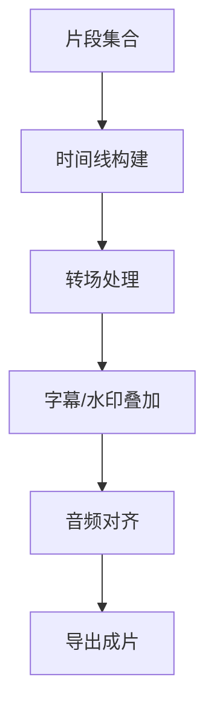

图表来源
- [backend/app/services/dreamweaver/composition_engine.py:1-200](file://backend/app/services/dreamweaver/composition_engine.py#L1-L200)

章节来源
- [backend/app/services/dreamweaver/composition_engine.py:1-200](file://backend/app/services/dreamweaver/composition_engine.py#L1-L200)

### 任务与WebSocket事件
- 任务状态：待处理、进行中、成功、失败、取消
- 事件类型：阶段开始、进度更新、片段完成、错误、结果可用
- 订阅方式：WebSocket连接建立后接收事件流

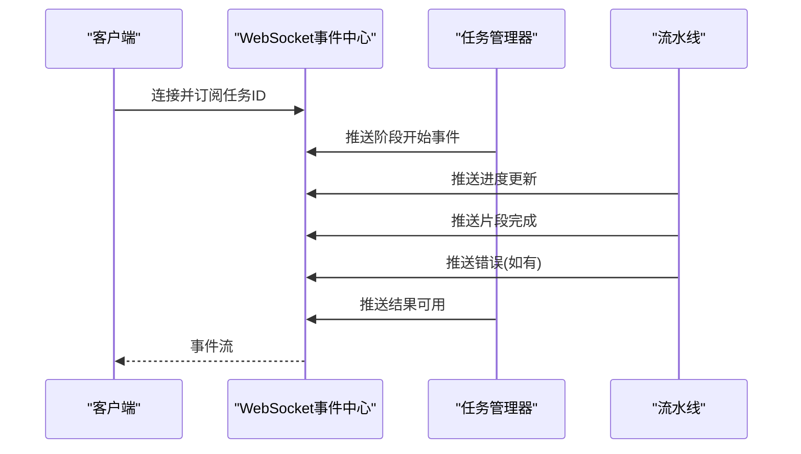

图表来源
- [backend/app/websocket/manager.py:1-200](file://backend/app/websocket/manager.py#L1-L200)
- [backend/app/tasks/dreamweaver_tasks.py:1-200](file://backend/app/tasks/dreamweaver_tasks.py#L1-L200)

章节来源
- [backend/app/websocket/manager.py:1-200](file://backend/app/websocket/manager.py#L1-L200)
- [backend/app/tasks/dreamweaver_tasks.py:1-200](file://backend/app/tasks/dreamweaver_tasks.py#L1-L200)

### 数据模型（Dreamweaver Models）
- 项目：标题、描述、设置、状态、创建时间
- 任务：项目关联、阶段、状态、输入输出、审计日志
- 事件：任务ID、事件类型、时间戳、负载

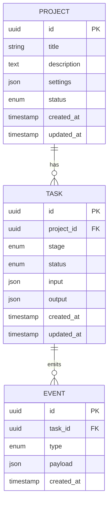

图表来源
- [backend/app/models/dreamweaver.py:1-200](file://backend/app/models/dreamweaver.py#L1-L200)

章节来源
- [backend/app/models/dreamweaver.py:1-200](file://backend/app/models/dreamweaver.py#L1-L200)

## 依赖关系分析
- API层依赖服务层与WebSocket层
- 服务层依赖任务管理器、流水线、分镜处理器、角色一致性管理器、场景管理器、视频生成服务与合成引擎
- 视频生成服务依赖适配器层（多供应商）与存储
- 任务层依赖队列与工作进程
- 数据模型层被服务层与API层共同使用

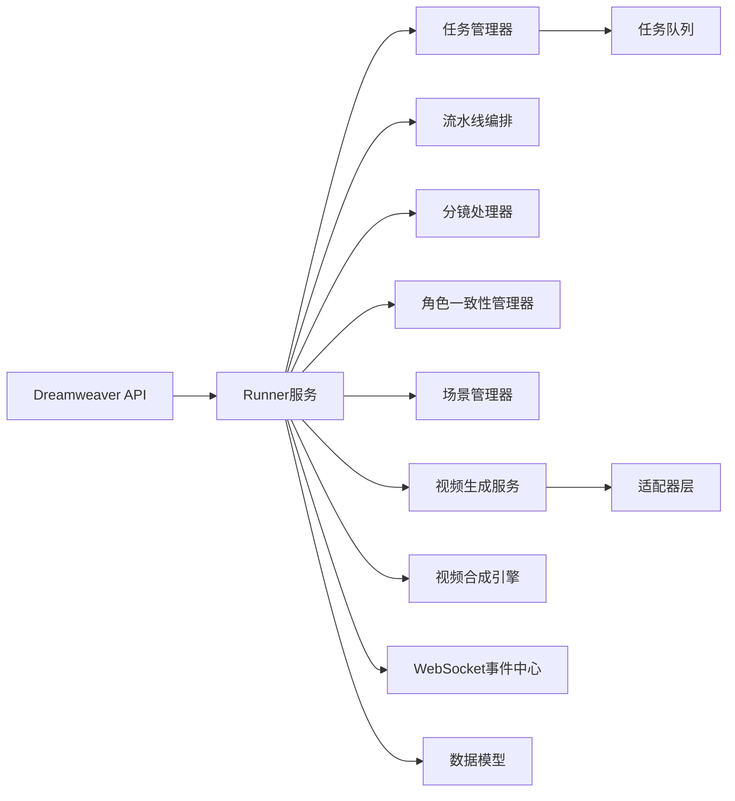

图表来源
- [backend/app/api/v1/dreamweaver.py:1-200](file://backend/app/api/v1/dreamweaver.py#L1-L200)
- [backend/app/services/dreamweaver/runner.py:1-200](file://backend/app/services/dreamweaver/runner.py#L1-L200)
- [backend/app/services/dreamweaver/task_manager.py:1-200](file://backend/app/services/dreamweaver/task_manager.py#L1-L200)
- [backend/app/services/dreamweaver/pipeline.py:1-200](file://backend/app/services/dreamweaver/pipeline.py#L1-L200)
- [backend/app/services/dreamweaver/video_generation_service.py:1-200](file://backend/app/services/dreamweaver/video_generation_service.py#L1-L200)
- [backend/app/websocket/manager.py:1-200](file://backend/app/websocket/manager.py#L1-L200)
- [backend/app/models/dreamweaver.py:1-200](file://backend/app/models/dreamweaver.py#L1-L200)

章节来源
- [backend/app/api/v1/dreamweaver.py:1-200](file://backend/app/api/v1/dreamweaver.py#L1-L200)
- [backend/app/services/dreamweaver/runner.py:1-200](file://backend/app/services/dreamweaver/runner.py#L1-L200)

## 性能与成本优化
- 并发与批处理：合理设置任务并发度，批量提交减少网络开销
- 缓存与复用：场景与角色参考图缓存，避免重复生成
- 模型选择：根据质量与成本权衡选择适配器（如轻量模型用于预览，高质量模型用于成片）
- 限流与退避：对供应商API实施限流与指数退避，避免超限与抖动
- 存储策略：中间产物按需保留，成片压缩与CDN加速
- 监控与度量：关键指标（延迟、成功率、成本）采集与分析

[本节为通用指导，不直接分析具体文件]

## 故障排查指南
- 常见错误：参数校验失败、模型调用超时、存储写入失败、WebSocket连接断开
- 诊断步骤：查看任务状态与事件日志、检查适配器返回码、验证存储权限与配额
- 恢复策略：重试机制、降级到备用模型、清理无效中间产物
- 日志定位：任务ID、阶段、错误码与堆栈信息

章节来源
- [backend/app/services/dreamweaver/runner.py:1-200](file://backend/app/services/dreamweaver/runner.py#L1-L200)
- [backend/app/websocket/manager.py:1-200](file://backend/app/websocket/manager.py#L1-L200)
- [backend/app/tasks/dreamweaver_tasks.py:1-200](file://backend/app/tasks/dreamweaver_tasks.py#L1-L200)

## 结论
梦境编织者API提供了完整的视频生成流水线能力，覆盖从分镜到成品的全链路。通过模块化设计与适配器抽象，系统具备良好的扩展性与稳定性。结合WebSocket实时事件与完善的错误处理机制，用户可获得流畅的开发与使用体验。遵循性能与成本优化最佳实践，可在保证质量的同时提升效率与控制成本。

[本节为总结性内容，不直接分析具体文件]

## 附录：API参考与示例

### 项目接口
- 创建项目：POST /projects
- 更新项目：PUT /projects/{id}
- 删除项目：DELETE /projects/{id}
- 项目列表：GET /projects
- 项目详情：GET /projects/{id}

章节来源
- [backend/app/api/v1/dreamweaver.py:1-200](file://backend/app/api/v1/dreamweaver.py#L1-L200)
- [backend/app/schemas/dreamweaver_contract.py:1-200](file://backend/app/schemas/dreamweaver_contract.py#L1-L200)

### 任务接口
- 提交任务：POST /tasks
- 查询任务：GET /tasks/{id}
- 取消任务：POST /tasks/{id}/cancel
- 重试任务：POST /tasks/{id}/retry
- 批量提交：POST /tasks/batch

章节来源
- [backend/app/api/v1/dreamweaver.py:1-200](file://backend/app/api/v1/dreamweaver.py#L1-L200)
- [backend/app/schemas/dreamweaver_contract.py:1-200](file://backend/app/schemas/dreamweaver_contract.py#L1-L200)

### 结果接口
- 获取结果：GET /tasks/{id}/result
- 下载片段：GET /tasks/{id}/clips/{clip_id}
- 下载成片：GET /tasks/{id}/final
- 预览链接：GET /tasks/{id}/preview

章节来源
- [backend/app/api/v1/dreamweaver.py:1-200](file://backend/app/api/v1/dreamweaver.py#L1-L200)
- [backend/app/schemas/dreamweaver_contract.py:1-200](file://backend/app/schemas/dreamweaver_contract.py#L1-L200)

### WebSocket事件
- 连接建立：ws://host/ws?token=...
- 事件类型：stage_start、progress、clip_done、error、result_ready
- 订阅范围：按任务ID过滤

章节来源
- [backend/app/websocket/manager.py:1-200](file://backend/app/websocket/manager.py#L1-L200)

### 使用示例（概念性）
- 批量生成：准备多个分镜任务，批量提交后轮询或订阅事件
- 参数优化：调整提示词权重、分辨率、时长与转场参数
- 质量评估：基于质检阶段的评分与反馈迭代优化

[本节为概念性示例，不直接分析具体文件]

### 资源管理与成本控制
- 资源配额：设置并发上限、存储限额与预算阈值
- 成本核算：按任务与模型统计消耗，生成账单与报表
- 优化策略：优先使用缓存与复用，选择性价比更高的模型

[本节为通用指导，不直接分析具体文件]

### 性能优化建议
- 流水线并行：在安全边界内并行执行独立阶段
- 适配器优化：启用连接池与请求合并
- 存储优化：使用对象存储的分片上传与CDN分发

[本节为通用指导，不直接分析具体文件]