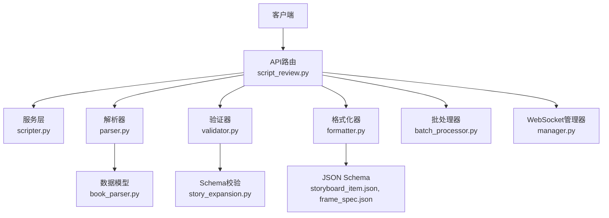
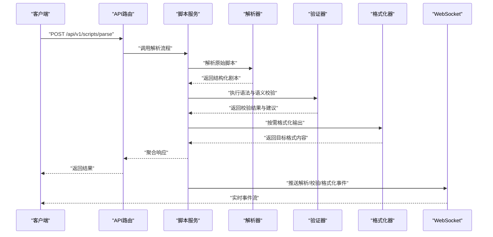
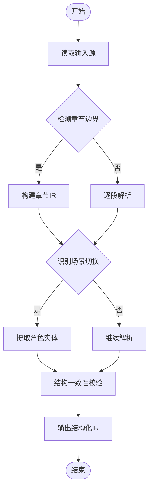
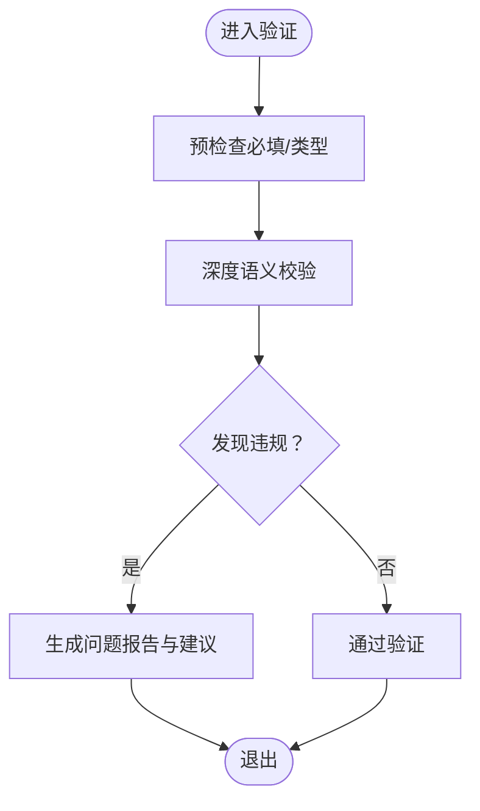
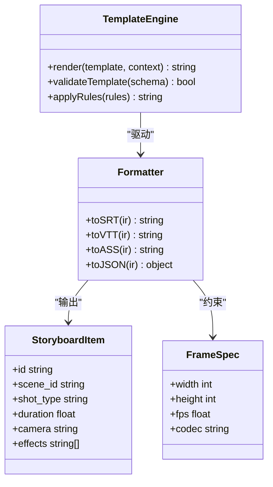
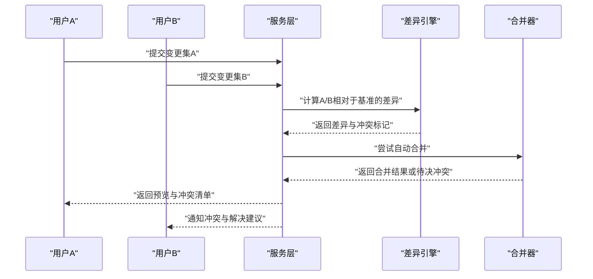
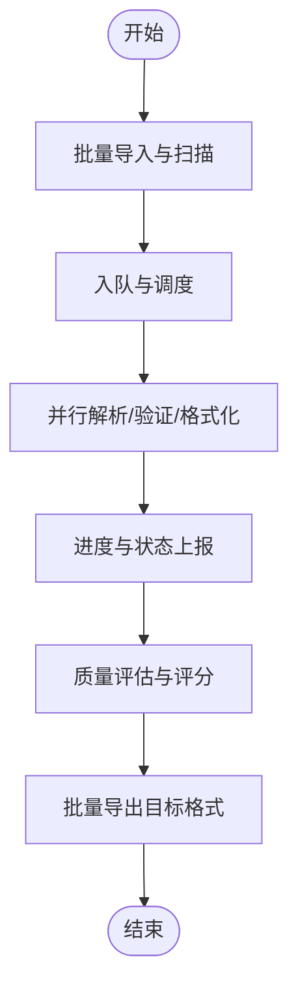
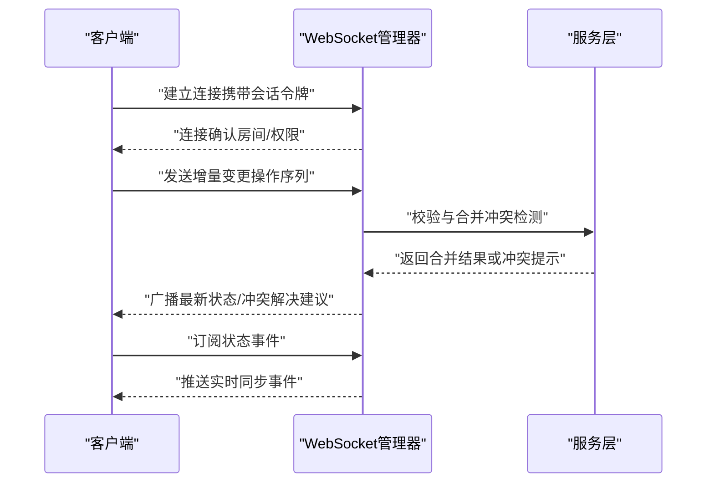
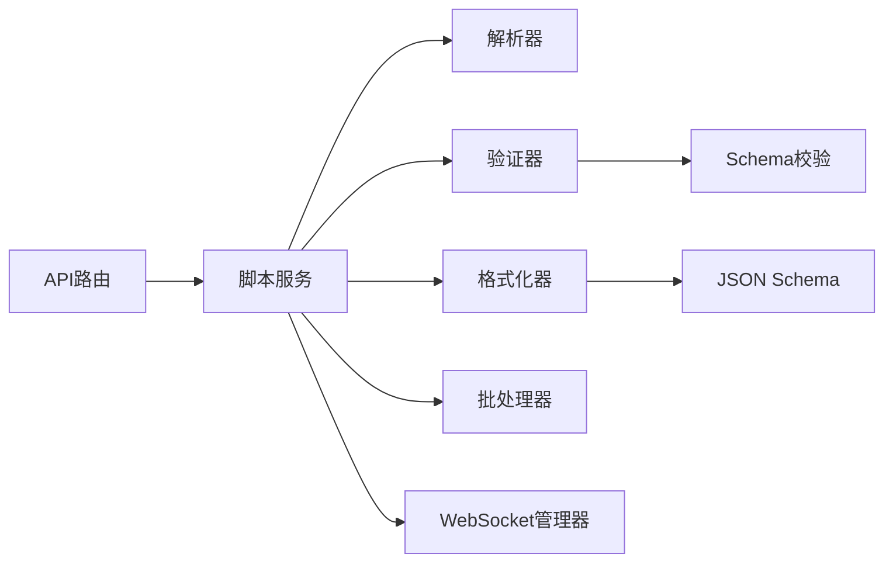

# 脚本处理API

<cite>
**本文引用的文件**   
- [backend/app/api/v1/script_review.py](file://backend/app/api/v1/script_review.py)
- [backend/app/services/agents/scripter.py](file://backend/app/services/agents/scripter.py)
- [backend/app/schemas/story_expansion.py](file://backend/app/schemas/story_expansion.py)
- [backend/app/models/book_parser.py](file://backend/app/models/book_parser.py)
- [backend/app/services/book_parser/parser.py](file://backend/app/services/book_parser/parser.py)
- [backend/app/services/book_parser/validator.py](file://backend/app/services/book_parser/validator.py)
- [backend/app/services/book_parser/formatter.py](file://backend/app/services/book_parser/formatter.py)
- [backend/app/services/batch_processor.py](file://backend/app/services/batch_processor.py)
- [backend/app/websocket/manager.py](file://backend/app/websocket/manager.py)
- [backend/app/core/config.py](file://backend/app/core/config.py)
- [schemas/storyboard_item.json](file://schemas/storyboard_item.json)
- [schemas/frame_spec.json](file://schemas/frame_spec.json)
</cite>

## 目录
1. [简介](#简介)
2. [项目结构](#项目结构)
3. [核心组件](#核心组件)
4. [架构总览](#架构总览)
5. [详细组件分析](#详细组件分析)
6. [依赖关系分析](#依赖关系分析)
7. [性能考量](#性能考量)
8. [故障排查指南](#故障排查指南)
9. [结论](#结论)
10. [附录](#附录)

## 简介
本文件为“梦境编织者”脚本处理系统的API文档，聚焦分镜脚本的解析、验证与转换接口；涵盖剧本结构分析、场景识别与角色提取能力；提供脚本编辑、版本对比与冲突解决接口；说明脚本模板、格式化规则与语法检查机制；给出批量脚本处理、格式转换与质量评估示例；并定义协作编辑、实时同步与变更追踪的WebSocket规范。文档面向开发者与集成方，力求在技术细节与可读性之间取得平衡。

## 项目结构
系统后端采用分层架构：API层暴露REST接口，服务层封装业务逻辑（解析、验证、格式化、批处理等），数据模型与Schema用于契约校验与持久化，WebSocket管理器负责实时通信。关键目录与职责如下：
- API路由：脚本评审与相关操作入口
- 服务层：脚本解析器、验证器、格式化器、批处理器、故事扩展协调器等
- 数据模型与Schema：书稿解析模型、分镜项与帧规格JSON Schema
- WebSocket：连接管理与消息分发

图表来源
- [backend/app/api/v1/script_review.py](file://backend/app/api/v1/script_review.py)
- [backend/app/services/agents/scripter.py](file://backend/app/services/agents/scripter.py)
- [backend/app/services/book_parser/parser.py](file://backend/app/services/book_parser/parser.py)
- [backend/app/services/book_parser/validator.py](file://backend/app/services/book_parser/validator.py)
- [backend/app/services/book_parser/formatter.py](file://backend/app/services/book_parser/formatter.py)
- [backend/app/services/batch_processor.py](file://backend/app/services/batch_processor.py)
- [backend/app/websocket/manager.py](file://backend/app/websocket/manager.py)
- [backend/app/models/book_parser.py](file://backend/app/models/book_parser.py)
- [backend/app/schemas/story_expansion.py](file://backend/app/schemas/story_expansion.py)
- [schemas/storyboard_item.json](file://schemas/storyboard_item.json)
- [schemas/frame_spec.json](file://schemas/frame_spec.json)

章节来源
- [backend/app/api/v1/script_review.py](file://backend/app/api/v1/script_review.py)
- [backend/app/services/agents/scripter.py](file://backend/app/services/agents/scripter.py)
- [backend/app/services/book_parser/parser.py](file://backend/app/services/book_parser/parser.py)
- [backend/app/services/book_parser/validator.py](file://backend/app/services/book_parser/validator.py)
- [backend/app/services/book_parser/formatter.py](file://backend/app/services/book_parser/formatter.py)
- [backend/app/services/batch_processor.py](file://backend/app/services/batch_processor.py)
- [backend/app/websocket/manager.py](file://backend/app/websocket/manager.py)
- [backend/app/models/book_parser.py](file://backend/app/models/book_parser.py)
- [backend/app/schemas/story_expansion.py](file://backend/app/schemas/story_expansion.py)
- [schemas/storyboard_item.json](file://schemas/storyboard_item.json)
- [schemas/frame_spec.json](file://schemas/frame_spec.json)

## 核心组件
- 脚本评审API：提供脚本解析、验证、转换、模板渲染、批量处理与质量评估的统一入口
- 解析器：将原始文本或结构化输入转换为内部剧本结构（章节、场景、镜头、角色）
- 验证器：基于Schema与领域规则进行语法与语义校验，输出问题清单与修复建议
- 格式化器：按模板与风格规则规范化输出（如SRT/VTT/ASS/JSON等）
- 批处理器：支持多脚本并发处理、任务编排与进度上报
- WebSocket管理器：维护连接、广播事件、增量同步与冲突合并

章节来源
- [backend/app/api/v1/script_review.py](file://backend/app/api/v1/script_review.py)
- [backend/app/services/agents/scripter.py](file://backend/app/services/agents/scripter.py)
- [backend/app/services/book_parser/parser.py](file://backend/app/services/book_parser/parser.py)
- [backend/app/services/book_parser/validator.py](file://backend/app/services/book_parser/validator.py)
- [backend/app/services/book_parser/formatter.py](file://backend/app/services/book_parser/formatter.py)
- [backend/app/services/batch_processor.py](file://backend/app/services/batch_processor.py)
- [backend/app/websocket/manager.py](file://backend/app/websocket/manager.py)

## 架构总览
整体调用链遵循“请求进入API -> 服务编排 -> 解析/验证/格式化 -> 结果返回/事件推送”的模式。批处理通过任务队列异步执行，WebSocket用于实时状态与增量变更推送。

图表来源
- [backend/app/api/v1/script_review.py](file://backend/app/api/v1/script_review.py)
- [backend/app/services/agents/scripter.py](file://backend/app/services/agents/scripter.py)
- [backend/app/services/book_parser/parser.py](file://backend/app/services/book_parser/parser.py)
- [backend/app/services/book_parser/validator.py](file://backend/app/services/book_parser/validator.py)
- [backend/app/services/book_parser/formatter.py](file://backend/app/services/book_parser/formatter.py)
- [backend/app/websocket/manager.py](file://backend/app/websocket/manager.py)

## 详细组件分析

### 脚本解析与结构分析
- 功能要点
  - 支持多种输入源（纯文本、结构化片段、上传文件）
  - 自动识别章节边界、场景切换、镜头描述与对话段落
  - 抽取角色实体（名称、出场次数、台词占比、情绪标签）
  - 生成结构化中间表示（IR），便于后续验证与转换
- 数据结构
  - 章节：标题、序号、摘要、时间戳范围
  - 场景：地点、时间、环境、人物列表、动作序列
  - 镜头：景别、机位、时长、转场、特效标记
  - 角色：ID、名称、属性、台词片段索引
- 复杂度与优化
  - 解析阶段采用流式读取与增量构建，降低大文件内存占用
  - 角色抽取使用缓存与去重策略，避免重复计算

图表来源
- [backend/app/services/book_parser/parser.py](file://backend/app/services/book_parser/parser.py)
- [backend/app/models/book_parser.py](file://backend/app/models/book_parser.py)

章节来源
- [backend/app/services/book_parser/parser.py](file://backend/app/services/book_parser/parser.py)
- [backend/app/models/book_parser.py](file://backend/app/models/book_parser.py)

### 脚本验证与语法检查
- 功能要点
  - 基于Schema与领域规则进行语法检查（字段完整性、类型约束、枚举值）
  - 语义校验（角色一致性、场景连续性、时序合理性）
  - 输出问题清单、严重级别与修复建议
- 校验流程
  - 预检查：必填字段、基础格式
  - 深度检查：跨段落引用、时间戳重叠、角色未声明
  - 报告生成：结构化错误列表与定位信息

图表来源
- [backend/app/services/book_parser/validator.py](file://backend/app/services/book_parser/validator.py)
- [backend/app/schemas/story_expansion.py](file://backend/app/schemas/story_expansion.py)

章节来源
- [backend/app/services/book_parser/validator.py](file://backend/app/services/book_parser/validator.py)
- [backend/app/schemas/story_expansion.py](file://backend/app/schemas/story_expansion.py)

### 脚本格式化与模板渲染
- 功能要点
  - 支持多目标格式（SRT、VTT、ASS、JSON分镜表）
  - 模板引擎渲染（占位符替换、条件分支、循环段落）
  - 风格规则（标点统一、时间码格式、字幕对齐）
- 模板与Schema
  - storyboard_item.json：分镜条目结构定义
  - frame_spec.json：帧级参数规范（分辨率、帧率、时长）

图表来源
- [backend/app/services/book_parser/formatter.py](file://backend/app/services/book_parser/formatter.py)
- [schemas/storyboard_item.json](file://schemas/storyboard_item.json)
- [schemas/frame_spec.json](file://schemas/frame_spec.json)

章节来源
- [backend/app/services/book_parser/formatter.py](file://backend/app/services/book_parser/formatter.py)
- [schemas/storyboard_item.json](file://schemas/storyboard_item.json)
- [schemas/frame_spec.json](file://schemas/frame_spec.json)

### 脚本编辑、版本对比与冲突解决
- 编辑接口
  - 创建新版本：提交差异集（增删改片段）
  - 预览变更：展示影响范围与潜在冲突
  - 合并策略：优先用户覆盖、自动合并无冲突部分
- 版本对比
  - 行级diff、语义块级diff
  - 冲突检测：同一位置多人修改、角色/场景引用断裂
- 冲突解决
  - 三方合并：基准版本+双方变更
  - 人工介入：选择保留策略或提示修正

章节来源
- [backend/app/api/v1/script_review.py](file://backend/app/api/v1/script_review.py)
- [backend/app/services/agents/scripter.py](file://backend/app/services/agents/scripter.py)

### 批量脚本处理与格式转换
- 能力概述
  - 批量导入：多文件/多目录扫描与队列化
  - 并行处理：可配置并发度与资源限制
  - 进度上报：任务状态、完成比例、失败重试
  - 格式转换：统一IR到目标格式的批量导出
- 质量评估
  - 指标：可读性、一致性、合规性、节奏感
  - 评分模型：规则打分+LLM辅助评估

图表来源
- [backend/app/services/batch_processor.py](file://backend/app/services/batch_processor.py)

章节来源
- [backend/app/services/batch_processor.py](file://backend/app/services/batch_processor.py)

### WebSocket协作编辑与实时同步
- 连接管理
  - 鉴权与会话绑定（项目/脚本/用户）
  - 心跳保活与断线重连
- 消息协议
  - 事件类型：连接建立、增量更新、冲突提示、状态同步
  - 载荷结构：变更集、时间戳、操作者标识、版本号
- 同步策略
  - OT/CRDT思路：基于操作的协同编辑
  - 冲突检测与自动合并策略
  - 离线恢复：本地草稿与服务器基线比对

图表来源
- [backend/app/websocket/manager.py](file://backend/app/websocket/manager.py)

章节来源
- [backend/app/websocket/manager.py](file://backend/app/websocket/manager.py)

## 依赖关系分析
- 模块耦合
  - API路由依赖服务层，服务层依赖解析/验证/格式化组件
  - 批处理器与WebSocket管理器作为横向支撑能力
- 外部依赖
  - JSON Schema用于强契约校验
  - 配置中心提供运行时参数（并发、超时、重试）

图表来源
- [backend/app/api/v1/script_review.py](file://backend/app/api/v1/script_review.py)
- [backend/app/services/agents/scripter.py](file://backend/app/services/agents/scripter.py)
- [backend/app/services/book_parser/parser.py](file://backend/app/services/book_parser/parser.py)
- [backend/app/services/book_parser/validator.py](file://backend/app/services/book_parser/validator.py)
- [backend/app/services/book_parser/formatter.py](file://backend/app/services/book_parser/formatter.py)
- [backend/app/services/batch_processor.py](file://backend/app/services/batch_processor.py)
- [backend/app/websocket/manager.py](file://backend/app/websocket/manager.py)
- [backend/app/schemas/story_expansion.py](file://backend/app/schemas/story_expansion.py)
- [schemas/storyboard_item.json](file://schemas/storyboard_item.json)
- [schemas/frame_spec.json](file://schemas/frame_spec.json)

章节来源
- [backend/app/core/config.py](file://backend/app/core/config.py)

## 性能考量
- 解析与验证
  - 流式处理大文件，避免一次性加载
  - 校验规则分级执行，快速失败路径优先
- 批处理
  - 动态并发控制，依据CPU/IO负载调整
  - 任务分片与断点续传
- 实时同步
  - 增量消息最小化，压缩传输
  - 冲突检测延迟优化（局部哈希与差异快照）

## 故障排查指南
- 常见问题
  - 解析失败：检查输入编码、分隔符、章节标记
  - 验证报错：对照Schema与领域规则，定位具体字段
  - 格式化异常：确认模板变量与占位符匹配
  - 批处理阻塞：查看队列积压与资源占用
  - WebSocket断开：检查心跳间隔与网络稳定性
- 诊断步骤
  - 启用调试日志与链路追踪
  - 使用最小复现用例隔离问题
  - 通过质量评估报告定位薄弱环节

章节来源
- [backend/app/api/v1/script_review.py](file://backend/app/api/v1/script_review.py)
- [backend/app/services/book_parser/validator.py](file://backend/app/services/book_parser/validator.py)
- [backend/app/services/book_parser/formatter.py](file://backend/app/services/book_parser/formatter.py)
- [backend/app/services/batch_processor.py](file://backend/app/services/batch_processor.py)
- [backend/app/websocket/manager.py](file://backend/app/websocket/manager.py)

## 结论
本API体系围绕“解析-验证-格式化-批处理-实时协作”的主干流程构建，强调结构化中间表示与强契约校验，兼顾可扩展性与工程可用性。通过模板与Schema驱动的一致性保障，以及WebSocket驱动的协作编辑体验，满足复杂脚本生产与团队协作需求。

## 附录
- 接口示例（概念性）
  - 解析接口：POST /api/v1/scripts/parse，输入原始文本或文件，返回结构化IR与解析统计
  - 验证接口：POST /api/v1/scripts/validate，输入IR或文本，返回问题清单与修复建议
  - 格式化接口：POST /api/v1/scripts/format，输入IR与目标格式，返回格式化内容
  - 模板渲染：POST /api/v1/scripts/render-template，输入模板与上下文，返回渲染结果
  - 批量处理：POST /api/v1/scripts/batch，输入任务清单与策略，返回任务ID与进度查询接口
  - 版本对比：POST /api/v1/scripts/diff，输入两个版本，返回差异与冲突标记
  - 冲突解决：POST /api/v1/scripts/resolve-conflict，输入冲突清单与策略，返回合并结果
  - WebSocket：ws://host/ws/scripts/{project}/{script}，订阅事件与推送增量变更
- 参考Schema
  - storyboard_item.json：分镜条目字段定义
  - frame_spec.json：帧级参数规范