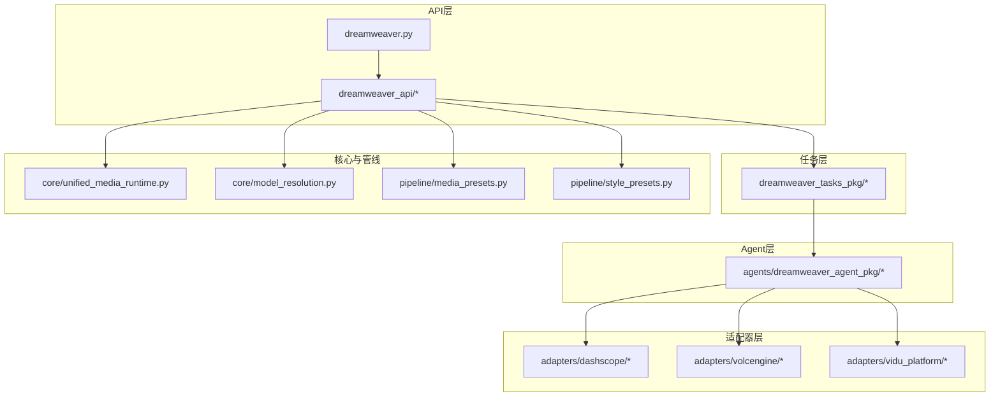
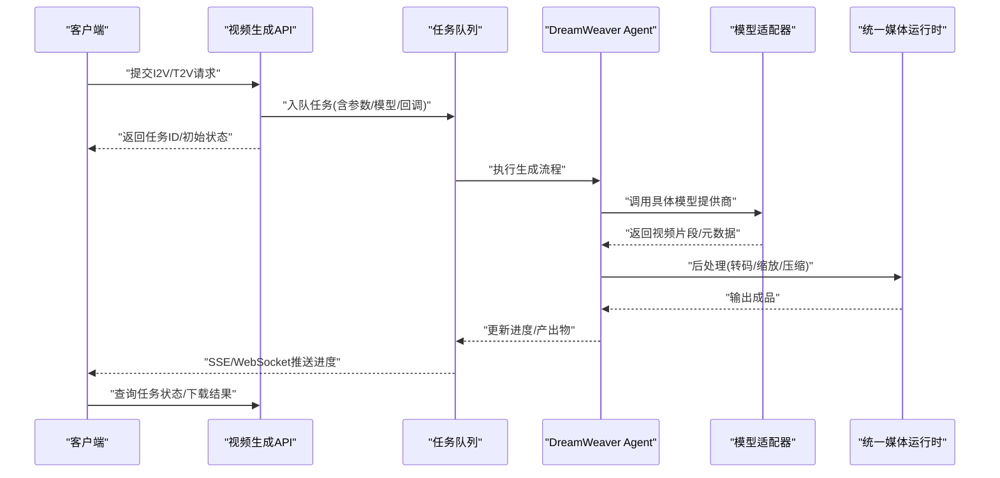
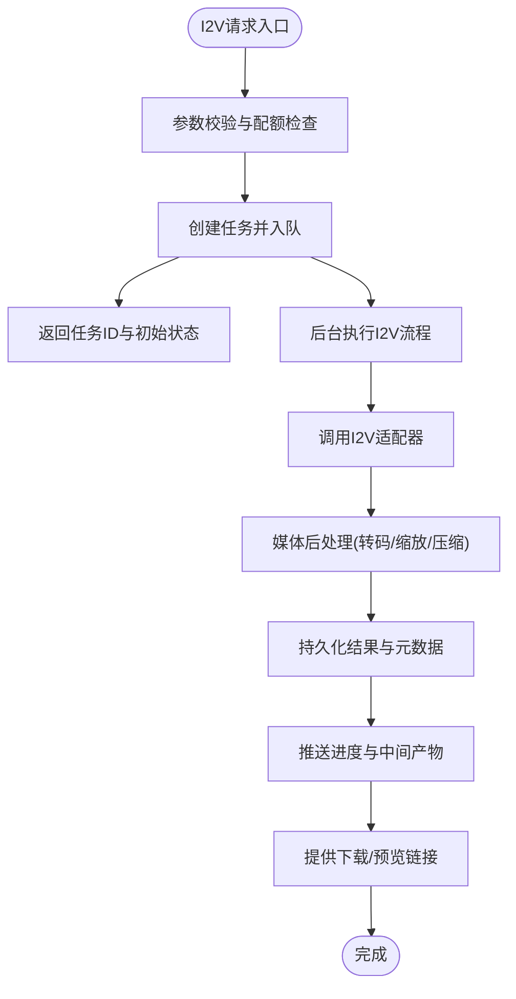
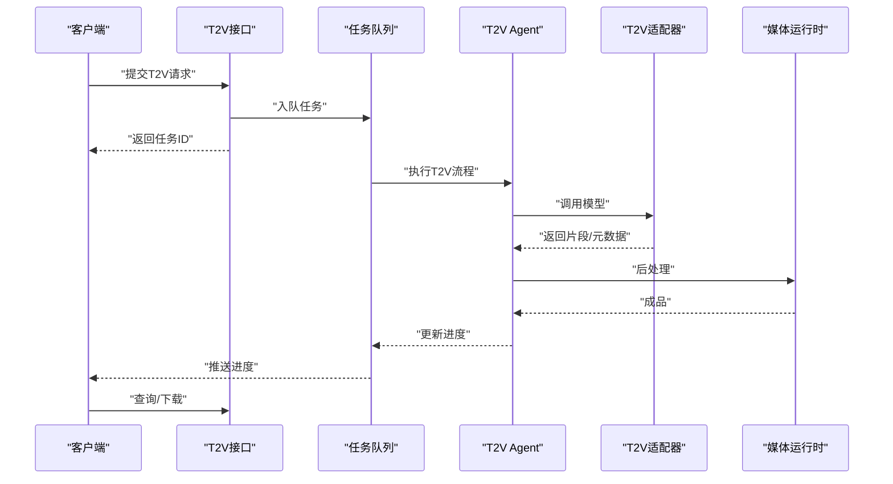
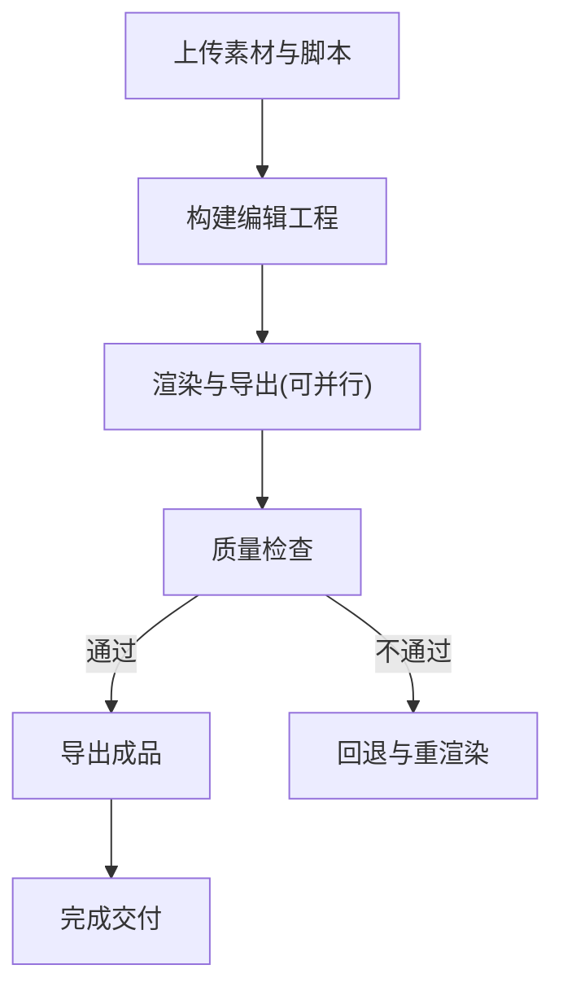
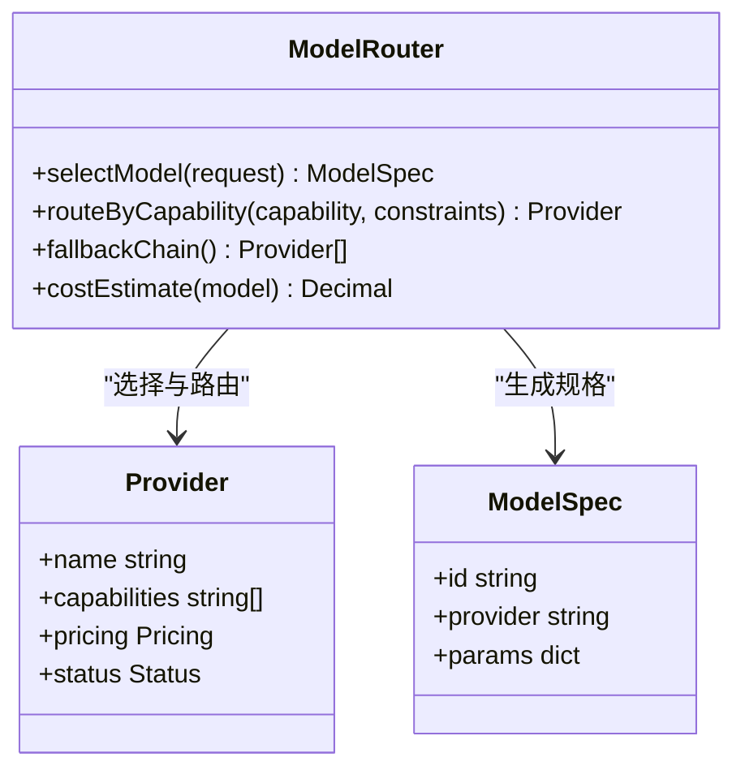
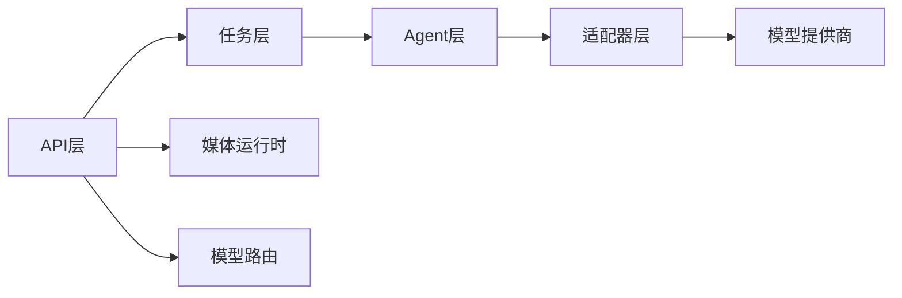

# 视频生成API

<cite>
**本文引用的文件**   
- [dreamweaver.py](file://backend/app/api/v1/dreamweaver.py)
- [dreamweaver_api/__init__.py](file://backend/app/api/v1/dreamweaver_api/__init__.py)
- [dreamweaver_api/video_generation.py](file://backend/app/api/v1/dreamweaver_api/video_generation.py)
- [dreamweaver_api/video_edit.py](file://backend/app/api/v1/dreamweaver_api/video_edit.py)
- [dreamweaver_api/video_batch.py](file://backend/app/api/v1/dreamweaver_api/video_batch.py)
- [dreamweaver_api/video_progress.py](file://backend/app/api/v1/dreamweaver_api/video_progress.py)
- [dreamweaver_api/video_format.py](file://backend/app/api/v1/dreamweaver_api/video_format.py)
- [dreamweaver_api/video_quality.py](file://backend/app/api/v1/dreamweaver_api/video_quality.py)
- [dreamweaver_api/video_style.py](file://backend/app/api/v1/dreamweaver_api/video_style.py)
- [dreamweaver_api/video_model_routing.py](file://backend/app/api/v1/dreamweaver_api/video_model_routing.py)
- [dreamweaver_tasks_pkg/tasks.py](file://backend/app/tasks/dreamweaver_tasks_pkg/tasks.py)
- [dreamweaver_tasks_pkg/progress.py](file://backend/app/tasks/dreamweaver_tasks_pkg/progress.py)
- [agents/dreamweaver_agent_pkg/_i2v_gen.py](file://agents/dreamweaver_agent_pkg/_i2v_gen.py)
- [agents/dreamweaver_agent_pkg/_t2v_gen.py](file://agents/dreamweaver_agent_pkg/_t2v_gen.py)
- [adapters/dashscope/video_i2v.py](file://adapters/dashscope/video_i2v.py)
- [adapters/dashscope/video_t2v.py](file://adapters/dashscope/video_t2v.py)
- [adapters/dashscope/video_kling.py](file://adapters/dashscope/video_kling.py)
- [adapters/volcengine/video.py](file://adapters/volcengine/video.py)
- [adapters/vidu_platform/video.py](file://adapters/vidu_platform/video.py)
- [core/unified_media_runtime.py](file://core/unified_media_runtime.py)
- [core/model_resolution.py](file://core/model_resolution.py)
- [pipeline/media_presets.py](file://pipeline/media_presets.py)
- [pipeline/style_presets.py](file://pipeline/style_presets.py)
- [schemas/common.py](file://schemas/common.py)
- [schemas/task_spec.py](file://schemas/task_spec.py)
</cite>

## 目录
1. [简介](#简介)
2. [项目结构](#项目结构)
3. [核心组件](#核心组件)
4. [架构总览](#架构总览)
5. [详细组件分析](#详细组件分析)
6. [依赖关系分析](#依赖关系分析)
7. [性能考虑](#性能考虑)
8. [故障排查指南](#故障排查指南)
9. [结论](#结论)
10. [附录](#附录)

## 简介
本文件为“梦境编织者”视频生成系统的全面API文档，覆盖图像到视频（I2V）、文本到视频（T2V）的生成接口；说明视频参数配置、风格控制与质量调节；提供视频编辑、剪辑合成与特效添加的API；解释多模型选择、提供商路由与成本优化策略；给出批量生成、异步处理与进度跟踪的接口示例；并包含视频格式转换、分辨率调整与压缩优化的使用方法。

## 项目结构
围绕视频生成的API主要位于后端API层与任务调度层，结合适配器层对接多家视频模型提供商，并通过统一媒体运行时进行资源管理与格式处理。

图表来源
- [dreamweaver.py](file://backend/app/api/v1/dreamweaver.py)
- [dreamweaver_api/video_generation.py](file://backend/app/api/v1/dreamweaver_api/video_generation.py)
- [dreamweaver_tasks_pkg/tasks.py](file://backend/app/tasks/dreamweaver_tasks_pkg/tasks.py)
- [agents/dreamweaver_agent_pkg/_i2v_gen.py](file://agents/dreamweaver_agent_pkg/_i2v_gen.py)
- [agents/dreamweaver_agent_pkg/_t2v_gen.py](file://agents/dreamweaver_agent_pkg/_t2v_gen.py)
- [adapters/dashscope/video_i2v.py](file://adapters/dashscope/video_i2v.py)
- [adapters/dashscope/video_t2v.py](file://adapters/dashscope/video_t2v.py)
- [adapters/dashscope/video_kling.py](file://adapters/dashscope/video_kling.py)
- [adapters/volcengine/video.py](file://adapters/volcengine/video.py)
- [adapters/vidu_platform/video.py](file://adapters/vidu_platform/video.py)
- [core/unified_media_runtime.py](file://core/unified_media_runtime.py)
- [core/model_resolution.py](file://core/model_resolution.py)
- [pipeline/media_presets.py](file://pipeline/media_presets.py)
- [pipeline/style_presets.py](file://pipeline/style_presets.py)

章节来源
- [dreamweaver.py](file://backend/app/api/v1/dreamweaver.py)
- [dreamweaver_api/video_generation.py](file://backend/app/api/v1/dreamweaver_api/video_generation.py)
- [dreamweaver_tasks_pkg/tasks.py](file://backend/app/tasks/dreamweaver_tasks_pkg/tasks.py)
- [core/unified_media_runtime.py](file://core/unified_media_runtime.py)
- [core/model_resolution.py](file://core/model_resolution.py)
- [pipeline/media_presets.py](file://pipeline/media_presets.py)
- [pipeline/style_presets.py](file://pipeline/style_presets.py)

## 核心组件
- 视频生成API：提供I2V/T2V创建、查询、取消等能力，支持参数化配置与结果下载。
- 视频编辑API：提供裁剪、拼接、转场、滤镜、字幕叠加、音频混音等编辑能力。
- 批量生成API：支持批量提交任务、聚合状态查询与分批拉取结果。
- 进度与事件：通过任务ID与WebSocket/SSE推送进度与中间产物。
- 格式与质量：统一的格式转换、分辨率调整、码率与压缩策略。
- 风格控制：内置风格预设与自定义风格注入。
- 多模型路由：按能力、价格、可用性自动或手动选择模型与提供商。

章节来源
- [dreamweaver_api/video_generation.py](file://backend/app/api/v1/dreamweaver_api/video_generation.py)
- [dreamweaver_api/video_edit.py](file://backend/app/api/v1/dreamweaver_api/video_edit.py)
- [dreamweaver_api/video_batch.py](file://backend/app/api/v1/dreamweaver_api/video_batch.py)
- [dreamweaver_api/video_progress.py](file://backend/app/api/v1/dreamweaver_api/video_progress.py)
- [dreamweaver_api/video_format.py](file://backend/app/api/v1/dreamweaver_api/video_format.py)
- [dreamweaver_api/video_quality.py](file://backend/app/api/v1/dreamweaver_api/video_quality.py)
- [dreamweaver_api/video_style.py](file://backend/app/api/v1/dreamweaver_api/video_style.py)
- [dreamweaver_api/video_model_routing.py](file://backend/app/api/v1/dreamweaver_api/video_model_routing.py)

## 架构总览
系统采用分层解耦设计：API层暴露REST接口；任务层负责异步执行；Agent层编排提示词与流程；适配器层对接具体模型提供商；核心与管线层提供媒体运行时、模型解析、预设与质量控制。

图表来源
- [dreamweaver_api/video_generation.py](file://backend/app/api/v1/dreamweaver_api/video_generation.py)
- [dreamweaver_tasks_pkg/tasks.py](file://backend/app/tasks/dreamweaver_tasks_pkg/tasks.py)
- [agents/dreamweaver_agent_pkg/_i2v_gen.py](file://agents/dreamweaver_agent_pkg/_i2v_gen.py)
- [agents/dreamweaver_agent_pkg/_t2v_gen.py](file://agents/dreamweaver_agent_pkg/_t2v_gen.py)
- [adapters/dashscope/video_i2v.py](file://adapters/dashscope/video_i2v.py)
- [adapters/dashscope/video_t2v.py](file://adapters/dashscope/video_t2v.py)
- [adapters/dashscope/video_kling.py](file://adapters/dashscope/video_kling.py)
- [adapters/volcengine/video.py](file://adapters/volcengine/video.py)
- [adapters/vidu_platform/video.py](file://adapters/vidu_platform/video.py)
- [core/unified_media_runtime.py](file://core/unified_media_runtime.py)

## 详细组件分析

### 图像到视频（I2V）接口
- 功能要点
  - 输入：参考图像、提示词、时长、分辨率、帧率、风格、质量等级、模型/提供商偏好。
  - 输出：任务ID、状态、进度、最终视频URL/二进制流。
  - 能力：首帧一致性、运动强度、镜头控制、背景保持。
- 关键路径
  - API接收请求并校验参数
  - 任务入队并返回任务ID
  - Agent编排I2V流程，调用适配器
  - 适配器调用具体模型服务
  - 媒体运行时进行后处理与存储
  - 进度推送与结果下载

图表来源
- [dreamweaver_api/video_generation.py](file://backend/app/api/v1/dreamweaver_api/video_generation.py)
- [agents/dreamweaver_agent_pkg/_i2v_gen.py](file://agents/dreamweaver_agent_pkg/_i2v_gen.py)
- [adapters/dashscope/video_i2v.py](file://adapters/dashscope/video_i2v.py)
- [core/unified_media_runtime.py](file://core/unified_media_runtime.py)

章节来源
- [dreamweaver_api/video_generation.py](file://backend/app/api/v1/dreamweaver_api/video_generation.py)
- [agents/dreamweaver_agent_pkg/_i2v_gen.py](file://agents/dreamweaver_agent_pkg/_i2v_gen.py)
- [adapters/dashscope/video_i2v.py](file://adapters/dashscope/video_i2v.py)
- [core/unified_media_runtime.py](file://core/unified_media_runtime.py)

### 文本到视频（T2V）接口
- 功能要点
  - 输入：文本提示、场景设定、时长、分辨率、帧率、风格、质量等级、模型/提供商偏好。
  - 输出：任务ID、状态、进度、最终视频URL/二进制流。
  - 能力：叙事连贯性、角色一致性、镜头语言、音效/字幕可选。
- 关键路径
  - API接收请求并校验参数
  - 任务入队并返回任务ID
  - Agent编排T2V流程，调用适配器
  - 适配器调用具体模型服务
  - 媒体运行时进行后处理与存储
  - 进度推送与结果下载

图表来源
- [dreamweaver_api/video_generation.py](file://backend/app/api/v1/dreamweaver_api/video_generation.py)
- [agents/dreamweaver_agent_pkg/_t2v_gen.py](file://agents/dreamweaver_agent_pkg/_t2v_gen.py)
- [adapters/dashscope/video_t2v.py](file://adapters/dashscope/video_t2v.py)
- [core/unified_media_runtime.py](file://core/unified_media_runtime.py)

章节来源
- [dreamweaver_api/video_generation.py](file://backend/app/api/v1/dreamweaver_api/video_generation.py)
- [agents/dreamweaver_agent_pkg/_t2v_gen.py](file://agents/dreamweaver_agent_pkg/_t2v_gen.py)
- [adapters/dashscope/video_t2v.py](file://adapters/dashscope/video_t2v.py)
- [core/unified_media_runtime.py](file://core/unified_media_runtime.py)

### 视频编辑、剪辑合成与特效
- 能力范围
  - 剪辑：裁剪、拼接、分段导出、时间轴操作。
  - 转场与特效：淡入淡出、溶解、模糊、锐化、色彩校正、滤镜、水印、字幕叠加。
  - 音频：混音、降噪、音量均衡、音画同步。
- 典型流程
  - 上传素材与脚本描述
  - 构建编辑工程（节点图/时间线）
  - 渲染与导出（可并行子任务）
  - 质量检查与回滚

章节来源
- [dreamweaver_api/video_edit.py](file://backend/app/api/v1/dreamweaver_api/video_edit.py)
- [core/unified_media_runtime.py](file://core/unified_media_runtime.py)

### 批量视频生成
- 能力范围
  - 批量提交：一次提交多个I2V/T2V任务，支持分组与优先级。
  - 聚合查询：批量状态查询、失败重试、部分成功报告。
  - 限流与并发：按用户/租户维度限流，动态并发度控制。
- 使用建议
  - 合理拆分批次，避免单批过大导致超时。
  - 使用优先级与重试策略提升成功率。
  - 结合进度事件实现增量消费。

章节来源
- [dreamweaver_api/video_batch.py](file://backend/app/api/v1/dreamweaver_api/video_batch.py)
- [dreamweaver_tasks_pkg/tasks.py](file://backend/app/tasks/dreamweaver_tasks_pkg/tasks.py)

### 异步处理与进度跟踪
- 能力范围
  - 任务生命周期：创建、运行、暂停、恢复、取消、失败重试。
  - 进度事件：阶段划分、百分比、中间产物（分镜/草稿）。
  - 推送通道：SSE/WebSocket轮询与订阅。
- 最佳实践
  - 客户端维护任务ID与版本戳，避免重复消费。
  - 对长耗时任务设置心跳与超时保护。
  - 失败任务记录错误上下文以便诊断。

章节来源
- [dreamweaver_api/video_progress.py](file://backend/app/api/v1/dreamweaver_api/video_progress.py)
- [dreamweaver_tasks_pkg/progress.py](file://backend/app/tasks/dreamweaver_tasks_pkg/progress.py)

### 视频格式转换、分辨率调整与压缩优化
- 能力范围
  - 格式：MP4、WebM、MOV、AVI等互转。
  - 分辨率：自适应缩放、比例锁定、智能裁切。
  - 压缩：码率控制、CRF/CQP、H.264/H.265编码选择。
- 使用建议
  - 根据目标平台选择编码与容器。
  - 移动端优先H.264+MP4，Web端优先考虑WebM。
  - 在质量与体积间权衡，使用感知质量评估。

章节来源
- [dreamweaver_api/video_format.py](file://backend/app/api/v1/dreamweaver_api/video_format.py)
- [core/unified_media_runtime.py](file://core/unified_media_runtime.py)
- [pipeline/media_presets.py](file://pipeline/media_presets.py)

### 风格控制与质量调节
- 风格控制
  - 内置风格预设（电影感、动漫、写实、赛博朋克等）。
  - 自定义风格注入（提示词模板、参考图、调色LUT）。
- 质量调节
  - 质量等级（草稿/标准/高保真），影响采样步数、分辨率、时长上限。
  - 稳定性开关（一致性增强、抖动抑制）。
- 使用建议
  - 先以低质量快速验证创意，再切换高质量渲染。
  - 风格与质量组合需考虑成本与延迟。

章节来源
- [dreamweaver_api/video_style.py](file://backend/app/api/v1/dreamweaver_api/video_style.py)
- [dreamweaver_api/video_quality.py](file://backend/app/api/v1/dreamweaver_api/video_quality.py)
- [pipeline/style_presets.py](file://pipeline/style_presets.py)

### 多模型选择、提供商路由与成本优化
- 模型与提供商
  - 支持的提供商：DashScope、火山引擎、Vidu等。
  - 模型能力：I2V、T2V、Kling Omni等。
- 路由策略
  - 手动指定模型/提供商。
  - 自动路由：基于能力匹配、可用性、价格、延迟、配额。
- 成本优化
  - 预算上限与配额管理。
  - 降级策略：失败时自动切换到备用模型。
  - 缓存与复用：相似任务命中缓存，减少重复生成。

图表来源
- [dreamweaver_api/video_model_routing.py](file://backend/app/api/v1/dreamweaver_api/video_model_routing.py)
- [core/model_resolution.py](file://core/model_resolution.py)
- [adapters/dashscope/video_i2v.py](file://adapters/dashscope/video_i2v.py)
- [adapters/dashscope/video_t2v.py](file://adapters/dashscope/video_t2v.py)
- [adapters/dashscope/video_kling.py](file://adapters/dashscope/video_kling.py)
- [adapters/volcengine/video.py](file://adapters/volcengine/video.py)
- [adapters/vidu_platform/video.py](file://adapters/vidu_platform/video.py)

章节来源
- [dreamweaver_api/video_model_routing.py](file://backend/app/api/v1/dreamweaver_api/video_model_routing.py)
- [core/model_resolution.py](file://core/model_resolution.py)
- [adapters/dashscope/video_i2v.py](file://adapters/dashscope/video_i2v.py)
- [adapters/dashscope/video_t2v.py](file://adapters/dashscope/video_t2v.py)
- [adapters/dashscope/video_kling.py](file://adapters/dashscope/video_kling.py)
- [adapters/volcengine/video.py](file://adapters/volcengine/video.py)
- [adapters/vidu_platform/video.py](file://adapters/vidu_platform/video.py)

## 依赖关系分析
- API层依赖任务层进行异步执行，依赖Agent层编排流程，依赖适配器层调用外部模型。
- 媒体运行时贯穿所有视频处理环节，确保一致的格式与质量。
- 模型解析与路由决定最终使用的模型与提供商，影响成本与延迟。

图表来源
- [dreamweaver.py](file://backend/app/api/v1/dreamweaver.py)
- [dreamweaver_tasks_pkg/tasks.py](file://backend/app/tasks/dreamweaver_tasks_pkg/tasks.py)
- [agents/dreamweaver_agent_pkg/_i2v_gen.py](file://agents/dreamweaver_agent_pkg/_i2v_gen.py)
- [agents/dreamweaver_agent_pkg/_t2v_gen.py](file://agents/dreamweaver_agent_pkg/_t2v_gen.py)
- [core/unified_media_runtime.py](file://core/unified_media_runtime.py)
- [core/model_resolution.py](file://core/model_resolution.py)

章节来源
- [dreamweaver.py](file://backend/app/api/v1/dreamweaver.py)
- [dreamweaver_tasks_pkg/tasks.py](file://backend/app/tasks/dreamweaver_tasks_pkg/tasks.py)
- [core/unified_media_runtime.py](file://core/unified_media_runtime.py)
- [core/model_resolution.py](file://core/model_resolution.py)

## 性能考虑
- 并发与限流：按用户/租户维度限制并发，避免资源争用。
- 缓存策略：相似任务命中缓存，减少重复计算。
- 流水线优化：分阶段渲染与并行导出，缩短端到端延迟。
- 编码选择：根据目标平台选择合适的编码器与容器，平衡质量与体积。
- 监控与告警：关键指标（QPS、延迟、失败率、成本）实时监控。

[本节为通用指导，不直接分析具体文件]

## 故障排查指南
- 常见问题
  - 任务长时间无进度：检查任务状态、队列堆积、适配器健康。
  - 生成失败：查看错误上下文、重试次数、配额与限流。
  - 结果异常：检查媒体后处理日志、编码参数、分辨率与帧率。
- 诊断步骤
  - 通过任务ID查询状态与事件流。
  - 检查适配器调用日志与响应码。
  - 验证媒体运行时参数与预设配置。
- 恢复策略
  - 自动重试与降级到备用模型。
  - 部分失败任务的局部重渲染。
  - 清理临时文件与释放资源。

章节来源
- [dreamweaver_api/video_progress.py](file://backend/app/api/v1/dreamweaver_api/video_progress.py)
- [dreamweaver_tasks_pkg/progress.py](file://backend/app/tasks/dreamweaver_tasks_pkg/progress.py)
- [core/unified_media_runtime.py](file://core/unified_media_runtime.py)

## 结论
本API文档系统化梳理了梦境编织者视频生成系统的核心能力与接口设计，涵盖I2V/T2V生成、编辑合成、批量与异步处理、格式与质量、风格控制以及多模型路由与成本优化。通过分层架构与统一媒体运行时，系统在可扩展性、稳定性与成本效率方面具备良好基础。建议在实际使用中结合监控与诊断工具，持续优化参数与策略，以获得最佳的用户体验与经济效益。

[本节为总结性内容，不直接分析具体文件]

## 附录
- 术语表
  - I2V：图像到视频
  - T2V：文本到视频
  - CRF/CQP：视频压缩质量参数
  - SSE/WebSocket：实时推送通道
- 参考文件
  - 公共Schema定义：[common.py](file://schemas/common.py)、[task_spec.py](file://schemas/task_spec.py)
  - 媒体预设与风格预设：[media_presets.py](file://pipeline/media_presets.py)、[style_presets.py](file://pipeline/style_presets.py)

[本节为补充信息，不直接分析具体文件]