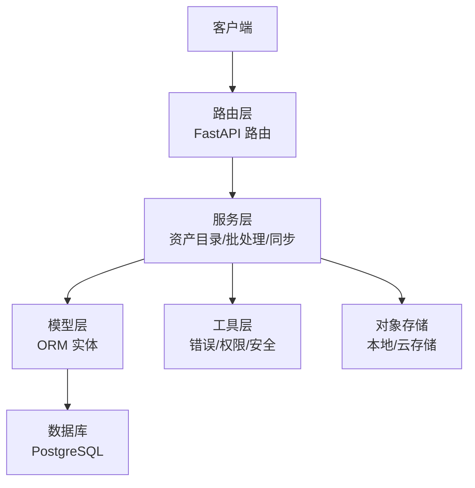
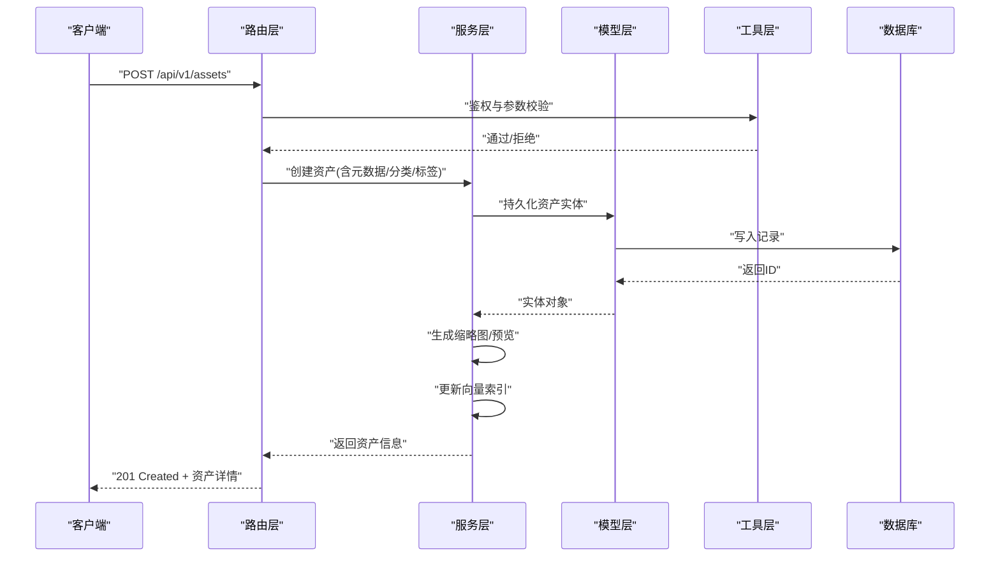
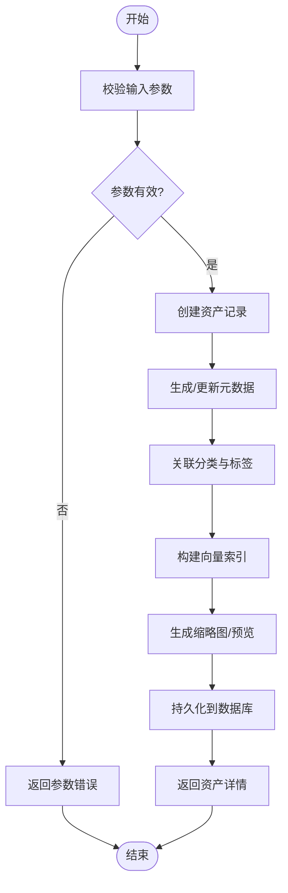
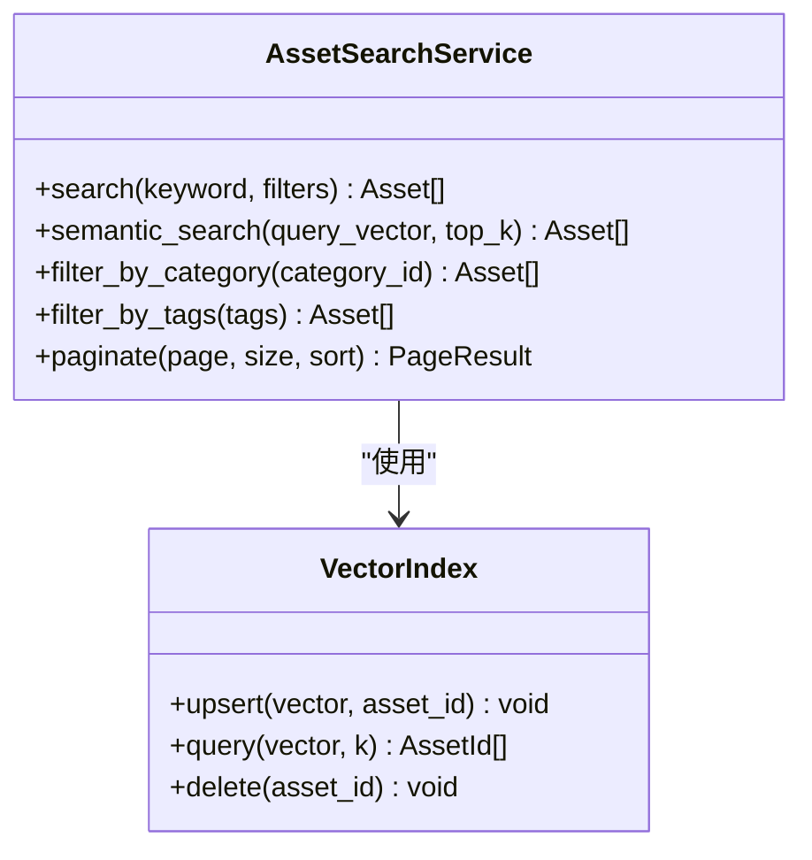
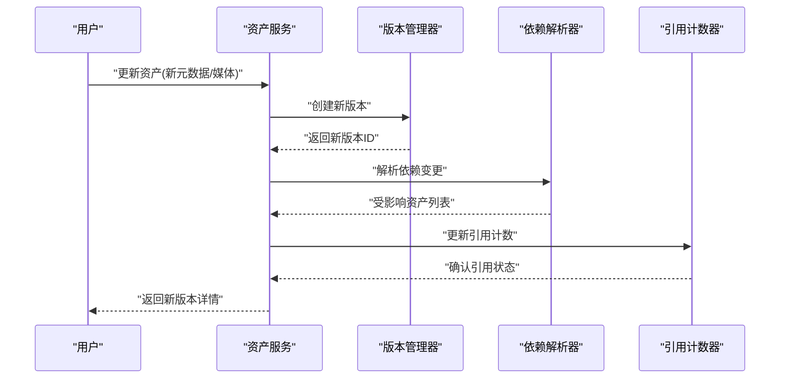
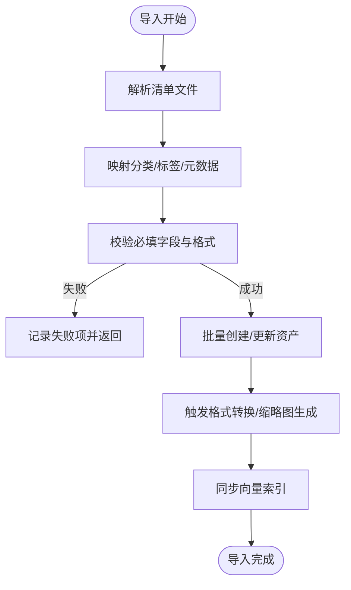
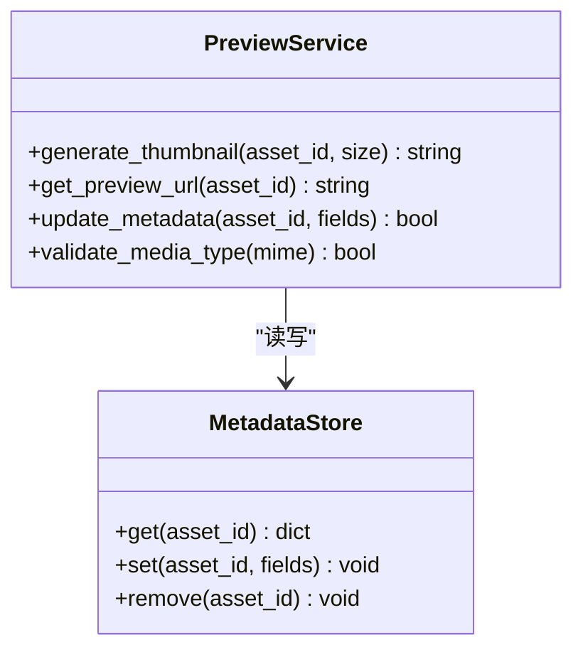
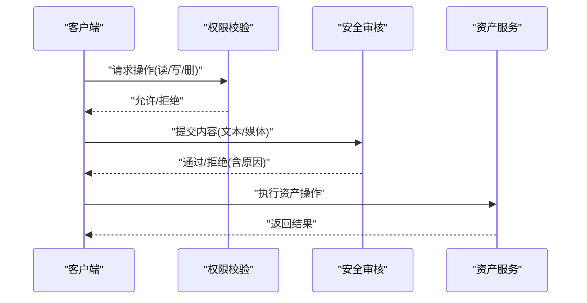
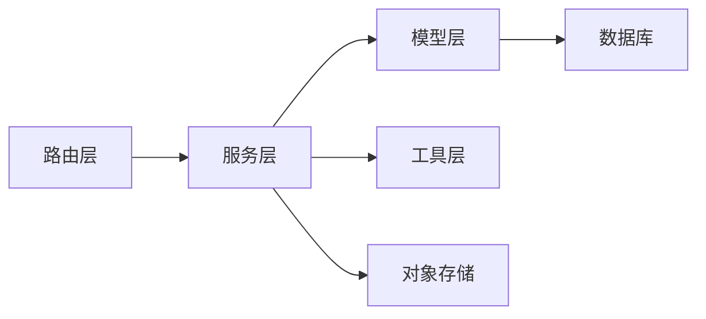

# 资产库管理API

<cite>
**本文档引用的文件**   
- [backend/app/api/v1/asset_studio.py](file://backend/app/api/v1/asset_studio.py)
- [backend/app/api/v1/user_assets.py](file://backend/app/api/v1/user_assets.py)
- [backend/app/schemas/user_asset.py](file://backend/app/schemas/user_asset.py)
- [backend/app/models/audio_library_asset.py](file://backend/app/models/audio_library_asset.py)
- [backend/app/services/asset_studio_model_catalog.py](file://backend/app/services/asset_studio_model_catalog.py)
- [backend/app/core/security.py](file://backend/app/core/security.py)
- [backend/app/core/permissions.py](file://backend/app/core/permissions.py)
- [backend/app/utils/api_errors.py](file://backend/app/utils/api_errors.py)
- [backend/app/db/base.py](file://backend/app/db/base.py)
- [backend/app/main.py](file://backend/app/main.py)
- [backend/tests/test_user_assets_routes.py](file://backend/tests/test_user_assets_routes.py)
- [backend/tests/test_audio_library_asset_repository.py](file://backend/tests/test_audio_library_asset_repository.py)
</cite>

## 目录
1. [简介](#简介)
2. [项目结构](#项目结构)
3. [核心组件](#核心组件)
4. [架构总览](#架构总览)
5. [详细组件分析](#详细组件分析)
6. [依赖关系分析](#依赖关系分析)
7. [性能考虑](#性能考虑)
8. [故障排查指南](#故障排查指南)
9. [结论](#结论)
10. [附录](#附录)

## 简介
本文件为“梦境编织者”资产库管理系统的完整API文档，聚焦角色、场景、道具等数字资产的增删改查（CRUD）、分类与标签管理、搜索能力、版本控制、依赖关系与引用追踪、导入导出、批量操作、格式转换、预览与缩略图生成、元数据管理，以及权限控制、安全审核与合规检查的接口使用方法。文档面向开发者与集成方，提供从概念到实现细节的分层说明，并附带架构图、时序图与流程图帮助快速上手与排障。

## 项目结构
后端采用分层架构：路由层（FastAPI）暴露REST API；服务层封装业务逻辑；模型层定义数据库实体与迁移；Schema层统一请求/响应数据结构；工具层提供错误处理与安全校验。资产库相关能力主要分布在以下模块：
- 路由层：资产工作室API、用户资产API
- 服务层：资产目录服务、批处理服务、向量同步服务等
- 模型层：音频库资产模型、用户资产记录模型等
- Schema层：用户资产Schema、通用Schema
- 工具层：API错误、权限与安全校验

**图表来源** 
- [backend/app/main.py](file://backend/app/main.py)
- [backend/app/api/v1/asset_studio.py](file://backend/app/api/v1/asset_studio.py)
- [backend/app/api/v1/user_assets.py](file://backend/app/api/v1/user_assets.py)
- [backend/app/services/asset_studio_model_catalog.py](file://backend/app/services/asset_studio_model_catalog.py)
- [backend/app/models/audio_library_asset.py](file://backend/app/models/audio_library_asset.py)
- [backend/app/db/base.py](file://backend/app/db/base.py)

**章节来源**
- [backend/app/main.py](file://backend/app/main.py)
- [backend/app/api/v1/asset_studio.py](file://backend/app/api/v1/asset_studio.py)
- [backend/app/api/v1/user_assets.py](file://backend/app/api/v1/user_assets.py)

## 核心组件
- 资产路由层：提供资产CRUD、分类/标签、搜索、导入导出、批量操作、预览与缩略图、元数据管理等HTTP端点
- 资产服务层：封装资产生命周期、版本控制、依赖与引用追踪、格式转换、审核与合规检查、向量索引同步
- 资产模型层：定义资产实体（如音频库资产、用户资产记录）及字段约束
- Schema层：定义统一的请求/响应结构，确保接口契约稳定
- 权限与安全：基于角色的访问控制（RBAC）、内容安全检测、审计日志

**章节来源**
- [backend/app/api/v1/asset_studio.py](file://backend/app/api/v1/asset_studio.py)
- [backend/app/api/v1/user_assets.py](file://backend/app/api/v1/user_assets.py)
- [backend/app/schemas/user_asset.py](file://backend/app/schemas/user_asset.py)
- [backend/app/models/audio_library_asset.py](file://backend/app/models/audio_library_asset.py)
- [backend/app/services/asset_studio_model_catalog.py](file://backend/app/services/asset_studio_model_catalog.py)
- [backend/app/core/security.py](file://backend/app/core/security.py)
- [backend/app/core/permissions.py](file://backend/app/core/permissions.py)

## 架构总览
系统以FastAPI作为入口，通过路由分发到服务层，服务层调用模型层进行持久化，并通过工具层完成鉴权、错误处理与审计。资产库支持多类型资产（角色、场景、道具、音效等），具备版本化、依赖追踪、引用计数、标签与分类、搜索与预览能力。

**图表来源** 
- [backend/app/api/v1/asset_studio.py](file://backend/app/api/v1/asset_studio.py)
- [backend/app/api/v1/user_assets.py](file://backend/app/api/v1/user_assets.py)
- [backend/app/services/asset_studio_model_catalog.py](file://backend/app/services/asset_studio_model_catalog.py)
- [backend/app/models/audio_library_asset.py](file://backend/app/models/audio_library_asset.py)
- [backend/app/core/security.py](file://backend/app/core/security.py)
- [backend/app/core/permissions.py](file://backend/app/core/permissions.py)

## 详细组件分析

### 资产CRUD与分类标签
- 资产创建：支持上传媒体文件、设置分类、标签、元数据、版本初始值
- 资产查询：按ID、名称、分类、标签、时间范围、状态过滤
- 资产更新：增量更新元数据、标签、分类、版本升级
- 资产删除：软删除或硬删除，支持级联清理引用
- 分类与标签：独立维护分类树与标签集合，支持批量关联与去重

**图表来源** 
- [backend/app/api/v1/asset_studio.py](file://backend/app/api/v1/asset_studio.py)
- [backend/app/api/v1/user_assets.py](file://backend/app/api/v1/user_assets.py)
- [backend/app/schemas/user_asset.py](file://backend/app/schemas/user_asset.py)
- [backend/app/models/audio_library_asset.py](file://backend/app/models/audio_library_asset.py)

**章节来源**
- [backend/app/api/v1/asset_studio.py](file://backend/app/api/v1/asset_studio.py)
- [backend/app/api/v1/user_assets.py](file://backend/app/api/v1/user_assets.py)
- [backend/app/schemas/user_asset.py](file://backend/app/schemas/user_asset.py)
- [backend/app/models/audio_library_asset.py](file://backend/app/models/audio_library_asset.py)

### 搜索与语义检索
- 关键词搜索：对标题、描述、标签进行全文检索
- 语义搜索：基于向量嵌入匹配相似资产
- 组合过滤：结合分类、标签、时间、状态等多条件筛选
- 分页排序：支持页码、每页大小、排序字段

**图表来源** 
- [backend/app/services/asset_studio_model_catalog.py](file://backend/app/services/asset_studio_model_catalog.py)

**章节来源**
- [backend/app/services/asset_studio_model_catalog.py](file://backend/app/services/asset_studio_model_catalog.py)

### 版本控制、依赖关系与引用追踪
- 版本控制：每次修改生成新版本，保留历史快照，支持回滚
- 依赖关系：资产可声明依赖其他资产（如角色依赖场景），变更时触发影响分析
- 引用追踪：统计资产被哪些资源引用（剧本、分镜、工程），防止误删

**图表来源** 
- [backend/app/api/v1/asset_studio.py](file://backend/app/api/v1/asset_studio.py)
- [backend/app/api/v1/user_assets.py](file://backend/app/api/v1/user_assets.py)

**章节来源**
- [backend/app/api/v1/asset_studio.py](file://backend/app/api/v1/asset_studio.py)
- [backend/app/api/v1/user_assets.py](file://backend/app/api/v1/user_assets.py)

### 导入导出、批量操作与格式转换
- 导入：支持批量导入JSON/CSV清单，映射分类与标签，自动校验格式
- 导出：按条件导出资产清单与媒体文件包，支持ZIP打包
- 批量操作：批量打标签、批量移动分类、批量状态更新
- 格式转换：媒体文件转码（图像/音频/视频），生成预览与缩略图

**图表来源** 
- [backend/app/api/v1/asset_studio.py](file://backend/app/api/v1/asset_studio.py)
- [backend/app/api/v1/user_assets.py](file://backend/app/api/v1/user_assets.py)

**章节来源**
- [backend/app/api/v1/asset_studio.py](file://backend/app/api/v1/asset_studio.py)
- [backend/app/api/v1/user_assets.py](file://backend/app/api/v1/user_assets.py)

### 预览、缩略图与元数据管理
- 预览：根据媒体类型生成在线预览链接（图像缩略、音频波形、视频帧）
- 缩略图：异步生成多尺寸缩略图，缓存命中优化
- 元数据：结构化存储资产属性（分辨率、时长、编码、作者、版权信息等）

**图表来源** 
- [backend/app/api/v1/asset_studio.py](file://backend/app/api/v1/asset_studio.py)
- [backend/app/api/v1/user_assets.py](file://backend/app/api/v1/user_assets.py)

**章节来源**
- [backend/app/api/v1/asset_studio.py](file://backend/app/api/v1/asset_studio.py)
- [backend/app/api/v1/user_assets.py](file://backend/app/api/v1/user_assets.py)

### 权限控制、安全审核与合规检查
- 权限控制：基于角色的访问控制（RBAC），细粒度到资产类别与操作
- 安全审核：内容安全检测（文本/图像/音频），拦截违规内容
- 合规检查：版权校验、许可证验证、敏感词过滤

**图表来源** 
- [backend/app/core/security.py](file://backend/app/core/security.py)
- [backend/app/core/permissions.py](file://backend/app/core/permissions.py)

**章节来源**
- [backend/app/core/security.py](file://backend/app/core/security.py)
- [backend/app/core/permissions.py](file://backend/app/core/permissions.py)

## 依赖关系分析
资产库各组件之间的依赖关系如下：
- 路由层依赖服务层与工具层
- 服务层依赖模型层与外部存储
- 模型层依赖数据库连接与迁移脚本
- 工具层提供跨模块的鉴权、错误处理与审计

**图表来源** 
- [backend/app/main.py](file://backend/app/main.py)
- [backend/app/api/v1/asset_studio.py](file://backend/app/api/v1/asset_studio.py)
- [backend/app/api/v1/user_assets.py](file://backend/app/api/v1/user_assets.py)
- [backend/app/services/asset_studio_model_catalog.py](file://backend/app/services/asset_studio_model_catalog.py)
- [backend/app/models/audio_library_asset.py](file://backend/app/models/audio_library_asset.py)
- [backend/app/db/base.py](file://backend/app/db/base.py)

**章节来源**
- [backend/app/main.py](file://backend/app/main.py)
- [backend/app/api/v1/asset_studio.py](file://backend/app/api/v1/asset_studio.py)
- [backend/app/api/v1/user_assets.py](file://backend/app/api/v1/user_assets.py)
- [backend/app/services/asset_studio_model_catalog.py](file://backend/app/services/asset_studio_model_catalog.py)
- [backend/app/models/audio_library_asset.py](file://backend/app/models/audio_library_asset.py)
- [backend/app/db/base.py](file://backend/app/db/base.py)

## 性能考虑
- 异步处理：缩略图生成、格式转换、向量索引更新采用异步任务队列
- 缓存策略：缩略图与预览URL多级缓存（内存+对象存储）
- 分页与限流：大列表查询强制分页，接口级限流保护
- 索引优化：数据库复合索引（分类、标签、时间戳），向量索引按需重建

[本节为通用指导，不直接分析具体文件]

## 故障排查指南
- 常见错误：参数校验失败、权限不足、内容安全拦截、存储写入失败
- 调试建议：启用详细日志、检查向量索引状态、验证媒体文件格式
- 恢复措施：重试机制、回滚事务、清理临时文件

**章节来源**
- [backend/app/utils/api_errors.py](file://backend/app/utils/api_errors.py)
- [backend/tests/test_user_assets_routes.py](file://backend/tests/test_user_assets_routes.py)
- [backend/tests/test_audio_library_asset_repository.py](file://backend/tests/test_audio_library_asset_repository.py)

## 结论
本API文档全面覆盖资产库管理的核心能力，包括CRUD、分类标签、搜索、版本控制、依赖追踪、导入导出、批量操作、格式转换、预览缩略图、元数据管理以及权限安全与合规检查。通过分层架构与清晰的接口契约，系统具备良好的可扩展性与可维护性，适合大规模数字资产管理场景。

[本节为总结性内容，不直接分析具体文件]

## 附录
- 接口示例：参考测试用例中的请求/响应样例
- 配置项：环境变量与配置文件路径见部署文档
- 扩展点：新增资产类型需扩展Schema、模型与服务层

[本节为补充信息，不直接分析具体文件]