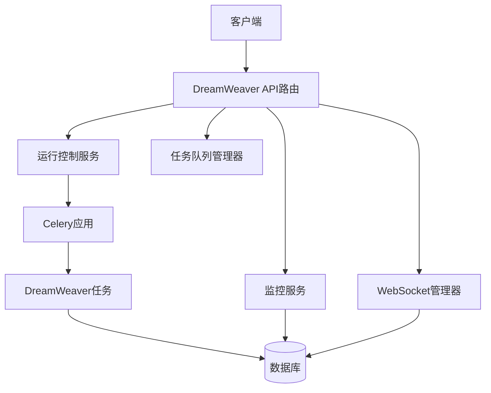
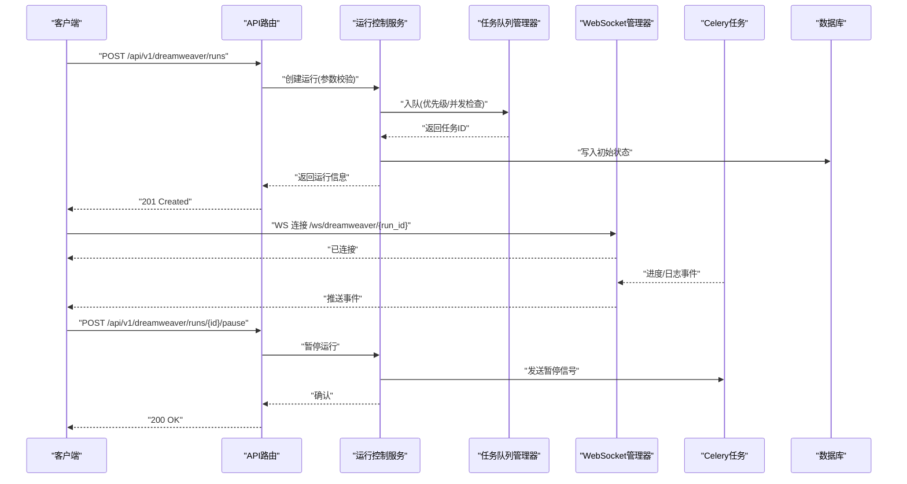
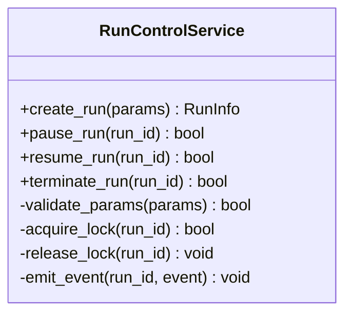
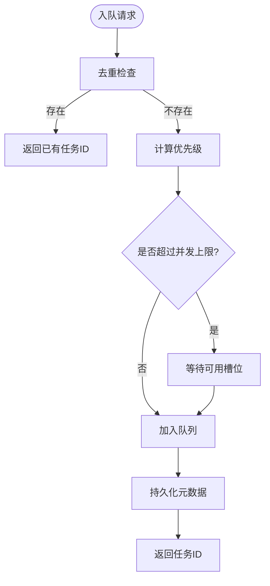
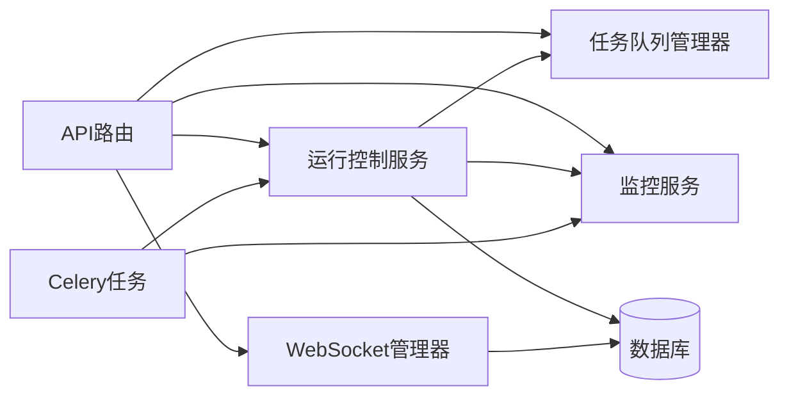

# 运行控制API

<cite>
**本文引用的文件**   
- [backend/app/api/v1/dreamweaver_api/routes.py](file://backend/app/api/v1/dreamweaver_api/routes.py)
- [backend/app/api/v1/dreamweaver_api/schemas.py](file://backend/app/api/v1/dreamweaver_api/schemas.py)
- [backend/app/services/dreamweaver/run_control_service.py](file://backend/app/services/dreamweaver/run_control_service.py)
- [backend/app/services/dreamweaver/task_queue_manager.py](file://backend/app/services/dreamweaver/task_queue_manager.py)
- [backend/app/services/dreamweaver/monitoring_service.py](file://backend/app/services/dreamweaver/monitoring_service.py)
- [backend/app/websocket/manager.py](file://backend/app/websocket/manager.py)
- [backend/app/celery_app.py](file://backend/app/celery_app.py)
- [backend/app/tasks/dreamweaver_tasks.py](file://backend/app/tasks/dreamweaver_tasks.py)
- [backend/app/models/dreamweaver.py](file://backend/app/models/dreamweaver.py)
- [backend/app/core/config.py](file://backend/app/core/config.py)
- [backend/app/services/batch_processor.py](file://backend/app/services/batch_processor.py)
- [backend/app/services/prompt_evolution/evolution_scheduler.py](file://backend/app/services/prompt_evolution/evolution_scheduler.py)
- [backend/app/services/prompt_evolution/quality_evaluator.py](file://backend/app/services/prompt_evolution/quality_evaluator.py)
</cite>

## 目录
1. [简介](#简介)
2. [项目结构](#项目结构)
3. [核心组件](#核心组件)
4. [架构总览](#架构总览)
5. [详细组件分析](#详细组件分析)
6. [依赖关系分析](#依赖关系分析)
7. [性能考虑](#性能考虑)
8. [故障排查指南](#故障排查指南)
9. [结论](#结论)
10. [附录](#附录)

## 简介
本文件为“梦境编织者运行控制系统”的运行控制API提供全面文档，覆盖视频生成任务的启动、暂停、恢复与停止接口；说明运行参数配置、资源分配与并发控制机制；提供实时进度跟踪、状态监控与日志获取的WebSocket接口；解释任务队列管理、优先级调度与失败重试策略；并给出批量运行、参数优化与质量评估的API使用示例及性能监控与资源管理的最佳实践。

## 项目结构
- API层：基于FastAPI的路由模块，暴露REST接口用于任务生命周期管理与查询。
- 服务层：封装运行控制、队列管理、监控与批处理等核心业务逻辑。
- 任务层：基于Celery的任务执行器，负责异步执行视频生成任务。
- WebSocket层：提供实时事件推送（进度、状态、日志）。
- 数据模型与配置：持久化任务状态、运行配置与环境变量加载。

图表来源
- [backend/app/api/v1/dreamweaver_api/routes.py](file://backend/app/api/v1/dreamweaver_api/routes.py)
- [backend/app/services/dreamweaver/run_control_service.py](file://backend/app/services/dreamweaver/run_control_service.py)
- [backend/app/services/dreamweaver/task_queue_manager.py](file://backend/app/services/dreamweaver/task_queue_manager.py)
- [backend/app/services/dreamweaver/monitoring_service.py](file://backend/app/services/dreamweaver/monitoring_service.py)
- [backend/app/websocket/manager.py](file://backend/app/websocket/manager.py)
- [backend/app/celery_app.py](file://backend/app/celery_app.py)
- [backend/app/tasks/dreamweaver_tasks.py](file://backend/app/tasks/dreamweaver_tasks.py)
- [backend/app/models/dreamweaver.py](file://backend/app/models/dreamweaver.py)

章节来源
- [backend/app/api/v1/dreamweaver_api/routes.py](file://backend/app/api/v1/dreamweaver_api/routes.py)
- [backend/app/core/config.py](file://backend/app/core/config.py)

## 核心组件
- 运行控制服务：负责创建、暂停、恢复、终止任务，维护任务状态机与资源锁。
- 任务队列管理器：实现优先级队列、并发限制、去重与重试策略。
- 监控服务：聚合任务指标、资源使用、错误统计与审计事件。
- WebSocket管理器：维护连接会话、按任务ID广播进度与日志。
- Celery任务：执行具体视频生成步骤，上报进度与结果。

章节来源
- [backend/app/services/dreamweaver/run_control_service.py](file://backend/app/services/dreamweaver/run_control_service.py)
- [backend/app/services/dreamweaver/task_queue_manager.py](file://backend/app/services/dreamweaver/task_queue_manager.py)
- [backend/app/services/dreamweaver/monitoring_service.py](file://backend/app/services/dreamweaver/monitoring_service.py)
- [backend/app/websocket/manager.py](file://backend/app/websocket/manager.py)
- [backend/app/celery_app.py](file://backend/app/celery_app.py)
- [backend/app/tasks/dreamweaver_tasks.py](file://backend/app/tasks/dreamweaver_tasks.py)

## 架构总览
系统采用分层架构：API路由接收请求，调用服务层进行业务编排；服务层通过Celery调度任务执行；WebSocket通道实时推送事件；所有关键状态与指标落库持久化。

图表来源
- [backend/app/api/v1/dreamweaver_api/routes.py](file://backend/app/api/v1/dreamweaver_api/routes.py)
- [backend/app/services/dreamweaver/run_control_service.py](file://backend/app/services/dreamweaver/run_control_service.py)
- [backend/app/services/dreamweaver/task_queue_manager.py](file://backend/app/services/dreamweaver/task_queue_manager.py)
- [backend/app/websocket/manager.py](file://backend/app/websocket/manager.py)
- [backend/app/celery_app.py](file://backend/app/celery_app.py)
- [backend/app/tasks/dreamweaver_tasks.py](file://backend/app/tasks/dreamweaver_tasks.py)
- [backend/app/models/dreamweaver.py](file://backend/app/models/dreamweaver.py)

## 详细组件分析

### 运行控制服务
职责：
- 创建运行：校验参数、分配资源、初始化状态、入队任务。
- 暂停/恢复/终止：状态机转换、向任务发送控制信号、记录审计事件。
- 资源锁：防止同一运行被重复操作或并发冲突。

图表来源
- [backend/app/services/dreamweaver/run_control_service.py](file://backend/app/services/dreamweaver/run_control_service.py)

章节来源
- [backend/app/services/dreamweaver/run_control_service.py](file://backend/app/services/dreamweaver/run_control_service.py)

### 任务队列管理器
职责：
- 优先级队列：支持按优先级排序与公平调度。
- 并发控制：全局与用户级并发上限、令牌桶限流。
- 重试策略：指数退避、最大重试次数、死信队列。

图表来源
- [backend/app/services/dreamweaver/task_queue_manager.py](file://backend/app/services/dreamweaver/task_queue_manager.py)

章节来源
- [backend/app/services/dreamweaver/task_queue_manager.py](file://backend/app/services/dreamweaver/task_queue_manager.py)

### 监控服务
职责：
- 指标采集：任务耗时、成功率、错误分类、资源占用。
- 健康检查：队列长度、消费者数量、外部依赖可用性。
- 审计事件：关键操作记录与追踪ID关联。

章节来源
- [backend/app/services/dreamweaver/monitoring_service.py](file://backend/app/services/dreamweaver/monitoring_service.py)

### WebSocket管理器
职责：
- 连接管理：按run_id建立会话、心跳保活。
- 事件广播：进度、日志、状态变更实时推送。
- 权限校验：鉴权与访问控制。

章节来源
- [backend/app/websocket/manager.py](file://backend/app/websocket/manager.py)

### Celery任务
职责：
- 执行视频生成流水线：分步执行、中间产物保存。
- 上报进度：百分比、阶段名称、错误堆栈。
- 失败重试：捕获异常、触发重试策略。

章节来源
- [backend/app/celery_app.py](file://backend/app/celery_app.py)
- [backend/app/tasks/dreamweaver_tasks.py](file://backend/app/tasks/dreamweaver_tasks.py)

### 数据模型与配置
- 数据模型：运行实例、任务元数据、事件日志、资源配额。
- 配置项：并发上限、超时、重试策略、队列大小、WebSocket速率限制。

章节来源
- [backend/app/models/dreamweaver.py](file://backend/app/models/dreamweaver.py)
- [backend/app/core/config.py](file://backend/app/core/config.py)

## 依赖关系分析
- API路由依赖运行控制服务、队列管理器、监控服务与WebSocket管理器。
- 运行控制服务依赖队列管理器、监控服务与数据库。
- Celery任务依赖运行控制服务提供的控制信号与监控服务的指标上报。
- WebSocket管理器依赖认证与数据库以维护会话与事件历史。

图表来源
- [backend/app/api/v1/dreamweaver_api/routes.py](file://backend/app/api/v1/dreamweaver_api/routes.py)
- [backend/app/services/dreamweaver/run_control_service.py](file://backend/app/services/dreamweaver/run_control_service.py)
- [backend/app/services/dreamweaver/task_queue_manager.py](file://backend/app/services/dreamweaver/task_queue_manager.py)
- [backend/app/services/dreamweaver/monitoring_service.py](file://backend/app/services/dreamweaver/monitoring_service.py)
- [backend/app/websocket/manager.py](file://backend/app/websocket/manager.py)
- [backend/app/celery_app.py](file://backend/app/celery_app.py)
- [backend/app/tasks/dreamweaver_tasks.py](file://backend/app/tasks/dreamweaver_tasks.py)
- [backend/app/models/dreamweaver.py](file://backend/app/models/dreamweaver.py)

章节来源
- [backend/app/api/v1/dreamweaver_api/routes.py](file://backend/app/api/v1/dreamweaver_api/routes.py)
- [backend/app/services/dreamweaver/run_control_service.py](file://backend/app/services/dreamweaver/run_control_service.py)
- [backend/app/services/dreamweaver/task_queue_manager.py](file://backend/app/services/dreamweaver/task_queue_manager.py)
- [backend/app/services/dreamweaver/monitoring_service.py](file://backend/app/services/dreamweaver/monitoring_service.py)
- [backend/app/websocket/manager.py](file://backend/app/websocket/manager.py)
- [backend/app/celery_app.py](file://backend/app/celery_app.py)
- [backend/app/tasks/dreamweaver_tasks.py](file://backend/app/tasks/dreamweaver_tasks.py)
- [backend/app/models/dreamweaver.py](file://backend/app/models/dreamweaver.py)

## 性能考虑
- 并发控制：设置合理的队列容量与消费者数量，避免内存与GPU过载。
- 重试策略：指数退避与最大重试次数平衡稳定性与延迟。
- 资源隔离：用户级并发上限与配额限制，防止单租户独占资源。
- 监控告警：关键指标阈值告警，快速定位瓶颈。
- 缓存与预热：常用模型与提示词预加载，减少冷启动时间。

## 故障排查指南
- 任务无法入队：检查并发上限、队列容量与去重规则。
- 任务卡住：查看Celery消费者状态、任务日志与中间产物。
- WebSocket断连：检查心跳间隔、网络与鉴权状态。
- 频繁失败：分析错误分类、重试计数与外部依赖健康状态。

章节来源
- [backend/app/services/dreamweaver/monitoring_service.py](file://backend/app/services/dreamweaver/monitoring_service.py)
- [backend/app/websocket/manager.py](file://backend/app/websocket/manager.py)
- [backend/app/tasks/dreamweaver_tasks.py](file://backend/app/tasks/dreamweaver_tasks.py)

## 结论
本API文档围绕运行控制的核心能力展开，涵盖任务生命周期、队列与并发、实时监控与WebSocket事件、以及性能与排障建议。通过分层架构与清晰的职责划分，系统具备良好的可扩展性与可观测性，适合大规模视频生成场景的稳定运行。

## 附录

### API定义与示例

#### 启动运行
- 方法：POST
- 路径：/api/v1/dreamweaver/runs
- 请求体字段：
  - run_name: 字符串，运行名称
  - model_id: 字符串，模型标识
  - prompt: 字符串，生成提示
  - params: 对象，运行时参数（分辨率、时长、采样率等）
  - priority: 整数，优先级（默认中）
  - concurrency_limit: 整数，并发上限（可选）
- 响应：
  - run_id: 字符串，运行ID
  - status: 字符串，初始状态
  - created_at: 时间戳

章节来源
- [backend/app/api/v1/dreamweaver_api/routes.py](file://backend/app/api/v1/dreamweaver_api/routes.py)
- [backend/app/api/v1/dreamweaver_api/schemas.py](file://backend/app/api/v1/dreamweaver_api/schemas.py)

#### 暂停运行
- 方法：POST
- 路径：/api/v1/dreamweaver/runs/{run_id}/pause
- 响应：
  - status: 字符串，新状态
  - message: 字符串，操作结果

章节来源
- [backend/app/api/v1/dreamweaver_api/routes.py](file://backend/app/api/v1/dreamweaver_api/routes.py)

#### 恢复运行
- 方法：POST
- 路径：/api/v1/dreamweaver/runs/{run_id}/resume
- 响应：
  - status: 字符串，新状态
  - message: 字符串，操作结果

章节来源
- [backend/app/api/v1/dreamweaver_api/routes.py](file://backend/app/api/v1/dreamweaver_api/routes.py)

#### 停止运行
- 方法：POST
- 路径：/api/v1/dreamweaver/runs/{run_id}/terminate
- 响应：
  - status: 字符串，新状态
  - message: 字符串，操作结果

章节来源
- [backend/app/api/v1/dreamweaver_api/routes.py](file://backend/app/api/v1/dreamweaver_api/routes.py)

#### 查询运行状态
- 方法：GET
- 路径：/api/v1/dreamweaver/runs/{run_id}
- 响应：
  - run_id: 字符串
  - status: 字符串
  - progress: 浮点数，进度百分比
  - metrics: 对象，指标摘要
  - logs_summary: 数组，最近日志条目

章节来源
- [backend/app/api/v1/dreamweaver_api/routes.py](file://backend/app/api/v1/dreamweaver_api/routes.py)

#### WebSocket实时事件
- 连接：ws://host/ws/dreamweaver/{run_id}
- 事件类型：
  - progress: 进度更新
  - log: 日志条目
  - status_change: 状态变更
  - error: 错误信息
- 鉴权：在连接URL或握手头中携带token

章节来源
- [backend/app/websocket/manager.py](file://backend/app/websocket/manager.py)

### 批量运行
- 方法：POST
- 路径：/api/v1/dreamweaver/batch_runs
- 请求体：runs数组，每项包含启动运行所需字段
- 响应：batch_id与每个run_id映射

章节来源
- [backend/app/services/batch_processor.py](file://backend/app/services/batch_processor.py)

### 参数优化与质量评估
- 参数优化：
  - 方法：POST
  - 路径：/api/v1/dreamweaver/optimize_params
  - 请求体：基准运行ID与优化目标（如时长、清晰度）
  - 响应：推荐参数集
- 质量评估：
  - 方法：POST
  - 路径：/api/v1/dreamweaver/evaluate_quality
  - 请求体：运行ID或输出文件列表
  - 响应：评分与改进建议

章节来源
- [backend/app/services/prompt_evolution/evolution_scheduler.py](file://backend/app/services/prompt_evolution/evolution_scheduler.py)
- [backend/app/services/prompt_evolution/quality_evaluator.py](file://backend/app/services/prompt_evolution/quality_evaluator.py)

### 运行参数配置参考
- 并发与队列：
  - max_concurrent_runs: 全局并发上限
  - user_concurrency_limit: 用户级并发上限
  - queue_size: 队列容量
- 超时与重试：
  - task_timeout_seconds: 任务超时
  - retry_max_attempts: 最大重试次数
  - retry_backoff_base: 指数退避基数
- WebSocket：
  - ws_rate_limit_per_second: 事件推送速率限制

章节来源
- [backend/app/core/config.py](file://backend/app/core/config.py)