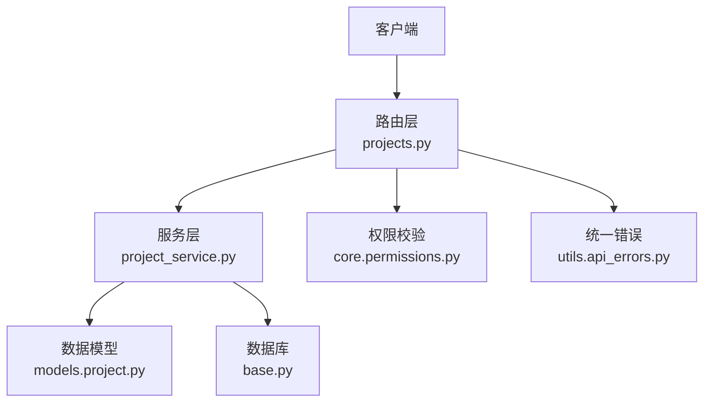
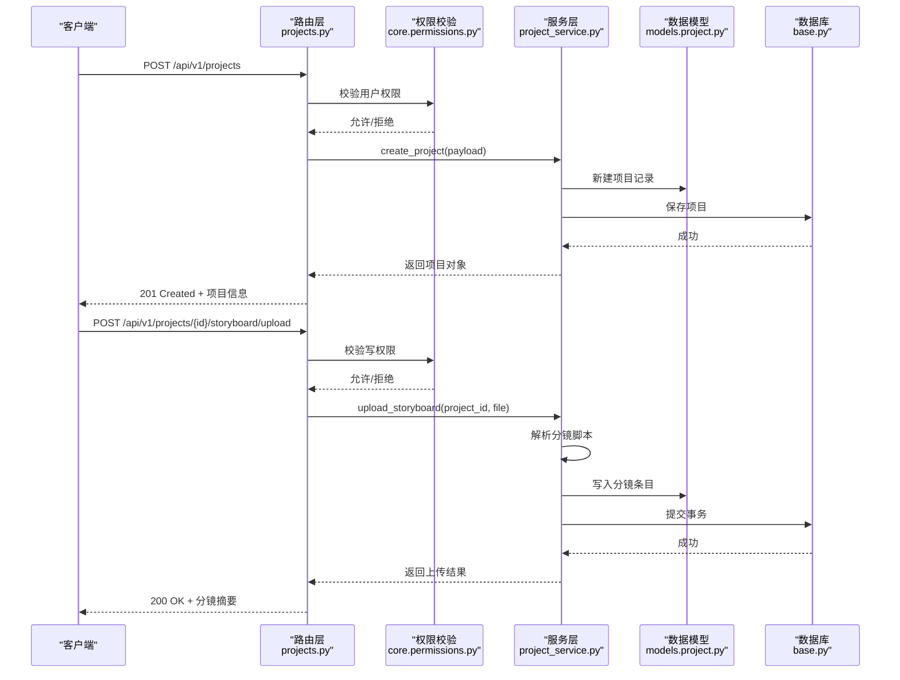
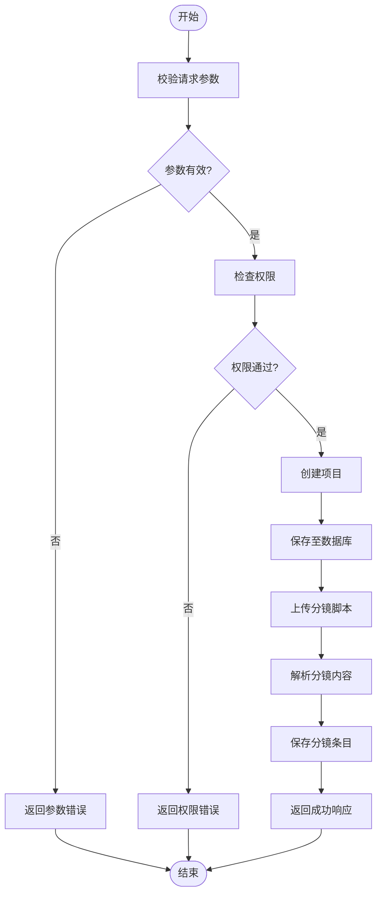
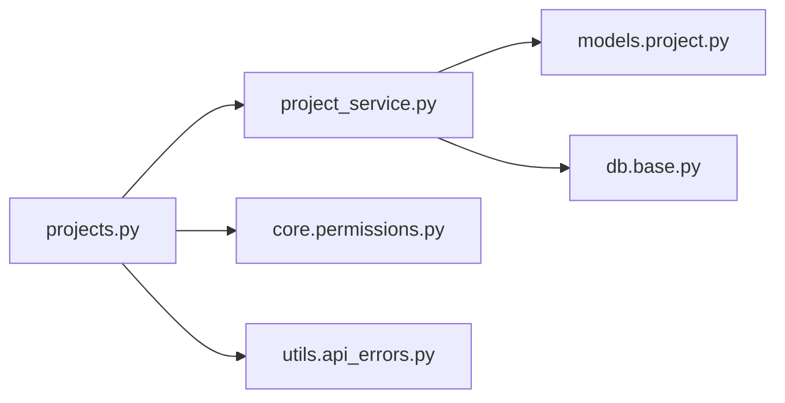

# 项目管理API

<cite>
**本文引用的文件**   
- [backend/app/api/v1/projects.py](file://backend/app/api/v1/projects.py)
- [backend/app/schemas/project.py](file://backend/app/schemas/project.py)
- [backend/app/models/project.py](file://backend/app/models/project.py)
- [backend/app/services/dreamweaver/project_service.py](file://backend/app/services/dreamweaver/project_service.py)
- [backend/app/core/permissions.py](file://backend/app/core/permissions.py)
- [backend/app/utils/api_errors.py](file://backend/app/utils/api_errors.py)
- [backend/app/main.py](file://backend/app/main.py)
- [backend/app/db/base.py](file://backend/app/db/base.py)
</cite>

## 目录
1. [简介](#简介)
2. [项目结构](#项目结构)
3. [核心组件](#核心组件)
4. [架构总览](#架构总览)
5. [详细组件分析](#详细组件分析)
6. [依赖分析](#依赖分析)
7. [性能考虑](#性能考虑)
8. [故障排查指南](#故障排查指南)
9. [结论](#结论)
10. [附录](#附录)

## 简介
本文件为“梦境编织者”项目管理系统的API文档，聚焦项目的创建、更新、删除与查询接口，覆盖项目配置参数、分镜脚本上传、角色设定管理、状态管理、版本控制与协作能力。同时提供模板化项目初始化、批量操作与权限控制的示例，并说明数据结构、字段校验与业务规则，以及错误处理与异常场景的处理建议。

## 项目结构
后端采用分层架构：路由层（API）→ 服务层（业务逻辑）→ 数据模型（ORM）→ 数据库。项目相关的路由定义在 v1 的 projects.py 中，请求与响应结构通过 Pydantic Schema 定义，领域模型位于 models.project，业务编排由 services.dreamweaver.project_service 负责。权限校验与统一错误处理分别由 core.permissions 与 utils.api_errors 提供。

**图示来源** 
- [backend/app/api/v1/projects.py](file://backend/app/api/v1/projects.py)
- [backend/app/services/dreamweaver/project_service.py](file://backend/app/services/dreamweaver/project_service.py)
- [backend/app/models/project.py](file://backend/app/models/project.py)
- [backend/app/db/base.py](file://backend/app/db/base.py)
- [backend/app/core/permissions.py](file://backend/app/core/permissions.py)
- [backend/app/utils/api_errors.py](file://backend/app/utils/api_errors.py)

**章节来源**
- [backend/app/api/v1/projects.py](file://backend/app/api/v1/projects.py)
- [backend/app/schemas/project.py](file://backend/app/schemas/project.py)
- [backend/app/models/project.py](file://backend/app/models/project.py)
- [backend/app/services/dreamweaver/project_service.py](file://backend/app/services/dreamweaver/project_service.py)
- [backend/app/core/permissions.py](file://backend/app/core/permissions.py)
- [backend/app/utils/api_errors.py](file://backend/app/utils/api_errors.py)
- [backend/app/db/base.py](file://backend/app/db/base.py)

## 核心组件
- 路由层（projects.py）：暴露 RESTful 接口，包括项目CRUD、分镜脚本上传、角色管理、状态切换、版本操作、模板应用与批量操作等。
- 模式定义（schemas/project.py）：定义请求体与响应体的字段、类型与校验规则。
- 数据模型（models/project.py）：ORM 实体映射，包含项目主表及关联关系。
- 服务层（project_service.py）：封装业务逻辑，如项目创建流程、分镜脚本解析与入库、角色设定维护、状态流转与版本控制、权限检查与审计。
- 权限控制（core.permissions.py）：基于角色的访问控制（RBAC），对接口进行鉴权与授权。
- 错误处理（utils/api_errors.py）：统一的异常类型与HTTP错误码映射。

**章节来源**
- [backend/app/api/v1/projects.py](file://backend/app/api/v1/projects.py)
- [backend/app/schemas/project.py](file://backend/app/schemas/project.py)
- [backend/app/models/project.py](file://backend/app/models/project.py)
- [backend/app/services/dreamweaver/project_service.py](file://backend/app/services/dreamweaver/project_service.py)
- [backend/app/core/permissions.py](file://backend/app/core/permissions.py)
- [backend/app/utils/api_errors.py](file://backend/app/utils/api_errors.py)

## 架构总览
下图展示一次“创建项目并上传分镜脚本”的典型调用链：客户端发起请求，路由层接收并进行参数校验与权限检查，随后调用服务层执行创建与脚本解析，最终持久化到数据库并返回结果。

**图示来源** 
- [backend/app/api/v1/projects.py](file://backend/app/api/v1/projects.py)
- [backend/app/core/permissions.py](file://backend/app/core/permissions.py)
- [backend/app/services/dreamweaver/project_service.py](file://backend/app/services/dreamweaver/project_service.py)
- [backend/app/models/project.py](file://backend/app/models/project.py)
- [backend/app/db/base.py](file://backend/app/db/base.py)

## 详细组件分析

### 项目CRUD接口
- 创建项目
  - 路径：POST /api/v1/projects
  - 功能：根据请求体创建新项目，初始化默认配置与状态。
  - 输入：项目名、描述、模板ID（可选）、初始配置（音频、分镜、角色等）。
  - 输出：项目对象（含ID、名称、状态、时间戳等）。
  - 权限：需要项目创建权限。
  - 校验：项目名称必填且唯一；配置项按Schema校验。
  - 错误：重复名称、非法配置、权限不足。

- 查询项目
  - 路径：GET /api/v1/projects/{id}
  - 功能：获取项目详情，包括配置、状态、版本列表、分镜概览与角色集合。
  - 权限：需具备查看权限。
  - 错误：项目不存在、权限不足。

- 更新项目
  - 路径：PUT /api/v1/projects/{id}
  - 功能：更新项目基础信息与配置（支持增量更新）。
  - 输入：可更新的字段集（名称、描述、配置项等）。
  - 权限：需具备编辑权限。
  - 校验：字段合法性、冲突检测（如并发更新）。
  - 错误：字段校验失败、项目不存在、权限不足。

- 删除项目
  - 路径：DELETE /api/v1/projects/{id}
  - 功能：软删除或硬删除项目（依策略而定），清理关联资源。
  - 权限：需具备删除权限。
  - 错误：项目不存在、权限不足、存在强依赖无法删除。

**章节来源**
- [backend/app/api/v1/projects.py](file://backend/app/api/v1/projects.py)
- [backend/app/schemas/project.py](file://backend/app/schemas/project.py)
- [backend/app/models/project.py](file://backend/app/models/project.py)
- [backend/app/services/dreamweaver/project_service.py](file://backend/app/services/dreamweaver/project_service.py)
- [backend/app/core/permissions.py](file://backend/app/core/permissions.py)
- [backend/app/utils/api_errors.py](file://backend/app/utils/api_errors.py)

### 分镜脚本上传与管理
- 上传分镜脚本
  - 路径：POST /api/v1/projects/{id}/storyboard/upload
  - 功能：上传分镜脚本文件（文本或结构化格式），系统解析后生成条目并入库。
  - 输入：项目ID、文件流或JSON内容。
  - 输出：上传结果（条目数量、解析统计、错误明细）。
  - 权限：需具备分镜编辑权限。
  - 校验：文件格式、大小限制、语法校验。
  - 错误：文件过大、格式不支持、解析失败。

- 分镜条目操作
  - 路径：GET/PUT/DELETE /api/v1/projects/{id}/storyboard/items/{item_id}
  - 功能：查询、更新或删除具体分镜条目。
  - 权限：需具备分镜编辑权限。
  - 校验：条目存在性、字段合法性。
  - 错误：条目不存在、权限不足、字段校验失败。

**章节来源**
- [backend/app/api/v1/projects.py](file://backend/app/api/v1/projects.py)
- [backend/app/schemas/project.py](file://backend/app/schemas/project.py)
- [backend/app/services/dreamweaver/project_service.py](file://backend/app/services/dreamweaver/project_service.py)
- [backend/app/core/permissions.py](file://backend/app/core/permissions.py)
- [backend/app/utils/api_errors.py](file://backend/app/utils/api_errors.py)

### 角色设定管理
- 角色CRUD
  - 路径：POST/GET/PUT/DELETE /api/v1/projects/{id}/characters
  - 功能：新增、查询、更新、删除角色设定（名称、外观、声音、行为特征等）。
  - 权限：需具备角色编辑权限。
  - 校验：角色名称唯一性、字段合法性。
  - 错误：重复名称、权限不足、字段校验失败。

- 角色关联
  - 路径：POST/DELETE /api/v1/projects/{id}/characters/{char_id}/links
  - 功能：将角色与分镜条目或资产建立/解除关联。
  - 权限：需具备角色编辑权限。
  - 错误：关联冲突、权限不足。

**章节来源**
- [backend/app/api/v1/projects.py](file://backend/app/api/v1/projects.py)
- [backend/app/schemas/project.py](file://backend/app/schemas/project.py)
- [backend/app/services/dreamweaver/project_service.py](file://backend/app/services/dreamweaver/project_service.py)
- [backend/app/core/permissions.py](file://backend/app/core/permissions.py)
- [backend/app/utils/api_errors.py](file://backend/app/utils/api_errors.py)

### 项目状态管理与版本控制
- 状态切换
  - 路径：PATCH /api/v1/projects/{id}/status
  - 功能：在项目生命周期内切换状态（草稿、制作中、审核中、已完成等）。
  - 权限：需具备状态变更权限。
  - 校验：目标状态合法性、前置条件满足。
  - 错误：状态不合法、前置条件不满足、权限不足。

- 版本操作
  - 路径：POST /api/v1/projects/{id}/versions
  - 功能：创建新版本快照，支持回滚与对比。
  - 权限：需具备版本管理权限。
  - 校验：版本命名唯一性、快照完整性。
  - 错误：命名冲突、快照失败、权限不足。

**章节来源**
- [backend/app/api/v1/projects.py](file://backend/app/api/v1/projects.py)
- [backend/app/schemas/project.py](file://backend/app/schemas/project.py)
- [backend/app/services/dreamweaver/project_service.py](file://backend/app/services/dreamweaver/project_service.py)
- [backend/app/core/permissions.py](file://backend/app/core/permissions.py)
- [backend/app/utils/api_errors.py](file://backend/app/utils/api_errors.py)

### 项目模板与批量操作
- 应用模板
  - 路径：POST /api/v1/projects/{id}/apply-template
  - 功能：基于模板快速初始化项目结构与默认配置。
  - 权限：需具备模板使用权限。
  - 校验：模板有效性、冲突合并策略。
  - 错误：模板不存在、冲突未解决、权限不足。

- 批量操作
  - 路径：POST /api/v1/projects/batch
  - 功能：批量创建/更新/删除多个项目或批量执行任务（如批量导入分镜）。
  - 权限：需具备批量操作权限。
  - 校验：批次大小限制、逐项校验与汇总结果。
  - 错误：部分失败、权限不足、超限。

**章节来源**
- [backend/app/api/v1/projects.py](file://backend/app/api/v1/projects.py)
- [backend/app/schemas/project.py](file://backend/app/schemas/project.py)
- [backend/app/services/dreamweaver/project_service.py](file://backend/app/services/dreamweaver/project_service.py)
- [backend/app/core/permissions.py](file://backend/app/core/permissions.py)
- [backend/app/utils/api_errors.py](file://backend/app/utils/api_errors.py)

### 权限控制与协作
- RBAC权限模型
  - 角色：管理员、项目经理、编辑者、观察者等。
  - 资源：项目、分镜、角色、版本、模板等。
  - 动作：创建、读取、更新、删除、状态切换、版本管理、模板应用、批量操作。
  - 校验点：路由层入口统一鉴权，服务层二次校验业务权限。

- 协作能力
  - 成员管理：邀请、移除、角色分配。
  - 审计日志：关键操作的记录与追溯。
  - 冲突解决：并发更新时的锁机制与合并策略。

**章节来源**
- [backend/app/core/permissions.py](file://backend/app/core/permissions.py)
- [backend/app/api/v1/projects.py](file://backend/app/api/v1/projects.py)
- [backend/app/services/dreamweaver/project_service.py](file://backend/app/services/dreamweaver/project_service.py)

### 数据结构与字段验证
- 项目对象
  - 字段：ID、名称、描述、状态、版本列表、配置（音频、分镜、角色等）、时间戳。
  - 校验：名称唯一、状态枚举、配置项类型与范围。

- 分镜条目
  - 字段：序号、画面描述、时长、镜头语言、关联角色、备注。
  - 校验：序号唯一、时长正数、镜头语言枚举。

- 角色设定
  - 字段：ID、名称、外观、声音、行为特征、关联资产。
  - 校验：名称唯一、资产ID有效性。

- 版本快照
  - 字段：版本号、创建时间、变更摘要、快照内容引用。
  - 校验：版本号递增、内容非空。

**章节来源**
- [backend/app/schemas/project.py](file://backend/app/schemas/project.py)
- [backend/app/models/project.py](file://backend/app/models/project.py)

### 业务流程图（以“创建项目并上传分镜”为例）

**图示来源** 
- [backend/app/api/v1/projects.py](file://backend/app/api/v1/projects.py)
- [backend/app/services/dreamweaver/project_service.py](file://backend/app/services/dreamweaver/project_service.py)
- [backend/app/core/permissions.py](file://backend/app/core/permissions.py)
- [backend/app/utils/api_errors.py](file://backend/app/utils/api_errors.py)

## 依赖分析
- 路由层依赖服务层进行业务编排，服务层依赖数据模型与数据库连接。
- 权限模块在各路由入口统一拦截，确保最小权限原则。
- 错误处理模块集中定义异常类型与HTTP映射，保证一致的错误响应。

**图示来源** 
- [backend/app/api/v1/projects.py](file://backend/app/api/v1/projects.py)
- [backend/app/services/dreamweaver/project_service.py](file://backend/app/services/dreamweaver/project_service.py)
- [backend/app/models/project.py](file://backend/app/models/project.py)
- [backend/app/db/base.py](file://backend/app/db/base.py)
- [backend/app/core/permissions.py](file://backend/app/core/permissions.py)
- [backend/app/utils/api_errors.py](file://backend/app/utils/api_errors.py)

**章节来源**
- [backend/app/api/v1/projects.py](file://backend/app/api/v1/projects.py)
- [backend/app/services/dreamweaver/project_service.py](file://backend/app/services/dreamweaver/project_service.py)
- [backend/app/models/project.py](file://backend/app/models/project.py)
- [backend/app/db/base.py](file://backend/app/db/base.py)
- [backend/app/core/permissions.py](file://backend/app/core/permissions.py)
- [backend/app/utils/api_errors.py](file://backend/app/utils/api_errors.py)

## 性能考虑
- 分镜脚本解析：大文件上传建议使用分片与异步处理，避免阻塞请求。
- 批量操作：限制批次大小，采用队列与重试机制，避免数据库压力峰值。
- 版本快照：增量快照与差异存储，减少冗余数据。
- 缓存策略：对频繁读取的项目元数据与模板进行缓存。
- 并发控制：使用乐观锁或分布式锁防止并发更新冲突。

[本节为通用指导，无需特定文件来源]

## 故障排查指南
- 常见错误码
  - 400：参数校验失败（字段缺失、类型错误、范围越界）。
  - 401：未认证（缺少令牌或令牌过期）。
  - 403：权限不足（无相应角色或资源权限）。
  - 404：资源不存在（项目、分镜条目、角色等）。
  - 409：冲突（名称重复、版本号冲突、并发更新冲突）。
  - 413：请求体过大（分镜文件过大）。
  - 422：语义校验失败（分镜语法错误、模板冲突）。
  - 500：服务器内部错误（数据库异常、服务层异常）。

- 排查步骤
  - 检查请求参数是否符合Schema定义。
  - 确认用户角色与资源权限是否匹配。
  - 查看服务层日志定位解析或持久化失败原因。
  - 核对数据库约束与索引是否满足业务规则。
  - 对于批量操作，逐项检查结果并定位失败项。

**章节来源**
- [backend/app/utils/api_errors.py](file://backend/app/utils/api_errors.py)
- [backend/app/core/permissions.py](file://backend/app/core/permissions.py)
- [backend/app/services/dreamweaver/project_service.py](file://backend/app/services/dreamweaver/project_service.py)

## 结论
本项目管理系统围绕“项目”这一核心实体，提供了完整的CRUD、分镜脚本管理、角色设定、状态与版本控制、模板与批量操作能力，并通过RBAC权限模型保障协作安全。建议在大规模使用中结合缓存、异步处理与并发控制优化性能，并完善错误处理与审计日志以提升可观测性与可维护性。

[本节为总结性内容，无需特定文件来源]

## 附录
- 接口清单与示例
  - 创建项目：POST /api/v1/projects
  - 查询项目：GET /api/v1/projects/{id}
  - 更新项目：PUT /api/v1/projects/{id}
  - 删除项目：DELETE /api/v1/projects/{id}
  - 上传分镜：POST /api/v1/projects/{id}/storyboard/upload
  - 分镜条目：GET/PUT/DELETE /api/v1/projects/{id}/storyboard/items/{item_id}
  - 角色管理：POST/GET/PUT/DELETE /api/v1/projects/{id}/characters
  - 状态切换：PATCH /api/v1/projects/{id}/status
  - 版本管理：POST /api/v1/projects/{id}/versions
  - 应用模板：POST /api/v1/projects/{id}/apply-template
  - 批量操作：POST /api/v1/projects/batch

- 最佳实践
  - 使用幂等键避免重复提交。
  - 对大文件上传启用断点续传与进度回调。
  - 批量操作分批执行并监控失败率。
  - 版本快照前进行一致性校验。
  - 权限最小化，定期审计角色与资源绑定。

[本节为补充信息，无需特定文件来源]