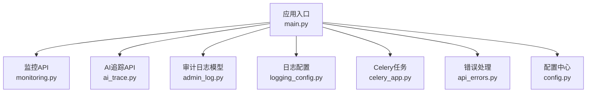
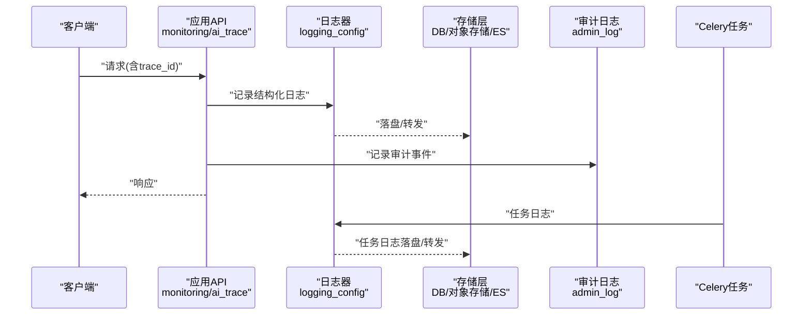
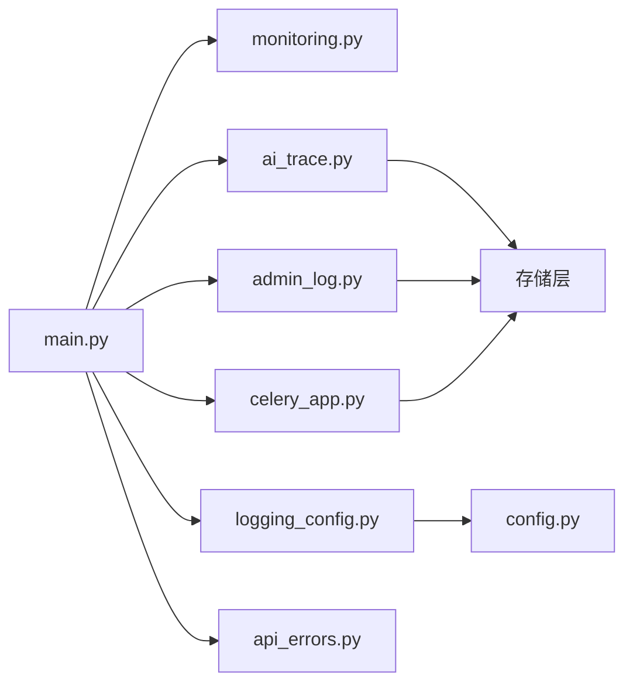

# 日志管理API

<cite>
**本文档引用的文件**   
- [logging_config.py](file://core/logging_config.py)
- [monitoring.py](file://backend/app/api/v1/monitoring.py)
- [ai_trace.py](file://backend/app/api/v1/ai_trace.py)
- [admin_log.py](file://backend/app/models/admin_log.py)
- [main.py](file://backend/app/main.py)
- [celery_app.py](file://backend/app/celery_app.py)
- [api_errors.py](file://backend/app/utils/api_errors.py)
- [config.py](file://backend/app/core/config.py)
</cite>

## 目录
1. [简介](#简介)
2. [项目结构](#项目结构)
3. [核心组件](#核心组件)
4. [架构总览](#架构总览)
5. [详细组件分析](#详细组件分析)
6. [依赖关系分析](#依赖关系分析)
7. [性能考量](#性能考量)
8. [故障排查指南](#故障排查指南)
9. [结论](#结论)
10. [附录](#附录)

## 简介
本文件为小说创作代理系统的“日志管理API”提供完整文档，覆盖系统日志收集、应用日志查询、错误追踪与审计日志的接口说明；并阐述日志级别配置、格式标准化、存储策略与检索优化。同时给出日志分析、模式识别、异常检测与性能分析的API设计建议，以及日志归档、清理策略与合规性保留的实现示例。最后解释分布式日志聚合、实时搜索与可视化展示的机制，帮助读者快速理解与落地。

## 项目结构
与日志相关的关键位置：
- 日志配置与初始化：core/logging_config.py
- 监控与诊断API：backend/app/api/v1/monitoring.py
- AI追踪与可观测性API：backend/app/api/v1/ai_trace.py
- 审计日志模型：backend/app/models/admin_log.py
- 应用入口与中间件挂载：backend/app/main.py
- 异步任务（Celery）集成：backend/app/celery_app.py
- 统一错误处理：backend/app/utils/api_errors.py
- 配置加载：backend/app/core/config.py

图表来源 
- [main.py](file://backend/app/main.py)
- [monitoring.py](file://backend/app/api/v1/monitoring.py)
- [ai_trace.py](file://backend/app/api/v1/ai_trace.py)
- [admin_log.py](file://backend/app/models/admin_log.py)
- [logging_config.py](file://core/logging_config.py)
- [celery_app.py](file://backend/app/celery_app.py)
- [api_errors.py](file://backend/app/utils/api_errors.py)
- [config.py](file://backend/app/core/config.py)

章节来源
- [logging_config.py](file://core/logging_config.py)
- [monitoring.py](file://backend/app/api/v1/monitoring.py)
- [ai_trace.py](file://backend/app/api/v1/ai_trace.py)
- [admin_log.py](file://backend/app/models/admin_log.py)
- [main.py](file://backend/app/main.py)
- [celery_app.py](file://backend/app/celery_app.py)
- [api_errors.py](file://backend/app/utils/api_errors.py)
- [config.py](file://backend/app/core/config.py)

## 核心组件
- 日志配置与格式化
  - 负责日志级别、输出目标（控制台/文件/远端）、时间戳与时区、结构化字段（trace_id、span_id、模块名等）的统一设置。
  - 支持按模块或路由粒度调整级别，便于调试与生产切换。
- 监控与诊断API
  - 暴露健康检查、指标采集、运行时状态与关键KPI（QPS、延迟分布、错误率）。
  - 用于外部监控系统拉取与应用内自检。
- AI追踪与可观测性API
  - 提供请求链路追踪、调用链记录、上下文透传与采样策略。
  - 支持按trace_id检索全链路日志与指标。
- 审计日志模型
  - 定义审计事件的结构化Schema与持久化方式，满足合规留存与检索。
- Celery任务日志
  - 将任务执行、重试、失败与耗时写入统一日志通道，便于离线分析与告警。
- 统一错误处理
  - 规范化错误码、错误消息与堆栈摘要，避免敏感信息泄露。

章节来源
- [logging_config.py](file://core/logging_config.py)
- [monitoring.py](file://backend/app/api/v1/monitoring.py)
- [ai_trace.py](file://backend/app/api/v1/ai_trace.py)
- [admin_log.py](file://backend/app/models/admin_log.py)
- [celery_app.py](file://backend/app/celery_app.py)
- [api_errors.py](file://backend/app/utils/api_errors.py)
- [config.py](file://backend/app/core/config.py)

## 架构总览
日志系统在应用中以“采集—传输—存储—检索—分析—归档”为主线，结合API层对外提供服务。

图表来源 
- [monitoring.py](file://backend/app/api/v1/monitoring.py)
- [ai_trace.py](file://backend/app/api/v1/ai_trace.py)
- [logging_config.py](file://core/logging_config.py)
- [admin_log.py](file://backend/app/models/admin_log.py)
- [celery_app.py](file://backend/app/celery_app.py)

## 详细组件分析

### 日志配置与格式化
- 日志级别
  - 支持DEBUG/INFO/WARNING/ERROR/FATAL等多级，可通过环境变量或配置文件动态切换。
- 输出目标
  - 控制台、本地文件、远程服务（如日志平台/消息队列），可按模块路由。
- 结构化字段
  - 强制包含trace_id、span_id、service_name、level、timestamp、module、message等。
- 时区与时间戳
  - 统一使用UTC或指定时区，确保跨节点一致性。
- 采样与限流
  - 对高频日志进行采样，避免风暴；对错误日志保持高保真。

章节来源
- [logging_config.py](file://core/logging_config.py)
- [config.py](file://backend/app/core/config.py)

### 监控与诊断API
- 健康检查
  - GET /health：返回服务状态、依赖健康度与启动时间。
- 指标与统计
  - GET /metrics：返回关键指标（请求数、延迟分位、错误率、资源使用）。
- 运行态快照
  - GET /status：返回线程池、连接池、缓存命中率等。
- 日志查询（轻量）
  - GET /logs：基于时间范围、级别、模块过滤的最近N条日志摘要。

章节来源
- [monitoring.py](file://backend/app/api/v1/monitoring.py)

### AI追踪与可观测性API
- 链路追踪
  - POST /trace：上报或查询trace上下文，支持按trace_id检索全链路。
- 采样策略
  - 支持按请求类型、错误比例、用户维度进行采样控制。
- 上下文透传
  - 在HTTP/WebSocket/任务间传递trace_id/span_id，保证链路完整。
- 可视化关联
  - 与指标、审计日志通过trace_id关联展示。

章节来源
- [ai_trace.py](file://backend/app/api/v1/ai_trace.py)

### 审计日志模型与API
- 数据模型
  - 定义审计事件字段：操作者、主体、动作、结果、原因、时间戳、IP、UA、trace_id等。
- 写入策略
  - 同步或异步写入，确保不阻塞主流程；失败重试与死信队列。
- 查询与导出
  - 提供按时间、主体、动作、结果的筛选与分页；支持CSV/JSON导出。
- 合规保留
  - 按法规要求设定保留期，到期自动归档或删除。

章节来源
- [admin_log.py](file://backend/app/models/admin_log.py)

### Celery任务日志
- 任务生命周期
  - 入队、执行、重试、成功、失败均记录结构化日志。
- 错误与堆栈
  - 捕获异常并记录堆栈摘要，避免敏感信息泄露。
- 性能指标
  - 记录任务耗时、队列长度、并发度，便于容量规划。

章节来源
- [celery_app.py](file://backend/app/celery_app.py)

### 统一错误处理
- 错误码规范
  - 业务错误码与HTTP状态码映射清晰，便于前端与监控联动。
- 安全脱敏
  - 禁止在日志中输出密码、密钥、令牌等敏感信息。
- 可观测性增强
  - 错误日志附带trace_id与上下文，便于定位。

章节来源
- [api_errors.py](file://backend/app/utils/api_errors.py)

## 依赖关系分析
- 应用入口挂载监控与追踪API，注入日志器与审计模型。
- 日志器依赖配置中心读取级别与输出目标。
- 审计日志与追踪数据依赖存储层（数据库/对象存储/搜索引擎）。
- Celery任务通过日志器统一输出，便于集中采集。

图表来源 
- [main.py](file://backend/app/main.py)
- [monitoring.py](file://backend/app/api/v1/monitoring.py)
- [ai_trace.py](file://backend/app/api/v1/ai_trace.py)
- [logging_config.py](file://core/logging_config.py)
- [admin_log.py](file://backend/app/models/admin_log.py)
- [celery_app.py](file://backend/app/celery_app.py)
- [api_errors.py](file://backend/app/utils/api_errors.py)
- [config.py](file://backend/app/core/config.py)

章节来源
- [main.py](file://backend/app/main.py)
- [monitoring.py](file://backend/app/api/v1/monitoring.py)
- [ai_trace.py](file://backend/app/api/v1/ai_trace.py)
- [logging_config.py](file://core/logging_config.py)
- [admin_log.py](file://backend/app/models/admin_log.py)
- [celery_app.py](file://backend/app/celery_app.py)
- [api_errors.py](file://backend/app/utils/api_errors.py)
- [config.py](file://backend/app/core/config.py)

## 性能考量
- 日志采样与限流
  - 对INFO及以上级别进行采样，ERROR/FATAL保持全量。
- 异步写入
  - 通过消息队列或后台任务批量落盘，降低IO抖动。
- 索引与查询优化
  - 对常用查询字段建立索引（trace_id、时间、级别、模块）。
- 存储分层
  - 热数据（近7天）存高速存储，冷数据归档至低成本介质。
- 压缩与去重
  - 启用压缩与重复键去重，减少存储空间与带宽。

[本节为通用指导，不直接分析具体文件]

## 故障排查指南
- 常见问题
  - 日志缺失：检查日志器是否初始化、输出目标是否可达、权限是否正确。
  - 追踪断裂：确认trace_id在各组件间透传，未发生丢失或覆盖。
  - 审计遗漏：核对审计写入路径与重试策略，关注死信队列。
  - 性能抖动：查看采样与限流配置，评估批量写入吞吐。
- 定位步骤
  - 通过trace_id串联HTTP请求、任务执行与数据库访问。
  - 使用监控API获取实时指标，对比历史基线。
  - 导出审计日志进行合规审查与回溯。

章节来源
- [monitoring.py](file://backend/app/api/v1/monitoring.py)
- [ai_trace.py](file://backend/app/api/v1/ai_trace.py)
- [admin_log.py](file://backend/app/models/admin_log.py)
- [celery_app.py](file://backend/app/celery_app.py)
- [api_errors.py](file://backend/app/utils/api_errors.py)

## 结论
本日志管理API围绕“结构化、可追踪、可审计、高性能”的目标构建，通过统一的日志配置、标准化的API与完善的存储策略，支撑小说创作代理系统的稳定运行与持续优化。建议在生产环境启用采样与异步写入，结合分布式日志平台实现聚合、实时搜索与可视化展示，以满足运维与合规需求。

[本节为总结性内容，不直接分析具体文件]

## 附录

### API清单与行为说明
- 健康检查
  - GET /health：返回服务状态与依赖健康度。
- 指标与统计
  - GET /metrics：返回关键指标与趋势。
- 运行态快照
  - GET /status：返回进程与资源状态。
- 日志查询（轻量）
  - GET /logs：基于时间、级别、模块过滤的最近日志摘要。
- 链路追踪
  - POST /trace：上报或查询trace上下文，支持trace_id检索。
- 审计日志
  - 提供审计事件的写入、查询与导出接口（由审计模型驱动）。

章节来源
- [monitoring.py](file://backend/app/api/v1/monitoring.py)
- [ai_trace.py](file://backend/app/api/v1/ai_trace.py)
- [admin_log.py](file://backend/app/models/admin_log.py)

### 日志级别配置与格式标准化
- 级别配置
  - 支持按模块与环境动态调整，默认生产环境为INFO/WARNING/ERROR。
- 格式标准
  - JSON结构化字段，包含trace_id、span_id、service_name、level、timestamp、module、message等。
- 时区与时间戳
  - 统一时区与时间格式，便于跨系统关联。

章节来源
- [logging_config.py](file://core/logging_config.py)
- [config.py](file://backend/app/core/config.py)

### 存储策略与检索优化
- 存储分层
  - 热数据（近7天）高速存储，冷数据归档至低成本介质。
- 索引策略
  - 对trace_id、时间、级别、模块建立索引，提升查询效率。
- 压缩与去重
  - 启用压缩与重复键去重，降低存储成本。

章节来源
- [admin_log.py](file://backend/app/models/admin_log.py)

### 日志分析、模式识别、异常检测与性能分析
- 日志分析
  - 基于trace_id聚合请求链路，计算成功率、P95/P99延迟。
- 模式识别
  - 对错误消息聚类，识别常见异常模式与根因。
- 异常检测
  - 基于阈值与规则引擎触发告警（错误率突增、延迟飙升）。
- 性能分析
  - 结合指标API与任务日志，定位瓶颈与容量不足。

[本节为通用指导，不直接分析具体文件]

### 日志归档、清理策略与合规性保留
- 归档策略
  - 按月归档，压缩后迁移至对象存储。
- 清理策略
  - 超过保留期的日志自动删除或匿名化处理。
- 合规保留
  - 审计日志按法规要求保留，支持只读与不可篡改。

[本节为通用指导，不直接分析具体文件]

### 分布式日志聚合、实时搜索与可视化展示
- 聚合方案
  - 使用日志采集Agent将各节点日志汇聚至中央平台。
- 实时搜索
  - 基于倒排索引与流式处理实现毫秒级检索。
- 可视化展示
  - 提供仪表盘、链路图与审计报表，支持钻取与下钻。

[本节为通用指导，不直接分析具体文件]