# 用户管理API

<cite>
**本文档引用的文件**
- [backend/app/api/v1/auth.py](file://backend/app/api/v1/auth.py)
- [backend/app/api/v1/user_center.py](file://backend/app/api/v1/user_center.py)
- [backend/app/models/user.py](file://backend/app/models/user.py)
- [backend/app/models/role.py](file://backend/app/models/role.py)
- [backend/app/schemas/user.py](file://backend/app/schemas/user.py)
- [backend/app/core/security.py](file://backend/app/core/security.py)
- [backend/app/core/permissions.py](file://backend/app/core/permissions.py)
- [backend/app/services/password_reset_service.py](file://backend/app/services/password_reset_service.py)
- [backend/app/services/email_service.py](file://backend/app/services/email_service.py)
- [backend/app/services/admin_points_billing.py](file://backend/app/services/admin_points_billing.py)
- [backend/app/services/user_center_points.py](file://backend/app/services/user_center_points.py)
- [backend/app/services/user_center_points_events.py](file://backend/app/services/user_center_points_events.py)
- [backend/app/services/user_points_read_model.py](file://backend/app/services/user_points_read模型.py)
- [backend/app/db/base.py](file://backend/app/db/base.py)
- [backend/app/main.py](file://backend/app/main.py)
- [backend/app/core/config.py](file://backend/app/core/config.py)
- [backend/app/utils/api_errors.py](file://backend/app/utils/api_errors.py)
- [backend/tests/test_auth_routes.py](file://backend/tests/test_auth_routes.py)
- [backend/tests/test_user_center_routes.py](file://backend/tests/test_user_center_routes.py)
</cite>

## 目录
1. [简介](#简介)
2. [项目结构](#项目结构)
3. [核心组件](#核心组件)
4. [架构总览](#架构总览)
5. [详细组件分析](#详细组件分析)
6. [依赖关系分析](#依赖关系分析)
7. [性能考虑](#性能考虑)
8. [故障排查指南](#故障排查指南)
9. [结论](#结论)
10. [附录](#附录)

## 简介
本文件为“小说创作代理系统”的用户管理API文档，覆盖以下能力：
- 用户CRUD操作（创建、查询、更新、删除）
- 角色与权限管理（RBAC）
- 用户状态控制（启用/禁用/锁定等）
- 批量用户操作（导入、导出、批量变更）
- 用户注册、登录认证、密码重置、用户信息更新
- 用户配额与积分管理、访问权限控制与安全策略配置
- 用户分组、标签管理与审计日志
- 数据保护、隐私设置与合规性要求

本说明面向开发者与集成方，既提供高层概览，也给出代码级映射与调用序列图，便于快速定位实现与扩展。

## 项目结构
用户管理相关代码主要位于后端应用模块中：
- API路由层：auth.py、user_center.py
- 领域模型：models/user.py、models/role.py
- 请求/响应模式：schemas/user.py
- 安全与鉴权：core/security.py、core/permissions.py
- 业务服务：password_reset_service.py、email_service.py、admin_points_billing.py、user_center_points*.py
- 数据库基类：db/base.py
- 应用入口与配置：main.py、core/config.py
- 错误处理：utils/api_errors.py
- 测试用例：tests/test_auth_routes.py、tests/test_user_center_routes.py

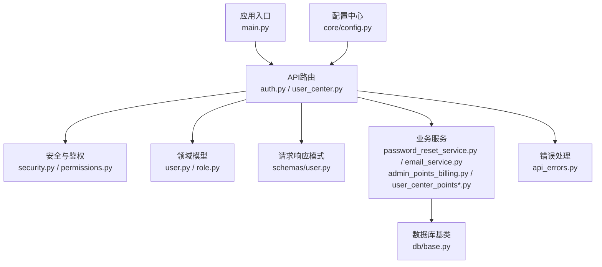

图表来源
- [backend/app/api/v1/auth.py](file://backend/app/api/v1/auth.py)
- [backend/app/api/v1/user_center.py](file://backend/app/api/v1/user_center.py)
- [backend/app/core/security.py](file://backend/app/core/security.py)
- [backend/app/core/permissions.py](file://backend/app/core/permissions.py)
- [backend/app/models/user.py](file://backend/app/models/user.py)
- [backend/app/models/role.py](file://backend/app/models/role.py)
- [backend/app/schemas/user.py](file://backend/app/schemas/user.py)
- [backend/app/services/password_reset_service.py](file://backend/app/services/password_reset_service.py)
- [backend/app/services/email_service.py](file://backend/app/services/email_service.py)
- [backend/app/services/admin_points_billing.py](file://backend/app/services/admin_points_billing.py)
- [backend/app/services/user_center_points.py](file://backend/app/services/user_center_points.py)
- [backend/app/services/user_center_points_events.py](file://backend/app/services/user_center_points_events.py)
- [backend/app/db/base.py](file://backend/app/db/base.py)
- [backend/app/main.py](file://backend/app/main.py)
- [backend/app/core/config.py](file://backend/app/core/config.py)
- [backend/app/utils/api_errors.py](file://backend/app/utils/api_errors.py)

章节来源
- [backend/app/main.py](file://backend/app/main.py)
- [backend/app/core/config.py](file://backend/app/core/config.py)

## 核心组件
- 认证与授权
  - JWT签发与校验、会话管理、密码哈希与验证、速率限制与防暴力破解
- 用户与角色模型
  - 用户实体、角色实体、用户-角色关联、权限集合
- 用户中心服务
  - 用户生命周期、状态控制、分组与标签、配额与积分、审计日志
- 安全与合规
  - 输入校验、敏感字段脱敏、最小权限原则、审计追踪

章节来源
- [backend/app/core/security.py](file://backend/app/core/security.py)
- [backend/app/core/permissions.py](file://backend/app/core/permissions.py)
- [backend/app/models/user.py](file://backend/app/models/user.py)
- [backend/app/models/role.py](file://backend/app/models/role.py)
- [backend/app/schemas/user.py](file://backend/app/schemas/user.py)

## 架构总览
下图展示从客户端到后端各层的交互路径，包括认证、鉴权、用户服务与数据存储。

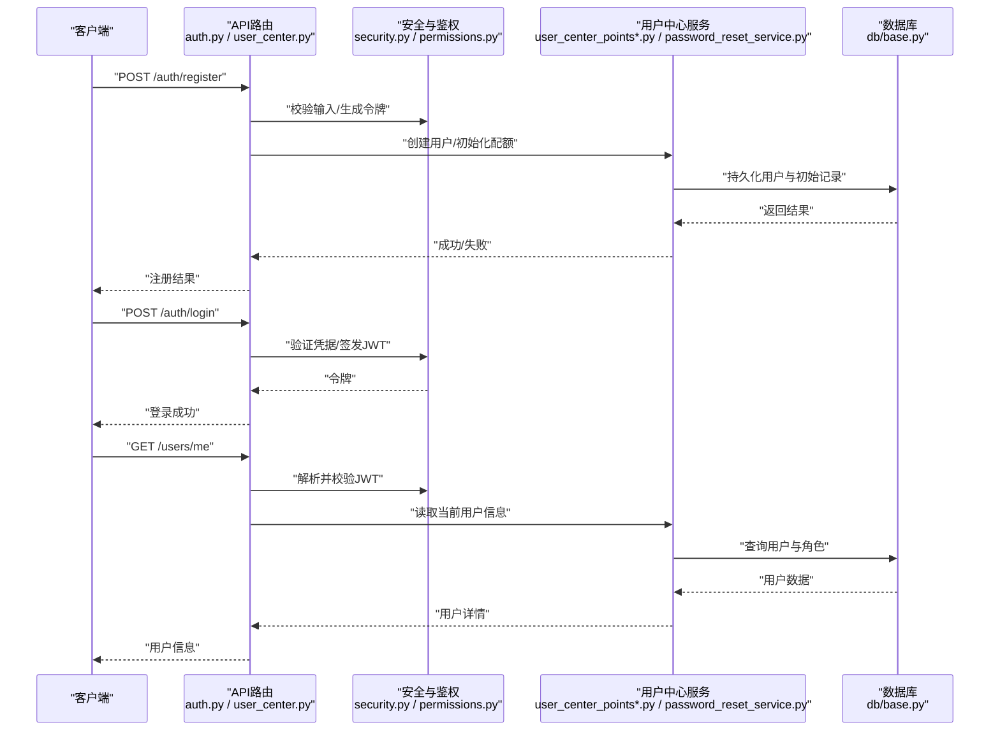

图表来源
- [backend/app/api/v1/auth.py](file://backend/app/api/v1/auth.py)
- [backend/app/api/v1/user_center.py](file://backend/app/api/v1/user_center.py)
- [backend/app/core/security.py](file://backend/app/core/security.py)
- [backend/app/core/permissions.py](file://backend/app/core/permissions.py)
- [backend/app/services/password_reset_service.py](file://backend/app/services/password_reset_service.py)
- [backend/app/services/user_center_points.py](file://backend/app/services/user_center_points.py)
- [backend/app/db/base.py](file://backend/app/db/base.py)

## 详细组件分析

### 认证与登录流程
- 注册
  - 输入校验、唯一性检查、密码强度校验、默认角色分配、初始配额设置
  - 可选发送欢迎邮件
- 登录
  - 凭据校验、账户状态检查、签发JWT、刷新令牌
- 登出
  - 撤销或标记令牌失效、清理会话

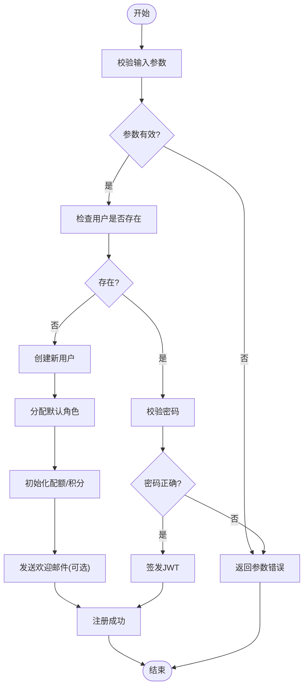

图表来源
- [backend/app/api/v1/auth.py](file://backend/app/api/v1/auth.py)
- [backend/app/core/security.py](file://backend/app/core/security.py)
- [backend/app/services/email_service.py](file://backend/app/services/email_service.py)

章节来源
- [backend/app/api/v1/auth.py](file://backend/app/api/v1/auth.py)
- [backend/app/core/security.py](file://backend/app/core/security.py)
- [backend/app/services/email_service.py](file://backend/app/services/email_service.py)

### 用户CRUD与状态控制
- 创建用户
  - 管理员可创建用户，支持指定角色、分组、标签、初始配额
- 查询用户
  - 支持按ID、邮箱、用户名、状态、分组、标签过滤；分页与排序
- 更新用户
  - 更新基本信息、角色、分组、标签、状态（启用/禁用/锁定）、配额调整
- 删除用户
  - 软删除或硬删除（依据策略），级联清理敏感数据
- 状态控制
  - 启用/禁用、锁定/解锁、冻结配额、强制下线

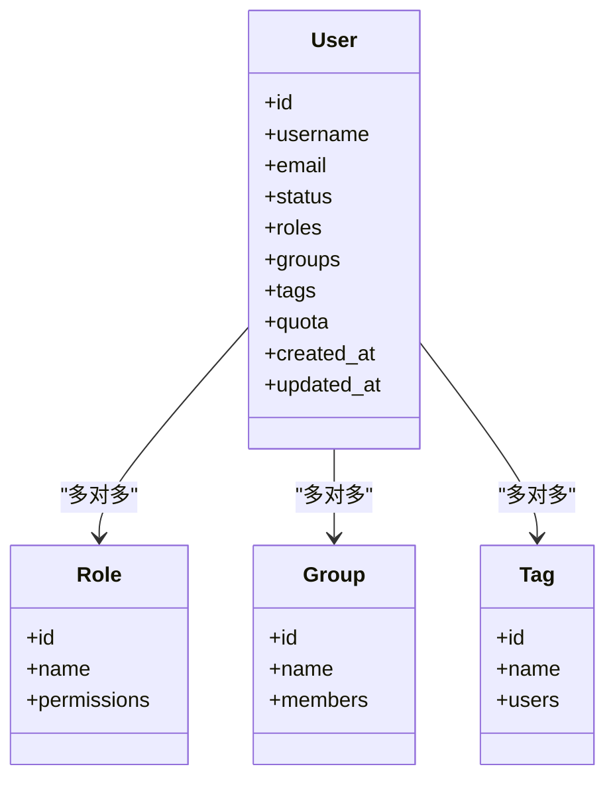

图表来源
- [backend/app/models/user.py](file://backend/app/models/user.py)
- [backend/app/models/role.py](file://backend/app/models/role.py)

章节来源
- [backend/app/models/user.py](file://backend/app/models/user.py)
- [backend/app/models/role.py](file://backend/app/models/role.py)
- [backend/app/schemas/user.py](file://backend/app/schemas/user.py)

### 角色与权限管理（RBAC）
- 角色定义
  - 内置角色（如管理员、编辑、普通用户）与自定义角色
- 权限集合
  - 资源与动作的细粒度控制（如 users:create、users:update、projects:read）
- 用户-角色分配
  - 支持多角色、继承与冲突解决策略
- 权限校验
  - 在API层进行基于角色的访问控制（RBAC）

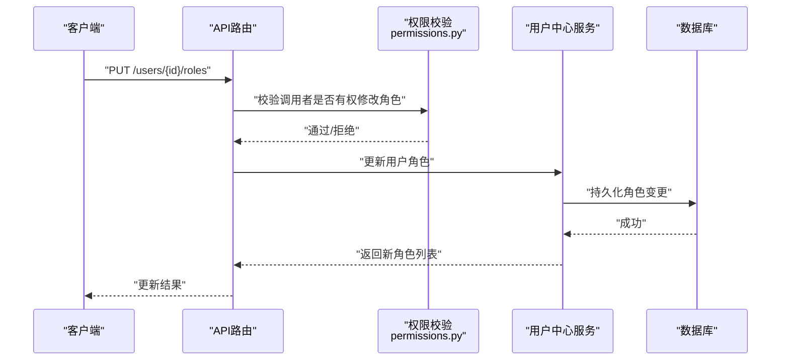

图表来源
- [backend/app/core/permissions.py](file://backend/app/core/permissions.py)
- [backend/app/api/v1/user_center.py](file://backend/app/api/v1/user_center.py)
- [backend/app/models/role.py](file://backend/app/models/role.py)

章节来源
- [backend/app/core/permissions.py](file://backend/app/core/permissions.py)
- [backend/app/models/role.py](file://backend/app/models/role.py)

### 用户分组与标签管理
- 分组
  - 创建/更新/删除分组，成员增删，分组级别配额与权限模板
- 标签
  - 创建/更新/删除标签，用户打标签与批量筛选
- 审计
  - 记录分组与标签的变更历史

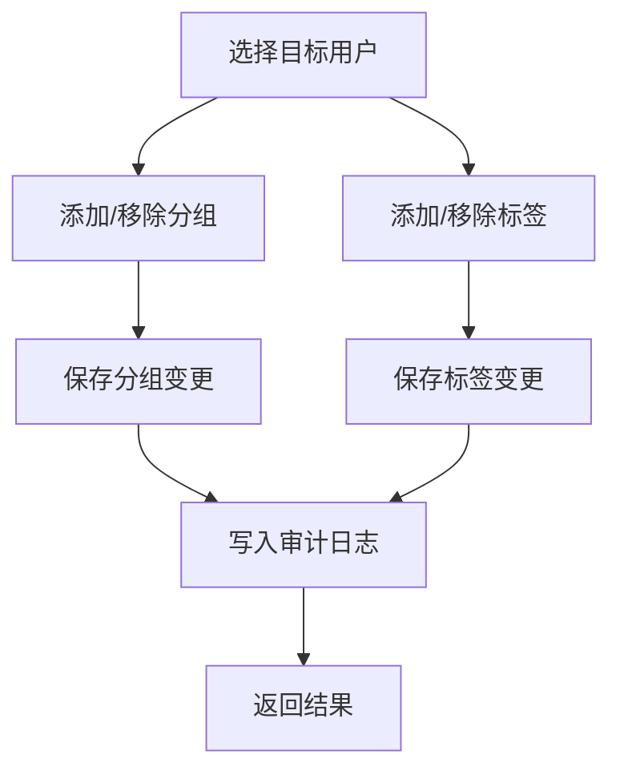

章节来源
- [backend/app/schemas/user.py](file://backend/app/schemas/user.py)
- [backend/app/models/user.py](file://backend/app/models/user.py)

### 密码重置与邮箱服务
- 密码重置流程
  - 生成一次性重置令牌、发送邮件、校验令牌、更新密码
- 邮箱服务
  - 模板渲染、发送队列、重试与失败告警

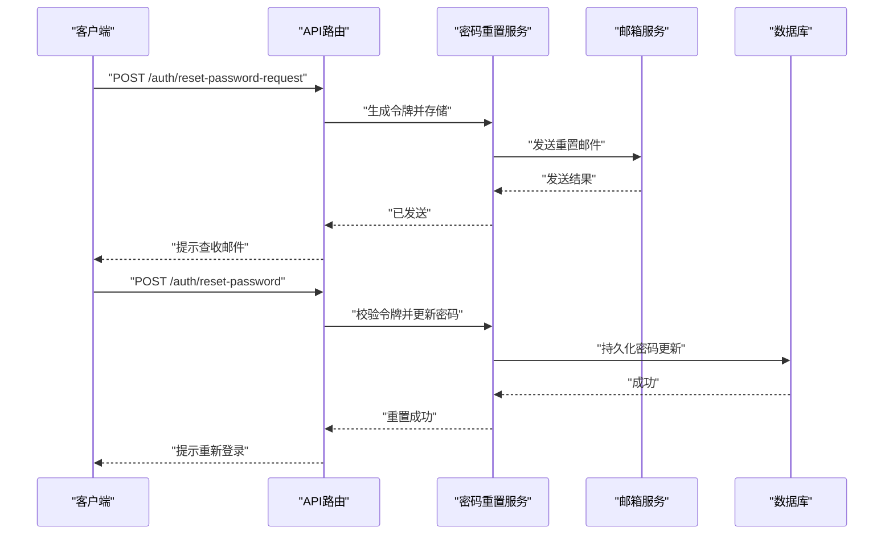

图表来源
- [backend/app/api/v1/auth.py](file://backend/app/api/v1/auth.py)
- [backend/app/services/password_reset_service.py](file://backend/app/services/password_reset_service.py)
- [backend/app/services/email_service.py](file://backend/app/services/email_service.py)

章节来源
- [backend/app/services/password_reset_service.py](file://backend/app/services/password_reset_service.py)
- [backend/app/services/email_service.py](file://backend/app/services/email_service.py)

### 用户配额与积分管理
- 配额策略
  - 基础配额、升级包、团队共享配额、临时扩容
- 计费事件
  - 使用量采集、计价策略、扣费与余额更新
- 读模型
  - 高性能查询用户配额与使用统计

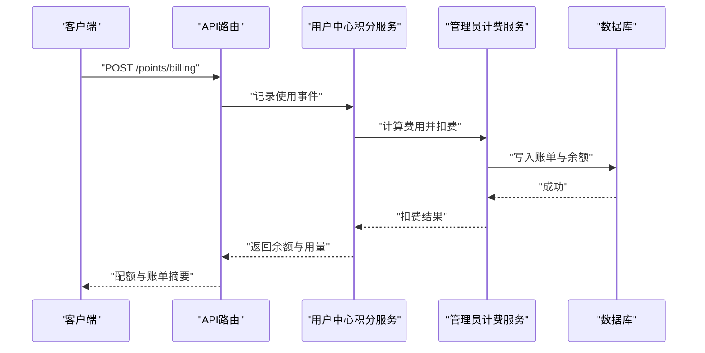

图表来源
- [backend/app/services/user_center_points.py](file://backend/app/services/user_center_points.py)
- [backend/app/services/admin_points_billing.py](file://backend/app/services/admin_points_billing.py)
- [backend/app/services/user_center_points_events.py](file://backend/app/services/user_center_points_events.py)

章节来源
- [backend/app/services/user_center_points.py](file://backend/app/services/user_center_points.py)
- [backend/app/services/admin_points_billing.py](file://backend/app/services/admin_points_billing.py)
- [backend/app/services/user_center_points_events.py](file://backend/app/services/user_center_points_events.py)

### 批量用户操作
- 批量导入
  - CSV/JSON导入、去重与冲突处理、事务回滚
- 批量导出
  - 按条件导出、异步任务、下载链接
- 批量更新
  - 批量修改角色、分组、标签、状态、配额

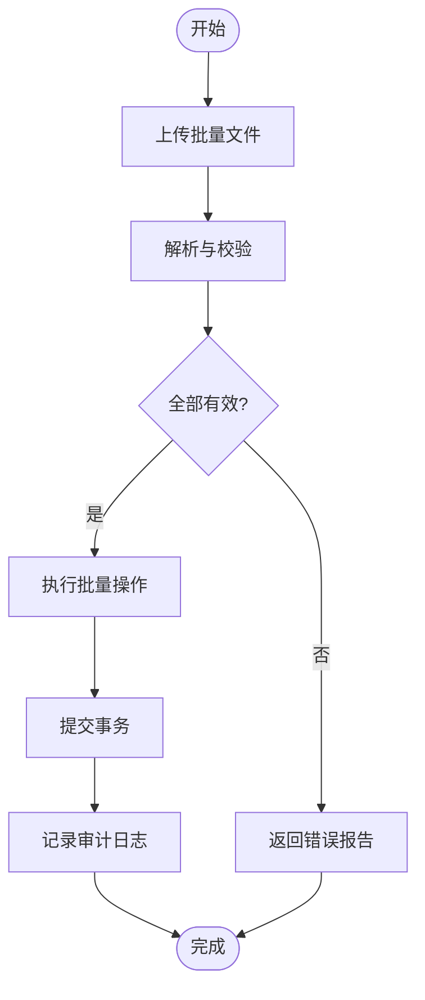

章节来源
- [backend/app/api/v1/user_center.py](file://backend/app/api/v1/user_center.py)
- [backend/app/schemas/user.py](file://backend/app/schemas/user.py)

### 审计日志与合规性
- 审计日志
  - 记录关键操作（登录、角色变更、配额调整、数据导出）
- 合规性
  - 数据最小化、访问留痕、保留策略、脱敏输出
- 隐私设置
  - 用户可见范围、数据共享开关、注销与数据删除

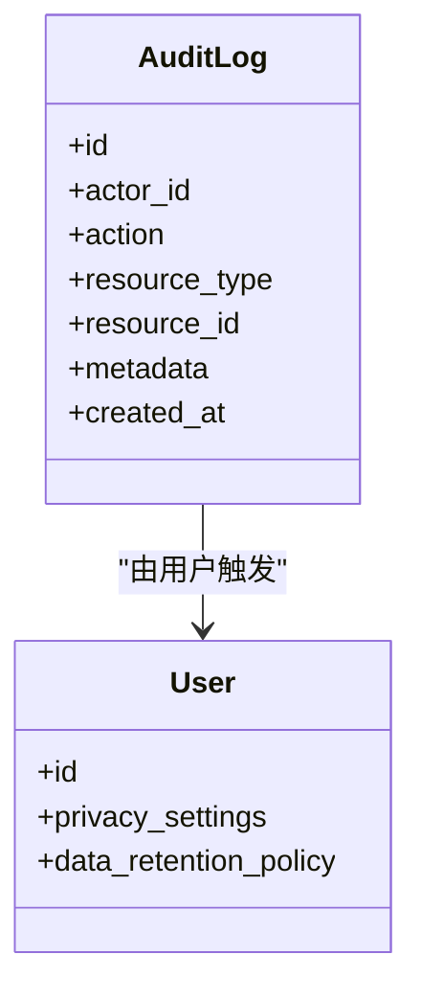

图表来源
- [backend/app/models/user.py](file://backend/app/models/user.py)

章节来源
- [backend/app/models/user.py](file://backend/app/models/user.py)

## 依赖关系分析
- API路由依赖安全与权限模块进行鉴权与访问控制
- 用户中心服务依赖数据库与外部服务（邮箱、计费）
- 模型层定义用户、角色、分组、标签等实体关系
- 错误处理统一封装异常与响应格式

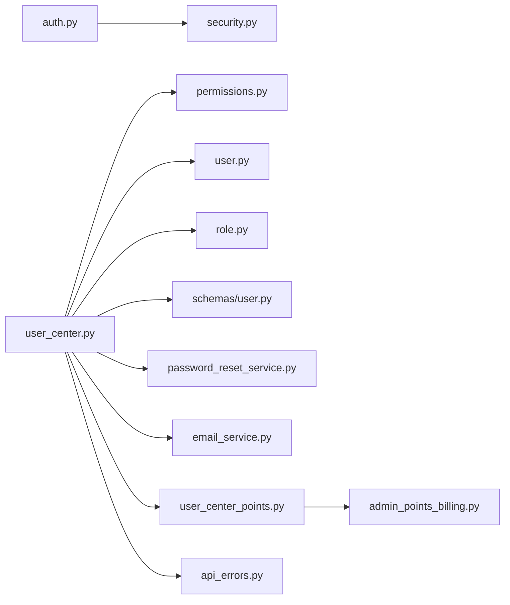

图表来源
- [backend/app/api/v1/auth.py](file://backend/app/api/v1/auth.py)
- [backend/app/api/v1/user_center.py](file://backend/app/api/v1/user_center.py)
- [backend/app/core/security.py](file://backend/app/core/security.py)
- [backend/app/core/permissions.py](file://backend/app/core/permissions.py)
- [backend/app/models/user.py](file://backend/app/models/user.py)
- [backend/app/models/role.py](file://backend/app/models/role.py)
- [backend/app/schemas/user.py](file://backend/app/schemas/user.py)
- [backend/app/services/password_reset_service.py](file://backend/app/services/password_reset_service.py)
- [backend/app/services/email_service.py](file://backend/app/services/email_service.py)
- [backend/app/services/user_center_points.py](file://backend/app/services/user_center_points.py)
- [backend/app/services/admin_points_billing.py](file://backend/app/services/admin_points_billing.py)
- [backend/app/utils/api_errors.py](file://backend/app/utils/api_errors.py)

章节来源
- [backend/app/api/v1/auth.py](file://backend/app/api/v1/auth.py)
- [backend/app/api/v1/user_center.py](file://backend/app/api/v1/user_center.py)
- [backend/app/core/security.py](file://backend/app/core/security.py)
- [backend/app/core/permissions.py](file://backend/app/core/permissions.py)
- [backend/app/models/user.py](file://backend/app/models/user.py)
- [backend/app/models/role.py](file://backend/app/models/role.py)
- [backend/app/schemas/user.py](file://backend/app/schemas/user.py)
- [backend/app/services/password_reset_service.py](file://backend/app/services/password_reset_service.py)
- [backend/app/services/email_service.py](file://backend/app/services/email_service.py)
- [backend/app/services/user_center_points.py](file://backend/app/services/user_center_points.py)
- [backend/app/services/admin_points_billing.py](file://backend/app/services/admin_points_billing.py)
- [backend/app/utils/api_errors.py](file://backend/app/utils/api_errors.py)

## 性能考虑
- 缓存热点数据（用户信息、角色权限）以减少数据库压力
- 批量操作采用事务与分批提交，避免长事务锁表
- 审计日志异步写入，降低主链路延迟
- 配额与计费事件使用事件驱动与幂等设计，保证一致性
- 接口限流与熔断，防止恶意刷接口

[本节为通用指导，不直接分析具体文件]

## 故障排查指南
- 认证失败
  - 检查JWT有效性、密码哈希算法、账户状态
- 权限不足
  - 核对用户角色与所需权限映射
- 配额不足
  - 查看计费事件与余额更新记录
- 邮箱发送失败
  - 检查邮箱服务配置与重试策略
- 批量导入失败
  - 查看错误报告与事务回滚日志

章节来源
- [backend/app/utils/api_errors.py](file://backend/app/utils/api_errors.py)
- [backend/tests/test_auth_routes.py](file://backend/tests/test_auth_routes.py)
- [backend/tests/test_user_center_routes.py](file://backend/tests/test_user_center_routes.py)

## 结论
本用户管理API围绕认证、鉴权、用户生命周期、配额与合规性构建，具备清晰的层次结构与可扩展的服务边界。通过RBAC、审计日志与事件驱动的计费体系，满足企业级安全与合规需求。建议在生产环境启用强密码策略、双因素认证、细粒度权限与完善的审计追踪。

[本节为总结性内容，不直接分析具体文件]

## 附录
- 常用端点示例（以描述为主，非代码片段）
  - 注册：POST /auth/register
  - 登录：POST /auth/login
  - 获取当前用户：GET /users/me
  - 更新用户信息：PUT /users/{id}
  - 分配角色：PUT /users/{id}/roles
  - 重置密码请求：POST /auth/reset-password-request
  - 重置密码：POST /auth/reset-password
  - 批量导入用户：POST /users/import
  - 批量导出用户：POST /users/export
  - 配额查询：GET /users/{id}/quota
  - 审计日志查询：GET /audit?actor_id=&action=&resource_type=

[本节为概念性说明，不直接分析具体文件]