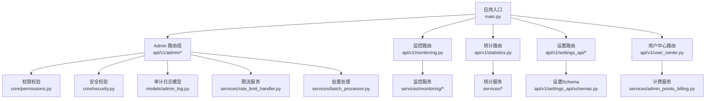
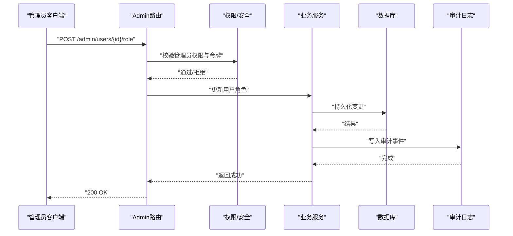
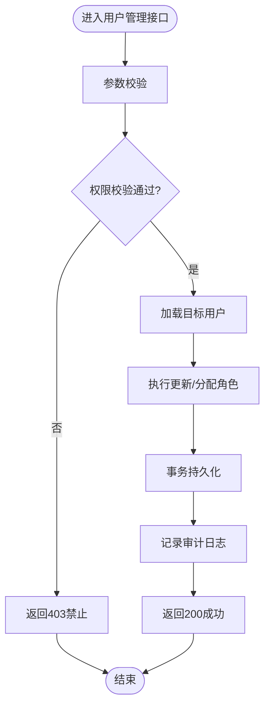
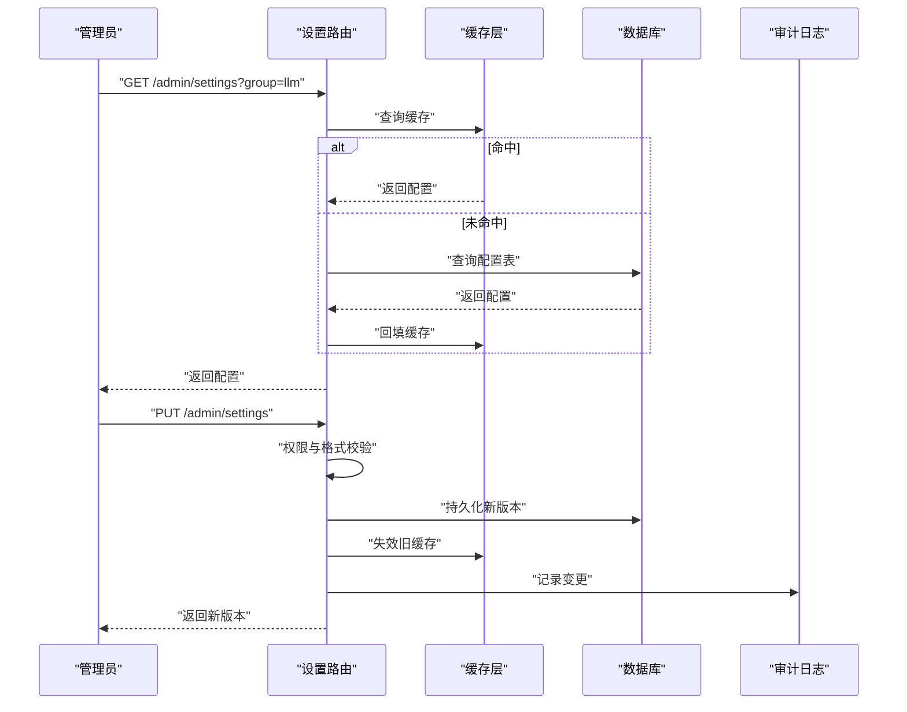
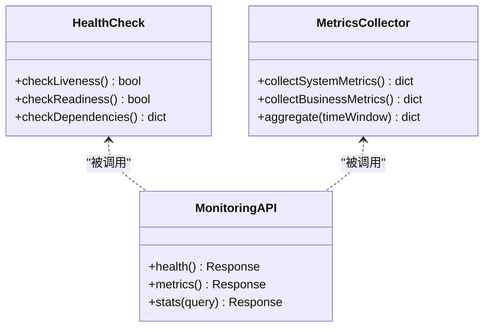
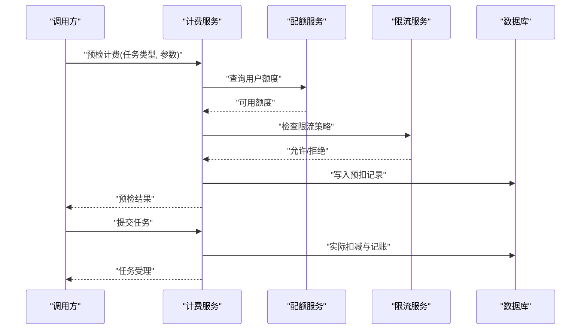
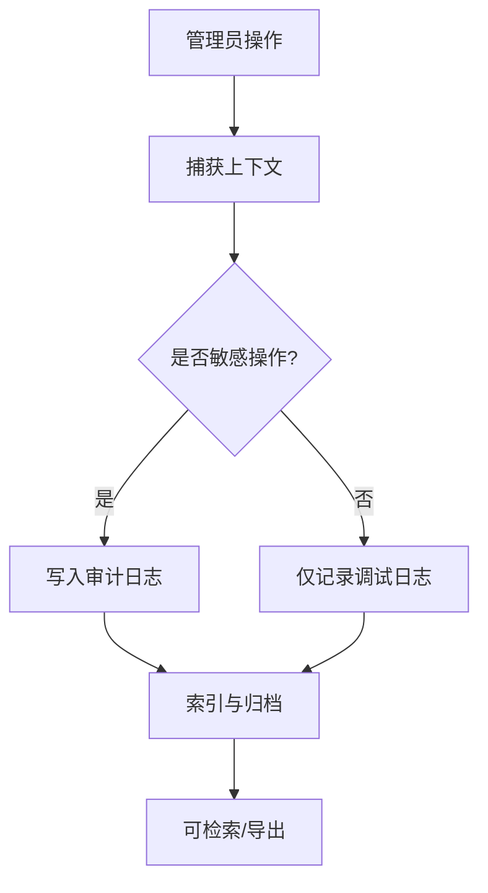
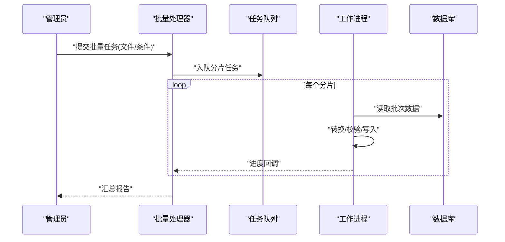
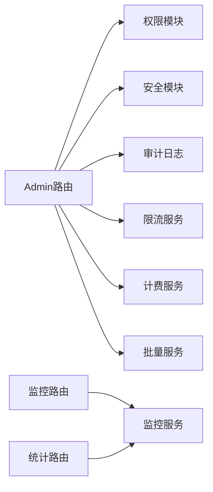

# 管理后台API

<cite>
**本文引用的文件**   
- [backend/app/main.py](file://backend/app/main.py)
- [backend/app/api/v1/admin/__init__.py](file://backend/app/api/v1/admin/__init__.py)
- [backend/app/core/permissions.py](file://backend/app/core/permissions.py)
- [backend/app/core/security.py](file://backend/app/core/security.py)
- [backend/app/schemas/admin.py](file://backend/app/schemas/admin.py)
- [backend/app/models/admin_log.py](file://backend/app/models/admin_log.py)
- [backend/app/services/rate_limit_handler.py](file://backend/app/services/rate_limit_handler.py)
- [backend/app/services/monitoring/__init__.py](file://backend/app/services/monitoring/__init__.py)
- [backend/app/api/v1/monitoring.py](file://backend/app/api/v1/monitoring.py)
- [backend/app/api/v1/statistics.py](file://backend/app/api/v1/statistics.py)
- [backend/app/api/v1/user_center.py](file://backend/app/api/v1/user_center.py)
- [backend/app/services/admin_points_billing.py](file://backend/app/services/admin_points_billing.py)
- [backend/app/services/batch_processor.py](file://backend/app/services/batch_processor.py)
- [backend/app/api/v1/settings_api/routes.py](file://backend/app/api/v1/settings_api/routes.py)
- [backend/app/api/v1/settings_api/schemas.py](file://backend/app/api/v1/settings_api/schemas.py)
</cite>

## 目录
1. [简介](#简介)
2. [项目结构](#项目结构)
3. [核心组件](#核心组件)
4. [架构总览](#架构总览)
5. [详细组件分析](#详细组件分析)
6. [依赖关系分析](#依赖关系分析)
7. [性能考量](#性能考量)
8. [故障排查指南](#故障排查指南)
9. [结论](#结论)
10. [附录](#附录)

## 简介
本文件为“小说创作代理系统”的管理后台API文档，聚焦管理员视角的接口能力与实现要点，覆盖用户管理、系统配置、监控统计、计费管理、权限控制、审计日志、性能监控、资源管理、配额与限流、错误追踪与诊断、健康检查、备份恢复以及批量操作等。文档面向运维与平台管理员，兼顾非技术读者理解。

## 项目结构
管理后台相关代码主要位于后端模块中：
- API路由层：admin、monitoring、statistics、settings_api、user_center 等
- 安全与权限：core/permissions.py、core/security.py
- 数据模型与迁移：models/admin_log.py 及 alembic 版本脚本
- 服务层：rate_limit_handler.py、monitoring、admin_points_billing.py、batch_processor.py
- 应用入口：main.py（注册路由、中间件、生命周期）

图表来源
- [backend/app/main.py](file://backend/app/main.py)
- [backend/app/api/v1/admin/__init__.py](file://backend/app/api/v1/admin/__init__.py)
- [backend/app/api/v1/monitoring.py](file://backend/app/api/v1/monitoring.py)
- [backend/app/api/v1/statistics.py](file://backend/app/api/v1/statistics.py)
- [backend/app/api/v1/settings_api/routes.py](file://backend/app/api/v1/settings_api/routes.py)
- [backend/app/api/v1/user_center.py](file://backend/app/api/v1/user_center.py)
- [backend/app/core/permissions.py](file://backend/app/core/permissions.py)
- [backend/app/core/security.py](file://backend/app/core/security.py)
- [backend/app/services/rate_limit_handler.py](file://backend/app/services/rate_limit_handler.py)
- [backend/app/services/monitoring/__init__.py](file://backend/app/services/monitoring/__init__.py)
- [backend/app/models/admin_log.py](file://backend/app/models/admin_log.py)
- [backend/app/services/admin_points_billing.py](file://backend/app/services/admin_points_billing.py)
- [backend/app/services/batch_processor.py](file://backend/app/services/batch_processor.py)

章节来源
- [backend/app/main.py](file://backend/app/main.py)
- [backend/app/api/v1/admin/__init__.py](file://backend/app/api/v1/admin/__init__.py)

## 核心组件
- 权限与安全
  - 基于角色的访问控制（RBAC）与细粒度权限校验，结合JWT鉴权与请求签名校验。
  - 关键文件：core/permissions.py、core/security.py。
- 审计日志
  - 记录管理员操作行为（增删改查、审批、配置变更），支持检索与导出。
  - 关键文件：models/admin_log.py。
- 限流与配额
  - 全局与租户级限流策略，按IP/用户/接口维度限制；配合用户积分配额管理。
  - 关键文件：services/rate_limit_handler.py、services/admin_points_billing.py。
- 监控与健康检查
  - 暴露系统健康、依赖状态、队列与缓存指标，支持SSE或轮询获取。
  - 关键文件：api/v1/monitoring.py、services/monitoring/*。
- 统计报表
  - 聚合业务与系统指标，提供时间序列与汇总视图。
  - 关键文件：api/v1/statistics.py。
- 设置管理
  - 集中管理系统参数、功能开关、模板与外部服务配置。
  - 关键文件：api/v1/settings_api/routes.py、schemas.py。
- 用户中心与计费
  - 用户账户、角色、积分、账单、额度与使用量统计。
  - 关键文件：api/v1/user_center.py、services/admin_points_billing.py。
- 批量操作
  - 异步任务编排，支持大批量导入/导出、批量更新与清理。
  - 关键文件：services/batch_processor.py。

章节来源
- [backend/app/core/permissions.py](file://backend/app/core/permissions.py)
- [backend/app/core/security.py](file://backend/app/core/security.py)
- [backend/app/models/admin_log.py](file://backend/app/models/admin_log.py)
- [backend/app/services/rate_limit_handler.py](file://backend/app/services/rate_limit_handler.py)
- [backend/app/services/admin_points_billing.py](file://backend/app/services/admin_points_billing.py)
- [backend/app/api/v1/monitoring.py](file://backend/app/api/v1/monitoring.py)
- [backend/app/api/v1/statistics.py](file://backend/app/api/v1/statistics.py)
- [backend/app/api/v1/settings_api/routes.py](file://backend/app/api/v1/settings_api/routes.py)
- [backend/app/api/v1/user_center.py](file://backend/app/api/v1/user_center.py)
- [backend/app/services/batch_processor.py](file://backend/app/services/batch_processor.py)

## 架构总览
管理后台采用分层架构：
- 接入层：FastAPI路由统一注册，鉴权中间件前置，限流与审计横切。
- 控制器层：各业务路由负责参数校验、调用服务、返回响应。
- 服务层：封装领域逻辑（限流、计费、监控、批量任务）。
- 数据层：ORM模型与迁移，持久化审计、配置、统计快照等。

图表来源
- [backend/app/api/v1/admin/__init__.py](file://backend/app/api/v1/admin/__init__.py)
- [backend/app/core/permissions.py](file://backend/app/core/permissions.py)
- [backend/app/core/security.py](file://backend/app/core/security.py)
- [backend/app/models/admin_log.py](file://backend/app/models/admin_log.py)

## 详细组件分析

### 用户管理与权限控制
- 能力范围
  - 用户CRUD、角色分配、状态管理、登录锁定策略、第三方登录字段管理。
  - RBAC权限点定义与校验，超级管理员与普通管理员分离。
- 关键流程
  - 创建/更新用户：参数校验→权限检查→事务写入→审计记录→返回结果。
  - 角色变更：权限矩阵校验→并发锁→落库→通知下游（如缓存失效）。
- 异常与边界
  - 重复邮箱/手机号、非法角色、权限不足、并发冲突重试。

图表来源
- [backend/app/api/v1/admin/__init__.py](file://backend/app/api/v1/admin/__init__.py)
- [backend/app/core/permissions.py](file://backend/app/core/permissions.py)
- [backend/app/models/admin_log.py](file://backend/app/models/admin_log.py)

章节来源
- [backend/app/api/v1/admin/__init__.py](file://backend/app/api/v1/admin/__init__.py)
- [backend/app/core/permissions.py](file://backend/app/core/permissions.py)
- [backend/app/models/admin_log.py](file://backend/app/models/admin_log.py)

### 系统配置管理
- 能力范围
  - 键值型配置、分组与版本化、灰度开关、外部服务凭据加密存储。
  - 配置变更审计与回滚。
- 关键流程
  - 读取配置：缓存优先→DB兜底→默认值。
  - 更新配置：权限校验→幂等写入→广播通知→审计记录。
- 典型场景
  - 动态切换模型路由策略、开启/关闭内容安全检测、调整TTS参数。

图表来源
- [backend/app/api/v1/settings_api/routes.py](file://backend/app/api/v1/settings_api/routes.py)
- [backend/app/api/v1/settings_api/schemas.py](file://backend/app/api/v1/settings_api/schemas.py)
- [backend/app/models/admin_log.py](file://backend/app/models/admin_log.py)

章节来源
- [backend/app/api/v1/settings_api/routes.py](file://backend/app/api/v1/settings_api/routes.py)
- [backend/app/api/v1/settings_api/schemas.py](file://backend/app/api/v1/settings_api/schemas.py)

### 监控统计与健康检查
- 能力范围
  - 健康检查（存活、就绪、依赖探测）、指标采集（CPU/内存/队列长度/错误率）、统计聚合（用户活跃度、生成成功率、耗时分布）。
- 关键流程
  - 健康检查：探针依次检查DB、Redis、消息队列、外部服务可用性。
  - 指标上报：定时采集→聚合→存储→对外暴露。
- 输出形式
  - JSON指标、SSE实时推送、分页列表与时间序列。

图表来源
- [backend/app/api/v1/monitoring.py](file://backend/app/api/v1/monitoring.py)
- [backend/app/services/monitoring/__init__.py](file://backend/app/services/monitoring/__init__.py)
- [backend/app/api/v1/statistics.py](file://backend/app/api/v1/statistics.py)

章节来源
- [backend/app/api/v1/monitoring.py](file://backend/app/api/v1/monitoring.py)
- [backend/app/services/monitoring/__init__.py](file://backend/app/services/monitoring/__init__.py)
- [backend/app/api/v1/statistics.py](file://backend/app/api/v1/statistics.py)

### 计费管理与用户配额
- 能力范围
  - 积分定价策略、用量计量、账单生成、额度冻结/解冻、超额拦截。
- 关键流程
  - 预检：计算预估成本→检查余额/额度→放行或拒绝。
  - 结算：实际用量采集→扣减积分→生成账单→审计记录。
- 限流联动
  - 当接近阈值时触发软限流，超限硬限流并告警。

图表来源
- [backend/app/services/admin_points_billing.py](file://backend/app/services/admin_points_billing.py)
- [backend/app/api/v1/user_center.py](file://backend/app/api/v1/user_center.py)
- [backend/app/services/rate_limit_handler.py](file://backend/app/services/rate_limit_handler.py)

章节来源
- [backend/app/services/admin_points_billing.py](file://backend/app/services/admin_points_billing.py)
- [backend/app/api/v1/user_center.py](file://backend/app/api/v1/user_center.py)
- [backend/app/services/rate_limit_handler.py](file://backend/app/services/rate_limit_handler.py)

### 审计日志与错误追踪
- 审计日志
  - 记录主体、动作、对象、差异、结果、上下文（IP、UA、TraceID）。
  - 支持按时间、操作人、对象类型筛选与导出。
- 错误追踪
  - 结构化错误码、堆栈采样、关联TraceID，便于定位问题。

图表来源
- [backend/app/models/admin_log.py](file://backend/app/models/admin_log.py)

章节来源
- [backend/app/models/admin_log.py](file://backend/app/models/admin_log.py)

### 批量操作与任务编排
- 能力范围
  - 批量导入/导出、批量更新、定时清理、异步任务进度查询。
- 关键流程
  - 创建任务→分片处理→失败重试→汇总报告→审计记录。
- 注意事项
  - 大事务拆分、内存水位控制、幂等性保证、断点续跑。

图表来源
- [backend/app/services/batch_processor.py](file://backend/app/services/batch_processor.py)

章节来源
- [backend/app/services/batch_processor.py](file://backend/app/services/batch_processor.py)

## 依赖关系分析
- 路由与服务耦合
  - admin路由依赖权限、安全、审计、限流、计费、批量服务等。
  - monitoring与statistics依赖监控服务与数据源（DB/缓存/外部指标）。
- 外部依赖
  - 数据库（PostgreSQL）、缓存（Redis）、消息队列（Celery/RabbitMQ）、对象存储（用于备份/导出）。
- 潜在循环依赖
  - 服务间应通过接口抽象解耦，避免直接互相import导致启动失败。

图表来源
- [backend/app/api/v1/admin/__init__.py](file://backend/app/api/v1/admin/__init__.py)
- [backend/app/api/v1/monitoring.py](file://backend/app/api/v1/monitoring.py)
- [backend/app/api/v1/statistics.py](file://backend/app/api/v1/statistics.py)
- [backend/app/core/permissions.py](file://backend/app/core/permissions.py)
- [backend/app/core/security.py](file://backend/app/core/security.py)
- [backend/app/models/admin_log.py](file://backend/app/models/admin_log.py)
- [backend/app/services/rate_limit_handler.py](file://backend/app/services/rate_limit_handler.py)
- [backend/app/services/admin_points_billing.py](file://backend/app/services/admin_points_billing.py)
- [backend/app/services/batch_processor.py](file://backend/app/services/batch_processor.py)

章节来源
- [backend/app/api/v1/admin/__init__.py](file://backend/app/api/v1/admin/__init__.py)
- [backend/app/api/v1/monitoring.py](file://backend/app/api/v1/monitoring.py)
- [backend/app/api/v1/statistics.py](file://backend/app/api/v1/statistics.py)

## 性能考量
- 接口设计
  - 分页与过滤、只读接口缓存、写操作合并与批量化。
- 限流与背压
  - 滑动窗口计数、令牌桶、漏桶算法选择；对慢依赖降级与熔断。
- 监控与观测
  - 关键路径埋点、分布式追踪、指标面板与告警阈值。
- 资源管理
  - 连接池大小、线程/进程数、GC调优、临时文件清理。

[本节为通用指导，不直接分析具体文件]

## 故障排查指南
- 常见问题
  - 权限不足：检查RBAC配置与当前令牌角色。
  - 限流触发：查看限流策略与阈值，确认是否突发流量。
  - 计费异常：核对定价策略、用量计量与账单一致性。
  - 监控缺失：确认探针依赖可达性与指标采集周期。
- 定位方法
  - 通过TraceID串联日志与指标；审计日志回溯操作链；数据库慢查询分析。
- 恢复步骤
  - 临时扩容、降级非核心功能、回滚配置、重建索引或缓存预热。

章节来源
- [backend/app/core/permissions.py](file://backend/app/core/permissions.py)
- [backend/app/services/rate_limit_handler.py](file://backend/app/services/rate_limit_handler.py)
- [backend/app/services/admin_points_billing.py](file://backend/app/services/admin_points_billing.py)
- [backend/app/api/v1/monitoring.py](file://backend/app/api/v1/monitoring.py)

## 结论
管理后台API以权限与安全为核心，围绕用户、配置、监控、统计、计费与批量操作形成完整闭环。通过限流、审计、监控与错误追踪保障系统的稳定性与可观测性。建议在生产环境完善告警、备份与演练机制，持续优化性能与合规性。

[本节为总结，不直接分析具体文件]

## 附录
- 安全策略与合规
  - 传输加密（TLS）、密码哈希、最小权限原则、数据脱敏与留存策略。
- 备份与恢复
  - 定期全量/增量备份、异地容灾、恢复演练与RTO/RPO目标。
- 示例接口清单（概念性）
  - 用户管理：创建/更新/删除/查询用户、角色分配、状态切换。
  - 系统配置：读取/更新/回滚配置、分组与版本管理。
  - 监控统计：健康检查、指标查询、统计报表。
  - 计费管理：预检、结算、账单查询、额度管理。
  - 批量操作：导入/导出、批量更新、任务进度。

[本节为补充信息，不直接分析具体文件]