# 系统配置API

<cite>
**本文引用的文件**   
- [backend/app/main.py](file://backend/app/main.py)
- [backend/app/core/config.py](file://backend/app/core/config.py)
- [backend/app/core/env_loader.py](file://backend/app/core/env_loader.py)
- [backend/app/api/v1/monitoring.py](file://backend/app/api/v1/monitoring.py)
- [backend/app/api/v1/settings.py](file://backend/app/api/v1/settings.py)
- [backend/app/services/cache_system.py](file://backend/app/services/cache_system.py)
- [backend/app/celery_app.py](file://backend/app/celery_app.py)
- [backend/app/db/base.py](file://backend/app/db/base.py)
- [backend/app/core/security.py](file://backend/app/core/security.py)
- [core/logging_config.py](file://core/logging_config.py)
- [config/models.yaml](file://config/models.yaml)
- [config/llm_models.yaml](file://config/llm_models.yaml)
- [docker-compose.yml](file://docker-compose.yml)
- [nginx.conf](file://nginx.conf)
</cite>

## 目录
1. [简介](#简介)
2. [项目结构](#项目结构)
3. [核心组件](#核心组件)
4. [架构总览](#架构总览)
5. [详细组件分析](#详细组件分析)
6. [依赖关系分析](#依赖关系分析)
7. [性能考虑](#性能考虑)
8. [故障排查指南](#故障排查指南)
9. [结论](#结论)
10. [附录](#附录)

## 简介
本文件为“小说创作代理系统”的系统配置API文档，聚焦以下能力：
- 系统参数配置与环境变量管理
- 安全策略设置（鉴权、限流、内容安全）
- 性能调优（缓存、并发、队列、模型路由）
- 服务监控与健康检查
- 日志配置与错误追踪
- 数据库连接、缓存与消息队列配置
- 系统备份恢复、服务重启与故障诊断示例
- 配置热更新、版本管理与回滚机制

本说明兼顾非技术读者与开发者，提供分层理解与可视化图示。

## 项目结构
系统采用后端FastAPI应用为核心，配合Celery异步任务、PostgreSQL数据库、Redis缓存以及Nginx反向代理。配置来源包括环境变量、YAML配置文件与应用内默认值。关键路径如下：
- 应用入口与路由挂载：backend/app/main.py
- 配置加载与校验：backend/app/core/config.py, backend/app/core/env_loader.py
- 监控与健康检查：backend/app/api/v1/monitoring.py
- 设置接口：backend/app/api/v1/settings.py
- 缓存系统：backend/app/services/cache_system.py
- 任务队列：backend/app/celery_app.py
- 数据库基础：backend/app/db/base.py
- 安全策略：backend/app/core/security.py
- 日志配置：core/logging_config.py
- 外部模型配置：config/models.yaml, config/llm_models.yaml
- 容器编排与反向代理：docker-compose.yml, nginx.conf

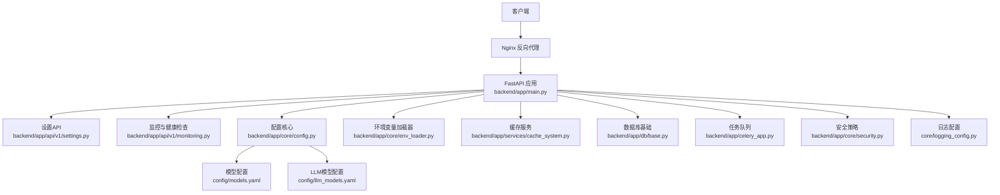

**图表来源** 
- [backend/app/main.py](file://backend/app/main.py)
- [backend/app/api/v1/settings.py](file://backend/app/api/v1/settings.py)
- [backend/app/api/v1/monitoring.py](file://backend/app/api/v1/monitoring.py)
- [backend/app/core/config.py](file://backend/app/core/config.py)
- [backend/app/core/env_loader.py](file://backend/app/core/env_loader.py)
- [backend/app/services/cache_system.py](file://backend/app/services/cache_system.py)
- [backend/app/db/base.py](file://backend/app/db/base.py)
- [backend/app/celery_app.py](file://backend/app/celery_app.py)
- [backend/app/core/security.py](file://backend/app/core/security.py)
- [core/logging_config.py](file://core/logging_config.py)
- [config/models.yaml](file://config/models.yaml)
- [config/llm_models.yaml](file://config/llm_models.yaml)

**章节来源**
- [backend/app/main.py](file://backend/app/main.py)
- [backend/app/core/config.py](file://backend/app/core/config.py)
- [backend/app/core/env_loader.py](file://backend/app/core/env_loader.py)
- [backend/app/api/v1/monitoring.py](file://backend/app/api/v1/monitoring.py)
- [backend/app/api/v1/settings.py](file://backend/app/api/v1/settings.py)
- [backend/app/services/cache_system.py](file://backend/app/services/cache_system.py)
- [backend/app/celery_app.py](file://backend/app/celery_app.py)
- [backend/app/db/base.py](file://backend/app/db/base.py)
- [backend/app/core/security.py](file://backend/app/core/security.py)
- [core/logging_config.py](file://core/logging_config.py)
- [config/models.yaml](file://config/models.yaml)
- [config/llm_models.yaml](file://config/llm_models.yaml)
- [docker-compose.yml](file://docker-compose.yml)
- [nginx.conf](file://nginx.conf)

## 核心组件
- 配置中心与加载器
  - 统一读取环境变量与YAML配置，提供类型化配置对象与默认值覆盖
  - 支持运行时重载与校验，确保配置一致性
- 监控与健康检查
  - 暴露健康状态、依赖连通性、资源使用指标
- 设置API
  - 提供系统级与模块级配置的查询、更新与验证接口
- 缓存系统
  - 封装Redis连接、键空间隔离、过期策略与序列化
- 任务队列
  - Celery应用初始化、工作进程与重试策略
- 数据库基础
  - 连接池、迁移与Schema兼容性
- 安全策略
  - 鉴权中间件、速率限制、内容安全检查
- 日志与追踪
  - 结构化日志、采样率、链路追踪上下文

**章节来源**
- [backend/app/core/config.py](file://backend/app/core/config.py)
- [backend/app/core/env_loader.py](file://backend/app/core/env_loader.py)
- [backend/app/api/v1/monitoring.py](file://backend/app/api/v1/monitoring.py)
- [backend/app/api/v1/settings.py](file://backend/app/api/v1/settings.py)
- [backend/app/services/cache_system.py](file://backend/app/services/cache_system.py)
- [backend/app/celery_app.py](file://backend/app/celery_app.py)
- [backend/app/db/base.py](file://backend/app/db/base.py)
- [backend/app/core/security.py](file://backend/app/core/security.py)
- [core/logging_config.py](file://core/logging_config.py)

## 架构总览
系统通过FastAPI对外暴露REST接口，内部由配置中心、缓存、数据库、任务队列与安全模块组成。Nginx作为反向代理处理TLS终止与请求转发；Docker Compose编排多服务。

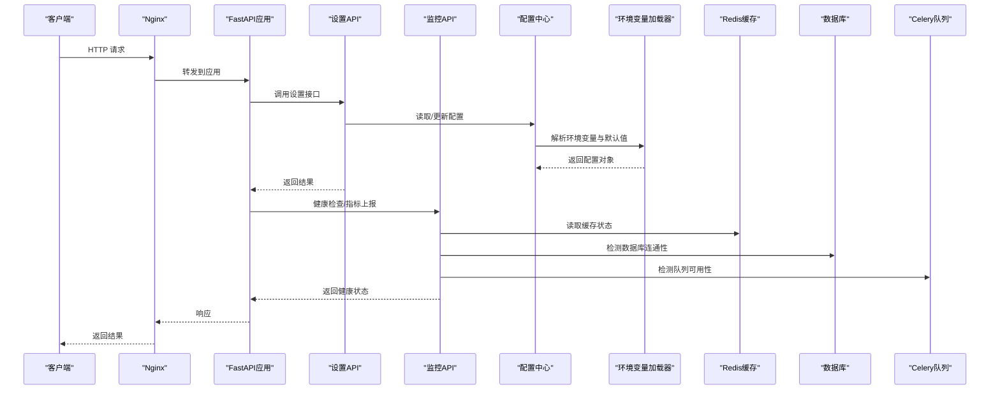

**图表来源** 
- [backend/app/main.py](file://backend/app/main.py)
- [backend/app/api/v1/settings.py](file://backend/app/api/v1/settings.py)
- [backend/app/api/v1/monitoring.py](file://backend/app/api/v1/monitoring.py)
- [backend/app/core/config.py](file://backend/app/core/config.py)
- [backend/app/core/env_loader.py](file://backend/app/core/env_loader.py)
- [backend/app/services/cache_system.py](file://backend/app/services/cache_system.py)
- [backend/app/db/base.py](file://backend/app/db/base.py)
- [backend/app/celery_app.py](file://backend/app/celery_app.py)

## 详细组件分析

### 配置中心与环境变量管理
- 功能要点
  - 集中式配置对象，包含数据库、缓存、队列、模型、安全、日志等子配置
  - 环境变量优先级高于YAML与默认值，支持类型转换与必填校验
  - 支持热重载：在特定条件下重新加载配置并生效
- 关键流程
  - 启动时加载.env与YAML，合并生成最终配置
  - 运行时更新接口触发校验与替换，旧引用保持兼容直到下次重建
- 典型字段
  - 数据库：连接字符串、池大小、超时
  - 缓存：Redis地址、命名空间、TTL
  - 队列：Broker URL、Worker数量、重试策略
  - 模型：提供商密钥、端点、并发限制
  - 安全：JWT密钥、速率限制阈值、内容安全开关
  - 日志：级别、输出目标、采样率

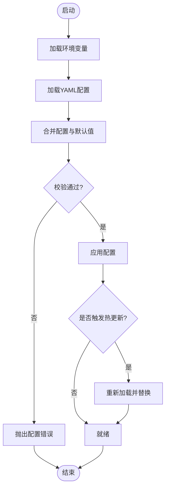

**图表来源** 
- [backend/app/core/config.py](file://backend/app/core/config.py)
- [backend/app/core/env_loader.py](file://backend/app/core/env_loader.py)
- [config/models.yaml](file://config/models.yaml)
- [config/llm_models.yaml](file://config/llm_models.yaml)

**章节来源**
- [backend/app/core/config.py](file://backend/app/core/config.py)
- [backend/app/core/env_loader.py](file://backend/app/core/env_loader.py)
- [config/models.yaml](file://config/models.yaml)
- [config/llm_models.yaml](file://config/llm_models.yaml)

### 监控与健康检查
- 功能要点
  - 暴露健康检查端点，返回服务状态、依赖连通性与资源指标
  - 支持自定义探针，如缓存命中率、队列积压、数据库延迟
- 典型响应
  - 状态码：200表示健康，5xx表示异常
  - 字段：服务名、版本、依赖列表、指标快照

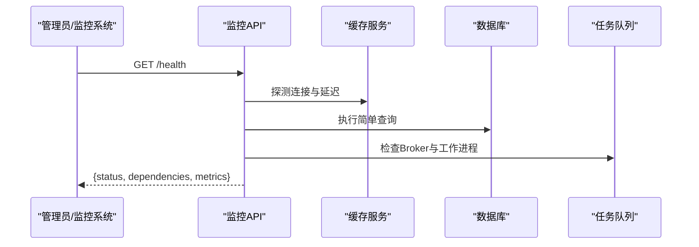

**图表来源** 
- [backend/app/api/v1/monitoring.py](file://backend/app/api/v1/monitoring.py)
- [backend/app/services/cache_system.py](file://backend/app/services/cache_system.py)
- [backend/app/db/base.py](file://backend/app/db/base.py)
- [backend/app/celery_app.py](file://backend/app/celery_app.py)

**章节来源**
- [backend/app/api/v1/monitoring.py](file://backend/app/api/v1/monitoring.py)

### 设置API（系统参数配置）
- 功能要点
  - 提供系统级与模块级配置的查询、更新、验证接口
  - 支持按作用域（全局、项目、用户）进行配置隔离
  - 变更审计与版本记录，便于回滚
- 典型操作
  - 获取当前配置快照
  - 增量更新某项参数
  - 批量导入配置模板
  - 校验配置合法性并预览影响范围

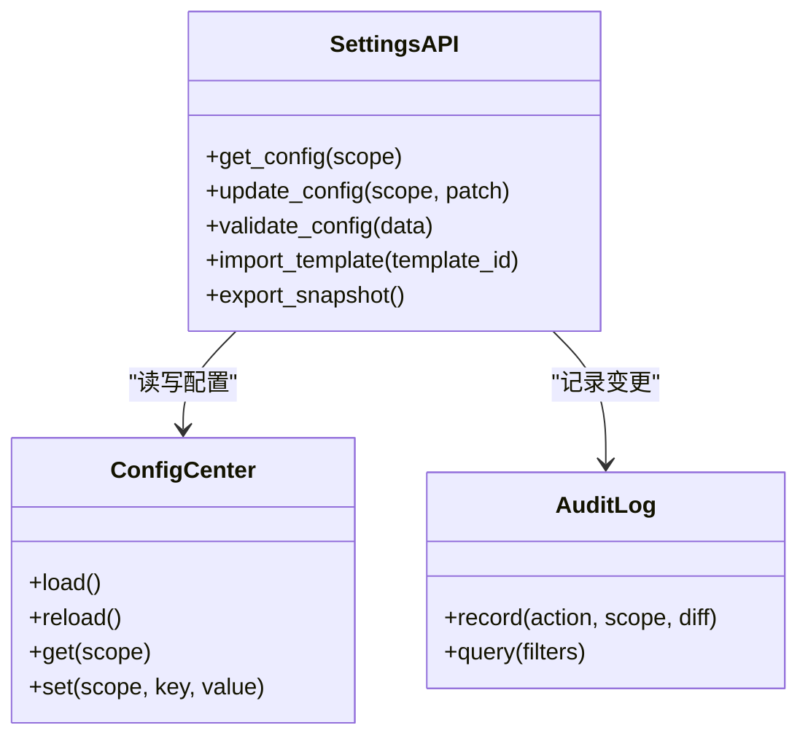

**图表来源** 
- [backend/app/api/v1/settings.py](file://backend/app/api/v1/settings.py)
- [backend/app/core/config.py](file://backend/app/core/config.py)

**章节来源**
- [backend/app/api/v1/settings.py](file://backend/app/api/v1/settings.py)

### 缓存系统（Redis）
- 功能要点
  - 统一封装连接、键空间隔离、序列化、过期策略
  - 提供缓存预热、清理与统计接口
- 典型配置
  - 连接地址、密码、数据库索引
  - 命名空间前缀、默认TTL、最大连接数
  - 序列化方式（JSON/MessagePack）

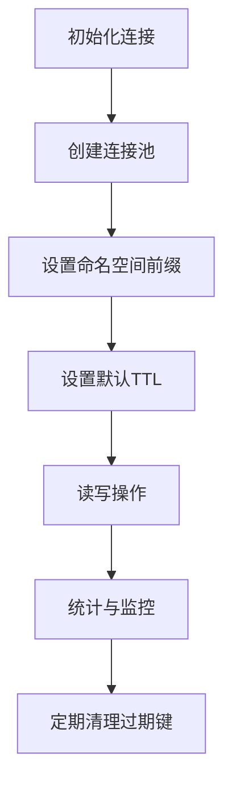

**图表来源** 
- [backend/app/services/cache_system.py](file://backend/app/services/cache_system.py)

**章节来源**
- [backend/app/services/cache_system.py](file://backend/app/services/cache_system.py)

### 任务队列（Celery）
- 功能要点
  - 初始化Broker与Backend，配置Worker数量与重试策略
  - 提供任务注册、调度与状态查询
- 典型配置
  - Broker URL（Redis/RabbitMQ）
  - Backend存储（Redis/DB）
  - Worker并发、预取、超时与重试次数

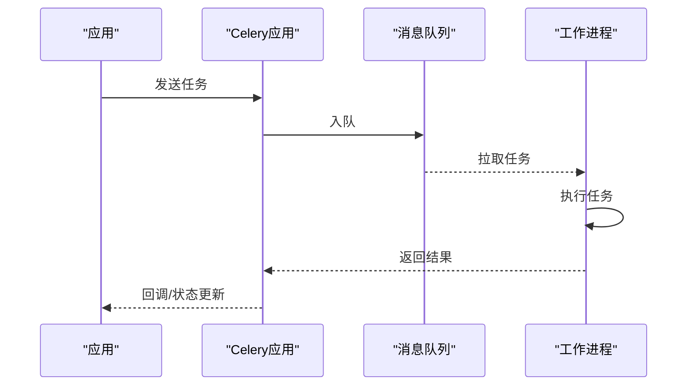

**图表来源** 
- [backend/app/celery_app.py](file://backend/app/celery_app.py)

**章节来源**
- [backend/app/celery_app.py](file://backend/app/celery_app.py)

### 数据库连接（PostgreSQL）
- 功能要点
  - 连接池管理、超时与重试
  - 迁移工具集成与Schema兼容性检查
- 典型配置
  - 连接字符串、用户名、密码、主机、端口
  - 池大小、最大空闲时间、查询超时
  - 迁移脚本路径与自动升级开关

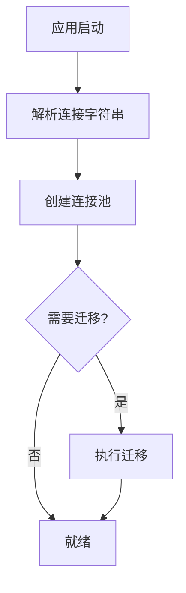

**图表来源** 
- [backend/app/db/base.py](file://backend/app/db/base.py)

**章节来源**
- [backend/app/db/base.py](file://backend/app/db/base.py)

### 安全策略（鉴权、限流、内容安全）
- 功能要点
  - JWT鉴权中间件、角色权限控制
  - 速率限制（IP/用户维度）、防重放
  - 内容安全检查（敏感词、模型输出过滤）
- 典型配置
  - JWT密钥、算法、过期时间
  - 限流窗口、令牌桶大小
  - 内容安全规则集与阈值

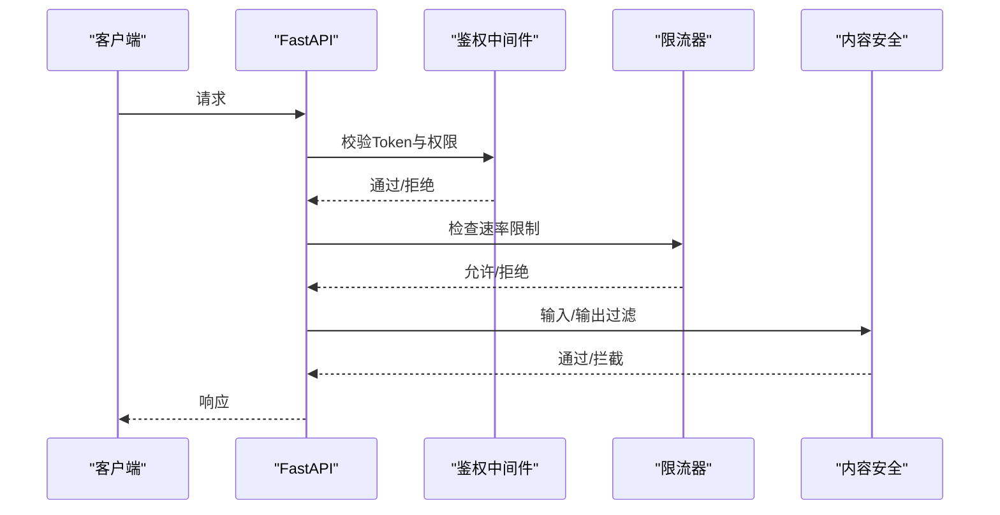

**图表来源** 
- [backend/app/core/security.py](file://backend/app/core/security.py)

**章节来源**
- [backend/app/core/security.py](file://backend/app/core/security.py)

### 日志配置与错误追踪
- 功能要点
  - 结构化日志（JSON），分级输出，采样率控制
  - 错误追踪上下文（请求ID、链路ID）
  - 日志轮转与远程收集
- 典型配置
  - 级别（DEBUG/INFO/WARN/ERROR）
  - 输出目标（控制台/文件/远程）
  - 采样率与脱敏规则

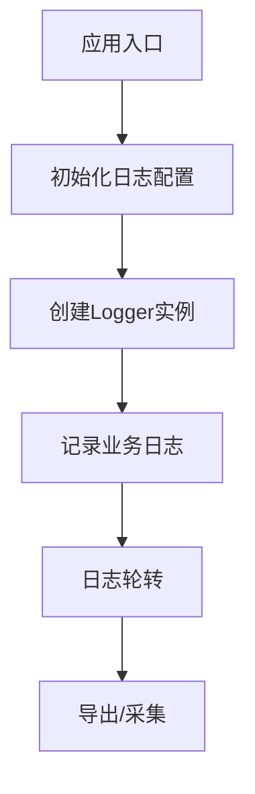

**图表来源** 
- [core/logging_config.py](file://core/logging_config.py)

**章节来源**
- [core/logging_config.py](file://core/logging_config.py)

### 模型与适配器配置
- 功能要点
  - 统一管理模型元数据、端点、密钥与并发限制
  - 支持多提供商切换与降级策略
- 典型配置
  - 模型名称、提供商、API Key、Base URL
  - 并发上限、超时、重试次数
  - 特征开关（图像/视频/TTS/ASR）

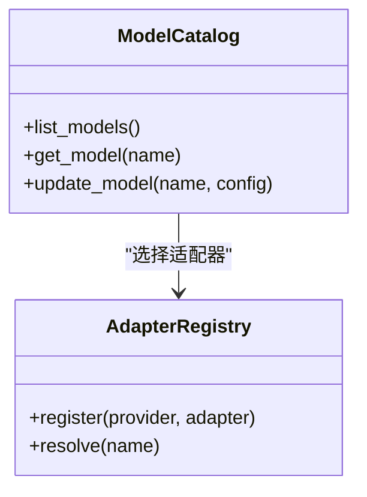

**图表来源** 
- [config/models.yaml](file://config/models.yaml)
- [config/llm_models.yaml](file://config/llm_models.yaml)

**章节来源**
- [config/models.yaml](file://config/models.yaml)
- [config/llm_models.yaml](file://config/llm_models.yaml)

## 依赖关系分析
- 组件耦合
  - 设置API依赖配置中心与审计日志
  - 监控API依赖缓存、数据库、队列探针
  - 配置中心依赖环境变量加载器与YAML文件
- 外部依赖
  - Redis、PostgreSQL、Celery Broker、Nginx、TLS证书
- 潜在循环依赖
  - 通过接口解耦避免循环，确保单向依赖

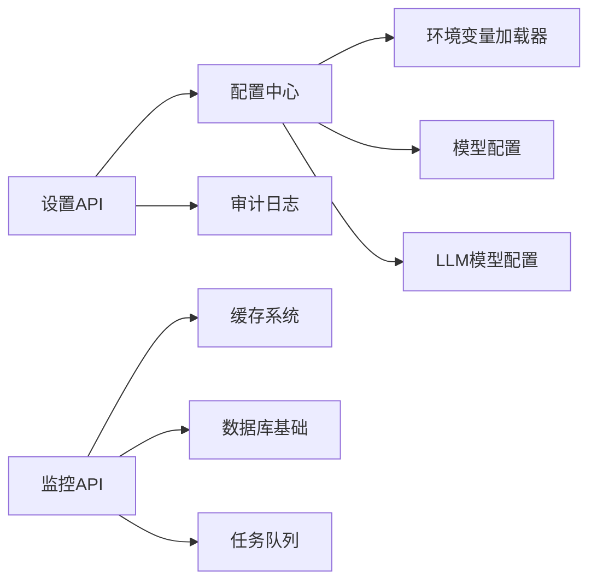

**图表来源** 
- [backend/app/api/v1/settings.py](file://backend/app/api/v1/settings.py)
- [backend/app/api/v1/monitoring.py](file://backend/app/api/v1/monitoring.py)
- [backend/app/core/config.py](file://backend/app/core/config.py)
- [backend/app/core/env_loader.py](file://backend/app/core/env_loader.py)
- [backend/app/services/cache_system.py](file://backend/app/services/cache_system.py)
- [backend/app/db/base.py](file://backend/app/db/base.py)
- [backend/app/celery_app.py](file://backend/app/celery_app.py)
- [config/models.yaml](file://config/models.yaml)
- [config/llm_models.yaml](file://config/llm_models.yaml)

**章节来源**
- [backend/app/api/v1/settings.py](file://backend/app/api/v1/settings.py)
- [backend/app/api/v1/monitoring.py](file://backend/app/api/v1/monitoring.py)
- [backend/app/core/config.py](file://backend/app/core/config.py)
- [backend/app/core/env_loader.py](file://backend/app/core/env_loader.py)
- [backend/app/services/cache_system.py](file://backend/app/services/cache_system.py)
- [backend/app/db/base.py](file://backend/app/db/base.py)
- [backend/app/celery_app.py](file://backend/app/celery_app.py)
- [config/models.yaml](file://config/models.yaml)
- [config/llm_models.yaml](file://config/llm_models.yaml)

## 性能考虑
- 缓存策略
  - 热点数据缓存、合理TTL、键空间隔离
  - 缓存预热与失效策略，避免雪崩
- 并发与限流
  - Worker数量与预取值调优
  - 速率限制与令牌桶，保护下游服务
- 数据库优化
  - 连接池大小、查询超时、索引与慢查询监控
- 模型调用
  - 并发上限、超时与重试退避
  - 多提供商切换与降级
- 日志与追踪
  - 采样率降低IO压力
  - 结构化日志便于聚合与分析

[本节为通用指导，不直接分析具体文件]

## 故障排查指南
- 健康检查
  - 访问健康端点，检查依赖状态与指标
- 配置问题
  - 校验环境变量与YAML格式，查看配置加载日志
- 缓存问题
  - 检查Redis连通性、内存使用与键空间
- 队列问题
  - 检查Broker连接、Worker状态与任务积压
- 数据库问题
  - 检查连接池、迁移状态与慢查询
- 安全策略
  - 检查JWT配置、限流阈值与内容安全规则
- 日志与追踪
  - 启用调试级别，收集请求ID与链路ID

**章节来源**
- [backend/app/api/v1/monitoring.py](file://backend/app/api/v1/monitoring.py)
- [backend/app/core/config.py](file://backend/app/core/config.py)
- [backend/app/services/cache_system.py](file://backend/app/services/cache_system.py)
- [backend/app/celery_app.py](file://backend/app/celery_app.py)
- [backend/app/db/base.py](file://backend/app/db/base.py)
- [backend/app/core/security.py](file://backend/app/core/security.py)
- [core/logging_config.py](file://core/logging_config.py)

## 结论
本系统通过统一的配置中心、健壮的监控与健康检查、完善的设置API与缓存/队列/数据库集成，提供了可扩展、可观测、可运维的配置管理能力。结合安全策略与日志追踪，可在复杂生产环境中稳定运行。建议在生产部署中严格遵循环境变量与YAML配置规范，启用健康检查与审计日志，并定期进行备份与回滚演练。

[本节为总结，不直接分析具体文件]

## 附录
- 备份与恢复
  - 数据库快照与恢复脚本
  - 缓存与队列状态导出
- 服务重启与滚动升级
  - 优雅关闭与再启动流程
  - 蓝绿/金丝雀发布策略
- 配置热更新与版本管理
  - 配置版本化与差异对比
  - 回滚机制与回滚验证

[本节为概念性内容，不直接分析具体文件]