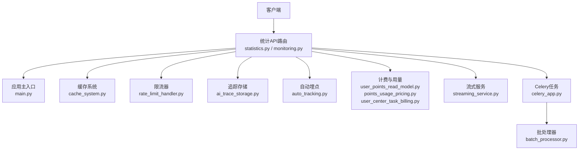
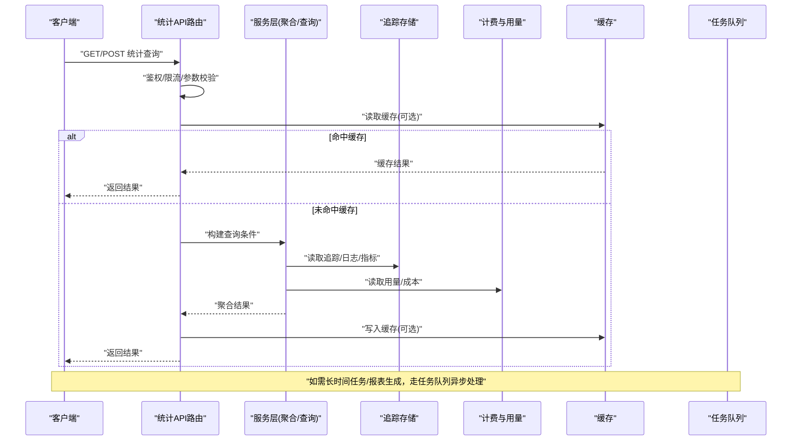
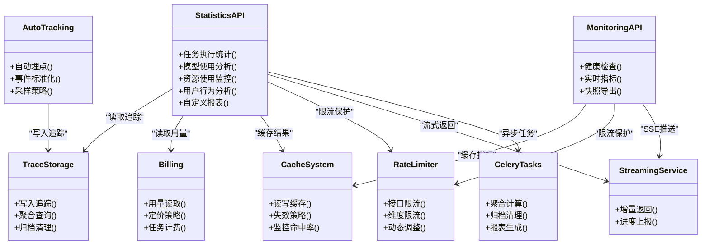

# 统计分析API

<cite>
**本文引用的文件**   
- [statistics.py](file://backend/app/api/v1/statistics.py)
- [monitoring.py](file://backend/app/api/v1/monitoring.py)
- [main.py](file://backend/app/main.py)
- [celery_app.py](file://backend/app/celery_app.py)
- [ai_trace_storage.py](file://backend/app/services/ai_trace_storage.py)
- [ai_trace_competition.py](file://backend/app/services/ai_trace_competition.py)
- [cache_system.py](file://backend/app/services/cache_system.py)
- [rate_limit_handler.py](file://backend/app/services/rate_limit_handler.py)
- [user_points_read_model.py](file://backend/app/services/user_points_read_model.py)
- [points_usage_pricing.py](file://backend/app/services/points_usage_pricing.py)
- [user_center_task_billing.py](file://backend/app/services/user_center_task_billing.py)
- [streaming_service.py](file://backend/app/services/streaming_service.py)
- [batch_processor.py](file://backend/app/services/batch_processor.py)
- [auto_tracking.py](file://backend/app/services/auto_tracking.py)
</cite>

## 目录
1. [简介](#简介)
2. [项目结构](#项目结构)
3. [核心组件](#核心组件)
4. [架构总览](#架构总览)
5. [详细组件分析](#详细组件分析)
6. [依赖关系分析](#依赖关系分析)
7. [性能考量](#性能考量)
8. [故障排查指南](#故障排查指南)
9. [结论](#结论)
10. [附录](#附录)

## 简介
本文件为“小说创作代理系统”的统计分析API提供完整文档，覆盖以下能力：
- 实时监控与历史数据分析
- 趋势预测与告警配置
- 任务执行统计、模型使用分析、存储占用与带宽消耗监控
- 自定义报表生成、数据导出与可视化集成
- 数据采集、聚合计算与查询优化实现说明

该API面向运营、产品与研发人员，用于观测系统健康、评估模型成本与产出效率、定位瓶颈并支撑容量规划。

## 项目结构
统计分析相关能力主要位于后端API层与业务服务层：
- API路由与请求处理：backend/app/api/v1/statistics.py、backend/app/api/v1/monitoring.py
- 应用入口与中间件：backend/app/main.py
- 异步任务与批处理：backend/app/celery_app.py、backend/app/services/batch_processor.py
- 指标采集与追踪：backend/app/services/ai_trace_storage.py、backend/app/services/auto_tracking.py
- 缓存与限流：backend/app/services/cache_system.py、backend/app/services/rate_limit_handler.py
- 计费与用量：backend/app/services/user_points_read_model.py、backend/app/services/points_usage_pricing.py、backend/app/services/user_center_task_billing.py
- 流式输出：backend/app/services/streaming_service.py

图表来源
- [statistics.py](file://backend/app/api/v1/statistics.py)
- [monitoring.py](file://backend/app/api/v1/monitoring.py)
- [main.py](file://backend/app/main.py)
- [cache_system.py](file://backend/app/services/cache_system.py)
- [rate_limit_handler.py](file://backend/app/services/rate_limit_handler.py)
- [ai_trace_storage.py](file://backend/app/services/ai_trace_storage.py)
- [auto_tracking.py](file://backend/app/services/auto_tracking.py)
- [user_points_read_model.py](file://backend/app/services/user_points_read_model.py)
- [points_usage_pricing.py](file://backend/app/services/points_usage_pricing.py)
- [user_center_task_billing.py](file://backend/app/services/user_center_task_billing.py)
- [streaming_service.py](file://backend/app/services/streaming_service.py)
- [celery_app.py](file://backend/app/celery_app.py)
- [batch_processor.py](file://backend/app/services/batch_processor.py)

章节来源
- [statistics.py](file://backend/app/api/v1/statistics.py)
- [monitoring.py](file://backend/app/api/v1/monitoring.py)
- [main.py](file://backend/app/main.py)

## 核心组件
- 统计API路由：暴露任务执行、模型调用、资源使用、用户行为等维度的查询接口；支持时间窗口、分组维度、分页与排序。
- 监控API路由：提供实时健康检查、延迟分布、错误率、吞吐、队列深度等指标；支持SSE推送与快照导出。
- 追踪存储：统一收集AI链路追踪数据（模型、提示、耗时、Token、状态码），并提供聚合查询。
- 自动埋点：在关键路径自动采集事件（如任务创建、阶段完成、失败原因）。
- 缓存系统：对热点统计结果进行缓存，降低重复查询压力。
- 限流器：保护统计接口在高并发下的稳定性。
- 计费与用量：将统计与计费关联，提供按用户/项目/模型的用量与成本分析。
- 流式服务：支持大结果集或长时任务的增量返回。
- 批处理与任务：后台聚合计算、报表生成、历史数据归档。

章节来源
- [statistics.py](file://backend/app/api/v1/statistics.py)
- [monitoring.py](file://backend/app/api/v1/monitoring.py)
- [ai_trace_storage.py](file://backend/app/services/ai_trace_storage.py)
- [auto_tracking.py](file://backend/app/services/auto_tracking.py)
- [cache_system.py](file://backend/app/services/cache_system.py)
- [rate_limit_handler.py](file://backend/app/services/rate_limit_handler.py)
- [user_points_read_model.py](file://backend/app/services/user_points_read_model.py)
- [points_usage_pricing.py](file://backend/app/services/points_usage_pricing.py)
- [user_center_task_billing.py](file://backend/app/services/user_center_task_billing.py)
- [streaming_service.py](file://backend/app/services/streaming_service.py)
- [celery_app.py](file://backend/app/celery_app.py)
- [batch_processor.py](file://backend/app/services/batch_processor.py)

## 架构总览
统计与监控的整体流程如下：
- 客户端通过统计/监控API发起查询或订阅。
- 路由层进行鉴权、参数校验与限流。
- 服务层从追踪存储、缓存、计费与外部系统中拉取数据。
- 聚合计算可在内存或后台任务中完成，结果可缓存。
- 响应可通过HTTP或SSE返回，支持分页与增量更新。

图表来源
- [statistics.py](file://backend/app/api/v1/statistics.py)
- [monitoring.py](file://backend/app/api/v1/monitoring.py)
- [ai_trace_storage.py](file://backend/app/services/ai_trace_storage.py)
- [user_points_read_model.py](file://backend/app/services/user_points_read_model.py)
- [cache_system.py](file://backend/app/services/cache_system.py)
- [celery_app.py](file://backend/app/celery_app.py)

## 详细组件分析

### 统计API（statistics.py）
- 功能范围
  - 任务执行统计：按项目/章节/任务类型统计成功/失败次数、平均耗时、P95/P99、重试率。
  - 模型使用分析：按模型族/具体模型统计调用量、Token用量、成功率、错误分类、成本估算。
  - 资源使用监控：CPU/内存/磁盘/网络带宽的时序指标与阈值告警。
  - 用户行为分析：活跃用户数、会话时长、功能使用频次、转化漏斗。
  - 自定义报表：支持多维筛选、分组、排序、分页与导出。
- 典型接口
  - 任务执行统计：支持时间窗口、维度过滤、聚合粒度（分钟/小时/天）、分页。
  - 模型使用分析：支持模型族/版本/供应商维度，输出用量、成本、质量评分。
  - 资源使用监控：支持主机/容器维度，输出CPU、内存、I/O、网络。
  - 用户行为分析：支持用户/角色/项目维度，输出活跃、留存、转化。
  - 报表导出：CSV/JSON/Excel，支持异步任务与下载链接。
- 查询优化
  - 预聚合表与时序索引
  - 缓存热点查询结果
  - 分页游标与字段裁剪
  - 批量读取与并行查询

章节来源
- [statistics.py](file://backend/app/api/v1/statistics.py)

### 监控API（monitoring.py）
- 功能范围
  - 实时健康检查：存活、就绪、依赖健康（数据库、缓存、消息队列）。
  - 延迟与吞吐：QPS、平均/分位延迟、错误率。
  - 队列深度与消费者滞后：任务积压、消费速率。
  - SSE推送：实时指标流，便于前端仪表盘展示。
- 典型接口
  - 健康检查：/health、/ready、/metrics
  - 实时指标：/metrics/stream（SSE）
  - 快照导出：/metrics/snapshot（一次性导出）
- 注意事项
  - 高频率SSE需配合限流与连接池管理
  - 指标采样策略影响精度与开销

章节来源
- [monitoring.py](file://backend/app/api/v1/monitoring.py)

### 追踪存储（ai_trace_storage.py）
- 功能范围
  - 统一采集AI链路追踪数据：模型、提示、输入输出摘要、耗时、Token、状态码、错误信息。
  - 提供聚合查询：按时间、模型、项目、用户等维度统计。
  - 数据保留与归档：冷热分层、压缩与清理策略。
- 关键点
  - 写入路径：同步/异步写入，避免阻塞主流程
  - 查询路径：索引设计、预聚合、物化视图
  - 一致性：最终一致与幂等写入

章节来源
- [ai_trace_storage.py](file://backend/app/services/ai_trace_storage.py)

### 自动埋点（auto_tracking.py）
- 功能范围
  - 在关键路径自动采集事件：任务生命周期、阶段转换、异常捕获。
  - 事件标准化：统一字段、上下文注入（用户、项目、模型）。
  - 低侵入：基于装饰器/钩子机制，最小化代码改动。
- 关键点
  - 事件去重与合并
  - 采样策略（全量/抽样）
  - 与追踪存储对接

章节来源
- [auto_tracking.py](file://backend/app/services/auto_tracking.py)

### 缓存系统（cache_system.py）
- 功能范围
  - 热点统计结果缓存：键设计、过期策略、失效通知。
  - 多级缓存：本地+分布式缓存。
  - 缓存穿透/雪崩防护：空值缓存、随机过期、降级策略。
- 关键点
  - 缓存命中率监控
  - 缓存预热与回源逻辑

章节来源
- [cache_system.py](file://backend/app/services/cache_system.py)

### 限流器（rate_limit_handler.py）
- 功能范围
  - 接口级限流：令牌桶/滑动窗口。
  - 用户/IP/租户维度限流。
  - 动态调整：根据系统负载自适应限流阈值。
- 关键点
  - 限流计数器的持久化与一致性
  - 限流拒绝时的友好响应

章节来源
- [rate_limit_handler.py](file://backend/app/services/rate_limit_handler.py)

### 计费与用量（user_points_read_model.py, points_usage_pricing.py, user_center_task_billing.py）
- 功能范围
  - 用量读取：按用户/项目/模型统计调用量、Token、时长。
  - 定价策略：不同模型/版本的单价、折扣、封顶策略。
  - 任务计费：任务级别的费用分摊与结算。
- 关键点
  - 用量与追踪数据的对齐
  - 价格变更的历史追溯
  - 费用汇总的性能优化

章节来源
- [user_points_read_model.py](file://backend/app/services/user_points_read_model.py)
- [points_usage_pricing.py](file://backend/app/services/points_usage_pricing.py)
- [user_center_task_billing.py](file://backend/app/services/user_center_task_billing.py)

### 流式服务（streaming_service.py）
- 功能范围
  - 大结果集增量返回：分页流式、SSE推送。
  - 长时任务进度上报：阶段状态、剩余时间估算。
- 关键点
  - 背压控制与超时处理
  - 断线重连与状态恢复

章节来源
- [streaming_service.py](file://backend/app/services/streaming_service.py)

### 批处理与任务（celery_app.py, batch_processor.py）
- 功能范围
  - 后台聚合计算：日/周/月报表、趋势预测预处理。
  - 数据归档与清理：冷热分离、压缩与删除。
  - 报表生成：多格式导出、异步下载。
- 关键点
  - 任务幂等与重试
  - 资源隔离与优先级
  - 监控与告警

章节来源
- [celery_app.py](file://backend/app/celery_app.py)
- [batch_processor.py](file://backend/app/services/batch_processor.py)

## 依赖关系分析
统计与监控模块之间的依赖关系如下：

图表来源
- [statistics.py](file://backend/app/api/v1/statistics.py)
- [monitoring.py](file://backend/app/api/v1/monitoring.py)
- [ai_trace_storage.py](file://backend/app/services/ai_trace_storage.py)
- [auto_tracking.py](file://backend/app/services/auto_tracking.py)
- [cache_system.py](file://backend/app/services/cache_system.py)
- [rate_limit_handler.py](file://backend/app/services/rate_limit_handler.py)
- [user_points_read_model.py](file://backend/app/services/user_points_read_model.py)
- [points_usage_pricing.py](file://backend/app/services/points_usage_pricing.py)
- [user_center_task_billing.py](file://backend/app/services/user_center_task_billing.py)
- [streaming_service.py](file://backend/app/services/streaming_service.py)
- [celery_app.py](file://backend/app/celery_app.py)
- [batch_processor.py](file://backend/app/services/batch_processor.py)

## 性能考量
- 查询优化
  - 预聚合与时序索引：减少实时扫描，提升聚合速度。
  - 字段裁剪与分页游标：降低传输与解析开销。
  - 并行查询与批处理：提高吞吐，缩短延迟。
- 缓存策略
  - 热点结果缓存：合理TTL与失效策略。
  - 多级缓存：本地+分布式，提升命中率。
- 限流与降级
  - 接口级限流：保护系统稳定。
  - 降级策略：非核心指标跳过或返回近似值。
- 异步与流式
  - 长时任务异步化：避免阻塞请求。
  - SSE增量返回：提升用户体验。
- 资源监控
  - CPU/内存/磁盘/网络：设置阈值与告警。
  - 队列深度与消费者滞后：及时扩容或优化。

[本节为通用指导，不直接分析具体文件]

## 故障排查指南
- 常见问题
  - 统计结果不一致：检查追踪写入是否幂等、聚合逻辑是否正确。
  - 查询延迟高：检查索引、缓存命中率、下游依赖延迟。
  - 限流触发频繁：调整限流阈值或扩容。
  - SSE连接断开：检查网络与服务器配置，实现重连。
- 诊断步骤
  - 查看健康检查与实时指标，确认依赖服务状态。
  - 检查追踪存储写入与读取日志，定位数据缺失或异常。
  - 检查缓存命中率与过期策略，必要时预热或调整TTL。
  - 检查任务队列堆积情况，调整并发与资源配额。
- 告警建议
  - 错误率突增、延迟P99超标、队列深度超过阈值、缓存命中率下降。

章节来源
- [monitoring.py](file://backend/app/api/v1/monitoring.py)
- [ai_trace_storage.py](file://backend/app/services/ai_trace_storage.py)
- [cache_system.py](file://backend/app/services/cache_system.py)
- [rate_limit_handler.py](file://backend/app/services/rate_limit_handler.py)
- [celery_app.py](file://backend/app/celery_app.py)

## 结论
统计分析API为小说创作代理系统提供了全面的观测与分析能力，覆盖实时监控、历史数据分析、趋势预测与告警配置。通过统一的追踪存储、自动埋点、缓存与限流、计费与用量、流式服务与批处理任务，系统在性能、稳定性与可扩展性方面具备良好基础。建议在生产环境完善索引与预聚合、优化缓存策略、加强监控与告警，以持续提升系统可用性与运维效率。

[本节为总结，不直接分析具体文件]

## 附录
- 示例：自定义报表生成
  - 选择维度（项目/模型/用户）、时间窗口、聚合粒度。
  - 提交异步报表任务，完成后获取下载链接。
- 示例：数据导出
  - 支持CSV/JSON/Excel，包含必要字段与元数据。
- 示例：可视化集成
  - 通过SSE实时推送指标，前端渲染图表。
- 数据采集与聚合
  - 自动埋点采集事件，追踪存储聚合查询。
- 查询优化
  - 预聚合表、索引设计、缓存与分页游标。

[本节为概念性内容，不直接分析具体文件]