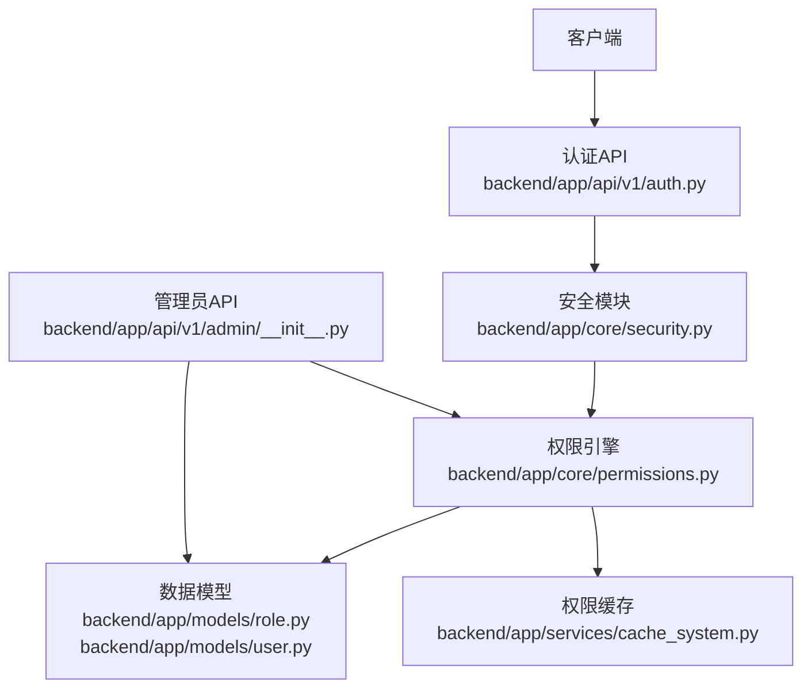
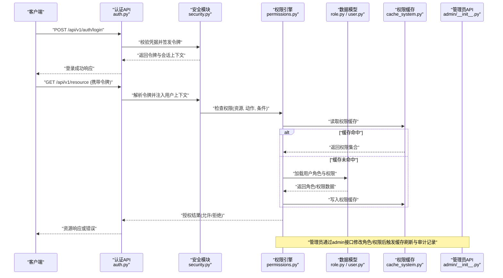
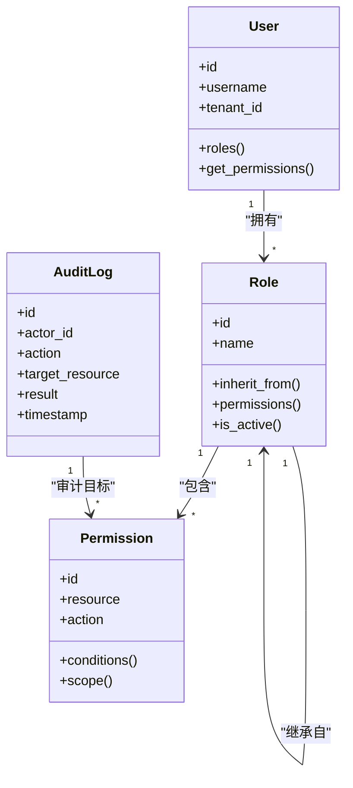
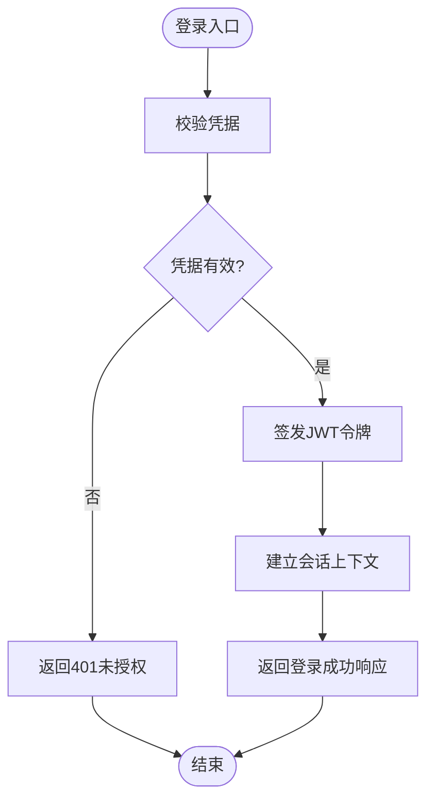
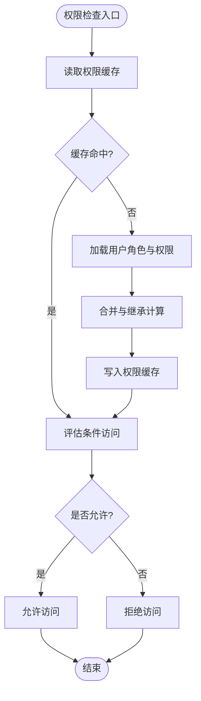
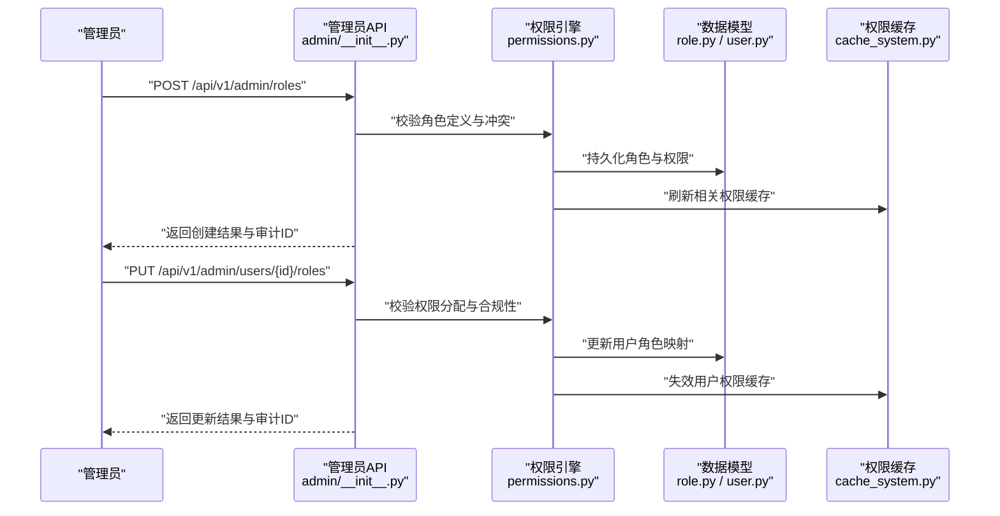
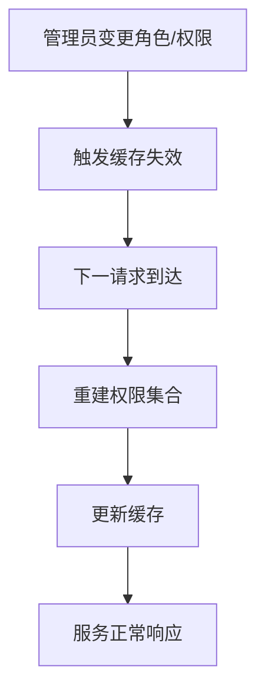
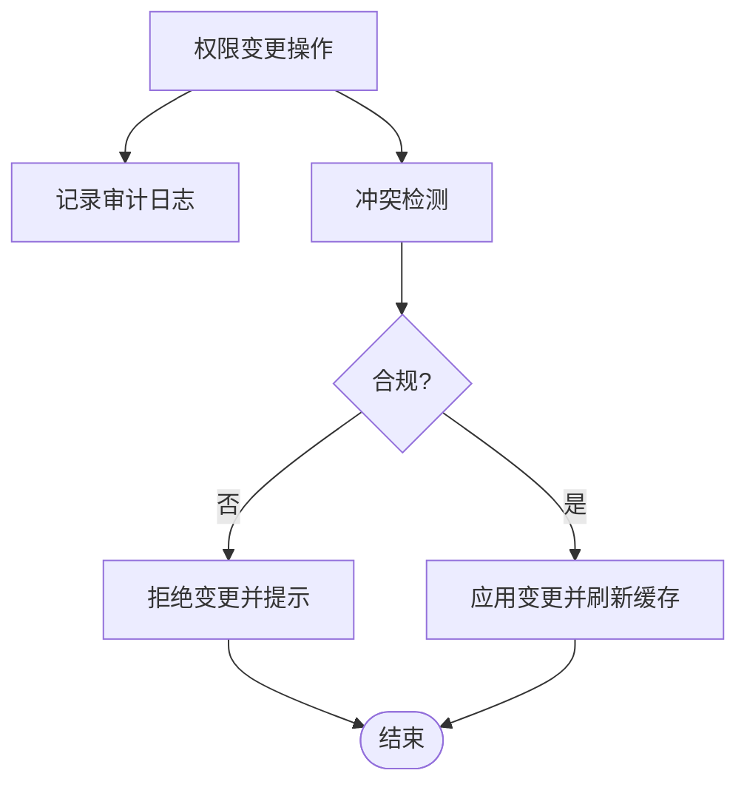
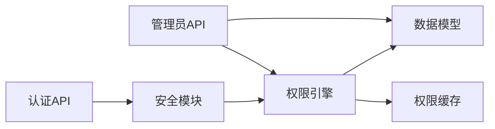

# 角色权限API

<cite>
**本文引用的文件**   
- [backend/app/core/permissions.py](file://backend/app/core/permissions.py)
- [backend/app/core/security.py](file://backend/app/core/security.py)
- [backend/app/api/v1/auth.py](file://backend/app/api/v1/auth.py)
- [backend/app/models/role.py](file://backend/app/models/role.py)
- [backend/app/models/user.py](file://backend/app/models/user.py)
- [backend/app/schemas/admin.py](file://backend/app/schemas/admin.py)
- [backend/app/services/cache_system.py](file://backend/app/services/cache_system.py)
- [backend/app/api/v1/admin/__init__.py](file://backend/app/api/v1/admin/__init__.py)
</cite>

## 目录
1. [简介](#简介)
2. [项目结构](#项目结构)
3. [核心组件](#核心组件)
4. [架构总览](#架构总览)
5. [详细组件分析](#详细组件分析)
6. [依赖关系分析](#依赖关系分析)
7. [性能考虑](#性能考虑)
8. [故障排查指南](#故障排查指南)
9. [结论](#结论)
10. [附录](#附录)

## 简介
本文件为小说创作代理系统的“角色权限API”提供权威文档，覆盖RBAC模型、细粒度权限控制、动态权限管理、角色继承与权限组合、条件访问与资源隔离、权限审计、冲突检测与合规性检查、权限缓存与实时生效机制、以及安全策略执行。读者可据此快速理解并集成角色与权限相关接口，确保系统的安全性与可扩展性。

## 项目结构
权限能力主要分布在以下模块：
- 认证与安全：鉴权中间件、令牌签发与校验、会话上下文注入
- 权限引擎：RBAC决策、细粒度策略、条件访问、资源隔离
- 数据模型：用户、角色、权限实体及关联关系
- API路由：管理员权限管理、用户认证、权限查询与变更
- 缓存与服务：权限缓存、实时刷新、审计日志

**图表来源** 
- [backend/app/api/v1/auth.py](file://backend/app/api/v1/auth.py)
- [backend/app/core/security.py](file://backend/app/core/security.py)
- [backend/app/core/permissions.py](file://backend/app/core/permissions.py)
- [backend/app/models/role.py](file://backend/app/models/role.py)
- [backend/app/models/user.py](file://backend/app/models/user.py)
- [backend/app/services/cache_system.py](file://backend/app/services/cache_system.py)
- [backend/app/api/v1/admin/__init__.py](file://backend/app/api/v1/admin/__init__.py)

**章节来源**
- [backend/app/api/v1/auth.py](file://backend/app/api/v1/auth.py)
- [backend/app/core/security.py](file://backend/app/core/security.py)
- [backend/app/core/permissions.py](file://backend/app/core/permissions.py)
- [backend/app/models/role.py](file://backend/app/models/role.py)
- [backend/app/models/user.py](file://backend/app/models/user.py)
- [backend/app/services/cache_system.py](file://backend/app/services/cache_system.py)
- [backend/app/api/v1/admin/__init__.py](file://backend/app/api/v1/admin/__init__.py)

## 核心组件
- 认证与安全（security）
  - 负责JWT签发与校验、会话上下文注入、密码加密与验证、登录态维护
- 权限引擎（permissions）
  - 实现RBAC决策、细粒度权限判定、条件访问规则、资源隔离策略、权限组合与继承计算
- 数据模型（models）
  - 定义用户、角色、权限及其关联关系，支持多租户与资源域隔离
- 管理员API（admin）
  - 提供角色与权限的CRUD、批量分配、冲突检测、合规性检查、审计记录
- 缓存系统（cache_system）
  - 提供权限缓存、失效与刷新、热点权限加速、一致性保障

**章节来源**
- [backend/app/core/security.py](file://backend/app/core/security.py)
- [backend/app/core/permissions.py](file://backend/app/core/permissions.py)
- [backend/app/models/role.py](file://backend/app/models/role.py)
- [backend/app/models/user.py](file://backend/app/models/user.py)
- [backend/app/api/v1/admin/__init__.py](file://backend/app/api/v1/admin/__init__.py)
- [backend/app/services/cache_system.py](file://backend/app/services/cache_system.py)

## 架构总览
下图展示从请求进入、认证、授权到资源访问的完整流程，包括缓存命中与回源、审计记录与合规检查。

**图表来源** 
- [backend/app/api/v1/auth.py](file://backend/app/api/v1/auth.py)
- [backend/app/core/security.py](file://backend/app/core/security.py)
- [backend/app/core/permissions.py](file://backend/app/core/permissions.py)
- [backend/app/models/role.py](file://backend/app/models/role.py)
- [backend/app/models/user.py](file://backend/app/models/user.py)
- [backend/app/services/cache_system.py](file://backend/app/services/cache_system.py)
- [backend/app/api/v1/admin/__init__.py](file://backend/app/api/v1/admin/__init__.py)

## 详细组件分析

### RBAC权限模型与数据模型
- 用户与角色
  - 用户可拥有多个角色；角色包含一组权限；支持角色继承链
- 权限与资源
  - 权限以“资源:动作”形式表示，支持条件表达式与范围限定
- 多租户与资源隔离
  - 通过租户ID与资源域字段进行隔离，确保跨租户不可见

**图表来源** 
- [backend/app/models/user.py](file://backend/app/models/user.py)
- [backend/app/models/role.py](file://backend/app/models/role.py)

**章节来源**
- [backend/app/models/user.py](file://backend/app/models/user.py)
- [backend/app/models/role.py](file://backend/app/models/role.py)

### 认证与安全（JWT与会话）
- 登录流程
  - 校验用户名/密码，生成JWT令牌，设置会话有效期与刷新策略
- 令牌校验
  - 解析令牌、验证签名、提取用户上下文、注入请求上下文
- 密码安全
  - 使用强哈希算法存储密码，支持盐值与轮转

**图表来源** 
- [backend/app/api/v1/auth.py](file://backend/app/api/v1/auth.py)
- [backend/app/core/security.py](file://backend/app/core/security.py)

**章节来源**
- [backend/app/api/v1/auth.py](file://backend/app/api/v1/auth.py)
- [backend/app/core/security.py](file://backend/app/core/security.py)

### 权限引擎（RBAC决策与细粒度控制）
- 权限判定流程
  - 基于用户角色集、权限集、条件表达式与资源范围进行决策
- 条件访问
  - 支持时间窗口、IP白名单、设备指纹、操作频率等条件
- 资源隔离
  - 按租户与资源域过滤，避免越权访问
- 权限组合与继承
  - 合并角色权限、去重、应用继承链，计算最终权限集合

**图表来源** 
- [backend/app/core/permissions.py](file://backend/app/core/permissions.py)
- [backend/app/services/cache_system.py](file://backend/app/services/cache_system.py)

**章节来源**
- [backend/app/core/permissions.py](file://backend/app/core/permissions.py)
- [backend/app/services/cache_system.py](file://backend/app/services/cache_system.py)

### 管理员API（角色与权限管理）
- 角色管理
  - 创建/更新/删除角色，配置继承关系与激活状态
- 权限分配
  - 为用户或角色分配权限，支持批量操作与范围限定
- 冲突检测与合规性检查
  - 检测权限冲突（如互斥权限）、合规性约束（最小权限原则）
- 审计记录
  - 记录所有角色与权限变更操作，便于追溯与审计

**图表来源** 
- [backend/app/api/v1/admin/__init__.py](file://backend/app/api/v1/admin/__init__.py)
- [backend/app/core/permissions.py](file://backend/app/core/permissions.py)
- [backend/app/models/role.py](file://backend/app/models/role.py)
- [backend/app/models/user.py](file://backend/app/models/user.py)
- [backend/app/services/cache_system.py](file://backend/app/services/cache_system.py)

**章节来源**
- [backend/app/api/v1/admin/__init__.py](file://backend/app/api/v1/admin/__init__.py)
- [backend/app/core/permissions.py](file://backend/app/core/permissions.py)
- [backend/app/models/role.py](file://backend/app/models/role.py)
- [backend/app/models/user.py](file://backend/app/models/user.py)
- [backend/app/services/cache_system.py](file://backend/app/services/cache_system.py)

### 权限缓存与实时生效
- 缓存策略
  - 用户维度缓存权限集合，支持TTL与事件驱动失效
- 实时生效
  - 管理员变更后主动失效相关缓存，确保下一请求即时生效
- 一致性保障
  - 读写分离场景下采用版本号或事件总线保证一致性

**图表来源** 
- [backend/app/services/cache_system.py](file://backend/app/services/cache_system.py)
- [backend/app/core/permissions.py](file://backend/app/core/permissions.py)

**章节来源**
- [backend/app/services/cache_system.py](file://backend/app/services/cache_system.py)
- [backend/app/core/permissions.py](file://backend/app/core/permissions.py)

### 权限审计、冲突检测与合规性检查
- 审计记录
  - 记录操作者、目标资源、操作类型、结果与时间戳
- 冲突检测
  - 识别互斥权限、过度授权、循环继承等问题
- 合规性检查
  - 强制最小权限原则、敏感操作二次确认、审批流集成

**图表来源** 
- [backend/app/core/permissions.py](file://backend/app/core/permissions.py)
- [backend/app/models/role.py](file://backend/app/models/role.py)

**章节来源**
- [backend/app/core/permissions.py](file://backend/app/core/permissions.py)
- [backend/app/models/role.py](file://backend/app/models/role.py)

## 依赖关系分析
- 模块耦合
  - 认证与安全模块依赖权限引擎进行授权决策
  - 管理员API依赖权限引擎进行变更校验与审计
  - 权限引擎依赖数据模型与缓存系统进行数据获取与加速
- 外部依赖
  - 数据库用于持久化用户、角色、权限与审计日志
  - 缓存系统用于权限集合的快速检索与一致性管理

**图表来源** 
- [backend/app/api/v1/auth.py](file://backend/app/api/v1/auth.py)
- [backend/app/core/security.py](file://backend/app/core/security.py)
- [backend/app/core/permissions.py](file://backend/app/core/permissions.py)
- [backend/app/models/role.py](file://backend/app/models/role.py)
- [backend/app/models/user.py](file://backend/app/models/user.py)
- [backend/app/services/cache_system.py](file://backend/app/services/cache_system.py)
- [backend/app/api/v1/admin/__init__.py](file://backend/app/api/v1/admin/__init__.py)

**章节来源**
- [backend/app/api/v1/auth.py](file://backend/app/api/v1/auth.py)
- [backend/app/core/security.py](file://backend/app/core/security.py)
- [backend/app/core/permissions.py](file://backend/app/core/permissions.py)
- [backend/app/models/role.py](file://backend/app/models/role.py)
- [backend/app/models/user.py](file://backend/app/models/user.py)
- [backend/app/services/cache_system.py](file://backend/app/services/cache_system.py)
- [backend/app/api/v1/admin/__init__.py](file://backend/app/api/v1/admin/__init__.py)

## 性能考虑
- 权限缓存命中率优化
  - 合理设置TTL与热点键预热，降低数据库压力
- 并发与锁
  - 在权限变更时采用分布式锁避免竞态条件
- 查询优化
  - 对角色-权限关联表建立索引，提升查询效率
- 异步处理
  - 将审计日志与缓存失效任务异步化，减少主链路延迟

[本节为通用指导，不直接分析具体文件]

## 故障排查指南
- 常见错误
  - 401未授权：令牌无效或过期，检查安全模块的令牌校验逻辑
  - 403禁止访问：权限不足或条件访问失败，检查权限引擎的条件表达式与资源范围
  - 500内部错误：权限缓存不一致或数据库异常，检查缓存系统与数据模型的连接与事务
- 调试建议
  - 启用详细日志，记录权限判定过程与缓存命中情况
  - 使用管理员接口查看审计日志，定位变更源头
  - 通过健康检查接口确认缓存与数据库状态

**章节来源**
- [backend/app/core/security.py](file://backend/app/core/security.py)
- [backend/app/core/permissions.py](file://backend/app/core/permissions.py)
- [backend/app/services/cache_system.py](file://backend/app/services/cache_system.py)

## 结论
本系统通过清晰的RBAC模型、细粒度权限控制、条件访问与资源隔离，结合权限缓存与实时生效机制，提供了安全、高效且可扩展的角色权限管理能力。管理员可通过专用API完成角色与权限的集中管理，同时获得完善的审计与合规性支持。建议在生产环境中严格遵循最小权限原则，定期审查权限分配与审计日志，确保系统安全与合规。

[本节为总结性内容，不直接分析具体文件]

## 附录
- 术语表
  - RBAC：基于角色的访问控制
  - 细粒度权限：针对资源与动作的精确控制
  - 条件访问：基于上下文条件的授权判断
  - 资源隔离：按租户或资源域限制访问范围
- 最佳实践
  - 定期清理闲置角色与权限
  - 对敏感操作启用二次确认与审批流
  - 监控权限缓存命中率与延迟指标

[本节为补充信息，不直接分析具体文件]