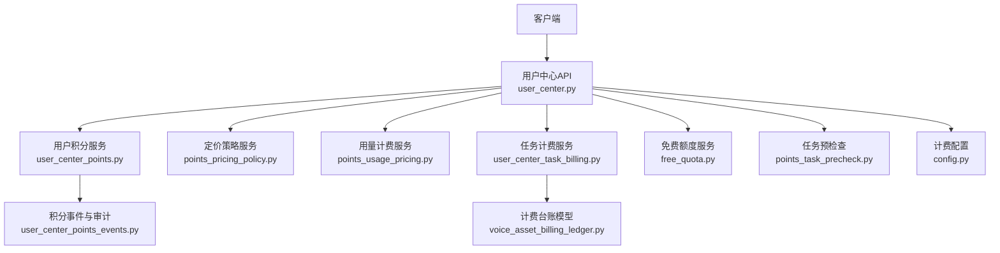
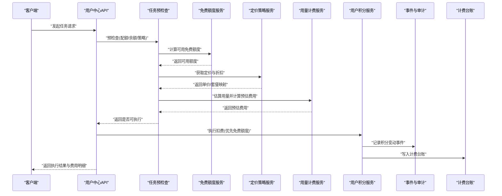
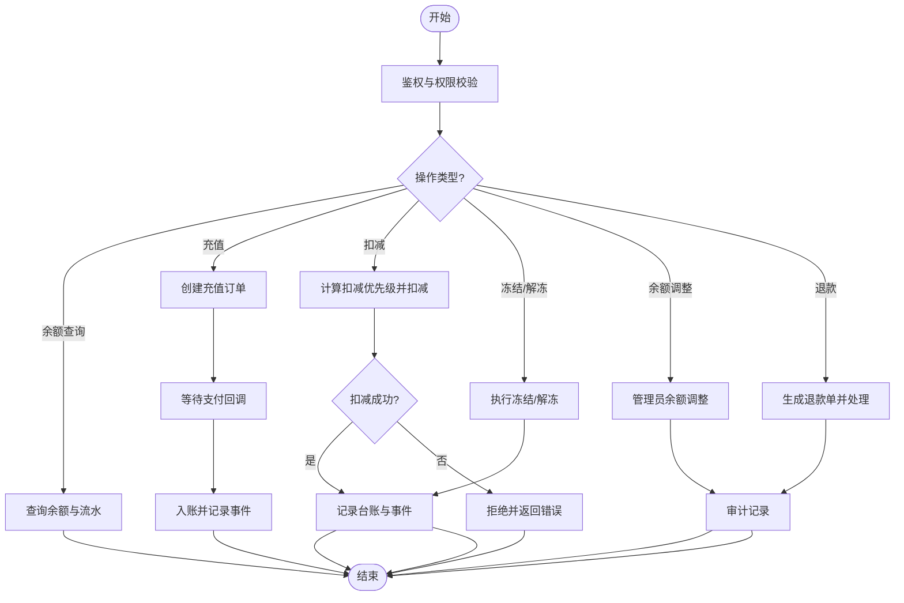
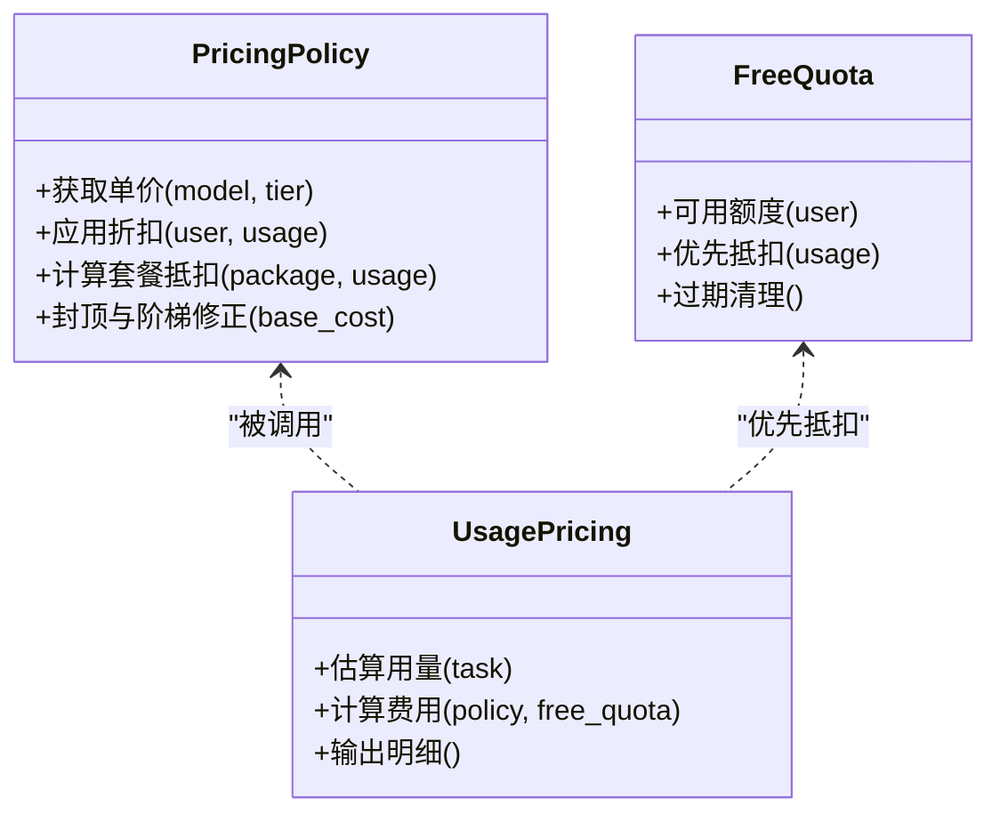
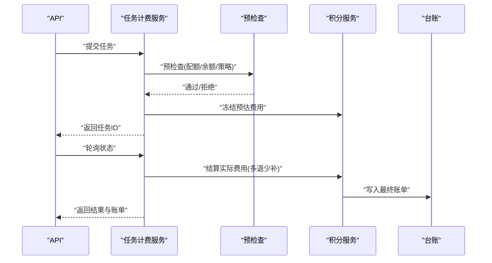
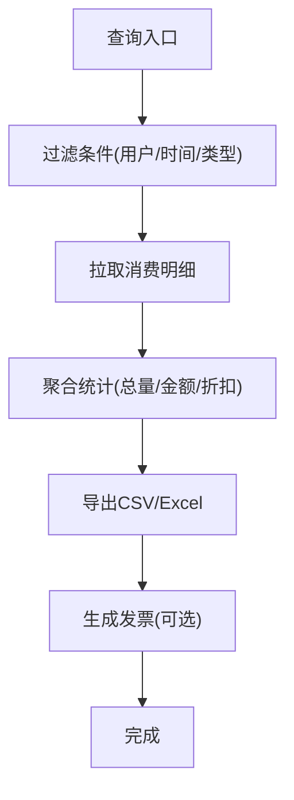
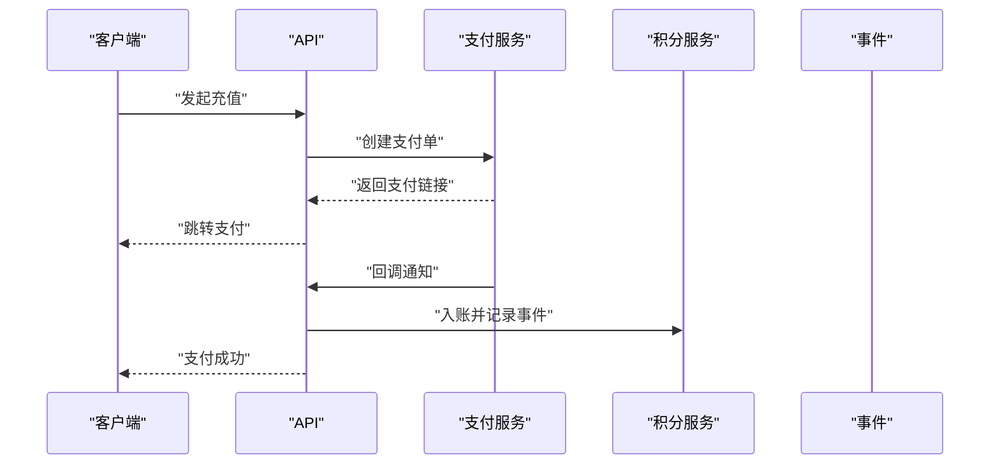
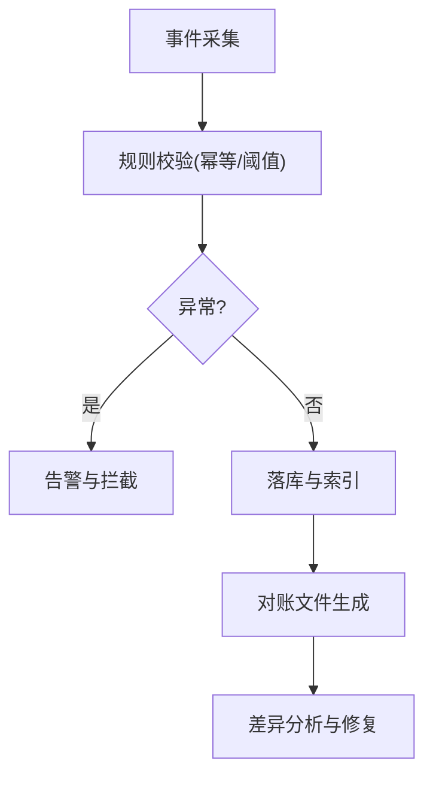
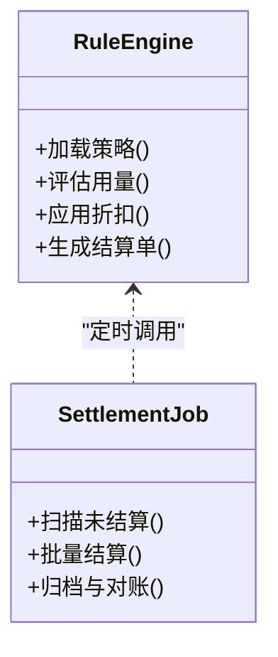
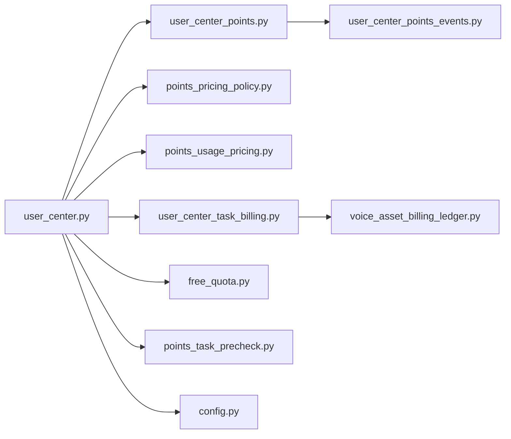

# 计费管理API

<cite>
**本文引用的文件**   
- [backend/app/api/v1/user_center.py](file://backend/app/api/v1/user_center.py)
- [backend/app/services/admin_points_billing.py](file://backend/app/services/admin_points_billing.py)
- [backend/app/services/points_pricing_policy.py](file://backend/app/services/points_pricing_policy.py)
- [backend/app/services/points_usage_pricing.py](file://backend/app/services/points_usage_pricing.py)
- [backend/app/services/user_center_points.py](file://backend/app/services/user_center_points.py)
- [backend/app/services/user_center_points_events.py](file://backend/app/services/user_center_points_events.py)
- [backend/app/services/user_center_task_billing.py](file://backend/app/services/user_center_task_billing.py)
- [backend/app/services/free_quota.py](file://backend/app/services/free_quota.py)
- [backend/app/services/points_task_precheck.py](file://backend/app/services/points_task_precheck.py)
- [backend/app/models/voice_asset_billing_ledger.py](file://backend/app/models/voice_asset_billing_ledger.py)
- [backend/app/schemas/user.py](file://backend/app/schemas/user.py)
- [backend/app/core/config.py](file://backend/app/core/config.py)
- [backend/tests/test_admin_user_points_routes.py](file://backend/tests/test_admin_user_points_routes.py)
- [backend/tests/test_free_quota.py](file://backend/tests/test_free_quota.py)
- [backend/tests/test_budget_ledger.py](file://backend/tests/test_budget_ledger.py)
- [backend/tests/test_voice_asset_billing_ledger_repository.py](file://backend/tests/test_voice_asset_billing_ledger_repository.py)
</cite>

## 目录
1. [简介](#简介)
2. [项目结构](#项目结构)
3. [核心组件](#核心组件)
4. [架构总览](#架构总览)
5. [详细组件分析](#详细组件分析)
6. [依赖关系分析](#依赖关系分析)
7. [性能考量](#性能考量)
8. [故障排查指南](#故障排查指南)
9. [结论](#结论)
10. [附录](#附录)

## 简介
本文件为“小说创作代理系统”的计费管理API文档，聚焦用户积分、服务计费、账单与支付处理。内容涵盖：
- 定价策略配置、折扣规则、套餐管理与费用计算
- 消费记录查询、余额调整、退款处理与发票生成
- 计费审计、异常检测与财务对账示例
- 计费规则引擎、实时扣费与周期性结算机制

该文档面向产品、研发与运营人员，既提供高层概览，也给出代码级实现定位与调用流程说明，便于快速理解与落地集成。

## 项目结构
计费相关能力主要分布在后端服务的 API、服务层、数据模型与测试中：
- API 层：用户中心接口（含积分与计费）
- 服务层：定价策略、使用量计费、任务计费、免费额度、预检查、事件与审计
- 数据模型：语音资产计费台账等
- 配置：计费开关、限额与策略参数
- 测试：覆盖路由、免费额度、预算台账与记账仓储

图表来源
- [backend/app/api/v1/user_center.py](file://backend/app/api/v1/user_center.py)
- [backend/app/services/user_center_points.py](file://backend/app/services/user_center_points.py)
- [backend/app/services/points_pricing_policy.py](file://backend/app/services/points_pricing_policy.py)
- [backend/app/services/points_usage_pricing.py](file://backend/app/services/points_usage_pricing.py)
- [backend/app/services/user_center_task_billing.py](file://backend/app/services/user_center_task_billing.py)
- [backend/app/services/free_quota.py](file://backend/backend/app/services/free_quota.py)
- [backend/app/services/points_task_precheck.py](file://backend/app/services/points_task_precheck.py)
- [backend/app/services/user_center_points_events.py](file://backend/app/services/user_center_points_events.py)
- [backend/app/models/voice_asset_billing_ledger.py](file://backend/app/models/voice_asset_billing_ledger.py)
- [backend/app/core/config.py](file://backend/app/core/config.py)

章节来源
- [backend/app/api/v1/user_center.py](file://backend/app/api/v1/user_center.py)
- [backend/app/services/user_center_points.py](file://backend/app/services/user_center_points.py)
- [backend/app/services/points_pricing_policy.py](file://backend/app/services/points_pricing_policy.py)
- [backend/app/services/points_usage_pricing.py](file://backend/app/services/points_usage_pricing.py)
- [backend/app/services/user_center_task_billing.py](file://backend/app/services/user_center_task_billing.py)
- [backend/app/services/free_quota.py](file://backend/app/services/free_quota.py)
- [backend/app/services/points_task_precheck.py](file://backend/app/services/points_task_precheck.py)
- [backend/app/services/user_center_points_events.py](file://backend/app/services/user_center_points_events.py)
- [backend/app/models/voice_asset_billing_ledger.py](file://backend/app/models/voice_asset_billing_ledger.py)
- [backend/app/core/config.py](file://backend/app/core/config.py)

## 核心组件
- 用户积分服务：负责用户积分余额查询、充值、扣减、冻结/解冻、流水记录与审计事件。
- 定价策略服务：维护基础单价、折扣规则、套餐包与会员等级对应的价格映射。
- 用量计费服务：根据资源使用量（如时长、Token、次数）计算实际费用，支持阶梯计价与封顶。
- 任务计费服务：将具体业务任务（如音频生成、视频生成）与计费项绑定，完成一次性或分步计费。
- 免费额度服务：管理试用额度、赠送额度与过期策略，优先抵扣免费额度。
- 任务预检查：在任务执行前进行配额校验、余额校验与策略匹配，避免无效执行。
- 计费事件与审计：记录所有积分变动、计费决策与异常事件，支持对账与追溯。
- 计费台账模型：持久化关键计费明细，支撑报表、审计与财务对账。

章节来源
- [backend/app/services/user_center_points.py](file://backend/app/services/user_center_points.py)
- [backend/app/services/points_pricing_policy.py](file://backend/app/services/points_pricing_policy.py)
- [backend/app/services/points_usage_pricing.py](file://backend/app/services/points_usage_pricing.py)
- [backend/app/services/user_center_task_billing.py](file://backend/app/services/user_center_task_billing.py)
- [backend/app/services/free_quota.py](file://backend/app/services/free_quota.py)
- [backend/app/services/points_task_precheck.py](file://backend/app/services/points_task_precheck.py)
- [backend/app/services/user_center_points_events.py](file://backend/app/services/user_center_points_events.py)
- [backend/app/models/voice_asset_billing_ledger.py](file://backend/app/models/voice_asset_billing_ledger.py)

## 架构总览
计费系统采用分层设计：API 层暴露统一接口；服务层封装计费策略、额度与任务计费逻辑；数据层通过模型与事件落库与审计。

图表来源
- [backend/app/api/v1/user_center.py](file://backend/app/api/v1/user_center.py)
- [backend/app/services/points_task_precheck.py](file://backend/app/services/points_task_precheck.py)
- [backend/app/services/free_quota.py](file://backend/app/services/free_quota.py)
- [backend/app/services/points_pricing_policy.py](file://backend/app/services/points_pricing_policy.py)
- [backend/app/services/points_usage_pricing.py](file://backend/app/services/points_usage_pricing.py)
- [backend/app/services/user_center_points.py](file://backend/app/services/user_center_points.py)
- [backend/app/services/user_center_points_events.py](file://backend/app/services/user_center_points_events.py)
- [backend/app/models/voice_asset_billing_ledger.py](file://backend/app/models/voice_asset_billing_ledger.py)

## 详细组件分析

### 用户积分管理API
- 功能范围：余额查询、充值、扣减、冻结/解冻、流水查询、余额调整（管理员）、退款处理。
- 典型流程：
  - 余额查询：读取用户当前余额与最近流水摘要。
  - 充值：创建充值订单，触发支付回调后入账，记录事件与台账。
  - 扣减：按优先级扣除免费额度、套餐额度、现金积分，不足则拒绝。
  - 冻结/解冻：用于风控或争议处理，冻结期间不可用。
  - 余额调整：管理员操作，需审计事件与审批流。
  - 退款：原路退回或转入账户余额，生成退款单与审计事件。

章节来源
- [backend/app/api/v1/user_center.py](file://backend/app/api/v1/user_center.py)
- [backend/app/services/user_center_points.py](file://backend/app/services/user_center_points.py)
- [backend/app/services/user_center_points_events.py](file://backend/app/services/user_center_points_events.py)
- [backend/app/models/voice_asset_billing_ledger.py](file://backend/app/models/voice_asset_billing_ledger.py)

### 定价策略与折扣规则
- 定价维度：按资源类型（文本、图像、音频、视频）、模型版本、区域与并发等级。
- 折扣规则：会员等级折扣、活动折扣、批量折扣、封顶价与阶梯价。
- 套餐管理：固定额度包、有效期、适用范围与优先级。
- 费用计算：基础费用 = 用量 × 单价 × 折扣系数；叠加封顶与阶梯修正。

图表来源
- [backend/app/services/points_pricing_policy.py](file://backend/app/services/points_pricing_policy.py)
- [backend/app/services/free_quota.py](file://backend/app/services/free_quota.py)
- [backend/app/services/points_usage_pricing.py](file://backend/app/services/points_usage_pricing.py)

章节来源
- [backend/app/services/points_pricing_policy.py](file://backend/app/services/points_pricing_policy.py)
- [backend/app/services/free_quota.py](file://backend/app/services/free_quota.py)
- [backend/app/services/points_usage_pricing.py](file://backend/app/services/points_usage_pricing.py)

### 任务计费与实时扣费
- 任务计费：将业务任务（如TTS、视频生成）映射到计费项，支持分阶段计费（预处理、生成、后处理）。
- 实时扣费：任务开始前预检查并冻结额度，完成后按实际用量结算，多退少补。
- 失败回滚：任务失败时释放冻结额度或按约定比例扣减。

图表来源
- [backend/app/services/user_center_task_billing.py](file://backend/app/services/user_center_task_billing.py)
- [backend/app/services/points_task_precheck.py](file://backend/app/services/points_task_precheck.py)
- [backend/app/services/user_center_points.py](file://backend/app/services/user_center_points.py)
- [backend/app/models/voice_asset_billing_ledger.py](file://backend/app/models/voice_asset_billing_ledger.py)

章节来源
- [backend/app/services/user_center_task_billing.py](file://backend/app/services/user_center_task_billing.py)
- [backend/app/services/points_task_precheck.py](file://backend/app/services/points_task_precheck.py)
- [backend/app/services/user_center_points.py](file://backend/app/services/user_center_points.py)
- [backend/app/models/voice_asset_billing_ledger.py](file://backend/app/models/voice_asset_billing_ledger.py)

### 消费记录查询与账单生成
- 消费记录：按用户、时间范围、任务类型、状态筛选，支持分页与导出。
- 账单生成：周期汇总（日/周/月），聚合各计费项，输出对账文件与发票信息。
- 发票生成：基于账单生成电子发票，关联支付单与退款单。

章节来源
- [backend/app/api/v1/user_center.py](file://backend/app/api/v1/user_center.py)
- [backend/app/models/voice_asset_billing_ledger.py](file://backend/app/models/voice_asset_billing_ledger.py)

### 支付处理与退款
- 支付处理：创建支付单、调用第三方支付、回调验签、入账与事件记录。
- 退款处理：按原路退回或转入余额，校验原交易、重复退款与风控阈值。
- 异常处理：超时重试、幂等控制、对账差异处理。

章节来源
- [backend/app/api/v1/user_center.py](file://backend/app/api/v1/user_center.py)
- [backend/app/services/user_center_points.py](file://backend/app/services/user_center_points.py)
- [backend/app/services/user_center_points_events.py](file://backend/app/services/user_center_points_events.py)

### 计费审计、异常检测与财务对账
- 计费审计：全链路事件记录（定价决策、额度抵扣、扣费、退款），支持溯源。
- 异常检测：余额不足、策略冲突、重复扣费、支付回调异常等告警。
- 财务对账：每日对账文件生成，与支付渠道、内部台账比对差异并处理。

章节来源
- [backend/app/services/user_center_points_events.py](file://backend/app/services/user_center_points_events.py)
- [backend/app/models/voice_asset_billing_ledger.py](file://backend/app/models/voice_asset_billing_ledger.py)

### 计费规则引擎与周期性结算
- 规则引擎：集中管理定价、折扣、套餐与封顶策略，支持热更新与灰度发布。
- 周期性结算：定时任务汇总未结算账单，按周期结算并归档，支持重算与冲正。

章节来源
- [backend/app/services/points_pricing_policy.py](file://backend/app/services/points_pricing_policy.py)
- [backend/app/services/points_usage_pricing.py](file://backend/app/services/points_usage_pricing.py)

## 依赖关系分析
- API 层依赖服务层：用户中心API依赖积分、定价、用量、任务计费、免费额度与预检查服务。
- 服务层依赖数据模型与事件：计费台账与事件记录用于持久化与审计。
- 配置驱动：计费开关、限额与策略参数由配置模块注入。

图表来源
- [backend/app/api/v1/user_center.py](file://backend/app/api/v1/user_center.py)
- [backend/app/services/user_center_points.py](file://backend/app/services/user_center_points.py)
- [backend/app/services/points_pricing_policy.py](file://backend/app/services/points_pricing_policy.py)
- [backend/app/services/points_usage_pricing.py](file://backend/app/services/points_usage_pricing.py)
- [backend/app/services/user_center_task_billing.py](file://backend/app/services/user_center_task_billing.py)
- [backend/app/services/free_quota.py](file://backend/app/services/free_quota.py)
- [backend/app/services/points_task_precheck.py](file://backend/app/services/points_task_precheck.py)
- [backend/app/services/user_center_points_events.py](file://backend/app/services/user_center_points_events.py)
- [backend/app/models/voice_asset_billing_ledger.py](file://backend/app/models/voice_asset_billing_ledger.py)
- [backend/app/core/config.py](file://backend/app/core/config.py)

章节来源
- [backend/app/api/v1/user_center.py](file://backend/app/api/v1/user_center.py)
- [backend/app/core/config.py](file://backend/app/core/config.py)

## 性能考量
- 预检查与缓存：定价策略与免费额度建议缓存热点键，降低数据库压力。
- 异步事件：积分事件与台账写入采用异步队列，提升API响应速度。
- 批量结算：周期性结算任务分批处理，避免长事务与锁竞争。
- 幂等与去重：支付回调与扣费接口保证幂等，防止重复计费。
- 监控与限流：对高频计费接口实施限流与熔断，保障稳定性。

[本节为通用指导，不直接分析具体文件]

## 故障排查指南
- 常见问题：
  - 余额不足：检查预检查与冻结逻辑，确认免费额度与套餐优先级。
  - 重复扣费：核对事件幂等键与支付回调处理。
  - 策略冲突：查看定价策略生效顺序与折扣叠加规则。
  - 对账差异：比对支付渠道账单与内部台账，定位差异原因。
- 调试手段：
  - 启用计费事件日志与审计追踪。
  - 使用测试用例验证边界场景（零额度、负数、超大用量）。
  - 定期运行对账脚本与差异报告。

章节来源
- [backend/tests/test_admin_user_points_routes.py](file://backend/tests/test_admin_user_points_routes.py)
- [backend/tests/test_free_quota.py](file://backend/tests/test_free_quota.py)
- [backend/tests/test_budget_ledger.py](file://backend/tests/test_budget_ledger.py)
- [backend/tests/test_voice_asset_billing_ledger_repository.py](file://backend/tests/test_voice_asset_billing_ledger_repository.py)

## 结论
本计费管理API以清晰的分层架构与完善的审计机制，支撑用户积分、定价策略、任务计费与周期性结算的全链路需求。通过预检查、实时扣费与对账工具，确保计费准确性与系统稳定性。建议在生产环境强化监控、限流与对账自动化，持续提升计费系统的可靠性与可观测性。

[本节为总结性内容，不直接分析具体文件]

## 附录
- 术语表：
  - 免费额度：赠送或试用额度，优先抵扣。
  - 套餐包：固定额度包，按有效期与适用范围抵扣。
  - 计费台账：持久化的计费明细，用于审计与对账。
  - 事件审计：记录所有计费相关操作的审计日志。
- 参考测试：
  - 用户积分路由测试、免费额度测试、预算台账测试、计费台账仓储测试。

章节来源
- [backend/tests/test_admin_user_points_routes.py](file://backend/tests/test_admin_user_points_routes.py)
- [backend/tests/test_free_quota.py](file://backend/tests/test_free_quota.py)
- [backend/tests/test_budget_ledger.py](file://backend/tests/test_budget_ledger.py)
- [backend/tests/test_voice_asset_billing_ledger_repository.py](file://backend/tests/test_voice_asset_billing_ledger_repository.py)