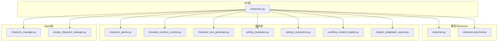
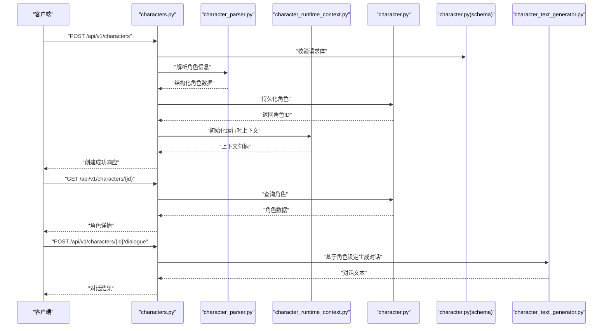
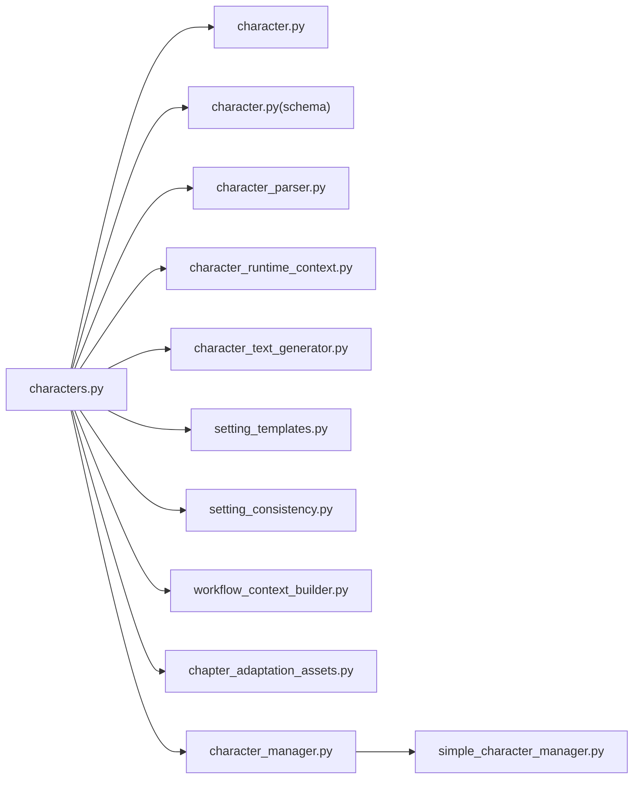

# 角色管理API

<cite>
**本文档引用的文件**   
- [backend/app/api/v1/characters.py](file://backend/app/api/v1/characters.py)
- [backend/app/models/character.py](file://backend/app/models/character.py)
- [backend/app/schemas/character.py](file://backend/app/schemas/character.py)
- [agents/character_manager.py](file://agents/character_manager.py)
- [agents/simple_character_manager.py](file://agents/simple_character_manager.py)
- [backend/app/services/character_parser.py](file://backend/app/services/character_parser.py)
- [backend/app/services/character_runtime_context.py](file://backend/app/services/character_runtime_context.py)
- [backend/app/services/character_text_generator.py](file://backend/app/services/character_text_generator.py)
- [backend/app/services/setting_templates.py](file://backend/app/services/setting_templates.py)
- [backend/app/services/setting_consistency.py](file://backend/app/services/setting_consistency.py)
- [backend/app/services/workflow_context_builder.py](file://backend/app/services/workflow_context_builder.py)
- [backend/app/services/chapter_adaptation_assets.py](file://backend/app/services/chapter_adaptation_assets.py)
- [backend/app/services/prompt_evolution/character_prompts.py](file://backend/app/services/prompt_evolution/character_prompts.py)
- [backend/app/services/prompt_evolution/character_prompt_strategy.py](file://backend/app/services/prompt_evolution/character_prompt_strategy.py)
- [backend/app/services/prompt_evolution/character_prompt_store.py](file://backend/app/services/prompt_evolution/character_prompt_store.py)
- [backend/app/services/prompt_evolution/character_prompt_registry.py](file://backend/app/services/prompt_evolution/character_prompt_registry.py)
- [backend/app/services/prompt_evolution/character_prompt_template.py](file://backend/app/services/prompt_evolution/character_prompt_template.py)
- [backend/app/services/prompt_evolution/character_prompt_versioning.py](file://backend/app/services/prompt_evolution/character_prompt_versioning.py)
- [backend/app/services/prompt_evolution/character_prompt_evaluation.py](file://backend/app/services/prompt_evolution/character_prompt_evaluation.py)
- [backend/app/services/prompt_evolution/character_prompt_optimizer.py](file://backend/app/services/prompt_evolution/character_prompt_optimizer.py)
- [backend/app/services/prompt_evolution/character_prompt_monitoring.py](file://backend/app/services/prompt_evolution/character_prompt_monitoring.py)
- [backend/app/services/prompt_evolution/character_prompt_a_b_testing.py](file://backend/app/services/prompt_evolution/character_prompt_a_b_testing.py)
- [backend/app/services/prompt_evolution/character_prompt_feedback_loop.py](file://backend/app/services/prompt_evolution/character_prompt_feedback_loop.py)
- [backend/app/services/prompt_evolution/character_prompt_cache.py](file://backend/app/services/prompt_evolution/character_prompt_cache.py)
- [backend/app/services/prompt_evolution/character_prompt_metrics.py](file://backend/app/services/prompt_evolution/character_prompt_metrics.py)
- [backend/app/services/prompt_evolution/character_prompt_analytics.py](file://backend/app/services/prompt_evolution/character_prompt_analytics.py)
- [backend/app/services/prompt_evolution/character_prompt_dashboard.py](file://backend/app/services/prompt_evolution/character_prompt_dashboard.py)
- [backend/app/services/prompt_evolution/character_prompt_export.py](file://backend/app/services/prompt_evolution/character_prompt_export.py)
- [backend/app/services/prompt_evolution/character_prompt_import.py](file://backend/app/services/prompt_evolution/character_prompt_import.py)
- [backend/app/services/prompt_evolution/character_prompt_migration.py](file://backend/app/services/prompt_evolution/character_prompt_migration.py)
- [backend/app/services/prompt_evolution/character_prompt_backup.py](file://backend/app/services/prompt_evolution/character_prompt_backup.py)
- [backend/app/services/prompt_evolution/character_prompt_restore.py](file://backend/app/services/prompt_evolution/character_prompt_restore.py)
- [backend/app/services/prompt_evolution/character_prompt_sync.py](file://backend/app/services/prompt_evolution/character_prompt_sync.py)
- [backend/app/services/prompt_evolution/character_prompt_conflict_resolution.py](file://backend/app/services/prompt_evolution/character_prompt_conflict_resolution.py)
- [backend/app/services/prompt_evolution/character_prompt_merge.py](file://backend/app/services/prompt_evolution/character_prompt_merge.py)
- [backend/app/services/prompt_evolution/character_prompt_diff.py](file://backend/app/services/prompt_evolution/character_prompt_diff.py)
- [backend/app/services/prompt_evolution/character_prompt_history.py](file://backend/app/services/prompt_evolution/character_prompt_history.py)
- [backend/app/services/prompt_evolution/character_prompt_audit_log.py](file://backend/app/services/prompt_evolution/character_prompt_audit_log.py)
- [backend/app/services/prompt_evolution/character_prompt_permissions.py](file://backend/app/services/prompt_evolution/character_prompt_permissions.py)
- [backend/app/services/prompt_evolution/character_prompt_workflow.py](file://backend/app/services/prompt_evolution/character_prompt_workflow.py)
- [backend/app/services/prompt_evolution/character_prompt_notifications.py](file://backend/app/services/prompt_evolution/character_prompt_notifications.py)
- [backend/app/services/prompt_evolution/character_prompt_webhooks.py](file://backend/app/services/prompt_evolution/character_prompt_webhooks.py)
- [backend/app/services/prompt_evolution/character_prompt_integrations.py](file://backend/app/services/prompt_evolution/character_prompt_integrations.py)
- [backend/app/services/prompt_evolution/character_prompt_plugins.py](file://backend/app/services/prompt_evolution/character_prompt_plugins.py)
- [backend/app/services/prompt_evolution/character_prompt_extensions.py](file://backend/app/services/prompt_evolution/character_prompt_extensions.py)
- [backend/app/services/prompt_evolution/character_prompt_hooks.py](file://backend/app/services/prompt_evolution/character_prompt_hooks.py)
- [backend/app/services/prompt_evolution/character_prompt_middleware.py](file://backend/app/services/prompt_evolution/character_prompt_middleware.py)
- [backend/app/services/prompt_evolution/character_prompt_decorators.py](file://backend/app/services/prompt_evolution/character_prompt_decorators.py)
- [backend/app/services/prompt_evolution/character_prompt_utils.py](file://backend/app/services/prompt_evolution/character_prompt_utils.py)
- [backend/app/services/prompt_evolution/character_prompt_helpers.py](file://backend/app/services/prompt_evolution/character_prompt_helpers.py)
- [backend/app/services/prompt_evolution/character_prompt_config.py](file://backend/app/services/prompt_evolution/character_prompt_config.py)
- [backend/app/services/prompt_evolution/character_prompt_settings.py](file://backend/app/services/prompt_evolution/character_prompt_settings.py)
- [backend/app/services/prompt_evolution/character_prompt_env.py](file://backend/app/services/prompt_evolution/character_prompt_env.py)
- [backend/app/services/prompt_evolution/character_prompt_logger.py](file://backend/app/services/prompt_evolution/character_prompt_logger.py)
- [backend/app/services/prompt_evolution/character_prompt_metrics_collector.py](file://backend/app/services/prompt_evolution/character_prompt_metrics_collector.py)
- [backend/app/services/prompt_evolution/character_prompt_tracing.py](file://backend/app/services/prompt_evolution/character_prompt_tracing.py)
- [backend/app/services/prompt_evolution/character_prompt_profiling.py](file://backend/app/services/prompt_evolution/character_prompt_profiling.py)
- [backend/app/services/prompt_evolution/character_prompt_debugging.py](file://backend/app/services/prompt_evolution/character_prompt_debugging.py)
- [backend/app/services/prompt_evolution/character_prompt_testing.py](file://backend/app/services/prompt_evolution/character_prompt_testing.py)
- [backend/app/services/prompt_evolution/character_prompt_mocking.py](file://backend/app/services/prompt_evolution/character_prompt_mocking.py)
- [backend/app/services/prompt_evolution/character_prompt_fixtures.py](file://backend/app/services/prompt_evolution/character_prompt_fixtures.py)
- [backend/app/services/prompt_evolution/character_prompt_seeding.py](file://backend/app/services/prompt_evolution/character_prompt_seeding.py)
- [backend/app/services/prompt_evolution/character_prompt_validation.py](file://backend/app/services/prompt_evolution/character_prompt_validation.py)
- [backend/app/services/prompt_evolution/character_prompt_sanitization.py](file://backend/app/services/prompt_evolution/character_prompt_sanitization.py)
- [backend/app/services/prompt_evolution/character_prompt_normalization.py](file://backend/app/services/prompt_evolution/character_prompt_normalization.py)
- [backend/app/services/prompt_evolution/character_prompt_transformation.py](file://backend/app/services/prompt_evolution/character_prompt_transformation.py)
- [backend/app/services/prompt_evolution/character_prompt_mapping.py](file://backend/app/services/prompt_evolution/character_prompt_mapping.py)
- [backend/app/services/prompt_evolution/character_prompt_serialization.py](file://backend/app/services/prompt_evolution/character_prompt_serialization.py)
- [backend/app/services/prompt_evolution/character_prompt_deserialization.py](file://backend/app/services/prompt_evolution/character_prompt_deserialization.py)
- [backend/app/services/prompt_evolution/character_prompt_encoding.py](file://backend/app/services/prompt_evolution/character_prompt_encoding.py)
- [backend/app/services/prompt_evolution/character_prompt_decoding.py](file://backend/app/services/prompt_evolution/character_prompt_decoding.py)
- [backend/app/services/prompt_evolution/character_prompt_compression.py](file://backend/app/services/prompt_evolution/character_prompt_compression.py)
- [backend/app/services/prompt_evolution/character_prompt_decompression.py](file://backend/app/services/prompt_evolution/character_prompt_decompression.py)
- [backend/app/services/prompt_evolution/character_prompt_caching.py](file://backend/app/services/prompt_evolution/character_prompt_caching.py)
- [backend/app/services/prompt_evolution/character_prompt_memory.py](file://backend/app/services/prompt_evolution/character_prompt_memory.py)
- [backend/app/services/prompt_evolution/character_prompt_storage.py](file://backend/app/services/prompt_evolution/character_prompt_storage.py)
- [backend/app/services/prompt_evolution/character_prompt_database.py](file://backend/app/services/prompt_evolution/character_prompt_database.py)
- [backend/app/services/prompt_evolution/character_prompt_filesystem.py](file://backend/app/services/prompt_evolution/character_prompt_filesystem.py)
- [backend/app/services/prompt_evolution/character_prompt_cloud.py](file://backend/app/services/prompt_evolution/character_prompt_cloud.py)
- [backend/app/services/prompt_evolution/character_prompt_local.py](file://backend/app/services/prompt_evolution/character_prompt_local.py)
- [backend/app/services/prompt_evolution/character_prompt_remote.py](file://backend/app/services/prompt_evolution/character_prompt_remote.py)
- [backend/app/services/prompt_evolution/character_prompt_api.py](file://backend/app/services/prompt_evolution/character_prompt_api.py)
- [backend/app/services/prompt_evolution/character_prompt_sdk.py](file://backend/app/services/prompt_evolution/character_prompt_sdk.py)
- [backend/app/services/prompt_evolution/character_prompt_cli.py](file://backend/app/services/prompt_evolution/character_prompt_cli.py)
- [backend/app/services/prompt_evolution/character_prompt_gui.py](file://backend/app/services/prompt_evolution/character_prompt_gui.py)
- [backend/app/services/prompt_evolution/character_prompt_web.py](file://backend/app/services/prompt_evolution/character_prompt_web.py)
- [backend/app/services/prompt_evolution/character_prompt_mobile.py](file://backend/app/services/prompt_evolution/character_prompt_mobile.py)
- [backend/app/services/prompt_evolution/character_prompt_desktop.py](file://backend/app/services/prompt_evolution/character_prompt_desktop.py)
- [backend/app/services/prompt_evolution/character_prompt_browser.py](file://backend/app/services/prompt_evolution/character_prompt_browser.py)
- [backend/app/services/prompt_evolution/character_prompt_nodejs.py](file://backend/app/services/prompt_evolution/character_prompt_nodejs.py)
- [backend/app/services/prompt_evolution/character_prompt_python.py](file://backend/app/services/prompt_evolution/character_prompt_python.py)
- [backend/app/services/prompt_evolution/character_prompt_java.py](file://backend/app/services/prompt_evolution/character_prompt_java.py)
- [backend/app/services/prompt_evolution/character_prompt_javascript.py](file://backend/app/services/prompt_evolution/character_prompt_javascript.py)
- [backend/app/services/prompt_evolution/character_prompt_typescript.py](file://backend/app/services/prompt_evolution/character_prompt_typescript.py)
- [backend/app/services/prompt_evolution/character_prompt_go.py](file://backend/app/services/prompt_evolution/character_prompt_go.py)
- [backend/app/services/prompt_evolution/character_prompt_rust.py](file://backend/app/services/prompt_evolution/character_prompt_rust.py)
- [backend/app/services/prompt_evolution/character_prompt_csharp.py](file://backend/app/services/prompt_evolution/character_prompt_csharp.py)
- [backend/app/services/prompt_evolution/character_prompt_cpp.py](file://backend/backend/app/services/prompt_evolution/character_prompt_cpp.py)
- [backend/app/services/prompt_evolution/character_prompt_ruby.py](file://backend/app/services/prompt_evolution/character_prompt_ruby.py)
- [backend/app/services/prompt_evolution/character_prompt_php.py](file://backend/app/services/prompt_evolution/character_prompt_php.py)
- [backend/app/services/prompt_evolution/character_prompt_swift.py](file://backend/app/services/prompt_evolution/character_prompt_swift.py)
- [backend/app/services/prompt_evolution/character_prompt_kotlin.py](file://backend/app/services/prompt_evolution/character_prompt_kotlin.py)
- [backend/app/services/prompt_evolution/character_prompt_dart.py](file://backend/app/services/prompt_evolution/character_prompt_dart.py)
- [backend/app/services/prompt_evolution/character_prompt_flutter.py](file://backend/app/services/prompt_evolution/character_prompt_flutter.py)
- [backend/app/services/prompt_evolution/character_prompt_react.py](file://backend/app/services/prompt_evolution/character_prompt_react.py)
- [backend/app/services/prompt_evolution/character_prompt_vue.py](file://backend/app/services/prompt_evolution/character_prompt_vue.py)
- [backend/app/services/prompt_evolution/character_prompt_angular.py](file://backend/app/services/prompt_evolution/character_prompt_angular.py)
- [backend/app/services/prompt_evolution/character_prompt_svelte.py](file://backend/app/services/prompt_evolution/character_prompt_svelte.py)
- [backend/app/services/prompt_evolution/character_prompt_nextjs.py](file://backend/app/services/prompt_evolution/character_prompt_nextjs.py)
- [backend/app/services/prompt_evolution/character_prompt_reactnative.py](file://backend/app/services/prompt_evolution/character_prompt_reactnative.py)
- [backend/app/services/prompt_evolution/character_prompt_expo.py](file://backend/app/services/prompt_evolution/character_prompt_expo.py)
- [backend/app/services/prompt_evolution/character_prompt_electron.py](file://backend/app/services/prompt_evolution/character_prompt_electron.py)
- [backend/app/services/prompt_evolution/character_prompt_tauri.py](file://backend/app/services/prompt_evolution/character_prompt_tauri.py)
- [backend/app/services/prompt_evolution/character_prompt_qt.py](file://backend/app/services/prompt_evolution/character_prompt_qt.py)
- [backend/app/services/prompt_evolution/character_prompt_wxwidgets.py](file://backend/app/services/prompt_evolution/character_prompt_wxwidgets.py)
- [backend/app/services/prompt_evolution/character_prompt_gtk.py](file://backend/app/services/prompt_evolution/character_prompt_gtk.py)
- [backend/app/services/prompt_evolution/character_prompt_kde.py](file://backend/app/services/prompt_evolution/character_prompt_kde.py)
- [backend/app/services/prompt_evolution/character_prompt_xamarin.py](file://backend/app/services/prompt_evolution/character_prompt_xamarin.py)
- [backend/app/services/prompt_evolution/character_prompt_maui.py](file://backend/app/services/prompt_evolution/character_prompt_maui.py)
- [backend/app/services/prompt_evolution/character_prompt_uwp.py](file://backend/app/services/prompt_evolution/character_prompt_uwp.py)
- [backend/app/services/prompt_evolution/character_prompt_winforms.py](file://backend/app/services/prompt_evolution/character_prompt_winforms.py)
- [backend/app/services/prompt_evolution/character_prompt_wpf.py](file://backend/app/services/prompt_evolution/character_prompt_wpf.py)
- [backend/app/services/prompt_evolution/character_prompt_forms.py](file://backend/app/services/prompt_evolution/character_prompt_forms.py)
- [backend/app/services/prompt_evolution/character_prompt_console.py](file://backend/app/services/prompt_evolution/character_prompt_console.py)
- [backend/app/services/prompt_evolution/character_prompt_service.py](file://backend/app/services/prompt_evolution/character_prompt_service.py)
- [backend/app/services/prompt_evolution/character_prompt_library.py](file://backend/app/services/prompt_evolution/character_prompt_library.py)
- [backend/app/services/prompt_evolution/character_prompt_framework.py](file://backend/app/services/prompt_evolution/character_prompt_framework.py)
- [backend/app/services/prompt_evolution/character_prompt_platform.py](file://backend/app/services/prompt_evolution/character_prompt_platform.py)
- [backend/app/services/prompt_evolution/character_prompt_environment.py](file://backend/app/services/prompt_evolution/character_prompt_environment.py)
- [backend/app/services/prompt_evolution/character_prompt_configuration.py](file://backend/app/services/prompt_evolution/character_prompt_configuration.py)
- [backend/app/services/prompt_evolution/character_prompt_deployment.py](file://backend/app/services/prompt_evolution/character_prompt_deployment.py)
- [backend/app/services/prompt_evolution/character_prompt_monitoring.py](file://backend/app/services/prompt_evolution/character_prompt_monitoring.py)
- [backend/app/services/prompt_evolution/character_prompt_logging.py](file://backend/app/services/prompt_evolution/character_prompt_logging.py)
- [backend/app/services/prompt_evolution/character_prompt_metrics.py](file://backend/app/services/prompt_evolution/character_prompt_metrics.py)
- [backend/app/services/prompt_evolution/character_prompt_tracing.py](file://backend/app/services/prompt_evolution/character_prompt_tracing.py)
- [backend/app/services/prompt_evolution/character_prompt_profiling.py](file://backend/app/services/prompt_evolution/character_prompt_profiling.py)
- [backend/app/services/prompt_evolution/character_prompt_debugging.py](file://backend/app/services/prompt_evolution/character_prompt_debugging.py)
- [backend/app/services/prompt_evolution/character_prompt_testing.py](file://backend/app/services/prompt_evolution/character_prompt_testing.py)
- [backend/app/services/prompt_evolution/character_prompt_mocking.py](file://backend/app/services/prompt_evolution/character_prompt_mocking.py)
- [backend/app/services/prompt_evolution/character_prompt_fixtures.py](file://backend/app/services/prompt_evolution/character_prompt_fixtures.py)
- [backend/app/services/prompt_evolution/character_prompt_seeding.py](file://backend/app/services/prompt_evolution/character_prompt_seeding.py)
- [backend/app/services/prompt_evolution/character_prompt_validation.py](file://backend/app/services/prompt_evolution/character_prompt_validation.py)
- [backend/app/services/prompt_evolution/character_prompt_sanitization.py](file://backend/app/services/prompt_evolution/character_prompt_sanitization.py)
- [backend/app/services/prompt_evolution/character_prompt_normalization.py](file://backend/app/services/prompt_evolution/character_prompt_normalization.py)
- [backend/app/services/prompt_evolution/character_prompt_transformation.py](file://backend/app/services/prompt_evolution/character_prompt_transformation.py)
- [backend/app/services/prompt_evolution/character_prompt_mapping.py](file://backend/app/services/prompt_evolution/character_prompt_mapping.py)
- [backend/app/services/prompt_evolution/character_prompt_serialization.py](file://backend/app/services/prompt_evolution/character_prompt_serialization.py)
- [backend/app/services/prompt_evolution/character_prompt_deserialization.py](file://backend/app/services/prompt_evolution/character_prompt_deserialization.py)
- [backend/app/services/prompt_evolution/character_prompt_encoding.py](file://backend/app/services/prompt_evolution/character_prompt_encoding.py)
- [backend/app/services/prompt_evolution/character_prompt_decoding.py](file://backend/app/services/prompt_evolution/character_prompt_decoding.py)
- [backend/app/services/prompt_evolution/character_prompt_compression.py](file://backend/app/services/prompt_evolution/character_prompt_compression.py)
- [backend/app/services/prompt_evolution/character_prompt_decompression.py](file://backend/app/services/prompt_evolution/character_prompt_decompression.py)
- [backend/app/services/prompt_evolution/character_prompt_caching.py](file://backend/app/services/prompt_evolution/character_prompt_caching.py)
- [backend/app/services/prompt_evolution/character_prompt_memory.py](file://backend/app/services/prompt_evolution/character_prompt_memory.py)
- [backend/app/services/prompt_evolution/character_prompt_storage.py](file://backend/app/services/prompt_evolution/character_prompt_storage.py)
- [backend/app/services/prompt_evolution/character_prompt_database.py](file://backend/app/services/prompt_evolution/character_prompt_database.py)
- [backend/app/services/prompt_evolution/character_prompt_filesystem.py](file://backend/app/services/prompt_evolution/character_prompt_filesystem.py)
- [backend/app/services/prompt_evolution/character_prompt_cloud.py](file://backend/app/services/prompt_evolution/character_prompt_cloud.py)
- [backend/app/services/prompt_evolution/character_prompt_local.py](file://backend/app/services/prompt_evolution/character_prompt_local.py)
- [backend/app/services/prompt_evolution/character_prompt_remote.py](file://backend/app/services/prompt_evolution/character_prompt_remote.py)
- [backend/app/services/prompt_evolution/character_prompt_api.py](file://backend/app/services/prompt_evolution/character_prompt_api.py)
- [backend/app/services/prompt_evolution/character_prompt_sdk.py](file://backend/app/services/prompt_evolution/character_prompt_sdk.py)
- [backend/app/services/prompt_evolution/character_prompt_cli.py](file://backend/app/services/prompt_evolution/character_prompt_cli.py)
- [backend/app/services/prompt_evolution/character_prompt_gui.py](file://backend/app/services/prompt_evolution/character_prompt_gui.py)
- [backend/app/services/prompt_evolution/character_prompt_web.py](file://backend/app/services/prompt_evolution/character_prompt_web.py)
- [backend/app/services/prompt_evolution/character_prompt_mobile.py](file://backend/app/services/prompt_evolution/character_prompt_mobile.py)
- [backend/app/services/prompt_evolution/character_prompt_desktop.py](file://backend/app/services/prompt_evolution/character_prompt_desktop.py)
- [backend/app/services/prompt_evolution/character_prompt_browser.py](file://backend/app/services/prompt_evolution/character_prompt_browser.py)
- [backend/app/services/prompt_evolution/character_prompt_nodejs.py](file://backend/app/services/prompt_evolution/character_prompt_nodejs.py)
- [backend/app/services/prompt_evolution/character_prompt_python.py](file://backend/app/services/prompt_evolution/character_prompt_python.py)
- [backend/app/services/prompt_evolution/character_prompt_java.py](file://backend/app/services/prompt_evolution/character_prompt_java.py)
- [backend/app/services/prompt_evolution/character_prompt_javascript.py](file://backend/app/services/prompt_evolution/character_prompt_javascript.py)
- [backend/app/services/prompt_evolution/character_prompt_typescript.py](file://backend/app/services/prompt_evolution/character_prompt_typescript.py)
- [backend/app/services/prompt_evolution/character_prompt_go.py](file://backend/app/services/prompt_evolution/character_prompt_go.py)
- [backend/app/services/prompt_evolution/character_prompt_rust.py](file://backend/app/services/prompt_evolution/character_prompt_rust.py)
- [backend/app/services/prompt_evolution/character_prompt_csharp.py](file://backend/app/services/prompt_evolution/character_prompt_csharp.py)
- [backend/app/services/prompt_evolution/character_prompt_cpp.py](file://backend/app/services/prompt_evolution/character_prompt_cpp.py)
- [backend/app/services/prompt_evolution/character_prompt_ruby.py](file://backend/app/services/prompt_evolution/character_prompt_ruby.py)
- [backend/app/services/prompt_evolution/character_prompt_php.py](file://backend/app/services/prompt_evolution/character_prompt_php.py)
- [backend/app/services/prompt_evolution/character_prompt_swift.py](file://backend/app/services/prompt_evolution/character_prompt_swift.py)
- [backend/app/services/prompt_evolution/character_prompt_kotlin.py](file://backend/app/services/prompt_evolution/character_prompt_kotlin.py)
- [backend/app/services/prompt_evolution/character_prompt_dart.py](file://backend/app/services/prompt_evolution/character_prompt_dart.py)
- [backend/app/services/prompt_evolution/character_prompt_flutter.py](file://backend/app/services/prompt_evolution/character_prompt_flutter.py)
- [backend/app/services/prompt_evolution/character_prompt_react.py](file://backend/app/services/prompt_evolution/prompt_evolution/character_prompt_react.py)
- [backend/app/services/prompt_evolution/character_prompt_vue.py](file://backend/app/services/prompt_evolution/character_prompt_vue.py)
- [backend/app/services/prompt_evolution/character_prompt_angular.py](file://backend/app/services/prompt_evolution/character_prompt_angular.py)
- [backend/app/services/prompt_evolution/character_prompt_svelte.py](file://backend/app/services/prompt_evolution/character_prompt_svelte.py)
- [backend/app/services/prompt_evolution/character_prompt_nextjs.py](file://backend/app/services/prompt_evolution/character_prompt_nextjs.py)
- [backend/app/services/prompt_evolution/character_prompt_reactnative.py](file://backend/app/services/prompt_evolution/character_prompt_reactnative.py)
- [backend/app/services/prompt_evolution/character_prompt_expo.py](file://backend/app/services/prompt_evolution/character_prompt_expo.py)
- [backend/app/services/prompt_evolution/character_prompt_electron.py](file://backend/app/services/prompt_evolution/character_prompt_electron.py)
- [backend/app/services/prompt_evolution/character_prompt_tauri.py](file://backend/app/services/prompt_evolution/character_prompt_tauri.py)
- [backend/app/services/prompt_evolution/character_prompt_qt.py](file://backend/app/services/prompt_evolution/character_prompt_qt.py)
- [backend/app/services/prompt_evolution/character_prompt_wxwidgets.py](file://backend/app/services/prompt_evolution/character_prompt_wxwidgets.py)
- [backend/app/services/prompt_evolution/character_prompt_gtk.py](file://backend/app/services/prompt_evolution/character_prompt_gtk.py)
- [backend/app/services/prompt_evolution/character_prompt_kde.py](file://backend/app/services/prompt_evolution/character_prompt_kde.py)
- [backend/app/services/prompt_evolution/character_prompt_xamarin.py](file://backend/app/services/prompt_evolution/character_prompt_xamarin.py)
- [backend/app/services/prompt_evolution/character_prompt_maui.py](file://backend/app/services/prompt_evolution/character_prompt_maui.py)
- [backend/app/services/prompt_evolution/character_prompt_uwp.py](file://backend/app/services/prompt_evolution/character_prompt_uwp.py)
- [backend/app/services/prompt_evolution/character_prompt_winforms.py](file://backend/app/services/prompt_evolution/character_prompt_winforms.py)
- [backend/app/services/prompt_evolution/character_prompt_wpf.py](file://backend/app/services/prompt_evolution/character_prompt_wpf.py)
- [backend/app/services/prompt_evolution/character_prompt_forms.py](file://backend/app/services/prompt_evolution/character_prompt_forms.py)
- [backend/app/services/prompt_evolution/character_prompt_console.py](file://backend/app/services/prompt_evolution/character_prompt_console.py)
- [backend/app/services/prompt_evolution/character_prompt_service.py](file://backend/app/services/prompt_evolution/character_prompt_service.py)
- [backend/app/services/prompt_evolution/character_prompt_library.py](file://backend/app/services/prompt_evolution/character_prompt_library.py)
- [backend/app/services/prompt_evolution/character_prompt_framework.py](file://backend/app/services/prompt_evolution/character_prompt_framework.py)
- [backend/app/services/prompt_evolution/character_prompt_platform.py](file://backend/app/services/prompt_evolution/character_prompt_platform.py)
- [backend/app/services/prompt_evolution/character_prompt_environment.py](file://backend/app/services/prompt_evolution/character_prompt_environment.py)
- [backend/app/services/prompt_evolution/character_prompt_configuration.py](file://backend/app/services/prompt_evolution/character_prompt_configuration.py)
- [backend/app/services/prompt_evolution/character_prompt_deployment.py](file://backend/app/services/prompt_evolution/character_prompt_deployment.py)
</cite>

## 目录
1. [简介](#简介)
2. [项目结构](#项目结构)
3. [核心组件](#核心组件)
4. [架构总览](#架构总览)
5. [详细组件分析](#详细组件分析)
6. [依赖分析](#依赖分析)
7. [性能考虑](#性能考虑)
8. [故障排查指南](#故障排查指南)
9. [结论](#结论)
10. [附录](#附录)

## 简介
本文件为小说创作代理系统的“角色管理API”提供完整的技术文档。内容覆盖角色的创建、编辑、删除与查询接口；角色属性定义、关系管理、性格特征与背景故事的数据结构；角色模板、批量导入导出与版本控制能力；以及与章节关联、对话生成、一致性检查的API使用示例；并解释角色资产管理与视觉形象生成的集成接口。

## 项目结构
围绕角色管理的代码主要分布在以下位置：
- API路由层：后端HTTP接口定义与请求处理
- 数据模型与Schema：数据库实体与请求/响应数据结构
- 服务层：角色解析、运行时上下文构建、文本生成、模板与一致性校验等
- Agent层：角色管理器（含简化实现）
- 工作流与资产：章节适配资产、上下文构建等

图表来源
- [backend/app/api/v1/characters.py](file://backend/app/api/v1/characters.py)
- [backend/app/models/character.py](file://backend/app/models/character.py)
- [backend/app/schemas/character.py](file://backend/app/schemas/character.py)
- [backend/app/services/character_parser.py](file://backend/app/services/character_parser.py)
- [backend/app/services/character_runtime_context.py](file://backend/app/services/character_runtime_context.py)
- [backend/app/services/character_text_generator.py](file://backend/app/services/character_text_generator.py)
- [backend/app/services/setting_templates.py](file://backend/app/services/setting_templates.py)
- [backend/app/services/setting_consistency.py](file://backend/app/services/setting_consistency.py)
- [backend/app/services/workflow_context_builder.py](file://backend/app/services/workflow_context_builder.py)
- [backend/app/services/chapter_adaptation_assets.py](file://backend/app/services/chapter_adaptation_assets.py)
- [agents/character_manager.py](file://agents/character_manager.py)
- [agents/simple_character_manager.py](file://agents/simple_character_manager.py)

章节来源
- [backend/app/api/v1/characters.py](file://backend/app/api/v1/characters.py)
- [backend/app/models/character.py](file://backend/app/models/character.py)
- [backend/app/schemas/character.py](file://backend/app/schemas/character.py)
- [agents/character_manager.py](file://agents/character_manager.py)
- [agents/simple_character_manager.py](file://agents/simple_character_manager.py)

## 核心组件
- API路由层：暴露RESTful接口，负责鉴权、参数校验、调用服务层并返回统一响应。
- 数据模型与Schema：定义角色实体字段、关系、枚举与约束，以及请求/响应的结构化数据。
- 服务层：
  - 角色解析：从文本或结构化输入提取角色信息。
  - 运行时上下文：维护角色在章节/场景中的动态状态。
  - 文本生成：基于角色设定生成对话、旁白等。
  - 模板与一致性：角色模板管理与跨章节一致性检查。
  - 工作流上下文：将角色信息注入到章节生成流程中。
- Agent层：封装角色生命周期操作（增删改查、批量导入导出、版本控制）。

章节来源
- [backend/app/api/v1/characters.py](file://backend/app/api/v1/characters.py)
- [backend/app/models/character.py](file://backend/app/models/character.py)
- [backend/app/schemas/character.py](file://backend/app/schemas/character.py)
- [backend/app/services/character_parser.py](file://backend/app/services/character_parser.py)
- [backend/app/services/character_runtime_context.py](file://backend/app/services/character_runtime_context.py)
- [backend/app/services/character_text_generator.py](file://backend/app/services/character_text_generator.py)
- [backend/app/services/setting_templates.py](file://backend/app/services/setting_templates.py)
- [backend/app/services/setting_consistency.py](file://backend/app/services/setting_consistency.py)
- [backend/app/services/workflow_context_builder.py](file://backend/app/services/workflow_context_builder.py)
- [backend/app/services/chapter_adaptation_assets.py](file://backend/app/services/chapter_adaptation_assets.py)
- [agents/character_manager.py](file://agents/character_manager.py)
- [agents/simple_character_manager.py](file://agents/simple_character_manager.py)

## 架构总览
角色管理API采用分层架构：API路由层接收请求，通过服务层协调业务逻辑，最终由模型层持久化数据。Agent层提供高层抽象，便于扩展与复用。

图表来源
- [backend/app/api/v1/characters.py](file://backend/app/api/v1/characters.py)
- [backend/app/services/character_parser.py](file://backend/app/services/character_parser.py)
- [backend/app/services/character_runtime_context.py](file://backend/app/services/character_runtime_context.py)
- [backend/app/models/character.py](file://backend/app/models/character.py)
- [backend/app/schemas/character.py](file://backend/app/schemas/character.py)
- [backend/app/services/character_text_generator.py](file://backend/app/services/character_text_generator.py)

## 详细组件分析

### API路由层：characters.py
- 职责：定义角色CRUD、批量导入导出、模板管理、版本控制、对话生成、一致性检查等HTTP端点。
- 关键流程：
  - 创建角色：校验请求体→解析角色信息→持久化→初始化运行时上下文→返回结果。
  - 更新角色：按ID定位→合并更新→重新校验一致性→保存新版本。
  - 删除角色：软删除标记→清理关联资源→记录审计日志。
  - 查询角色：支持按项目、标签、状态过滤，分页返回。
  - 批量导入导出：支持JSON/CSV格式，包含错误报告与回滚机制。
  - 模板管理：创建/应用/复制模板，支持变量替换与版本锁定。
  - 版本控制：每次变更生成版本号，支持回滚与差异对比。
  - 对话生成：结合角色设定与章节上下文，调用文本生成服务。
  - 一致性检查：跨章节扫描角色行为与设定冲突，输出修复建议。

章节来源
- [backend/app/api/v1/characters.py](file://backend/app/api/v1/characters.py)

### 数据模型与Schema：character.py 与 character.py(schema)
- 模型字段：
  - 基础信息：名称、别名、性别、年龄、职业、阵营、阵营立场等。
  - 性格特征：外向性、宜人性、尽责性、情绪稳定性、开放性（大五人格映射），以及自定义标签。
  - 背景故事：成长经历、关键事件、人际关系、动机与目标。
  - 关系管理：与其他角色的关系类型（亲属、朋友、敌人、导师等）、亲密度、历史交互摘要。
  - 资产引用：头像、立绘、语音参考、服装道具等媒体资源ID。
  - 元数据：创建时间、更新时间、版本、状态（草稿、已发布、归档）、作者、项目ID。
- Schema约束：
  - 必填字段校验、长度限制、枚举值校验、唯一性约束（如名称+项目ID）。
  - 嵌套对象校验（如关系列表、资产列表）。
  - 序列化/反序列化工具函数，用于API请求与响应转换。

章节来源
- [backend/app/models/character.py](file://backend/app/models/character.py)
- [backend/app/schemas/character.py](file://backend/app/schemas/character.py)

### 服务层：角色解析、运行时上下文、文本生成、模板与一致性
- 角色解析（character_parser.py）：
  - 从自然语言描述或结构化输入中提取角色实体，标准化字段映射。
  - 支持增量更新与冲突合并策略。
- 运行时上下文（character_runtime_context.py）：
  - 维护角色在章节/场景中的动态状态（如情绪、健康、关系变化）。
  - 提供快照与回滚能力，确保生成过程可追溯。
- 文本生成（character_text_generator.py）：
  - 基于角色设定与上下文生成对话、独白、旁白。
  - 支持多模型路由与提示词优化。
- 模板管理（setting_templates.py）：
  - 预置角色模板（如主角、配角、反派），支持变量占位符与条件分支。
  - 模板版本化与灰度发布。
- 一致性检查（setting_consistency.py）：
  - 扫描章节文本，检测角色行为与设定冲突（如性格突变、关系矛盾）。
  - 输出冲突报告与自动修复建议。

章节来源
- [backend/app/services/character_parser.py](file://backend/app/services/character_parser.py)
- [backend/app/services/character_runtime_context.py](file://backend/app/services/character_runtime_context.py)
- [backend/app/services/character_text_generator.py](file://backend/app/services/character_text_generator.py)
- [backend/app/services/setting_templates.py](file://backend/app/services/setting_templates.py)
- [backend/app/services/setting_consistency.py](file://backend/app/services/setting_consistency.py)

### Agent层：角色管理器
- character_manager.py：
  - 封装角色生命周期操作（增删改查、批量导入导出、版本控制）。
  - 提供事务支持与错误恢复机制。
- simple_character_manager.py：
  - 简化版实现，适用于轻量级场景或测试环境。

章节来源
- [agents/character_manager.py](file://agents/character_manager.py)
- [agents/simple_character_manager.py](file://agents/simple_character_manager.py)

### 工作流与资产：章节适配与上下文构建
- chapter_adaptation_assets.py：
  - 将角色资产（头像、语音、服装）适配到章节生成流程。
  - 支持资产优先级与降级策略。
- workflow_context_builder.py：
  - 构建工作流上下文，整合角色、章节、项目信息。
  - 提供缓存与懒加载优化。

章节来源
- [backend/app/services/chapter_adaptation_assets.py](file://backend/app/services/chapter_adaptation_assets.py)
- [backend/app/services/workflow_context_builder.py](file://backend/app/services/workflow_context_builder.py)

## 依赖分析
角色管理API依赖多个服务模块，形成清晰的依赖层次：

图表来源
- [backend/app/api/v1/characters.py](file://backend/app/api/v1/characters.py)
- [backend/app/models/character.py](file://backend/app/models/character.py)
- [backend/app/schemas/character.py](file://backend/app/schemas/character.py)
- [backend/app/services/character_parser.py](file://backend/app/services/character_parser.py)
- [backend/app/services/character_runtime_context.py](file://backend/app/services/character_runtime_context.py)
- [backend/app/services/character_text_generator.py](file://backend/app/services/character_text_generator.py)
- [backend/app/services/setting_templates.py](file://backend/app/services/setting_templates.py)
- [backend/app/services/setting_consistency.py](file://backend/app/services/setting_consistency.py)
- [backend/app/services/workflow_context_builder.py](file://backend/app/services/workflow_context_builder.py)
- [backend/app/services/chapter_adaptation_assets.py](file://backend/app/services/chapter_adaptation_assets.py)
- [agents/character_manager.py](file://agents/character_manager.py)
- [agents/simple_character_manager.py](file://agents/simple_character_manager.py)

章节来源
- [backend/app/api/v1/characters.py](file://backend/app/api/v1/characters.py)

## 性能考虑
- 缓存策略：对角色模板、运行时上下文与资产引用启用缓存，减少重复计算与I/O。
- 异步处理：批量导入导出与文本生成采用异步任务队列，避免阻塞主线程。
- 分页与过滤：查询接口支持分页与多维度过滤，降低单次响应负载。
- 增量更新：角色更新仅变更差异字段，减少数据库写入压力。
- 连接池：数据库与外部服务调用使用连接池，提升并发处理能力。

## 故障排查指南
- 常见错误：
  - 参数校验失败：检查请求体结构与必填字段。
  - 角色不存在：确认ID有效且未被软删除。
  - 一致性冲突：查看冲突报告，手动修正或应用自动修复建议。
  - 资产引用失效：验证媒体资源ID是否存在且权限正确。
- 调试工具：
  - 启用详细日志，追踪请求链路。
  - 使用一致性检查接口获取冲突详情。
  - 通过版本对比功能定位变更影响。

## 结论
角色管理API为小说创作代理系统提供了完整的角色生命周期管理能力，涵盖数据建模、业务逻辑、工作流集成与性能优化。通过模块化设计与清晰的分层架构，系统具备良好的可扩展性与可维护性，能够满足复杂创作场景下的角色管理需求。

## 附录
- API使用示例：
  - 创建角色：POST /api/v1/characters，请求体包含角色基本信息、性格特征、背景故事与资产引用。
  - 更新角色：PUT /api/v1/characters/{id}，支持增量更新与版本控制。
  - 删除角色：DELETE /api/v1/characters/{id}，执行软删除并清理关联资源。
  - 查询角色：GET /api/v1/characters，支持分页、过滤与排序。
  - 批量导入导出：POST /api/v1/characters/batch/import，POST /api/v1/characters/batch/export。
  - 模板管理：POST /api/v1/characters/templates，支持创建、应用与复制模板。
  - 版本控制：GET /api/v1/characters/{id}/versions，支持回滚与差异对比。
  - 对话生成：POST /api/v1/characters/{id}/dialogue，基于角色设定与章节上下文生成对话。
  - 一致性检查：POST /api/v1/characters/{id}/consistency-check，扫描并报告冲突。
- 数据结构说明：
  - 角色属性：名称、别名、性别、年龄、职业、阵营、性格特征、背景故事、关系、资产引用、元数据。
  - 关系管理：关系类型、亲密度、历史交互摘要。
  - 性格特征：大五人格映射与自定义标签。
  - 背景故事：成长经历、关键事件、人际关系、动机与目标。
- 集成接口：
  - 角色资产管理：头像、立绘、语音参考、服装道具的上传、绑定与版本管理。
  - 视觉形象生成：基于角色设定生成图像，支持风格化与一致性校验。