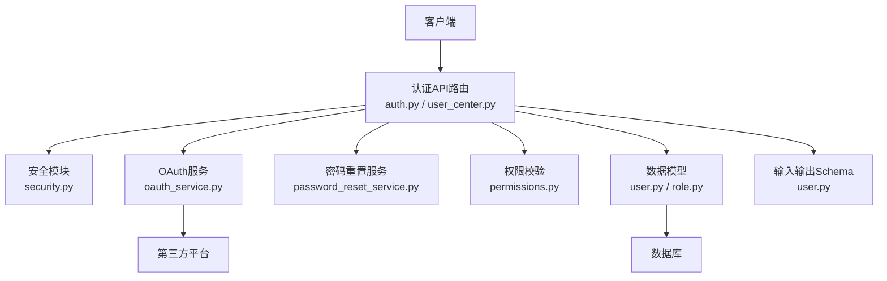
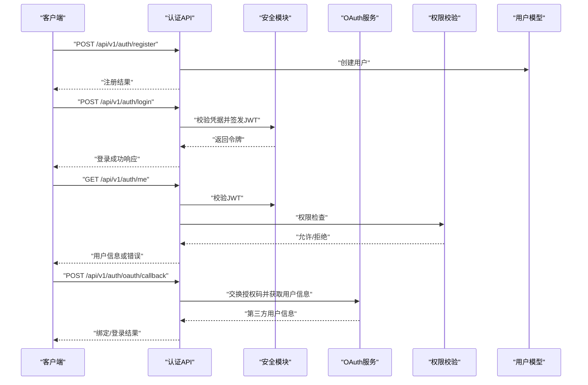
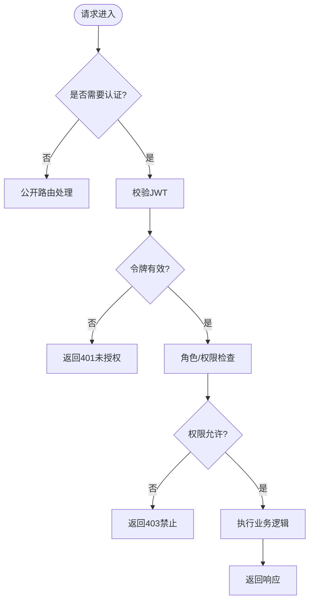
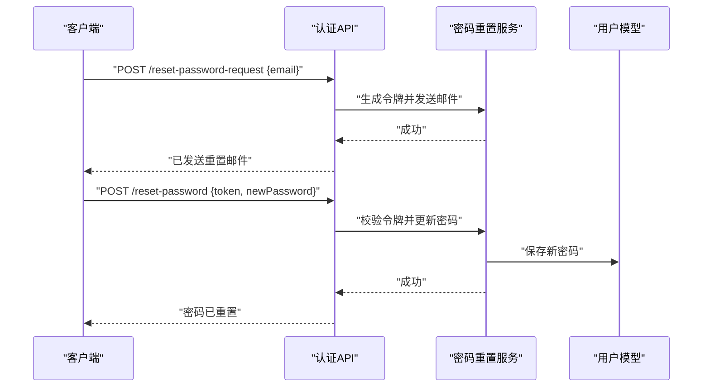
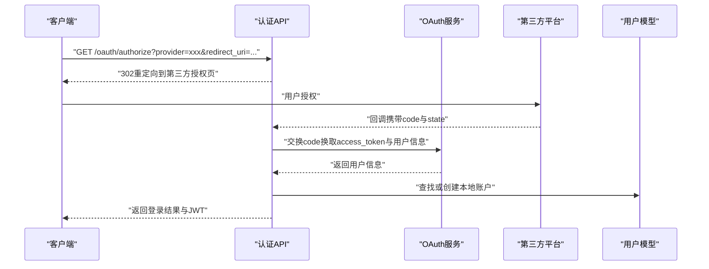
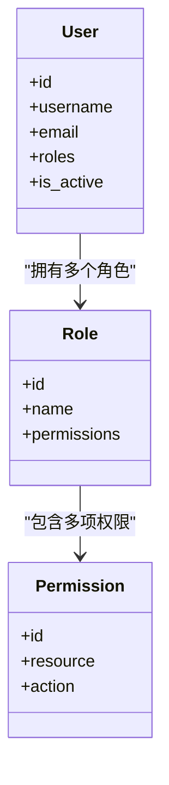
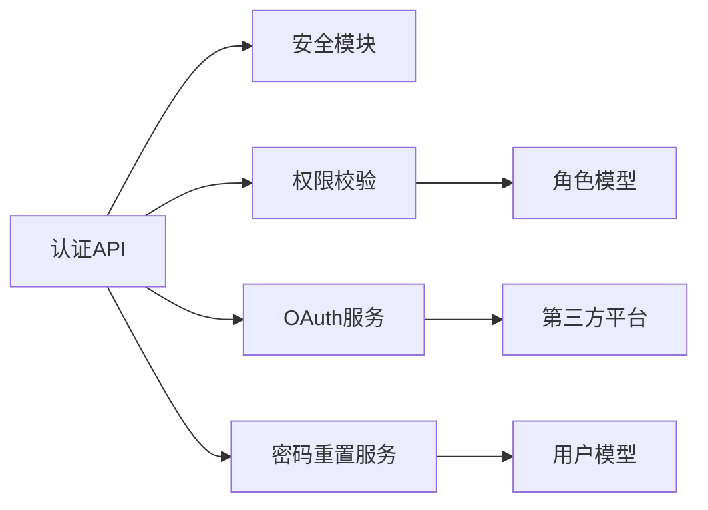

# 认证授权API

<cite>
**本文引用的文件**   
- [backend/app/api/v1/auth.py](file://backend/app/api/v1/auth.py)
- [backend/app/core/security.py](file://backend/app/core/security.py)
- [backend/app/services/oauth_service.py](file://backend/app/services/oauth_service.py)
- [backend/app/services/password_reset_service.py](file://backend/app/services/password_reset_service.py)
- [backend/app/models/user.py](file://backend/app/models/user.py)
- [backend/app/models/role.py](file://backend/app/models/role.py)
- [backend/app/schemas/user.py](file://backend/app/schemas/user.py)
- [backend/app/core/config.py](file://backend/app/core/config.py)
- [backend/app/core/permissions.py](file://backend/app/core/permissions.py)
- [backend/app/api/v1/user_center.py](file://backend/app/api/v1/user_center.py)
- [backend/tests/test_auth_routes.py](file://backend/tests/test_auth_routes.py)
</cite>

## 目录
1. [简介](#简介)
2. [项目结构](#项目结构)
3. [核心组件](#核心组件)
4. [架构总览](#架构总览)
5. [详细组件分析](#详细组件分析)
6. [依赖关系分析](#依赖关系分析)
7. [性能考虑](#性能考虑)
8. [故障排查指南](#故障排查指南)
9. [结论](#结论)
10. [附录](#附录)

## 简介
本文件为小说创作代理系统的认证与授权API提供完整说明，覆盖用户注册、登录、密码重置、权限校验、JWT令牌机制、会话管理、角色权限控制与安全策略。文档同时包含OAuth集成、第三方登录支持与多因素认证配置说明，并提供客户端集成指南（令牌存储、自动刷新、错误处理）以及完整的请求/响应示例（成功与错误）。

## 项目结构
认证授权相关代码主要分布在后端模块中：
- API路由层：定义HTTP端点与参数校验
- 安全层：JWT签发与校验、密码哈希、安全配置
- 服务层：OAuth流程、密码重置、权限校验等
- 数据模型与Schema：用户、角色、输入输出结构
- 测试：端到端与单元测试用例

图表来源
- [backend/app/api/v1/auth.py](file://backend/app/api/v1/auth.py)
- [backend/app/core/security.py](file://backend/app/core/security.py)
- [backend/app/services/oauth_service.py](file://backend/app/services/oauth_service.py)
- [backend/app/services/password_reset_service.py](file://backend/app/services/password_reset_service.py)
- [backend/app/core/permissions.py](file://backend/app/core/permissions.py)
- [backend/app/models/user.py](file://backend/app/models/user.py)
- [backend/app/models/role.py](file://backend/app/models/role.py)
- [backend/app/schemas/user.py](file://backend/app/schemas/user.py)

章节来源
- [backend/app/api/v1/auth.py](file://backend/app/api/v1/auth.py)
- [backend/app/core/security.py](file://backend/app/core/security.py)
- [backend/app/services/oauth_service.py](file://backend/app/services/oauth_service.py)
- [backend/app/services/password_reset_service.py](file://backend/app/services/password_reset_service.py)
- [backend/app/core/permissions.py](file://backend/app/core/permissions.py)
- [backend/app/models/user.py](file://backend/app/models/user.py)
- [backend/app/models/role.py](file://backend/app/models/role.py)
- [backend/app/schemas/user.py](file://backend/app/schemas/user.py)

## 核心组件
- 认证路由层：提供注册、登录、登出、密码重置、邮箱验证、第三方登录回调等端点
- 安全模块：负责JWT签发/校验、密码哈希、令牌过期策略、安全头设置
- OAuth服务：对接第三方平台，完成授权码交换、用户信息拉取与账户绑定
- 密码重置服务：生成一次性令牌、发送重置邮件、校验并更新密码
- 权限校验：基于角色的访问控制（RBAC），结合资源级权限检查
- 数据模型与Schema：用户、角色、权限字段定义；请求/响应数据结构化校验

章节来源
- [backend/app/api/v1/auth.py](file://backend/app/api/v1/auth.py)
- [backend/app/core/security.py](file://backend/app/core/security.py)
- [backend/app/services/oauth_service.py](file://backend/app/services/oauth_service.py)
- [backend/app/services/password_reset_service.py](file://backend/app/services/password_reset_service.py)
- [backend/app/core/permissions.py](file://backend/app/core/permissions.py)
- [backend/app/models/user.py](file://backend/app/models/user.py)
- [backend/app/models/role.py](file://backend/app/models/role.py)
- [backend/app/schemas/user.py](file://backend/app/schemas/user.py)

## 架构总览
系统采用无状态JWT鉴权与RBAC权限控制相结合的模式。客户端通过登录获取JWT，后续请求携带令牌进行身份验证；服务端根据用户角色与资源权限决定操作是否允许。OAuth用于第三方登录集成，密码重置通过一次性令牌保障安全性。

图表来源
- [backend/app/api/v1/auth.py](file://backend/app/api/v1/auth.py)
- [backend/app/core/security.py](file://backend/app/core/security.py)
- [backend/app/services/oauth_service.py](file://backend/app/services/oauth_service.py)
- [backend/app/core/permissions.py](file://backend/app/core/permissions.py)
- [backend/app/models/user.py](file://backend/app/models/user.py)

## 详细组件分析

### 认证路由与端点
- 用户注册：接收用户名、邮箱、密码等字段，校验唯一性与格式，创建用户并返回基础信息
- 用户登录：校验用户名/邮箱与密码，签发JWT（含用户ID、角色、过期时间），返回令牌与有效期
- 登出：支持无状态登出（客户端删除本地令牌）或可选的黑名单机制（若启用）
- 密码重置：生成一次性令牌，发送邮件；提交新密码时校验令牌有效性并更新
- 邮箱验证：发送验证链接，校验后标记用户邮箱已验证
- 第三方登录：发起授权跳转，回调时交换授权码，获取用户信息并绑定本地账户

图表来源
- [backend/app/api/v1/auth.py](file://backend/app/api/v1/auth.py)
- [backend/app/core/permissions.py](file://backend/app/core/permissions.py)

章节来源
- [backend/app/api/v1/auth.py](file://backend/app/api/v1/auth.py)
- [backend/tests/test_auth_routes.py](file://backend/tests/test_auth_routes.py)

### JWT令牌机制与会话管理
- 令牌结构：包含用户标识、角色、权限范围、签发时间与过期时间
- 签发策略：登录成功后由安全模块签发，支持短效访问令牌与长效刷新令牌（可选）
- 校验流程：请求头携带令牌，服务端解析并验证签名、过期与吊销状态
- 会话管理：默认无状态；如需强制登出可引入令牌黑名单或短期令牌+刷新令牌模式
- 安全建议：使用HTTPS、设置HttpOnly Cookie、限制跨域、定期轮换密钥

章节来源
- [backend/app/core/security.py](file://backend/app/core/security.py)
- [backend/app/core/config.py](file://backend/app/core/config.py)

### 密码重置流程
- 触发重置：用户提交邮箱，系统生成一次性令牌并发送邮件
- 重置提交：用户携带令牌与新密码提交，服务端校验令牌有效性并更新密码
- 安全策略：令牌短期有效、单次使用、失败次数限制

图表来源
- [backend/app/services/password_reset_service.py](file://backend/app/services/password_reset_service.py)
- [backend/app/api/v1/auth.py](file://backend/app/api/v1/auth.py)
- [backend/app/models/user.py](file://backend/app/models/user.py)

章节来源
- [backend/app/services/password_reset_service.py](file://backend/app/services/password_reset_service.py)
- [backend/app/api/v1/auth.py](file://backend/app/api/v1/auth.py)

### OAuth集成与第三方登录
- 支持的提供商：按配置动态加载（如微信、GitHub、Google等）
- 流程：前端跳转至第三方授权页，回调时服务端交换授权码，获取用户信息并绑定本地账户
- 账户绑定：首次登录自动创建本地账户；后续可通过邮箱或手机号绑定已有账户
- 安全策略：校验state防CSRF、限制重定向域名、记录审计日志

图表来源
- [backend/app/services/oauth_service.py](file://backend/app/services/oauth_service.py)
- [backend/app/api/v1/auth.py](file://backend/app/api/v1/auth.py)
- [backend/app/models/user.py](file://backend/app/models/user.py)

章节来源
- [backend/app/services/oauth_service.py](file://backend/app/services/oauth_service.py)
- [backend/app/api/v1/auth.py](file://backend/app/api/v1/auth.py)

### 权限验证与角色控制（RBAC）
- 角色模型：管理员、编辑、普通用户等，支持扩展
- 权限粒度：资源级（如项目、章节、资产）与操作级（读、写、删、审核）
- 校验时机：在受保护路由入口处进行，结合JWT中的角色与权限声明
- 审计与日志：关键权限决策记录审计日志，便于追踪与合规

图表来源
- [backend/app/models/user.py](file://backend/app/models/user.py)
- [backend/app/models/role.py](file://backend/app/models/role.py)
- [backend/app/core/permissions.py](file://backend/app/core/permissions.py)

章节来源
- [backend/app/models/user.py](file://backend/app/models/user.py)
- [backend/app/models/role.py](file://backend/app/models/role.py)
- [backend/app/core/permissions.py](file://backend/app/core/permissions.py)

### 用户中心与个人信息管理
- 获取当前用户信息：需携带有效JWT
- 更新个人信息：支持修改昵称、头像、联系方式等
- 安全要求：敏感操作需二次确认（如邮箱变更、密码修改）

章节来源
- [backend/app/api/v1/user_center.py](file://backend/app/api/v1/user_center.py)
- [backend/app/schemas/user.py](file://backend/app/schemas/user.py)

## 依赖关系分析
- 路由层依赖安全模块进行JWT校验，依赖权限模块进行RBAC检查
- OAuth服务依赖第三方平台SDK与配置
- 密码重置服务依赖邮件服务与用户模型
- 所有数据操作通过用户与角色模型持久化

图表来源
- [backend/app/api/v1/auth.py](file://backend/app/api/v1/auth.py)
- [backend/app/core/security.py](file://backend/app/core/security.py)
- [backend/app/core/permissions.py](file://backend/app/core/permissions.py)
- [backend/app/services/oauth_service.py](file://backend/app/services/oauth_service.py)
- [backend/app/services/password_reset_service.py](file://backend/app/services/password_reset_service.py)
- [backend/app/models/user.py](file://backend/app/models/user.py)
- [backend/app/models/role.py](file://backend/app/models/role.py)

章节来源
- [backend/app/api/v1/auth.py](file://backend/app/api/v1/auth.py)
- [backend/app/core/security.py](file://backend/app/core/security.py)
- [backend/app/core/permissions.py](file://backend/app/core/permissions.py)
- [backend/app/services/oauth_service.py](file://backend/app/services/oauth_service.py)
- [backend/app/services/password_reset_service.py](file://backend/app/services/password_reset_service.py)
- [backend/app/models/user.py](file://backend/app/models/user.py)
- [backend/app/models/role.py](file://backend/app/models/role.py)

## 性能考虑
- JWT校验为轻量操作，建议在网关或中间件层统一处理以减少重复逻辑
- 密码哈希使用高效算法（如bcrypt/argon2），合理设置工作因子以平衡安全与性能
- OAuth回调避免同步阻塞，必要时使用异步任务处理用户信息拉取与账户绑定
- 缓存热点用户信息与角色权限，减少数据库查询压力
- 对频繁失败的登录尝试实施限流与锁定策略，防止暴力破解

[本节为通用指导，不直接分析具体文件]

## 故障排查指南
- 登录失败：检查凭据格式、账号状态、密码哈希是否正确；查看错误码定位原因
- JWT无效：确认令牌未过期、签名正确、未被吊销；检查客户端是否正确携带令牌
- OAuth回调异常：核对state、redirect_uri、授权码有效性；查看第三方平台返回的错误信息
- 权限不足：确认用户角色与资源权限匹配；检查权限配置与路由装饰器
- 密码重置失败：验证一次性令牌是否有效且未使用；检查邮件发送与网络连通性

章节来源
- [backend/tests/test_auth_routes.py](file://backend/tests/test_auth_routes.py)
- [backend/app/core/security.py](file://backend/app/core/security.py)
- [backend/app/services/oauth_service.py](file://backend/app/services/oauth_service.py)
- [backend/app/services/password_reset_service.py](file://backend/app/services/password_reset_service.py)

## 结论
本认证授权体系以JWT为核心，结合RBAC实现细粒度权限控制，并通过OAuth扩展第三方登录能力。系统设计兼顾安全性与可扩展性，建议在生产环境中启用HTTPS、严格的安全头、令牌黑名单与审计日志，以提升整体安全水位与可观测性。

[本节为总结性内容，不直接分析具体文件]

## 附录

### 客户端集成指南
- 令牌存储：优先使用HttpOnly Cookie或内存存储，避免LocalStorage长期保存敏感令牌
- 自动刷新：实现刷新令牌机制，在访问令牌过期前自动续期
- 错误处理：捕获401/403错误，引导用户重新登录或提示权限不足
- 重试策略：对网络错误实施指数退避重试，避免雪崩效应

[本节为通用指导，不直接分析具体文件]

### 请求与响应示例
- 注册成功：返回用户基础信息与状态标志
- 登录成功：返回JWT令牌、类型与有效期
- 密码重置成功：返回成功消息与下一步指引
- 错误响应：统一错误码与消息结构，便于客户端处理

[本节为通用示例，不直接分析具体文件]