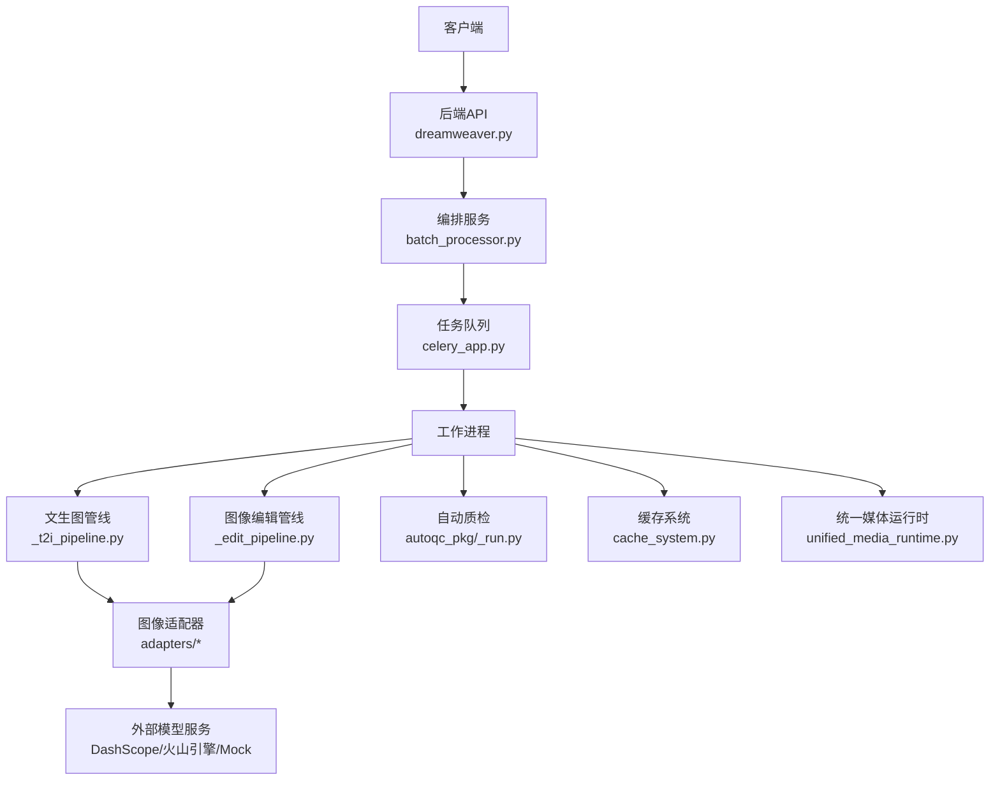
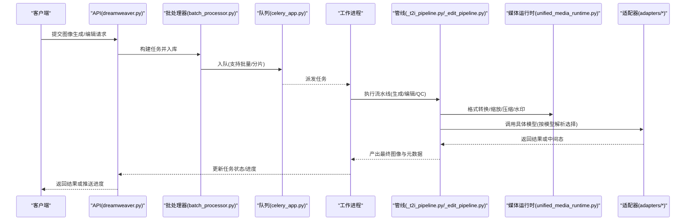
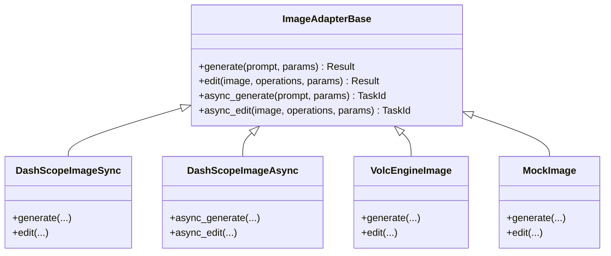
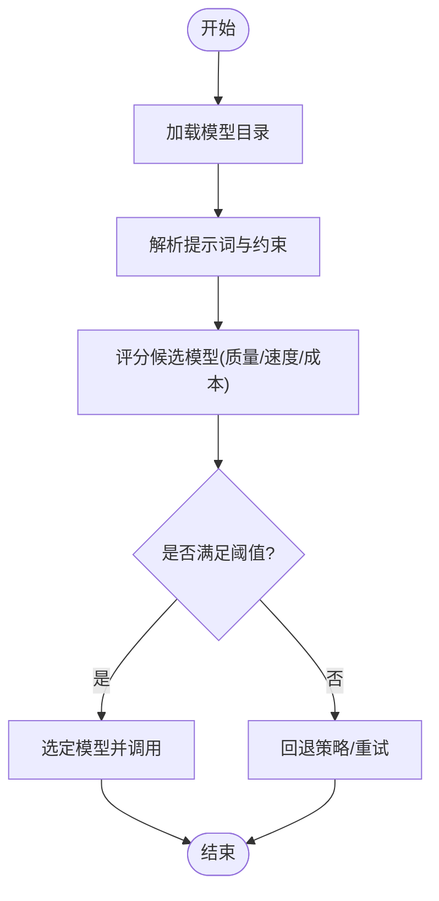
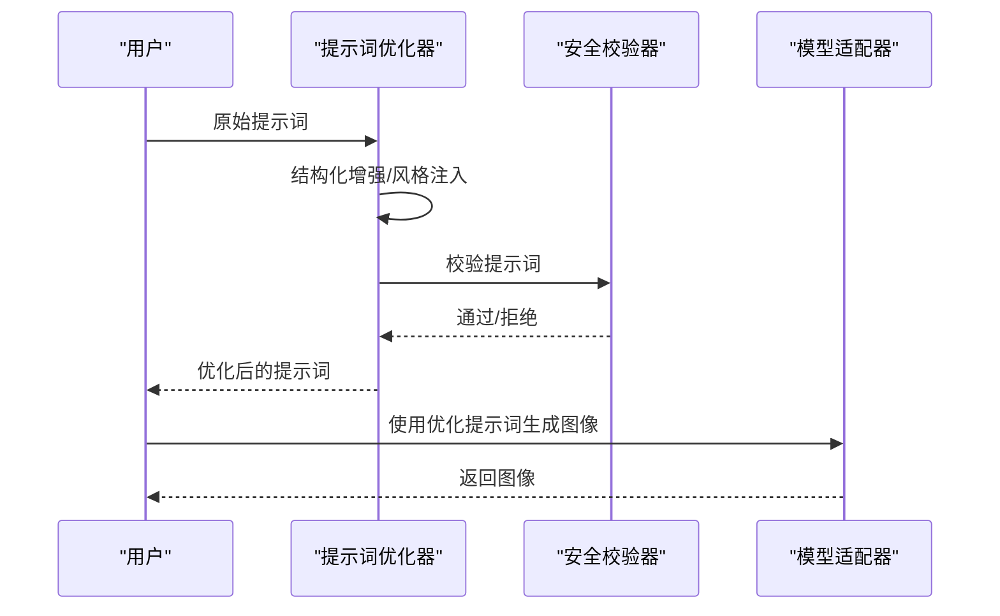
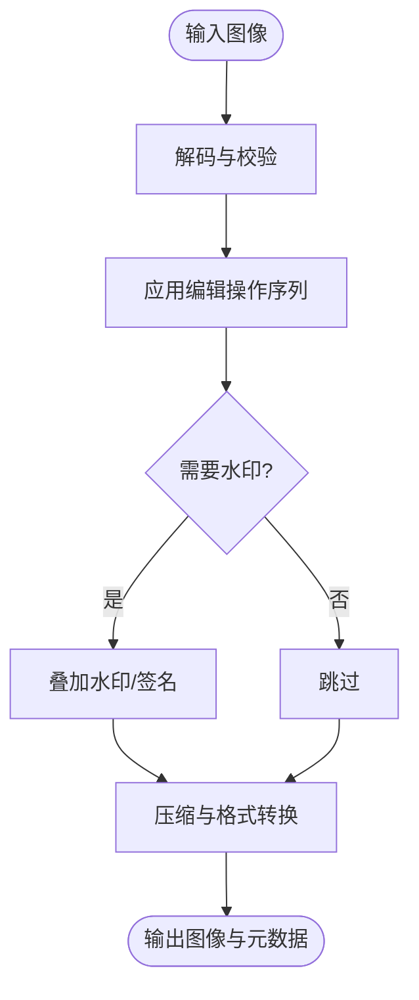
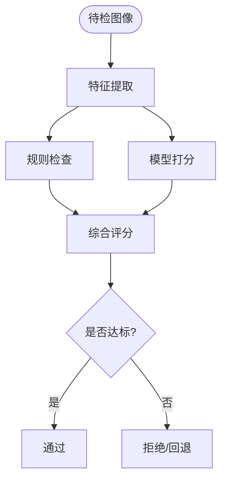
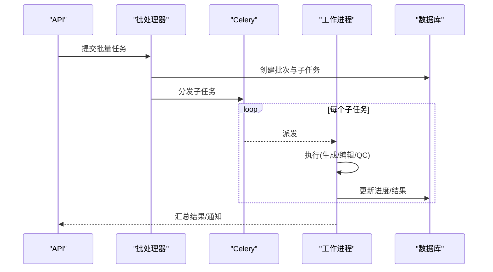
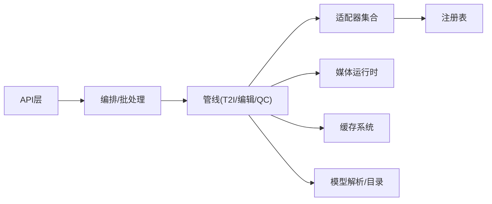

# 图像处理API

<cite>
**本文引用的文件**   
- [adapters/dashscope/image_sync.py](file://adapters/dashscope/image_sync.py)
- [adapters/dashscope/image_async.py](file://adapters/dashscope/image_async.py)
- [adapters/dashscope/image_edit.py](file://adapters/dashscope/image_edit.py)
- [adapters/volcengine/image.py](file://adapters/volcengine/image.py)
- [adapters/mock/image.py](file://adapters/mock/image.py)
- [adapters/base.py](file://adapters/base.py)
- [adapters/registry.py](file://adapters/registry.py)
- [adapters/model_adapters.py](file://adapters/model_adapters.py)
- [adapters/new_models_adapters.py](file://adapters/new_models_adapters.py)
- [adapters/prompt_optimizer.py](file://adapters/prompt_optimizer.py)
- [adapters/content_safety_checker.py](file://adapters/content_safety_checker.py)
- [adapters/rate_limiter.py](file://adapters/rate_limiter.py)
- [adapters/_shared.py](file://adapters/_shared.py)
- [adapters/adapter_helpers.py](file://adapters/adapter_helpers.py)
- [agents/painter_pkg/_t2i_pipeline.py](file://agents/painter_pkg/_t2i_pipeline.py)
- [agents/painter_pkg/_edit_pipeline.py](file://agents/painter_pkg/_edit_pipeline.py)
- [agents/painter_pkg/_utils.py](file://agents/painter_pkg/_utils.py)
- [pipeline/autoqc.py](file://pipeline/autoqc.py)
- [pipeline/autoqc_pkg/_run.py](file://pipeline/autoqc_pkg/_run.py)
- [pipeline/autoqc_pkg/_image_qc.py](file://pipeline/autoqc_pkg/_image_qc.py)
- [pipeline/media_presets.py](file://pipeline/media_presets.py)
- [backend/app/api/v1/dreamweaver.py](file://backend/app/api/v1/dreamweaver.py)
- [backend/app/services/batch_processor.py](file://backend/app/services/batch_processor.py)
- [backend/app/celery_app.py](file://backend/app/celery_app.py)
- [backend/app/services/cache_system.py](file://backend/app/services/cache_system.py)
- [core/unified_media_runtime.py](file://core/unified_media_runtime.py)
- [core/model_resolution.py](file://core/model_resolution.py)
- [core/model_catalog_runtime.py](file://core/model_catalog_runtime.py)
</cite>

## 目录
1. [简介](#简介)
2. [项目结构](#项目结构)
3. [核心组件](#核心组件)
4. [架构总览](#架构总览)
5. [详细组件分析](#详细组件分析)
6. [依赖关系分析](#依赖关系分析)
7. [性能与优化](#性能与优化)
8. [故障排查指南](#故障排查指南)
9. [结论](#结论)
10. [附录：接口清单与调用示例](#附录接口清单与调用示例)

## 简介
本文件为小说创作代理系统的图像处理API提供系统化技术文档，覆盖图像生成、编辑、风格迁移、尺寸调整等能力；说明AI驱动的模型选择、提示词优化与质量控制流程；给出批量处理、异步任务与进度监控的实现方式；并提供格式转换、压缩优化、水印添加的调用示例；最后解释图像处理流水线、缓存策略与性能优化的配置方法。

## 项目结构
图像处理相关代码主要分布在以下模块：
- 适配器层（adapters）：对接不同厂商的图像生成/编辑能力（如DashScope、火山引擎），并统一抽象接口。
- 代理与管线（agents/painter_pkg、pipeline）：封装文本到图像、图像编辑、质量检查等业务流程。
- 后端API（backend/app）：对外暴露HTTP接口，编排任务、调度异步执行、返回进度。
- 运行时与模型解析（core）：统一媒体运行时、模型路由与目录管理。

图表来源
- [backend/app/api/v1/dreamweaver.py](file://backend/app/api/v1/dreamweaver.py)
- [backend/app/services/batch_processor.py](file://backend/app/services/batch_processor.py)
- [backend/app/celery_app.py](file://backend/app/celery_app.py)
- [agents/painter_pkg/_t2i_pipeline.py](file://agents/painter_pkg/_t2i_pipeline.py)
- [agents/painter_pkg/_edit_pipeline.py](file://agents/painter_pkg/_edit_pipeline.py)
- [pipeline/autoqc_pkg/_run.py](file://pipeline/autoqc_pkg/_run.py)
- [adapters/dashscope/image_sync.py](file://adapters/dashscope/image_sync.py)
- [adapters/volcengine/image.py](file://adapters/volcengine/image.py)
- [core/unified_media_runtime.py](file://core/unified_media_runtime.py)

章节来源
- [backend/app/api/v1/dreamweaver.py](file://backend/app/api/v1/dreamweaver.py)
- [backend/app/services/batch_processor.py](file://backend/app/services/batch_processor.py)
- [backend/app/celery_app.py](file://backend/app/celery_app.py)
- [agents/painter_pkg/_t2i_pipeline.py](file://agents/painter_pkg/_t2i_pipeline.py)
- [agents/painter_pkg/_edit_pipeline.py](file://agents/painter_pkg/_edit_pipeline.py)
- [pipeline/autoqc_pkg/_run.py](file://pipeline/autoqc_pkg/_run.py)
- [adapters/dashscope/image_sync.py](file://adapters/dashscope/image_sync.py)
- [adapters/volcengine/image.py](file://adapters/volcengine/image.py)
- [core/unified_media_runtime.py](file://core/unified_media_runtime.py)

## 核心组件
- 图像适配器基类与注册表：定义统一的图像生成/编辑接口，集中注册各厂商实现，屏蔽差异。
- 模型解析与目录：根据业务需求动态选择最优模型，支持多供应商切换与降级。
- 提示词优化器：对原始提示词进行结构化增强、约束注入与风格化改写。
- 内容安全校验：在生成前/后对输入输出进行合规性检查。
- 速率限制：保护下游服务不被突发流量打爆。
- 统一媒体运行时：负责图像解码、编码、缩放、裁剪、水印、压缩等通用操作。
- 自动质检（AutoQC）：基于规则与模型的图像质量评估与问题定位。

章节来源
- [adapters/base.py](file://adapters/base.py)
- [adapters/registry.py](file://adapters/registry.py)
- [adapters/model_adapters.py](file://adapters/model_adapters.py)
- [adapters/new_models_adapters.py](file://adapters/new_models_adapters.py)
- [adapters/prompt_optimizer.py](file://adapters/prompt_optimizer.py)
- [adapters/content_safety_checker.py](file://adapters/content_safety_checker.py)
- [adapters/rate_limiter.py](file://adapters/rate_limiter.py)
- [core/unified_media_runtime.py](file://core/unified_media_runtime.py)
- [pipeline/autoqc.py](file://pipeline/autoqc.py)
- [pipeline/autoqc_pkg/_run.py](file://pipeline/autoqc_pkg/_run.py)

## 架构总览
整体采用“API编排 + 异步任务 + 适配器抽象 + 统一媒体运行时”的分层架构：
- API层接收请求，参数校验，落库记录，入队任务。
- 任务层使用Celery异步执行，支持批量与分片。
- 管线层组织T2I/编辑/QC等步骤，形成可插拔流水线。
- 适配器层对接多家图像模型，通过注册表与模型解析动态选择。
- 媒体运行时提供跨格式的编解码、变换与优化能力。

图表来源
- [backend/app/api/v1/dreamweaver.py](file://backend/app/api/v1/dreamweaver.py)
- [backend/app/services/batch_processor.py](file://backend/app/services/batch_processor.py)
- [backend/app/celery_app.py](file://backend/app/celery_app.py)
- [agents/painter_pkg/_t2i_pipeline.py](file://agents/painter_pkg/_t2i_pipeline.py)
- [agents/painter_pkg/_edit_pipeline.py](file://agents/painter_pkg/_edit_pipeline.py)
- [core/unified_media_runtime.py](file://core/unified_media_runtime.py)
- [adapters/dashscope/image_sync.py](file://adapters/dashscope/image_sync.py)
- [adapters/volcengine/image.py](file://adapters/volcengine/image.py)

## 详细组件分析

### 图像生成与编辑适配器
- 同步/异步接口：提供同步调用与异步回调两种模式，适配长耗时任务。
- 编辑能力：支持局部重绘、背景替换、风格迁移、尺寸调整等。
- 多供应商实现：DashScope、火山引擎、Mock等，统一由注册表管理。

图表来源
- [adapters/base.py](file://adapters/base.py)
- [adapters/dashscope/image_sync.py](file://adapters/dashscope/image_sync.py)
- [adapters/dashscope/image_async.py](file://adapters/dashscope/image_async.py)
- [adapters/volcengine/image.py](file://adapters/volcengine/image.py)
- [adapters/mock/image.py](file://adapters/mock/image.py)

章节来源
- [adapters/base.py](file://adapters/base.py)
- [adapters/dashscope/image_sync.py](file://adapters/dashscope/image_sync.py)
- [adapters/dashscope/image_async.py](file://adapters/dashscope/image_async.py)
- [adapters/volcengine/image.py](file://adapters/volcengine/image.py)
- [adapters/mock/image.py](file://adapters/mock/image.py)

### 模型选择与目录
- 模型目录：维护可用模型清单、能力标签、配额与价格信息。
- 模型解析：根据提示词语义、目标风格、质量要求与成本预算选择最佳模型。
- 运行时：统一封装调用细节，支持热切换与降级。

图表来源
- [core/model_catalog_runtime.py](file://core/model_catalog_runtime.py)
- [core/model_resolution.py](file://core/model_resolution.py)
- [adapters/model_adapters.py](file://adapters/model_adapters.py)
- [adapters/new_models_adapters.py](file://adapters/new_models_adapters.py)

章节来源
- [core/model_catalog_runtime.py](file://core/model_catalog_runtime.py)
- [core/model_resolution.py](file://core/model_resolution.py)
- [adapters/model_adapters.py](file://adapters/model_adapters.py)
- [adapters/new_models_adapters.py](file://adapters/new_models_adapters.py)

### 提示词优化与安全校验
- 提示词优化：将自然语言转化为结构化提示，补充风格、构图、分辨率等参数。
- 安全校验：对输入提示词与输出图像进行敏感内容检测与过滤。

图表来源
- [adapters/prompt_optimizer.py](file://adapters/prompt_optimizer.py)
- [adapters/content_safety_checker.py](file://adapters/content_safety_checker.py)
- [adapters/dashscope/image_sync.py](file://adapters/dashscope/image_sync.py)

章节来源
- [adapters/prompt_optimizer.py](file://adapters/prompt_optimizer.py)
- [adapters/content_safety_checker.py](file://adapters/content_safety_checker.py)

### 图像编辑与媒体运行时
- 编辑管线：组合多种操作（裁剪、缩放、滤镜、水印、合成）。
- 媒体运行时：统一处理解码/编码、色彩空间、压缩、元数据保留。

图表来源
- [agents/painter_pkg/_edit_pipeline.py](file://agents/painter_pkg/_edit_pipeline.py)
- [core/unified_media_runtime.py](file://core/unified_media_runtime.py)
- [adapters/_shared.py](file://adapters/_shared.py)
- [adapters/adapter_helpers.py](file://adapters/adapter_helpers.py)

章节来源
- [agents/painter_pkg/_edit_pipeline.py](file://agents/painter_pkg/_edit_pipeline.py)
- [core/unified_media_runtime.py](file://core/unified_media_runtime.py)
- [adapters/_shared.py](file://adapters/_shared.py)
- [adapters/adapter_helpers.py](file://adapters/adapter_helpers.py)

### 自动质量检查（AutoQC）
- 质量维度：清晰度、噪声、过曝/欠曝、色偏、构图、人物一致性等。
- 评分与拦截：低于阈值的图像进入二次生成或人工复核。

图表来源
- [pipeline/autoqc_pkg/_run.py](file://pipeline/autoqc_pkg/_run.py)
- [pipeline/autoqc_pkg/_image_qc.py](file://pipeline/autoqc_pkg/_image_qc.py)
- [pipeline/autoqc.py](file://pipeline/autoqc.py)

章节来源
- [pipeline/autoqc_pkg/_run.py](file://pipeline/autoqc_pkg/_run.py)
- [pipeline/autoqc_pkg/_image_qc.py](file://pipeline/autoqc_pkg/_image_qc.py)
- [pipeline/autoqc.py](file://pipeline/autoqc.py)

### 批量处理与异步任务
- 批量处理：将大任务拆分为子任务，支持并发与失败重试。
- 异步任务：通过Celery队列承载，支持进度查询与事件推送。

图表来源
- [backend/app/services/batch_processor.py](file://backend/app/services/batch_processor.py)
- [backend/app/celery_app.py](file://backend/app/celery_app.py)

章节来源
- [backend/app/services/batch_processor.py](file://backend/app/services/batch_processor.py)
- [backend/app/celery_app.py](file://backend/app/celery_app.py)

## 依赖关系分析
- 适配器与注册表：所有图像适配器继承基类并通过注册表集中管理，便于扩展新供应商。
- 模型目录与解析：上游API与管线依赖模型目录与解析逻辑，确保正确选择模型。
- 媒体运行时：被编辑管线与QC环节复用，保证一致的编解码与优化行为。
- 缓存系统：命中相同输入时直接返回结果，降低重复计算与网络开销。

图表来源
- [adapters/registry.py](file://adapters/registry.py)
- [core/model_resolution.py](file://core/model_resolution.py)
- [core/model_catalog_runtime.py](file://core/model_catalog_runtime.py)
- [core/unified_media_runtime.py](file://core/unified_media_runtime.py)
- [backend/app/services/cache_system.py](file://backend/app/services/cache_system.py)

章节来源
- [adapters/registry.py](file://adapters/registry.py)
- [core/model_resolution.py](file://core/model_resolution.py)
- [core/model_catalog_runtime.py](file://core/model_catalog_runtime.py)
- [core/unified_media_runtime.py](file://core/unified_media_runtime.py)
- [backend/app/services/cache_system.py](file://backend/app/services/cache_system.py)

## 性能与优化
- 缓存策略
  - 输入指纹：对提示词、参数、源图哈希生成唯一键，命中即返回。
  - 分层缓存：内存缓存优先，其次本地/对象存储，最后回源。
  - 失效策略：按TTL与版本控制，避免脏读。
- 并发与限流
  - 任务分片与并行执行，结合速率限制保护下游。
  - 自适应重试与退避，提升鲁棒性。
- 媒体优化
  - 按需转码与有损/无损压缩，平衡画质与体积。
  - 预取与懒加载，减少首帧等待。
- 模型选择
  - 依据质量/速度/成本多维评分，动态切换与降级。

章节来源
- [backend/app/services/cache_system.py](file://backend/app/services/cache_system.py)
- [adapters/rate_limiter.py](file://adapters/rate_limiter.py)
- [core/unified_media_runtime.py](file://core/unified_media_runtime.py)
- [core/model_resolution.py](file://core/model_resolution.py)

## 故障排查指南
- 常见错误
  - 提示词触发安全策略：检查安全校验器日志与白名单。
  - 模型调用超时/限流：查看速率限制与重试策略，必要时切换模型。
  - 图像质量不达标：查看AutoQC评分与拦截原因，调整参数或重新生成。
  - 缓存未命中：确认输入指纹一致性与缓存TTL设置。
- 诊断要点
  - 任务ID追踪：从API到Celery再到工作进程的链路日志。
  - 适配器日志：记录请求体、响应体与异常堆栈。
  - 媒体运行时：检查解码/编码错误与格式兼容性。

章节来源
- [adapters/content_safety_checker.py](file://adapters/content_safety_checker.py)
- [adapters/rate_limiter.py](file://adapters/rate_limiter.py)
- [pipeline/autoqc_pkg/_run.py](file://pipeline/autoqc_pkg/_run.py)
- [core/unified_media_runtime.py](file://core/unified_media_runtime.py)

## 结论
本图像处理API以适配器抽象为核心，结合模型目录与解析、提示词优化、安全校验、媒体运行时与AutoQC，构建了可扩展、高性能、可观测的图像生成与编辑体系。通过批量与异步机制，满足大规模生产场景需求；借助缓存与限流策略，保障稳定性与经济性。建议在生产环境开启完整日志与指标采集，持续优化模型选择策略与质量阈值。

## 附录：接口清单与调用示例
以下为常用接口的概念性描述与调用要点（不包含具体代码片段）：

- 文生图（T2I）
  - 功能：根据提示词生成图像，支持分辨率、风格、数量等参数。
  - 调用要点：传入优化后的提示词与模型选择参数；可选择同步或异步模式。
  - 参考路径：[adapters/dashscope/image_sync.py](file://adapters/dashscope/image_sync.py)、[adapters/dashscope/image_async.py](file://adapters/dashscope/image_async.py)

- 图像编辑
  - 功能：裁剪、缩放、滤镜、局部重绘、背景替换、风格迁移。
  - 调用要点：指定操作序列与参数；支持批量与流水线。
  - 参考路径：[adapters/dashscope/image_edit.py](file://adapters/dashscope/image_edit.py)、[agents/painter_pkg/_edit_pipeline.py](file://agents/painter_pkg/_edit_pipeline.py)

- 尺寸调整与格式转换
  - 功能：统一缩放、裁切、旋转、翻转；格式互转（PNG/JPEG/WebP等）。
  - 调用要点：通过媒体运行时指定目标尺寸与格式；可选压缩级别。
  - 参考路径：[core/unified_media_runtime.py](file://core/unified_media_runtime.py)、[pipeline/media_presets.py](file://pipeline/media_presets.py)

- 压缩优化
  - 功能：有损/无损压缩，按目标大小或质量阈值输出。
  - 调用要点：设定质量因子或目标字节数；保留必要元数据。
  - 参考路径：[core/unified_media_runtime.py](file://core/unified_media_runtime.py)

- 水印添加
  - 功能：文字/图片水印，位置、透明度、平铺模式可调。
  - 调用要点：提供水印素材与布局参数；支持透明通道。
  - 参考路径：[core/unified_media_runtime.py](file://core/unified_media_runtime.py)

- 批量处理
  - 功能：将多个图像任务拆分并发执行，支持失败重试与进度上报。
  - 调用要点：提交批次ID与子任务列表；轮询或订阅进度。
  - 参考路径：[backend/app/services/batch_processor.py](file://backend/app/services/batch_processor.py)

- 异步任务与进度监控
  - 功能：长耗时任务入队，支持状态查询与事件推送。
  - 调用要点：获取任务ID；定期查询或通过WebSocket/SSE获取进度。
  - 参考路径：[backend/app/celery_app.py](file://backend/app/celery_app.py)

- 模型选择与提示词优化
  - 功能：根据约束自动选择模型；对提示词进行结构化增强。
  - 调用要点：传入业务约束（质量/速度/成本）；启用提示词优化开关。
  - 参考路径：[core/model_resolution.py](file://core/model_resolution.py)、[adapters/prompt_optimizer.py](file://adapters/prompt_optimizer.py)

- 质量控制（AutoQC）
  - 功能：多维度评分与拦截，不合格图像进入回退流程。
  - 调用要点：配置阈值与评分权重；查看质检报告。
  - 参考路径：[pipeline/autoqc_pkg/_run.py](file://pipeline/autoqc_pkg/_run.py)、[pipeline/autoqc_pkg/_image_qc.py](file://pipeline/autoqc_pkg/_image_qc.py)

- 缓存策略
  - 功能：基于输入指纹的缓存命中，减少重复计算。
  - 调用要点：确保输入一致；合理设置TTL与版本。
  - 参考路径：[backend/app/services/cache_system.py](file://backend/app/services/cache_system.py)

- 速率限制
  - 功能：保护下游服务，防止突发流量导致限流或熔断。
  - 调用要点：配置令牌桶/漏桶策略；观察限流日志。
  - 参考路径：[adapters/rate_limiter.py](file://adapters/rate_limiter.py)

- 安全校验
  - 功能：提示词与图像内容的安全检测与过滤。
  - 调用要点：启用安全策略；查看拦截原因与白名单。
  - 参考路径：[adapters/content_safety_checker.py](file://adapters/content_safety_checker.py)