# 文件管理API

<cite>
**本文引用的文件**   
- [backend/app/api/v1/user_assets.py](file://backend/app/api/v1/user_assets.py)
- [backend/app/schemas/user_asset.py](file://backend/app/schemas/user_asset.py)
- [backend/app/services/cache_system.py](file://backend/app/services/cache_system.py)
- [backend/app/core/config.py](file://backend/app/core/config.py)
- [backend/app/core/permissions.py](file://backend/app/core/permissions.py)
- [backend/app/utils/api_errors.py](file://backend/app/utils/api_errors.py)
- [backend/app/models/user_asset_record.py](file://backend/app/models/user_asset_record.py)
- [backend/app/db/base.py](file://backend/app/db/base.py)
- [nginx.conf](file://nginx.conf)
- [docker-compose.yml](file://docker-compose.yml)
</cite>

## 目录
1. [简介](#简介)
2. [项目结构](#项目结构)
3. [核心组件](#核心组件)
4. [架构总览](#架构总览)
5. [详细组件分析](#详细组件分析)
6. [依赖关系分析](#依赖关系分析)
7. [性能考虑](#性能考虑)
8. [故障排查指南](#故障排查指南)
9. [结论](#结论)
10. [附录](#附录)

## 简介
本文件管理API面向小说创作代理系统，提供统一的文件上传、下载、删除与批量操作能力，并支持文件分类、标签、搜索过滤、版本控制、预览、元数据管理与权限控制。同时涵盖云存储集成、CDN加速与缓存策略的配置说明，帮助开发者快速接入与扩展。

## 项目结构
后端采用分层架构：路由层（API）、服务层（业务逻辑）、模型层（数据库ORM）、配置与安全（权限、配置加载）、缓存与错误处理等。文件管理相关的路由集中在用户资产API模块，数据模型与Schema定义在对应模块中，缓存与权限分别由独立服务与中间件实现。

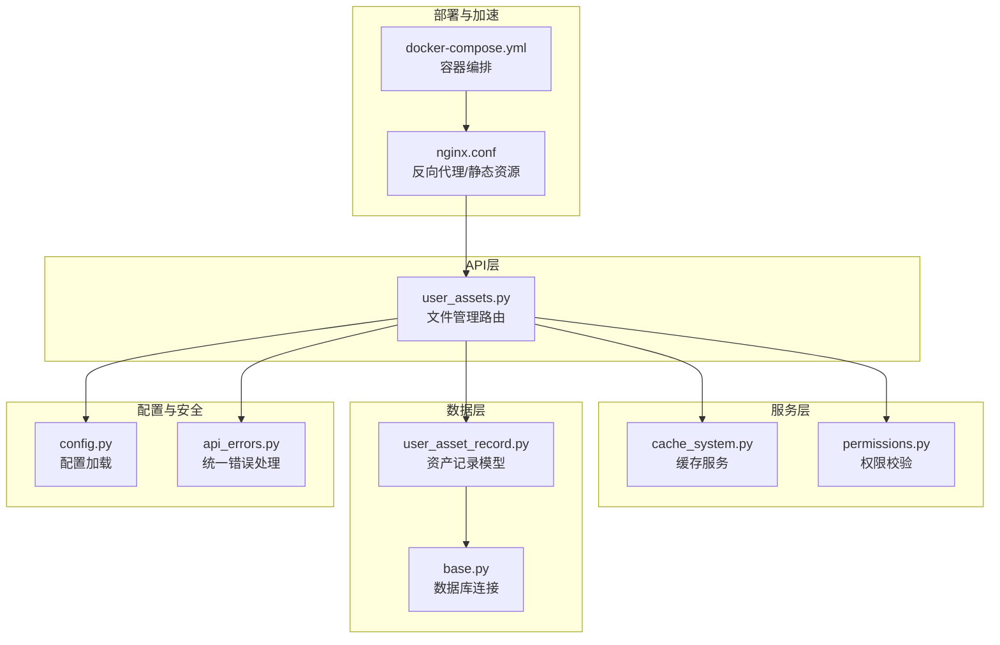

图表来源
- [backend/app/api/v1/user_assets.py](file://backend/app/api/v1/user_assets.py)
- [backend/app/services/cache_system.py](file://backend/app/services/cache_system.py)
- [backend/app/core/permissions.py](file://backend/app/core/permissions.py)
- [backend/app/models/user_asset_record.py](file://backend/app/models/user_asset_record.py)
- [backend/app/db/base.py](file://backend/app/db/base.py)
- [backend/app/core/config.py](file://backend/app/core/config.py)
- [backend/app/utils/api_errors.py](file://backend/app/utils/api_errors.py)
- [nginx.conf](file://nginx.conf)
- [docker-compose.yml](file://docker-compose.yml)

章节来源
- [backend/app/api/v1/user_assets.py](file://backend/app/api/v1/user_assets.py)
- [backend/app/schemas/user_asset.py](file://backend/app/schemas/user_asset.py)
- [backend/app/services/cache_system.py](file://backend/app/services/cache_system.py)
- [backend/app/core/config.py](file://backend/app/core/config.py)
- [backend/app/core/permissions.py](file://backend/app/core/permissions.py)
- [backend/app/utils/api_errors.py](file://backend/app/utils/api_errors.py)
- [backend/app/models/user_asset_record.py](file://backend/app/models/user_asset_record.py)
- [backend/app/db/base.py](file://backend/app/db/base.py)
- [nginx.conf](file://nginx.conf)
- [docker-compose.yml](file://docker-compose.yml)

## 核心组件
- 路由与接口：文件上传、下载、删除、批量操作、预览、元数据更新、版本管理等RESTful端点。
- 数据模型与Schema：资产记录、版本信息、标签、分类、元数据字段定义与校验。
- 权限控制：基于角色的访问控制（RBAC）与资源级鉴权。
- 缓存系统：响应缓存、预取与失效策略，提升大文件与频繁读取的性能。
- 配置与安全：环境变量加载、存储策略、安全头与限流。
- 错误处理：统一错误码与消息格式，便于前端一致处理。

章节来源
- [backend/app/api/v1/user_assets.py](file://backend/app/api/v1/user_assets.py)
- [backend/app/schemas/user_asset.py](file://backend/app/schemas/user_asset.py)
- [backend/app/core/permissions.py](file://backend/app/core/permissions.py)
- [backend/app/services/cache_system.py](file://backend/app/services/cache_system.py)
- [backend/app/core/config.py](file://backend/app/core/config.py)
- [backend/app/utils/api_errors.py](file://backend/app/utils/api_errors.py)
- [backend/app/models/user_asset_record.py](file://backend/app/models/user_asset_record.py)

## 架构总览
文件管理API的请求流程如下：客户端通过Nginx反向代理进入后端API；路由层进行参数校验与权限检查；服务层调用缓存与数据模型完成CRUD与版本控制；最终返回结构化响应或错误信息。

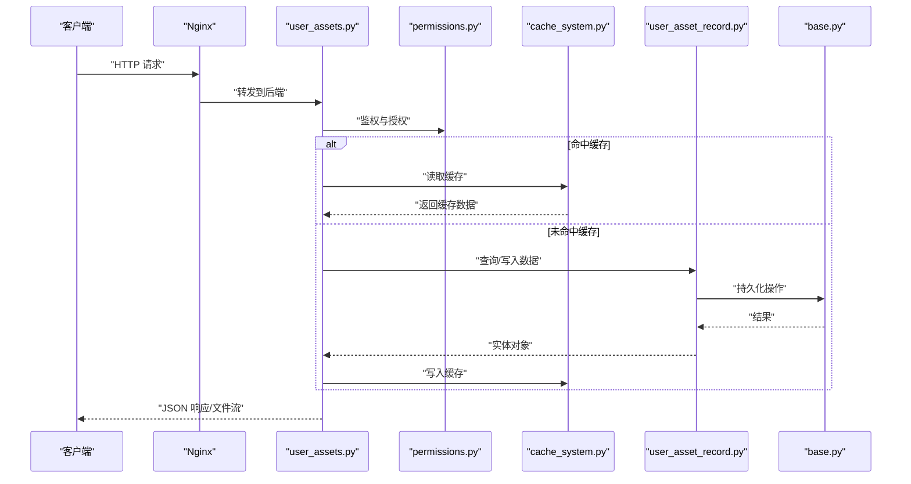

图表来源
- [backend/app/api/v1/user_assets.py](file://backend/app/api/v1/user_assets.py)
- [backend/app/core/permissions.py](file://backend/app/core/permissions.py)
- [backend/app/services/cache_system.py](file://backend/app/services/cache_system.py)
- [backend/app/models/user_asset_record.py](file://backend/app/models/user_asset_record.py)
- [backend/app/db/base.py](file://backend/app/db/base.py)
- [nginx.conf](file://nginx.conf)

## 详细组件分析

### 文件上传接口
- 功能：支持单文件与多文件上传，包含分片上传与断点续传（可选）。
- 参数：文件二进制、文件名、分类、标签、元数据、是否覆盖同名版本。
- 响应：返回文件ID、版本、URL、大小、类型、创建时间等。
- 错误：重复文件、非法类型、大小超限、权限不足等。

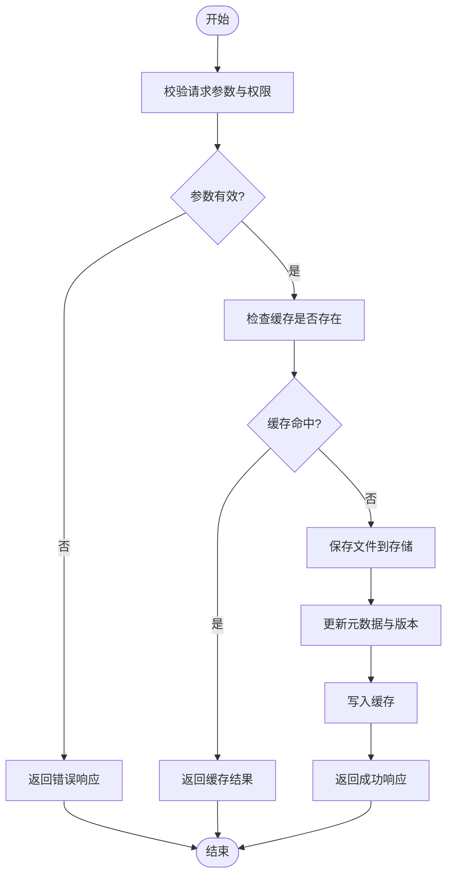

图表来源
- [backend/app/api/v1/user_assets.py](file://backend/app/api/v1/user_assets.py)
- [backend/app/services/cache_system.py](file://backend/app/services/cache_system.py)
- [backend/app/models/user_asset_record.py](file://backend/app/models/user_asset_record.py)
- [backend/app/utils/api_errors.py](file://backend/app/utils/api_errors.py)

章节来源
- [backend/app/api/v1/user_assets.py](file://backend/app/api/v1/user_assets.py)
- [backend/app/schemas/user_asset.py](file://backend/app/schemas/user_asset.py)
- [backend/app/utils/api_errors.py](file://backend/app/utils/api_errors.py)

### 文件下载接口
- 功能：按文件ID或路径下载，支持范围请求（Range）与流式传输。
- 参数：文件标识、版本选择、是否生成签名URL。
- 响应：文件流或重定向到CDN/云存储URL。
- 错误：文件不存在、权限不足、版本冲突等。

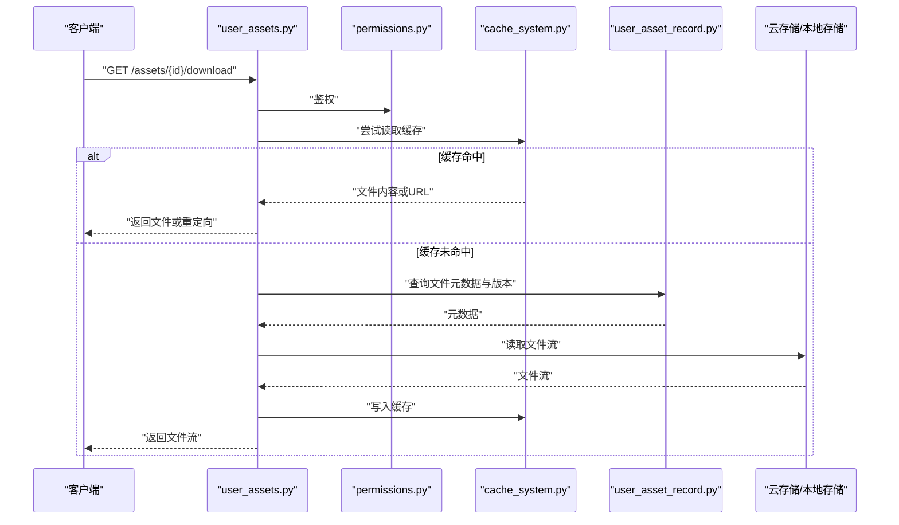

图表来源
- [backend/app/api/v1/user_assets.py](file://backend/app/api/v1/user_assets.py)
- [backend/app/services/cache_system.py](file://backend/app/services/cache_system.py)
- [backend/app/models/user_asset_record.py](file://backend/app/models/user_asset_record.py)

章节来源
- [backend/app/api/v1/user_assets.py](file://backend/app/api/v1/user_assets.py)
- [backend/app/models/user_asset_record.py](file://backend/app/models/user_asset_record.py)

### 文件删除与批量操作
- 功能：单文件删除、批量删除、软删除与回收站恢复。
- 参数：文件ID列表、是否强制删除、操作原因。
- 响应：操作结果统计、失败项明细。
- 错误：权限不足、文件被引用、并发冲突等。

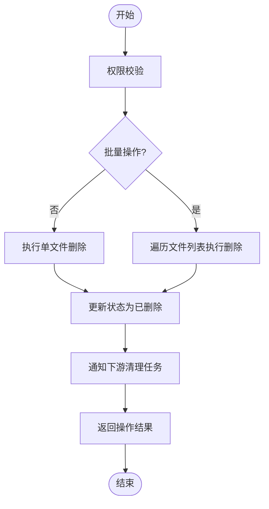

图表来源
- [backend/app/api/v1/user_assets.py](file://backend/app/api/v1/user_assets.py)
- [backend/app/models/user_asset_record.py](file://backend/app/models/user_asset_record.py)

章节来源
- [backend/app/api/v1/user_assets.py](file://backend/app/api/v1/user_assets.py)
- [backend/app/models/user_asset_record.py](file://backend/app/models/user_asset_record.py)

### 文件分类与标签系统
- 分类：树形分类结构，支持多级分类与默认分类。
- 标签：键值对形式，支持多标签与模糊匹配。
- 接口：分类增删改查、标签绑定与解绑、按分类/标签筛选。

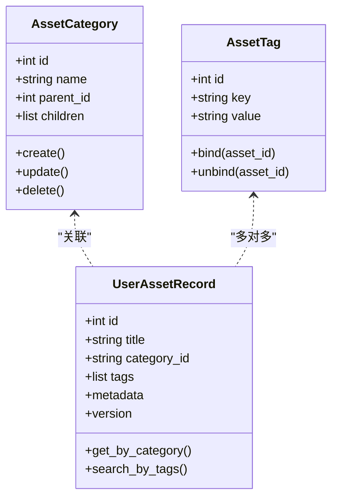

图表来源
- [backend/app/models/user_asset_record.py](file://backend/app/models/user_asset_record.py)
- [backend/app/schemas/user_asset.py](file://backend/app/schemas/user_asset.py)

章节来源
- [backend/app/models/user_asset_record.py](file://backend/app/models/user_asset_record.py)
- [backend/app/schemas/user_asset.py](file://backend/app/schemas/user_asset.py)

### 搜索与过滤
- 能力：按标题、分类、标签、类型、时间范围、作者、项目等多维度过滤。
- 排序：按更新时间、大小、热度等排序。
- 分页：页码与每页数量，支持游标分页（可选）。

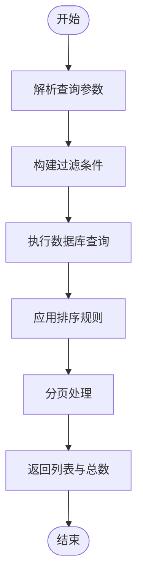

图表来源
- [backend/app/api/v1/user_assets.py](file://backend/app/api/v1/user_assets.py)
- [backend/app/models/user_asset_record.py](file://backend/app/models/user_asset_record.py)

章节来源
- [backend/app/api/v1/user_assets.py](file://backend/app/api/v1/user_assets.py)
- [backend/app/models/user_asset_record.py](file://backend/app/models/user_asset_record.py)

### 版本控制
- 策略：每次上传可生成新版本，支持回滚与对比。
- 接口：获取版本列表、切换版本、合并版本。
- 元数据：版本描述、变更摘要、作者信息。

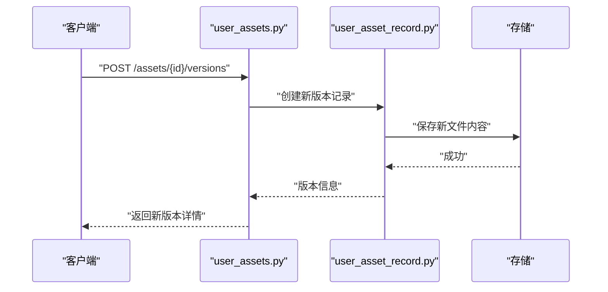

图表来源
- [backend/app/api/v1/user_assets.py](file://backend/app/api/v1/user_assets.py)
- [backend/app/models/user_asset_record.py](file://backend/app/models/user_asset_record.py)

章节来源
- [backend/app/api/v1/user_assets.py](file://backend/app/api/v1/user_assets.py)
- [backend/app/models/user_asset_record.py](file://backend/app/models/user_asset_record.py)

### 文件预览与元数据管理
- 预览：图片缩略图、音频时长、视频帧提取、文本摘要。
- 元数据：自定义字段、AI抽取标签、质量评分、版权信息。
- 接口：获取预览、更新元数据、批量导入导出。

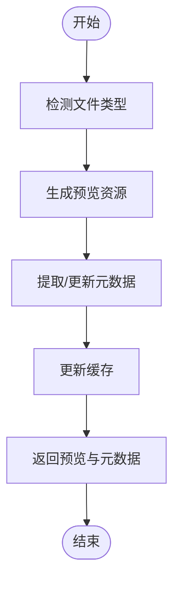

图表来源
- [backend/app/api/v1/user_assets.py](file://backend/app/api/v1/user_assets.py)
- [backend/app/services/cache_system.py](file://backend/app/services/cache_system.py)

章节来源
- [backend/app/api/v1/user_assets.py](file://backend/app/api/v1/user_assets.py)
- [backend/app/services/cache_system.py](file://backend/app/services/cache_system.py)

### 权限控制与存储策略
- 权限：基于角色与资源的访问控制，支持项目级隔离。
- 存储：本地磁盘、对象存储（S3/OSS/COS等），自动选择与迁移。
- 安全：签名URL、防盗链、访问日志。

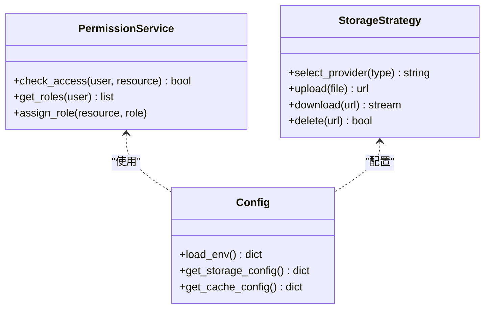

图表来源
- [backend/app/core/permissions.py](file://backend/app/core/permissions.py)
- [backend/app/core/config.py](file://backend/app/core/config.py)

章节来源
- [backend/app/core/permissions.py](file://backend/app/core/permissions.py)
- [backend/app/core/config.py](file://backend/app/core/config.py)

### RESTful API示例
以下为常用接口的调用示例（以JSON为例）：

- 上传文件
  - 方法：POST
  - 路径：/api/v1/assets/upload
  - 请求体：multipart/form-data，包含文件、分类、标签、元数据
  - 响应：{ "asset_id": "...", "version": 1, "url": "...", "size": 12345, "type": "image/png", "created_at": "..." }
  - 错误：400 参数错误、403 权限不足、413 文件过大、415 不支持类型

- 下载文件
  - 方法：GET
  - 路径：/api/v1/assets/{id}/download?version=1
  - 响应：文件流或重定向到CDN/云存储URL
  - 错误：404 文件不存在、403 权限不足

- 删除文件
  - 方法：DELETE
  - 路径：/api/v1/assets/{id}?force=false
  - 响应：{ "deleted": true, "message": "删除成功" }
  - 错误：403 权限不足、409 文件被引用

- 批量删除
  - 方法：POST
  - 路径：/api/v1/assets/batch-delete
  - 请求体：{ "ids": ["..."], "force": false }
  - 响应：{ "success_count": 1, "failed_count": 0, "errors": [] }
  - 错误：400 参数错误、403 权限不足

- 获取分类列表
  - 方法：GET
  - 路径：/api/v1/categories
  - 响应：{ "categories": [...] }

- 绑定标签
  - 方法：POST
  - 路径：/api/v1/assets/{id}/tags
  - 请求体：{ "tags": [{"key":"genre","value":"fantasy"}] }
  - 响应：{ "tags": [...] }

- 搜索文件
  - 方法：GET
  - 路径：/api/v1/assets/search?q=title&category=fantasy&tag=genre:fantasy&page=1&limit=20
  - 响应：{ "items": [...], "total": 100, "page": 1 }

- 获取版本列表
  - 方法：GET
  - 路径：/api/v1/assets/{id}/versions
  - 响应：{ "versions": [{"version":1,"created_at":"...","description":"..."}] }

- 更新元数据
  - 方法：PATCH
  - 路径：/api/v1/assets/{id}/metadata
  - 请求体：{ "title":"...", "custom_fields": {...} }
  - 响应：{ "updated": true, "metadata": {...} }

- 获取预览
  - 方法：GET
  - 路径：/api/v1/assets/{id}/preview?type=thumbnail
  - 响应：预览URL或二进制数据

章节来源
- [backend/app/api/v1/user_assets.py](file://backend/app/api/v1/user_assets.py)
- [backend/app/schemas/user_asset.py](file://backend/app/schemas/user_asset.py)
- [backend/app/utils/api_errors.py](file://backend/app/utils/api_errors.py)

### 云存储集成、CDN加速与缓存策略
- 云存储集成：通过配置选择不同提供商（本地、S3、OSS、COS），统一抽象接口实现上传、下载、删除。
- CDN加速：Nginx配置静态资源直链与缓存头，结合签名URL保障安全。
- 缓存策略：响应缓存、预取热点文件、失效策略（按版本或时间）。

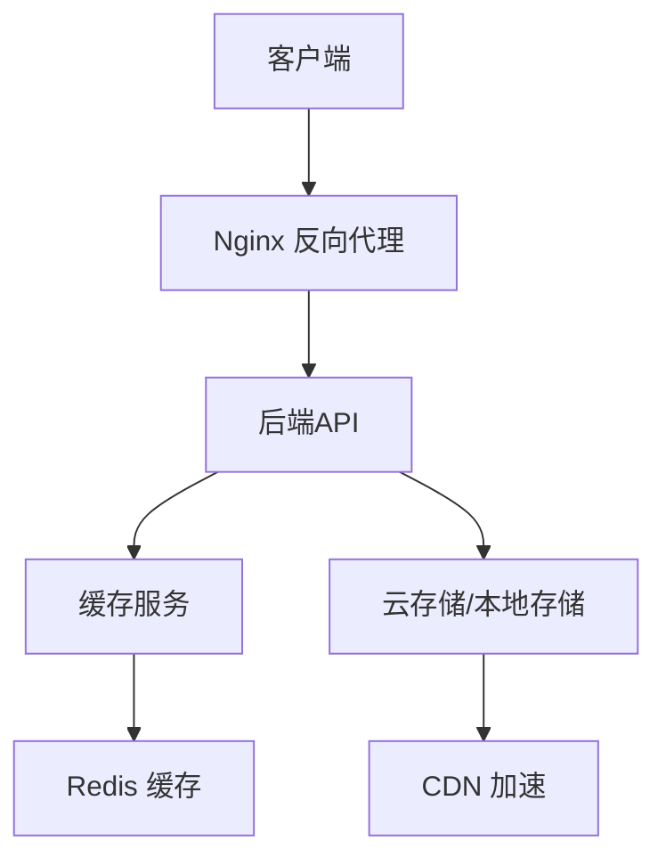

图表来源
- [nginx.conf](file://nginx.conf)
- [docker-compose.yml](file://docker-compose.yml)
- [backend/app/services/cache_system.py](file://backend/app/services/cache_system.py)
- [backend/app/core/config.py](file://backend/app/core/config.py)

章节来源
- [nginx.conf](file://nginx.conf)
- [docker-compose.yml](file://docker-compose.yml)
- [backend/app/services/cache_system.py](file://backend/app/services/cache_system.py)
- [backend/app/core/config.py](file://backend/app/core/config.py)

## 依赖关系分析
文件管理API的依赖关系清晰：路由依赖权限与服务，服务依赖缓存与模型，模型依赖数据库。配置与安全贯穿各层，错误处理统一输出。

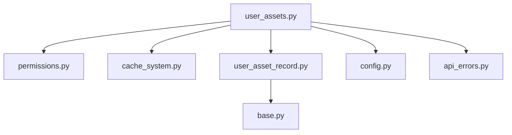

图表来源
- [backend/app/api/v1/user_assets.py](file://backend/app/api/v1/user_assets.py)
- [backend/app/core/permissions.py](file://backend/app/core/permissions.py)
- [backend/app/services/cache_system.py](file://backend/app/services/cache_system.py)
- [backend/app/models/user_asset_record.py](file://backend/app/models/user_asset_record.py)
- [backend/app/db/base.py](file://backend/app/db/base.py)
- [backend/app/core/config.py](file://backend/app/core/config.py)
- [backend/app/utils/api_errors.py](file://backend/app/utils/api_errors.py)

章节来源
- [backend/app/api/v1/user_assets.py](file://backend/app/api/v1/user_assets.py)
- [backend/app/core/permissions.py](file://backend/app/core/permissions.py)
- [backend/app/services/cache_system.py](file://backend/app/services/cache_system.py)
- [backend/app/models/user_asset_record.py](file://backend/app/models/user_asset_record.py)
- [backend/app/db/base.py](file://backend/app/db/base.py)
- [backend/app/core/config.py](file://backend/app/core/config.py)
- [backend/app/utils/api_errors.py](file://backend/app/utils/api_errors.py)

## 性能考虑
- 大文件传输：启用分片上传与断点续传，减少网络中断影响。
- 缓存优化：热点文件预取与长TTL缓存，降低数据库压力。
- 并行处理：批量操作异步化，避免阻塞主线程。
- 存储选择：根据文件类型与访问频率选择合适存储与CDN节点。

[本节为通用指导，不直接分析具体文件]

## 故障排查指南
- 常见问题：
  - 上传失败：检查文件大小限制、MIME类型、权限配置。
  - 下载超时：确认CDN配置、签名URL有效期、网络连通性。
  - 权限错误：核对角色与资源绑定、项目隔离设置。
  - 缓存不一致：清理缓存或强制刷新版本。
- 调试建议：
  - 查看统一错误响应格式与日志。
  - 使用健康检查与监控指标定位瓶颈。
  - 逐步禁用缓存与CDN验证问题来源。

章节来源
- [backend/app/utils/api_errors.py](file://backend/app/utils/api_errors.py)
- [backend/app/core/config.py](file://backend/app/core/config.py)

## 结论
文件管理API提供了完整的文件生命周期管理能力，结合分类、标签、搜索、版本控制与权限控制，满足小说创作代理系统的多样化需求。通过云存储集成、CDN加速与缓存策略，系统在性能与可扩展性方面具备良好基础。

[本节为总结，不直接分析具体文件]

## 附录
- 环境变量配置：存储提供商、缓存参数、CDN域名、签名密钥等。
- 部署清单：Docker镜像、Nginx配置、数据库初始化脚本。
- 测试用例：单元测试与集成测试覆盖关键路径。

[本节为补充信息，不直接分析具体文件]