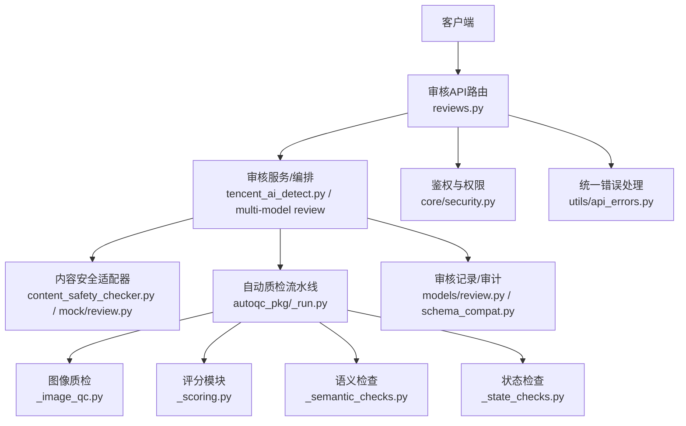
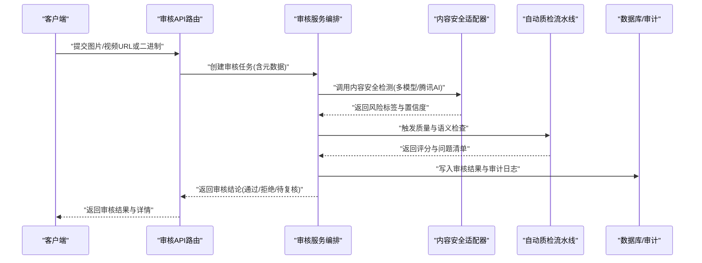
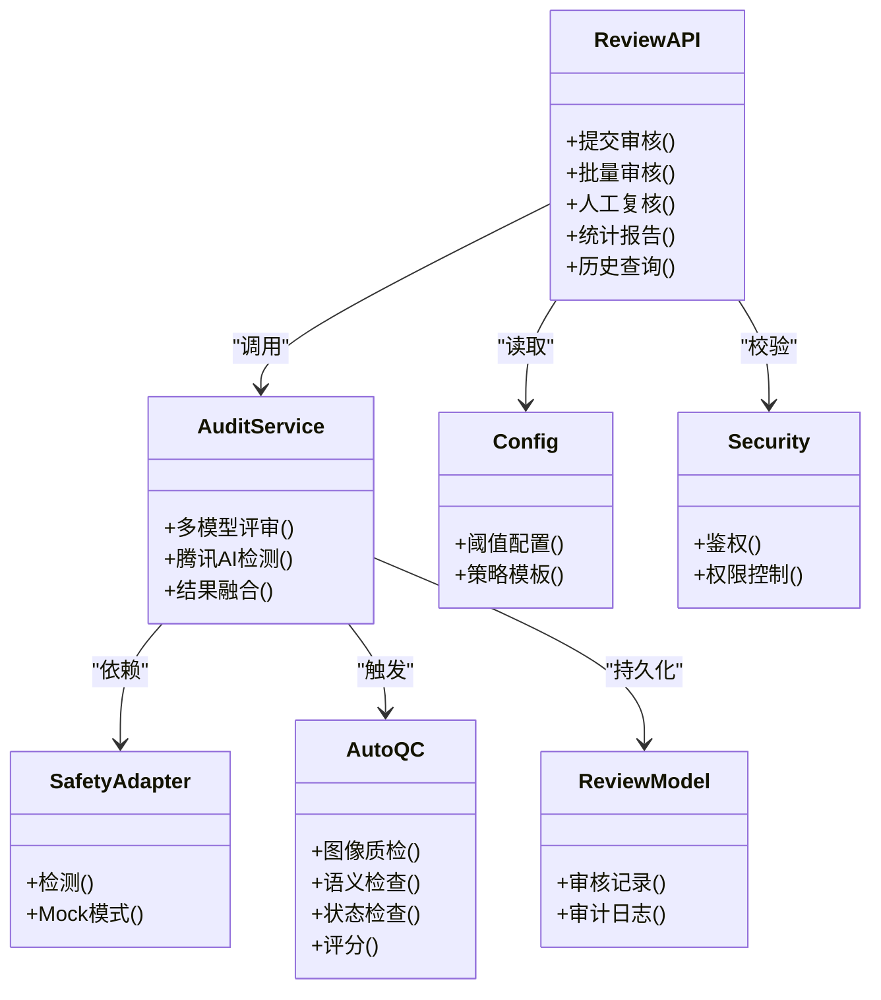

# 视觉审核API

<cite>
**本文引用的文件**   
- [CONTENT_SAFETY_CHECKER.md](file://CONTENT_SAFETY_CHECKER.md)
- [adapters/content_safety_checker.py](file://adapters/content_safety_checker.py)
- [adapters/mock/review.py](file://adapters/mock/review.py)
- [backend/app/api/v1/reviews.py](file://backend/app/api/v1/reviews.py)
- [backend/app/schemas/review.py](file://backend/app/schemas/review.py)
- [backend/app/services/tencent_ai_detect.py](file://backend/app/services/tencent_ai_detect.py)
- [pipeline/autoqc_pkg/_run.py](file://pipeline/autoqc_pkg/_run.py)
- [pipeline/autoqc_pkg/_image_qc.py](file://pipeline/autoqc_pkg/_image_qc.py)
- [pipeline/autoqc_pkg/_scoring.py](file://pipeline/autoqc_pkg/_scoring.py)
- [pipeline/autoqc_pkg/_semantic_checks.py](file://pipeline/autoqc_pkg/_semantic_checks.py)
- [pipeline/autoqc_pkg/_state_checks.py](file://pipeline/autoqc_pkg/_state_checks.py)
- [agents/auditor.py](file://agents/auditor.py)
- [backend/app/models/review.py](file://backend/app/models/review.py)
- [backend/app/db/schema_compat.py](file://backend/app/db/schema_compat.py)
- [backend/app/core/config.py](file://backend/app/core/config.py)
- [backend/app/core/security.py](file://backend/app/core/security.py)
- [backend/app/utils/api_errors.py](file://backend/app/utils/api_errors.py)
- [backend/tests/test_dreamweaver_safety_audit.py](file://backend/tests/test_dreamweaver_safety_audit.py)
- [backend/tests/test_dreamweaver_vision_review.py](file://backend/tests/test_dreamweaver_vision_review.py)
- [backend/tests/test_multi_model_review.py](file://backend/tests/test_multi_model_review.py)
- [backend/tests/test_tencent_ai_detect_contract.py](file://backend/tests/test_tencent_ai_detect_contract.py)
</cite>

## 目录
1. [简介](#简介)
2. [项目结构](#项目结构)
3. [核心组件](#核心组件)
4. [架构总览](#架构总览)
5. [详细组件分析](#详细组件分析)
6. [依赖关系分析](#依赖关系分析)
7. [性能考量](#性能考量)
8. [故障排查指南](#故障排查指南)
9. [结论](#结论)
10. [附录](#附录)

## 简介
本文件为小说创作代理系统的“视觉审核API”提供完整的技术文档，覆盖内容安全检测、质量评估、合规性检查等接口；说明AI视觉分析模型、敏感内容识别、版权检测与审核流程的实现方式；并提供批量审核、人工复核、审核结果统计与报告生成的调用示例。同时解释审核规则配置、阈值设置与自定义检测器的集成方法，以及审核状态管理、历史记录查询与审计日志的接口说明。

## 项目结构
围绕视觉审核能力，系统在后端API层、服务层、适配器层、自动质检流水线与数据模型中均有对应实现：
- API路由与请求校验：后端v1路由中的审核相关接口
- 业务编排：审核服务、多模型评审、腾讯AI检测服务
- 适配器：内容安全检测适配器（含Mock）
- 自动质检：图像/视频片段的质量与语义检查、评分与状态判定
- 数据模型与迁移：审核记录、审计日志、数据库兼容性
- 配置与安全：审核开关、阈值、鉴权与错误处理

图表来源
- [backend/app/api/v1/reviews.py](file://backend/app/api/v1/reviews.py)
- [backend/app/services/tencent_ai_detect.py](file://backend/app/services/tencent_ai_detect.py)
- [adapters/content_safety_checker.py](file://adapters/content_safety_checker.py)
- [adapters/mock/review.py](file://adapters/mock/review.py)
- [pipeline/autoqc_pkg/_run.py](file://pipeline/autoqc_pkg/_run.py)
- [pipeline/autoqc_pkg/_image_qc.py](file://pipeline/autoqc_pkg/_image_qc.py)
- [pipeline/autoqc_pkg/_scoring.py](file://pipeline/autoqc_pkg/_scoring.py)
- [pipeline/autoqc_pkg/_semantic_checks.py](file://pipeline/autoqc_pkg/_semantic_checks.py)
- [pipeline/autoqc_pkg/_state_checks.py](file://pipeline/autoqc_pkg/_state_checks.py)
- [backend/app/models/review.py](file://backend/app/models/review.py)
- [backend/app/db/schema_compat.py](file://backend/app/db/schema_compat.py)
- [backend/app/core/security.py](file://backend/app/core/security.py)
- [backend/app/utils/api_errors.py](file://backend/app/utils/api_errors.py)

章节来源
- [CONTENT_SAFETY_CHECKER.md](file://CONTENT_SAFETY_CHECKER.md)
- [backend/app/api/v1/reviews.py](file://backend/app/api/v1/reviews.py)
- [adapters/content_safety_checker.py](file://adapters/content_safety_checker.py)
- [adapters/mock/review.py](file://adapters/mock/review.py)
- [backend/app/services/tencent_ai_detect.py](file://backend/app/services/tencent_ai_detect.py)
- [pipeline/autoqc_pkg/_run.py](file://pipeline/autoqc_pkg/_run.py)

## 核心组件
- 审核API路由：暴露内容安全检测、质量评估、合规性检查、批量审核、人工复核、统计与报告的HTTP接口
- 审核服务编排：协调多模型评审、腾讯AI检测、自动质检流水线与持久化
- 内容安全适配器：对接外部或本地安全检测能力，支持Mock模式用于开发测试
- 自动质检流水线：对图像/视频进行质量、语义一致性、状态连续性等多维度检查与评分
- 数据模型与迁移：存储审核任务、结果、审计日志，并保证数据库结构演进兼容
- 配置与安全：集中管理审核开关、阈值、策略与鉴权控制

章节来源
- [backend/app/api/v1/reviews.py](file://backend/app/api/v1/reviews.py)
- [backend/app/services/tencent_ai_detect.py](file://backend/app/services/tencent_ai_detect.py)
- [adapters/content_safety_checker.py](file://adapters/content_safety_checker.py)
- [adapters/mock/review.py](file://adapters/mock/review.py)
- [pipeline/autoqc_pkg/_run.py](file://pipeline/autoqc_pkg/_run.py)
- [backend/app/models/review.py](file://backend/app/models/review.py)
- [backend/app/db/schema_compat.py](file://backend/app/db/schema_compat.py)
- [backend/app/core/config.py](file://backend/app/core/config.py)
- [backend/app/core/security.py](file://backend/app/core/security.py)

## 架构总览
视觉审核API采用分层架构：API路由负责请求解析与响应封装；服务层负责跨组件编排与决策；适配器层屏蔽第三方差异；自动质检流水线提供可插拔的检测器；数据层负责持久化与审计。

图表来源
- [backend/app/api/v1/reviews.py](file://backend/app/api/v1/reviews.py)
- [backend/app/services/tencent_ai_detect.py](file://backend/app/services/tencent_ai_detect.py)
- [adapters/content_safety_checker.py](file://adapters/content_safety_checker.py)
- [pipeline/autoqc_pkg/_run.py](file://pipeline/autoqc_pkg/_run.py)
- [backend/app/models/review.py](file://backend/app/models/review.py)

## 详细组件分析

### 审核API路由（内容安全、质量评估、合规性检查）
- 功能要点
  - 单条审核：接收媒体资源，触发安全检测与质量评估，返回结构化结果
  - 批量审核：支持批量提交，异步处理，进度查询与汇总报告
  - 人工复核：将高风险或低置信度结果转交人工，支持复核意见与二次判定
  - 统计与报告：按项目/时间/类型聚合统计，导出PDF/JSON报告
  - 历史与审计：查询审核历史、操作日志与变更轨迹
- 关键输入输出
  - 输入：媒体URL/二进制、项目ID、审核策略、阈值配置
  - 输出：审核结论、风险标签、置信度、问题清单、建议动作、审计信息
- 错误处理
  - 统一错误码与消息，区分网络异常、第三方限流、参数校验失败

章节来源
- [backend/app/api/v1/reviews.py](file://backend/app/api/v1/reviews.py)
- [backend/app/utils/api_errors.py](file://backend/app/utils/api_errors.py)
- [backend/app/schemas/review.py](file://backend/app/schemas/review.py)

### 审核服务编排（多模型评审与腾讯AI检测）
- 功能要点
  - 多模型评审：聚合多个视觉模型的检测结果，进行加权或投票决策
  - 腾讯AI检测：调用腾讯云内容安全服务，获取敏感类别与置信度
  - 策略路由：根据项目策略选择检测器组合与阈值
  - 结果融合：合并各来源结果，生成统一的结构化输出
- 关键流程
  - 初始化检测器 -> 并行调用 -> 结果归一化 -> 决策引擎 -> 持久化

章节来源
- [backend/app/services/tencent_ai_detect.py](file://backend/app/services/tencent_ai_detect.py)
- [backend/tests/test_multi_model_review.py](file://backend/tests/test_multi_model_review.py)
- [backend/tests/test_tencent_ai_detect_contract.py](file://backend/tests/test_tencent_ai_detect_contract.py)

### 内容安全适配器（含Mock）
- 功能要点
  - 抽象接口：统一的检测入口，支持多实现（真实/模拟）
  - Mock模式：便于开发与联调，返回预设风险标签与置信度
  - 扩展点：新增检测器需实现统一接口，注册到适配器
- 使用场景
  - 开发环境使用Mock快速验证流程
  - 生产环境切换至真实适配器

章节来源
- [adapters/content_safety_checker.py](file://adapters/content_safety_checker.py)
- [adapters/mock/review.py](file://adapters/mock/review.py)
- [CONTENT_SAFETY_CHECKER.md](file://CONTENT_SAFETY_CHECKER.md)

### 自动质检流水线（图像/视频质量与语义检查）
- 功能要点
  - 图像质检：清晰度、分辨率、比例、水印、过曝/欠曝等指标
  - 语义检查：画面与文本提示的一致性、角色/场景连贯性
  - 状态检查：帧间状态连续性、镜头运动合理性
  - 评分模块：多维度打分与综合评级
- 执行流程
  - 任务分发 -> 检测器并行执行 -> 结果聚合 -> 评分与结论

章节来源
- [pipeline/autoqc_pkg/_run.py](file://pipeline/autoqc_pkg/_run.py)
- [pipeline/autoqc_pkg/_image_qc.py](file://pipeline/autoqc_pkg/_image_qc.py)
- [pipeline/autoqc_pkg/_scoring.py](file://pipeline/autoqc_pkg/_scoring.py)
- [pipeline/autoqc_pkg/_semantic_checks.py](file://pipeline/autoqc_pkg/_semantic_checks.py)
- [pipeline/autoqc_pkg/_state_checks.py](file://pipeline/autoqc_pkg/_state_checks.py)

### 审核状态管理与历史记录
- 状态定义
  - 待审核、审核中、已通过、已拒绝、待复核、复核通过、复核拒绝
- 历史记录
  - 按项目/用户/时间范围查询，支持分页与筛选
- 审计日志
  - 记录操作人、时间、IP、变更前后值、原因说明

章节来源
- [backend/app/models/review.py](file://backend/app/models/review.py)
- [backend/app/db/schema_compat.py](file://backend/app/db/schema_compat.py)
- [agents/auditor.py](file://agents/auditor.py)

### 审核规则配置与阈值设置
- 配置项
  - 检测器开关、权重、阈值、白名单/黑名单、策略模板
- 动态更新
  - 支持运行时调整阈值与策略，影响后续审核决策
- 版本管理
  - 策略版本化，便于回滚与对比

章节来源
- [backend/app/core/config.py](file://backend/app/core/config.py)
- [backend/app/schemas/review.py](file://backend/app/schemas/review.py)

### 鉴权与访问控制
- 鉴权机制
  - 基于令牌的身份认证与权限校验
- 角色与权限
  - 不同角色对审核操作的访问粒度控制
- 安全最佳实践
  - 最小权限原则、敏感操作审计

章节来源
- [backend/app/core/security.py](file://backend/app/core/security.py)

## 依赖关系分析
审核API依赖服务编排、适配器、自动质检、数据模型与配置安全等模块，形成清晰的解耦与可扩展结构。

图表来源
- [backend/app/api/v1/reviews.py](file://backend/app/api/v1/reviews.py)
- [backend/app/services/tencent_ai_detect.py](file://backend/app/services/tencent_ai_detect.py)
- [adapters/content_safety_checker.py](file://adapters/content_safety_checker.py)
- [pipeline/autoqc_pkg/_run.py](file://pipeline/autoqc_pkg/_run.py)
- [backend/app/models/review.py](file://backend/app/models/review.py)
- [backend/app/core/config.py](file://backend/app/core/config.py)
- [backend/app/core/security.py](file://backend/app/core/security.py)

章节来源
- [backend/app/api/v1/reviews.py](file://backend/app/api/v1/reviews.py)
- [backend/app/services/tencent_ai_detect.py](file://backend/app/services/tencent_ai_detect.py)
- [adapters/content_safety_checker.py](file://adapters/content_safety_checker.py)
- [pipeline/autoqc_pkg/_run.py](file://pipeline/autoqc_pkg/_run.py)
- [backend/app/models/review.py](file://backend/app/models/review.py)
- [backend/app/core/config.py](file://backend/app/core/config.py)
- [backend/app/core/security.py](file://backend/app/core/security.py)

## 性能考量
- 并发与异步
  - 批量审核采用异步队列，避免阻塞主线程
- 缓存与去重
  - 对相同媒体哈希结果进行缓存，减少重复计算
- 限流与降级
  - 第三方服务限流保护与降级策略
- 资源优化
  - 图像预处理与采样策略，降低带宽与CPU占用

[本节为通用指导，不直接分析具体文件]

## 故障排查指南
- 常见问题
  - 第三方服务超时/限流：检查适配器日志与重试策略
  - 阈值不合理导致误判：调整策略配置并观察效果
  - 权限不足：确认用户角色与权限分配
- 调试工具
  - 启用Mock适配器快速定位问题
  - 查看审计日志与错误堆栈
- 恢复策略
  - 回滚策略版本，恢复稳定配置

章节来源
- [backend/app/utils/api_errors.py](file://backend/app/utils/api_errors.py)
- [adapters/mock/review.py](file://adapters/mock/review.py)
- [backend/tests/test_dreamweaver_safety_audit.py](file://backend/tests/test_dreamweaver_safety_audit.py)
- [backend/tests/test_dreamweaver_vision_review.py](file://backend/tests/test_dreamweaver_vision_review.py)

## 结论
视觉审核API通过分层架构与模块化设计，实现了内容安全检测、质量评估与合规性检查的完整闭环。借助多模型评审、腾讯AI检测与自动质检流水线，系统具备高可扩展性与稳定性。配合灵活的规则配置、阈值管理与鉴权控制，可满足多样化审核需求。建议在生产环境中结合监控与审计，持续优化策略与性能。

[本节为总结性内容，不直接分析具体文件]

## 附录
- API调用示例（概念性）
  - 单条审核：POST /api/v1/reviews/submit，请求体包含媒体URL/二进制、项目ID、策略与阈值
  - 批量审核：POST /api/v1/reviews/batch，请求体包含媒体列表与批处理选项
  - 人工复核：PUT /api/v1/reviews/{id}/review，请求体包含复核意见与结论
  - 统计报告：GET /api/v1/reports/review?project_id=&start=&end=
  - 历史查询：GET /api/v1/reviews/history?project_id=&status=&page=
- 审核流程图（概念性）
  - 提交 -> 安全检测 -> 质量评估 -> 决策 -> 持久化 -> 返回结果

[本节为概念性内容，不直接分析具体文件]