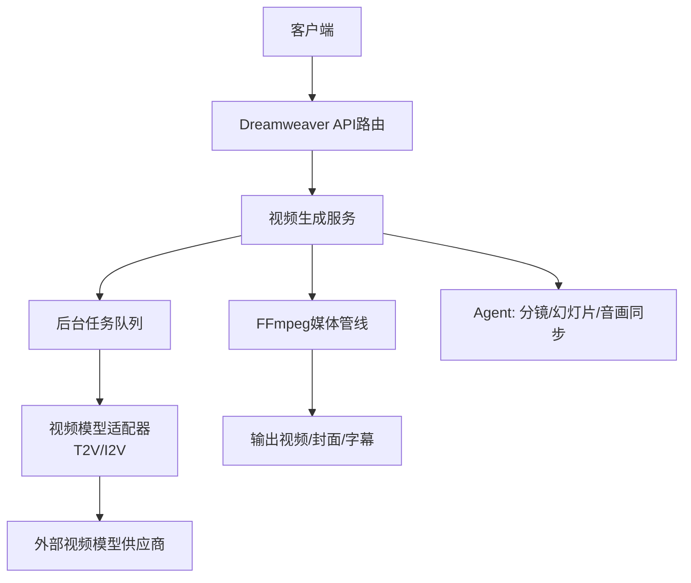
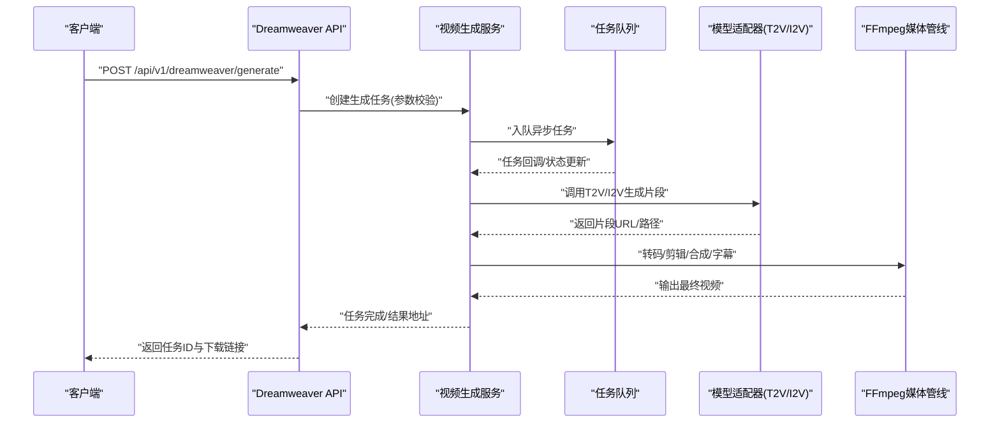
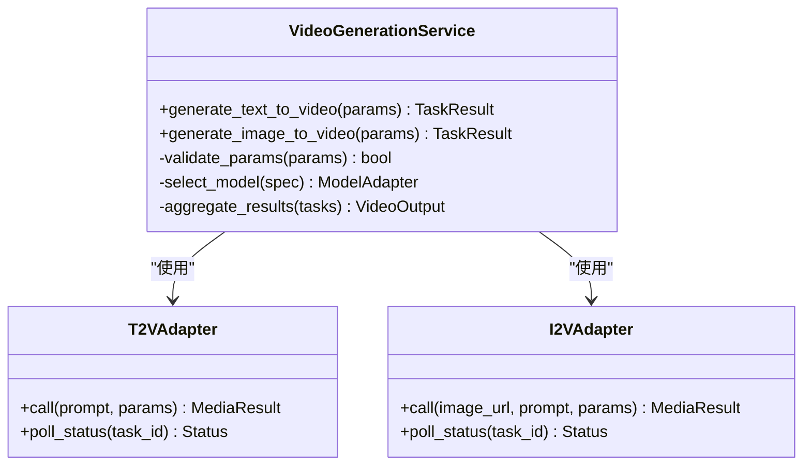
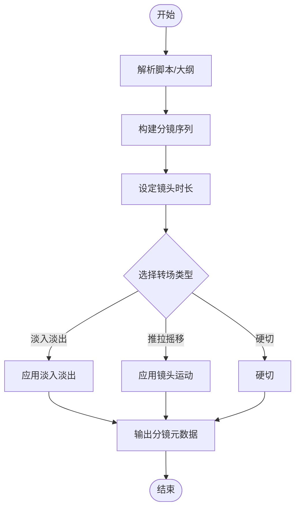
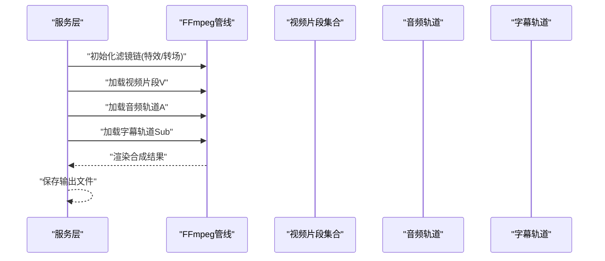
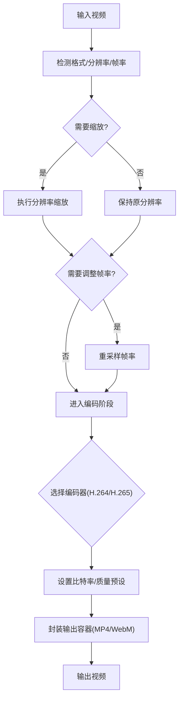
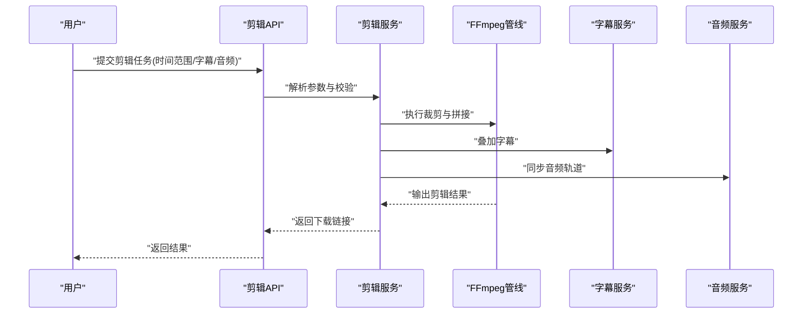
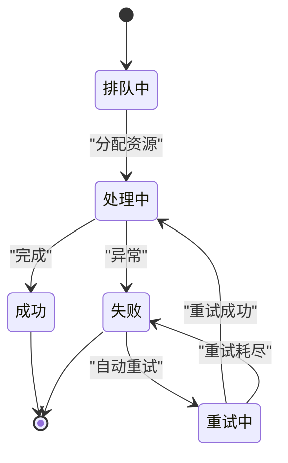
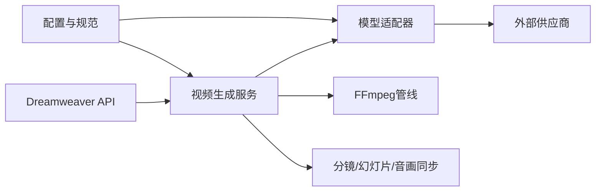

# 视频处理API

<cite>
**本文引用的文件**   
- [backend/app/api/v1/dreamweaver.py](file://backend/app/api/v1/dreamweaver.py)
- [backend/app/services/dreamweaver/video_generation_service.py](file://backend/app/services/dreamweaver/video_generation_service.py)
- [adapters/video_t2v.py](file://adapters/video_t2v.py)
- [adapters/video_i2v.py](file://adapters/video_i2v.py)
- [adapters/vidu_platform/video.py](file://adapters/vidu_platform/video.py)
- [adapters/volcengine/video.py](file://adapters/volcengine/video.py)
- [pipeline/ffmpeg_runner.py](file://pipeline/ffmpeg_runner.py)
- [agents/dreamweaver_agent_pkg/_write_video.py](file://agents/dreamweaver_agent_pkg/_write_video.py)
- [agents/dreamweaver_agent_pkg/_slideshow.py](file://agents/dreamweaver_agent_pkg/_slideshow.py)
- [agents/storyboarder_pkg/_audio_sync.py](file://agents/storyboarder_pkg/_audio_sync.py)
- [backend/app/tasks/dreamweaver_tasks.py](file://backend/app/tasks/dreamweaver_tasks.py)
- [backend/app/services/batch_processor.py](file://backend/app/services/batch_processor.py)
- [backend/app/core/config.py](file://backend/app/core/config.py)
- [schemas/unified_model_spec.py](file://schemas/unified_model_spec.py)
- [core/unified_media_runtime.py](file://core/unified_media_runtime.py)
</cite>

## 目录
1. [简介](#简介)
2. [项目结构](#项目结构)
3. [核心组件](#核心组件)
4. [架构总览](#架构总览)
5. [详细组件分析](#详细组件分析)
6. [依赖关系分析](#依赖关系分析)
7. [性能考量](#性能考量)
8. [故障排查指南](#故障排查指南)
9. [结论](#结论)
10. [附录](#附录)

## 简介
本文件为“小说创作代理系统”的视频处理API文档，覆盖以下能力：
- AI视频生成（文本到视频、图像到视频）
- 分镜制作与镜头切换
- 特效添加与转码合成
- 格式转换、分辨率调整、帧率优化与压缩编码
- 视频剪辑、字幕叠加、音频同步与导出配置
- 批量处理、进度跟踪与错误恢复

该API通过后端FastAPI路由暴露，结合任务队列与FFmpeg媒体管线，提供稳定可靠的端到端视频处理能力。

## 项目结构
围绕视频处理的代码主要分布在以下模块：
- API层：dreamweaver相关路由定义对外接口
- 服务层：视频生成编排、任务调度、批处理
- 适配器层：对接不同AI视频模型供应商
- 媒体管线：FFmpeg封装用于转码、剪辑、合成
- Agent层：分镜、幻灯片、音视频同步等高级功能
- 配置与规范：统一模型规格、媒体运行时抽象

**图表来源** 
- [backend/app/api/v1/dreamweaver.py](file://backend/app/api/v1/dreamweaver.py)
- [backend/app/services/dreamweaver/video_generation_service.py](file://backend/app/services/dreamweaver/video_generation_service.py)
- [adapters/video_t2v.py](file://adapters/video_t2v.py)
- [adapters/video_i2v.py](file://adapters/video_i2v.py)
- [pipeline/ffmpeg_runner.py](file://pipeline/ffmpeg_runner.py)
- [agents/dreamweaver_agent_pkg/_write_video.py](file://agents/dreamweaver_agent_pkg/_write_video.py)
- [agents/dreamweaver_agent_pkg/_slideshow.py](file://agents/dreamweaver_agent_pkg/_slideshow.py)
- [agents/storyboarder_pkg/_audio_sync.py](file://agents/storyboarder_pkg/_audio_sync.py)

**章节来源**
- [backend/app/api/v1/dreamweaver.py](file://backend/app/api/v1/dreamweaver.py)
- [backend/app/services/dreamweaver/video_generation_service.py](file://backend/app/services/dreamweaver/video_generation_service.py)
- [pipeline/ffmpeg_runner.py](file://pipeline/ffmpeg_runner.py)

## 核心组件
- Dreamweaver API路由：提供视频生成、编辑、转码、合成的HTTP入口
- 视频生成服务：编排T2V/I2V调用、参数校验、结果聚合
- 模型适配器：统一不同供应商的T2V/I2V接口
- FFmpeg媒体管线：封装转码、裁剪、缩放、滤镜、字幕、合并
- Agent：分镜构建、幻灯片生成、音视频同步
- 任务与批处理：异步任务、进度上报、失败重试与恢复

**章节来源**
- [backend/app/api/v1/dreamweaver.py](file://backend/app/api/v1/dreamweaver.py)
- [backend/app/services/dreamweaver/video_generation_service.py](file://backend/app/services/dreamweaver/video_generation_service.py)
- [adapters/video_t2v.py](file://adapters/video_t2v.py)
- [adapters/video_i2v.py](file://adapters/video_i2v.py)
- [pipeline/ffmpeg_runner.py](file://pipeline/ffmpeg_runner.py)
- [agents/dreamweaver_agent_pkg/_write_video.py](file://agents/dreamweaver_agent_pkg/_write_video.py)
- [agents/dreamweaver_agent_pkg/_slideshow.py](file://agents/dreamweaver_agent_pkg/_slideshow.py)
- [agents/storyboarder_pkg/_audio_sync.py](file://agents/storyboarder_pkg/_audio_sync.py)

## 架构总览
整体流程从API接收请求开始，经过服务层编排，调用模型适配器生成视频片段，再通过FFmpeg进行剪辑、转码、合成与导出；同时支持任务队列与进度追踪。

**图表来源** 
- [backend/app/api/v1/dreamweaver.py](file://backend/app/api/v1/dreamweaver.py)
- [backend/app/services/dreamweaver/video_generation_service.py](file://backend/app/services/dreamweaver/video_generation_service.py)
- [adapters/video_t2v.py](file://adapters/video_t2v.py)
- [adapters/video_i2v.py](file://adapters/video_i2v.py)
- [pipeline/ffmpeg_runner.py](file://pipeline/ffmpeg_runner.py)
- [backend/app/tasks/dreamweaver_tasks.py](file://backend/app/tasks/dreamweaver_tasks.py)

## 详细组件分析

### 视频生成API（文本到视频、图像到视频）
- 接口职责：接收文本或图像输入，选择合适模型，生成视频片段并返回任务ID与状态查询方式
- 关键参数：提示词、参考图、时长、分辨率、帧率、模型ID、质量预设
- 返回内容：任务ID、状态、预计完成时间、结果下载地址（完成后）

**图表来源** 
- [backend/app/services/dreamweaver/video_generation_service.py](file://backend/app/services/dreamweaver/video_generation_service.py)
- [adapters/video_t2v.py](file://adapters/video_t2v.py)
- [adapters/video_i2v.py](file://adapters/video_i2v.py)

**章节来源**
- [backend/app/api/v1/dreamweaver.py](file://backend/app/api/v1/dreamweaver.py)
- [backend/app/services/dreamweaver/video_generation_service.py](file://backend/app/services/dreamweaver/video_generation_service.py)
- [adapters/video_t2v.py](file://adapters/video_t2v.py)
- [adapters/video_i2v.py](file://adapters/video_i2v.py)

### 分镜制作与镜头切换
- 功能说明：根据脚本或故事大纲生成分镜序列，定义每个镜头的时长、转场效果、画面描述
- 实现要点：分镜实体建模、镜头属性管理、转场策略（淡入淡出、推拉摇移）
- 输出：分镜JSON、预览图、后续生成所需的提示词与参数

**图表来源** 
- [agents/storyboarder_pkg/_entities.py](file://agents/storyboarder_pkg/_entities.py)
- [agents/storyboarder_pkg/_shot_profile.py](file://agents/storyboarder_pkg/_shot_profile.py)
- [agents/storyboarder_pkg/_video_subshots.py](file://agents/storyboarder_pkg/_video_subshots.py)

**章节来源**
- [agents/storyboarder_pkg/_entities.py](file://agents/storyboarder_pkg/_entities.py)
- [agents/storyboarder_pkg/_shot_profile.py](file://agents/storyboarder_pkg/_shot_profile.py)
- [agents/storyboarder_pkg/_video_subshots.py](file://agents/storyboarder_pkg/_video_subshots.py)

### 特效添加与转码合成
- 功能说明：在视频片段上叠加特效（如模糊、锐化、调色）、拼接多段素材、合成字幕与音频
- 实现要点：FFmpeg滤镜链、多路输入合并、时间轴对齐、编码参数优化

**图表来源** 
- [pipeline/ffmpeg_runner.py](file://pipeline/ffmpeg_runner.py)
- [agents/dreamweaver_agent_pkg/_write_video.py](file://agents/dreamweaver_agent_pkg/_write_video.py)

**章节来源**
- [pipeline/ffmpeg_runner.py](file://pipeline/ffmpeg_runner.py)
- [agents/dreamweaver_agent_pkg/_write_video.py](file://agents/dreamweaver_agent_pkg/_write_video.py)

### 格式转换、分辨率调整、帧率优化与压缩编码
- 支持的格式：MP4、WebM、MOV等常见容器
- 分辨率调整：按目标设备或平台要求缩放
- 帧率优化：根据内容动态调整帧率以平衡流畅度与体积
- 压缩编码：H.264/H.265、比特率控制、码率自适应

**图表来源** 
- [pipeline/ffmpeg_runner.py](file://pipeline/ffmpeg_runner.py)
- [core/unified_media_runtime.py](file://core/unified_media_runtime.py)

**章节来源**
- [pipeline/ffmpeg_runner.py](file://pipeline/ffmpeg_runner.py)
- [core/unified_media_runtime.py](file://core/unified_media_runtime.py)

### 视频剪辑、字幕添加、音频同步与导出配置
- 视频剪辑：按时间轴裁剪、拼接、去黑边
- 字幕添加：SRT/ASS/VTT格式支持，样式与位置配置
- 音频同步：确保音画同步，处理延迟与偏移
- 导出配置：分辨率、帧率、编码、比特率、容器格式

**图表来源** 
- [agents/dreamweaver_agent_pkg/_write_video.py](file://agents/dreamweaver_agent_pkg/_write_video.py)
- [agents/storyboarder_pkg/_audio_sync.py](file://agents/storyboarder_pkg/_audio_sync.py)
- [pipeline/ffmpeg_runner.py](file://pipeline/ffmpeg_runner.py)

**章节来源**
- [agents/dreamweaver_agent_pkg/_write_video.py](file://agents/dreamweaver_agent_pkg/_write_video.py)
- [agents/storyboarder_pkg/_audio_sync.py](file://agents/storyboarder_pkg/_audio_sync.py)
- [pipeline/ffmpeg_runner.py](file://pipeline/ffmpeg_runner.py)

### 批量视频处理、进度跟踪与错误恢复
- 批量处理：支持多任务并发、队列管理、资源限流
- 进度跟踪：任务状态机、事件上报、WebSocket/SSE推送
- 错误恢复：失败重试、断点续传、异常分类与告警

**图表来源** 
- [backend/app/tasks/dreamweaver_tasks.py](file://backend/app/tasks/dreamweaver_tasks.py)
- [backend/app/services/batch_processor.py](file://backend/app/services/batch_processor.py)

**章节来源**
- [backend/app/tasks/dreamweaver_tasks.py](file://backend/app/tasks/dreamweaver_tasks.py)
- [backend/app/services/batch_processor.py](file://backend/app/services/batch_processor.py)

## 依赖关系分析
- API层依赖服务层进行业务编排
- 服务层依赖适配器调用外部模型供应商
- 媒体管线依赖FFmpeg工具链
- Agent层依赖分镜与音视频同步逻辑
- 配置与规范层提供统一模型规格与媒体运行时抽象

**图表来源** 
- [backend/app/api/v1/dreamweaver.py](file://backend/app/api/v1/dreamweaver.py)
- [backend/app/services/dreamweaver/video_generation_service.py](file://backend/app/services/dreamweaver/video_generation_service.py)
- [adapters/video_t2v.py](file://adapters/video_t2v.py)
- [adapters/video_i2v.py](file://adapters/video_i2v.py)
- [pipeline/ffmpeg_runner.py](file://pipeline/ffmpeg_runner.py)
- [schemas/unified_model_spec.py](file://schemas/unified_model_spec.py)
- [core/unified_media_runtime.py](file://core/unified_media_runtime.py)

**章节来源**
- [backend/app/api/v1/dreamweaver.py](file://backend/app/api/v1/dreamweaver.py)
- [backend/app/services/dreamweaver/video_generation_service.py](file://backend/app/services/dreamweaver/video_generation_service.py)
- [schemas/unified_model_spec.py](file://schemas/unified_model_spec.py)
- [core/unified_media_runtime.py](file://core/unified_media_runtime.py)

## 性能考量
- 并发与限流：合理设置任务队列大小与并发度，避免资源争用
- 编码优化：选择合适的编码器与预设，平衡质量与速度
- 缓存策略：对重复生成的片段进行缓存，减少重复计算
- 内存管理：大文件处理时采用流式读写，避免内存溢出
- 监控与日志：记录关键指标与错误信息，便于问题定位

[本节为通用指导，不直接分析具体文件]

## 故障排查指南
- 常见问题：模型调用超时、FFmpeg命令失败、资源不足、参数校验错误
- 排查步骤：检查任务状态、查看日志、验证输入参数、确认环境依赖
- 恢复策略：重试机制、降级方案、人工干预

**章节来源**
- [backend/app/tasks/dreamweaver_tasks.py](file://backend/app/tasks/dreamweaver_tasks.py)
- [pipeline/ffmpeg_runner.py](file://pipeline/ffmpeg_runner.py)

## 结论
本API为小说创作代理系统提供了完整的视频处理能力，涵盖生成、编辑、转码、合成等关键环节。通过模块化设计与异步任务机制，实现了高可用与可扩展性。建议在生产环境中加强监控与日志记录，确保系统稳定运行。

[本节为总结性内容，不直接分析具体文件]

## 附录
- 配置项说明：模型选择、编码参数、队列配置
- 示例调用：API请求与响应格式
- 最佳实践：参数调优、错误处理、性能优化

[本节为补充信息，不直接分析具体文件]