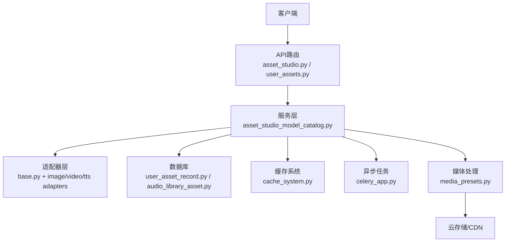
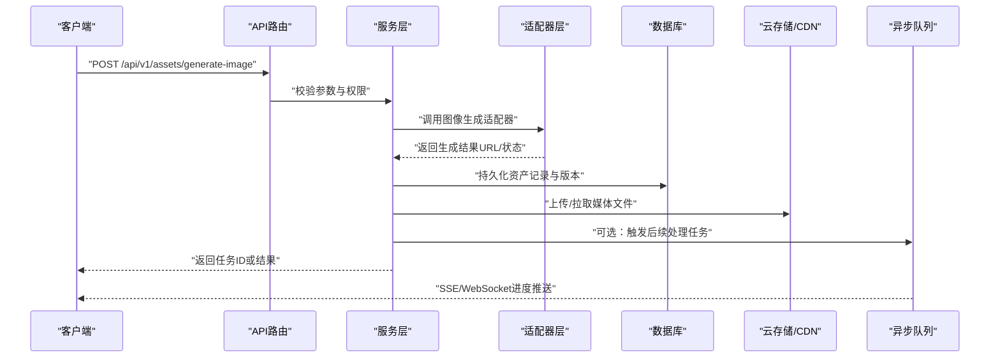
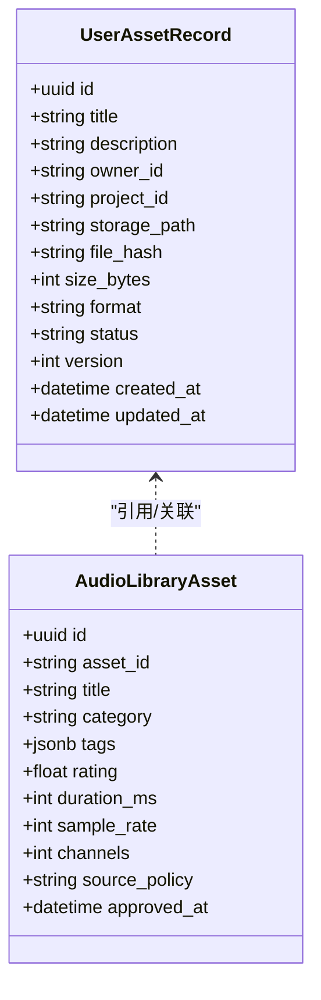
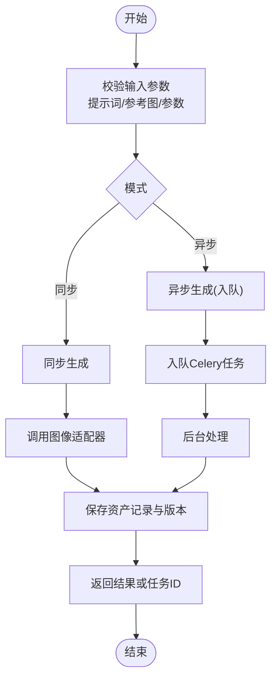
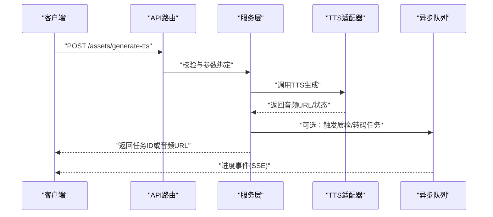
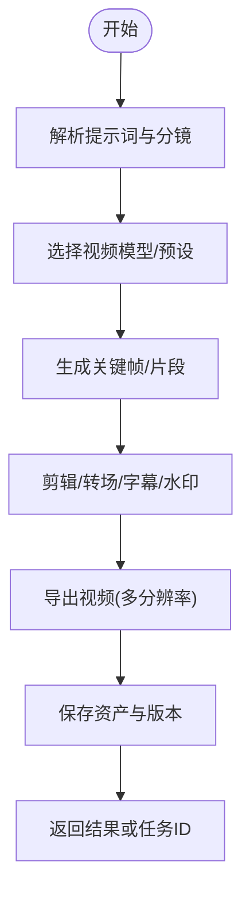
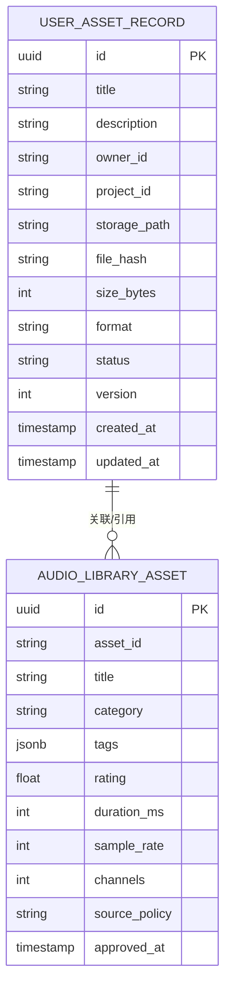
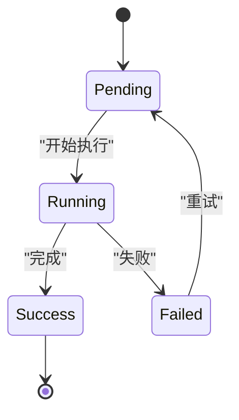
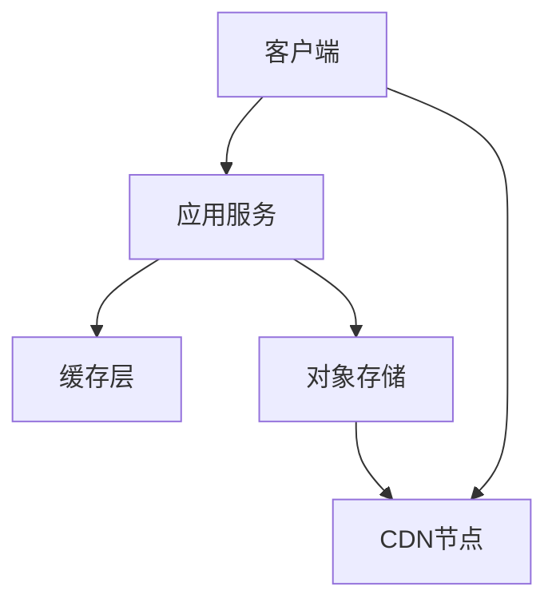
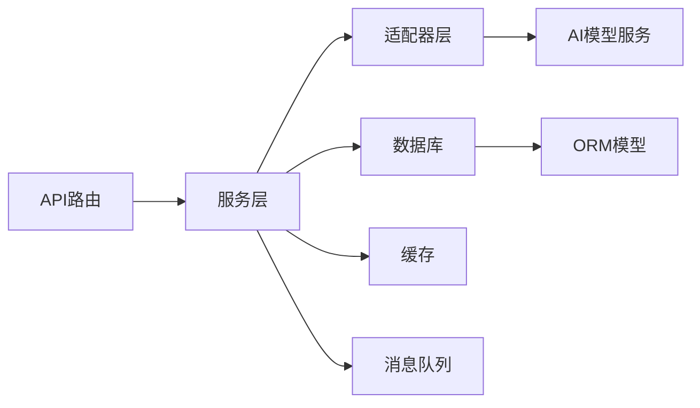

# 资产工作室API

<cite>
**本文引用的文件**   
- [backend/app/api/v1/asset_studio.py](file://backend/app/api/v1/asset_studio.py)
- [backend/app/api/v1/asset_studio_api/__init__.py](file://backend/app/api/v1/asset_studio_api/__init__.py)
- [backend/app/api/v1/user_assets.py](file://backend/app/api/v1/user_assets.py)
- [backend/app/services/asset_studio_model_catalog.py](file://backend/app/services/asset_studio_model_catalog.py)
- [backend/app/schemas/user_asset.py](file://backend/app/schemas/user_asset.py)
- [backend/app/models/audio_library_asset.py](file://backend/app/models/audio_library_asset.py)
- [backend/app/models/user_asset_record.py](file://backend/app/models/user_asset_record.py)
- [backend/app/services/cache_system.py](file://backend/app/services/cache_system.py)
- [backend/app/celery_app.py](file://backend/app/celery_app.py)
- [adapters/base.py](file://adapters/base.py)
- [adapters/image_sync.py](file://adapters/image_sync.py)
- [adapters/video_t2v.py](file://adapters/video_t2v.py)
- [adapters/tts.py](file://adapters/tts.py)
- [core/unified_media_runtime.py](file://core/unified_media_runtime.py)
- [pipeline/media_presets.py](file://pipeline/media_presets.py)
</cite>

## 目录
1. [简介](#简介)
2. [项目结构](#项目结构)
3. [核心组件](#核心组件)
4. [架构总览](#架构总览)
5. [详细组件分析](#详细组件分析)
6. [依赖关系分析](#依赖关系分析)
7. [性能考量](#性能考量)
8. [故障排查指南](#故障排查指南)
9. [结论](#结论)
10. [附录](#附录)

## 简介
本文件为“小说创作代理系统”的资产工作室API提供完整、可操作的文档。内容覆盖：
- 文件管理（上传、下载、元数据、版本控制）
- 图像生成与编辑（文生图、图生图、风格迁移、批量处理）
- 音频处理（TTS、音效、转码、质量检查）
- 视频合成（文本到视频、关键帧插值、剪辑与导出）
- 资产分类与标签体系、搜索过滤
- 异步任务与进度监控、批量操作
- 云存储集成、CDN加速与缓存策略

该API面向前端与第三方系统集成，强调高可用、可扩展与可观测性，并通过统一适配器层对接多种AI模型与媒体处理后端。

## 项目结构
资产工作室API位于后端模块中，采用分层设计：
- API路由层：定义HTTP接口与请求校验
- 服务层：业务编排、工作流协调、任务调度
- 数据层：ORM模型、数据库迁移、索引与查询
- 适配器层：统一封装多厂商AI能力（图像、视频、音频）
- 基础设施：缓存、Celery异步任务、媒体预处理与转码

图表来源
- [backend/app/api/v1/asset_studio.py](file://backend/app/api/v1/asset_studio.py)
- [backend/app/api/v1/user_assets.py](file://backend/app/api/v1/user_assets.py)
- [backend/app/services/asset_studio_model_catalog.py](file://backend/app/services/asset_studio_model_catalog.py)
- [adapters/base.py](file://adapters/base.py)
- [backend/app/celery_app.py](file://backend/app/celery_app.py)
- [backend/app/services/cache_system.py](file://backend/app/services/cache_system.py)
- [pipeline/media_presets.py](file://pipeline/media_presets.py)

章节来源
- [backend/app/api/v1/asset_studio.py](file://backend/app/api/v1/asset_studio.py)
- [backend/app/api/v1/user_assets.py](file://backend/app/api/v1/user_assets.py)

## 核心组件
- 资产路由与控制器：集中管理资产生命周期（创建、更新、删除、版本化）、标签与分类、搜索与过滤
- 模型目录服务：统一管理AI模型能力、参数模板与路由选择
- 适配器层：抽象图像、视频、音频等AI能力，屏蔽厂商差异
- 缓存系统：热点数据与结果缓存，提升响应速度
- 异步任务：长耗时任务（生成、转码、审核）通过Celery执行并支持进度上报
- 媒体处理：统一的转码、裁剪、水印、封面生成等流水线

章节来源
- [backend/app/services/asset_studio_model_catalog.py](file://backend/app/services/asset_studio_model_catalog.py)
- [adapters/base.py](file://adapters/base.py)
- [backend/app/services/cache_system.py](file://backend/app/services/cache_system.py)
- [backend/app/celery_app.py](file://backend/app/celery_app.py)
- [pipeline/media_presets.py](file://pipeline/media_presets.py)

## 架构总览
资产工作室API的整体调用链如下：
- 客户端发起HTTP请求至API路由
- 路由进行鉴权与参数校验后进入服务层
- 服务层根据资产类型与模型目录选择具体适配器
- 适配器调用外部AI或媒体处理服务
- 结果写入数据库与对象存储，必要时触发异步任务
- 缓存命中或更新，返回响应或SSE/WebSocket进度事件

图表来源
- [backend/app/api/v1/asset_studio.py](file://backend/app/api/v1/asset_studio.py)
- [backend/app/services/asset_studio_model_catalog.py](file://backend/app/services/asset_studio_model_catalog.py)
- [adapters/image_sync.py](file://adapters/image_sync.py)
- [backend/app/celery_app.py](file://backend/app/celery_app.py)

## 详细组件分析

### 文件管理与资产生命周期
- 功能要点
  - 上传/下载：支持分片上传、断点续传、签名URL直传
  - 元数据：标题、描述、作者、项目关联、分类、标签、版权信息
  - 版本控制：每次修改生成新版本，支持回滚与对比
  - 软删除与回收站：保留历史版本，支持恢复
- 关键接口
  - 上传资产：POST /assets/upload
  - 获取资产详情：GET /assets/{id}
  - 更新资产元数据：PATCH /assets/{id}
  - 删除资产：DELETE /assets/{id}
  - 版本列表与切换：GET /assets/{id}/versions, POST /assets/{id}/versions/switch
- 数据模型
  - 用户资产记录：包含路径、哈希、大小、格式、版本、状态等
  - 音频库资产：音质、时长、采样率、声道、标签、评分等

图表来源
- [backend/app/models/user_asset_record.py](file://backend/app/models/user_asset_record.py)
- [backend/app/models/audio_library_asset.py](file://backend/app/models/audio_library_asset.py)

章节来源
- [backend/app/models/user_asset_record.py](file://backend/app/models/user_asset_record.py)
- [backend/app/models/audio_library_asset.py](file://backend/app/models/audio_library_asset.py)

### 图像生成与编辑
- 能力范围
  - 文生图（Text-to-Image）
  - 图生图（Image-to-Image）
  - 风格迁移（Style Transfer）
  - 局部编辑（Inpainting/Outpainting）
  - 批量生成与并发控制
- 关键接口
  - 生成图像：POST /assets/generate-image
  - 编辑图像：POST /assets/edit-image
  - 批量生成：POST /assets/batch-generate-image
  - 任务进度：GET /tasks/{task_id}/progress
- 适配器实现
  - 统一接口抽象，内部路由到不同厂商模型
  - 支持同步与异步两种模式

图表来源
- [adapters/image_sync.py](file://adapters/image_sync.py)
- [backend/app/celery_app.py](file://backend/app/celery_app.py)

章节来源
- [adapters/image_sync.py](file://adapters/image_sync.py)
- [adapters/base.py](file://adapters/base.py)

### 音频处理
- 能力范围
  - TTS（文本转语音）：多音色、多语言、情感控制
  - 音效检索与插入：基于标签与语义匹配
  - 转码与质量检查：格式转换、响度标准化、降噪
- 关键接口
  - 生成语音：POST /assets/generate-tts
  - 音效检索：GET /audio-library/search
  - 转码任务：POST /assets/transcode-audio
  - 进度查询：GET /tasks/{task_id}/progress
- 适配器实现
  - 统一TTS接口，支持多供应商与音色池

图表来源
- [adapters/tts.py](file://adapters/tts.py)
- [backend/app/celery_app.py](file://backend/app/celery_app.py)

章节来源
- [adapters/tts.py](file://adapters/tts.py)
- [backend/app/celery_app.py](file://backend/app/celery_app.py)

### 视频合成
- 能力范围
  - 文本到视频（Text-to-Video）
  - 关键帧插值与过渡
  - 片段拼接、字幕叠加、水印
  - 批量渲染与导出
- 关键接口
  - 生成视频：POST /assets/generate-video
  - 编辑视频：POST /assets/edit-video
  - 批量任务：POST /assets/batch-generate-video
  - 进度查询：GET /tasks/{task_id}/progress
- 适配器实现
  - 统一视频生成接口，支持多厂商与分辨率预设

图表来源
- [adapters/video_t2v.py](file://adapters/video_t2v.py)
- [pipeline/media_presets.py](file://pipeline/media_presets.py)

章节来源
- [adapters/video_t2v.py](file://adapters/video_t2v.py)
- [pipeline/media_presets.py](file://pipeline/media_presets.py)

### 资产分类、标签系统与搜索过滤
- 分类体系
  - 按媒体类型（图像、音频、视频）
  - 按用途（角色、场景、道具、音效、BGM）
  - 按项目维度（项目内分类）
- 标签系统
  - 自由标签与预置标签混合
  - 支持层级标签与同义词映射
- 搜索与过滤
  - 全文检索（标题、描述、标签）
  - 条件过滤（类型、项目、时间、状态、评分）
  - 排序与分页

图表来源
- [backend/app/models/user_asset_record.py](file://backend/app/models/user_asset_record.py)
- [backend/app/models/audio_library_asset.py](file://backend/app/models/audio_library_asset.py)

章节来源
- [backend/app/schemas/user_asset.py](file://backend/app/schemas/user_asset.py)
- [backend/app/models/user_asset_record.py](file://backend/app/models/user_asset_record.py)
- [backend/app/models/audio_library_asset.py](file://backend/app/models/audio_library_asset.py)

### 批量操作与异步任务
- 批量操作
  - 批量上传、批量重命名、批量打标签、批量导出
  - 支持CSV/JSON清单导入
- 异步任务
  - 使用Celery队列承载长耗时任务
  - 任务状态机：pending -> running -> success/failed
  - 进度上报：SSE或WebSocket推送
- 重试与幂等
  - 失败重试策略（指数退避）
  - 任务去重与幂等键

章节来源
- [backend/app/celery_app.py](file://backend/app/celery_app.py)

### 云存储集成、CDN加速与缓存策略
- 云存储
  - 支持多后端（本地、S3兼容、阿里云OSS等）
  - 分片上传、断点续传、签名直传
- CDN加速
  - 静态资源与媒体文件通过CDN分发
  - 域名与缓存头配置
- 缓存策略
  - 热点资产元数据缓存（Redis/Memcached）
  - 生成结果缓存（按参数指纹）
  - 失效策略（TTL、主动失效）

章节来源
- [backend/app/services/cache_system.py](file://backend/app/services/cache_system.py)
- [core/unified_media_runtime.py](file://core/unified_media_runtime.py)

## 依赖关系分析
- 组件耦合
  - API路由与服务层松耦合，通过接口契约通信
  - 服务层与适配器层通过统一抽象解耦厂商差异
  - 数据层与ORM模型强耦合，便于迁移与扩展
- 外部依赖
  - AI模型适配器（图像、视频、音频）
  - 消息队列（Celery/RabbitMQ或Redis）
  - 对象存储与CDN
  - 缓存系统（Redis/Memcached）

图表来源
- [backend/app/api/v1/asset_studio.py](file://backend/app/api/v1/asset_studio.py)
- [backend/app/services/asset_studio_model_catalog.py](file://backend/app/services/asset_studio_model_catalog.py)
- [adapters/base.py](file://adapters/base.py)
- [backend/app/celery_app.py](file://backend/app/celery_app.py)
- [backend/app/services/cache_system.py](file://backend/app/services/cache_system.py)

章节来源
- [backend/app/api/v1/asset_studio.py](file://backend/app/api/v1/asset_studio.py)
- [backend/app/services/asset_studio_model_catalog.py](file://backend/app/services/asset_studio_model_catalog.py)
- [adapters/base.py](file://adapters/base.py)

## 性能考量
- 并发与限流
  - 对高频接口实施令牌桶/滑动窗口限流
  - 批量任务拆分与并行执行
- 缓存命中率优化
  - 热点资产与热门模型参数缓存
  - 结果缓存按参数指纹生成键
- I/O优化
  - 分片上传与直传减少服务器负载
  - CDN缓存静态与媒体资源
- 数据库优化
  - 常用查询字段建立索引
  - 读写分离与连接池调优

[本节为通用指导，不直接分析具体文件]

## 故障排查指南
- 常见问题
  - 生成失败：检查适配器日志、模型配额与网络连通性
  - 任务卡住：查看队列积压与Worker状态
  - 缓存异常：检查缓存服务健康与键空间
  - 存储错误：验证对象存储权限与CDN缓存头
- 诊断工具
  - 任务追踪：通过任务ID查询状态与日志
  - 指标采集：QPS、延迟、错误率、队列长度
  - 链路追踪：跨组件TraceID串联

章节来源
- [backend/app/celery_app.py](file://backend/app/celery_app.py)
- [backend/app/services/cache_system.py](file://backend/app/services/cache_system.py)

## 结论
资产工作室API以清晰的分层架构与统一适配器为核心，提供完整的文件管理、图像生成与编辑、音频处理与视频合成能力。通过分类与标签体系、搜索过滤、版本控制以及异步任务与缓存机制，满足大规模多媒体资产管理与AI驱动创作的需求。建议在生产环境完善限流、监控与审计，持续优化缓存与I/O路径，确保高可用与高性能。

[本节为总结，不直接分析具体文件]

## 附录
- 术语表
  - 资产：系统中的媒体与元数据集合
  - 适配器：封装外部AI能力的统一接口
  - 任务：异步执行的长耗时操作单元
- 最佳实践
  - 使用签名直传降低带宽压力
  - 合理设置缓存TTL与失效策略
  - 对批量任务进行拆分与监控
  - 保持模型目录与参数模板的版本化

[本节为补充信息，不直接分析具体文件]