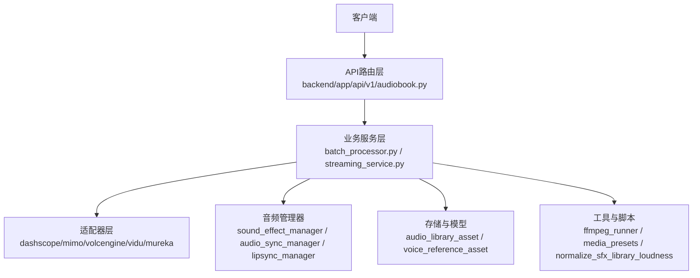
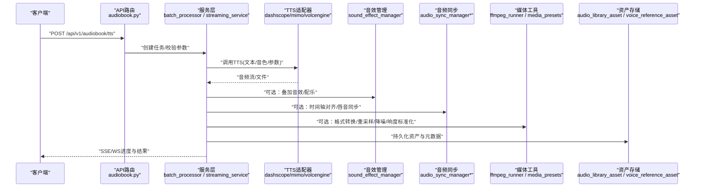
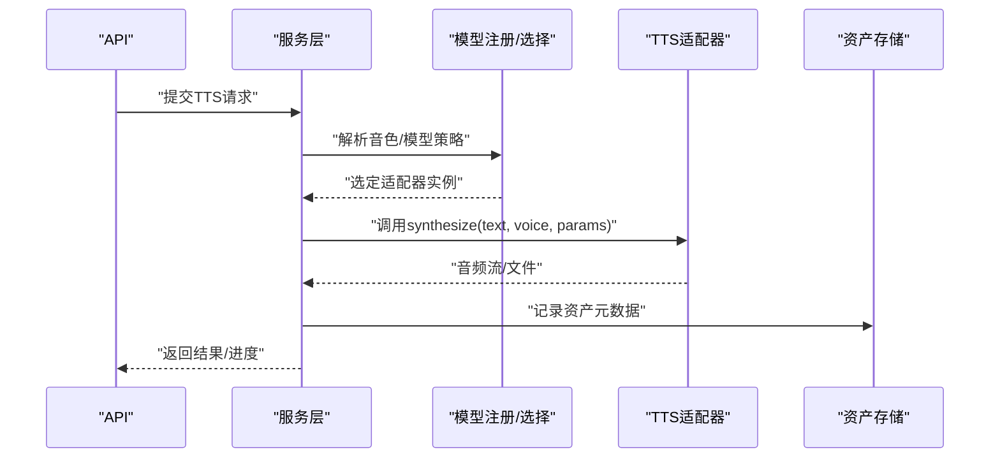
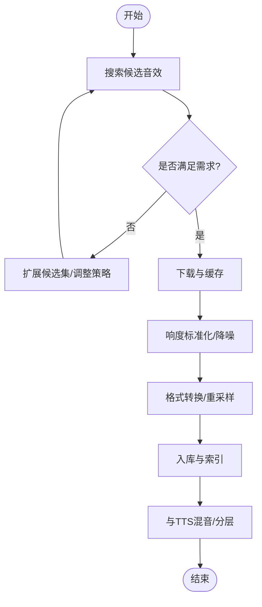
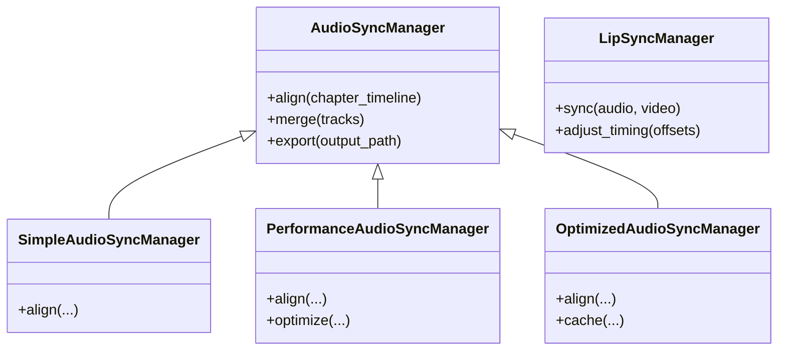
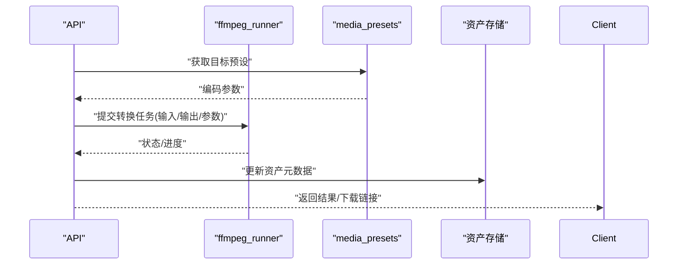
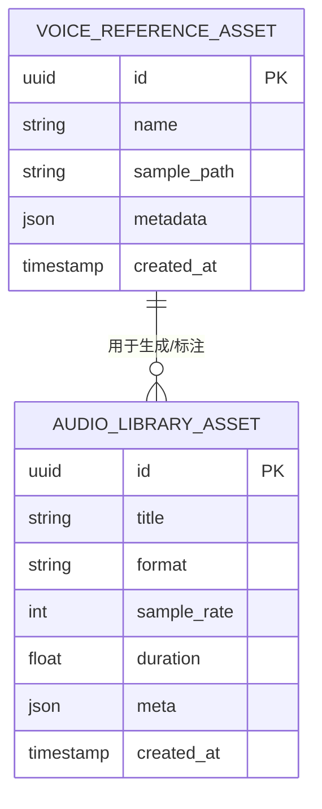
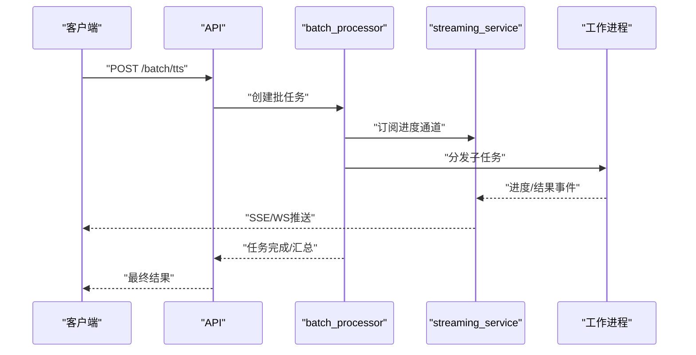
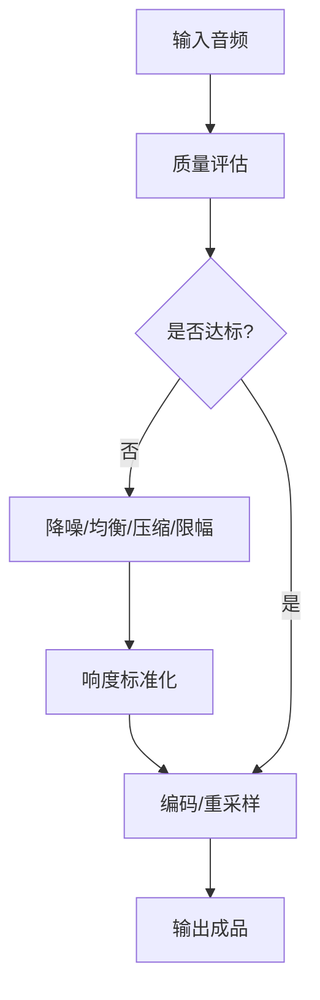
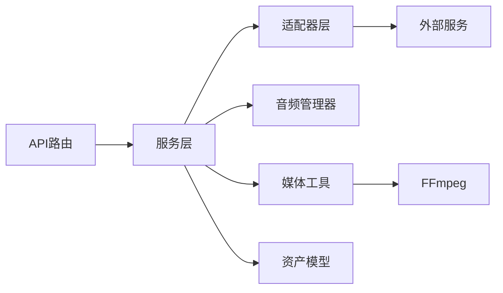

# 音频处理API

<cite>
**本文引用的文件**   
- [adapters/dashscope/tts.py](file://adapters/dashscope/tts.py)
- [adapters/mimo/tts.py](file://adapters/mimo/tts.py)
- [adapters/volcengine/tts.py](file://adapters/volcengine/tts.py)
- [adapters/vidu_platform/timing2audio.py](file://adapters/vidu_platform/timing2audio.py)
- [adapters/mureka/instrumental.py](file://adapters/mureka/instrumental.py)
- [adapters/base.py](file://adapters/base.py)
- [adapters/_shared.py](file://adapters/_shared.py)
- [adapters/model_adapters.py](file://adapters/model_adapters.py)
- [adapters/new_models_adapters.py](file://adapters/new_models_adapters.py)
- [adapters/adapter_helpers.py](file://adapters/adapter_helpers.py)
- [agents/sound_effect_manager.py](file://agents/sound_effect_manager.py)
- [agents/audio_sync_manager.py](file://agents/audio_sync_manager.py)
- [agents/optimized_audio_sync_manager.py](file://agents/optimized_audio_sync_manager.py)
- [agents/performance_audio_sync_manager.py](file://agents/performance_audio_sync_manager.py)
- [agents/simple_audio_sync_manager.py](file://agents/simple_audio_sync_manager.py)
- [agents/lipsync_manager.py](file://agents/lipsync_manager.py)
- [agents/cross_batch_audio_manager.py](file://agents/cross_batch_audio_manager.py)
- [backend/app/api/v1/audiobook.py](file://backend/app/api/v1/audiobook.py)
- [backend/app/services/batch_processor.py](file://backend/app/services/batch_processor.py)
- [backend/app/services/streaming_service.py](file://backend/app/services/streaming_service.py)
- [backend/app/models/audio_library_asset.py](file://backend/app/models/audio_library_asset.py)
- [backend/app/models/voice_reference_asset.py](file://backend/app/models/voice_reference_asset.py)
- [backend/app/schemas/audiobook.py](file://backend/app/schemas/audiobook.py)
- [backend/app/core/config.py](file://backend/app/core/config.py)
- [scripts/ffmpeg_runner.py](file://scripts/ffmpeg_runner.py)
- [pipeline/media_presets.py](file://pipeline/media_presets.py)
- [backend/scripts/normalize_sfx_library_loudness.py](file://backend/scripts/normalize_sfx_library_loudness.py)
- [tests/test_audio_fx_optimizations.py](file://tests/test_audio_fx_optimizations.py)
- [tests/test_audio_integration.py](file://tests/test_audio_integration.py)
</cite>

## 目录
1. [简介](#简介)
2. [项目结构](#项目结构)
3. [核心组件](#核心组件)
4. [架构总览](#架构总览)
5. [详细组件分析](#详细组件分析)
6. [依赖关系分析](#依赖关系分析)
7. [性能考量](#性能考量)
8. [故障排查指南](#故障排查指南)
9. [结论](#结论)
10. [附录](#附录)

## 简介
本文件为小说创作代理系统的“音频处理API”文档，覆盖语音合成（TTS）、音效生成、音频编辑、格式转换、音色克隆、音频同步与音质优化等能力。文档面向开发者与集成方，提供接口说明、调用流程、配置项与最佳实践，并给出批量处理、实时流式处理与异步任务的示例路径。

## 项目结构
系统围绕“适配器层 + 业务服务层 + API路由层 + 存储与脚本工具”组织：
- 适配器层：对接外部TTS/音效/视频转音频等第三方能力，统一抽象为内部接口。
- 业务服务层：编排TTS、音效、同步、质量评估、批处理、流式输出等。
- API路由层：暴露REST/WebSocket接口，承载请求校验、鉴权、计费与追踪。
- 存储与脚本：资产模型、参考音色、FFmpeg工具、媒体预设、标准化脚本等。

图表来源
- [backend/app/api/v1/audiobook.py](file://backend/app/api/v1/audiobook.py)
- [backend/app/services/batch_processor.py](file://backend/app/services/batch_processor.py)
- [backend/app/services/streaming_service.py](file://backend/app/services/streaming_service.py)
- [adapters/dashscope/tts.py](file://adapters/dashscope/tts.py)
- [adapters/mimo/tts.py](file://adapters/mimo/tts.py)
- [adapters/volcengine/tts.py](file://adapters/volcengine/tts.py)
- [adapters/vidu_platform/timing2audio.py](file://adapters/vidu_platform/timing2audio.py)
- [adapters/mureka/instrumental.py](file://adapters/mureka/instrumental.py)
- [agents/sound_effect_manager.py](file://agents/sound_effect_manager.py)
- [agents/audio_sync_manager.py](file://agents/audio_sync_manager.py)
- [agents/lipsync_manager.py](file://agents/lipsync_manager.py)
- [backend/app/models/audio_library_asset.py](file://backend/app/models/audio_library_asset.py)
- [backend/app/models/voice_reference_asset.py](file://backend/app/models/voice_reference_asset.py)
- [scripts/ffmpeg_runner.py](file://scripts/ffmpeg_runner.py)
- [pipeline/media_presets.py](file://pipeline/media_presets.py)
- [backend/scripts/normalize_sfx_library_loudness.py](file://backend/scripts/normalize_sfx_library_loudness.py)

章节来源
- [backend/app/api/v1/audiobook.py](file://backend/app/api/v1/audiobook.py)
- [adapters/base.py](file://adapters/base.py)
- [adapters/_shared.py](file://adapters/_shared.py)
- [adapters/model_adapters.py](file://adapters/model_adapters.py)
- [adapters/new_models_adapters.py](file://adapters/new_models_adapters.py)
- [adapters/adapter_helpers.py](file://adapters/adapter_helpers.py)

## 核心组件
- TTS适配器族：DashScope、Mimo、VolcEngine等，统一通过基类与适配辅助函数进行参数映射、错误归一化与重试策略。
- 音效与配乐：音效库管理、素材检索与下载、音量标准化与入库。
- 音频同步：多实现（简单、性能优化、优化版）与唇音同步，支持章节级时间轴对齐。
- 批处理与流式：批量任务调度、SSE/WS流式返回进度与片段。
- 媒体工具：FFmpeg封装、媒体预设、采样率与码率控制。
- 资产与音色：音频资产元数据、音色参考资产与克隆样本索引。

章节来源
- [adapters/dashscope/tts.py](file://adapters/dashscope/tts.py)
- [adapters/mimo/tts.py](file://adapters/mimo/tts.py)
- [adapters/volcengine/tts.py](file://adapters/volcengine/tts.py)
- [adapters/base.py](file://adapters/base.py)
- [adapters/adapter_helpers.py](file://adapters/adapter_helpers.py)
- [agents/sound_effect_manager.py](file://agents/sound_effect_manager.py)
- [agents/audio_sync_manager.py](file://agents/audio_sync_manager.py)
- [agents/optimized_audio_sync_manager.py](file://agents/optimized_audio_sync_manager.py)
- [agents/performance_audio_sync_manager.py](file://agents/performance_audio_sync_manager.py)
- [agents/simple_audio_sync_manager.py](file://agents/simple_audio_sync_manager.py)
- [agents/lipsync_manager.py](file://agents/lipsync_manager.py)
- [backend/app/services/batch_processor.py](file://backend/app/services/batch_processor.py)
- [backend/app/services/streaming_service.py](file://backend/app/services/streaming_service.py)
- [scripts/ffmpeg_runner.py](file://scripts/ffmpeg_runner.py)
- [pipeline/media_presets.py](file://pipeline/media_presets.py)
- [backend/app/models/audio_library_asset.py](file://backend/app/models/audio_library_asset.py)
- [backend/app/models/voice_reference_asset.py](file://backend/app/models/voice_reference_asset.py)

## 架构总览
下图展示从API到适配器与工具的端到端调用链，涵盖TTS、音效、同步、批处理与流式输出。

图表来源
- [backend/app/api/v1/audiobook.py](file://backend/app/api/v1/audiobook.py)
- [backend/app/services/batch_processor.py](file://backend/app/services/batch_processor.py)
- [backend/app/services/streaming_service.py](file://backend/app/services/streaming_service.py)
- [adapters/dashscope/tts.py](file://adapters/dashscope/tts.py)
- [adapters/mimo/tts.py](file://adapters/mimo/tts.py)
- [adapters/volcengine/tts.py](file://adapters/volcengine/tts.py)
- [agents/sound_effect_manager.py](file://agents/sound_effect_manager.py)
- [agents/audio_sync_manager.py](file://agents/audio_sync_manager.py)
- [scripts/ffmpeg_runner.py](file://scripts/ffmpeg_runner.py)
- [pipeline/media_presets.py](file://pipeline/media_presets.py)
- [backend/app/models/audio_library_asset.py](file://backend/app/models/audio_library_asset.py)
- [backend/app/models/voice_reference_asset.py](file://backend/app/models/voice_reference_asset.py)

## 详细组件分析

### 语音合成（TTS）
- 能力范围
  - 文本转语音、多引擎接入（DashScope、Mimo、VolcEngine）。
  - 音色选择与音色克隆（基于参考音频或音色索引）。
  - 参数映射：语速、音调、情感、停顿、采样率、编码格式。
  - 错误归一化、重试与降级策略。
- 关键实现
  - 适配器基类与共享逻辑：统一输入输出、异常处理、速率限制。
  - 各引擎适配器：具体参数映射与调用细节。
  - 模型注册与选择：按项目/用户策略选择最优引擎。
- 典型调用序列

图表来源
- [adapters/base.py](file://adapters/base.py)
- [adapters/_shared.py](file://adapters/_shared.py)
- [adapters/model_adapters.py](file://adapters/model_adapters.py)
- [adapters/new_models_adapters.py](file://adapters/new_models_adapters.py)
- [adapters/dashscope/tts.py](file://adapters/dashscope/tts.py)
- [adapters/mimo/tts.py](file://adapters/mimo/tts.py)
- [adapters/volcengine/tts.py](file://adapters/volcengine/tts.py)
- [backend/app/api/v1/audiobook.py](file://backend/app/api/v1/audiobook.py)
- [backend/app/models/audio_library_asset.py](file://backend/app/models/audio_library_asset.py)

章节来源
- [adapters/dashscope/tts.py](file://adapters/dashscope/tts.py)
- [adapters/mimo/tts.py](file://adapters/mimo/tts.py)
- [adapters/volcengine/tts.py](file://adapters/volcengine/tts.py)
- [adapters/base.py](file://adapters/base.py)
- [adapters/_shared.py](file://adapters/_shared.py)
- [adapters/model_adapters.py](file://adapters/model_adapters.py)
- [adapters/new_models_adapters.py](file://adapters/new_models_adapters.py)
- [adapters/adapter_helpers.py](file://adapters/adapter_helpers.py)
- [backend/app/api/v1/audiobook.py](file://backend/app/api/v1/audiobook.py)
- [backend/app/models/audio_library_asset.py](file://backend/app/models/audio_library_asset.py)

### 音效生成与素材管理
- 能力范围
  - 音效库检索、候选集构建、下载与入库。
  - 音量标准化、噪声抑制、格式统一。
  - 与TTS结果混音与场景化组合。
- 关键实现
  - 音效管理器：素材生命周期、评分与审核。
  - 标准化脚本：批量响度归一化与质量检查。
  - 媒体预设：统一的编码、采样率与比特率。

图表来源
- [agents/sound_effect_manager.py](file://agents/sound_effect_manager.py)
- [backend/scripts/normalize_sfx_library_loudness.py](file://backend/scripts/normalize_sfx_library_loudness.py)
- [pipeline/media_presets.py](file://pipeline/media_presets.py)
- [scripts/ffmpeg_runner.py](file://scripts/ffmpeg_runner.py)

章节来源
- [agents/sound_effect_manager.py](file://agents/sound_effect_manager.py)
- [backend/scripts/normalize_sfx_library_loudness.py](file://backend/scripts/normalize_sfx_library_loudness.py)
- [pipeline/media_presets.py](file://pipeline/media_presets.py)
- [scripts/ffmpeg_runner.py](file://scripts/ffmpeg_runner.py)

### 音频同步与唇音同步
- 能力范围
  - 章节/场景级时间轴对齐，多轨合并。
  - 唇音同步（Lip-sync）与口型驱动。
  - 高性能与优化版同步器，支持大规模并发。
- 关键实现
  - 多实现策略：Simple、Performance、Optimized。
  - 与FFmpeg管线集成，保证帧/样本级精度。
  - 跨批次音频管理，保障一致性。

图表来源
- [agents/audio_sync_manager.py](file://agents/audio_sync_manager.py)
- [agents/simple_audio_sync_manager.py](file://agents/simple_audio_sync_manager.py)
- [agents/performance_audio_sync_manager.py](file://agents/performance_audio_sync_manager.py)
- [agents/optimized_audio_sync_manager.py](file://agents/optimized_audio_sync_manager.py)
- [agents/lipsync_manager.py](file://agents/lipsync_manager.py)
- [agents/cross_batch_audio_manager.py](file://agents/cross_batch_audio_manager.py)

章节来源
- [agents/audio_sync_manager.py](file://agents/audio_sync_manager.py)
- [agents/simple_audio_sync_manager.py](file://agents/simple_audio_sync_manager.py)
- [agents/performance_audio_sync_manager.py](file://agents/performance_audio_sync_manager.py)
- [agents/optimized_audio_sync_manager.py](file://agents/optimized_audio_sync_manager.py)
- [agents/lipsync_manager.py](file://agents/lipsync_manager.py)
- [agents/cross_batch_audio_manager.py](file://agents/cross_batch_audio_manager.py)

### 格式转换与媒体处理
- 能力范围
  - 基于FFmpeg的格式转换、重采样、编码参数控制。
  - 媒体预设：采样率、码率、声道数、容器格式。
  - 批量转换与队列化执行。
- 关键实现
  - ffmpeg_runner：命令构建、超时与错误处理。
  - media_presets：默认与自定义预设。
  - 与资产模型联动，记录转换前后元数据。

图表来源
- [scripts/ffmpeg_runner.py](file://scripts/ffmpeg_runner.py)
- [pipeline/media_presets.py](file://pipeline/media_presets.py)
- [backend/app/models/audio_library_asset.py](file://backend/app/models/audio_library_asset.py)

章节来源
- [scripts/ffmpeg_runner.py](file://scripts/ffmpeg_runner.py)
- [pipeline/media_presets.py](file://pipeline/media_presets.py)
- [backend/app/models/audio_library_asset.py](file://backend/app/models/audio_library_asset.py)

### 音色克隆与参考音色
- 能力范围
  - 基于参考音频的音色克隆与复用。
  - 音色参考资产管理与索引。
  - 与TTS适配器联动的音色ID映射。
- 关键实现
  - voice_reference_asset：参考音频、元数据、索引。
  - 适配器侧对音色参数的兼容与透传。

图表来源
- [backend/app/models/voice_reference_asset.py](file://backend/app/models/voice_reference_asset.py)
- [backend/app/models/audio_library_asset.py](file://backend/app/models/audio_library_asset.py)
- [adapters/dashscope/tts.py](file://adapters/dashscope/tts.py)
- [adapters/mimo/tts.py](file://adapters/mimo/tts.py)
- [adapters/volcengine/tts.py](file://adapters/volcengine/tts.py)

章节来源
- [backend/app/models/voice_reference_asset.py](file://backend/app/models/voice_reference_asset.py)
- [backend/app/models/audio_library_asset.py](file://backend/app/models/audio_library_asset.py)
- [adapters/dashscope/tts.py](file://adapters/dashscope/tts.py)
- [adapters/mimo/tts.py](file://adapters/mimo/tts.py)
- [adapters/volcengine/tts.py](file://adapters/volcengine/tts.py)

### 批量音频处理与异步任务
- 能力范围
  - 批量TTS、批量转换、批量标准化。
  - 任务队列、进度上报、失败重试与补偿。
  - SSE/WS流式反馈。
- 关键实现
  - batch_processor：任务编排、并发控制、结果聚合。
  - streaming_service：SSE/WS事件推送。
  - 与资产模型和日志追踪集成。

图表来源
- [backend/app/services/batch_processor.py](file://backend/app/services/batch_processor.py)
- [backend/app/services/streaming_service.py](file://backend/app/services/streaming_service.py)
- [backend/app/api/v1/audiobook.py](file://backend/app/api/v1/audiobook.py)

章节来源
- [backend/app/services/batch_processor.py](file://backend/app/services/batch_processor.py)
- [backend/app/services/streaming_service.py](file://backend/app/services/streaming_service.py)
- [backend/app/api/v1/audiobook.py](file://backend/app/api/v1/audiobook.py)

### 音频质量评估、噪声消除与音量标准化
- 能力范围
  - 自动质量门控、指标采集与报告。
  - 噪声抑制、回声消除、响度标准化。
  - 与FFmpeg管线与媒体预设联动。
- 关键实现
  - 测试用例覆盖：音频效果优化、集成验证。
  - 标准化脚本：批量响度处理。
  - 媒体预设：统一输出规格。

图表来源
- [tests/test_audio_fx_optimizations.py](file://tests/test_audio_fx_optimizations.py)
- [tests/test_audio_integration.py](file://tests/test_audio_integration.py)
- [backend/scripts/normalize_sfx_library_loudness.py](file://backend/scripts/normalize_sfx_library_loudness.py)
- [pipeline/media_presets.py](file://pipeline/media_presets.py)
- [scripts/ffmpeg_runner.py](file://scripts/ffmpeg_runner.py)

章节来源
- [tests/test_audio_fx_optimizations.py](file://tests/test_audio_fx_optimizations.py)
- [tests/test_audio_integration.py](file://tests/test_audio_integration.py)
- [backend/scripts/normalize_sfx_library_loudness.py](file://backend/scripts/normalize_sfx_library_loudness.py)
- [pipeline/media_presets.py](file://pipeline/media_presets.py)
- [scripts/ffmpeg_runner.py](file://scripts/ffmpeg_runner.py)

## 依赖关系分析
- 耦合与内聚
  - 适配器层高内聚，通过基类与共享模块降低重复代码。
  - 服务层编排能力强，依赖管理器与工具模块。
  - API层薄封装，侧重校验与路由。
- 外部依赖
  - TTS/音效/视频转音频第三方服务。
  - FFmpeg用于音视频编解码与后处理。
- 潜在循环依赖
  - 通过分层与接口隔离避免循环引用。

图表来源
- [backend/app/api/v1/audiobook.py](file://backend/app/api/v1/audiobook.py)
- [adapters/base.py](file://adapters/base.py)
- [adapters/_shared.py](file://adapters/_shared.py)
- [agents/sound_effect_manager.py](file://agents/sound_effect_manager.py)
- [agents/audio_sync_manager.py](file://agents/audio_sync_manager.py)
- [scripts/ffmpeg_runner.py](file://scripts/ffmpeg_runner.py)
- [backend/app/models/audio_library_asset.py](file://backend/app/models/audio_library_asset.py)

章节来源
- [adapters/base.py](file://adapters/base.py)
- [adapters/_shared.py](file://adapters/_shared.py)
- [adapters/model_adapters.py](file://adapters/model_adapters.py)
- [adapters/new_models_adapters.py](file://adapters/new_models_adapters.py)
- [adapters/adapter_helpers.py](file://adapters/adapter_helpers.py)

## 性能考量
- 并发与批处理
  - 使用批处理器拆分大任务，合理设置并发度与队列长度。
  - 流式输出减少首包延迟，提升用户体验。
- 资源与存储
  - 合理配置采样率与码率，平衡音质与体积。
  - 临时文件清理与对象存储策略，避免磁盘膨胀。
- 缓存与预热
  - 音色预览与常用模板缓存，缩短冷启动时间。
- 错误与重试
  - 指数退避与熔断，避免雪崩。
  - 失败任务可恢复与断点续传。

[本节为通用指导，不直接分析具体文件]

## 故障排查指南
- 常见问题
  - TTS失败：检查适配器配置、网络连通、密钥与配额。
  - 同步错位：核对时间轴单位、采样率一致性与偏移量。
  - 音质问题：确认降噪/限幅参数，检查响度标准。
  - 转换失败：查看FFmpeg命令与输入格式兼容性。
- 定位方法
  - 启用调试日志与追踪ID。
  - 使用测试用例复现与回归验证。
  - 借助SSE/WS进度事件定位卡点。

章节来源
- [tests/test_audio_integration.py](file://tests/test_audio_integration.py)
- [tests/test_audio_fx_optimizations.py](file://tests/test_audio_fx_optimizations.py)
- [backend/app/api/v1/audiobook.py](file://backend/app/api/v1/audiobook.py)
- [scripts/ffmpeg_runner.py](file://scripts/ffmpeg_runner.py)

## 结论
本系统以适配器为核心，结合音频管理器与媒体工具，形成完整的音频处理能力矩阵。通过批处理与流式输出，兼顾吞吐与体验；通过标准化与质量门控，确保输出一致性。建议在生产环境完善监控、告警与容量规划，持续优化适配器与同步算法。

[本节为总结性内容，不直接分析具体文件]

## 附录
- 接口与配置要点
  - TTS引擎集成：在适配器层新增引擎时，遵循基类契约与参数映射规范。
  - 音色克隆：上传参考音频至音色参考资产，建立索引并在TTS请求中指定音色ID。
  - 音频同步：根据章节时间轴与角色台词，选择合适的同步器实现。
  - 格式转换：通过媒体预设统一编码参数，必要时自定义扩展。
  - 存储空间管理：设定对象存储路径、保留策略与清理任务。
  - 采样率配置：全局默认与项目级覆盖，确保上下游一致。
  - 质量评估：开启自动QC，收集指标并纳入发布门禁。
  - 噪声消除与音量标准化：在流水线中插入降噪与响度标准化节点。
- 调用示例路径
  - 批量TTS：参考批处理器与API路由中的批量接口定义。
  - 实时流处理：参考流式服务与SSE/WS事件协议。
  - 异步任务：参考任务队列与进度回调机制。

[本节为补充信息，不直接分析具体文件]