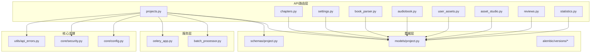
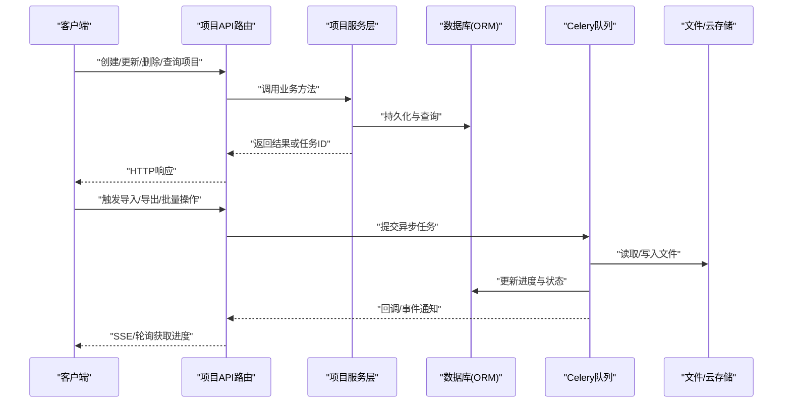
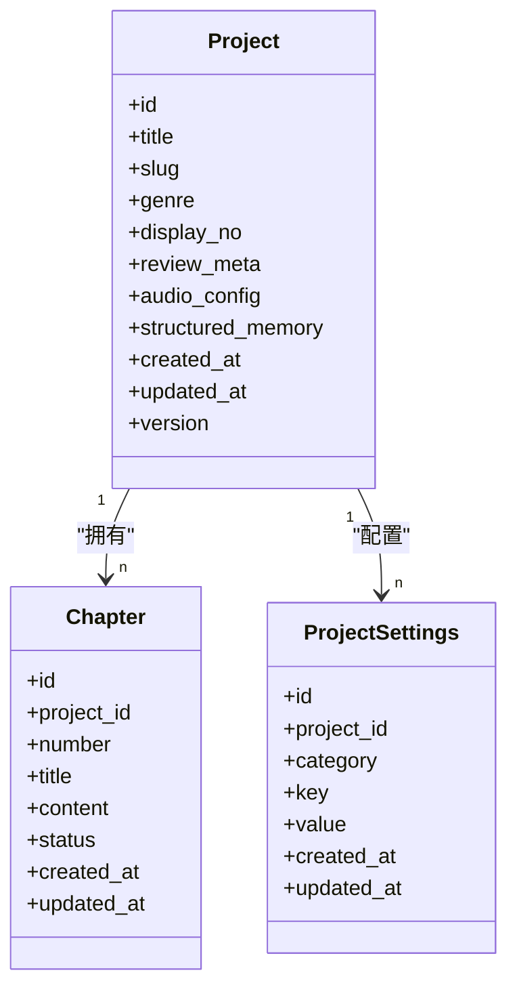
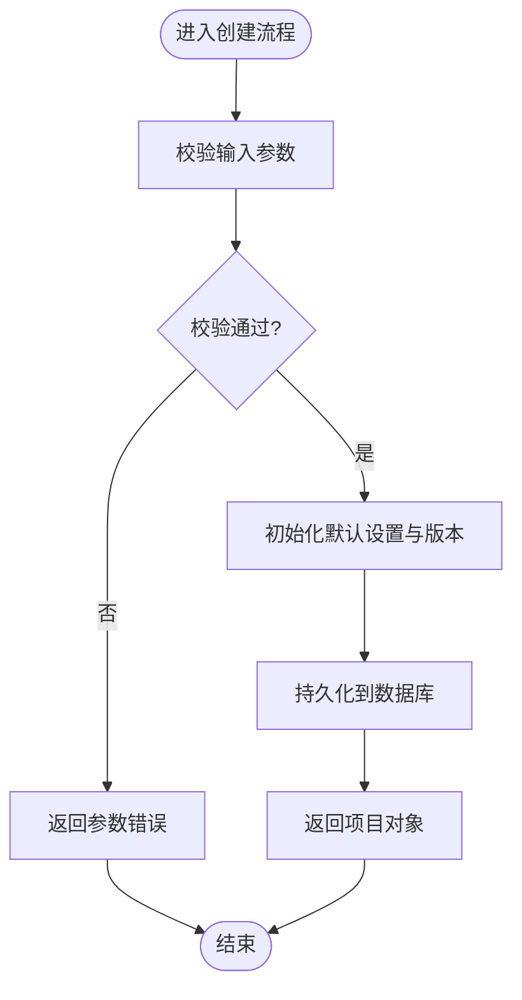
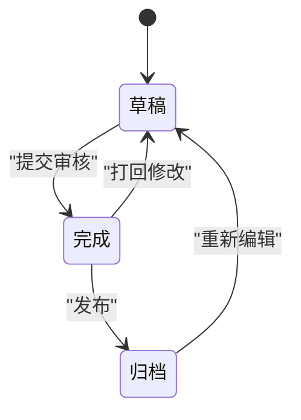
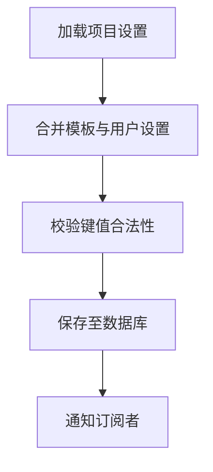
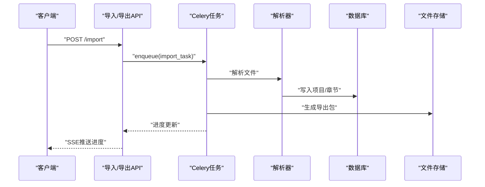
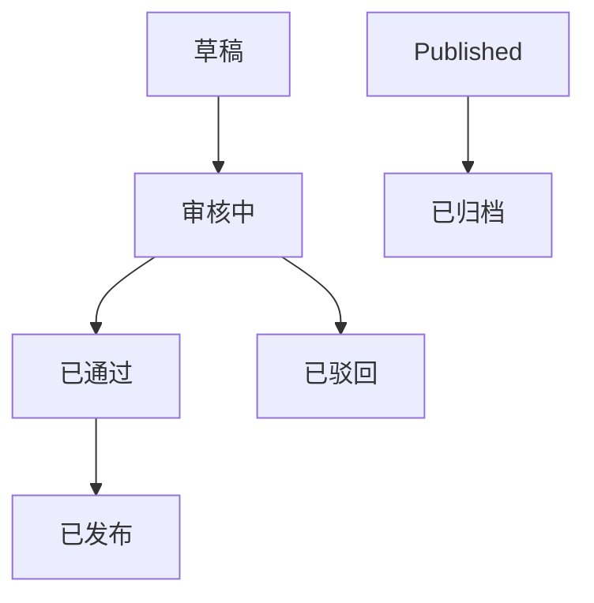
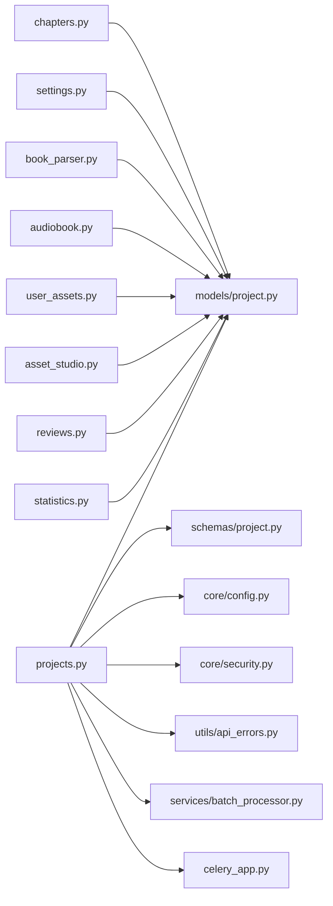

# 项目管理API

<cite>
**本文引用的文件**   
- [backend/app/api/v1/projects.py](file://backend/app/api/v1/projects.py)
- [backend/app/models/project.py](file://backend/app/models/project.py)
- [backend/app/schemas/project.py](file://backend/app/schemas/project.py)
- [backend/app/services/batch_processor.py](file://backend/app/services/batch_processor.py)
- [backend/app/celery_app.py](file://backend/app/celery_app.py)
- [backend/alembic/versions/add_project_display_no.py](file://backend/alembic/versions/add_project_display_no.py)
- [backend/alembic/versions/add_genre_planning_to_projects.py](file://backend/alembic/versions/add_genre_planning_to_projects.py)
- [backend/alembic/versions/add_project_settings_review_meta.py](file://backend/alembic/versions/add_project_settings_review_meta.py)
- [backend/alembic/versions/create_project_settings_table.py](file://backend/alembic/versions/create_project_settings_table.py)
- [backend/alembic/versions/add_audio_config_to_projects.py](file://backend/alembic/versions/add_audio_config_to_projects.py)
- [backend/app/api/v1/chapters.py](file://backend/app/api/v1/chapters.py)
- [backend/app/api/v1/settings.py](file://backend/app/api/v1/settings.py)
- [backend/app/api/v1/book_parser.py](file://backend/app/api/v1/book_parser.py)
- [backend/app/api/v1/audiobook.py](file://backend/app/api/v1/audiobook.py)
- [backend/app/api/v1/user_assets.py](file://backend/app/api/v1/user_assets.py)
- [backend/app/api/v1/asset_studio.py](file://backend/app/api/v1/asset_studio.py)
- [backend/app/api/v1/reviews.py](file://backend/app/api/v1/reviews.py)
- [backend/app/api/v1/statistics.py](file://backend/app/api/v1/statistics.py)
- [backend/app/core/config.py](file://backend/app/core/config.py)
- [backend/app/core/security.py](file://backend/app/core/security.py)
- [backend/app/utils/api_errors.py](file://backend/app/utils/api_errors.py)
</cite>

## 目录
1. [简介](#简介)
2. [项目结构](#项目结构)
3. [核心组件](#核心组件)
4. [架构总览](#架构总览)
5. [详细组件分析](#详细组件分析)
6. [依赖关系分析](#依赖关系分析)
7. [性能考虑](#性能考虑)
8. [故障排查指南](#故障排查指南)
9. [结论](#结论)
10. [附录](#附录)

## 简介
本文件为“小说创作代理系统”的项目管理API文档，聚焦于项目的CRUD、版本管理、协作与状态跟踪接口，并覆盖章节管理、设置配置、数据导入导出、批量操作与异步任务处理。同时说明文件上传下载、附件管理与云存储集成方式，提供完整的数据模型定义、字段验证规则与业务约束，帮助开发者快速集成与扩展。

## 项目结构
后端采用分层架构：路由层（API）、服务层（业务逻辑）、数据模型（ORM）与Schema（请求/响应校验）。项目管理相关代码主要位于 backend/app/api/v1 下的 projects.py、chapters.py、settings.py、book_parser.py、audiobook.py、user_assets.py、asset_studio.py、reviews.py、statistics.py；数据模型与Schema分别位于 models 与 schemas 目录；迁移脚本位于 alembic/versions；配置与安全在 core 目录；错误处理在 utils 目录。

图表来源
- [backend/app/api/v1/projects.py](file://backend/app/api/v1/projects.py)
- [backend/app/models/project.py](file://backend/app/models/project.py)
- [backend/app/schemas/project.py](file://backend/app/schemas/project.py)
- [backend/app/services/batch_processor.py](file://backend/app/services/batch_processor.py)
- [backend/app/celery_app.py](file://backend/app/celery_app.py)
- [backend/app/core/config.py](file://backend/app/core/config.py)
- [backend/app/core/security.py](file://backend/app/core/security.py)
- [backend/app/utils/api_errors.py](file://backend/app/utils/api_errors.py)

章节来源
- [backend/app/api/v1/projects.py](file://backend/app/api/v1/projects.py)
- [backend/app/models/project.py](file://backend/app/models/project.py)
- [backend/app/schemas/project.py](file://backend/app/schemas/project.py)

## 核心组件
- 项目路由与控制器：负责项目CRUD、版本管理、协作权限、状态跟踪、章节编排、设置项读写、导入导出、批量操作与异步任务调度。
- 数据模型与Schema：定义项目实体、章节、设置、审核元数据、音频配置等字段、类型与校验规则。
- 迁移脚本：维护数据库表结构与字段演进，如显示编号、类型规划、审核元数据、设置表与音频配置。
- 批处理与异步任务：通过 Celery 队列执行耗时任务（如导入导出、批量更新、生成预览等）。
- 配置与安全：统一读取环境变量与配置项，鉴权与权限控制。
- 错误处理：标准化HTTP错误码与消息。

章节来源
- [backend/app/api/v1/projects.py](file://backend/app/api/v1/projects.py)
- [backend/app/models/project.py](file://backend/app/models/project.py)
- [backend/app/schemas/project.py](file://backend/app/schemas/project.py)
- [backend/app/services/batch_processor.py](file://backend/app/services/batch_processor.py)
- [backend/app/celery_app.py](file://backend/app/celery_app.py)
- [backend/app/core/config.py](file://backend/app/core/config.py)
- [backend/app/core/security.py](file://backend/app/core/security.py)
- [backend/app/utils/api_errors.py](file://backend/app/utils/api_errors.py)

## 架构总览
项目管理API遵循RESTful风格，结合Celery进行异步任务处理，使用Alembic进行数据库迁移，通过Pydantic Schema进行输入输出校验，并通过安全模块实现鉴权与访问控制。

图表来源
- [backend/app/api/v1/projects.py](file://backend/app/api/v1/projects.py)
- [backend/app/services/batch_processor.py](file://backend/app/services/batch_processor.py)
- [backend/app/celery_app.py](file://backend/app/celery_app.py)

## 详细组件分析

### 项目数据模型与Schema
- 项目实体包含基础信息、类型与风格、显示编号、审核元数据、音频配置、结构化记忆等字段。
- Schema对必填字段、长度限制、枚举值、格式校验等进行严格约束，确保数据一致性。
- 版本管理字段支持历史追踪与回滚能力。

图表来源
- [backend/app/models/project.py](file://backend/app/models/project.py)
- [backend/app/schemas/project.py](file://backend/app/schemas/project.py)

章节来源
- [backend/app/models/project.py](file://backend/app/models/project.py)
- [backend/app/schemas/project.py](file://backend/app/schemas/project.py)
- [backend/alembic/versions/add_project_display_no.py](file://backend/alembic/versions/add_project_display_no.py)
- [backend/alembic/versions/add_genre_planning_to_projects.py](file://backend/alembic/versions/add_genre_planning_to_projects.py)
- [backend/alembic/versions/add_project_settings_review_meta.py](file://backend/alembic/versions/add_project_settings_review_meta.py)
- [backend/alembic/versions/create_project_settings_table.py](file://backend/alembic/versions/create_project_settings_table.py)
- [backend/alembic/versions/add_audio_config_to_projects.py](file://backend/alembic/versions/add_audio_config_to_projects.py)

### 项目CRUD与版本管理
- 创建项目：校验标题、类型、风格等字段，初始化默认设置与版本。
- 更新项目：支持增量更新与全量替换，记录变更历史。
- 删除项目：软删除策略，保留审计日志。
- 版本管理：每次关键变更生成新版本快照，支持对比与回滚。

图表来源
- [backend/app/api/v1/projects.py](file://backend/app/api/v1/projects.py)
- [backend/app/schemas/project.py](file://backend/app/schemas/project.py)

章节来源
- [backend/app/api/v1/projects.py](file://backend/app/api/v1/projects.py)
- [backend/app/schemas/project.py](file://backend/app/schemas/project.py)

### 章节管理
- 章节属于项目，具备序号、标题、内容与状态。
- 支持按项目查询章节列表、创建新章节、更新内容、切换状态（草稿/完成/归档）。
- 章节状态机驱动工作流推进。

图表来源
- [backend/app/api/v1/chapters.py](file://backend/app/api/v1/chapters.py)
- [backend/app/models/project.py](file://backend/app/models/project.py)

章节来源
- [backend/app/api/v1/chapters.py](file://backend/app/api/v1/chapters.py)
- [backend/app/models/project.py](file://backend/app/models/project.py)

### 设置配置
- 项目级设置以键值形式存储，支持分类与多语言扩展。
- 提供设置模板与智能提取，自动填充常用配置。
- 支持设置一致性检查与冲突合并。

图表来源
- [backend/app/api/v1/settings.py](file://backend/app/api/v1/settings.py)
- [backend/app/models/project.py](file://backend/app/models/project.py)

章节来源
- [backend/app/api/v1/settings.py](file://backend/app/api/v1/settings.py)
- [backend/app/models/project.py](file://backend/app/models/project.py)

### 数据导入导出
- 导入：支持文本、大纲、角色设定等格式的批量导入，解析后映射到项目与章节。
- 导出：将项目内容、章节、设置打包为ZIP或JSON，便于备份与分享。
- 异步任务：导入导出通过Celery队列执行，前端通过SSE或轮询获取进度。

图表来源
- [backend/app/api/v1/book_parser.py](file://backend/app/api/v1/book_parser.py)
- [backend/app/api/v1/audiobook.py](file://backend/app/api/v1/audiobook.py)
- [backend/app/celery_app.py](file://backend/app/celery_app.py)

章节来源
- [backend/app/api/v1/book_parser.py](file://backend/app/api/v1/book_parser.py)
- [backend/app/api/v1/audiobook.py](file://backend/app/api/v1/audiobook.py)
- [backend/app/celery_app.py](file://backend/app/celery_app.py)

### 协作与权限
- 基于角色的访问控制（RBAC），支持作者、编辑、审阅者等角色。
- 项目级协作成员管理，细粒度权限控制（读/写/审核/发布）。
- 操作审计日志记录，便于追溯与合规。

章节来源
- [backend/app/core/security.py](file://backend/app/core/security.py)
- [backend/app/api/v1/reviews.py](file://backend/app/api/v1/reviews.py)

### 状态跟踪与工作流
- 项目与章节状态机驱动生命周期，包括草稿、审核、发布、归档等阶段。
- 工作流节点可配置，支持条件分支与并行处理。
- 通过统计接口聚合状态分布与进度指标。

图表来源
- [backend/app/api/v1/statistics.py](file://backend/app/api/v1/statistics.py)
- [backend/app/api/v1/projects.py](file://backend/app/api/v1/projects.py)

章节来源
- [backend/app/api/v1/statistics.py](file://backend/app/api/v1/statistics.py)
- [backend/app/api/v1/projects.py](file://backend/app/api/v1/projects.py)

### 文件上传下载与附件管理
- 支持图片、音频、视频等多媒体附件上传，自动转码与缩略图生成。
- 本地存储与云存储（如对象存储）双模式，可通过配置切换。
- 附件与章节/项目关联，支持版本化与引用计数。

章节来源
- [backend/app/api/v1/user_assets.py](file://backend/app/api/v1/user_assets.py)
- [backend/app/api/v1/asset_studio.py](file://backend/app/api/v1/asset_studio.py)

### 批量操作与异步任务
- 批量更新章节状态、批量导入/导出、批量生成预览等。
- 通过Celery队列执行，支持任务重试、超时与监控。
- 前端通过SSE或WebSocket实时获取任务进度。

章节来源
- [backend/app/services/batch_processor.py](file://backend/app/services/batch_processor.py)
- [backend/app/celery_app.py](file://backend/app/celery_app.py)

## 依赖关系分析
项目管理API依赖数据模型、Schema、迁移脚本、配置与安全模块，以及外部存储服务与消息队列。各模块间松耦合，通过清晰的接口契约交互。

图表来源
- [backend/app/api/v1/projects.py](file://backend/app/api/v1/projects.py)
- [backend/app/models/project.py](file://backend/app/models/project.py)
- [backend/app/schemas/project.py](file://backend/app/schemas/project.py)
- [backend/app/core/config.py](file://backend/app/core/config.py)
- [backend/app/core/security.py](file://backend/app/core/security.py)
- [backend/app/utils/api_errors.py](file://backend/app/utils/api_errors.py)
- [backend/app/services/batch_processor.py](file://backend/app/services/batch_processor.py)
- [backend/app/celery_app.py](file://backend/app/celery_app.py)

章节来源
- [backend/app/api/v1/projects.py](file://backend/app/api/v1/projects.py)
- [backend/app/models/project.py](file://backend/app/models/project.py)
- [backend/app/schemas/project.py](file://backend/app/schemas/project.py)

## 性能考虑
- 分页与过滤：列表接口支持分页、排序与条件过滤，减少数据传输量。
- 缓存策略：热点数据（如项目设置、章节摘要）使用缓存加速读取。
- 异步处理：耗时操作（导入导出、批量更新）放入队列，避免阻塞请求。
- 存储优化：大文件分块上传与CDN加速，数据库索引优化查询性能。

## 故障排查指南
- 常见错误：参数校验失败、权限不足、资源不存在、并发冲突。
- 日志定位：查看应用日志与数据库慢查询日志，定位瓶颈。
- 任务监控：通过Celery监控任务状态与重试次数，排查失败原因。
- 存储问题：检查本地路径权限与云存储配置，确认网络连通性。

章节来源
- [backend/app/utils/api_errors.py](file://backend/app/utils/api_errors.py)
- [backend/app/celery_app.py](file://backend/app/celery_app.py)

## 结论
本项目管理API提供了完整的项目生命周期管理能力，涵盖CRUD、版本控制、协作权限、状态跟踪、章节编排、设置配置、导入导出、批量操作与异步任务。通过清晰的架构设计与严格的Schema校验，确保了系统的稳定性与可扩展性。建议在生产环境中启用缓存、异步任务与云存储，以提升性能与可靠性。

## 附录
- 环境配置：参考 core/config.py 中的环境变量定义。
- 数据库迁移：使用 Alembic 管理表结构变更。
- 测试用例：参考 tests 目录下的相关测试文件。