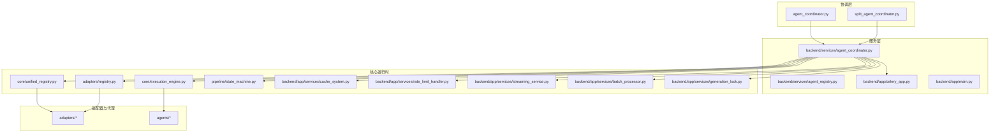
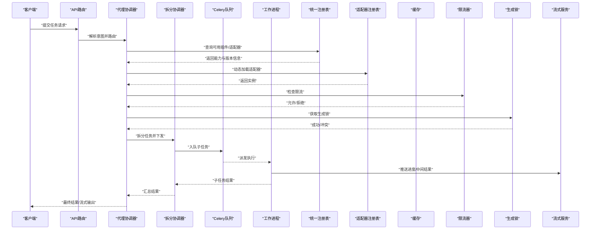
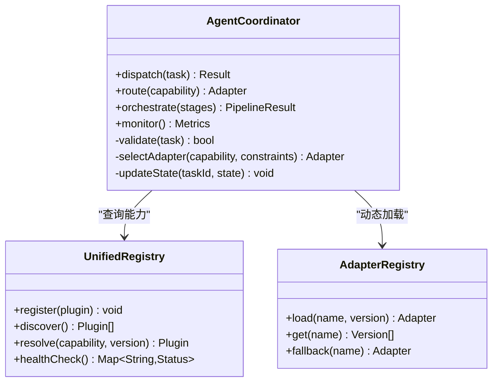
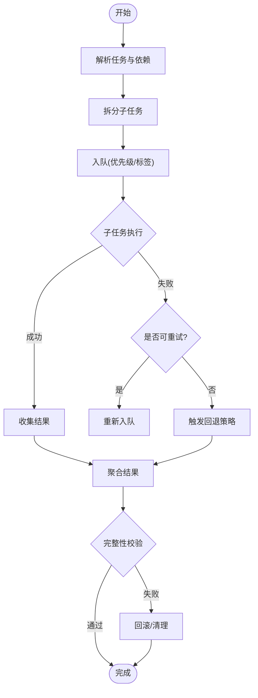
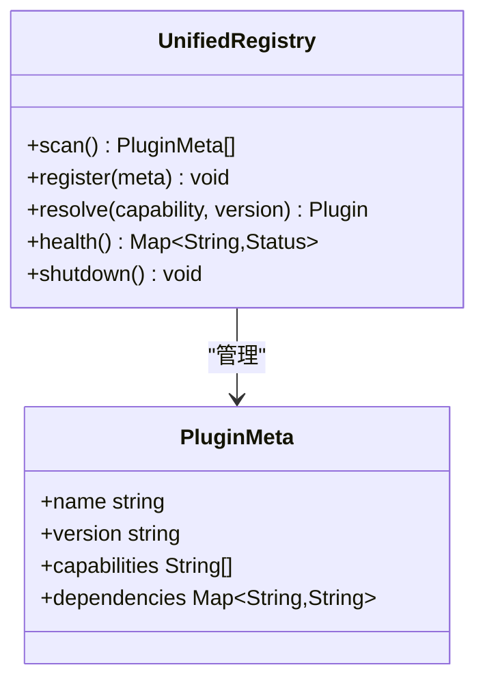
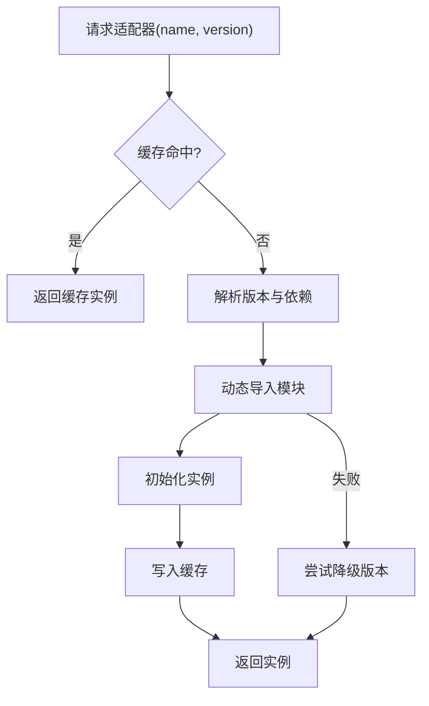
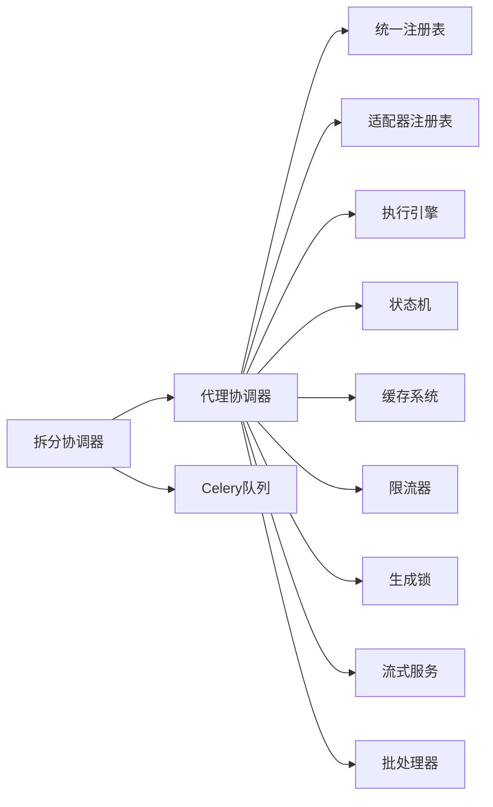

# 代理协调系统

<cite>
**本文引用的文件**   
- [agent_coordinator.py](file://agent_coordinator.py)
- [split_agent_coordinator.py](file://split_agent_coordinator.py)
- [unified_registry.py](file://core/unified_registry.py)
- [registry.py](file://adapters/registry.py)
- [backend/services/agent_coordinator.py](file://backend/services/agent_coordinator.py)
- [backend/services/agent_registry.py](file://backend/services/agent_registry.py)
- [backend/app/celery_app.py](file://backend/app/celery_app.py)
- [backend/app/main.py](file://backend/app/main.py)
- [backend/app/api/v1/workflow/routes.py](file://backend/app/api/v1/workflow/routes.py)
- [backend/app/api/v1/smart_dispatch.py](file://backend/app/api/v1/smart_dispatch.py)
- [backend/app/services/streaming_service.py](file://backend/app/services/streaming_service.py)
- [backend/app/services/batch_processor.py](file://backend/app/services/batch_processor.py)
- [backend/app/services/cache_system.py](file://backend/app/services/cache_system.py)
- [backend/app/services/rate_limit_handler.py](file://backend/app/services/rate_limit_handler.py)
- [backend/app/services/generation_lock.py](file://backend/app/services/generation_lock.py)
- [backend/app/services/model_catalog_runtime.py](file://core/model_catalog_runtime.py)
- [backend/app/services/model_resolution.py](file://core/model_resolution.py)
- [backend/app/services/model_runtime.py](file://core/model_runtime.py)
- [backend/app/services/unified_llm_client.py](file://core/unified_llm_client.py)
- [backend/app/services/unified_media_runtime.py](file://core/unified_media_runtime.py)
- [backend/app/services/llm_adapters.py](file://core/llm_adapters.py)
- [backend/app/services/task_parser.py](file://core/task_parser.py)
- [backend/app/services/intent_parser.py](file://core/intent_parser.py)
- [backend/app/services/router.py](file://core/router.py)
- [backend/app/services/execution_engine.py](file://core/execution_engine.py)
- [backend/app/services/fallback_manager.py](file://core/fallback_manager.py)
- [backend/app/services/state_machine.py](file://pipeline/state_machine.py)
- [backend/app/services/pipeline/artifacts_io.py](file://pipeline/artifacts_io.py)
- [backend/app/services/pipeline/autoqc.py](file://pipeline/autoqc.py)
- [backend/app/services/pipeline/step_budget.py](file://pipeline/step_budget.py)
- [backend/app/services/pipeline/style_presets.py](file://pipeline/style_presets.py)
- [backend/app/services/pipeline/media_presets.py](file://pipeline/media_presets.py)
- [backend/app/services/pipeline/restart_reset.py](file://pipeline/restart_reset.py)
- [backend/app/services/pipeline/smart_tuning.py](file://pipeline/smart_tuning.py)
- [backend/app/services/pipeline/ffmpeg_runner.py](file://pipeline/ffmpeg_runner.py)
- [backend/app/services/pipeline/dreamweaver_smart_dispatch_trace.py](file://pipeline/dreamweaver_smart_dispatch_trace.py)
- [backend/app/services/pipeline/_run.py](file://agents/dreamweaver_agent_pkg/_run.py)
- [backend/app/services/pipeline/_write_video.py](file://agents/dreamweaver_agent_pkg/_write_video.py)
- [backend/app/services/pipeline/_t2v_gen.py](file://agents/dreamweaver_agent_pkg/_t2v_gen.py)
- [backend/app/services/pipeline/_i2v_gen.py](file://agents/dreamweaver_agent_pkg/_i2v_gen.py)
- [backend/app/services/pipeline/_slideshow.py](file://agents/dreamweaver_agent_pkg/_slideshow.py)
- [backend/app/services/pipeline/_kling_omni.py](file://agents/dreamweaver_agent_pkg/_kling_omni.py)
- [backend/app/services/pipeline/_video_prompts.py](file://agents/dreamweaver_agent_pkg/_video_prompts.py)
- [backend/app/services/pipeline/_utils.py](file://agents/dreamweaver_agent_pkg/_utils.py)
- [backend/app/services/pipeline/_ensure_prompts.py](file://agents/dreamweaver_agent_pkg/_ensure_prompts.py)
- [backend/app/services/pipeline/_audio_sync.py](file://agents/storyboarder_pkg/_audio_sync.py)
- [backend/app/services/pipeline/_duration.py](file://agents/storyboarder_pkg/_duration.py)
- [backend/app/services/pipeline/_entities.py](file://agents/storyboarder_pkg/_entities.py)
- [backend/app/services/pipeline/_env_helpers.py](file://agents/storyboarder_pkg/_env_helpers.py)
- [backend/app/services/pipeline/_frame_prompt.py](file://agents/storyboarder_pkg/_frame_prompt.py)
- [backend/app/services/pipeline/_prompts.py](file://agents/storyboarder_pkg/_prompts.py)
- [backend/app/services/pipeline/_run.py](file://agents/storyboarder_pkg/_run.py)
- [backend/app/services/pipeline/_shot_profile.py](file://agents/storyboarder_pkg/_shot_profile.py)
- [backend/app/services/pipeline/_storyboard_builders.py](file://agents/storyboarder_pkg/_storyboard_builders.py)
- [backend/app/services/pipeline/_variation.py](file://agents/storyboarder_pkg/_variation.py)
- [backend/app/services/pipeline/_video_subshots.py](file://agents/storyboarder_pkg/_video_subshots.py)
- [backend/app/services/pipeline/_edit_pipeline.py](file://agents/painter_pkg/_edit_pipeline.py)
- [backend/app/services/pipeline/_keyframes.py](file://agents/painter_pkg/_keyframes.py)
- [backend/app/services/pipeline/_library.py](file://agents/painter_pkg/_library.py)
- [backend/app/services/pipeline/_midframes.py](file://agents/painter_pkg/_midframes.py)
- [backend/app/services/pipeline/_t2i_pipeline.py](file://agents/painter_pkg/_t2i_pipeline.py)
- [backend/app/services/pipeline/_utils.py](file://agents/painter_pkg/_utils.py)
- [backend/app/services/pipeline/asset_library.py](file://agents/asset_library.py)
- [backend/app/services/pipeline/audio_sync_manager.py](file://agents/audio_sync_manager.py)
- [backend/app/services/pipeline/auditor.py](file://agents/auditor.py)
- [backend/app/services/pipeline/best_image_selector.py](file://agents/best_image_selector.py)
- [backend/app/services/pipeline/camera_states.py](file://agents/camera_states.py)
- [backend/app/services/pipeline/camera_tree.py](file://agents/camera_tree.py)
- [backend/app/services/pipeline/character_manager.py](file://agents/character_manager.py)
- [backend/app/services/pipeline/cross_batch_audio_manager.py](file://agents/cross_batch_audio_manager.py)
- [backend/app/services/pipeline/dreamweaver.py](file://agents/dreamweaver.py)
- [backend/app/services/pipeline/editor.py](file://agents/editor.py)
- [backend/app/services/pipeline/high_performance_voice_consistency_manager.py](file://agents/high_performance_voice_consistency_manager.py)
- [backend/app/services/pipeline/image_edit_utils.py](file://agents/image_edit_utils.py)
- [backend/app/services/pipeline/lipsync_manager.py](file://agents/lipsync_manager.py)
- [backend/app/services/pipeline/llm_client.py](file://agents/llm_client.py)
- [backend/app/services/pipeline/optimized_audio_sync_manager.py](file://agents/optimized_audio_sync_manager.py)
- [backend/app/services/pipeline/painter.py](file://agents/painter.py)
- [backend/app/services/pipeline/performance_audio_sync_manager.py](file://agents/performance_audio_sync_manager.py)
- [backend/app/services/pipeline/performance_voice_consistency_manager.py](file://agents/performance_voice_consistency_manager.py)
- [backend/app/services/pipeline/planner.py](file://agents/planner.py)
- [backend/app/services/pipeline/prompt_fragments.py](file://agents/prompt_fragments.py)
- [backend/app/services/pipeline/reference_image_selector.py](file://agents/reference_image_selector.py)
- [backend/app/services/pipeline/scripter.py](file://agents/scripter.py)
- [backend/app/services/pipeline/semantic_asset_index.py](file://agents/semantic_asset_index.py)
- [backend/app/services/pipeline/simple_audio_sync_manager.py](file://agents/simple_audio_sync_manager.py)
- [backend/app/services/pipeline/simple_character_manager.py](file://agents/simple_character管理器.py)
- [backend/app/services/pipeline/simple_voice_consistency_manager.py](file://agents/simple_voice_consistency_manager.py)
- [backend/app/services/pipeline/sound_effect_manager.py](file://agents/sound_effect_manager.py)
- [backend/app/services/pipeline/storyboarder.py](file://agents/storyboarder.py)
- [backend/app/services/pipeline/vlm_utils.py](file://agents/vlm_utils.py)
- [backend/app/services/pipeline/voice_consistency_manager.py](file://agents/voice_consistency_manager.py)
- [backend/app/services/pipeline/adapters/base.py](file://adapters/base.py)
- [backend/app/services/pipeline/adapters/adapter_helpers.py](file://adapters/adapter_helpers.py)
- [backend/app/services/pipeline/adapters/content_safety_checker.py](file://adapters/content_safety_checker.py)
- [backend/app/services/pipeline/adapters/legacy_bridge.py](file://adapters/legacy_bridge.py)
- [backend/app/services/pipeline/adapters/legacy_runtime_wrappers.py](file://adapters/legacy_runtime_wrappers.py)
- [backend/app/services/pipeline/adapters/model_adapters.py](file://adapters/model_adapters.py)
- [backend/app/services/pipeline/adapters/new_models_adapters.py](file://adapters/new_models_adapters.py)
- [backend/app/services/pipeline/adapters/prompt_optimizer.py](file://adapters/prompt_optimizer.py)
- [backend/app/services/pipeline/adapters/qwen_multimodal_adapter.py](file://adapters/qwen_multimodal_adapter.py)
- [backend/app/services/pipeline/adapters/rate_limiter.py](file://adapters/rate_limiter.py)
- [backend/app/services/pipeline/adapters/wan26_video_adapter.py](file://adapters/wan26_video_adapter.py)
- [backend/app/services/pipeline/adapters/wanx_adapter.py](file://adapters/wanx_adapter.py)
- [backend/app/services/pipeline/adapters/dashscope/chat.py](file://adapters/dashscope/chat.py)
- [backend/app/services/pipeline/adapters/dashscope/image_async.py](file://adapters/dashscope/image_async.py)
- [backend/app/services/pipeline/adapters/dashscope/image_edit.py](file://adapters/dashscope/image_edit.py)
- [backend/app/services/pipeline/adapters/dashscope/image_sync.py](file://adapters/dashscope/image_sync.py)
- [backend/app/services/pipeline/adapters/dashscope/multimodal.py](file://adapters/dashscope/multimodal.py)
- [backend/app/services/pipeline/adapters/dashscope/tts.py](file://adapters/dashscope/tts.py)
- [backend/app/services/pipeline/adapters/dashscope/video_i2v.py](file://adapters/dashscope/video_i2v.py)
- [backend/app/services/pipeline/adapters/dashscope/video_kling.py](file://adapters/dashscope/video_kling.py)
- [backend/app/services/pipeline/adapters/dashscope/video_t2v.py](file://adapters/dashscope/video_t2v.py)
- [backend/app/services/pipeline/adapters/mimo/tts.py](file://adapters/mimo/tts.py)
- [backend/app/services/pipeline/adapters/mock/image.py](file://adapters/mock/image.py)
- [backend/app/services/pipeline/adapters/mock/llm.py](file://adapters/mock/llm.py)
- [backend/app/services/pipeline/adapters/mock/review.py](file://adapters/mock/review.py)
- [backend/app/services/pipeline/adapters/mock/video.py](file://adapters/mock/video.py)
- [backend/app/services/pipeline/adapters/mureka/instrumental.py](file://adapters/mureka/instrumental.py)
- [backend/app/services/pipeline/adapters/vidu_platform/timing2audio.py](file://adapters/vidu_platform/timing2audio.py)
- [backend/app/services/pipeline/adapters/vidu_platform/video.py](file://adapters/vidu_platform/video.py)
- [backend/app/services/pipeline/adapters/volcengine/audio_generation.py](file://adapters/volcengine/audio_generation.py)
- [backend/app/services/pipeline/adapters/volcengine/chat.py](file://adapters/volcengine/chat.py)
- [backend/app/services/pipeline/adapters/volcengine/image.py](file://adapters/volcengine/image.py)
- [backend/app/services/pipeline/adapters/volcengine/tts.py](file://adapters/volcengine/tts.py)
- [backend/app/services/pipeline/adapters/volcengine/video.py](file://adapters/volcengine/video.py)
- [backend/app/services/pipeline/adapters/_shared.py](file://adapters/_shared.py)
</cite>

## 目录
1. [简介](#简介)
2. [项目结构](#项目结构)
3. [核心组件](#核心组件)
4. [架构总览](#架构总览)
5. [详细组件分析](#详细组件分析)
6. [依赖关系分析](#依赖关系分析)
7. [性能考量](#性能考量)
8. [故障排查指南](#故障排查指南)
9. [结论](#结论)
10. [附录](#附录)

## 简介
本技术文档围绕“代理协调系统”展开，聚焦以下关键目标：
- 代理协调器（agent_coordinator.py）的任务分发、负载均衡与状态管理
- 拆分协调器（split_agent_coordinator.py）的分布式处理架构
- 统一注册表（unified_registry.py）的插件发现与生命周期管理
- 适配器注册表（registry.py）的动态加载与版本控制
- 代理间通信协议、消息传递机制与错误恢复策略
- 编排多个代理完成复杂任务的使用示例、配置选项与监控方法
- 扩展开发指导与性能优化建议

本系统以“协调器 + 注册表 + 适配器”为核心范式，结合 Celery 异步任务、流式输出、缓存与限流等基础设施，支撑多模态内容生成（文本、图像、视频、音频）与复杂工作流编排。

## 项目结构
- 顶层协调器与拆分协调器位于仓库根目录，便于独立运行与测试
- 后端服务位于 backend/app 下，包含 API、Celery 应用、服务层与数据库模型
- 核心运行时与通用能力位于 core 与 pipeline 目录，提供模型解析、执行引擎、状态机、媒体与 LLM 抽象
- 适配器体系位于 adapters 目录，按厂商与能力划分，集中实现动态注册与版本控制
- agents 目录包含具体业务代理（如 DreamWeaver、Storyboarder、Painter 等），通过协调器编排协作

图表来源
- [agent_coordinator.py](file://agent_coordinator.py)
- [split_agent_coordinator.py](file://split_agent_coordinator.py)
- [backend/services/agent_coordinator.py](file://backend/services/agent_coordinator.py)
- [backend/app/celery_app.py](file://backend/app/celery_app.py)
- [core/unified_registry.py](file://core/unified_registry.py)
- [adapters/registry.py](file://adapters/registry.py)
- [core/execution_engine.py](file://core/execution_engine.py)
- [pipeline/state_machine.py](file://pipeline/state_machine.py)
- [backend/app/services/cache_system.py](file://backend/app/services/cache_system.py)
- [backend/app/services/rate_limit_handler.py](file://backend/app/services/rate_limit_handler.py)
- [backend/app/services/streaming_service.py](file://backend/app/services/streaming_service.py)
- [backend/app/services/batch_processor.py](file://backend/app/services/batch_processor.py)
- [backend/app/services/generation_lock.py](file://backend/app/services/generation_lock.py)

章节来源
- [agent_coordinator.py](file://agent_coordinator.py)
- [split_agent_coordinator.py](file://split_agent_coordinator.py)
- [backend/services/agent_coordinator.py](file://backend/services/agent_coordinator.py)
- [backend/app/celery_app.py](file://backend/app/celery_app.py)
- [backend/app/main.py](file://backend/app/main.py)

## 核心组件
- 代理协调器（agent_coordinator.py）
  - 负责接收上层请求，解析任务意图，选择并调度合适的代理或子流程
  - 维护任务状态机，支持重试、回退与结果聚合
  - 集成限流、缓存、锁与批处理，保障高并发下的稳定性
- 拆分协调器（split_agent_coordinator.py）
  - 将大任务拆分为可并行执行的子任务，跨节点/进程分发
  - 基于 Celery 队列进行任务路由与负载均衡
  - 汇总子任务结果，处理部分失败与补偿逻辑
- 统一注册表（unified_registry.py）
  - 统一管理插件与适配器的发现、注册、生命周期与版本约束
  - 提供能力查询、兼容性校验与热更新支持
- 适配器注册表（registry.py）
  - 动态加载各厂商适配器，支持版本选择与降级
  - 暴露标准化接口，屏蔽底层差异

章节来源
- [agent_coordinator.py](file://agent_coordinator.py)
- [split_agent_coordinator.py](file://split_agent_coordinator.py)
- [core/unified_registry.py](file://core/unified_registry.py)
- [adapters/registry.py](file://adapters/registry.py)

## 架构总览
系统采用分层架构：
- 接入层：API 路由与 WebSocket/SSE 流式响应
- 协调层：代理协调器与拆分协调器，负责任务编排与分布式执行
- 运行时层：执行引擎、状态机、缓存、限流、锁、批处理
- 适配层：统一注册表与适配器注册表，屏蔽多厂商差异
- 数据层：数据库、对象存储、向量索引等

图表来源
- [backend/app/api/v1/workflow/routes.py](file://backend/app/api/v1/workflow/routes.py)
- [backend/app/api/v1/smart_dispatch.py](file://backend/app/api/v1/smart_dispatch.py)
- [agent_coordinator.py](file://agent_coordinator.py)
- [split_agent_coordinator.py](file://split_agent_coordinator.py)
- [backend/app/celery_app.py](file://backend/app/celery_app.py)
- [core/unified_registry.py](file://core/unified_registry.py)
- [adapters/registry.py](file://adapters/registry.py)
- [backend/app/services/cache_system.py](file://backend/app/services/cache_system.py)
- [backend/app/services/rate_limit_handler.py](file://backend/app/services/rate_limit_handler.py)
- [backend/app/services/generation_lock.py](file://backend/app/services/generation_lock.py)
- [backend/app/services/streaming_service.py](file://backend/app/services/streaming_service.py)

## 详细组件分析

### 代理协调器（agent_coordinator.py）
- 任务分发
  - 解析请求体与上下文，识别任务类型与所需能力
  - 根据统一注册表的能力矩阵选择最优代理/适配器
  - 支持多阶段流水线编排，串联多个代理
- 负载均衡
  - 基于适配器健康度、负载指标与历史成功率进行权重分配
  - 结合限流与熔断策略，避免雪崩
- 状态管理
  - 使用状态机跟踪任务生命周期：创建、执行、等待、完成、失败、回滚
  - 持久化关键状态，支持断点续跑与审计追踪

图表来源
- [agent_coordinator.py](file://agent_coordinator.py)
- [core/unified_registry.py](file://core/unified_registry.py)
- [adapters/registry.py](file://adapters/registry.py)

章节来源
- [agent_coordinator.py](file://agent_coordinator.py)
- [backend/services/agent_coordinator.py](file://backend/services/agent_coordinator.py)

### 拆分协调器（split_agent_coordinator.py）
- 分布式处理架构
  - 将复杂任务切分为原子子任务，按依赖关系构建 DAG
  - 通过 Celery 队列进行跨进程/节点分发，支持优先级与重试
- 结果聚合与容错
  - 收集子任务结果，处理部分失败的重试与补偿
  - 支持超时控制与资源回收

图表来源
- [split_agent_coordinator.py](file://split_agent_coordinator.py)
- [backend/app/celery_app.py](file://backend/app/celery_app.py)
- [backend/app/services/batch_processor.py](file://backend/app/services/batch_processor.py)

章节来源
- [split_agent_coordinator.py](file://split_agent_coordinator.py)
- [backend/app/celery_app.py](file://backend/app/celery_app.py)

### 统一注册表（unified_registry.py）
- 插件发现与生命周期
  - 扫描已安装插件，自动注册能力元数据
  - 支持启动预热、运行时健康检查与优雅下线
- 版本管理与兼容性
  - 记录插件版本与依赖，提供语义化版本匹配
  - 在冲突时提供降级路径

图表来源
- [core/unified_registry.py](file://core/unified_registry.py)

章节来源
- [core/unified_registry.py](file://core/unified_registry.py)

### 适配器注册表（registry.py）
- 动态加载与版本控制
  - 按名称与版本加载适配器实例，支持热插拔
  - 内置版本选择策略（最新稳定、兼容模式、强制指定）
- 降级与回退
  - 当主适配器不可用时，自动切换至备用实现

图表来源
- [adapters/registry.py](file://adapters/registry.py)

章节来源
- [adapters/registry.py](file://adapters/registry.py)

### 代理间通信协议与消息传递
- 协议设计
  - 统一消息格式：包含任务ID、类型、载荷、上下文与追踪ID
  - 支持同步调用与异步事件两种模式
- 传输机制
  - 内部使用内存队列/Celery；外部通过 HTTP/WebSocket/SSE
  - 流式输出用于长耗时任务的进度反馈
- 错误恢复
  - 幂等性保证与去重键
  - 重试策略（指数退避、最大次数、死信队列）
  - 补偿事务与状态回滚

章节来源
- [backend/app/services/streaming_service.py](file://backend/app/services/streaming_service.py)
- [backend/app/celery_app.py](file://backend/app/celery_app.py)
- [backend/app/services/batch_processor.py](file://backend/app/services/batch_processor.py)

### 编排示例：多代理协作完成视频生成
- 典型流程
  - 脚本生成 → 分镜规划 → 图像/视频素材生成 → 音画同步 → 后期质检 → 成品输出
- 协调方式
  - 协调器按阶段编排代理，拆分协调器并行执行可并行的子任务
  - 统一注册表确保各阶段使用正确的适配器与版本
- 监控与调优
  - 通过流式服务实时查看进度
  - 利用缓存与批处理提升吞吐
  - 限流与锁防止资源竞争

章节来源
- [backend/app/api/v1/workflow/routes.py](file://backend/app/api/v1/workflow/routes.py)
- [backend/app/api/v1/smart_dispatch.py](file://backend/app/api/v1/smart_dispatch.py)
- [agents/dreamweaver_agent_pkg/_run.py](file://agents/dreamweaver_agent_pkg/_run.py)
- [agents/storyboarder_pkg/_run.py](file://agents/storyboarder_pkg/_run.py)
- [agents/painter_pkg/_edit_pipeline.py](file://agents/painter_pkg/_edit_pipeline.py)

## 依赖关系分析
- 协调器依赖统一注册表与适配器注册表，解耦具体实现
- 拆分协调器依赖 Celery 队列与工作进程，实现分布式执行
- 运行时组件（缓存、限流、锁、批处理）为协调器提供横切能力
- 适配器层屏蔽多厂商差异，向上提供统一接口

图表来源
- [agent_coordinator.py](file://agent_coordinator.py)
- [split_agent_coordinator.py](file://split_agent_coordinator.py)
- [core/unified_registry.py](file://core/unified_registry.py)
- [adapters/registry.py](file://adapters/registry.py)
- [core/execution_engine.py](file://core/execution_engine.py)
- [pipeline/state_machine.py](file://pipeline/state_machine.py)
- [backend/app/services/cache_system.py](file://backend/app/services/cache_system.py)
- [backend/app/services/rate_limit_handler.py](file://backend/app/services/rate_limit_handler.py)
- [backend/app/services/generation_lock.py](file://backend/app/services/generation_lock.py)
- [backend/app/services/streaming_service.py](file://backend/app/services/streaming_service.py)
- [backend/app/services/batch_processor.py](file://backend/app/services/batch_processor.py)
- [backend/app/celery_app.py](file://backend/app/celery_app.py)

章节来源
- [agent_coordinator.py](file://agent_coordinator.py)
- [split_agent_coordinator.py](file://split_agent_coordinator.py)
- [core/unified_registry.py](file://core/unified_registry.py)
- [adapters/registry.py](file://adapters/registry.py)
- [backend/app/celery_app.py](file://backend/app/celery_app.py)

## 性能考量
- 缓存策略
  - 对高频查询（模型目录、适配器元数据）启用本地与分布式缓存
  - 合理设置过期时间与一致性策略
- 批处理与并行
  - 将小任务合并批量执行，减少上下文切换开销
  - 利用拆分协调器并行执行无依赖子任务
- 限流与背压
  - 针对外部 API 与内部热点资源实施限流
  - 在高负载时主动降级非关键路径
- 锁与并发控制
  - 使用细粒度锁避免重复计算与资源竞争
  - 支持读写分离与乐观锁
- 流式输出
  - 长耗时任务采用流式返回，降低首字节延迟
  - 前端增量渲染提升用户体验

章节来源
- [backend/app/services/cache_system.py](file://backend/app/services/cache_system.py)
- [backend/app/services/batch_processor.py](file://backend/app/services/batch_processor.py)
- [backend/app/services/rate_limit_handler.py](file://backend/app/services/rate_limit_handler.py)
- [backend/app/services/generation_lock.py](file://backend/app/services/generation_lock.py)
- [backend/app/services/streaming_service.py](file://backend/app/services/streaming_service.py)

## 故障排查指南
- 常见问题定位
  - 适配器加载失败：检查版本兼容性与依赖缺失
  - 任务超时：调整队列优先级与超时阈值
  - 状态不一致：核对状态机转换与持久化日志
- 诊断工具
  - 启用详细日志与追踪 ID，关联上下游调用链
  - 使用健康检查接口观察适配器与队列状态
- 恢复策略
  - 自动重试与手动重试入口
  - 死信队列与人工干预流程
  - 快照回滚与数据修复脚本

章节来源
- [backend/app/celery_app.py](file://backend/app/celery_app.py)
- [pipeline/state_machine.py](file://pipeline/state_machine.py)
- [adapters/registry.py](file://adapters/registry.py)
- [core/unified_registry.py](file://core/unified_registry.py)

## 结论
代理协调系统通过“协调器 + 注册表 + 适配器”的分层架构，实现了高内聚、低耦合的可扩展平台。统一注册表与适配器注册表屏蔽了多厂商差异，拆分协调器与 Celery 提供了强大的分布式处理能力。配合缓存、限流、锁与流式输出，系统在性能与稳定性上具备良好表现。未来可进一步引入更智能的路由策略、自适应负载均衡与端到端可观测性增强。

## 附录
- 配置选项
  - 队列与并发：worker 数量、队列名称、优先级策略
  - 缓存：后端类型、TTL、一致性级别
  - 限流：全局与按租户配额、突发限制
  - 锁：粒度、超时、重试策略
- 监控方法
  - 指标采集：QPS、延迟、错误率、队列长度
  - 日志聚合：结构化日志与链路追踪
  - 告警规则：阈值与通知渠道
- 扩展开发指导
  - 新增适配器：实现标准接口，注册到适配器注册表
  - 新增插件：声明能力元数据，纳入统一注册表
  - 自定义编排：扩展协调器阶段与路由策略