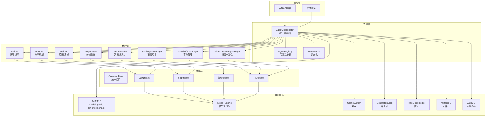
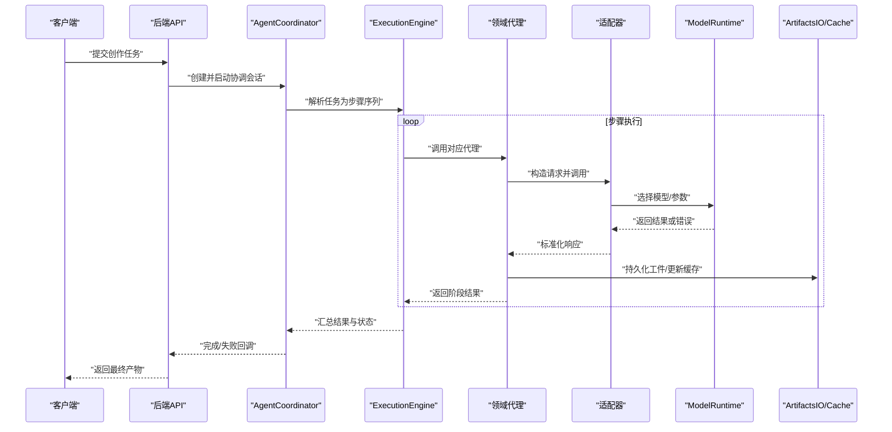
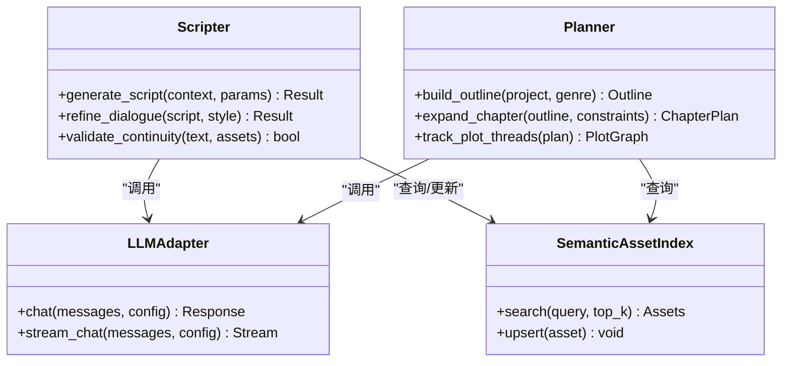
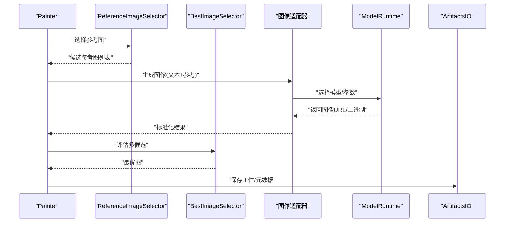
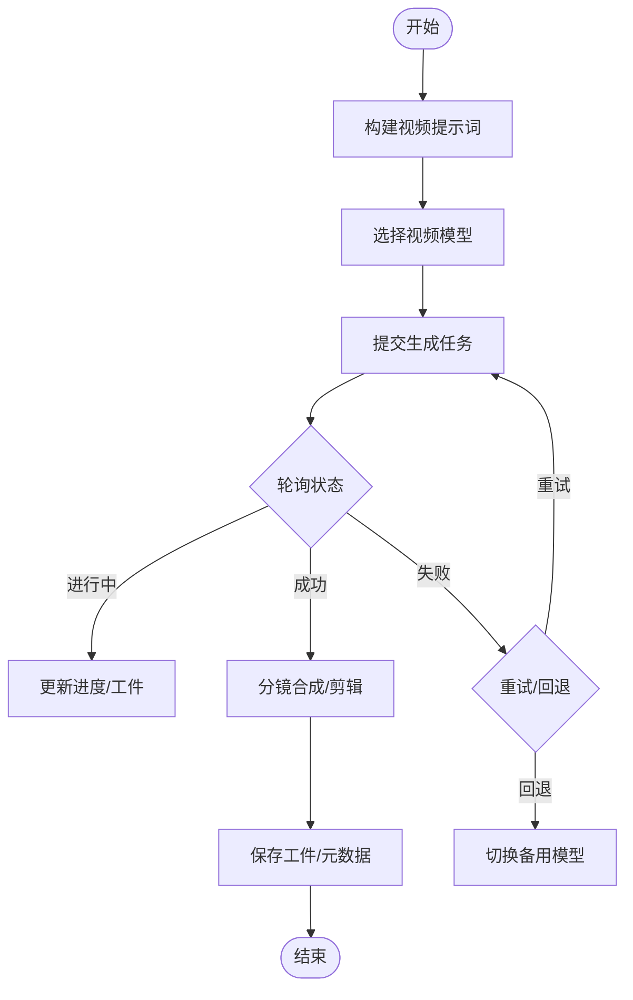
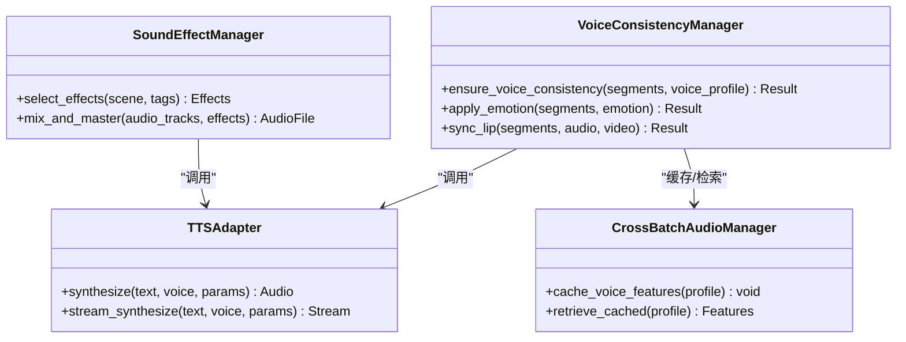
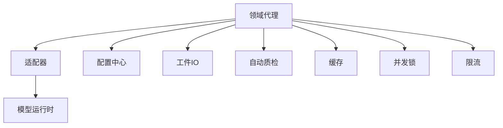

# 代理系统

<cite>
**本文引用的文件**   
- [agents/__init__.py](file://agents/__init__.py)
- [agent_coordinator.py](file://agent_coordinator.py)
- [split_agent_coordinator.py](file://split_agent_coordinator.py)
- [core/execution_engine.py](file://core/execution_engine.py)
- [core/unified_registry.py](file://core/unified_registry.py)
- [adapters/base.py](file://adapters/base.py)
- [adapters/registry.py](file://adapters/registry.py)
- [adapters/model_adapters.py](file://adapters/model_adapters.py)
- [adapters/new_models_adapters.py](file://adapters/new_models_adapters.py)
- [adapters/qwen_multimodal_adapter.py](file://adapters/qwen_multimodal_adapter.py)
- [adapters/wanx_adapter.py](file://adapters/wanx_adapter.py)
- [adapters/wan26_video_adapter.py](file://adapters/wan26_video_adapter.py)
- [adapters/dashscope/video_t2v.py](file://adapters/dashscope/video_t2v.py)
- [adapters/dashscope/video_i2v.py](file://adapters/dashscope/video_i2v.py)
- [adapters/volcengine/video.py](file://adapters/volcengine/video.py)
- [adapters/mimo/tts.py](file://adapters/mimo/tts.py)
- [adapters/volcengine/tts.py](file://adapters/volcengine/tts.py)
- [adapters/dashscope/tts.py](file://adapters/dashscope/tts.py)
- [adapters/content_safety_checker.py](file://adapters/content_safety_checker.py)
- [adapters/rate_limiter.py](file://adapters/rate_limiter.py)
- [adapters/_shared.py](file://adapters/_shared.py)
- [adapters/adapter_helpers.py](file://adapters/adapter_helpers.py)
- [adapters/prompt_optimizer.py](file://adapters/prompt_optimizer.py)
- [agents/scripter.py](file://agents/scripter.py)
- [agents/planner.py](file://agents/planner.py)
- [agents/painter.py](file://agents/painter.py)
- [agents/dreamweaver.py](file://agents/dreamweaver.py)
- [agents/storyboarder.py](file://agents/storyboarder.py)
- [agents/audio_sync_manager.py](file://agents/audio_sync_manager.py)
- [agents/sound_effect_manager.py](file://agents/sound_effect_manager.py)
- [agents/voice_consistency_manager.py](file://agents/voice_consistency_manager.py)
- [agents/high_performance_voice_consistency_manager.py](file://agents/high_performance_voice_consistency_manager.py)
- [agents/performance_voice_consistency_manager.py](file://agents/performance_voice_consistency_manager.py)
- [agents/simple_voice_consistency_manager.py](file://agents/simple_voice_consistency_manager.py)
- [agents/lipsync_manager.py](file://agents/lipsync_manager.py)
- [agents/cross_batch_audio_manager.py](file://agents/cross_batch_audio_manager.py)
- [agents/optimized_audio_sync_manager.py](file://agents/optimized_audio_sync_manager.py)
- [agents/performance_audio_sync_manager.py](file://agents/performance_audio_sync_manager.py)
- [agents/simple_audio_sync_manager.py](file://agents/simple_audio_sync_manager.py)
- [agents/asset_library.py](file://agents/asset_library.py)
- [agents/character_manager.py](file://agents/character_manager.py)
- [agents/simple_character_manager.py](file://agents/simple_character_manager.py)
- [agents/reference_image_selector.py](file://agents/reference_image_selector.py)
- [agents/best_image_selector.py](file://agents/best_image_selector.py)
- [agents/camera_states.py](file://agents/camera_states.py)
- [agents/camera_tree.py](file://agents/camera_tree.py)
- [agents/editor.py](file://agents/editor.py)
- [agents/image_edit_utils.py](file://agents/image_edit_utils.py)
- [agents/llm_client.py](file://agents/llm_client.py)
- [agents/prompt_fragments.py](file://agents/prompt_fragments.py)
- [agents/semantic_asset_index.py](file://agents/semantic_asset_index.py)
- [agents/vlm_utils.py](file://agents/vlm_utils.py)
- [backend/app/services/agent_coordinator.py](file://backend/app/services/agent_coordinator.py)
- [backend/app/services/agent_registry.py](file://backend/app/services/agent_registry.py)
- [backend/app/services/streaming_service.py](file://backend/app/services/streaming_service.py)
- [backend/app/services/cache_system.py](file://backend/app/services/cache_system.py)
- [backend/app/services/batch_processor.py](file://backend/app/services/batch_processor.py)
- [backend/app/services/generation_lock.py](file://backend/app/services/generation_lock.py)
- [backend/app/services/rate_limit_handler.py](file://backend/app/services/rate_limit_handler.py)
- [backend/app/services/workflow_context_builder.py](file://backend/app/services/workflow_context_builder.py)
- [schemas/common.py](file://schemas/common.py)
- [schemas/task_spec.py](file://schemas/task_spec.py)
- [schemas/model_spec.py](file://schemas/model_spec.py)
- [schemas/unified_model_spec.py](file://schemas/unified_model_spec.py)
- [pipeline/state_machine.py](file://pipeline/state_machine.py)
- [pipeline/artifacts_io.py](file://pipeline/artifacts_io.py)
- [pipeline/media_presets.py](file://pipeline/media_presets.py)
- [pipeline/autoqc.py](file://pipeline/autoqc.py)
- [core/config.py](file://core/config.py)
- [core/model_runtime.py](file://core/model_runtime.py)
- [core/model_resolution.py](file://core/model_resolution.py)
- [core/unified_llm_client.py](file://core/unified_llm_client.py)
- [core/unified_media_runtime.py](file://core/unified_media_runtime.py)
- [core/fallback_manager.py](file://core/fallback_manager.py)
- [core/logging_config.py](file://core/logging_config.py)
- [config/models.yaml](file://config/models.yaml)
- [config/llm_models.yaml](file://config/llm_models.yaml)
- [config/intent_domains.yaml](file://config/intent_domains.yaml)
</cite>

## 目录
1. [简介](#简介)
2. [项目结构](#项目结构)
3. [核心组件](#核心组件)
4. [架构总览](#架构总览)
5. [详细组件分析](#详细组件分析)
6. [依赖关系分析](#依赖关系分析)
7. [性能考量](#性能考量)
8. [故障排查指南](#故障排查指南)
9. [结论](#结论)
10. [附录](#附录)

## 简介
本技术文档面向小说创作代理系统的“代理模块”，系统性梳理文本创作、视觉生成、视频生成与音频处理等四类专业代理的设计与实现，覆盖生命周期管理、通信机制、协作模式、配置选项、参数调优与性能优化，并提供使用示例、错误处理与调试技巧。同时说明代理间依赖关系与数据交换格式，给出自定义代理开发的指导原则与最佳实践。

## 项目结构
代理模块围绕“统一注册与调度”、“适配器抽象”、“领域代理”和“流水线编排”四大层次组织：
- 统一注册与调度：提供代理与模型的统一注册、解析与运行时选择能力
- 适配器抽象：屏蔽多厂商（文本、图像、视频、TTS）差异，暴露一致接口
- 领域代理：脚本编写、故事规划、绘画/编辑、梦境编织者、分镜制作、语音一致性、音效管理等
- 流水线编排：状态机、工件IO、媒体预设、自动质检等

图表来源
- [agent_coordinator.py:1-200](file://agent_coordinator.py#L1-L200)
- [backend/app/services/agent_coordinator.py:1-200](file://backend/app/services/agent_coordinator.py#L1-L200)
- [core/execution_engine.py:1-200](file://core/execution_engine.py#L1-L200)
- [adapters/base.py:1-200](file://adapters/base.py#L1-L200)
- [adapters/registry.py:1-200](file://adapters/registry.py#L1-L200)
- [pipeline/state_machine.py:1-200](file://pipeline/state_machine.py#L1-L200)
- [pipeline/artifacts_io.py:1-200](file://pipeline/artifacts_io.py#L1-L200)
- [core/config.py:1-200](file://core/config.py#L1-L200)

章节来源
- [agent_coordinator.py:1-200](file://agent_coordinator.py#L1-L200)
- [backend/app/services/agent_coordinator.py:1-200](file://backend/app/services/agent_coordinator.py#L1-L200)
- [core/execution_engine.py:1-200](file://core/execution_engine.py#L1-L200)
- [adapters/base.py:1-200](file://adapters/base.py#L1-L200)
- [adapters/registry.py:1-200](file://adapters/registry.py#L1-L200)
- [pipeline/state_machine.py:1-200](file://pipeline/state_machine.py#L1-L200)
- [pipeline/artifacts_io.py:1-200](file://pipeline/artifacts_io.py#L1-L200)
- [core/config.py:1-200](file://core/config.py#L1-L200)

## 核心组件
- 统一协调器（AgentCoordinator）：负责代理的注册、发现、生命周期管理与任务编排；对接状态机、工件IO、缓存、锁与限流
- 代理注册表（AgentRegistry）：维护代理名称到实现的映射，支持版本与能力声明
- 执行引擎（ExecutionEngine）：将高层任务解析为可执行的步骤序列，驱动各代理按阶段执行
- 适配器基类与注册表：定义统一的文本/图像/视频/TTS调用契约，屏蔽底层厂商差异
- 领域代理：脚本编写、故事规划、绘画/编辑、梦境编织者、分镜制作、语音一致性、音效管理等
- 基础设施：配置中心、模型运行时、缓存、并发锁、限流、工件IO、自动质检

章节来源
- [agent_coordinator.py:1-200](file://agent_coordinator.py#L1-L200)
- [backend/app/services/agent_coordinator.py:1-200](file://backend/app/services/agent_coordinator.py#L1-L200)
- [core/execution_engine.py:1-200](file://core/execution_engine.py#L1-L200)
- [adapters/base.py:1-200](file://adapters/base.py#L1-L200)
- [adapters/registry.py:1-200](file://adapters/registry.py#L1-L200)
- [core/config.py:1-200](file://core/config.py#L1-L200)
- [core/model_runtime.py:1-200](file://core/model_runtime.py#L1-L200)
- [pipeline/state_machine.py:1-200](file://pipeline/state_machine.py#L1-L200)
- [pipeline/artifacts_io.py:1-200](file://pipeline/artifacts_io.py#L1-L200)

## 架构总览
代理系统采用分层解耦设计：上层通过协调器编排任务，中间层由领域代理承载业务逻辑，底层通过适配器访问具体模型服务。配置与运行时能力集中管理，保障可扩展性与稳定性。

图表来源
- [agent_coordinator.py:1-200](file://agent_coordinator.py#L1-L200)
- [backend/app/services/agent_coordinator.py:1-200](file://backend/app/services/agent_coordinator.py#L1-L200)
- [core/execution_engine.py:1-200](file://core/execution_engine.py#L1-L200)
- [adapters/base.py:1-200](file://adapters/base.py#L1-L200)
- [core/model_runtime.py:1-200](file://core/model_runtime.py#L1-L200)
- [pipeline/artifacts_io.py:1-200](file://pipeline/artifacts_io.py#L1-L200)

## 详细组件分析

### 文本创作代理（脚本编写、故事规划）
- 职责
  - 脚本编写：根据大纲/设定生成剧本、对白、场景描述
  - 故事规划：生成章节结构、情节推进、角色弧线
- 关键实现
  - 通过LLM适配器进行文本生成，结合提示词模板与片段库
  - 与语义资产索引交互，保证人物、地点、设定的连贯性
- 配置与参数
  - 模型选择、温度、最大长度、重试策略、安全过滤开关
- 性能优化
  - 批量生成、缓存命中、流式输出、降级回退

图表来源
- [agents/scripter.py:1-200](file://agents/scripter.py#L1-L200)
- [agents/planner.py:1-200](file://agents/planner.py#L1-L200)
- [adapters/qwen_multimodal_adapter.py:1-200](file://adapters/qwen_multimodal_adapter.py#L1-L200)
- [agents/semantic_asset_index.py:1-200](file://agents/semantic_asset_index.py#L1-L200)

章节来源
- [agents/scripter.py:1-200](file://agents/scripter.py#L1-L200)
- [agents/planner.py:1-200](file://agents/planner.py#L1-L200)
- [adapters/qwen_multimodal_adapter.py:1-200](file://adapters/qwen_multimodal_adapter.py#L1-L200)
- [agents/semantic_asset_index.py:1-200](file://agents/semantic_asset_index.py#L1-L200)

### 视觉生成代理（绘画、图像编辑）
- 职责
  - 文本转图像、参考图编辑、风格迁移、关键帧生成
- 关键实现
  - 通过图像适配器调用不同厂商模型（如WanX、DashScope等）
  - 结合参考图选择器与最佳图片选择器提升一致性
- 配置与参数
  - 分辨率、宽高比、种子、步数、CFG强度、安全审核
- 性能优化
  - 预取参考图、批处理、缓存生成结果、失败重试与回退

图表来源
- [agents/painter.py:1-200](file://agents/painter.py#L1-L200)
- [agents/reference_image_selector.py:1-200](file://agents/reference_image_selector.py#L1-L200)
- [agents/best_image_selector.py:1-200](file://agents/best_image_selector.py#L1-200)
- [adapters/wanx_adapter.py:1-200](file://adapters/wanx_adapter.py#L1-200)
- [adapters/dashscope/image_async.py:1-200](file://adapters/dashscope/image_async.py#L1-200)
- [core/model_runtime.py:1-200](file://core/model_runtime.py#L1-200)
- [pipeline/artifacts_io.py:1-200](file://pipeline/artifacts_io.py#L1-200)

章节来源
- [agents/painter.py:1-200](file://agents/painter.py#L1-200)
- [agents/reference_image_selector.py:1-200](file://agents/reference_image_selector.py#L1-200)
- [agents/best_image_selector.py:1-200](file://agents/best_image_selector.py#L1-200)
- [adapters/wanx_adapter.py:1-200](file://adapters/wanx_adapter.py#L1-200)
- [adapters/dashscope/image_async.py:1-200](file://adapters/dashscope/image_async.py#L1-200)
- [core/model_runtime.py:1-200](file://core/model_runtime.py#L1-200)
- [pipeline/artifacts_io.py:1-200](file://pipeline/artifacts_io.py#L1-200)

### 视频生成代理（梦境编织者、分镜制作）
- 职责
  - 梦境编织者：文本/图像转视频、镜头语言控制、分镜合成
  - 分镜制作：基于脚本生成分镜条目、时长估算、音画对齐
- 关键实现
  - 通过视频适配器调用不同厂商（DashScope、VolcEngine等）
  - 结合状态机与工件IO管理长时任务进度与断点续传
- 配置与参数
  - 分辨率、帧率、时长、运动强度、安全审核、重试策略
- 性能优化
  - 异步任务、队列消费、分段生成、缓存中间帧

图表来源
- [agents/dreamweaver.py:1-200](file://agents/dreamweaver.py#L1-200)
- [agents/storyboarder.py:1-200](file://agents/storyboarder.py#L1-200)
- [adapters/dashscope/video_t2v.py:1-200](file://adapters/dashscope/video_t2v.py#L1-200)
- [adapters/dashscope/video_i2v.py:1-200](file://adapters/dashscope/video_i2v.py#L1-200)
- [adapters/volcengine/video.py:1-200](file://adapters/volcengine/video.py#L1-200)
- [pipeline/state_machine.py:1-200](file://pipeline/state_machine.py#L1-200)
- [pipeline/artifacts_io.py:1-200](file://pipeline/artifacts_io.py#L1-200)

章节来源
- [agents/dreamweaver.py:1-200](file://agents/dreamweaver.py#L1-200)
- [agents/storyboarder.py:1-200](file://agents/storyboarder.py#L1-200)
- [adapters/dashscope/video_t2v.py:1-200](file://adapters/dashscope/video_t2v.py#L1-200)
- [adapters/dashscope/video_i2v.py:1-200](file://adapters/dashscope/video_i2v.py#L1-200)
- [adapters/volcengine/video.py:1-200](file://adapters/volcengine/video.py#L1-200)
- [pipeline/state_machine.py:1-200](file://pipeline/state_machine.py#L1-200)
- [pipeline/artifacts_io.py:1-200](file://pipeline/artifacts_io.py#L1-200)

### 音频处理代理（语音一致性、音效管理）
- 职责
  - 语音一致性：跨批次保持音色稳定、情感一致、口型同步
  - 音效管理：环境音、动作音效的选择与混音
- 关键实现
  - 通过TTS适配器调用不同厂商（Mimo、VolcEngine、DashScope等）
  - 结合唇形同步管理器与跨批次音频管理器提升一致性
- 配置与参数
  - 音色ID、语速、音量、采样率、降噪、回声消除、安全审核
- 性能优化
  - 预渲染预览、缓存音色特征、批处理、失败重试与降级

图表来源
- [agents/voice_consistency_manager.py:1-200](file://agents/voice_consistency_manager.py#L1-200)
- [agents/high_performance_voice_consistency_manager.py:1-200](file://agents/high_performance_voice_consistency_manager.py#L1-200)
- [agents/performance_voice_consistency_manager.py:1-200](file://agents/performance_voice_consistency_manager.py#L1-200)
- [agents/simple_voice_consistency_manager.py:1-200](file://agents/simple_voice_consistency_manager.py#L1-200)
- [agents/lipsync_manager.py:1-200](file://agents/lipsync_manager.py#L1-200)
- [agents/cross_batch_audio_manager.py:1-200](file://agents/cross_batch_audio_manager.py#L1-200)
- [agents/sound_effect_manager.py:1-200](file://agents/sound_effect_manager.py#L1-200)
- [adapters/mimo/tts.py:1-200](file://adapters/mimo/tts.py#L1-200)
- [adapters/volcengine/tts.py:1-200](file://adapters/volcengine/tts.py#L1-200)
- [adapters/dashscope/tts.py:1-200](file://adapters/dashscope/tts.py#L1-200)

章节来源
- [agents/voice_consistency_manager.py:1-200](file://agents/voice_consistency_manager.py#L1-200)
- [agents/high_performance_voice_consistency_manager.py:1-200](file://agents/high_performance_voice_consistency_manager.py#L1-200)
- [agents/performance_voice_consistency_manager.py:1-200](file://agents/performance_voice_consistency_manager.py#L1-200)
- [agents/simple_voice_consistency_manager.py:1-200](file://agents/simple_voice_consistency_manager.py#L1-200)
- [agents/lipsync_manager.py:1-200](file://agents/lipsync_manager.py#L1-200)
- [agents/cross_batch_audio_manager.py:1-200](file://agents/cross_batch_audio_manager.py#L1-200)
- [agents/sound_effect_manager.py:1-200](file://agents/sound_effect_manager.py#L1-200)
- [adapters/mimo/tts.py:1-200](file://adapters/mimo/tts.py#L1-200)
- [adapters/volcengine/tts.py:1-200](file://adapters/volcengine/tts.py#L1-200)
- [adapters/dashscope/tts.py:1-200](file://adapters/dashscope/tts.py#L1-200)

### 生命周期管理
- 启动阶段：加载配置、初始化适配器、预热模型、建立缓存
- 运行阶段：接收任务、解析步骤、分配资源、执行代理、记录轨迹
- 收尾阶段：持久化工件、清理临时文件、释放锁、上报指标
- 异常处理：捕获错误、触发回退、重试、降级、告警

章节来源
- [agent_coordinator.py:1-200](file://agent_coordinator.py#L1-200)
- [backend/app/services/agent_coordinator.py:1-200](file://backend/app/services/agent_coordinator.py#L1-200)
- [core/execution_engine.py:1-200](file://core/execution_engine.py#L1-200)
- [core/fallback_manager.py:1-200](file://core/fallback_manager.py#L1-200)
- [pipeline/state_machine.py:1-200](file://pipeline/state_machine.py#L1-200)

### 通信机制与协作模式
- 通信机制
  - 同步调用：短任务直接返回结果
  - 异步任务：长任务通过状态机与工件IO跟踪进度
  - 流式输出：文本/音频流式返回，降低首字节延迟
- 协作模式
  - 顺序编排：按步骤依次执行
  - 并行执行：独立分支并行，合并结果
  - 条件分支：根据质量门控决定下一步

章节来源
- [backend/app/services/streaming_service.py:1-200](file://backend/app/services/streaming_service.py#L1-200)
- [pipeline/state_machine.py:1-200](file://pipeline/state_machine.py#L1-200)
- [pipeline/artifacts_io.py:1-200](file://pipeline/artifacts_io.py#L1-200)

### 配置选项、参数调优与性能优化
- 配置项
  - models.yaml：模型清单、能力标签、默认参数
  - llm_models.yaml：LLM模型路由与权重
  - intent_domains.yaml：意图域与代理映射
- 参数调优
  - 文本：温度、TopP、最大长度、重试次数
  - 图像：分辨率、步数、CFG强度、种子
  - 视频：帧率、时长、运动强度、安全阈值
  - 音频：采样率、语速、音量、降噪强度
- 性能优化
  - 缓存：模型权重、生成结果、音色特征
  - 并发：批处理、线程池、队列消费
  - 降级：多模型回退、快速路径、简化流程

章节来源
- [config/models.yaml:1-200](file://config/models.yaml#L1-200)
- [config/llm_models.yaml:1-200](file://config/llm_models.yaml#L1-200)
- [config/intent_domains.yaml:1-200](file://config/intent_domains.yaml#L1-200)
- [core/config.py:1-200](file://core/config.py#L1-200)
- [core/model_runtime.py:1-200](file://core/model_runtime.py#L1-200)
- [backend/app/services/cache_system.py:1-200](file://backend/app/services/cache_system.py#L1-200)
- [backend/app/services/batch_processor.py:1-200](file://backend/app/services/batch_processor.py#L1-200)

### 使用示例、错误处理与调试技巧
- 使用示例
  - 文本创作：传入大纲与风格，获取剧本草稿与修订建议
  - 视觉生成：输入文本与参考图，得到关键帧与最佳图
  - 视频生成：基于分镜生成短视频片段并合成
  - 音频处理：指定音色与情感，生成对白与环境音并混音
- 错误处理
  - 网络超时：重试与回退到备用模型
  - 内容安全：拦截敏感内容并提示修改
  - 资源不足：排队与限流，避免雪崩
- 调试技巧
  - 启用详细日志与追踪ID
  - 查看工件IO中间产物
  - 使用Mock适配器验证流程

章节来源
- [adapters/content_safety_checker.py:1-200](file://adapters/content_safety_checker.py#L1-200)
- [adapters/rate_limiter.py:1-200](file://adapters/rate_limiter.py#L1-200)
- [pipeline/autoqc.py:1-200](file://pipeline/autoqc.py#L1-200)
- [core/logging_config.py:1-200](file://core/logging_config.py#L1-200)

### 代理间依赖关系与数据交换格式
- 依赖关系
  - 文本代理依赖LLM适配器与语义资产索引
  - 视觉代理依赖图像适配器与参考图选择器
  - 视频代理依赖视频适配器与分镜构建器
  - 音频代理依赖TTS适配器与唇形同步管理器
- 数据交换格式
  - 任务规范：统一的任务描述与参数结构
  - 模型规范：模型能力与参数约束
  - 通用结构：工件元数据、状态码、错误信息

章节来源
- [schemas/task_spec.py:1-200](file://schemas/task_spec.py#L1-200)
- [schemas/model_spec.py:1-200](file://schemas/model_spec.py#L1-200)
- [schemas/unified_model_spec.py:1-200](file://schemas/unified_model_spec.py#L1-200)
- [schemas/common.py:1-200](file://schemas/common.py#L1-200)

### 自定义代理开发指导原则与最佳实践
- 设计原则
  - 单一职责：每个代理专注一个领域任务
  - 接口稳定：遵循适配器契约，便于替换实现
  - 可观测性：记录关键指标与轨迹
- 开发步骤
  - 定义输入输出结构与校验规则
  - 实现核心逻辑与错误处理
  - 接入统一注册表与配置中心
  - 编写测试用例与集成测试
- 最佳实践
  - 使用缓存与批处理提升性能
  - 设置合理的重试与回退策略
  - 进行安全审核与内容过滤
  - 持续监控与性能调优

章节来源
- [adapters/base.py:1-200](file://adapters/base.py#L1-200)
- [adapters/registry.py:1-200](file://adapters/registry.py#L1-200)
- [core/unified_registry.py:1-200](file://core/unified_registry.py#L1-200)
- [core/unified_llm_client.py:1-200](file://core/unified_llm_client.py#L1-200)
- [core/unified_media_runtime.py:1-200](file://core/unified_media_runtime.py#L1-200)

## 依赖关系分析
代理系统与适配器、运行时、配置与基础设施之间的依赖如下：

图表来源
- [adapters/base.py:1-200](file://adapters/base.py#L1-200)
- [adapters/registry.py:1-200](file://adapters/registry.py#L1-200)
- [core/model_runtime.py:1-200](file://core/model_runtime.py#L1-200)
- [core/config.py:1-200](file://core/config.py#L1-200)
- [pipeline/artifacts_io.py:1-200](file://pipeline/artifacts_io.py#L1-200)
- [pipeline/autoqc.py:1-200](file://pipeline/autoqc.py#L1-200)
- [backend/app/services/cache_system.py:1-200](file://backend/app/services/cache_system.py#L1-200)
- [backend/app/services/generation_lock.py:1-200](file://backend/app/services/generation_lock.py#L1-200)
- [backend/app/services/rate_limit_handler.py:1-200](file://backend/app/services/rate_limit_handler.py#L1-200)

章节来源
- [adapters/base.py:1-200](file://adapters/base.py#L1-200)
- [adapters/registry.py:1-200](file://adapters/registry.py#L1-200)
- [core/model_runtime.py:1-200](file://core/model_runtime.py#L1-200)
- [core/config.py:1-200](file://core/config.py#L1-200)
- [pipeline/artifacts_io.py:1-200](file://pipeline/artifacts_io.py#L1-200)
- [pipeline/autoqc.py:1-200](file://pipeline/autoqc.py#L1-200)
- [backend/app/services/cache_system.py:1-200](file://backend/app/services/cache_system.py#L1-200)
- [backend/app/services/generation_lock.py:1-200](file://backend/app/services/generation_lock.py#L1-200)
- [backend/app/services/rate_limit_handler.py:1-200](file://backend/app/services/rate_limit_handler.py#L1-200)

## 性能考量
- 缓存策略：模型权重、生成结果、音色特征、参考图
- 并发控制：批处理、线程池、队列消费、限流
- 资源管理：内存占用、磁盘IO、网络带宽
- 监控与告警：延迟、吞吐、错误率、资源利用率
- 降级与回退：多模型切换、快速路径、简化流程

[本节为通用指导，不直接分析具体文件]

## 故障排查指南
- 常见问题
  - 模型调用失败：检查网络、密钥、配额、安全审核
  - 生成质量不佳：调整参数、更换模型、优化提示词
  - 资源耗尽：扩容、限流、清理缓存
- 调试技巧
  - 启用详细日志与追踪ID
  - 查看工件IO中间产物
  - 使用Mock适配器验证流程
- 工具与脚本
  - 模型状态检查、TTS验证、适配器验证

章节来源
- [adapters/content_safety_checker.py:1-200](file://adapters/content_safety_checker.py#L1-200)
- [adapters/rate_limiter.py:1-200](file://adapters/rate_limiter.py#L1-200)
- [pipeline/autoqc.py:1-200](file://pipeline/autoqc.py#L1-200)
- [core/logging_config.py:1-200](file://core/logging_config.py#L1-200)

## 结论
代理系统通过分层解耦、统一注册与适配器抽象，实现了文本、视觉、视频与音频等多模态能力的灵活编排与高效执行。借助配置中心、运行时、缓存、锁与限流等基础设施，系统在可扩展性、稳定性与性能方面具备良好基础。遵循本文档的指导原则与最佳实践，可有效提升代理开发与运维效率。

[本节为总结，不直接分析具体文件]

## 附录
- 术语表
  - 代理：执行特定任务的软件组件
  - 适配器：屏蔽底层模型差异的统一接口
  - 工件：生成过程中的中间或最终产物
  - 状态机：管理任务状态的有向图
- 参考文件
  - 配置与模型清单
  - 适配器实现与注册表
  - 领域代理与基础设施

[本节为补充信息，不直接分析具体文件]