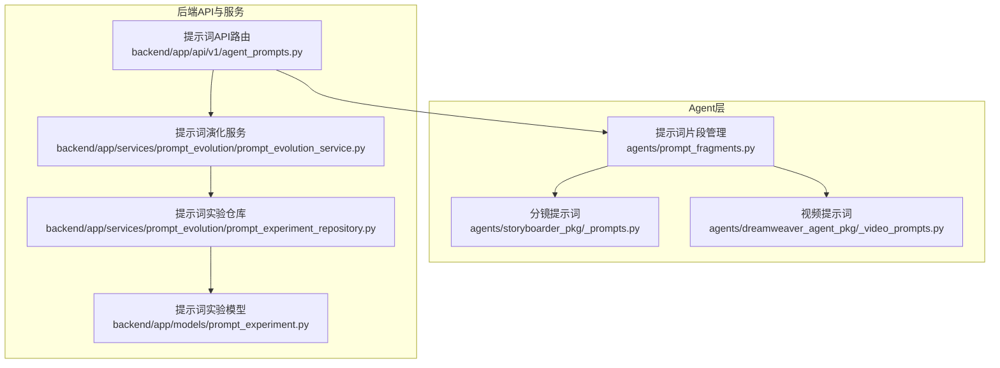
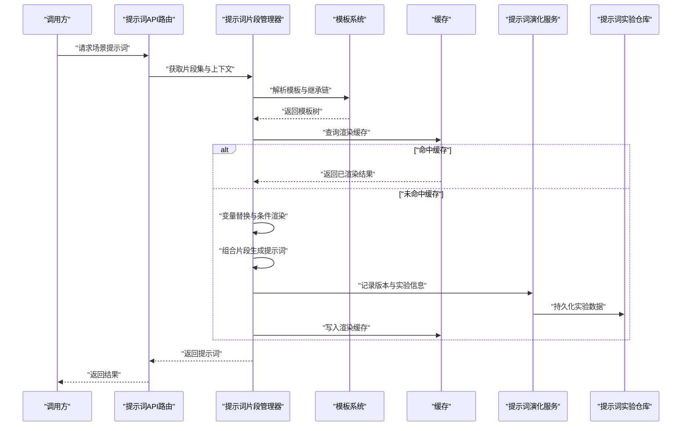
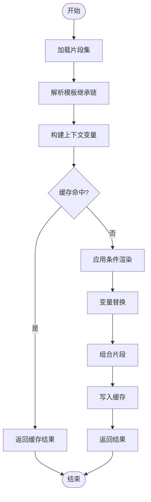
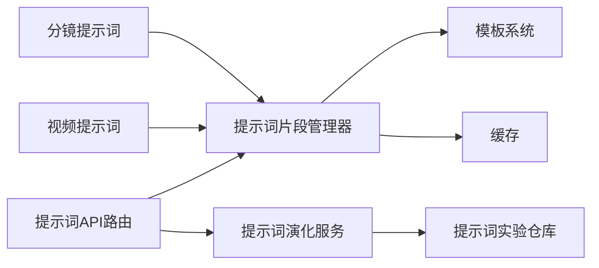

# 提示词片段管理

<cite>
**本文引用的文件**   
- [prompt_fragments.py](file://agents/prompt_fragments.py)
- [_prompts.py](file://agents/storyboarder_pkg/_prompts.py)
- [_video_prompts.py](file://agents/dreamweaver_agent_pkg/_video_prompts.py)
- [agent_prompts.py](file://backend/app/api/v1/agent_prompts.py)
- [prompt_evolution_service.py](file://backend/app/services/prompt_evolution/prompt_evolution_service.py)
- [prompt_experiment_repository.py](file://backend/app/services/prompt_evolution/prompt_experiment_repository.py)
- [prompt_experiment_models.py](file://backend/app/models/prompt_experiment.py)
</cite>

## 目录
1. [简介](#简介)
2. [项目结构](#项目结构)
3. [核心组件](#核心组件)
4. [架构总览](#架构总览)
5. [详细组件分析](#详细组件分析)
6. [依赖关系分析](#依赖关系分析)
7. [性能考量](#性能考量)
8. [故障排查指南](#故障排查指南)
9. [结论](#结论)
10. [附录](#附录)

## 简介
本技术文档围绕“提示词片段管理系统”展开，重点解析 agents/prompt_fragments.py 中的模板系统、变量替换机制与内容组合策略。同时覆盖模块化设计、动态生成逻辑、缓存机制，以及角色设定、场景描述、对话生成等专用模板的构建模式。文档还提供自定义片段创建与使用的实践方法（模板继承、条件渲染、批量生成），并给出提示词版本管理、A/B 测试与效果评估的最佳实践建议。

## 项目结构
与提示词片段管理相关的代码主要分布在以下位置：
- agents/prompt_fragments.py：提示词片段管理与模板引擎的核心实现
- agents/storyboarder_pkg/_prompts.py：分镜相关提示词片段集合
- agents/dreamweaver_agent_pkg/_video_prompts.py：视频生成相关提示词片段集合
- backend/app/api/v1/agent_prompts.py：面向后端的提示词 API 路由
- backend/app/services/prompt_evolution/*：提示词演化服务、实验仓库与模型定义，支撑版本管理与 A/B 测试

图表来源
- [prompt_fragments.py](file://agents/prompt_fragments.py)
- [_prompts.py](file://agents/storyboarder_pkg/_prompts.py)
- [_video_prompts.py](file://agents/dreamweaver_agent_pkg/_video_prompts.py)
- [agent_prompts.py](file://backend/app/api/v1/agent_prompts.py)
- [prompt_evolution_service.py](file://backend/app/services/prompt_evolution/prompt_evolution_service.py)
- [prompt_experiment_repository.py](file://backend/app/services/prompt_evolution/prompt_experiment_repository.py)
- [prompt_experiment_models.py](file://backend/app/models/prompt_experiment.py)

章节来源
- [prompt_fragments.py](file://agents/prompt_fragments.py)
- [_prompts.py](file://agents/storyboarder_pkg/_prompts.py)
- [_video_prompts.py](file://agents/dreamweaver_agent_pkg/_video_prompts.py)
- [agent_prompts.py](file://backend/app/api/v1/agent_prompts.py)
- [prompt_evolution_service.py](file://backend/app/services/prompt_evolution/prompt_evolution_service.py)
- [prompt_experiment_repository.py](file://backend/app/services/prompt_evolution/prompt_experiment_repository.py)
- [prompt_experiment_models.py](file://backend/app/models/prompt_experiment.py)

## 核心组件
- 提示词片段管理器：提供片段的注册、加载、合并与渲染能力，支持模板继承与变量替换
- 模板系统：以片段为单位组织提示词，支持按场景/角色/任务维度进行组合
- 变量替换机制：基于键值映射的动态填充，支持默认值与条件渲染
- 内容组合策略：将多个片段按顺序或条件拼接，形成最终提示词
- 缓存机制：对已渲染结果进行缓存，避免重复计算
- 版本与实验：通过后端服务与仓库记录提示词版本与实验数据，支撑 A/B 测试与效果评估

章节来源
- [prompt_fragments.py](file://agents/prompt_fragments.py)
- [_prompts.py](file://agents/storyboarder_pkg/_prompts.py)
- [_video_prompts.py](file://agents/dreamweaver_agent_pkg/_video_prompts.py)
- [agent_prompts.py](file://backend/app/api/v1/agent_prompts.py)
- [prompt_evolution_service.py](file://backend/app/services/prompt_evolution/prompt_evolution_service.py)
- [prompt_experiment_repository.py](file://backend/app/services/prompt_evolution/prompt_experiment_repository.py)
- [prompt_experiment_models.py](file://backend/app/models/prompt_experiment.py)

## 架构总览
提示词片段管理系统的整体流程如下：
- 调用方通过 API 或 Agent 层请求特定场景的提示词
- 提示词片段管理器根据场景选择对应片段集，执行模板继承与变量替换
- 组合后的提示词可被缓存，供后续相同参数复用
- 若启用版本与实验功能，渲染过程会记录版本信息与实验指标，便于对比评估

图表来源
- [agent_prompts.py](file://backend/app/api/v1/agent_prompts.py)
- [prompt_fragments.py](file://agents/prompt_fragments.py)
- [prompt_evolution_service.py](file://backend/app/services/prompt_evolution/prompt_evolution_service.py)
- [prompt_experiment_repository.py](file://backend/app/services/prompt_evolution/prompt_experiment_repository.py)

## 详细组件分析

### 提示词片段管理器（prompt_fragments.py）
- 职责
  - 片段注册与发现：集中管理不同场景的提示词片段
  - 模板继承：支持基础模板与扩展模板的组合
  - 变量替换：将上下文数据注入模板占位符
  - 条件渲染：根据上下文开关控制片段是否参与组合
  - 缓存：对渲染结果进行键控缓存，提升性能
- 关键流程
  - 初始化时加载片段集
  - 渲染时解析继承链，执行变量替换与条件判断
  - 组合片段生成最终提示词
  - 写入缓存并返回结果

图表来源
- [prompt_fragments.py](file://agents/prompt_fragments.py)

章节来源
- [prompt_fragments.py](file://agents/prompt_fragments.py)

### 分镜提示词片段（_prompts.py）
- 职责
  - 提供分镜场景下的专用提示词片段，如镜头描述、转场规则、画面元素约束等
  - 与通用片段管理器协作，按分镜任务组合出完整提示词
- 使用模式
  - 通过片段管理器选择分镜片段集
  - 结合分镜上下文（角色、场景、时间线）进行变量替换
  - 输出用于分镜生成的结构化提示词

章节来源
- [_prompts.py](file://agents/storyboarder_pkg/_prompts.py)

### 视频提示词片段（_video_prompts.py）
- 职责
  - 提供视频生成相关提示词片段，包括镜头运动、风格约束、时长控制等
  - 与片段管理器集成，支持按视频任务类型组合片段
- 使用模式
  - 根据视频任务（如 T2V、I2V）选择对应片段集
  - 注入视频参数（分辨率、帧率、风格）进行变量替换
  - 输出用于视频模型的提示词

章节来源
- [_video_prompts.py](file://agents/dreamweaver_agent_pkg/_video_prompts.py)

### 提示词 API 路由（agent_prompts.py）
- 职责
  - 暴露提示词获取与管理的 HTTP API
  - 接收调用方请求，解析参数，调用片段管理器生成提示词
  - 可选地记录实验与版本信息
- 典型流程
  - 校验请求参数
  - 调用片段管理器生成提示词
  - 返回结果或错误信息

章节来源
- [agent_prompts.py](file://backend/app/api/v1/agent_prompts.py)

### 提示词演化服务与实验（prompt_evolution_service.py, prompt_experiment_repository.py, prompt_experiment_models.py）
- 职责
  - 管理提示词版本与实验生命周期
  - 记录实验配置、运行结果与评估指标
  - 提供 A/B 测试支持与效果对比
- 关键能力
  - 版本发布与回滚
  - 实验分组与流量分配
  - 指标采集与报告生成

章节来源
- [prompt_evolution_service.py](file://backend/app/services/prompt_evolution/prompt_evolution_service.py)
- [prompt_experiment_repository.py](file://backend/app/services/prompt_evolution/prompt_experiment_repository.py)
- [prompt_experiment_models.py](file://backend/app/models/prompt_experiment.py)

## 依赖关系分析
- 模块耦合
  - 片段管理器依赖模板系统与缓存
  - 各业务提示词模块（分镜、视频）依赖片段管理器
  - API 路由依赖片段管理器与演化服务
- 外部依赖
  - 数据库与缓存存储（由服务层抽象）
  - 日志与监控（由框架统一接入）

图表来源
- [prompt_fragments.py](file://agents/prompt_fragments.py)
- [_prompts.py](file://agents/storyboarder_pkg/_prompts.py)
- [_video_prompts.py](file://agents/dreamweaver_agent_pkg/_video_prompts.py)
- [agent_prompts.py](file://backend/app/api/v1/agent_prompts.py)
- [prompt_evolution_service.py](file://backend/app/services/prompt_evolution/prompt_evolution_service.py)
- [prompt_experiment_repository.py](file://backend/app/services/prompt_evolution/prompt_experiment_repository.py)

章节来源
- [prompt_fragments.py](file://agents/prompt_fragments.py)
- [_prompts.py](file://agents/storyboarder_pkg/_prompts.py)
- [_video_prompts.py](file://agents/dreamweaver_agent_pkg/_video_prompts.py)
- [agent_prompts.py](file://backend/app/api/v1/agent_prompts.py)
- [prompt_evolution_service.py](file://backend/app/services/prompt_evolution/prompt_evolution_service.py)
- [prompt_experiment_repository.py](file://backend/app/services/prompt_evolution/prompt_experiment_repository.py)

## 性能考量
- 缓存命中率：合理设计缓存键，确保相同上下文命中同一缓存项
- 模板解析开销：减少复杂条件与深层继承链，必要时预编译模板
- 变量替换效率：批量替换优于逐字段替换，避免重复字符串操作
- I/O 优化：异步写入实验数据，避免阻塞主流程
- 内存占用：控制片段大小与数量，及时释放中间结果

## 故障排查指南
- 常见问题
  - 变量缺失：检查上下文是否包含所有必需变量
  - 条件渲染异常：确认布尔表达式与开关配置正确
  - 缓存不一致：清理缓存或更新缓存键策略
  - 版本冲突：核对版本兼容性与依赖片段变更
- 诊断步骤
  - 启用调试日志，记录模板解析与渲染过程
  - 验证片段继承链与变量映射
  - 检查缓存键生成逻辑与过期策略
  - 查看实验记录与指标，定位回归问题

## 结论
提示词片段管理系统通过模块化模板、动态变量替换与缓存机制，实现了高效、可维护的提示词构建流程。结合版本管理与 A/B 测试能力，团队可在保证稳定性的同时持续优化提示词质量。建议在实际使用中遵循最佳实践，合理设计片段结构与缓存策略，并通过实验驱动迭代改进。

## 附录
- 自定义片段创建示例（路径参考）
  - 模板继承：在片段管理器中注册新片段，继承基础模板
  - 条件渲染：在上下文中设置开关变量，控制片段参与
  - 批量生成：通过循环与上下文列表批量渲染片段
- 版本管理与 A/B 测试（路径参考）
  - 发布新版本：更新片段集并发布到服务层
  - 配置实验：设置分组与流量比例，记录指标
  - 效果评估：对比实验组与控制组的生成质量与成本