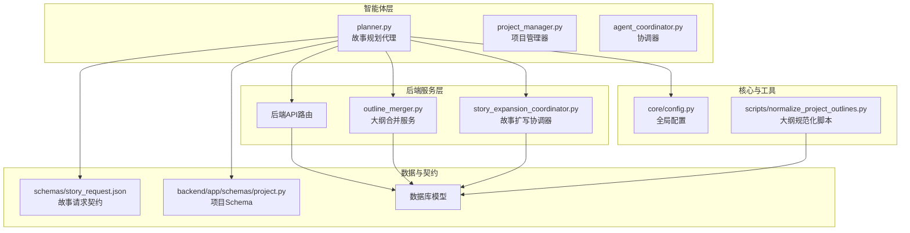
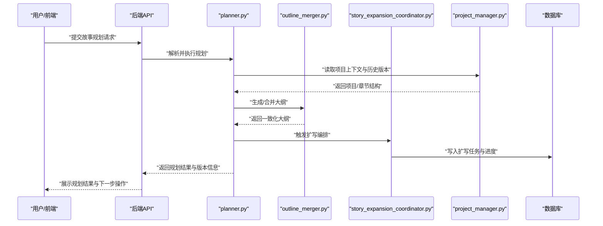
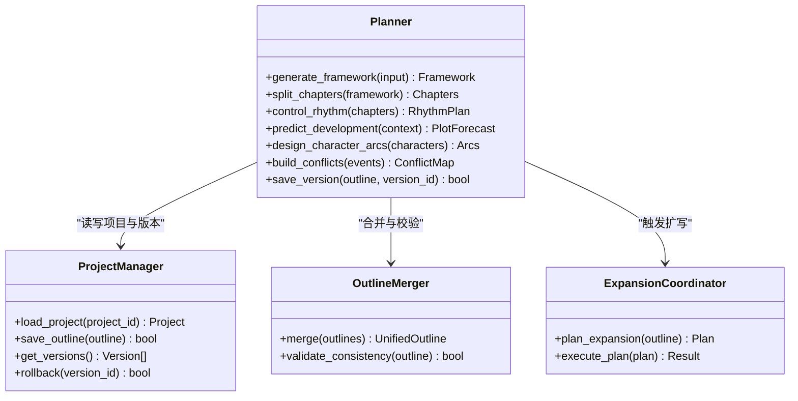
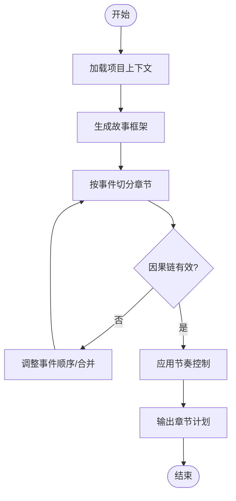
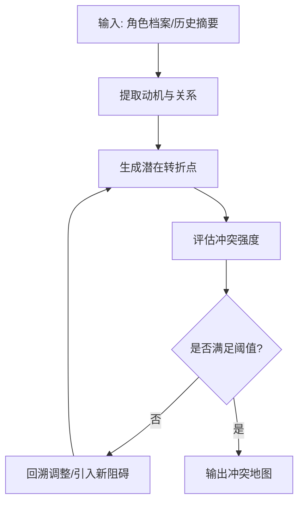
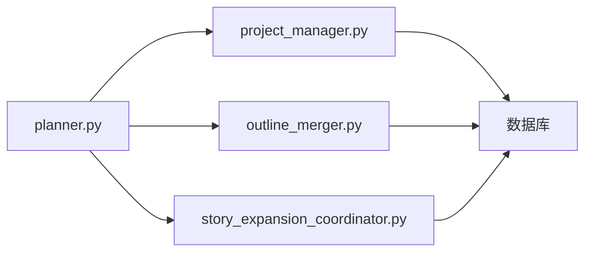

# 故事规划代理

<cite>
**本文引用的文件**   
- [planner.py](file://agents/planner.py)
- [README.md](file://README.md)
- [project_manager.py](file://project_manager.py)
- [agent_coordinator.py](file://agent_coordinator.py)
- [core/config.py](file://core/config.py)
- [schemas/story_request.json](file://schemas/story_request.json)
- [backend/app/schemas/project.py](file://backend/app/schemas/project.py)
- [backend/app/services/outline_merger.py](file://backend/app/services/outline_merger.py)
- [backend/app/services/story_expansion_coordinator.py](file://backend/app/services/story_expansion_coordinator.py)
- [scripts/normalize_project_outlines.py](file://scripts/normalize_project_outlines.py)
</cite>

## 目录
1. [简介](#简介)
2. [项目结构](#项目结构)
3. [核心组件](#核心组件)
4. [架构总览](#架构总览)
5. [详细组件分析](#详细组件分析)
6. [依赖关系分析](#依赖关系分析)
7. [性能考量](#性能考量)
8. [故障排查指南](#故障排查指南)
9. [结论](#结论)
10. [附录](#附录)

## 简介
本技术文档围绕“故事规划代理”展开，聚焦于 agents/planner.py 中的大纲构建、情节设计与结构分析能力。内容涵盖故事框架生成、章节划分逻辑与叙事节奏控制；深入解释规划算法的实现原理（情节发展预测、角色弧线设计、冲突构建机制）；说明代理的接口设计、配置参数、输入输出数据模型与状态管理机制；并提供交互式规划、自动优化与版本管理的实践方法，以及扩展开发与性能优化建议。

## 项目结构
本项目采用分层与模块化组织：
- agents：各智能体实现，包含故事规划代理 planner.py
- backend/app：后端服务、API、数据库模型与服务层
- core：通用配置、运行时与工具
- schemas：请求/响应与领域数据契约
- scripts：运维与数据处理脚本

图表来源
- [planner.py](file://agents/planner.py)
- [project_manager.py](file://project_manager.py)
- [agent_coordinator.py](file://agent_coordinator.py)
- [backend/app/services/outline_merger.py](file://backend/app/services/outline_merger.py)
- [backend/app/services/story_expansion_coordinator.py](file://backend/app/services/story_expansion_coordinator.py)
- [schemas/story_request.json](file://schemas/story_request.json)
- [backend/app/schemas/project.py](file://backend/app/schemas/project.py)
- [core/config.py](file://core/config.py)
- [scripts/normalize_project_outlines.py](file://scripts/normalize_project_outlines.py)

章节来源
- [README.md](file://README.md)

## 核心组件
- 故事规划代理（planner.py）
  - 负责从项目上下文与用户意图出发，生成故事框架、章节划分与节奏控制策略
  - 提供交互式的规划入口，支持增量修订与版本管理
  - 调用后端服务进行大纲合并与扩写编排
- 项目管理器（project_manager.py）
  - 维护项目元数据、章节结构与历史版本
  - 为规划代理提供稳定的上下文与持久化能力
- 协调器（agent_coordinator.py）
  - 统一调度多个智能体，确保规划流程与其他工作流（如扩写、审校）协同
- 服务层
  - outline_merger.py：多源大纲合并与一致性校验
  - story_expansion_coordinator.py：基于规划结果驱动扩写任务编排
- 数据契约
  - schemas/story_request.json：定义故事规划输入的结构与约束
  - backend/app/schemas/project.py：项目与章节的数据模型

章节来源
- [planner.py](file://agents/planner.py)
- [project_manager.py](file://project_manager.py)
- [agent_coordinator.py](file://agent_coordinator.py)
- [backend/app/services/outline_merger.py](file://backend/app/services/outline_merger.py)
- [backend/app/services/story_expansion_coordinator.py](file://backend/app/services/story_expansion_coordinator.py)
- [schemas/story_request.json](file://schemas/story_request.json)
- [backend/app/schemas/project.py](file://backend/app/schemas/project.py)

## 架构总览
故事规划代理处于智能体层的核心位置，向上承接用户交互与API调用，向下通过服务层完成大纲合并与扩写编排，并通过项目管理器与数据库进行持久化。核心数据流如下：

图表来源
- [planner.py](file://agents/planner.py)
- [project_manager.py](file://project_manager.py)
- [backend/app/services/outline_merger.py](file://backend/app/services/outline_merger.py)
- [backend/app/services/story_expansion_coordinator.py](file://backend/app/services/story_expansion_coordinator.py)

## 详细组件分析

### 故事规划代理（planner.py）
- 功能职责
  - 故事框架生成：依据主题、类型、受众等输入，产出整体结构（起承转合、主线/支线）
  - 章节划分逻辑：按叙事单元（场景/事件）切分，保证每章有明确目标与冲突
  - 叙事节奏控制：平衡紧张与舒缓段落，控制高潮分布与信息释放节奏
- 规划算法要点
  - 情节发展预测：基于已有章节摘要与人物关系，推断后续关键事件与转折
  - 角色弧线设计：为每个主要角色设定成长轨迹与动机变化点
  - 冲突构建机制：在章节间建立因果链，确保冲突升级与解决路径清晰
- 接口与数据模型
  - 输入：遵循 schemas/story_request.json 的请求结构（主题、类型、角色、约束等）
  - 输出：结构化大纲（章节列表、事件节点、角色弧线、节奏标记）
- 状态管理与版本控制
  - 每次规划生成新版本ID，支持回滚与对比
  - 与 project_manager.py 协作，维护章节树与变更日志

图表来源
- [planner.py](file://agents/planner.py)
- [project_manager.py](file://project_manager.py)
- [backend/app/services/outline_merger.py](file://backend/app/services/outline_merger.py)
- [backend/app/services/story_expansion_coordinator.py](file://backend/app/services/story_expansion_coordinator.py)

章节来源
- [planner.py](file://agents/planner.py)
- [project_manager.py](file://project_manager.py)
- [backend/app/services/outline_merger.py](file://backend/app/services/outline_merger.py)
- [backend/app/services/story_expansion_coordinator.py](file://backend/app/services/story_expansion_coordinator.py)
- [schemas/story_request.json](file://schemas/story_request.json)

### 章节划分与节奏控制流程
- 章节划分逻辑
  - 以“事件”为单位切分，确保每章具备独立目标与冲突
  - 跨章因果链检查，避免断裂或重复
- 节奏控制
  - 标注“紧张/舒缓”段落，控制高潮密度
  - 结合角色弧线推进，确保情感曲线合理

图表来源
- [planner.py](file://agents/planner.py)
- [project_manager.py](file://project_manager.py)

章节来源
- [planner.py](file://agents/planner.py)

### 规划算法实现原理
- 情节发展预测
  - 基于历史章节摘要与角色关系图，推断关键转折点
  - 使用规则+LLM混合策略，保证可解释性与创造性
- 角色弧线设计
  - 为每个角色定义初始状态、动机、冲突与成长目标
  - 在章节中插入“决策点”推动弧线演进
- 冲突构建机制
  - 在章节间建立“目标-阻碍-解决”三元组
  - 通过冲突强度评分，动态调整章节顺序与篇幅

图表来源
- [planner.py](file://agents/planner.py)

章节来源
- [planner.py](file://agents/planner.py)

### 接口设计与数据模型
- 输入数据结构（schemas/story_request.json）
  - 主题、类型、受众、风格、角色清单、约束条件
- 输出数据结构
  - 框架（起承转合）、章节列表（标题、目标、冲突、节奏标记）、角色弧线、版本信息
- 配置参数（core/config.py）
  - LLM模型选择、温度/采样参数、最大长度、重试策略
- 状态管理
  - 版本ID、变更日志、回滚支持

章节来源
- [schemas/story_request.json](file://schemas/story_request.json)
- [core/config.py](file://core/config.py)
- [backend/app/schemas/project.py](file://backend/app/schemas/project.py)

### 使用示例与实践方法
- 交互式规划
  - 通过API提交初始需求，逐步细化章节与角色弧线
  - 支持在线预览与即时修订
- 自动优化
  - 基于冲突强度与节奏评分，自动调整章节顺序与篇幅
  - 结合用户反馈迭代优化
- 版本管理
  - 每次规划生成新版本，支持对比与回滚
  - 与 project_manager.py 集成，确保一致性

章节来源
- [planner.py](file://agents/planner.py)
- [project_manager.py](file://project_manager.py)

## 依赖关系分析
- 内部依赖
  - planner.py 依赖 project_manager.py 进行项目上下文与版本管理
  - 通过 outline_merger.py 与 story_expansion_coordinator.py 完成大纲合并与扩写编排
- 外部依赖
  - 数据库用于持久化项目、章节与版本信息
  - LLM适配器用于生成与优化内容
- 耦合度与内聚性
  - planner.py 作为协调者，保持高内聚低耦合
  - 服务层解耦具体实现，便于替换与扩展

图表来源
- [planner.py](file://agents/planner.py)
- [project_manager.py](file://project_manager.py)
- [backend/app/services/outline_merger.py](file://backend/app/services/outline_merger.py)
- [backend/app/services/story_expansion_coordinator.py](file://backend/app/services/story_expansion_coordinator.py)

章节来源
- [planner.py](file://agents/planner.py)
- [project_manager.py](file://project_manager.py)
- [backend/app/services/outline_merger.py](file://backend/app/services/outline_merger.py)
- [backend/app/services/story_expansion_coordinator.py](file://backend/app/services/story_expansion_coordinator.py)

## 性能考量
- 缓存策略
  - 对常用模板与角色弧线进行缓存，减少重复计算
- 并发处理
  - 扩写任务并行执行，提升吞吐
- I/O优化
  - 批量写入数据库，减少事务开销
- 资源限制
  - 设置LLM调用上限与超时，防止资源耗尽

[本节为通用指导，不直接分析具体文件]

## 故障排查指南
- 常见问题
  - 大纲不一致：检查 outline_merger.py 的校验逻辑
  - 扩写失败：查看 story_expansion_coordinator.py 的任务状态与错误日志
  - 版本回滚异常：确认 project_manager.py 的版本快照完整性
- 调试建议
  - 启用详细日志，追踪规划步骤
  - 使用 scripts/normalize_project_outlines.py 修复历史数据

章节来源
- [backend/app/services/outline_merger.py](file://backend/app/services/outline_merger.py)
- [backend/app/services/story_expansion_coordinator.py](file://backend/app/services/story_expansion_coordinator.py)
- [project_manager.py](file://project_manager.py)
- [scripts/normalize_project_outlines.py](file://scripts/normalize_project_outlines.py)

## 结论
故事规划代理通过模块化的架构与清晰的接口设计，实现了从框架生成到章节划分、节奏控制的完整规划流程。结合项目管理器与服务层，提供了稳定、可扩展且易于维护的故事创作基础设施。未来可通过引入更丰富的评估指标与用户反馈闭环，进一步提升规划质量与用户体验。

[本节为总结性内容，不直接分析具体文件]

## 附录
- 扩展开发指南
  - 新增规划策略：在 planner.py 中扩展算法模块，保持接口一致
  - 自定义角色弧线：在角色档案中增加属性，并在规划时引用
  - 集成新服务：通过服务层接口接入外部系统
- 性能优化建议
  - 异步化处理耗时操作
  - 使用连接池与缓存提升I/O效率
  - 监控与告警：设置关键指标阈值，及时发现问题

[本节为通用指导，不直接分析具体文件]